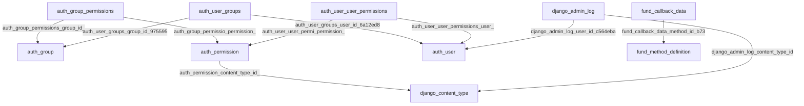

# 数据库表结构知识

> 本文件由系统在检测到 **元数据或外键关系变化** 或首次生成时，根据 `.env` 中 `DB_QUERY_URL` 自动拉取并写入。
> **结构指纹**：`bd3895ddda1ccafe426adf94c309e332b4d66faff85ea40a45b336fe37bb1483`
> **生成时间**：2026-04-17 08:26:33 UTC

> 摘要为基于表名、行数估计、外键的**启发式统计**，非业务建模结论。
> 知识图谱边来自 `information_schema.KEY_COLUMN_USAGE` 外键声明。
> 可通过 `DB_SCHEMA_DOC_ENABLED=0` 关闭生成用例前同步；`DB_SCHEMA_DOC_IGNORE` 排除系统库。

---
## 各库摘要

### 库 `ams` 摘要

- **规模**：**27** 张表（含视图则与 information_schema 一致）、约 **460** 条列定义。
- **外键**：本库作为源表端的外键约束共 **0** 个；跨库引用指向：无。
- **行数估计（information_schema，仅供参考）**：`ac_credit_req`（估 4489114 行），`ac_pilot_prd_term_fee_his`（估 504318 行），`ac_account_log`（估 362876 行），`ac_pilot_account_archive`（估 46661 行），`ac_pilot_prd_term_fee_archive`（估 38889 行），`ac_pilot_account`（估 33037 行）
- **表名高频词根（启发式，非业务结论）**：log、pilot、account、prd、term、fee、coupon、record

### 库 `apv` 摘要

- **规模**：**126** 张表（含视图则与 information_schema 一致）、约 **1978** 条列定义。
- **外键**：本库作为源表端的外键约束共 **0** 个；跨库引用指向：无。
- **行数估计（information_schema，仅供参考）**：`wf_task`（估 46841 行），`wf_cur_task`（估 35840 行），`cp_phase_step`（估 33923 行），`cp_credit_random`（估 27633 行），`apv_m_opr_log`（估 25558 行），`ap_apply_credit`（估 14289 行）
- **表名高频词根（启发式，非业务结论）**：credit、log、info、adjust、apply、user、rule、apv

### 库 `bcs` 摘要

- **规模**：**38** 张表（含视图则与 information_schema 一致）、约 **520** 条列定义。
- **外键**：本库作为源表端的外键约束共 **0** 个；跨库引用指向：无。
- **行数估计（information_schema，仅供参考）**：`app_dau_his`（估 27142 行），`app_dau_info`（估 18062 行），`t_sms_code_record`（估 1013 行），`t_user_app_download_record`（估 705 行），`t_user_latest_app_download_info`（估 495 行），`t_h5_page_load_record`（估 454 行）
- **表名高频词根（启发式，非业务结论）**：app、info、user、download、record、page、hub、dau

### 库 `brg` 摘要

- **规模**：**3** 张表（含视图则与 information_schema 一致）、约 **48** 条列定义。
- **外键**：本库作为源表端的外键约束共 **0** 个；跨库引用指向：无。
- **行数估计（information_schema，仅供参考）**：（无有效行数估计）
- **表名高频词根（启发式，非业务结论）**：system、sys、task、dict、param

### 库 `cis` 摘要

- **规模**：**115** 张表（含视图则与 information_schema 一致）、约 **1802** 条列定义。
- **外键**：本库作为源表端的外键约束共 **0** 个；跨库引用指向：无。
- **行数估计（information_schema，仅供参考）**：`u_collect_status_his`（估 663597 行），`b_bank_bin`（估 423964 行），`u_device_his`（估 162299 行），`u_collect_status`（估 66585 行），`u_geo_his`（估 54301 行），`u_user_mock_data`（估 48017 行）
- **表名高频词根（启发式，非业务结论）**：user、info、his、register、bankcard、control、bank、cust

### 库 `cns` 摘要

- **规模**：**48** 张表（含视图则与 information_schema 一致）、约 **750** 条列定义。
- **外键**：本库作为源表端的外键约束共 **0** 个；跨库引用指向：无。
- **行数估计（information_schema，仅供参考）**：`p_notice_record_histroy`（估 170690 行），`p_sms_receipt`（估 88917 行），`im_mc_msg`（估 46684 行），`p_notice_record`（估 45830 行），`p_sms_record_history`（估 38526 行），`p_sms_record`（估 27982 行）
- **表名高频词根（启发式，非业务结论）**：sms、record、group、template、notice、config、his、call

### 库 `cos` 摘要

- **规模**：**60** 张表（含视图则与 information_schema 一致）、约 **845** 条列定义。
- **外键**：本库作为源表端的外键约束共 **0** 个；跨库引用指向：无。
- **行数估计（information_schema，仅供参考）**：`log_component_content_record`（估 608711 行），`pop_user_record`（估 135656 行），`p_task_his`（估 113392 行），`log_pop_content_record`（估 88564 行），`op_award_info`（估 24454 行），`t_real_user_record`（估 11911 行）
- **表名高频词根（启发式，非业务结论）**：record、config、user、product、order、privilege、content、pop

### 库 `crs` 摘要

- **规模**：**399** 张表（含视图则与 information_schema 一致）、约 **7576** 条列定义。
- **外键**：本库作为源表端的外键约束共 **0** 个；跨库引用指向：无。
- **行数估计（information_schema，仅供参考）**：`ch_service_request_record`（估 1017582 行），`third_api_request`（估 19868 行），`cr_query_info`（估 17385 行），`ch_service_request_count`（估 6161 行），`mobile_no_place_belong`（估 5166 行），`tc_marketing_score`（估 3318 行）
- **表名高频词根（启发式，非业务结论）**：icr、pcr、recent、orgnum、cell、score、mix、sum

### 库 `css` 摘要

- **规模**：**14** 张表（含视图则与 information_schema 一致）、约 **170** 条列定义。
- **外键**：本库作为源表端的外键约束共 **0** 个；跨库引用指向：无。
- **行数估计（information_schema，仅供参考）**：`f_feedback_submit_change_extra`（估 545 行），`f_feedback_screenshot`（估 536 行），`f_feedback_handle`（估 262 行），`f_feedback_submit`（估 257 行），`f_feedback_record`（估 98 行），`f_feedback_answer_record`（估 85 行）
- **表名高频词根（启发式，非业务结论）**：feedback、question、record、config、submit、category、detail、system

### 库 `des` 摘要

- **规模**：**18** 张表（含视图则与 information_schema 一致）、约 **245** 条列定义。
- **外键**：本库作为源表端的外键约束共 **0** 个；跨库引用指向：无。
- **行数估计（information_schema，仅供参考）**：`dc_exec_log_detail_part`（估 267738 行），`dc_exec_result_part`（估 145496 行），`dc_exec_log_part`（估 54892 行），`dc_kb_instance`（估 713 行），`dc_kb_deploy`（估 217 行），`dc_kb_kbase_file`（估 210 行）
- **表名高频词根（启发式，非业务结论）**：exec、log、part、kbase、role、cfg、playback、result

### 库 `dps` 摘要

- **规模**：**27** 张表（含视图则与 information_schema 一致）、约 **494** 条列定义。
- **外键**：本库作为源表端的外键约束共 **0** 个；跨库引用指向：无。
- **行数估计（information_schema，仅供参考）**：`dd_simple_reformer`（估 10706 行），`system_dict`（估 1206 行），`dd_data_provider`（估 1116 行），`tl_approve_log`（估 1059 行），`dd_data_reformer`（估 913 行），`tl_approve_credit`（估 776 行）
- **表名高频词根（启发式，非业务结论）**：data、model、approve、reformer、school、config、log、input

### 库 `dwd` 摘要

- **规模**：**23** 张表（含视图则与 information_schema 一致）、约 **826** 条列定义。
- **外键**：本库作为源表端的外键约束共 **0** 个；跨库引用指向：无。
- **行数估计（information_schema，仅供参考）**：`risk_vars_credit_apply_1108`（估 7202900 行），`risk_vars_credit_amt_1108`（估 6165234 行），`risk_vars_funded_1108`（估 5960574 行），`ns_active_channel_ascribe`（估 19116 行），`risk_vars_credit_apply_test1105`（估 15775 行），`sms_cust_list_data`（估 1898 行）
- **表名高频词根（启发式，非业务结论）**：risk、vars、credit、apply、list、sms、pilot、prd

### 库 `dws_analyze` 摘要

- **规模**：**1** 张表（含视图则与 information_schema 一致）、约 **15** 条列定义。
- **外键**：本库作为源表端的外键约束共 **0** 个；跨库引用指向：无。
- **行数估计（information_schema，仅供参考）**：`ns_active_channel_ascribe`（估 55 行）
- **表名高频词根（启发式，非业务结论）**：active、channel、ascribe

### 库 `evt` 摘要

- **规模**：**3** 张表（含视图则与 information_schema 一致）、约 **40** 条列定义。
- **外键**：本库作为源表端的外键约束共 **0** 个；跨库引用指向：无。
- **行数估计（information_schema，仅供参考）**：（无有效行数估计）
- **表名高频词根（启发式，非业务结论）**：system、event、config、dict、param

### 库 `fas` 摘要

- **规模**：**29** 张表（含视图则与 information_schema 一致）、约 **377** 条列定义。
- **外键**：本库作为源表端的外键约束共 **0** 个；跨库引用指向：无。
- **行数估计（information_schema，仅供参考）**：（无有效行数估计）
- **表名高频词根（启发式，非业务结论）**：account、fas、transaction、detail、check、record、mapping、document

### 库 `fms` 摘要

- **规模**：**4** 张表（含视图则与 information_schema 一致）、约 **63** 条列定义。
- **外键**：本库作为源表端的外键约束共 **0** 个；跨库引用指向：无。
- **行数估计（information_schema，仅供参考）**：`filemd5`（估 4276 行）
- **表名高频词根（启发式，非业务结论）**：system、filemd、sys、task、dict、param

### 库 `gos` 摘要

- **规模**：**3** 张表（含视图则与 information_schema 一致）、约 **48** 条列定义。
- **外键**：本库作为源表端的外键约束共 **0** 个；跨库引用指向：无。
- **行数估计（information_schema，仅供参考）**：（无有效行数估计）
- **表名高频词根（启发式，非业务结论）**：system、sys、task、dict、param

### 库 `hover` 摘要

- **规模**：**7** 张表（含视图则与 information_schema 一致）、约 **87** 条列定义。
- **外键**：本库作为源表端的外键约束共 **0** 个；跨库引用指向：无。
- **行数估计（information_schema，仅供参考）**：`app_category`（估 57670 行），`bm_black_list_mobile`（估 12 行），`bm_black_list_id_no`（估 9 行）
- **表名高频词根（启发式，非业务结论）**：app、black、list、system、category、class、mobile、sys

### 库 `hub` 摘要

- **规模**：**64** 张表（含视图则与 information_schema 一致）、约 **946** 条列定义。
- **外键**：本库作为源表端的外键约束共 **0** 个；跨库引用指向：无。
- **行数估计（information_schema，仅供参考）**：`hub_channel_request_240223`（估 533774 行），`hub_push_task`（估 147434 行），`hub_channel_request`（估 101964 行），`hub_channel_request_bak`（估 16560 行），`hub_channel_check_result_13`（估 12977 行），`hub_channel_check_result_4`（估 12177 行）
- **表名高频词根（启发式，非业务结论）**：hub、channel、result、check、config、fund、summary、push

### 库 `lcs` 摘要

- **规模**：**218** 张表（含视图则与 information_schema 一致）、约 **4667** 条列定义。
- **外键**：本库作为源表端的外键约束共 **0** 个；跨库引用指向：无。
- **行数估计（information_schema，仅供参考）**：`pilot_addon_plan_his`（估 1929391 行），`pilot_putout_calc_detail`（估 585722 行），`pilot_putout_calc_detail_his`（估 543422 行），`pilot_plan_his`（估 276365 行），`pilot_loan_his`（估 109909 行），`pilot_plan`（估 99004 行）
- **表名高频词根（启发式，非业务结论）**：detail、recon、file、pilot、batch、diff、loan、fund

### 库 `lps` 摘要

- **规模**：**174** 张表（含视图则与 information_schema 一致）、约 **2664** 条列定义。
- **外键**：本库作为源表端的外键约束共 **10** 个；跨库引用指向：无。
- **行数估计（information_schema，仅供参考）**：`f_status_flow_proc_log`（估 3875050 行），`pilot_fund_notify_info`（估 3004011 行），`ap_fund_check_request_his`（估 307982 行），`ap_sub_flow_recording`（估 119344 行），`ap_fund_appl_log`（估 102357 行），`ap_fund_check_request`（估 89843 行）
- **表名高频词根（启发式，非业务结论）**：fund、config、agreement、log、appl、apply、flow、auth

### 库 `lw_hub` 摘要

- **规模**：**7** 张表（含视图则与 information_schema 一致）、约 **97** 条列定义。
- **外键**：本库作为源表端的外键约束共 **0** 个；跨库引用指向：无。
- **行数估计（information_schema，仅供参考）**：`hub_area_code_config`（估 3214 行），`partner_config`（估 48 行），`sys_dic_config`（估 46 行），`hub_grayscale_test_config`（估 2 行），`partner_rule`（估 2 行）
- **表名高频词根（启发式，非业务结论）**：config、hub、partner、area、code、grayscale、test、push

### 库 `mail` 摘要

- **规模**：**7** 张表（含视图则与 information_schema 一致）、约 **97** 条列定义。
- **外键**：本库作为源表端的外键约束共 **0** 个；跨库引用指向：无。
- **行数估计（information_schema，仅供参考）**：`partner_email_config`（估 2 行），`partner_email_contact`（估 2 行）
- **表名高频词根（启发式，非业务结论）**：partner、email、system、config、contact、receiver、sys、task

### 库 `mds` 摘要

- **规模**：**55** 张表（含视图则与 information_schema 一致）、约 **849** 条列定义。
- **外键**：本库作为源表端的外键约束共 **0** 个；跨库引用指向：无。
- **行数估计（information_schema，仅供参考）**：`t_market_return_history`（估 1039670 行），`t_ad_channel_return_record_huawei`（估 763113 行），`t_ad_channel_market_return_record_huawei`（估 337361 行），`t_hub_channel_check_record`（估 93376 行），`t_ad_channel_return_record_xiaomi`（估 47483 行），`t_ad_channel_return_record_vivo`（估 38135 行）
- **表名高频词根（启发式，非业务结论）**：channel、hit、record、result、click、user、group、return

### 库 `mes` 摘要

- **规模**：**2** 张表（含视图则与 information_schema 一致）、约 **8** 条列定义。
- **外键**：本库作为源表端的外键约束共 **0** 个；跨库引用指向：无。
- **行数估计（information_schema，仅供参考）**：`t_model_cache`（估 33 行）
- **表名高频词根（启发式，非业务结论）**：django、migrations、model、cache

### 库 `micros_fileservice` 摘要

- **规模**：**1** 张表（含视图则与 information_schema 一致）、约 **14** 条列定义。
- **外键**：本库作为源表端的外键约束共 **0** 个；跨库引用指向：无。
- **行数估计（information_schema，仅供参考）**：`fileservice_filemd5`（估 4 行）
- **表名高频词根（启发式，非业务结论）**：fileservice、filemd

### 库 `micros_gatewayadmin` 摘要

- **规模**：**9** 张表（含视图则与 information_schema 一致）、约 **101** 条列定义。
- **外键**：本库作为源表端的外键约束共 **0** 个；跨库引用指向：无。
- **行数估计（information_schema，仅供参考）**：`opr_gateway_config_record`（估 15 行），`opr_routes_config`（估 6 行），`bse_data_attr`（估 4 行），`opr_routes_url`（估 4 行），`bse_filter`（估 3 行），`opr_gateway_global_filter`（估 2 行）
- **表名高频词根（启发式，非业务结论）**：opr、bse、gateway、routes、filter、config、data、attr

### 库 `pas` 摘要

- **规模**：**37** 张表（含视图则与 information_schema 一致）、约 **635** 条列定义。
- **外键**：本库作为源表端的外键约束共 **0** 个；跨库引用指向：无。
- **行数估计（information_schema，仅供参考）**：（无有效行数估计）
- **表名高频词根（启发式，非业务结论）**：recon、withhold、pay、request、bank、cert、detail、system

### 库 `rds` 摘要

- **规模**：**18** 张表（含视图则与 information_schema 一致）、约 **236** 条列定义。
- **外键**：本库作为源表端的外键约束共 **0** 个；跨库引用指向：无。
- **行数估计（information_schema，仅供参考）**：`blacklist_log`（估 7924 行），`blacklist_msg`（估 1499 行），`event_item_config`（估 245 行），`system_dict`（估 205 行），`blacklist_priority`（估 39 行），`system_param`（估 36 行）
- **表名高频词根（启发式，非业务结论）**：device、blacklist、log、crb、dev、mapping、fingerprint、variable

### 库 `rps` 摘要

- **规模**：**22** 张表（含视图则与 information_schema 一致）、约 **401** 条列定义。
- **外键**：本库作为源表端的外键约束共 **0** 个；跨库引用指向：无。
- **行数估计（information_schema，仅供参考）**：`dd_simple_reformer`（估 6622 行），`dd_data_provider`（估 1076 行），`dd_data_reformer`（估 907 行），`dd_data_group`（估 296 行），`system_dict`（估 170 行），`rf_rule_front`（估 78 行）
- **表名高频词根（启发式，非业务结论）**：data、model、reformer、school、input、system、adapter、group

### 库 `tds` 摘要

- **规模**：**23** 张表（含视图则与 information_schema 一致）、约 **277** 条列定义。
- **外键**：本库作为源表端的外键约束共 **0** 个；跨库引用指向：无。
- **行数估计（information_schema，仅供参考）**：`flow_user_rule_exec_ext`（估 417478 行），`flow_user_rule_exec`（估 396383 行），`flow_user_rule_exec_2024`（估 29642 行），`flow_user_rule_exec_ext_2024`（估 28220 行），`risk_user_fund`（估 17606 行），`flow_policy_rule_mock_config`（估 5425 行）
- **表名高频词根（启发式，非业务结论）**：flow、rule、config、fund、exec、user、policy、limit

### 库 `trs` 摘要

- **规模**：**6** 张表（含视图则与 information_schema 一致）、约 **80** 条列定义。
- **外键**：本库作为源表端的外键约束共 **0** 个；跨库引用指向：无。
- **行数估计（information_schema，仅供参考）**：`active_attribution_err`（估 34878 行），`active_attribution_result`（估 8615 行），`track_msg_fail_record`（估 212 行），`failed_data`（估 45 行）
- **表名高频词根（启发式，非业务结论）**：active、attribution、system、err、result、failed、data、dict

### 库 `web_tools` 摘要

- **规模**：**66** 张表（含视图则与 information_schema 一致）、约 **458** 条列定义。
- **外键**：本库作为源表端的外键约束共 **21** 个；跨库引用指向：无。
- **行数估计（information_schema，仅供参考）**：`mock_interface_access_log`（估 4272 行），`mock_scenario_interface`（估 1546 行），`mock_interface_default_template`（估 1279 行），`easymock_data`（估 1155 行），`mock_interface`（估 1072 行），`mock_template`（估 1067 行）
- **表名高频词根（启发式，非业务结论）**：mock、interface、log、easymock、query、auth、user、copy

### 库 `widek` 摘要

- **规模**：**30** 张表（含视图则与 information_schema 一致）、约 **369** 条列定义。
- **外键**：本库作为源表端的外键约束共 **0** 个；跨库引用指向：无。
- **行数估计（information_schema，仅供参考）**：`sys_oper_log`（估 281742 行），`sys_logininfor`（估 7459 行），`sys_user_msg`（估 1114 行），`sys_role_menu`（估 1075 行），`sys_dict_data`（估 581 行），`sys_menu`（估 450 行）
- **表名高频词根（启发式，非业务结论）**：sys、log、user、role、dict、task、data、gen

### 库 `xxljob` 摘要

- **规模**：**8** 张表（含视图则与 information_schema 一致）、约 **69** 条列定义。
- **外键**：本库作为源表端的外键约束共 **0** 个；跨库引用指向：无。
- **行数估计（information_schema，仅供参考）**：`xxl_job_log`（估 3811670 行），`xxl_job_log_report`（估 575 行），`xxl_job_info`（估 166 行），`xxl_job_logglue`（估 48 行），`xxl_job_registry`（估 29 行），`xxl_job_group`（估 22 行）
- **表名高频词根（启发式，非业务结论）**：xxl、job、log、group、info、lock、report、logglue

### 库 `zlist` 摘要

- **规模**：**4** 张表（含视图则与 information_schema 一致）、约 **66** 条列定义。
- **外键**：本库作为源表端的外键约束共 **0** 个；跨库引用指向：无。
- **行数估计（information_schema，仅供参考）**：`blacklist_log`（估 8384 行）
- **表名高频词根（启发式，非业务结论）**：system、blacklist、log、sys、task、dict、param

## 知识图谱：库与库关联

> 未发现跨库外键引用（或当前账号在 `information_schema` 中不可见）。
## 知识图谱：表与表外键

本节含 **按库子图的 Mermaid（节选）** 与 **外键约束明细表（节选）**。

### Mermaid（按源表所在库分子图，边数上限）

#### 库 `lps`

#### 库 `web_tools`

```mermaid
flowchart TB
  t9b3beba0a9["auth_group"]
  td22b861db5["auth_group_permissions"]
  t8c22c2a3d3["auth_permission"]
  t23c060f1ca["auth_user"]
  tf20cd5b4c9["auth_user_groups"]
  t64569abc1c["auth_user_user_permissions"]
  tdc733f9cd2["django_admin_log"]
  t46dd360327["django_content_type"]
  t79ac3aabcc["fund_callback_data"]
  t5710fa4622["fund_callback_remark"]
  td22e17810d["fund_method_definition"]
  te2bec9e911["log_query"]
  ta3b9c28fb4["log_query_scenario"]
  tc7e6e6d19a["log_scenario_query"]
  t3f88c09d22["mock_interface"]
  t93218c5972["mock_interface_note"]
  taedfae88e0["mock_matching_rule"]
  t11092d7c4a["mock_project"]
  t2f81d8a505["mock_scenario"]
  tdcc7cfeedd["mock_scenario_interface"]
  ta5e9580c7c["mock_template"]
  tf1fa8a73a7["mock_user_binding"]
  td22b861db5 -->|"auth_group_permissio_permission_"| t8c22c2a3d3
  td22b861db5 -->|"auth_group_permissions_group_id_"| t9b3beba0a9
  t8c22c2a3d3 -->|"auth_permission_content_type_id_"| t46dd360327
  tf20cd5b4c9 -->|"auth_user_groups_group_id_975595"| t9b3beba0a9
  tf20cd5b4c9 -->|"auth_user_groups_user_id_6a12ed8"| t23c060f1ca
  t64569abc1c -->|"auth_user_user_permi_permission_"| t8c22c2a3d3
  t64569abc1c -->|"auth_user_user_permissions_user_"| t23c060f1ca
  tdc733f9cd2 -->|"django_admin_log_content_type_id"| t46dd360327
  tdc733f9cd2 -->|"django_admin_log_user_id_c564eba"| t23c060f1ca
  t3f88c09d22 -->|"fk_interface_project"| t11092d7c4a
  t93218c5972 -->|"fk_note_interface"| t3f88c09d22
  taedfae88e0 -->|"fk_rule_template"| ta5e9580c7c
  tdcc7cfeedd -->|"fk_scenario_interface_interface"| t3f88c09d22
  tdcc7cfeedd -->|"fk_scenario_interface_scenario"| t2f81d8a505
  tdcc7cfeedd -->|"fk_scenario_interface_template"| ta5e9580c7c
  tc7e6e6d19a -->|"fk_sq_query"| te2bec9e911
  tc7e6e6d19a -->|"fk_sq_scenario"| ta3b9c28fb4
  ta5e9580c7c -->|"fk_template_interface"| t3f88c09d22
  tf1fa8a73a7 -->|"fk_user_binding_scenario"| t2f81d8a505
  t79ac3aabcc -->|"fund_callback_data_method_id_b73"| td22e17810d
  t5710fa4622 -->|"fund_callback_remark_method_id_2"| td22e17810d
```

### 外键约束明细（节选）

| 源库.源表 | 目标库.目标表 | 约束（schema.name） |
| --- | --- | --- |
| `lps.auth_group_permissions` | `lps.auth_permission` | `lps.auth_group_permissio_permission_id_84c5c92e_fk_auth_perm` |
| `lps.auth_group_permissions` | `lps.auth_group` | `lps.auth_group_permissions_group_id_b120cbf9_fk_auth_group_id` |
| `lps.auth_permission` | `lps.django_content_type` | `lps.auth_permission_content_type_id_2f476e4b_fk_django_co` |
| `lps.auth_user_groups` | `lps.auth_group` | `lps.auth_user_groups_group_id_97559544_fk_auth_group_id` |
| `lps.auth_user_groups` | `lps.auth_user` | `lps.auth_user_groups_user_id_6a12ed8b_fk_auth_user_id` |
| `lps.auth_user_user_permissions` | `lps.auth_permission` | `lps.auth_user_user_permi_permission_id_1fbb5f2c_fk_auth_perm` |
| `lps.auth_user_user_permissions` | `lps.auth_user` | `lps.auth_user_user_permissions_user_id_a95ead1b_fk_auth_user_id` |
| `lps.django_admin_log` | `lps.django_content_type` | `lps.django_admin_log_content_type_id_c4bce8eb_fk_django_co` |
| `lps.django_admin_log` | `lps.auth_user` | `lps.django_admin_log_user_id_c564eba6_fk_auth_user_id` |
| `lps.fund_callback_data` | `lps.fund_method_definition` | `lps.fund_callback_data_method_id_b7399c1d_fk_fund_meth` |
| `web_tools.auth_group_permissions` | `web_tools.auth_permission` | `web_tools.auth_group_permissio_permission_id_84c5c92e_fk_auth_perm` |
| `web_tools.auth_group_permissions` | `web_tools.auth_group` | `web_tools.auth_group_permissions_group_id_b120cbf9_fk_auth_group_id` |
| `web_tools.auth_permission` | `web_tools.django_content_type` | `web_tools.auth_permission_content_type_id_2f476e4b_fk_django_co` |
| `web_tools.auth_user_groups` | `web_tools.auth_group` | `web_tools.auth_user_groups_group_id_97559544_fk_auth_group_id` |
| `web_tools.auth_user_groups` | `web_tools.auth_user` | `web_tools.auth_user_groups_user_id_6a12ed8b_fk_auth_user_id` |
| `web_tools.auth_user_user_permissions` | `web_tools.auth_permission` | `web_tools.auth_user_user_permi_permission_id_1fbb5f2c_fk_auth_perm` |
| `web_tools.auth_user_user_permissions` | `web_tools.auth_user` | `web_tools.auth_user_user_permissions_user_id_a95ead1b_fk_auth_user_id` |
| `web_tools.django_admin_log` | `web_tools.django_content_type` | `web_tools.django_admin_log_content_type_id_c4bce8eb_fk_django_co` |
| `web_tools.django_admin_log` | `web_tools.auth_user` | `web_tools.django_admin_log_user_id_c564eba6_fk_auth_user_id` |
| `web_tools.mock_interface` | `web_tools.mock_project` | `web_tools.fk_interface_project` |
| `web_tools.mock_interface_note` | `web_tools.mock_interface` | `web_tools.fk_note_interface` |
| `web_tools.mock_matching_rule` | `web_tools.mock_template` | `web_tools.fk_rule_template` |
| `web_tools.mock_scenario_interface` | `web_tools.mock_interface` | `web_tools.fk_scenario_interface_interface` |
| `web_tools.mock_scenario_interface` | `web_tools.mock_scenario` | `web_tools.fk_scenario_interface_scenario` |
| `web_tools.mock_scenario_interface` | `web_tools.mock_template` | `web_tools.fk_scenario_interface_template` |
| `web_tools.log_scenario_query` | `web_tools.log_query` | `web_tools.fk_sq_query` |
| `web_tools.log_scenario_query` | `web_tools.log_query_scenario` | `web_tools.fk_sq_scenario` |
| `web_tools.mock_template` | `web_tools.mock_interface` | `web_tools.fk_template_interface` |
| `web_tools.mock_user_binding` | `web_tools.mock_scenario` | `web_tools.fk_user_binding_scenario` |
| `web_tools.fund_callback_data` | `web_tools.fund_method_definition` | `web_tools.fund_callback_data_method_id_b7399c1d_fk_fund_meth` |
| `web_tools.fund_callback_remark` | `web_tools.fund_method_definition` | `web_tools.fund_callback_remark_method_id_2afbd993_fk_fund_meth` |
## 详细表结构（列级）

## 库 `ams`

### `ams`.`ac_account_log`

- 类型 / 引擎：`BASE TABLE` / `InnoDB`
- 表注释：账户变更日志表
- 估算行数（information_schema）：362876

| # | 列名 | 类型 | 可空 | 键 | 额外 | 默认值 | 列注释 |
| --- | --- | --- | --- | --- | --- | --- | --- |
| 1 | id | bigint | NO | PRI | auto_increment |  | 物理主键 |
| 2 | acct_no | varchar(50) | NO | MUL |  |  | 账户号 |
| 3 | batch_serial_no | varchar(50) | NO |  |  |  | 修改批次流水号 |
| 4 | chg_type | varchar(20) | NO |  |  |  | 变更类型 |
| 5 | chg_date | datetime(3) | NO |  |  |  | 变更时间 |
| 6 | old_val | varchar(512) | YES |  |  |  | 旧值 |
| 7 | new_val | varchar(512) | YES |  |  |  | 新值 |
| 8 | remark | varchar(100) | YES |  |  |  | 备注 |
| 9 | date_created | datetime(3) | NO |  | DEFAULT_GENERATED | CURRENT_TIMESTAMP(3) | 创建时间 |
| 10 | created_by | varchar(100) | NO |  |  | sys | 创建人 |
| 11 | date_updated | datetime(3) | NO |  | DEFAULT_GENERATED on update CURRENT_TIMESTAMP(3) | CURRENT_TIMESTAMP(3) | 修改时间 |
| 12 | updated_by | varchar(100) | NO |  |  | sys | 修改人 |

### `ams`.`ac_control`

- 类型 / 引擎：`BASE TABLE` / `InnoDB`
- 表注释：账户管控表
- 估算行数（information_schema）：0

| # | 列名 | 类型 | 可空 | 键 | 额外 | 默认值 | 列注释 |
| --- | --- | --- | --- | --- | --- | --- | --- |
| 1 | id | int unsigned | NO | PRI | auto_increment |  | 物理主键 |
| 2 | acct_no | varchar(50) | NO | MUL |  |  | 账户号 |
| 3 | cust_no | varchar(64) | NO |  |  |  | 客户号 |
| 4 | date_control | timestamp | NO |  | DEFAULT_GENERATED | CURRENT_TIMESTAMP | 管控时间 |
| 5 | control_type | varchar(20) | NO |  |  |  | 管控类型 |
| 6 | control_name | varchar(128) | NO |  |  |  | 管控名称 |
| 7 | remark | varchar(256) | NO |  |  |  | 备注 |
| 8 | modules | varchar(20) | NO |  |  |  | 管控模块 |
| 9 | state | varchar(10) | NO |  |  | 1 | 状态,1有效,0无效 |
| 10 | date_created | timestamp | NO |  | DEFAULT_GENERATED | CURRENT_TIMESTAMP | 创建时间 |
| 11 | created_by | varchar(100) | NO |  |  | sys | 创建人 |
| 12 | date_updated | timestamp | NO |  | DEFAULT_GENERATED on update CURRENT_TIMESTAMP | CURRENT_TIMESTAMP | 修改时间 |
| 13 | updated_by | varchar(100) | NO |  |  | sys | 修改人 |

### `ams`.`ac_control_log`

- 类型 / 引擎：`BASE TABLE` / `InnoDB`
- 表注释：账户管控日志表
- 估算行数（information_schema）：0

| # | 列名 | 类型 | 可空 | 键 | 额外 | 默认值 | 列注释 |
| --- | --- | --- | --- | --- | --- | --- | --- |
| 1 | id | int unsigned | NO | PRI | auto_increment |  | 物理主键 |
| 2 | acct_no | varchar(50) | NO | MUL |  |  | 账户号 |
| 3 | cust_no | varchar(64) | NO |  |  |  | 客户号 |
| 4 | date_control | timestamp | NO |  | DEFAULT_GENERATED | CURRENT_TIMESTAMP | 管控时间 |
| 5 | control_type | varchar(20) | NO |  |  |  | 管控类型 |
| 6 | control_name | varchar(128) | NO |  |  |  | 管控名称 |
| 7 | remark | varchar(256) | NO |  |  |  | 备注 |
| 8 | modules | varchar(20) | NO |  |  |  | 管控模块 |
| 9 | state | varchar(10) | NO |  |  | 1 | 状态,1有效,0无效 |
| 10 | date_created | timestamp | NO |  | DEFAULT_GENERATED | CURRENT_TIMESTAMP | 创建时间 |
| 11 | created_by | varchar(100) | NO |  |  | sys | 创建人 |
| 12 | date_updated | timestamp | NO |  | DEFAULT_GENERATED on update CURRENT_TIMESTAMP | CURRENT_TIMESTAMP | 修改时间 |
| 13 | updated_by | varchar(100) | NO |  |  | sys | 修改人 |

### `ams`.`ac_control_req`

- 类型 / 引擎：`BASE TABLE` / `InnoDB`
- 表注释：账号管控请求表
- 估算行数（information_schema）：0

| # | 列名 | 类型 | 可空 | 键 | 额外 | 默认值 | 列注释 |
| --- | --- | --- | --- | --- | --- | --- | --- |
| 1 | id | int unsigned | NO | PRI | auto_increment |  | 物理主键 |
| 2 | request_no | varchar(64) | NO | UNI |  |  | 请求流水号 |
| 3 | request_type | varchar(64) | YES |  |  |  | 请求类型 |
| 4 | control_type | varchar(64) | YES |  |  |  | 控制类型 |
| 5 | body | text | YES |  |  |  | 参数列表 |
| 6 | control_source | varchar(64) | YES |  |  |  | 来源 |
| 7 | remark | varchar(200) | YES |  |  |  | 备注 |
| 8 | result | text | YES |  |  |  | 处理结果 |
| 9 | date_created | timestamp | NO |  | DEFAULT_GENERATED | CURRENT_TIMESTAMP | 创建时间 |
| 10 | created_by | varchar(100) | NO |  |  | sys | 创建人 |
| 11 | date_updated | timestamp | NO |  | DEFAULT_GENERATED on update CURRENT_TIMESTAMP | CURRENT_TIMESTAMP | 修改时间 |
| 12 | updated_by | varchar(100) | NO |  |  | sys | 修改人 |

### `ams`.`ac_coupon`

- 类型 / 引擎：`BASE TABLE` / `InnoDB`
- 表注释：优惠券账户表
- 估算行数（information_schema）：0

| # | 列名 | 类型 | 可空 | 键 | 额外 | 默认值 | 列注释 |
| --- | --- | --- | --- | --- | --- | --- | --- |
| 1 | id | int | NO | PRI | auto_increment |  |  |
| 2 | acct_no | varchar(50) | NO | MUL |  |  | 账户号 |
| 3 | cust_no | varchar(50) | NO | MUL |  |  | 客户号 |
| 4 | account_type | varchar(50) | NO |  |  |  | 账户类型 CASH 现金, DISCOUNT 折扣 |
| 5 | product_code | varchar(50) | NO |  |  |  | 产品代码 |
| 6 | amt | decimal(17,8) | NO |  |  | 0.00000000 | 账户余额, 折扣账户表示优惠券个数 |
| 7 | used_amt | decimal(17,8) | NO |  |  | 0.00000000 | 已用余额 |
| 8 | status | varchar(50) | NO |  |  | NNR | 状态 NNR 正常, CLO 关闭 |
| 9 | date_created | timestamp | NO |  | DEFAULT_GENERATED | CURRENT_TIMESTAMP | 创建时间 |
| 10 | created_by | varchar(100) | NO |  |  | sys | 创建人 |
| 11 | date_updated | timestamp | NO |  | DEFAULT_GENERATED on update CURRENT_TIMESTAMP | CURRENT_TIMESTAMP | 修改时间 |
| 12 | updated_by | varchar(100) | NO |  |  | sys | 修改人 |

### `ams`.`ac_coupon_log`

- 类型 / 引擎：`BASE TABLE` / `InnoDB`
- 表注释：权益账户记录表
- 估算行数（information_schema）：0

| # | 列名 | 类型 | 可空 | 键 | 额外 | 默认值 | 列注释 |
| --- | --- | --- | --- | --- | --- | --- | --- |
| 1 | id | int unsigned | NO | PRI | auto_increment |  | 物理主键 |
| 2 | acct_no | varchar(50) | NO | MUL |  |  | 账户号 |
| 3 | batch_serial_no | varchar(50) | NO |  |  |  | 修改批次流水号 |
| 4 | chg_type | varchar(20) | NO |  |  |  | 变更类型 |
| 5 | chg_date | datetime | NO |  |  |  | 变更时间 |
| 6 | old_val | varchar(100) | YES |  |  |  | 旧值 |
| 7 | new_val | varchar(100) | YES |  |  |  | 新值 |
| 8 | date_created | timestamp | NO |  | DEFAULT_GENERATED | CURRENT_TIMESTAMP | 创建时间 |
| 9 | created_by | varchar(100) | NO |  |  | sys | 创建人 |
| 10 | date_updated | timestamp | NO |  | DEFAULT_GENERATED on update CURRENT_TIMESTAMP | CURRENT_TIMESTAMP | 修改时间 |
| 11 | updated_by | varchar(100) | NO |  |  | sys | 修改人 |

### `ams`.`ac_coupon_record`

- 类型 / 引擎：`BASE TABLE` / `InnoDB`
- 表注释：优惠券记录表
- 估算行数（information_schema）：0

| # | 列名 | 类型 | 可空 | 键 | 额外 | 默认值 | 列注释 |
| --- | --- | --- | --- | --- | --- | --- | --- |
| 1 | id | int unsigned | NO | PRI | auto_increment |  | 物理主键 |
| 2 | acct_no | varchar(50) | NO | MUL |  |  | 账户号 |
| 3 | cust_no | varchar(50) | NO |  |  |  | 客户号 |
| 4 | coupon_no | varchar(64) | YES | UNI |  |  | 优惠券编号 |
| 5 | serial_no | varchar(64) | YES | UNI |  |  | 发放流水号 |
| 6 | activity_id | varchar(32) | NO |  |  |  | 活动id |
| 7 | coupon_type | varchar(10) | YES |  |  |  | PRI_CASH 消费本金抵扣券, PRI_DISCOUNT 消费本金折扣券, PRI_INT_FREE 本金免息券(免息额度), INT_CASH 利息抵扣券, INT_DISCOUNT 利息折扣券, RPY_CASH 还款抵扣券 |
| 8 | date_start | date | NO |  |  |  | 开始日期 |
| 9 | date_expire | date | NO |  |  | 2099-12-30 | 过期日期 |
| 10 | amt | decimal(17,8) | NO |  |  | 0.00000000 | 金额 现金类型表示优惠金额、折扣类型表示折扣的值 |
| 11 | use_flag | varchar(2) | NO |  |  | N | 使用标识, N 未使用 Y 已使用 |
| 12 | date_use | datetime | YES |  |  |  | 使用时间 |
| 13 | used_amt | decimal(17,8) | NO |  |  | 0.00000000 | 已使用金额, 现金类型有用 |
| 14 | used_count | int | NO |  |  | 0 | 使用次数 |
| 15 | channel | varchar(50) | NO |  |  |  | 渠道 |
| 16 | status | varchar(2) | NO |  |  | 01 | 01:正常 02:已用完 03:已过期 |
| 17 | date_created | timestamp | NO |  | DEFAULT_GENERATED | CURRENT_TIMESTAMP | 创建时间 |
| 18 | created_by | varchar(100) | NO |  |  | sys | 创建人 |
| 19 | date_updated | timestamp | NO |  | DEFAULT_GENERATED on update CURRENT_TIMESTAMP | CURRENT_TIMESTAMP | 修改时间 |
| 20 | updated_by | varchar(100) | NO |  |  | sys | 修改人 |

### `ams`.`ac_coupon_record_his`

- 类型 / 引擎：`BASE TABLE` / `InnoDB`
- 表注释：权益领取记录历史表
- 估算行数（information_schema）：0

| # | 列名 | 类型 | 可空 | 键 | 额外 | 默认值 | 列注释 |
| --- | --- | --- | --- | --- | --- | --- | --- |
| 1 | id | int unsigned | NO | PRI | auto_increment |  | 物理主键 |
| 2 | acct_no | varchar(50) | NO | MUL |  |  | 账户号 |
| 3 | cust_no | varchar(50) | NO |  |  |  | 客户号 |
| 4 | coupon_no | varchar(64) | YES | UNI |  |  | 优惠券编号 |
| 5 | serial_no | varchar(64) | YES | UNI |  |  | 发放流水号 |
| 6 | activity_id | varchar(32) | NO |  |  |  | 活动id |
| 7 | coupon_type | varchar(10) | YES |  |  |  | PRI_CASH 消费本金抵扣券, PRI_DISCOUNT 消费本金折扣券, PRI_INT_FREE 本金免息券(免息额度), INT_CASH 利息抵扣券, INT_DISCOUNT 利息折扣券, RPY_CASH 还款抵扣券 |
| 8 | date_start | date | NO |  |  |  | 开始日期 |
| 9 | date_expire | date | NO |  |  | 2099-12-30 | 过期日期 |
| 10 | amt | decimal(17,8) | NO |  |  | 0.00000000 | 金额 现金类型表示优惠金额、折扣类型表示折扣的值 |
| 11 | use_flag | varchar(2) | NO |  |  | N | 使用标识, N 未使用 Y 已使用 |
| 12 | date_use | datetime | YES |  |  |  | 使用时间 |
| 13 | used_amt | decimal(17,8) | NO |  |  | 0.00000000 | 已使用金额, 现金类型有用 |
| 14 | used_count | int | NO |  |  | 0 | 使用次数 |
| 15 | channel | varchar(50) | NO |  |  |  | 渠道 |
| 16 | status | varchar(2) | NO |  |  | 01 | 01:正常 02:已用完 03:已过期 |
| 17 | date_created | timestamp | NO |  | DEFAULT_GENERATED | CURRENT_TIMESTAMP | 创建时间 |
| 18 | created_by | varchar(100) | NO |  |  | sys | 创建人 |
| 19 | date_updated | timestamp | NO |  | DEFAULT_GENERATED on update CURRENT_TIMESTAMP | CURRENT_TIMESTAMP | 修改时间 |
| 20 | updated_by | varchar(100) | NO |  |  | sys | 修改人 |

### `ams`.`ac_credit_req`

- 类型 / 引擎：`BASE TABLE` / `InnoDB`
- 表注释：账户授信请求表
- 估算行数（information_schema）：4489114

| # | 列名 | 类型 | 可空 | 键 | 额外 | 默认值 | 列注释 |
| --- | --- | --- | --- | --- | --- | --- | --- |
| 1 | id | bigint | NO | PRI | auto_increment |  | 物理主键 |
| 2 | credit_req_no | varchar(64) | NO |  |  |  | 产生额度请求流水号 |
| 3 | request_no | varchar(64) | NO | UNI |  |  | 请求交易流水号 |
| 4 | req_param | varchar(4096) | NO |  |  |  | 请求参数 |
| 5 | acct_no | varchar(50) | YES |  |  |  | 账户号 |
| 6 | date_created | datetime(3) | NO |  | DEFAULT_GENERATED | CURRENT_TIMESTAMP(3) | 创建时间 |
| 7 | created_by | varchar(100) | NO |  |  | sys | 创建人 |
| 8 | date_updated | datetime(3) | NO |  | DEFAULT_GENERATED on update CURRENT_TIMESTAMP(3) | CURRENT_TIMESTAMP(3) | 修改时间 |
| 9 | updated_by | varchar(100) | NO |  |  | sys | 修改人 |

### `ams`.`ac_loan_account`

- 类型 / 引擎：`BASE TABLE` / `InnoDB`
- 表注释：助贷类产品账户表
- 估算行数（information_schema）：2997

| # | 列名 | 类型 | 可空 | 键 | 额外 | 默认值 | 列注释 |
| --- | --- | --- | --- | --- | --- | --- | --- |
| 1 | id | int unsigned | NO | PRI | auto_increment |  | 物理主键 |
| 2 | acct_no | varchar(50) | NO | UNI |  |  | 账户号 |
| 3 | cust_no | varchar(64) | NO | MUL |  |  | 客户号 |
| 4 | product_code | varchar(50) | NO |  |  |  | 产品代码 |
| 5 | credit_amt | decimal(17,2) | NO |  |  | 0.00 | 授信额度 |
| 6 | used_amt | decimal(17,2) | NO |  |  | 0.00 | 已用授信额度 |
| 7 | bank_code | varchar(10) | YES |  |  |  | 还款卡银行代码 |
| 8 | rp_card_no | varchar(50) | YES |  |  |  | 还款卡号 |
| 9 | rp_acct_name | varchar(256) | YES |  |  |  | 还款账户名称 |
| 10 | rp_day | int | YES |  |  |  | 还款日 |
| 11 | rpy_flag | varchar(2) | NO |  |  | 01 | 扣款标志:00-逐笔借据明细扣款,01-借据合并扣款 |
| 12 | date_credit | date | NO |  |  |  | 授信日期 |
| 13 | date_begin | datetime | YES |  |  |  | 额度账户起期 |
| 14 | date_end | date | YES |  |  |  | 额度账户止期 |
| 15 | date_frozen | datetime(1) | YES |  |  |  | 账户冻结日期 |
| 16 | date_unforzen | date | YES |  |  |  | 应解冻日期 |
| 17 | credit_source | varchar(20) | NO |  |  |  | 定价渠道 |
| 18 | origin_credit_source | varchar(20) | YES |  |  |  | 原始授信渠道 |
| 19 | status | varchar(50) | NO |  |  | NNR | 状态 NNR 正常, CLO 关闭 |
| 20 | cust_seg | varchar(20) | NO |  |  |  | 客户风险等级 |
| 21 | stat_flag | varchar(1) | NO |  |  | N | 是否需要核算:Y-需要,N-不需要 |
| 22 | overdue_flag | varchar(1) | NO |  |  | N | 是否有逾期：Y-是,N-否 |
| 23 | acct_org_no | varchar(100) | NO |  |  |  | 账户分组 |
| 24 | cust_name | varchar(256) | YES |  |  |  | 客户姓名 |
| 25 | id_no | varchar(30) | YES | MUL |  |  | 证件号码 |
| 26 | id_type | varchar(10) | YES |  |  |  | 证件类型 |
| 27 | gender | varchar(50) | YES |  |  |  | 性别 |
| 28 | loan_times | int | NO |  |  | 0 | 借款次数 |
| 29 | first_loan_date | date | YES |  |  |  | 首贷日期 |
| 30 | date_created | timestamp | NO |  | DEFAULT_GENERATED | CURRENT_TIMESTAMP | 创建时间 |
| 31 | created_by | varchar(100) | NO |  |  | sys | 创建人 |
| 32 | date_updated | timestamp | NO |  | DEFAULT_GENERATED on update CURRENT_TIMESTAMP | CURRENT_TIMESTAMP | 修改时间 |
| 33 | updated_by | varchar(100) | NO |  |  | sys | 修改人 |

### `ams`.`ac_pilot_account`

- 类型 / 引擎：`BASE TABLE` / `InnoDB`
- 表注释：导流类产品账户表
- 估算行数（information_schema）：33037

| # | 列名 | 类型 | 可空 | 键 | 额外 | 默认值 | 列注释 |
| --- | --- | --- | --- | --- | --- | --- | --- |
| 1 | id | int unsigned | NO | PRI | auto_increment |  | 物理主键 |
| 2 | acct_no | varchar(50) | NO | UNI |  |  | 账户号 |
| 3 | cust_no | varchar(64) | NO | MUL |  |  | 客户号 |
| 4 | product_code | varchar(64) | YES |  |  |  | 产品代码 |
| 5 | sub_product_code | varchar(64) | YES |  |  |  | 子产品代码 |
| 6 | fund_code | varchar(64) | NO |  |  |  | 机构产品代码 |
| 7 | apply_no | varchar(64) | NO |  |  |  | 授信号 |
| 8 | credit_amt | decimal(17,2) | NO |  |  | 0.00 | 授信额度 |
| 9 | available_amt | decimal(17,2) | NO |  |  | 0.00 | 可用额度 |
| 10 | date_begin | datetime(3) | YES |  |  |  | 额度有效起期 |
| 11 | date_end | datetime(3) | YES |  |  |  | 额度有效止期 |
| 12 | frozen_type | tinyint | NO |  |  | 0 | 授信准入管制类型 0、无； 1：放款失败冻结；2、结清冻结；3、取消放款申请冻结；4、放款拒绝冻结；5、放款冻结（加贷）6、额度失效冻结; 7、授信拒绝（处理授信通过后机构给授信拒绝）;8、授信取消(处理授信通过后机构给授信取消)；9、授信中(处理授信通过后机构给授信中) |
| 13 | date_frozen | datetime(3) | YES |  |  |  | 账户冻结日期 |
| 14 | date_unfrozen | datetime(3) | YES |  |  |  | 应解冻日期 |
| 15 | draw_frozen_type | tinyint | YES |  |  |  | 借款管制类型 1:放款失败借款冻结 |
| 16 | draw_date_frozen | datetime(3) | YES |  |  |  | 借款账户冻结日期 |
| 17 | draw_date_unfrozen | datetime(3) | YES |  |  |  | 借款应解冻日期 |
| 18 | credit_source | varchar(20) | NO |  |  |  | 定价渠道 |
| 19 | origin_credit_source | varchar(20) | YES |  |  |  | 原始授信渠道 |
| 20 | status | varchar(50) | NO |  |  | NNR | 状态 NNR 正常(可以借款), CLO 关闭, RESTRICTED 管制(不可以借款) |
| 21 | has_privilege | varchar(16) | YES |  |  |  | 是否有权益，Y：有，N：无，UNK: 未知，NULL：无 |
| 22 | is_reloan | varchar(16) | YES |  |  |  | 是否复贷，Y：有，N：无，UNK: 未知，NULL：无 |
| 23 | cust_seg | varchar(20) | NO |  |  |  | 客户风险等级 |
| 24 | cust_name | varchar(256) | YES |  |  |  | 客户姓名 |
| 25 | id_no | varchar(30) | YES | MUL |  |  | 证件号码 |
| 26 | id_type | varchar(10) | YES |  |  |  | 证件类型 |
| 27 | gender | varchar(50) | YES |  |  |  | 性别 |
| 28 | extention | text | YES |  |  |  | 扩展字段 |
| 29 | date_created | datetime(3) | NO |  | DEFAULT_GENERATED | CURRENT_TIMESTAMP(3) | 创建时间 |
| 30 | delete_flag | int | YES |  |  | 0 | 是否逻辑删除 0：未删除 1：已删除 |
| 31 | created_by | varchar(100) | NO |  |  | sys | 创建人 |
| 32 | date_updated | datetime(3) | NO |  | DEFAULT_GENERATED on update CURRENT_TIMESTAMP(3) | CURRENT_TIMESTAMP(3) | 修改时间 |
| 33 | updated_by | varchar(100) | NO |  |  | sys | 修改人 |

### `ams`.`ac_pilot_account_archive`

- 类型 / 引擎：`BASE TABLE` / `InnoDB`
- 表注释：导流类产品账户档案表
- 估算行数（information_schema）：46661

| # | 列名 | 类型 | 可空 | 键 | 额外 | 默认值 | 列注释 |
| --- | --- | --- | --- | --- | --- | --- | --- |
| 1 | id | int unsigned | NO | PRI | auto_increment |  | 物理主键 |
| 2 | acct_no | varchar(50) | NO | MUL |  |  | 账户号 |
| 3 | cust_no | varchar(64) | NO | MUL |  |  | 客户号 |
| 4 | product_code | varchar(64) | YES |  |  |  | 产品代码 |
| 5 | sub_product_code | varchar(64) | YES |  |  |  | 子产品代码 |
| 6 | fund_code | varchar(64) | NO |  |  |  | 机构产品代码 |
| 7 | apply_no | varchar(64) | NO | MUL |  |  | 授信号 |
| 8 | credit_amt | decimal(17,2) | NO |  |  | 0.00 | 授信额度 |
| 9 | available_amt | decimal(17,2) | NO |  |  | 0.00 | 可用额度 |
| 10 | date_begin | datetime(3) | YES |  |  |  | 额度有效起期 |
| 11 | date_end | datetime(3) | YES |  |  |  | 额度有效止期 |
| 12 | frozen_type | tinyint | NO |  |  | 0 | 管制类型 0、无； 1：放款失败冻结；2、复贷结清后冻结；3、放款申请取消冻结；4、放款拒绝冻结；5、放款成功后冻结（加贷）6、额度失效冻结; 7、授信失败（处理授信通过后机构给授信拒绝）;8、授信取消(处理授信通过后机构给授信取消)；9、授信中(处理授信通过后机构给授信中) |
| 13 | date_frozen | datetime(3) | YES |  |  |  | 账户冻结日期 |
| 14 | date_unfrozen | datetime(3) | YES |  |  |  | 应解冻日期 |
| 15 | draw_frozen_type | tinyint | YES |  |  |  | 借款管制类型 0、无； 1：放款失败冻结；2、复贷结清后冻结；3、放款申请取消冻结；4、放款拒绝冻结；5、放款成功后冻结（加贷） |
| 16 | draw_date_frozen | datetime(3) | YES |  |  |  | 借款账户冻结日期 |
| 17 | draw_date_unfrozen | datetime(3) | YES |  |  |  | 借款应解冻日期 |
| 18 | credit_source | varchar(20) | NO |  |  |  | 定价渠道 |
| 19 | origin_credit_source | varchar(20) | YES |  |  |  | 原始授信渠道 |
| 20 | status | varchar(50) | NO |  |  | NNR | 状态 NNR 正常(可以借款), CLO 关闭, RESTRICTED 管制(不可以借款) |
| 21 | has_privilege | varchar(16) | YES |  |  |  | 是否有权益，Y：有，N：无，UNK: 未知，NULL：无 |
| 22 | is_reloan | varchar(16) | YES |  |  |  | 是否复贷，Y：有，N：无，UNK: 未知，NULL：无 |
| 23 | cust_seg | varchar(20) | NO |  |  | E99 | 客户风险等级 |
| 24 | cust_name | varchar(256) | YES |  |  |  | 客户姓名 |
| 25 | id_no | varchar(30) | YES | MUL |  |  | 证件号码 |
| 26 | id_type | varchar(10) | YES |  |  |  | 证件类型 |
| 27 | gender | varchar(50) | YES |  |  |  | 性别 |
| 28 | extention | text | YES |  |  |  | 扩展字段 |
| 29 | date_created | datetime(3) | NO |  | DEFAULT_GENERATED | CURRENT_TIMESTAMP(3) | 创建时间 |
| 30 | delete_flag | int | YES |  |  | 0 | 是否逻辑删除 0：未删除 1：已删除 |
| 31 | created_by | varchar(100) | NO |  |  | sys | 创建人 |
| 32 | date_updated | datetime(3) | NO |  | DEFAULT_GENERATED on update CURRENT_TIMESTAMP(3) | CURRENT_TIMESTAMP(3) | 修改时间 |
| 33 | updated_by | varchar(100) | NO |  |  | sys | 修改人 |

### `ams`.`ac_pilot_prd_term_fee`

- 类型 / 引擎：`BASE TABLE` / `InnoDB`
- 表注释：导流账户-产品定价表
- 估算行数（information_schema）：32277

| # | 列名 | 类型 | 可空 | 键 | 额外 | 默认值 | 列注释 |
| --- | --- | --- | --- | --- | --- | --- | --- |
| 1 | id | int unsigned | NO | PRI | auto_increment |  | 物理主键 |
| 2 | biz_no | varchar(50) | NO |  |  |  | 业务流水号 |
| 3 | acct_no | varchar(50) | NO | UNI |  |  | 账户号 |
| 4 | cust_no | varchar(64) | NO |  |  |  | 客户号 |
| 5 | fund_code | varchar(64) | NO |  |  |  | 机构产品编码 |
| 6 | apply_no | varchar(64) | NO |  |  |  | 授信申请号 |
| 7 | fee_rate | decimal(17,8) | YES |  |  |  | 年利率 |
| 8 | term | varchar(256) | YES |  |  |  | 支持期数(3,6,12) |
| 9 | max_amt | decimal(17,8) | YES |  |  |  | 最大可借金额 |
| 10 | min_amt | decimal(17,8) | YES |  |  |  | 最小可借金额 |
| 11 | step | decimal(17,8) | YES |  |  |  | 借款步长 |
| 12 | capital_code | varchar(64) | YES |  |  |  | 资金方编码 |
| 13 | rate_type | varchar(32) | YES |  |  |  | 利率类型，IRR，APR |
| 14 | extention | text | YES |  |  |  | 扩展字段 |
| 15 | date_created | datetime(3) | NO |  | DEFAULT_GENERATED | CURRENT_TIMESTAMP(3) | 创建时间 |
| 16 | delete_flag | int | YES |  |  | 0 | 是否逻辑删除 0：未删除 1：已删除 |
| 17 | created_by | varchar(100) | NO |  |  | sys | 修改人 |
| 18 | date_updated | datetime(3) | NO |  | DEFAULT_GENERATED on update CURRENT_TIMESTAMP(3) | CURRENT_TIMESTAMP(3) | 修改时间 |
| 19 | updated_by | varchar(100) | NO |  |  | sys | 修改人 |
| 20 | fixed_loan_amt | varchar(2) | YES |  |  |  | 是否固定金额, Y-是, N-否 |

### `ams`.`ac_pilot_prd_term_fee_archive`

- 类型 / 引擎：`BASE TABLE` / `InnoDB`
- 表注释：导流账户-产品定价档案表
- 估算行数（information_schema）：38889

| # | 列名 | 类型 | 可空 | 键 | 额外 | 默认值 | 列注释 |
| --- | --- | --- | --- | --- | --- | --- | --- |
| 1 | id | int unsigned | NO | PRI | auto_increment |  | 物理主键 |
| 2 | biz_no | varchar(50) | NO |  |  |  | 业务流水号 |
| 3 | acct_no | varchar(50) | NO | MUL |  |  | 账户号 |
| 4 | cust_no | varchar(64) | NO |  |  |  | 客户号 |
| 5 | fund_code | varchar(64) | NO |  |  |  | 机构产品编码 |
| 6 | apply_no | varchar(64) | NO | UNI |  |  | 授信申请号 |
| 7 | fee_rate | decimal(17,8) | YES |  |  |  | 年利率 |
| 8 | term | varchar(256) | YES |  |  |  | 支持期数(3,6,12) |
| 9 | max_amt | decimal(17,8) | YES |  |  |  | 最大可借金额 |
| 10 | min_amt | decimal(17,8) | YES |  |  |  | 最小可借金额 |
| 11 | step | decimal(17,8) | YES |  |  |  | 借款步长 |
| 12 | capital_code | varchar(64) | YES |  |  |  | 资金方编码 |
| 13 | rate_type | varchar(32) | YES |  |  |  | 利率类型，IRR，APR |
| 14 | extention | text | YES |  |  |  | 扩展字段 |
| 15 | date_created | datetime(3) | NO |  | DEFAULT_GENERATED | CURRENT_TIMESTAMP(3) | 创建时间 |
| 16 | delete_flag | int | YES |  |  | 0 | 是否逻辑删除 0：未删除 1：已删除 |
| 17 | created_by | varchar(100) | NO |  |  | sys | 修改人 |
| 18 | date_updated | datetime(3) | NO |  | DEFAULT_GENERATED on update CURRENT_TIMESTAMP(3) | CURRENT_TIMESTAMP(3) | 修改时间 |
| 19 | updated_by | varchar(100) | NO |  |  | sys | 修改人 |
| 20 | fixed_loan_amt | varchar(2) | YES |  |  |  | 是否固定金额, Y-是, N-否 |

### `ams`.`ac_pilot_prd_term_fee_his`

- 类型 / 引擎：`BASE TABLE` / `InnoDB`
- 表注释：导流账户-产品定价表历史表
- 估算行数（information_schema）：504318

| # | 列名 | 类型 | 可空 | 键 | 额外 | 默认值 | 列注释 |
| --- | --- | --- | --- | --- | --- | --- | --- |
| 1 | id | bigint | NO | PRI | auto_increment |  | 物理主键 |
| 2 | biz_no | varchar(50) | NO |  |  |  | 业务流水号 |
| 3 | acct_no | varchar(50) | NO | MUL |  |  | 账户号 |
| 4 | cust_no | varchar(64) | NO |  |  |  | 客户号 |
| 5 | fund_code | varchar(64) | NO |  |  |  | 机构产品编码 |
| 6 | apply_no | varchar(64) | NO |  |  |  | 授信申请号 |
| 7 | fee_rate | decimal(17,8) | YES |  |  |  | 年利率 |
| 8 | term | varchar(256) | YES |  |  |  | 支持期数(3,6,12) |
| 9 | max_amt | decimal(17,8) | YES |  |  |  | 最大可借金额 |
| 10 | min_amt | decimal(17,8) | YES |  |  |  | 最小可借金额 |
| 11 | step | decimal(17,8) | YES |  |  |  | 借款步长 |
| 12 | capital_code | varchar(64) | YES |  |  |  | 资金方编码 |
| 13 | rate_type | varchar(32) | YES |  |  |  | 利率类型，IRR，APR |
| 14 | extention | text | YES |  |  |  | 扩展字段 |
| 15 | date_created | datetime(3) | NO |  | DEFAULT_GENERATED | CURRENT_TIMESTAMP(3) | 创建时间 |
| 16 | created_by | varchar(100) | NO |  |  | sys | 修改人 |
| 17 | date_updated | datetime(3) | NO |  | DEFAULT_GENERATED on update CURRENT_TIMESTAMP(3) | CURRENT_TIMESTAMP(3) | 修改时间 |
| 18 | updated_by | varchar(100) | NO |  |  | sys | 修改人 |
| 19 | fixed_loan_amt | varchar(2) | YES |  |  |  | 是否固定金额, Y-是, N-否 |

### `ams`.`ac_pilot_quota_rate_change_record`

- 类型 / 引擎：`BASE TABLE` / `InnoDB`
- 表注释：导流提额降息记录表
- 估算行数（information_schema）：270

| # | 列名 | 类型 | 可空 | 键 | 额外 | 默认值 | 列注释 |
| --- | --- | --- | --- | --- | --- | --- | --- |
| 1 | id | int unsigned | NO | PRI | auto_increment |  | 物理主键 |
| 2 | user_no | varchar(64) | NO |  |  |  | 用户号 |
| 3 | acct_no | varchar(50) | YES |  |  |  | 账户号 |
| 4 | cust_no | varchar(64) | NO |  |  |  | 客户号 |
| 5 | apply_no | varchar(64) | NO | MUL |  |  | 授信号 |
| 6 | fund_code | varchar(32) | NO |  |  |  | 机构产品代码 |
| 7 | channel_id | varchar(32) | NO |  |  |  | 授信渠道 |
| 8 | change_type | varchar(3) | NO |  |  |  | 变更类型:1-提额，2-降息 |
| 9 | credit_amt | decimal(17,2) | NO |  |  | 0.00 | 变更后授信总额度 |
| 10 | available_amt | decimal(17,2) | NO |  |  | 0.00 | 剩余可用额度 |
| 11 | fee_rate | decimal(17,8) | YES |  |  |  | 变更后年利率 |
| 12 | busi_time | datetime(3) | NO |  | DEFAULT_GENERATED | CURRENT_TIMESTAMP(3) | 业务更新时间 |
| 13 | send_status | varchar(3) | NO |  |  |  | 发送状态:0-未发送，1-已发送，2-发送失败 |
| 14 | date_created | datetime(3) | NO | MUL | DEFAULT_GENERATED | CURRENT_TIMESTAMP(3) | 创建时间 |
| 15 | created_by | varchar(100) | NO |  |  | sys | 创建人 |
| 16 | date_updated | datetime(3) | NO |  | DEFAULT_GENERATED on update CURRENT_TIMESTAMP(3) | CURRENT_TIMESTAMP(3) | 修改时间 |
| 17 | updated_by | varchar(100) | NO |  |  | sys | 修改人 |
| 18 | temp_type | varchar(3) | YES |  |  | 2 | 是否是临时变更:1是2否 |
| 19 | end_date | datetime(3) | YES |  |  |  | 临时变更到期时间 |

### `ams`.`ac_prd_term_fee`

- 类型 / 引擎：`BASE TABLE` / `InnoDB`
- 表注释：账户-产品风险定价表(1:N)
- 估算行数（information_schema）：3098

| # | 列名 | 类型 | 可空 | 键 | 额外 | 默认值 | 列注释 |
| --- | --- | --- | --- | --- | --- | --- | --- |
| 1 | id | int unsigned | NO | PRI | auto_increment |  | 物理主键 |
| 2 | acct_no | varchar(50) | NO | MUL |  |  | 账户号 |
| 3 | cust_no | varchar(64) | NO | MUL |  |  | 客户号 |
| 4 | repay_type | varchar(2) | NO |  |  |  | 还款方式 |
| 5 | product_group | varchar(2) | NO |  |  |  | 产品类别 |
| 6 | cust_seg | varchar(20) | NO |  |  |  | 风险等级 |
| 7 | fee_rate | decimal(17,8) | YES |  |  |  | 利率, 等额本金为日利率, 等本等息为期利率 |
| 8 | term | int | YES |  |  |  | 期数 |
| 9 | date_created | timestamp | NO |  | DEFAULT_GENERATED | CURRENT_TIMESTAMP | 创建时间 |
| 10 | created_by | varchar(100) | NO |  |  | sys | 修改人 |
| 11 | date_updated | timestamp | NO |  | DEFAULT_GENERATED on update CURRENT_TIMESTAMP | CURRENT_TIMESTAMP | 修改时间 |
| 12 | updated_by | varchar(100) | NO |  |  | sys | 修改人 |

### `ams`.`ac_stats`

- 类型 / 引擎：`BASE TABLE` / `InnoDB`
- 表注释：账户统计表
- 估算行数（information_schema）：8

| # | 列名 | 类型 | 可空 | 键 | 额外 | 默认值 | 列注释 |
| --- | --- | --- | --- | --- | --- | --- | --- |
| 1 | id | int unsigned | NO | PRI | auto_increment |  | 物理主键 |
| 2 | acct_no | varchar(50) | NO |  |  |  | 账户号 |
| 3 | cust_no | varchar(64) | NO |  |  |  | 客户号 |
| 4 | date_stat | date | NO | MUL |  |  | 统计日期 |
| 5 | mob | int unsigned | NO |  |  |  | MOB,额度审批通过距离当前日期的月份数,向下取整 |
| 6 | overdue_days | int unsigned | NO |  |  | 0 | 当前逾期天数 |
| 7 | overdue_amt | decimal(17,2) | NO |  |  | 0.00 | 当前逾期金额 |
| 8 | over_times | int unsigned | NO |  |  | 0 | 逾期次数 |
| 9 | max_over_days | int unsigned | NO |  |  | 0 | 最高逾期天数 |
| 10 | max_over_amt | decimal(17,2) | NO |  |  | 0.00 | 最高逾期金额 |
| 11 | repay_times | int unsigned | NO |  |  | 0 | 还款次数 |
| 12 | er_times | int unsigned | NO |  |  | 0 | 提前还款次数 |
| 13 | date_created | timestamp | NO |  | DEFAULT_GENERATED | CURRENT_TIMESTAMP | 创建时间 |
| 14 | created_by | varchar(100) | NO |  |  | sys | 修改人 |
| 15 | date_updated | timestamp | NO |  | DEFAULT_GENERATED on update CURRENT_TIMESTAMP | CURRENT_TIMESTAMP | 修改时间 |
| 16 | updated_by | varchar(100) | NO |  |  | sys | 修改人 |

### `ams`.`ac_stats_log`

- 类型 / 引擎：`BASE TABLE` / `InnoDB`
- 表注释：账户统计日志表
- 估算行数（information_schema）：0

| # | 列名 | 类型 | 可空 | 键 | 额外 | 默认值 | 列注释 |
| --- | --- | --- | --- | --- | --- | --- | --- |
| 1 | id | int unsigned | NO | PRI | auto_increment |  | 物理主键 |
| 2 | acct_no | varchar(50) | NO |  |  |  | 账户号 |
| 3 | cust_no | varchar(64) | NO |  |  |  | 客户号 |
| 4 | date_stat | date | NO | MUL |  |  | 统计日期 |
| 5 | mob | int unsigned | NO |  |  |  | MOB,额度审批通过距离当前日期的月份数,向下取整 |
| 6 | overdue_days | int unsigned | NO |  |  | 0 | 当前逾期天数 |
| 7 | overdue_amt | decimal(17,2) | NO |  |  | 0.00 | 当前逾期金额 |
| 8 | over_times | int unsigned | NO |  |  | 0 | 逾期次数 |
| 9 | max_over_days | int unsigned | NO |  |  | 0 | 最高逾期天数 |
| 10 | max_over_amt | decimal(17,2) | NO |  |  | 0.00 | 最高逾期金额 |
| 11 | repay_times | int unsigned | NO |  |  | 0 | 还款次数 |
| 12 | er_times | int unsigned | NO |  |  | 0 | 提前还款次数 |
| 13 | date_created | timestamp | NO |  | DEFAULT_GENERATED | CURRENT_TIMESTAMP | 创建时间 |
| 14 | created_by | varchar(100) | NO |  |  | sys | 修改人 |
| 15 | date_updated | timestamp | NO |  | DEFAULT_GENERATED on update CURRENT_TIMESTAMP | CURRENT_TIMESTAMP | 修改时间 |
| 16 | updated_by | varchar(100) | NO |  |  | sys | 修改人 |

### `ams`.`bak_event_handle_log`

- 类型 / 引擎：`BASE TABLE` / `InnoDB`
- 表注释：失败事件重处理表
- 估算行数（information_schema）：91

| # | 列名 | 类型 | 可空 | 键 | 额外 | 默认值 | 列注释 |
| --- | --- | --- | --- | --- | --- | --- | --- |
| 1 | id | int unsigned | NO | PRI | auto_increment |  | 主键 |
| 2 | event_id | varchar(64) | NO | UNI |  |  | 事件唯一id |
| 3 | event_type | varchar(50) | YES |  |  |  | 事件类型 |
| 4 | biz_no | varchar(64) | YES | MUL |  |  | 业务主键 |
| 5 | biz_type | varchar(20) | YES |  |  |  | 业务类型 |
| 6 | content | blob | YES |  |  |  | 事件LifecycleEvent对象，blob存储 |
| 7 | sys_name | varchar(20) | NO |  |  |  | 系统名称 |
| 8 | state | varchar(1) | NO | MUL |  | 0 | 状态1-处理成功2-处理失败 |
| 9 | err_msg | varchar(300) | YES |  |  |  | 错误信息 |
| 10 | ex_count | int | NO |  |  | 0 | 异常次数 |
| 11 | date_created | timestamp | YES |  | DEFAULT_GENERATED | CURRENT_TIMESTAMP | 创建时间 |
| 12 | created_by | varchar(100) | YES |  |  | sys | 创建人 |
| 13 | date_updated | timestamp | YES |  | DEFAULT_GENERATED | CURRENT_TIMESTAMP | 修改时间 |
| 14 | updated_by | varchar(100) | YES |  |  | sys | 修改人 |
| 15 | listener_bean | varchar(100) | YES |  |  |  | 异常监听beanName |
| 16 | ex_count_limit | int | YES |  |  |  | 最大重试次数 |
| 17 | ex_date_limit | timestamp | YES |  |  |  | 重试截止时间 |
| 18 | next_ex_date | timestamp | YES |  |  |  | 下次重试时间 |

### `ams`.`event_handle_log`

- 类型 / 引擎：`BASE TABLE` / `InnoDB`
- 表注释：失败事件重处理表
- 估算行数（information_schema）：269

| # | 列名 | 类型 | 可空 | 键 | 额外 | 默认值 | 列注释 |
| --- | --- | --- | --- | --- | --- | --- | --- |
| 1 | id | int unsigned | NO | PRI | auto_increment |  | 主键 |
| 2 | event_id | varchar(64) | NO | UNI |  |  | 事件唯一id |
| 3 | event_type | varchar(50) | YES |  |  |  | 事件类型 |
| 4 | biz_no | varchar(64) | YES | MUL |  |  | 业务主键 |
| 5 | biz_type | varchar(20) | YES |  |  |  | 业务类型 |
| 6 | content | blob | YES |  |  |  | 事件LifecycleEvent对象，blob存储 |
| 7 | sys_name | varchar(20) | NO |  |  |  | 系统名称 |
| 8 | state | varchar(1) | NO | MUL |  | 0 | 状态1-处理成功2-处理失败 |
| 9 | err_msg | varchar(300) | YES |  |  |  | 错误信息 |
| 10 | ex_count | int | NO |  |  | 0 | 异常次数 |
| 11 | date_created | timestamp | YES |  | DEFAULT_GENERATED | CURRENT_TIMESTAMP | 创建时间 |
| 12 | created_by | varchar(100) | YES |  |  | sys | 创建人 |
| 13 | date_updated | timestamp | YES |  | DEFAULT_GENERATED | CURRENT_TIMESTAMP | 修改时间 |
| 14 | updated_by | varchar(100) | YES |  |  | sys | 修改人 |
| 15 | listener_bean | varchar(100) | YES |  |  |  | 异常监听beanName |
| 16 | ex_count_limit | int | YES |  |  |  | 最大重试次数 |
| 17 | ex_date_limit | timestamp | YES |  |  |  | 重试截止时间 |
| 18 | next_ex_date | timestamp | YES |  |  |  | 下次重试时间 |

### `ams`.`fix_account`

- 类型 / 引擎：`BASE TABLE` / `InnoDB`
- 表注释：(计息计费、还款、还款提醒等)补处理表
- 估算行数（information_schema）：0

| # | 列名 | 类型 | 可空 | 键 | 额外 | 默认值 | 列注释 |
| --- | --- | --- | --- | --- | --- | --- | --- |
| 1 | id | int unsigned | NO | PRI | auto_increment |  | 物理主键 |
| 2 | acct_no | varchar(50) | NO | UNI |  |  | 账户号 |
| 3 | date_calc | date | NO |  |  |  | 计算日期 |
| 4 | deal_type | varchar(50) | NO |  |  | calc_fee | 处理类型, calc_fee, repay, reapy_remind |
| 5 | date_created | timestamp | NO |  | DEFAULT_GENERATED | CURRENT_TIMESTAMP | 创建时间 |
| 6 | created_by | varchar(100) | NO |  |  | sys | 创建人 |
| 7 | date_updated | timestamp | YES |  | DEFAULT_GENERATED on update CURRENT_TIMESTAMP | CURRENT_TIMESTAMP | 修改时间 |
| 8 | updated_by | varchar(100) | NO |  |  | sys | 修改人 |

### `ams`.`prd_seg_term_fee`

- 类型 / 引擎：`BASE TABLE` / `InnoDB`
- 表注释：产品风险定价分组参数定义表
- 估算行数（information_schema）：0

| # | 列名 | 类型 | 可空 | 键 | 额外 | 默认值 | 列注释 |
| --- | --- | --- | --- | --- | --- | --- | --- |
| 1 | id | int unsigned | NO | PRI | auto_increment |  | 物理主键 |
| 2 | repay_type | varchar(2) | NO |  |  |  | 还款方式 |
| 3 | product_group | varchar(2) | NO |  |  |  | 产品类别 |
| 4 | cust_seg | varchar(20) | NO |  |  |  | 风险等级 |
| 5 | fee_rate | decimal(17,8) | YES |  |  |  | 利率, 等额本金为日利率, 等本等息为期利率 |
| 6 | term | int | YES |  |  |  | 期数 |
| 7 | date_created | timestamp | NO |  | DEFAULT_GENERATED | CURRENT_TIMESTAMP | 创建时间 |
| 8 | created_by | varchar(100) | NO |  |  | sys | 修改人 |
| 9 | date_updated | timestamp | NO |  | DEFAULT_GENERATED on update CURRENT_TIMESTAMP | CURRENT_TIMESTAMP | 修改时间 |
| 10 | updated_by | varchar(100) | NO |  |  | sys | 修改人 |

### `ams`.`sys_task`

- 类型 / 引擎：`BASE TABLE` / `InnoDB`
- 表注释：业务自动补偿任务表
- 估算行数（information_schema）：0

| # | 列名 | 类型 | 可空 | 键 | 额外 | 默认值 | 列注释 |
| --- | --- | --- | --- | --- | --- | --- | --- |
| 1 | id | bigint | NO | PRI | auto_increment |  | 主键自增 |
| 2 | biz_no | varchar(100) | YES | MUL |  |  | 业务编号 |
| 3 | task_class_name | varchar(200) | NO |  |  |  | 任务类名 |
| 4 | task_param_type | varchar(200) | NO |  |  |  | 任务参数类型 |
| 5 | task_param | text | YES |  |  |  | 任务参数 |
| 6 | exchange | varchar(200) | NO |  |  |  | rabbitmq交换机 |
| 7 | routing_key | varchar(200) | NO |  |  |  | rabbitmq路由键 |
| 8 | state | int | NO |  |  |  | 状态：0.初始化，1.成功，2.失败，3.补单中，4.超过重试次数 |
| 9 | retrys | int | NO |  |  |  | 重试次数 |
| 10 | last_retry_time | datetime(3) | YES |  |  |  | 最后一次重试时间(上次重试时间) |
| 11 | next_retry_time | datetime(3) | YES | MUL |  |  | 下次重试时间 |
| 12 | retry_policy | varchar(100) | YES |  |  |  | 重试策略，示例：1m-5m-10m-30m-1h-4h-8h-15h-1d-2d |
| 13 | alarm | int | NO |  |  | 0 | 是否已告警，0.未告警，1.已告警 |
| 14 | alarm_time | datetime(3) | YES |  |  |  | 告警时间 |
| 15 | date_created | datetime(3) | NO |  | DEFAULT_GENERATED | CURRENT_TIMESTAMP(3) | 创建时间 |
| 16 | created_by | varchar(64) | NO |  |  | sys | 创建者 |
| 17 | date_updated | datetime(3) | NO | MUL | DEFAULT_GENERATED on update CURRENT_TIMESTAMP(3) | CURRENT_TIMESTAMP(3) | 更新时间 |
| 18 | updated_by | varchar(64) | NO |  |  | sys | 更新者 |

### `ams`.`system_dict`

- 类型 / 引擎：`BASE TABLE` / `InnoDB`
- 表注释：系统字典表
- 估算行数（information_schema）：4

| # | 列名 | 类型 | 可空 | 键 | 额外 | 默认值 | 列注释 |
| --- | --- | --- | --- | --- | --- | --- | --- |
| 1 | id | int | NO | PRI | auto_increment |  | 主键 |
| 2 | type | varchar(192) | YES |  |  |  | 字典数据类型 |
| 3 | VALUE | varchar(300) | YES |  |  |  | 字典值 |
| 4 | label | varchar(300) | YES |  |  |  | 字典Label |
| 5 | description | varchar(600) | YES |  |  |  | 字典功能说明 |
| 6 | sort | int | YES |  |  |  | 字典值顺序号 |
| 7 | status | tinyint(1) | YES |  |  |  | 状态 0-无效；1-有效 |
| 8 | module | varchar(30) | YES |  |  |  | 所属子系统 |
| 9 | date_effective | datetime | YES |  |  |  | 生效日期 |
| 10 | date_expire | datetime | YES |  |  |  | 失效日期 |
| 11 | date_created | timestamp | NO |  | DEFAULT_GENERATED | CURRENT_TIMESTAMP | 创建时间 |
| 12 | created_by | varchar(300) | YES |  |  | sys | 创建人 |
| 13 | date_updated | timestamp | NO |  | DEFAULT_GENERATED on update CURRENT_TIMESTAMP | CURRENT_TIMESTAMP | 修改时间 |
| 14 | updated_by | varchar(300) | YES |  |  | sys | 修改人 |

### `ams`.`system_param`

- 类型 / 引擎：`BASE TABLE` / `InnoDB`
- 表注释：系统参数表
- 估算行数（information_schema）：0

| # | 列名 | 类型 | 可空 | 键 | 额外 | 默认值 | 列注释 |
| --- | --- | --- | --- | --- | --- | --- | --- |
| 1 | id | int unsigned | NO | PRI | auto_increment |  | 主键 |
| 2 | code | varchar(50) | NO | MUL |  |  | 参数编码 |
| 3 | name | varchar(100) | YES |  |  |  | 参数名称 |
| 4 | value1 | varchar(1500) | YES |  |  |  | 参数值1 |
| 5 | value2 | varchar(1000) | YES |  |  |  | 参数值2 |
| 6 | value3 | varchar(1000) | YES |  |  |  | 参数值3 |
| 7 | value4 | varchar(1000) | YES |  |  |  | 参数值4 |
| 8 | remark | varchar(100) | YES |  |  |  | 备注 |
| 9 | status | tinyint(1) | YES |  |  |  | 状态 0-无效；1-有效 |
| 10 | module | varchar(10) | YES |  |  |  | 所属子系统 |
| 11 | date_effective | datetime | NO |  | DEFAULT_GENERATED | CURRENT_TIMESTAMP | 生效日期 |
| 12 | date_expire | datetime | NO |  |  | 9999-12-31 23:59:59 | 失效日期 |
| 13 | date_created | timestamp | NO |  | DEFAULT_GENERATED | CURRENT_TIMESTAMP | 创建时间 |
| 14 | created_by | varchar(100) | NO |  |  | sys | 创建人 |
| 15 | date_updated | timestamp | NO |  | DEFAULT_GENERATED on update CURRENT_TIMESTAMP | CURRENT_TIMESTAMP | 修改时间 |
| 16 | updated_by | varchar(100) | NO |  |  | sys | 修改人 |

### `ams`.`task_record`

- 类型 / 引擎：`BASE TABLE` / `InnoDB`
- 表注释：任务执行记录表
- 估算行数（information_schema）：67

| # | 列名 | 类型 | 可空 | 键 | 额外 | 默认值 | 列注释 |
| --- | --- | --- | --- | --- | --- | --- | --- |
| 1 | id | bigint | NO | PRI | auto_increment |  | 自增主键 |
| 2 | task_no | varchar(64) | NO | MUL |  |  | 任务编号，业务唯一 |
| 3 | task_type | int | NO |  |  | 1 | 任务类型:1.将可用账户置为失效(失效后不可提现且可立即重新授信) |
| 4 | task_params | varchar(2000) | YES |  |  |  | 任务参数，json格式 |
| 5 | task_status | varchar(20) | NO |  |  | 0 | 任务状态：process处理中 success成功 fail失败 |
| 6 | success_count | int | YES |  |  | 0 | 处理成功数量 |
| 7 | fail_count | int | YES |  |  | 0 | 处理失败数量 |
| 8 | exec_begin_time | datetime(3) | YES |  |  |  | 开始处理时间 |
| 9 | exec_end_time | datetime(3) | YES |  |  |  | 处理结束时间 |
| 10 | remark | varchar(200) | YES |  |  |  | 备注，记录失败原因 |
| 11 | delete_flag | int | NO |  |  | 0 | 是否逻辑删除 0：未删除 1：已删除 |
| 12 | date_created | datetime(3) | NO |  | DEFAULT_GENERATED | CURRENT_TIMESTAMP(3) | 创建时间 |
| 13 | created_by | varchar(64) | NO |  |  | sys | 创建者 |
| 14 | date_updated | datetime(3) | NO |  | DEFAULT_GENERATED on update CURRENT_TIMESTAMP(3) | CURRENT_TIMESTAMP(3) | 更新时间 |
| 15 | updated_by | varchar(64) | NO |  |  | sys | 更新者 |

## 库 `apv`

### `apv`.`a_adjust_amt_part`

- 类型 / 引擎：`BASE TABLE` / `InnoDB`
- 表注释：部分调整金额表
- 估算行数（information_schema）：0

| # | 列名 | 类型 | 可空 | 键 | 额外 | 默认值 | 列注释 |
| --- | --- | --- | --- | --- | --- | --- | --- |
| 1 | id | bigint unsigned | NO | PRI | auto_increment |  | 主键 |
| 2 | request_no | varchar(64) | NO | MUL |  |  | 调额请求流水 |
| 3 | system_channel | varchar(64) | NO |  |  |  | 系统渠道 |
| 4 | adjust_no | varchar(64) | NO | MUL |  |  | 调额流水号 |
| 5 | user_no | varchar(64) | YES |  |  |  | 用户号 |
| 6 | cust_no | varchar(64) | YES |  |  |  | 客户号 |
| 7 | adjust_time | datetime | YES |  |  |  | 调整时间 |
| 8 | adjust_amt | decimal(15,2) | YES |  |  |  | 调整授信额度 |
| 9 | opr_user | varchar(40) | YES |  |  |  | 调额代码 |
| 10 | result_code | varchar(40) | YES |  |  |  | 调额结果 |
| 11 | result_msg | varchar(255) | YES |  |  |  | 结果描述 |
| 12 | date_created | datetime(3) | NO |  | DEFAULT_GENERATED | CURRENT_TIMESTAMP(3) | 创建时间 |
| 13 | date_updated | datetime(3) | NO |  | DEFAULT_GENERATED on update CURRENT_TIMESTAMP(3) | CURRENT_TIMESTAMP(3) | 修改时间 |
| 14 | created_by | varchar(32) | NO |  |  | sys | 创建人员 |
| 15 | updated_by | varchar(32) | NO |  |  | sys | 更新人员 |

### `apv`.`a_adjust_case`

- 类型 / 引擎：`BASE TABLE` / `InnoDB`
- 表注释：调额案件表
- 估算行数（information_schema）：0

| # | 列名 | 类型 | 可空 | 键 | 额外 | 默认值 | 列注释 |
| --- | --- | --- | --- | --- | --- | --- | --- |
| 1 | id | bigint unsigned | NO | PRI | auto_increment |  | 主键 |
| 2 | case_no | varchar(64) | NO | MUL |  |  | 调额案件编号 |
| 3 | cust_no | varchar(64) | NO | MUL |  |  | 客户号 |
| 4 | cust_name | varchar(100) | YES |  |  |  | 客户姓名 |
| 5 | user_no | varchar(64) | NO |  |  |  | 用户号 |
| 6 | cert_id | varchar(64) | YES |  |  |  | 身份证号 |
| 7 | birthday | varchar(40) | YES |  |  |  | 生日 |
| 8 | product_code | varchar(40) | YES |  |  |  | 产品编号 |
| 9 | date_credit | datetime | YES |  |  |  | 授信日期 |
| 10 | sleep_start_days | datetime | YES |  |  |  | 沉睡日期 |
| 11 | first_draw_date | datetime | YES |  |  |  | 首次借款时间 |
| 12 | finish_date | datetime | YES |  |  |  | 结清日期 |
| 13 | cur_od_days | varchar(20) | YES |  |  |  | 当前最大逾期天数 |
| 14 | max_od_days | varchar(20) | YES |  |  |  | 历史最大逾期天数 |
| 15 | control_code | varchar(255) | YES |  |  |  | 管控码 |
| 16 | last_draw_date | datetime | YES |  |  |  | 上次借款申请时间 |
| 17 | last_draw_rj_code | varchar(20) | YES |  |  |  | 上次申请拒绝原因码 |
| 18 | last_adjust_date | datetime | YES |  |  |  | 调整日期 |
| 19 | last_adjust_amt | decimal(15,2) | YES |  |  |  | 调整金额 |
| 20 | cust_status | varchar(20) | YES |  |  |  | 客户借款状态 |
| 21 | repay_status | varchar(20) | YES |  |  |  | 还款状态 |
| 22 | state | varchar(20) | NO | MUL |  |  | 案件状态 |
| 23 | adj_channel_code | varchar(20) | NO |  |  |  | 调额渠道类型 |
| 24 | batch_id | varchar(64) | NO | MUL |  |  | 批量编号 |
| 25 | date_created | datetime(3) | NO |  | DEFAULT_GENERATED | CURRENT_TIMESTAMP(3) | 创建时间 |
| 26 | created_by | varchar(30) | NO |  |  | sys | 创建人 |
| 27 | date_updated | datetime(3) | NO |  | DEFAULT_GENERATED on update CURRENT_TIMESTAMP(3) | CURRENT_TIMESTAMP(3) | 修改时间 |
| 28 | updated_by | varchar(30) | NO |  |  | sys | 更新人 |
| 29 | data_source | varchar(100) | YES |  |  |  | 数据来源 |
| 30 | cust_type | varchar(100) | NO |  |  | W000 | 客户分类 |
| 31 | content | text | YES |  |  |  | 请求数据 |

### `apv`.`a_adjust_info`

- 类型 / 引擎：`BASE TABLE` / `InnoDB`
- 表注释：调额信息表
- 估算行数（information_schema）：0

| # | 列名 | 类型 | 可空 | 键 | 额外 | 默认值 | 列注释 |
| --- | --- | --- | --- | --- | --- | --- | --- |
| 1 | id | bigint unsigned | NO | PRI | auto_increment |  | 主键 |
| 2 | adjust_no | varchar(64) | NO | MUL |  |  | 调额流水号 |
| 3 | case_no | varchar(64) | NO | MUL |  |  | 依赖案件流水 |
| 4 | cust_no | varchar(64) | NO | MUL |  |  | 客户号 |
| 5 | user_no | varchar(64) | NO | MUL |  |  | 用户号 |
| 6 | product_code | varchar(64) | YES |  |  |  | 产品编号 |
| 7 | adj_type | varchar(20) | YES |  |  |  | 调额类型(是否走营销系统) |
| 8 | adj_channel_code | varchar(20) | YES |  |  |  | 调额渠道类型 |
| 9 | adj_date | datetime | YES |  |  |  | 调额记录生成日期 |
| 10 | adj_code | varchar(255) | YES |  |  |  | 调额代码 |
| 11 | adj_reason | varchar(255) | YES |  |  |  | 调额原因 |
| 12 | last_credit_amt | decimal(15,2) | YES |  |  |  | 调整前授信额度 |
| 13 | last_risk_amt | decimal(15,2) | YES |  |  |  | 调整前风险额度 |
| 14 | add_credit_amt | decimal(15,2) | YES |  |  |  | 调整授信额度 |
| 15 | adjusted_amt | decimal(15,2) | NO |  |  | 0.00 | 已调整授信额度 |
| 16 | last_cust_seg | varchar(255) | YES |  |  |  | 前次产品定价(2\|D14&1\|P18) |
| 17 | cust_seg | varchar(255) | YES |  |  |  | 调整产品定价 |
| 18 | effective_date | datetime | YES |  |  |  | 生效日期 |
| 19 | result_code | varchar(40) | YES |  |  |  | 调额结果码 |
| 20 | result_msg | varchar(255) | YES |  |  |  | 调额结果信息 |
| 21 | date_created | datetime(3) | NO |  | DEFAULT_GENERATED | CURRENT_TIMESTAMP(3) | 创建时间 |
| 22 | date_updated | datetime(3) | NO |  | DEFAULT_GENERATED on update CURRENT_TIMESTAMP(3) | CURRENT_TIMESTAMP(3) | 修改时间 |
| 23 | created_by | varchar(32) | NO |  |  | sys | 创建人员 |
| 24 | updated_by | varchar(32) | NO |  |  | sys | 更新人员 |
| 25 | status | varchar(10) | NO | MUL |  | ing | 状态 |
| 26 | adjust_group_status | varchar(10) | NO | MUL |  | INIT | 调额分组状态 |
| 27 | result_group_code | varchar(40) | YES |  |  |  | 调额分组结果码 |
| 28 | result_group_msg | varchar(255) | YES |  |  |  | 调额分组结果信息 |
| 29 | cust_type | varchar(100) | NO |  |  | W000 | 客户分类 |
| 30 | push_mode | varchar(64) | YES |  |  |  | 推送方式 |
| 31 | push_date | varchar(64) | YES |  |  |  | 推送日期 |
| 32 | template_code | varchar(64) | YES |  |  |  | 模板编号 |
| 33 | json_rule_out | text | YES |  |  |  | 规则输出 |

### `apv`.`a_adjust_notice`

- 类型 / 引擎：`BASE TABLE` / `InnoDB`
- 表注释：调额通知表
- 估算行数（information_schema）：0

| # | 列名 | 类型 | 可空 | 键 | 额外 | 默认值 | 列注释 |
| --- | --- | --- | --- | --- | --- | --- | --- |
| 1 | id | bigint unsigned | NO | PRI | auto_increment |  | 主键 |
| 2 | adjust_no | varchar(64) | NO | MUL |  |  | 调额流水 |
| 3 | push_mode | varchar(64) | YES |  |  |  | 推送方式 |
| 4 | push_template | varchar(64) | NO | MUL |  |  | 推送模板 |
| 5 | status | varchar(10) | NO |  |  |  | 状态(WAIT,ING,SUCC,FAIL) |
| 6 | send_time | datetime | NO | MUL | DEFAULT_GENERATED | CURRENT_TIMESTAMP | 预计发送时间 |
| 7 | date_created | datetime(3) | NO |  | DEFAULT_GENERATED | CURRENT_TIMESTAMP(3) | 创建时间 |
| 8 | date_updated | datetime(3) | NO |  | DEFAULT_GENERATED on update CURRENT_TIMESTAMP(3) | CURRENT_TIMESTAMP(3) | 修改时间 |
| 9 | created_by | varchar(32) | NO |  |  | sys | 创建人员 |
| 10 | updated_by | varchar(32) | NO |  |  | sys | 更新人员 |

### `apv`.`a_adjust_templ_param`

- 类型 / 引擎：`BASE TABLE` / `InnoDB`
- 表注释：调额系统参数表
- 估算行数（information_schema）：0

| # | 列名 | 类型 | 可空 | 键 | 额外 | 默认值 | 列注释 |
| --- | --- | --- | --- | --- | --- | --- | --- |
| 1 | id | bigint unsigned | NO | PRI | auto_increment |  | 主键 |
| 2 | code | varchar(32) | YES |  |  |  | 参数编码 |
| 3 | templ_code | varchar(32) | YES |  |  |  | SMS模板编码 |
| 4 | item_key | varchar(100) | YES |  |  |  | 参数键 |
| 5 | value1 | varchar(250) | YES |  |  |  | 参数值1 |
| 6 | value2 | varchar(250) | YES |  |  |  | 参数值2 |
| 7 | date_created | datetime(3) | NO |  | DEFAULT_GENERATED | CURRENT_TIMESTAMP(3) | 创建时间 |
| 8 | date_updated | datetime(3) | NO |  | DEFAULT_GENERATED on update CURRENT_TIMESTAMP(3) | CURRENT_TIMESTAMP(3) | 修改时间 |
| 9 | created_by | varchar(32) | NO |  |  | sys | 创建人员 |
| 10 | updated_by | varchar(32) | NO |  |  | sys | 更新人员 |

### `apv`.`a_sms_template`

- 类型 / 引擎：`BASE TABLE` / `InnoDB`
- 表注释：短信模板表
- 估算行数（information_schema）：0

| # | 列名 | 类型 | 可空 | 键 | 额外 | 默认值 | 列注释 |
| --- | --- | --- | --- | --- | --- | --- | --- |
| 1 | id | bigint unsigned | NO | PRI | auto_increment |  | 主键 |
| 2 | code | varchar(32) | YES |  |  |  | 模板编码 |
| 3 | templ_name | varchar(100) | YES |  |  |  | 模板名称 |
| 4 | templ_content | varchar(1000) | YES |  |  |  | 模板内容 |
| 5 | templ_type | varchar(20) | YES |  |  |  | 模板类型:A 调额，B 调息，AB 调额&调息 |
| 6 | status | varchar(20) | NO |  |  | enable | 状态(enable,有效，disable失效) |
| 7 | date_created | datetime(3) | NO |  | DEFAULT_GENERATED | CURRENT_TIMESTAMP(3) | 创建时间 |
| 8 | date_updated | datetime(3) | NO |  | DEFAULT_GENERATED on update CURRENT_TIMESTAMP(3) | CURRENT_TIMESTAMP(3) | 修改时间 |
| 9 | created_by | varchar(32) | NO |  |  | sys | 创建人员 |
| 10 | updated_by | varchar(32) | NO |  |  | sys | 更新人员 |

### `apv`.`ab_event`

- 类型 / 引擎：`BASE TABLE` / `InnoDB`
- 表注释：事件表
- 估算行数（information_schema）：0

| # | 列名 | 类型 | 可空 | 键 | 额外 | 默认值 | 列注释 |
| --- | --- | --- | --- | --- | --- | --- | --- |
| 1 | id | int unsigned | NO | PRI | auto_increment |  | 事件ID |
| 2 | name | varchar(50) | NO | UNI |  |  | 事件名称 |
| 3 | description | varchar(128) | YES |  |  |  | 事件描述	 |
| 4 | report_nums | int | YES |  |  |  | 上报次数 |
| 5 | report_platform | tinyint | YES |  |  |  | 上报平台 |
| 6 | disable | tinyint(1) | NO |  |  | 0 | 是否有效:0有效，1无效 |
| 7 | date_created | datetime(3) | NO |  | DEFAULT_GENERATED | CURRENT_TIMESTAMP(3) | 创建时间 |
| 8 | created_by | varchar(30) | NO |  |  | sys | 创建人 |
| 9 | date_updated | datetime(3) | NO |  | DEFAULT_GENERATED on update CURRENT_TIMESTAMP(3) | CURRENT_TIMESTAMP(3) | 修改时间 |
| 10 | updated_by | varchar(30) | NO |  |  | sys | 修改人 |

### `apv`.`ab_event_attribute`

- 类型 / 引擎：`BASE TABLE` / `InnoDB`
- 表注释：事件属性表
- 估算行数（information_schema）：0

| # | 列名 | 类型 | 可空 | 键 | 额外 | 默认值 | 列注释 |
| --- | --- | --- | --- | --- | --- | --- | --- |
| 1 | id | int unsigned | NO | PRI | auto_increment |  | 属性ID |
| 2 | event_name | varchar(50) | NO | MUL |  |  | 事件名称 |
| 3 | attribute_name | varchar(50) | NO |  |  |  | 属性名称 |
| 4 | description | varchar(128) | YES |  |  |  | 属性描述	 |
| 5 | data_type | varchar(20) | NO |  |  | 0 | 字段类型 |
| 6 | disable | tinyint(1) | NO |  |  | 0 | 是否有效:0有效，1无效 |
| 7 | date_created | datetime(3) | NO |  | DEFAULT_GENERATED | CURRENT_TIMESTAMP(3) | 创建时间 |
| 8 | created_by | varchar(30) | NO |  |  | sys | 创建人 |
| 9 | date_updated | datetime(3) | NO |  | DEFAULT_GENERATED on update CURRENT_TIMESTAMP(3) | CURRENT_TIMESTAMP(3) | 修改时间 |
| 10 | updated_by | varchar(30) | NO |  |  | sys | 修改人 |

### `apv`.`ab_label_info`

- 类型 / 引擎：`BASE TABLE` / `InnoDB`
- 表注释：标签信息表
- 估算行数（information_schema）：0

| # | 列名 | 类型 | 可空 | 键 | 额外 | 默认值 | 列注释 |
| --- | --- | --- | --- | --- | --- | --- | --- |
| 1 | id | int unsigned | NO | PRI | auto_increment |  | 自增ID |
| 2 | label_id | int | NO | MUL |  |  | 标签id |
| 3 | label_root_id | int | YES |  |  |  | 标签分类id,即第一级id |
| 4 | label_parent_id | int | YES |  |  |  | 标签父id |
| 5 | label_en_name | varchar(128) | NO |  |  |  | 标签英文名称 |
| 6 | label_name | varchar(128) | NO |  |  |  | 标签名称 |
| 7 | label_own_app_num | int | NO |  |  | 1 | 标签所属产品编号 |
| 8 | label_version | int | NO |  |  | 1 | 标签版本 |
| 9 | label_level | varchar(8) | NO |  |  | 01 | 标签层级，01，02，03，04级 |
| 10 | label_desc | text | YES |  |  |  | 标签描述 |
| 11 | label_work_fun | text | YES |  |  |  | 标签加工逻辑 |
| 12 | label_value_desc | text | YES |  |  |  | 标签值说明 |
| 13 | label_effect | text | YES |  |  |  | 标签意义或者作用 |
| 14 | label_example | text | YES |  |  |  | 标签示例 |
| 15 | label_online_time | varchar(24) | YES |  |  |  | 标签上线时间 |
| 16 | label_owner | varchar(128) | YES |  |  |  | 标签操作人 |
| 17 | label_owner_email | varchar(128) | YES |  |  |  | 标签操作人邮箱 |
| 18 | state | int | NO |  |  | 0 | 操作类型，0:新增，1:更新，2:删除 |
| 19 | disable | tinyint(1) | NO |  |  | 0 | 是否有效:0有效，1无效 |
| 20 | date_created | datetime(3) | NO |  | DEFAULT_GENERATED | CURRENT_TIMESTAMP(3) | 创建时间 |
| 21 | created_by | varchar(30) | NO |  |  | sys | 创建人 |
| 22 | date_updated | datetime(3) | NO |  | DEFAULT_GENERATED on update CURRENT_TIMESTAMP(3) | CURRENT_TIMESTAMP(3) | 修改时间 |
| 23 | updated_by | varchar(30) | NO |  |  | sys | 修改人 |

### `apv`.`ab_test`

- 类型 / 引擎：`BASE TABLE` / `InnoDB`
- 表注释：AB实验配置表
- 估算行数（information_schema）：0

| # | 列名 | 类型 | 可空 | 键 | 额外 | 默认值 | 列注释 |
| --- | --- | --- | --- | --- | --- | --- | --- |
| 1 | id | int unsigned | NO | PRI | auto_increment |  | 物理主键 |
| 2 | name | varchar(50) | NO | UNI |  |  | 实验名称 |
| 3 | description | varchar(128) | YES |  |  |  | 实验描述 |
| 4 | start_time | datetime | YES |  |  |  | 实验开始时间 |
| 5 | end_time | datetime | YES |  |  |  | 实验结束时间 |
| 6 | test_start_time | datetime | YES |  |  |  | 实验调试开始时间 |
| 7 | duration | int | NO |  |  |  | 实验运行时间，单位秒 |
| 8 | confidence_level | int | NO |  |  |  | 置信度水平，95代表置信度水平为95% |
| 9 | version_resource | int | NO |  |  |  | 实验所占流量，范围[0.001, 1]，1为100% |
| 10 | layer_id | int | YES |  |  |  | 实验层ID |
| 11 | freeze_status | tinyint(1) | NO |  |  | 0 | 实验冻结状态 1-冻结，0-没冻结 |
| 12 | freeze_time | datetime | YES |  |  |  | 实验冻结时间 |
| 13 | pause_status | tinyint(1) | NO |  |  | 0 | 实验是否暂停 1-暂停 0-不暂停 |
| 14 | endpoint_type | tinyint(1) | NO |  |  | 1 | 实验类型0-客户端实验，1-服务端实验 |
| 15 | versions | varchar(128) | YES |  |  |  | 实验版本ID列表 |
| 16 | major_metric | int | NO |  |  |  | 核心指标ID |
| 17 | metrics | varchar(128) | YES |  |  |  | 实验关注指标信息 |
| 18 | status | tinyint | NO |  |  | 2 | 实验状态， 0:已结束 1:运行中 2: 待调度 3:调试中 |
| 19 | filters | text | YES |  |  |  | 实验受众目标，json字符串或rule文件 |
| 20 | strategy_type | tinyint | NO |  |  | 1 | 策略类型:1:JSON 2: drools |
| 21 | disable | tinyint(1) | NO |  |  | 0 | 是否有效:0有效，1无效 |
| 22 | date_created | datetime(3) | NO |  | DEFAULT_GENERATED | CURRENT_TIMESTAMP(3) | 创建时间 |
| 23 | created_by | varchar(30) | NO |  |  | sys | 创建人 |
| 24 | date_updated | datetime(3) | NO |  | DEFAULT_GENERATED on update CURRENT_TIMESTAMP(3) | CURRENT_TIMESTAMP(3) | 修改时间 |
| 25 | updated_by | varchar(30) | NO |  |  | sys | 修改人 |

### `apv`.`ab_test_layer`

- 类型 / 引擎：`BASE TABLE` / `InnoDB`
- 表注释：AB实验层表
- 估算行数（information_schema）：0

| # | 列名 | 类型 | 可空 | 键 | 额外 | 默认值 | 列注释 |
| --- | --- | --- | --- | --- | --- | --- | --- |
| 1 | id | int unsigned | NO | PRI | auto_increment |  | 互斥组ID |
| 2 | name | varchar(50) | NO | UNI |  |  | 互斥组名 |
| 3 | description | varchar(128) | YES |  |  |  | 描述	 |
| 4 | endpoint_type | tinyint(1) | NO |  |  | 1 | 实验类型0-客户端实验，1-服务端实验 |
| 5 | available_traffic | int | YES |  |  |  | 剩余流量，1000代表100% |
| 6 | date_created | datetime(3) | NO |  | DEFAULT_GENERATED | CURRENT_TIMESTAMP(3) | 创建时间 |
| 7 | created_by | varchar(30) | NO |  |  | sys | 创建人 |
| 8 | date_updated | datetime(3) | NO |  | DEFAULT_GENERATED on update CURRENT_TIMESTAMP(3) | CURRENT_TIMESTAMP(3) | 修改时间 |
| 9 | updated_by | varchar(30) | NO |  |  | sys | 修改人 |

### `apv`.`ab_test_metric`

- 类型 / 引擎：`BASE TABLE` / `InnoDB`
- 表注释：AB实验指标表
- 估算行数（information_schema）：0

| # | 列名 | 类型 | 可空 | 键 | 额外 | 默认值 | 列注释 |
| --- | --- | --- | --- | --- | --- | --- | --- |
| 1 | id | int unsigned | NO | PRI | auto_increment |  | 指标ID |
| 2 | name | varchar(50) | NO | UNI |  |  | 指标名称 |
| 3 | description | varchar(128) | YES |  |  |  | 指标描述	 |
| 4 | is_primary | tinyint(1) | NO |  |  | 0 | 是否核心指标：0-否 1-是 |
| 5 | calculate_type | varchar(8) | NO |  |  |  | 指标计算类型 |
| 6 | dsl | varchar(128) | NO |  |  |  | 指标dsl |
| 7 | status | tinyint(1) | NO |  |  | 1 | 指标状态 0: 已下线 1:没下线 |
| 8 | is_composed | tinyint(1) | NO |  |  | 1 | 是否组合指标：1是，0否 |
| 9 | data_type | varchar(128) | NO |  |  |  | 指标展现数值格式 |
| 10 | event_id | int | YES |  |  |  | 事件ID |
| 11 | date_created | datetime(3) | NO |  | DEFAULT_GENERATED | CURRENT_TIMESTAMP(3) | 创建时间 |
| 12 | created_by | varchar(30) | NO |  |  | sys | 创建人 |
| 13 | date_updated | datetime(3) | NO |  | DEFAULT_GENERATED on update CURRENT_TIMESTAMP(3) | CURRENT_TIMESTAMP(3) | 修改时间 |
| 14 | updated_by | varchar(30) | NO |  |  | sys | 修改人 |

### `apv`.`ab_test_version`

- 类型 / 引擎：`BASE TABLE` / `InnoDB`
- 表注释：AB实验版本表
- 估算行数（information_schema）：0

| # | 列名 | 类型 | 可空 | 键 | 额外 | 默认值 | 列注释 |
| --- | --- | --- | --- | --- | --- | --- | --- |
| 1 | id | int unsigned | NO | PRI | auto_increment |  | 实验版本ID |
| 2 | name | varchar(50) | NO | UNI |  |  | 版本名称 |
| 3 | description | varchar(128) | YES |  |  |  | 版本描述	 |
| 4 | type | tinyint | NO |  |  | 0 | 对照版本/实验版本 |
| 5 | weight | int | YES |  |  |  | 实验版本的流量分配：范围：[1, 1000] |
| 6 | config | varchar(256) | NO |  |  |  | 版本配置 |
| 7 | user_list | varchar(128) | YES |  |  |  | 白名单列表 |
| 8 | disable | tinyint(1) | NO |  |  | 0 | 是否有效:0有效，1无效 |
| 9 | date_created | datetime(3) | NO |  | DEFAULT_GENERATED | CURRENT_TIMESTAMP(3) | 创建时间 |
| 10 | created_by | varchar(30) | NO |  |  | sys | 创建人 |
| 11 | date_updated | datetime(3) | NO |  | DEFAULT_GENERATED on update CURRENT_TIMESTAMP(3) | CURRENT_TIMESTAMP(3) | 修改时间 |
| 12 | updated_by | varchar(30) | NO |  |  | sys | 修改人 |

### `apv`.`adjust_amount`

- 类型 / 引擎：`BASE TABLE` / `InnoDB`
- 表注释：调额请求表
- 估算行数（information_schema）：0

| # | 列名 | 类型 | 可空 | 键 | 额外 | 默认值 | 列注释 |
| --- | --- | --- | --- | --- | --- | --- | --- |
| 1 | id | int unsigned | NO | PRI | auto_increment |  | 物理主键 |
| 2 | adjust_no | varchar(64) | NO | MUL |  |  | 请求流水号 |
| 3 | user_no | varchar(64) | NO |  |  |  | 用户号 |
| 4 | cust_no | varchar(64) | NO |  |  |  | 客户号 |
| 5 | cust_name | varchar(64) | NO |  |  |  | 客户姓名 |
| 6 | id_no | varchar(64) | NO | MUL |  |  | 身份证号码 |
| 7 | mobile_no | varchar(64) | NO | MUL |  |  | 手机号 |
| 8 | credit_amt | varchar(20) | YES |  |  |  | 授信额度 |
| 9 | product_amt | varchar(20) | YES |  |  |  | 产品额度 |
| 10 | risk_amt | varchar(20) | YES |  |  |  | 风险额度 |
| 11 | marketing_amt | varchar(20) | YES |  |  |  | 营销额度 |
| 12 | state | varchar(10) | YES |  |  |  | 调额状态 |
| 13 | reason_code | varchar(20) | YES |  |  |  | 拒绝码 |
| 14 | reason_msg | varchar(225) | YES |  |  |  | 拒绝原因 |
| 15 | date_created | datetime(3) | NO |  | DEFAULT_GENERATED | CURRENT_TIMESTAMP(3) | 创建时间 |
| 16 | created_by | varchar(30) | NO |  |  | sys | 创建人 |
| 17 | date_updated | datetime(3) | NO |  | DEFAULT_GENERATED on update CURRENT_TIMESTAMP(3) | CURRENT_TIMESTAMP(3) | 修改时间 |
| 18 | updated_by | varchar(30) | NO |  |  | sys | 修改人 |

### `apv`.`adjust_cust_group`

- 类型 / 引擎：`BASE TABLE` / `InnoDB`
- 表注释：调客户分组请求表
- 估算行数（information_schema）：0

| # | 列名 | 类型 | 可空 | 键 | 额外 | 默认值 | 列注释 |
| --- | --- | --- | --- | --- | --- | --- | --- |
| 1 | id | int unsigned | NO | PRI | auto_increment |  | 物理主键 |
| 2 | adjust_no | varchar(64) | NO | MUL |  |  | 请求流水号 |
| 3 | cust_no | varchar(64) | NO |  |  |  | 客户号 |
| 4 | user_no | varchar(64) | NO |  |  |  | 用户号 |
| 5 | cust_name | varchar(64) | NO |  |  |  | 客户姓名 |
| 6 | id_no | varchar(64) | NO | MUL |  |  | 身份证号码 |
| 7 | mobile_no | varchar(64) | NO | MUL |  |  | 手机号 |
| 8 | cust_group | varchar(64) | YES |  |  |  | 客户分组 |
| 9 | product_group | varchar(64) | YES |  |  |  | 定价产品类型 |
| 10 | state | varchar(10) | YES |  |  |  | 调额状态 |
| 11 | reason_code | varchar(20) | YES |  |  |  | 拒绝码 |
| 12 | reason_msg | varchar(225) | YES |  |  |  | 拒绝原因 |
| 13 | date_created | datetime(3) | NO |  | DEFAULT_GENERATED | CURRENT_TIMESTAMP(3) | 创建时间 |
| 14 | created_by | varchar(30) | NO |  |  | sys | 创建人 |
| 15 | date_updated | datetime(3) | NO |  | DEFAULT_GENERATED on update CURRENT_TIMESTAMP(3) | CURRENT_TIMESTAMP(3) | 修改时间 |
| 16 | updated_by | varchar(30) | NO |  |  | sys | 修改人 |

### `apv`.`adjust_main_info`

- 类型 / 引擎：`BASE TABLE` / `InnoDB`
- 表注释：调额主表
- 估算行数（information_schema）：0

| # | 列名 | 类型 | 可空 | 键 | 额外 | 默认值 | 列注释 |
| --- | --- | --- | --- | --- | --- | --- | --- |
| 1 | id | int unsigned | NO | PRI | auto_increment |  | 物理主键 |
| 2 | adjust_no | varchar(64) | NO | MUL |  |  | 调整请求流水号 |
| 3 | cust_no | varchar(64) | NO | MUL |  |  | 客户号 |
| 4 | cust_name | varchar(64) | NO |  |  |  | 客户姓名 |
| 5 | user_no | varchar(64) | NO |  |  |  | 用户号 |
| 6 | id_no | varchar(64) | NO |  |  |  | 身份证号码 |
| 7 | mobile_no | varchar(64) | NO |  |  |  | 手机号 |
| 8 | credit_date | varchar(64) | YES |  |  |  | 授信时间 |
| 9 | adjust_date | varchar(64) | YES |  |  |  | 调整时间 |
| 10 | last_credit_amt | varchar(20) | YES |  |  |  | 上一次授信额度 |
| 11 | adjust_amount | varchar(20) | YES |  |  |  | 调整额度 |
| 12 | coupon | varchar(100) | YES |  |  |  | 优惠券 |
| 13 | last_cust_group | varchar(64) | YES |  |  |  | 上一次客户分组 |
| 14 | cust_group | varchar(64) | YES |  |  |  | 客户分组 |
| 15 | last_product_group | varchar(64) | YES |  |  |  | 上一次产品类型 |
| 16 | product_group | varchar(64) | YES |  |  |  | 定价产品类型 |
| 17 | priority | varchar(64) | YES |  |  |  | 优先级 |
| 18 | product_code | varchar(64) | NO |  |  |  | 产品代码 |
| 19 | push_mode | varchar(64) | YES |  |  |  | 推送方式 |
| 20 | push_date | varchar(64) | YES |  |  |  | 推送时间 |
| 21 | state | varchar(10) | NO | MUL |  |  | 调额状态 |
| 22 | adjusted_date | varchar(64) | YES |  |  |  | 调整完成时间 |
| 23 | source | varchar(20) | YES |  |  |  | 来源 |
| 24 | templ_code | varchar(32) | YES |  |  |  | 短信模板CODE |
| 25 | batch_no | varchar(64) | NO | MUL |  |  | 导入批次号 |
| 26 | opr_user | varchar(64) | NO |  |  | sys | 导入用户 |
| 27 | date_created | datetime(3) | NO |  | DEFAULT_GENERATED | CURRENT_TIMESTAMP(3) | 创建时间 |
| 28 | created_by | varchar(30) | NO |  |  | sys | 创建人 |
| 29 | date_updated | datetime(3) | NO |  | DEFAULT_GENERATED on update CURRENT_TIMESTAMP(3) | CURRENT_TIMESTAMP(3) | 修改时间 |
| 30 | updated_by | varchar(30) | NO |  |  | sys | 修改人 |

### `apv`.`ap_211`

- 类型 / 引擎：`BASE TABLE` / `InnoDB`
- 表注释：211学校匹配表
- 估算行数（information_schema）：0

| # | 列名 | 类型 | 可空 | 键 | 额外 | 默认值 | 列注释 |
| --- | --- | --- | --- | --- | --- | --- | --- |
| 1 | id | int unsigned | NO | PRI | auto_increment |  | 主键 |
| 2 | school_name | varchar(100) | YES | UNI |  |  | 学校名称 |
| 3 | is_211 | varchar(1) | YES |  |  |  | 是否211 |
| 4 | date_created | datetime(3) | NO |  | DEFAULT_GENERATED | CURRENT_TIMESTAMP(3) | 创建时间 |
| 5 | created_by | varchar(100) | NO |  |  | sys | 创建人 |
| 6 | date_updated | datetime(3) | NO |  | DEFAULT_GENERATED on update CURRENT_TIMESTAMP(3) | CURRENT_TIMESTAMP(3) | 修改时间 |
| 7 | updated_by | varchar(100) | NO |  |  | sys | 修改人 |

### `apv`.`ap_app`

- 类型 / 引擎：`BASE TABLE` / `InnoDB`
- 表注释：申请应用信息
- 估算行数（information_schema）：3137

| # | 列名 | 类型 | 可空 | 键 | 额外 | 默认值 | 列注释 |
| --- | --- | --- | --- | --- | --- | --- | --- |
| 1 | id | int unsigned | NO | PRI | auto_increment |  | 主键 |
| 2 | appl_no | varchar(64) | NO | MUL |  |  | 申请号 |
| 3 | mobile | varchar(20) | NO |  |  |  | 手机号 |
| 4 | total_app_count | varchar(10) | YES |  |  |  | APP总数 |
| 5 | loan_app_count | varchar(10) | YES |  |  |  | 贷款类APP个数 |
| 6 | gamble_app_count | varchar(10) | YES |  |  |  | 赌博APP记录数 |
| 7 | active_gamble_app_count | varchar(10) | YES |  |  |  | 活跃赌博APP记录数 |
| 8 | active_loan_app_count | varchar(10) | YES |  |  |  | 活跃贷款APP记录数 |
| 9 | pyramid_sales_count | varchar(10) | YES |  |  |  | 传销类app个数 |
| 10 | apps | mediumtext | YES |  |  |  | app |
| 11 | date_created | datetime(3) | NO |  | DEFAULT_GENERATED | CURRENT_TIMESTAMP(3) | 创建时间 |
| 12 | created_by | varchar(100) | NO |  |  | sys | 创建人 |
| 13 | date_updated | datetime(3) | NO |  | DEFAULT_GENERATED on update CURRENT_TIMESTAMP(3) | CURRENT_TIMESTAMP(3) | 修改时间 |
| 14 | updated_by | varchar(100) | NO |  |  | sys | 修改人 |
| 15 | type | varchar(10) | NO |  |  | appl | 上传类型, 分为 appl (申请), loan(借款), overlap（重合） |

### `apv`.`ap_apply`

- 类型 / 引擎：`BASE TABLE` / `InnoDB`
- 表注释：申请信息表
- 估算行数（information_schema）：3064

| # | 列名 | 类型 | 可空 | 键 | 额外 | 默认值 | 列注释 |
| --- | --- | --- | --- | --- | --- | --- | --- |
| 1 | ID | int unsigned | NO | PRI | auto_increment |  | 物理主键 |
| 2 | appl_no | varchar(64) | NO | UNI |  |  | 申请号 |
| 3 | cust_no | varchar(64) | NO | MUL |  |  | 客户号 |
| 4 | user_no | varchar(64) | NO |  |  |  | 用户号 |
| 5 | id_no | varchar(30) | NO | MUL |  |  | 证件号码 |
| 6 | id_no_md5 | varchar(32) | YES | MUL |  |  | 证件号码MD5 |
| 7 | id_type | varchar(5) | YES |  |  |  | 证件类型 |
| 8 | cust_name | varchar(30) | YES |  |  |  | 客户姓名 |
| 9 | mobile_no | varchar(20) | YES | MUL |  |  | 手机号码 |
| 10 | mobile_no_md5 | varchar(32) | YES | MUL |  |  | 手机号MD5 |
| 11 | appl_amt | decimal(17,2) | YES |  |  |  | 申请金额 |
| 12 | appl_term | varchar(3) | YES |  |  |  | 申请期数 |
| 13 | purpose_no | varchar(20) | YES |  |  |  | 贷款用途 |
| 14 | product_code | varchar(20) | YES |  |  |  | 产品代码 |
| 15 | request_no | varchar(64) | NO |  |  |  | 请求流水号,必须唯一 |
| 16 | ref_appl_no | varchar(64) | NO | MUL |  |  | 关联业务申请号（第三方） |
| 17 | date_appl | datetime | YES |  |  |  | 申请时间 |
| 18 | date_appl_submit | datetime | YES | MUL |  |  | 提交审批时间 |
| 19 | regist_channel | varchar(50) | YES |  |  |  | 注册渠道 |
| 20 | apply_channel | varchar(50) | YES |  |  |  | 申请渠道 |
| 21 | state | varchar(5) | NO |  |  |  | 申请状态 |
| 22 | reject_reason_code1 | varchar(10) | YES |  |  |  | 拒绝原因码1 |
| 23 | reject_reason_code2 | varchar(10) | YES |  |  |  | 拒绝原因码2 |
| 24 | reject_reason_code3 | varchar(10) | YES |  |  |  | 拒绝原因码3 |
| 25 | reject_msg | varchar(255) | YES |  |  |  | 拒绝原因 |
| 26 | date_finished | datetime | YES |  |  |  | 申请结束时间 |
| 27 | approval_user | varchar(100) | YES |  |  |  | 审批通过用户 |
| 28 | appr_auto_amt | decimal(17,2) | YES |  |  |  | 自动审批通过金额 |
| 29 | appr_manual_amt | decimal(17,2) | YES |  |  |  | 人工审批通过金额 |
| 30 | appr_final_amt | decimal(17,2) | YES |  |  |  | 人工最终审批金额 |
| 31 | partner_code | varchar(50) | YES |  |  |  | 合作方代码 |
| 32 | risk_level | varchar(1) | YES |  |  |  | 案件风险等级 |
| 33 | back_track | varchar(1) | NO |  |  | N | 是否案件回溯标识（Y-是，N-否） |
| 34 | backspace | varchar(1) | NO |  |  | N | 是否回退标识（Y-是，N-否） |
| 35 | contract_no | varchar(64) | YES |  |  |  | 额度合同号 |
| 36 | manual_flag | varchar(1) | YES |  |  |  | 是否走人工审批（Y 表示走人工审批流程） |
| 37 | meddled | varchar(1) | YES |  |  |  | 是否人工干预，Y是，N为否 |
| 38 | manual_edit | varchar(1) | NO |  |  | N | 是否人工修改，Y是，N为否，默认为N |
| 39 | review_flag | varchar(1) | NO |  |  | N | 是否重审(Y是，N否) |
| 40 | priority | varchar(10) | YES |  |  |  | 案件优先级 |
| 41 | que | varchar(10) | YES |  |  |  | 案件所属QUE |
| 42 | flow_type | varchar(1) | YES |  |  |  | PC端授信类型(A/B) |
| 43 | apply_tag | varchar(20) | YES |  |  |  | 标识带标签的申请 |
| 44 | apply_type | varchar(5) | YES |  |  |  | 类型：STD--标准 GNT--简版  CNN--通道 |
| 45 | credit_org | varchar(64) | YES |  |  |  | 资方机构 |
| 46 | params | text | YES |  |  |  | 附加参数 |
| 47 | date_created | datetime(3) | NO |  | DEFAULT_GENERATED | CURRENT_TIMESTAMP(3) | 创建时间 |
| 48 | created_by | varchar(30) | NO |  |  | sys | 创建人 |
| 49 | date_updated | datetime(3) | NO |  | DEFAULT_GENERATED on update CURRENT_TIMESTAMP(3) | CURRENT_TIMESTAMP(3) | 修改时间 |
| 50 | updated_by | varchar(30) | NO |  |  | sys | 修改人 |

### `apv`.`ap_apply_credit`

- 类型 / 引擎：`BASE TABLE` / `InnoDB`
- 表注释：申请资信查询关联关系表
- 估算行数（information_schema）：14289

| # | 列名 | 类型 | 可空 | 键 | 额外 | 默认值 | 列注释 |
| --- | --- | --- | --- | --- | --- | --- | --- |
| 1 | id | int unsigned | NO | PRI | auto_increment |  | 物理主键 |
| 2 | appl_no | varchar(64) | NO | MUL |  |  | 申请号 |
| 3 | request_no | varchar(64) | NO | MUL |  |  | 资信查询请求流水号 |
| 4 | credit_type | varchar(50) | NO |  |  |  | 资信类型 |
| 5 | intf_type | varchar(50) | NO |  |  |  | 接口类型 |
| 6 | task_no | varchar(64) | NO |  |  |  | 所属流程阶段任务编号 |
| 7 | date_created | datetime(3) | NO |  | DEFAULT_GENERATED | CURRENT_TIMESTAMP(3) | 创建时间 |
| 8 | created_by | varchar(30) | NO |  |  | sys | 创建人 |
| 9 | date_updated | datetime(3) | NO |  | DEFAULT_GENERATED on update CURRENT_TIMESTAMP(3) | CURRENT_TIMESTAMP(3) | 修改时间 |
| 10 | updated_by | varchar(30) | NO |  |  | sys | 修改人 |

### `apv`.`ap_apply_credit_log`

- 类型 / 引擎：`BASE TABLE` / `InnoDB`
- 表注释：申请资信查询关联关系日志表
- 估算行数（information_schema）：0

| # | 列名 | 类型 | 可空 | 键 | 额外 | 默认值 | 列注释 |
| --- | --- | --- | --- | --- | --- | --- | --- |
| 1 | id | int unsigned | NO | PRI | auto_increment |  | 物理主键 |
| 2 | original_id | int unsigned | NO |  |  |  |  |
| 3 | appl_no | varchar(64) | NO |  |  |  | 申请号 |
| 4 | request_no | varchar(64) | NO |  |  |  | 资信查询请求流水号 |
| 5 | credit_type | varchar(40) | YES |  |  |  | 资信类型 |
| 6 | intf_type | varchar(50) | NO |  |  |  | 接口类型 |
| 7 | task_no | varchar(64) | NO |  |  |  | 所属流程阶段任务编号 |
| 8 | date_created | datetime(3) | NO |  | DEFAULT_GENERATED | CURRENT_TIMESTAMP(3) | 创建时间 |
| 9 | created_by | varchar(30) | NO |  |  | sys | 创建人 |
| 10 | date_updated | datetime(3) | NO |  | DEFAULT_GENERATED on update CURRENT_TIMESTAMP(3) | CURRENT_TIMESTAMP(3) | 修改时间 |
| 11 | opr_date | timestamp | NO |  | DEFAULT_GENERATED | CURRENT_TIMESTAMP | 操作时间 |
| 12 | opr_user | varchar(64) | NO |  |  |  | 操作人 |
| 13 | updated_by | varchar(30) | NO |  |  | sys | 修改人 |

### `apv`.`ap_apply_ext`

- 类型 / 引擎：`BASE TABLE` / `InnoDB`
- 表注释：申请信息表扩展字段表
- 估算行数（information_schema）：5679

| # | 列名 | 类型 | 可空 | 键 | 额外 | 默认值 | 列注释 |
| --- | --- | --- | --- | --- | --- | --- | --- |
| 1 | ID | int unsigned | NO | PRI | auto_increment |  | 物理主键 |
| 2 | appl_no | varchar(64) | NO | MUL |  |  | 申请号 |
| 3 | creditCustGroup | varchar(10) | YES |  |  |  | 客户分组 |
| 4 | investigate | varchar(1) | NO |  |  | N | 是否转调查 Y-转调查 N-不转（默认） |
| 5 | last_download_channel | varchar(255) | YES |  |  |  | 最近一次的下载渠道 |
| 6 | last_12m_incoming_num | varchar(255) | YES |  |  |  | 最近12个月进件次数 |
| 7 | date_created | datetime(3) | NO |  | DEFAULT_GENERATED | CURRENT_TIMESTAMP(3) | 创建时间 |
| 8 | created_by | varchar(30) | NO |  |  | sys | 创建人 |
| 9 | date_updated | datetime(3) | NO |  | DEFAULT_GENERATED on update CURRENT_TIMESTAMP(3) | CURRENT_TIMESTAMP(3) | 修改时间 |
| 10 | updated_by | varchar(30) | NO |  |  | sys | 修改人 |

### `apv`.`ap_bl_match`

- 类型 / 引擎：`BASE TABLE` / `InnoDB`
- 表注释：申请黑名单匹配表
- 估算行数（information_schema）：3171

| # | 列名 | 类型 | 可空 | 键 | 额外 | 默认值 | 列注释 |
| --- | --- | --- | --- | --- | --- | --- | --- |
| 1 | id | int unsigned | NO | PRI | auto_increment |  | 物理主键 |
| 2 | appl_no | varchar(64) | NO | MUL |  |  | 申请号 |
| 3 | mobile | varchar(20) | YES |  |  |  | 手机号 |
| 4 | contact_mobile | varchar(20) | YES |  |  |  | 联系人手机号 |
| 5 | imei | varchar(100) | YES |  |  |  | imei |
| 6 | imsi | varchar(100) | YES |  |  |  | imsi |
| 7 | bank_card | varchar(32) | YES |  |  |  | 银行卡号 |
| 8 | id_no | varchar(32) | YES |  |  |  | 身份证号 |
| 9 | lbs | varchar(30) | YES |  |  |  | lbs |
| 10 | ip | varchar(20) | YES |  |  |  | ip |
| 11 | cust_name | varchar(30) | YES |  |  |  | 客户姓名 |
| 12 | bank_mobile | varchar(20) | YES |  |  |  | 银行预留手机号 |
| 13 | tel_flag | varchar(1) | YES |  |  |  | 手机号黑名单FLAG |
| 14 | bank_tel_flag | varchar(1) | YES |  |  |  | 银行预留手机号黑名单FLAG |
| 15 | tel_contact1_flag | varchar(1) | YES |  |  |  | 常用联系人手机号黑名单FLAG |
| 16 | tel_contact_flag | varchar(1) | YES |  |  |  | 联系人手机号黑名单FLAG |
| 17 | id_flag | varchar(1) | YES |  |  |  | 身份证黑名单FLAG |
| 18 | tel_mac_flag | varchar(1) | YES |  |  |  | 手机MAC黑名单 |
| 19 | imei_flag | varchar(1) | YES |  |  |  | IMEI黑名单FLAG |
| 20 | imsi_flag | varchar(1) | YES |  |  |  | IMSI黑名单FLAG |
| 21 | bank_card_flag | varchar(1) | YES |  |  |  | 银行卡黑名单FLAG |
| 22 | addr_flag | varchar(1) | YES |  |  |  | 地址黑名单FLAG |
| 23 | ip_flag | varchar(1) | YES |  |  |  | IP黑名单FLAG |
| 24 | outer_flag | varchar(1) | YES |  |  |  | 外部黑名单FLAG |
| 25 | tel_is_agency | varchar(1) | YES |  |  |  | 手机号是否中介电话 |
| 26 | tel_is_small_no | varchar(1) | YES |  |  |  | 手机号是否小号 |
| 27 | tel_is_gamble | varchar(1) | YES |  |  |  | 手机号是否赌博电话 |
| 28 | bank_tel_is_agency | varchar(1) | YES |  |  |  | 银行预留手机号是否中介电话 |
| 29 | bank_tel_is_small_no | varchar(1) | YES |  |  |  | 银行预留手机号是否小号 |
| 30 | bank_tel_is_gamble | varchar(1) | YES |  |  |  | 银行预留手机号是否赌博电话 |
| 31 | comm_contact_blacklist | varchar(1) | YES |  |  |  | 常用联系人 flag |
| 32 | external_blacklist | varchar(1) | YES |  |  |  | 外部黑名单 flag |
| 33 | mobile_mac_detail | varchar(255) | YES |  |  |  | 手机mac黑名单详细信息 |
| 34 | ip_detail | varchar(255) | YES |  |  |  | ip黑名单详细信息 |
| 35 | lbs_detail | varchar(255) | YES |  |  |  | lbs地址黑名单详细信息 |
| 36 | bankcard_detail | varchar(255) | YES |  |  |  | 银行卡号黑名单详细信息 |
| 37 | imsi_detail | varchar(255) | YES |  |  |  | imsi黑名单详细信息 |
| 38 | imei_detail | varchar(255) | YES |  |  |  | imei黑名单详细信息 |
| 39 | id_detail | varchar(255) | YES |  |  |  | 身份证黑名单详细信息 |
| 40 | mobile_detail | varchar(255) | YES |  |  |  | 手机黑名单详细信息 |
| 41 | agent | varchar(1) | YES |  |  |  | 疑似中介手机号黑名单 |
| 42 | first_contact | varchar(1) | YES |  |  |  | 联一手机号黑名单 |
| 43 | life_habit | varchar(1) | YES |  |  |  | 疑似生活习惯不良手机号黑名单 |
| 44 | cash_out | varchar(1) | YES |  |  |  | 疑似套现手机号黑名单 |
| 45 | date_created | datetime(3) | NO |  | DEFAULT_GENERATED | CURRENT_TIMESTAMP(3) | 创建时间 |
| 46 | created_by | varchar(30) | NO |  |  | sys | 创建人 |
| 47 | date_updated | datetime(3) | NO |  | DEFAULT_GENERATED on update CURRENT_TIMESTAMP(3) | CURRENT_TIMESTAMP(3) | 修改时间 |
| 48 | updated_by | varchar(30) | NO |  |  | sys | 修改人 |

### `apv`.`ap_callhis_belong`

- 类型 / 引擎：`BASE TABLE` / `InnoDB`
- 表注释：通话记录历史申请地区分布
- 估算行数（information_schema）：0

| # | 列名 | 类型 | 可空 | 键 | 额外 | 默认值 | 列注释 |
| --- | --- | --- | --- | --- | --- | --- | --- |
| 1 | id | int unsigned | NO | PRI | auto_increment |  | ID |
| 2 | appl_no | varchar(64) | NO | MUL |  |   | 申请号 |
| 3 | cust_no | varchar(64) | NO |  |  |   | 客户号 |
| 4 | user_no | varchar(64) | NO |  |  |   | 用户号 |
| 5 | province | varchar(10) | YES |  |  |  | 省 |
| 6 | city | varchar(20) | YES |  |  |  | 市 |
| 7 | count | int unsigned | YES |  |  |  | 匹配次数 |
| 8 | in_call_count | int unsigned | YES |  |  |  | 电话呼入次数 |
| 9 | in_call_seconds | int unsigned | YES |  |  |  | 电话呼入时间（单位秒） |
| 10 | out_call_count | int unsigned | YES |  |  |  | 电话呼入次数 |
| 11 | out_call_seconds | int unsigned | YES |  |  |  | 电话呼入时间（单位秒） |
| 12 | date_created | datetime(3) | NO |  | DEFAULT_GENERATED | CURRENT_TIMESTAMP(3) | 创建时间 |
| 13 | created_by | varchar(100) | NO |  |  | sys | 创建人 |
| 14 | date_updated | datetime(3) | NO |  | DEFAULT_GENERATED on update CURRENT_TIMESTAMP(3) | CURRENT_TIMESTAMP(3) | 修改时间 |
| 15 | updated_by | varchar(100) | NO |  |  | sys | 修改人 |

### `apv`.`ap_company_level`

- 类型 / 引擎：`BASE TABLE` / `InnoDB`
- 表注释：绩优企业级别表
- 估算行数（information_schema）：0

| # | 列名 | 类型 | 可空 | 键 | 额外 | 默认值 | 列注释 |
| --- | --- | --- | --- | --- | --- | --- | --- |
| 1 | id | int unsigned | NO | PRI | auto_increment |  | 主键 |
| 2 | company | varchar(100) | NO | MUL |  |  | 企业名称 |
| 3 | level | varchar(5) | YES |  |  |  | 级别 |
| 4 | date_created | datetime(3) | NO |  | DEFAULT_GENERATED | CURRENT_TIMESTAMP(3) | 创建时间 |
| 5 | created_by | varchar(100) | NO |  |  | sys | 创建人 |
| 6 | date_updated | datetime(3) | NO |  | DEFAULT_GENERATED on update CURRENT_TIMESTAMP(3) | CURRENT_TIMESTAMP(3) | 修改时间 |
| 7 | updated_by | varchar(100) | NO |  |  | sys | 修改人 |

### `apv`.`ap_compare_filter`

- 类型 / 引擎：`BASE TABLE` / `InnoDB`
- 表注释：风险比对过滤元素枚举值表
- 估算行数（information_schema）：0

| # | 列名 | 类型 | 可空 | 键 | 额外 | 默认值 | 列注释 |
| --- | --- | --- | --- | --- | --- | --- | --- |
| 1 | ID | int unsigned | NO | PRI | auto_increment |  | 物理主键 |
| 2 | compare_type | varchar(50) | NO |  |  |  | 枚举元素参与比对的类型 |
| 3 | filter_item | varchar(50) | NO |  |  |  | 过滤元素值 |
| 4 | filter_type | varchar(30) | NO |  |  | EQ | 过滤元素比对方式(EQ:等于, LIKE:模糊匹配, CONTAIN:包含, REG:正则匹配 等) |
| 5 | created_by | varchar(30) | NO |  |  | sys | 创建人 |
| 6 | date_created | datetime(3) | NO |  | DEFAULT_GENERATED | CURRENT_TIMESTAMP(3) | 创建时间 |
| 7 | date_updated | datetime(3) | NO |  | DEFAULT_GENERATED on update CURRENT_TIMESTAMP(3) | CURRENT_TIMESTAMP(3) | 修改时间 |
| 8 | updated_by | varchar(30) | NO |  |  | sys | 修改人 |

### `apv`.`ap_contact`

- 类型 / 引擎：`BASE TABLE` / `InnoDB`
- 表注释：申请通讯录信息
- 估算行数（information_schema）：0

| # | 列名 | 类型 | 可空 | 键 | 额外 | 默认值 | 列注释 |
| --- | --- | --- | --- | --- | --- | --- | --- |
| 1 | id | int unsigned | NO | PRI | auto_increment |  | 主键 |
| 2 | appl_no | varchar(64) | NO | MUL |  |  | 申请号 |
| 3 | mobile | varchar(20) | NO |  |  |  | 手机号 |
| 4 | agent | varchar(10) | YES |  |  |  | 通讯录中介电话个数 |
| 5 | total | varchar(10) | YES |  |  |  | 通讯录电话数量 |
| 6 | gamble | varchar(10) | YES |  |  |  | 通讯录赌博电话个数 |
| 7 | sensitive_num | varchar(10) | YES |  |  |  | 通讯录包含敏感词的联系人个数 |
| 8 | contacts | mediumtext | YES |  |  |  | 通讯录信息 |
| 9 | date_created | datetime(3) | NO |  | DEFAULT_GENERATED | CURRENT_TIMESTAMP(3) | 创建时间 |
| 10 | created_by | varchar(100) | NO |  |  | sys | 创建人 |
| 11 | date_updated | datetime(3) | NO |  | DEFAULT_GENERATED on update CURRENT_TIMESTAMP(3) | CURRENT_TIMESTAMP(3) | 修改时间 |
| 12 | updated_by | varchar(100) | NO |  |  | sys | 修改人 |

### `apv`.`ap_contact_belong`

- 类型 / 引擎：`BASE TABLE` / `InnoDB`
- 表注释：申请通讯录地区分布信息
- 估算行数（information_schema）：0

| # | 列名 | 类型 | 可空 | 键 | 额外 | 默认值 | 列注释 |
| --- | --- | --- | --- | --- | --- | --- | --- |
| 1 | id | int unsigned | NO | PRI | auto_increment |  | 注解 |
| 2 | appl_no | varchar(64) | NO | MUL |  |   | 申请号 |
| 3 | cust_no | varchar(64) | NO |  |  |   | 客户号 |
| 4 | user_no | varchar(64) | NO |  |  |   | 用户号 |
| 5 | province | varchar(10) | YES |  |  |  | 省 |
| 6 | city | varchar(20) | YES |  |  |  | 市 |
| 7 | count | int unsigned | YES |  |  |  | 匹配次数 |
| 8 | deleted | varchar(5) | NO |  |  | N | 删除标识 |
| 9 | date_created | datetime(3) | NO |  | DEFAULT_GENERATED | CURRENT_TIMESTAMP(3) | 创建时间 |
| 10 | created_by | varchar(100) | NO |  |  | sys | 创建人 |
| 11 | date_updated | datetime(3) | NO |  | DEFAULT_GENERATED on update CURRENT_TIMESTAMP(3) | CURRENT_TIMESTAMP(3) | 修改时间 |
| 12 | updated_by | varchar(100) | NO |  |  | sys | 修改人 |

### `apv`.`ap_credit_apply`

- 类型 / 引擎：`BASE TABLE` / `InnoDB`
- 表注释：申请
- 估算行数（information_schema）：0

| # | 列名 | 类型 | 可空 | 键 | 额外 | 默认值 | 列注释 |
| --- | --- | --- | --- | --- | --- | --- | --- |
| 1 | id | int unsigned | NO | PRI | auto_increment |  | 主键 |
| 2 | appl_no | varchar(64) | NO | MUL |  |  | 申请号 |
| 3 | ref_appl_no | varchar(64) | NO | UNI |  |  | lps业务号 |
| 4 | product_code | varchar(64) | NO |  |  |  | 产品号 |
| 5 | partner_code | varchar(64) | NO |  |  |  | 合作方代码 |
| 6 | id_no | varchar(30) | YES | MUL |  |  | 证件号 |
| 7 | mobile_no | varchar(30) | YES | MUL |  |  | 手机号 |
| 8 | cust_name | varchar(256) | YES | MUL |  |  | 客户名 |
| 9 | id_no_md5 | varchar(32) | NO |  |  |  | 证件号码MD5 |
| 10 | mobile_no_md5 | varchar(32) | NO |  |  |  | 客户手机号MD5 |
| 11 | cust_name_md5 | varchar(32) | NO |  |  |  | 客户姓名MD5 |
| 12 | status | varchar(5) | NO |  |  |  | 申请状态 APR: 申请中  APS: 通过 ARJ: 拒绝 |
| 13 | params | text | YES |  |  |  | 扩展信息 |
| 14 | result | text | YES |  |  |  | 策略结果 |
| 15 | query_flag | varchar(64) | YES |  |  |  | 标志位 |
| 16 | reason_code | varchar(64) | YES |  |  |  | 原因码 |
| 17 | reason_msg | varchar(255) | YES |  |  |  | 原因码描述 |
| 18 | date_created | datetime(3) | NO |  | DEFAULT_GENERATED | CURRENT_TIMESTAMP(3) | 创建时间 |
| 19 | created_by | varchar(100) | NO |  |  | sys | 创建者 |
| 20 | date_updated | datetime(3) | NO |  | DEFAULT_GENERATED on update CURRENT_TIMESTAMP(3) | CURRENT_TIMESTAMP(3) | 修改时间 |
| 21 | updated_by | varchar(100) | NO |  |  | sys | 修改者 |

### `apv`.`ap_credit_notice`

- 类型 / 引擎：`BASE TABLE` / `InnoDB`
- 表注释：申请资信通知记录表
- 估算行数（information_schema）：0

| # | 列名 | 类型 | 可空 | 键 | 额外 | 默认值 | 列注释 |
| --- | --- | --- | --- | --- | --- | --- | --- |
| 1 | id | int unsigned | NO | PRI | auto_increment |  | 物理主键 |
| 2 | appl_no | varchar(64) | NO | MUL |  |  | 申请号 |
| 3 | notice_type | varchar(64) | NO |  |  |  | 通知类型 |
| 4 | serial_number | varchar(100) | NO |  |  |  | 流水号 |
| 5 | notice_param | text | YES |  |  |  | 请求参数 |
| 6 | credit_result | varchar(20) | YES |  |  |  | 授信结果 |
| 7 | notice_result | varchar(64) | NO |  |  |  | 通知结果 |
| 8 | notice_result_msg | text | YES |  |  |  | 通知结果描述 |
| 9 | date_created | datetime(3) | NO |  | DEFAULT_GENERATED | CURRENT_TIMESTAMP(3) | 创建时间 |
| 10 | created_by | varchar(30) | NO |  |  | sys | 创建人 |
| 11 | date_updated | datetime(3) | NO |  | DEFAULT_GENERATED on update CURRENT_TIMESTAMP(3) | CURRENT_TIMESTAMP(3) | 修改时间 |
| 12 | updated_by | varchar(30) | NO |  |  | sys | 修改人 |

### `apv`.`ap_detect`

- 类型 / 引擎：`BASE TABLE` / `InnoDB`
- 表注释：案件侦测信息表
- 估算行数（information_schema）：0

| # | 列名 | 类型 | 可空 | 键 | 额外 | 默认值 | 列注释 |
| --- | --- | --- | --- | --- | --- | --- | --- |
| 1 | ID | int unsigned | NO | PRI | auto_increment |  | 物理主键 |
| 2 | case_no | varchar(64) | NO | UNI |  |  | 案件编号 |
| 3 | request_no | varchar(64) | NO |  |  |  | 请求流水号 |
| 4 | ref_biz_no | varchar(64) | NO | MUL |  |  | 第三方业务号 |
| 5 | cust_no | varchar(64) | YES |  |  |  | 客户号 |
| 6 | user_no | varchar(64) | NO | MUL |  |  | 用户号 |
| 7 | mobile_no | varchar(64) | YES |  |  |  | 手机号 |
| 8 | id_no | varchar(30) | YES |  |  |  | 证件号码 |
| 9 | id_type | varchar(5) | YES |  |  |  | 证件类型 |
| 10 | cust_name | varchar(100) | YES |  |  |  | 客户姓名 |
| 11 | product_code | varchar(20) | YES |  |  |  | 产品代码 |
| 12 | partner_code | varchar(10) | YES |  |  |  |  |
| 13 | trx_amt | decimal(17,2) | YES |  |  |  | 交易金额 |
| 14 | trx_term | varchar(3) | YES |  |  |  | 交易期数 |
| 15 | trx_channel | varchar(50) | YES |  |  |  |  |
| 16 | purpose_no | varchar(20) | YES |  |  |  | 借款用途 |
| 17 | date_trx | datetime | NO |  | DEFAULT_GENERATED | CURRENT_TIMESTAMP | 交易时间 |
| 18 | case_level | varchar(5) | YES |  |  |  | 案件等级 |
| 19 | state | varchar(5) | NO | MUL |  |  | 申请状态 |
| 20 | reject_code | varchar(10) | YES |  |  |  | 拒绝代码 |
| 21 | reject_msg | varchar(255) | YES |  |  |  | 拒绝原因 |
| 22 | date_finished | datetime | YES |  |  |  | 借款审批结束时间 |
| 23 | approval_user | varchar(100) | YES |  |  |  | 审批通过用户 |
| 24 | contract_no | varchar(64) | YES |  |  |  | 额度合同号 |
| 25 | compare_ref | varchar(1) | NO |  |  | N | 是否比较关联用户 |
| 26 | date_created | datetime(3) | NO |  | DEFAULT_GENERATED | CURRENT_TIMESTAMP(3) | 创建时间 |
| 27 | reject_reason_code3 | varchar(10) | YES |  |  |  | 拒绝原因码c |
| 28 | reject_reason_code2 | varchar(10) | YES |  |  |  | 拒绝原因码B |
| 29 | reject_reason_code1 | varchar(10) | YES |  |  |  | 拒绝原因码A |
| 30 | created_by | varchar(30) | NO |  |  | sys | 创建人 |
| 31 | date_updated | datetime(3) | NO |  | DEFAULT_GENERATED on update CURRENT_TIMESTAMP(3) | CURRENT_TIMESTAMP(3) | 修改时间 |
| 32 | updated_by | varchar(30) | NO |  |  | sys | 修改人 |
| 33 | case_type | tinyint | NO |  |  | 0 | 案件类型:默认为放款 0,1 注册,2 登录,3 绑卡,4 绑新卡 |
| 34 | device_fp | varchar(64) | YES |  |  |  | 设备指纹 |
| 35 | update_flag | varchar(1) | NO |  |  | N | 是否人工修改结果 |
| 36 | update_result | varchar(5) | YES |  |  |  | 修改结果 |

### `apv`.`ap_dist_apply`

- 类型 / 引擎：`BASE TABLE` / `InnoDB`
- 表注释：分发申请表
- 估算行数（information_schema）：8648

| # | 列名 | 类型 | 可空 | 键 | 额外 | 默认值 | 列注释 |
| --- | --- | --- | --- | --- | --- | --- | --- |
| 1 | ID | int unsigned | NO | PRI | auto_increment |  | 物理主键 |
| 2 | appl_no | varchar(64) | NO | UNI |  |  | 申请号 |
| 3 | request_no | varchar(64) | NO |  |  |  | 请求流水号,必须唯一 |
| 4 | ref_appl_no | varchar(64) | NO | MUL |  |  | 关联业务申请号（第三方） |
| 5 | cust_no | varchar(64) | NO | MUL |  |  | 客户号 |
| 6 | user_no | varchar(64) | NO |  |  |  | 用户号 |
| 7 | id_no | varchar(30) | NO | MUL |  |  | 证件号码 |
| 8 | id_no_md5 | varchar(32) | YES | MUL |  |  | 证件号码MD5 |
| 9 | id_type | varchar(5) | YES |  |  |  | 证件类型 |
| 10 | cust_name | varchar(200) | YES |  |  |  | 客户姓名 |
| 11 | mobile_no | varchar(20) | YES | MUL |  |  | 手机号码 |
| 12 | mobile_no_md5 | varchar(32) | YES | MUL |  |  | 手机号MD5 |
| 13 | date_appl | datetime | YES | MUL |  |  | 申请时间 |
| 14 | date_finished | datetime | YES |  |  |  | 申请结束时间 |
| 15 | product_code | varchar(20) | YES |  |  |  | 产品代码 |
| 16 | regist_channel | varchar(50) | YES |  |  |  | 注册渠道 |
| 17 | apply_channel | varchar(50) | YES |  |  |  | 申请渠道 |
| 18 | partner_code | varchar(50) | YES |  |  |  | 合作方代码 |
| 19 | fund_product_list | varchar(500) | YES |  |  |  | 机构产品编号列表 |
| 20 | state | varchar(5) | NO |  |  |  | 申请状态 |
| 21 | user_group | varchar(10) | YES |  |  |  | 用户风险等级 |
| 22 | user_score1 | int | YES |  |  |  | 用户评分1 |
| 23 | reject_msg | varchar(255) | YES |  |  |  | 拒绝原因 |
| 24 | reject_reason_code1 | varchar(10) | YES |  |  |  | 拒绝原因码1 |
| 25 | reject_reason_code2 | varchar(10) | YES |  |  |  | 拒绝原因码2 |
| 26 | reject_reason_code3 | varchar(10) | YES |  |  |  | 拒绝原因码3 |
| 27 | device_no | varchar(64) | YES |  |  |  | 设备编号 |
| 28 | device_os | varchar(10) | YES |  |  |  | 设备系统 |
| 29 | app_version | varchar(20) | YES |  |  |  | 应用版本号 |
| 30 | approval_user | varchar(100) | YES |  |  |  | 审批通过用户 |
| 31 | dist_result | text | YES |  |  |  | 分发结果 |
| 32 | params | text | YES |  |  |  | 附加参数 |
| 33 | date_created | datetime(3) | NO |  | DEFAULT_GENERATED | CURRENT_TIMESTAMP(3) | 创建时间 |
| 34 | created_by | varchar(30) | NO |  |  | sys | 创建人 |
| 35 | date_updated | datetime(3) | NO |  | DEFAULT_GENERATED on update CURRENT_TIMESTAMP(3) | CURRENT_TIMESTAMP(3) | 修改时间 |
| 36 | updated_by | varchar(30) | NO |  |  | sys | 修改人 |

### `apv`.`ap_distribe`

- 类型 / 引擎：`BASE TABLE` / `InnoDB`
- 表注释：分发审批信息表
- 估算行数（information_schema）：1804

| # | 列名 | 类型 | 可空 | 键 | 额外 | 默认值 | 列注释 |
| --- | --- | --- | --- | --- | --- | --- | --- |
| 1 | ID | int unsigned | NO | PRI | auto_increment |  | 物理主键 |
| 2 | appl_no | varchar(64) | NO | UNI |  |  | 申请号 |
| 3 | request_no | varchar(64) | NO |  |  |  | 请求流水号,必须唯一 |
| 4 | ref_appl_no | varchar(64) | NO | MUL |  |  | 关联业务申请号（第三方） |
| 5 | cust_no | varchar(64) | NO | MUL |  |  | 客户号 |
| 6 | user_no | varchar(64) | NO |  |  |  | 用户号 |
| 7 | id_no | varchar(30) | NO | MUL |  |  | 证件号码 |
| 8 | id_no_md5 | varchar(32) | YES | MUL |  |  | 证件号码MD5 |
| 9 | id_type | varchar(5) | YES |  |  |  | 证件类型 |
| 10 | cust_name | varchar(30) | YES |  |  |  | 客户姓名 |
| 11 | mobile_no | varchar(20) | YES | MUL |  |  | 手机号码 |
| 12 | mobile_no_md5 | varchar(32) | YES | MUL |  |  | 手机号MD5 |
| 13 | appl_amt | decimal(17,2) | YES |  |  |  | 申请金额 |
| 14 | appl_term | varchar(3) | YES |  |  |  | 申请期数 |
| 15 | purpose_no | varchar(20) | YES |  |  |  | 贷款用途 |
| 16 | product_code | varchar(20) | YES |  |  |  | 产品代码 |
| 17 | date_appl | datetime | YES |  |  |  | 申请时间 |
| 18 | date_appl_submit | datetime | YES | MUL |  |  | 提交审批时间 |
| 19 | regist_channel | varchar(50) | YES |  |  |  | 注册渠道 |
| 20 | apply_channel | varchar(50) | YES |  |  |  | 申请渠道 |
| 21 | state | varchar(5) | NO |  |  |  | 申请状态 |
| 22 | reject_reason_code1 | varchar(10) | YES |  |  |  | 拒绝原因码1 |
| 23 | reject_reason_code2 | varchar(10) | YES |  |  |  | 拒绝原因码2 |
| 24 | reject_reason_code3 | varchar(10) | YES |  |  |  | 拒绝原因码3 |
| 25 | reject_msg | varchar(255) | YES |  |  |  | 拒绝原因 |
| 26 | date_finished | datetime | YES |  |  |  | 申请结束时间 |
| 27 | approval_user | varchar(100) | YES |  |  |  | 审批通过用户 |
| 28 | partner_code | varchar(50) | YES |  |  |  | 合作方代码 |
| 29 | credit_org | varchar(64) | YES |  |  |  | 资方机构 |
| 30 | params | text | YES |  |  |  | 附加参数 |
| 31 | date_created | timestamp | NO |  | DEFAULT_GENERATED | CURRENT_TIMESTAMP | 创建时间 |
| 32 | created_by | varchar(30) | NO |  |  | sys | 创建人 |
| 33 | date_updated | timestamp | NO |  | DEFAULT_GENERATED on update CURRENT_TIMESTAMP | CURRENT_TIMESTAMP | 修改时间 |
| 34 | updated_by | varchar(30) | NO |  |  | sys | 修改人 |

### `apv`.`ap_distribe_ext`

- 类型 / 引擎：`BASE TABLE` / `InnoDB`
- 表注释：分发申请信息表扩展字段表
- 估算行数（information_schema）：0

| # | 列名 | 类型 | 可空 | 键 | 额外 | 默认值 | 列注释 |
| --- | --- | --- | --- | --- | --- | --- | --- |
| 1 | ID | int unsigned | NO | PRI | auto_increment |  | 物理主键 |
| 2 | appl_no | varchar(64) | NO | MUL |  |  | 申请号 |
| 3 | creditCustGroup | varchar(10) | YES |  |  |  | 客户分组 |
| 4 | investigate | varchar(1) | NO |  |  | N | 是否转调查 Y-转调查 N-不转（默认） |
| 5 | date_created | timestamp | NO |  | DEFAULT_GENERATED | CURRENT_TIMESTAMP | 创建时间 |
| 6 | created_by | varchar(30) | NO |  |  | sys | 创建人 |
| 7 | date_updated | timestamp | NO |  | DEFAULT_GENERATED on update CURRENT_TIMESTAMP | CURRENT_TIMESTAMP | 修改时间 |
| 8 | updated_by | varchar(30) | NO |  |  | sys | 修改人 |

### `apv`.`ap_distribe_result`

- 类型 / 引擎：`BASE TABLE` / `InnoDB`
- 表注释：分发申请结果表
- 估算行数（information_schema）：0

| # | 列名 | 类型 | 可空 | 键 | 额外 | 默认值 | 列注释 |
| --- | --- | --- | --- | --- | --- | --- | --- |
| 1 | ID | int unsigned | NO | PRI | auto_increment |  | 物理主键 |
| 2 | appl_no | varchar(64) | NO | MUL |  |  | 分发申请号 |
| 3 | appl_result | text | YES |  |  |  | 分发申请结果JSON |
| 4 | dc_type | varchar(8) | YES |  |  |  | 决策类型 |
| 5 | date_created | timestamp | NO |  | DEFAULT_GENERATED | CURRENT_TIMESTAMP | 创建时间 |
| 6 | created_by | varchar(30) | NO |  |  | sys | 创建人 |
| 7 | date_updated | timestamp | NO |  | DEFAULT_GENERATED on update CURRENT_TIMESTAMP | CURRENT_TIMESTAMP | 修改时间 |
| 8 | updated_by | varchar(30) | NO |  |  | sys | 修改人 |

### `apv`.`ap_dp_record`

- 类型 / 引擎：`BASE TABLE` / `InnoDB`
- 表注释：上送数据平台消费结果回写表
- 估算行数（information_schema）：11780

| # | 列名 | 类型 | 可空 | 键 | 额外 | 默认值 | 列注释 |
| --- | --- | --- | --- | --- | --- | --- | --- |
| 1 | ID | int unsigned | NO | PRI | auto_increment |  | 物理主键 |
| 2 | biz_no | varchar(50) | NO | MUL |  |  | 业务流水号 |
| 3 | biz_type | varchar(10) | NO |  |  |  | 业务类型 : APPL:授信申请，DRAW:动支申请 |
| 4 | mobile | varchar(30) | NO |  |  |  | 用户手机号码 |
| 5 | data_type | varchar(30) | NO |  |  |  | 上送的数据类型：CONTACT-BOOK-UPDAT/ CALL-RECORDS-UPDATE |
| 6 | success_flag | varchar(30) | NO |  |  |  | 业务是否处理成功，true/false |
| 7 | opr_timestamp | varchar(50) | YES |  |  |  | 消息体的时间戳 |
| 8 | created_by | varchar(30) | NO |  |  | sys | 创建人 |
| 9 | date_created | datetime(3) | NO |  | DEFAULT_GENERATED | CURRENT_TIMESTAMP(3) | 创建时间 |
| 10 | date_updated | datetime(3) | NO |  | DEFAULT_GENERATED on update CURRENT_TIMESTAMP(3) | CURRENT_TIMESTAMP(3) | 修改时间 |
| 11 | updated_by | varchar(30) | NO |  |  | sys | 修改人 |

### `apv`.`ap_draw`

- 类型 / 引擎：`BASE TABLE` / `InnoDB`
- 表注释：借款审批信息表
- 估算行数（information_schema）：36

| # | 列名 | 类型 | 可空 | 键 | 额外 | 默认值 | 列注释 |
| --- | --- | --- | --- | --- | --- | --- | --- |
| 1 | ID | int unsigned | NO | PRI | auto_increment |  | 物理主键 |
| 2 | appl_no | varchar(64) | NO | UNI |  |  | 申请号 |
| 3 | request_no | varchar(64) | NO |  |  |  | 请求流水号 |
| 4 | ref_appl_no | varchar(64) | NO | MUL |  |  | 第三方申请号 |
| 5 | cust_no | varchar(64) | NO | MUL |  |  | 客户号 |
| 6 | user_no | varchar(64) | YES |  |  |  | 用户号 |
| 7 | id_no | varchar(30) | YES | MUL |  |  | 证件号码 |
| 8 | id_no_md5 | varchar(32) | YES | MUL |  |  | 证件号码MD5 |
| 9 | id_type | varchar(5) | YES |  |  |  | 证件类型 |
| 10 | cust_name | varchar(30) | YES |  |  |  | 客户姓名 |
| 11 | draw_amt | decimal(17,2) | YES |  |  |  | 借款金额 |
| 12 | draw_term | varchar(3) | YES |  |  |  | 借款期数 |
| 13 | purpose_no | varchar(20) | YES |  |  |  | 借款用途 |
| 14 | product_code | varchar(20) | YES |  |  |  | 产品代码 |
| 15 | partner_code | varchar(50) | YES |  |  |  | 合作方代码 |
| 16 | date_draw | datetime | YES |  |  |  | 借款审批开始时间 |
| 17 | draw_channel | varchar(50) | YES |  |  |  | 借款申请渠道 |
| 18 | state | varchar(5) | NO |  |  |  | 申请状态 |
| 19 | reject_code | varchar(10) | YES |  |  |  | 拒绝代码 |
| 20 | reject_msg | varchar(255) | YES |  |  |  | 拒绝原因 |
| 21 | date_finished | datetime | YES |  |  |  | 借款审批结束时间 |
| 22 | approval_user | varchar(100) | YES |  |  |  | 审批通过用户 |
| 23 | contract_no | varchar(64) | YES | MUL |  |  | 额度合同号 |
| 24 | cr_appl_no | varchar(64) | YES | MUL |  |  | 授信申请号 |
| 25 | risk_level | varchar(2) | YES |  |  |  | 风险等级 |
| 26 | mobile_no | varchar(30) | YES |  |  |  | 手机号码 |
| 27 | mobile_no_md5 | varchar(32) | YES | MUL |  |  | 手机号MD5 |
| 28 | params | text | YES |  |  |  | 附加参数 |
| 29 | date_created | datetime(3) | NO |  | DEFAULT_GENERATED | CURRENT_TIMESTAMP(3) | 创建时间 |
| 30 | reject_reason_code3 | varchar(10) | YES |  |  |  | 拒绝原因码c |
| 31 | reject_reason_code2 | varchar(10) | YES |  |  |  | 拒绝原因码B |
| 32 | reject_reason_code1 | varchar(10) | YES |  |  |  | 拒绝原因码A |
| 33 | created_by | varchar(30) | NO |  |  | sys | 创建人 |
| 34 | date_updated | datetime(3) | NO |  | DEFAULT_GENERATED on update CURRENT_TIMESTAMP(3) | CURRENT_TIMESTAMP(3) | 修改时间 |
| 35 | updated_by | varchar(30) | NO |  |  | sys | 修改人 |

### `apv`.`ap_military_school`

- 类型 / 引擎：`BASE TABLE` / `InnoDB`
- 表注释：军校名单表
- 估算行数（information_schema）：0

| # | 列名 | 类型 | 可空 | 键 | 额外 | 默认值 | 列注释 |
| --- | --- | --- | --- | --- | --- | --- | --- |
| 1 | id | int unsigned | NO | PRI | auto_increment |  | 主键 |
| 2 | school | varchar(100) | NO | UNI |  |  | 学校名称 |
| 3 | flag | varchar(1) | NO |  |  | Y | 是否军校 |
| 4 | date_created | datetime(3) | NO |  | DEFAULT_GENERATED | CURRENT_TIMESTAMP(3) | 创建时间 |
| 5 | created_by | varchar(100) | NO |  |  | SYS | 创建人 |
| 6 | date_updated | datetime(3) | NO |  | DEFAULT_GENERATED on update CURRENT_TIMESTAMP(3) | CURRENT_TIMESTAMP(3) | 修改时间 |
| 7 | updated_by | varchar(100) | NO |  |  | SYS | 修改人 |

### `apv`.`ap_mobile_contact`

- 类型 / 引擎：`BASE TABLE` / `InnoDB`
- 表注释：手机号关联常用联系人表
- 估算行数（information_schema）：0

| # | 列名 | 类型 | 可空 | 键 | 额外 | 默认值 | 列注释 |
| --- | --- | --- | --- | --- | --- | --- | --- |
| 1 | id | int unsigned | NO | PRI | auto_increment |  | 物理主键 |
| 2 | mobile_no | varchar(20) | NO | MUL |  |  | 手机号 |
| 3 | contact_mobile_no | varchar(30) | NO | MUL |  |  | 关联常用联系人手机号 |
| 4 | date_created | datetime(3) | NO |  | DEFAULT_GENERATED | CURRENT_TIMESTAMP(3) | 创建时间 |
| 5 | created_by | varchar(30) | NO |  |  | sys | 创建人 |
| 6 | date_updated | datetime(3) | NO |  | DEFAULT_GENERATED on update CURRENT_TIMESTAMP(3) | CURRENT_TIMESTAMP(3) | 修改时间 |
| 7 | updated_by | varchar(30) | NO |  |  | sys | 修改人 |

### `apv`.`ap_mobile_last`

- 类型 / 引擎：`BASE TABLE` / `InnoDB`
- 表注释：申请手机号关联表
- 估算行数（information_schema）：9864

| # | 列名 | 类型 | 可空 | 键 | 额外 | 默认值 | 列注释 |
| --- | --- | --- | --- | --- | --- | --- | --- |
| 1 | id | int unsigned | NO | PRI | auto_increment |  | 物理主键 |
| 2 | mobile_no | varchar(20) | NO | MUL |  |  | 手机号 |
| 3 | last_appl_no | varchar(64) | YES |  |  |  | 上一次申请号 |
| 4 | cur_appl_no | varchar(64) | YES |  |  |  | 当前最新申请号 |
| 5 | date_cur_appl | timestamp | YES |  |  |  | 当前最新申请时间 |
| 6 | date_created | datetime(3) | NO |  | DEFAULT_GENERATED | CURRENT_TIMESTAMP(3) | 创建时间 |
| 7 | created_by | varchar(30) | NO |  |  | sys | 创建人 |
| 8 | date_updated | datetime(3) | NO |  | DEFAULT_GENERATED on update CURRENT_TIMESTAMP(3) | CURRENT_TIMESTAMP(3) | 修改时间 |
| 9 | updated_by | varchar(30) | NO |  |  | sys | 修改人 |

### `apv`.`ap_p2p`

- 类型 / 引擎：`BASE TABLE` / `InnoDB`
- 表注释：p2p匹配表
- 估算行数（information_schema）：0

| # | 列名 | 类型 | 可空 | 键 | 额外 | 默认值 | 列注释 |
| --- | --- | --- | --- | --- | --- | --- | --- |
| 1 | id | int unsigned | NO | PRI | auto_increment |  | 主键 |
| 2 | p2p_name | varchar(100) | YES | UNI |  |  | p2p机构名称 |
| 3 | date_created | datetime(3) | NO |  | DEFAULT_GENERATED | CURRENT_TIMESTAMP(3) | 创建时间 |
| 4 | created_by | varchar(100) | NO |  |  | sys | 创建人 |
| 5 | date_updated | datetime(3) | NO |  | DEFAULT_GENERATED on update CURRENT_TIMESTAMP(3) | CURRENT_TIMESTAMP(3) | 修改时间 |
| 6 | updated_by | varchar(100) | NO |  |  | sys | 修改人 |

### `apv`.`ap_phone_area_code`

- 类型 / 引擎：`BASE TABLE` / `InnoDB`
- 表注释：手机号段信息
- 估算行数（information_schema）：0

| # | 列名 | 类型 | 可空 | 键 | 额外 | 默认值 | 列注释 |
| --- | --- | --- | --- | --- | --- | --- | --- |
| 1 | id | int unsigned | NO | PRI | auto_increment |  |  |
| 2 | area_code | varchar(10) | NO | MUL |  |  | 区号 |
| 3 | province | varchar(20) | YES |  |  |  | 省 |
| 4 | city | varchar(50) | YES |  |  |  | 市 |
| 5 | date_created | datetime(3) | NO |  | DEFAULT_GENERATED | CURRENT_TIMESTAMP(3) | 创建时间 |
| 6 | created_by | varchar(100) | NO |  |  | sys | 创建人 |
| 7 | date_updated | datetime(3) | NO |  | DEFAULT_GENERATED on update CURRENT_TIMESTAMP(3) | CURRENT_TIMESTAMP(3) | 修改时间 |
| 8 | updated_by | varchar(100) | NO |  |  | sys | 修改人 |

### `apv`.`ap_phone_prefix`

- 类型 / 引擎：`BASE TABLE` / `InnoDB`
- 表注释：手机号前缀表
- 估算行数（information_schema）：0

| # | 列名 | 类型 | 可空 | 键 | 额外 | 默认值 | 列注释 |
| --- | --- | --- | --- | --- | --- | --- | --- |
| 1 | id | int unsigned | NO | PRI | auto_increment |  | 主键 |
| 2 | prefix | varchar(3) | YES |  |  |  | 手机号前三位 |
| 3 | mobile_type | varchar(30) | YES |  |  |  | 手机号类型，比如：联通如意通卡 |
| 4 | phone_header | varchar(10) | NO | UNI |  |  | 手机号前7位前缀，可以匹配地理信息 |
| 5 | province | varchar(10) | YES |  |  |  | 省 |
| 6 | city | varchar(20) | YES |  |  |  | 市 |
| 7 | division_code | varchar(20) | YES |  |  |  | 邮编 |
| 8 | date_created | datetime(3) | NO |  | DEFAULT_GENERATED | CURRENT_TIMESTAMP(3) | 创建时间 |
| 9 | created_by | varchar(100) | NO |  |  | sys | 创建人 |
| 10 | date_updated | datetime(3) | NO |  | DEFAULT_GENERATED on update CURRENT_TIMESTAMP(3) | CURRENT_TIMESTAMP(3) | 修改时间 |
| 11 | updated_by | varchar(100) | NO |  |  | sys | 修改人 |

### `apv`.`ap_reject_code`

- 类型 / 引擎：`BASE TABLE` / `InnoDB`
- 表注释：拒绝原因码表
- 估算行数（information_schema）：252

| # | 列名 | 类型 | 可空 | 键 | 额外 | 默认值 | 列注释 |
| --- | --- | --- | --- | --- | --- | --- | --- |
| 1 | id | int unsigned | NO | PRI | auto_increment |  | 主键 |
| 2 | code_module | varchar(10) | YES |  |  |  | 业务模块 |
| 3 | code_type | varchar(10) | YES |  |  |  | 原因码大类 |
| 4 | code | varchar(10) | YES | UNI |  |  | 原因码 |
| 5 | code_desc | varchar(200) | YES |  |  |  | 原因码描述 |
| 6 | is_bl | varchar(1) | YES |  |  |  | 是否加入黑名单 |
| 7 | bl_type | varchar(10) | YES |  |  |  | 黑名单类型 |
| 8 | forbidden_apply_days | int unsigned | YES |  |  |  |  |
| 9 | valid_flag | varchar(1) | NO |  |  | Y | 生效标志 |
| 10 | date_effective | timestamp | NO |  | DEFAULT_GENERATED | CURRENT_TIMESTAMP | 生效日期 |
| 11 | date_expire | date | NO |  |  | 2099-01-01 | 失效日期 |
| 12 | display_order | int unsigned | NO |  |  | 0 | 排序 |
| 13 | date_created | datetime(3) | NO |  | DEFAULT_GENERATED | CURRENT_TIMESTAMP(3) | 创建时间 |
| 14 | created_by | varchar(100) | NO |  |  | sys | 创建人 |
| 15 | date_updated | datetime(3) | NO |  | DEFAULT_GENERATED on update CURRENT_TIMESTAMP(3) | CURRENT_TIMESTAMP(3) | 修改时间 |
| 16 | updated_by | varchar(100) | NO |  |  | sys | 修改人 |

### `apv`.`ap_special_device`

- 类型 / 引擎：`BASE TABLE` / `InnoDB`
- 表注释：特殊设备表
- 估算行数（information_schema）：0

| # | 列名 | 类型 | 可空 | 键 | 额外 | 默认值 | 列注释 |
| --- | --- | --- | --- | --- | --- | --- | --- |
| 1 | id | int unsigned | NO | PRI | auto_increment |  | 主键 |
| 2 | is_special | varchar(4) | NO |  |  |  | 是否特殊名单 |
| 3 | imei | varchar(100) | NO | MUL |  |  | IMEI |
| 4 | model | varchar(60) | YES |  |  |  | 型号 |
| 5 | cust_name | varchar(60) | NO |  |  |  | 姓名 |
| 6 | mobile | varchar(20) | YES |  |  |  | 手机号 |
| 7 | id_no | varchar(40) | YES |  |  |  | 身份证号 |
| 8 | adv_appl_check | varchar(10) | YES |  |  |  | 建议转入结果(A通过，D拒绝) |
| 9 | adv_appl_result | varchar(10) | YES |  |  |  | 建议授信结果(A通过，M转人工，D拒绝) |
| 10 | adv_min_amt | decimal(17,2) unsigned | YES |  |  |  | 建议最低授信额度 |
| 11 | adv_max_amt | decimal(17,2) unsigned | YES |  |  |  | 建议最高授信额度 |
| 12 | adv_cust_group | varchar(20) | YES |  |  |  | 建议客群分组 |
| 13 | adv_draw_check | varchar(10) | YES |  |  |  | 建议借款准入结果(A通过，D拒绝) |
| 14 | adv_draw_credit | varchar(10) | YES |  |  |  | 建议借款资信结果(A通过，M转人工，D拒绝) |
| 15 | opr_user | varchar(20) | YES |  |  |  | 操作用户 |
| 16 | opr_date | timestamp | YES |  |  |  | 操作时间 |
| 17 | date_created | datetime(3) | NO |  | DEFAULT_GENERATED | CURRENT_TIMESTAMP(3) | 创建时间 |
| 18 | created_by | varchar(100) | NO |  |  | sys | 创建人 |
| 19 | date_updated | datetime(3) | NO |  | DEFAULT_GENERATED on update CURRENT_TIMESTAMP(3) | CURRENT_TIMESTAMP(3) | 修改时间 |
| 20 | updated_by | varchar(100) | NO |  |  | sys | 修改人 |

### `apv`.`ap_special_device_his`

- 类型 / 引擎：`BASE TABLE` / `InnoDB`
- 表注释：特殊设备审批关联表
- 估算行数（information_schema）：33

| # | 列名 | 类型 | 可空 | 键 | 额外 | 默认值 | 列注释 |
| --- | --- | --- | --- | --- | --- | --- | --- |
| 1 | id | int unsigned | NO | PRI | auto_increment |  | 主键 |
| 2 | biz_type | varchar(40) | NO |  |  |  | 关联审批类型 |
| 3 | appl_no | varchar(60) | NO | MUL |  |  | 关联申请号 |
| 4 | is_special | varchar(4) | NO |  |  |  | 是否特殊名单 |
| 5 | imei | varchar(100) | YES |  |  |  | IMEI |
| 6 | model | varchar(60) | YES |  |  |  | 型号 |
| 7 | cust_name | varchar(60) | YES |  |  |  | 姓名 |
| 8 | mobile | varchar(20) | YES |  |  |  | 手机号 |
| 9 | id_no | varchar(40) | YES |  |  |  | 身份证号 |
| 10 | adv_appl_check | varchar(10) | YES |  |  |  | 建议转入结果(A通过，D拒绝) |
| 11 | adv_appl_result | varchar(10) | YES |  |  |  | 建议授信结果(A通过，M转人工，D拒绝) |
| 12 | adv_min_amt | decimal(17,2) unsigned | YES |  |  |  | 建议最低授信额度 |
| 13 | adv_max_amt | decimal(17,2) unsigned | YES |  |  |  | 建议最高授信额度 |
| 14 | adv_cust_group | varchar(20) | YES |  |  |  | 建议客群分组 |
| 15 | adv_draw_check | varchar(10) | YES |  |  |  | 建议借款准入结果(A通过，D拒绝) |
| 16 | adv_draw_credit | varchar(10) | YES |  |  |  | 建议借款资信结果(A通过，M转人工，D拒绝) |
| 17 | opr_user | varchar(20) | YES |  |  |  | 操作用户 |
| 18 | opr_date | timestamp | YES |  |  |  | 操作时间 |
| 19 | date_created | datetime(3) | NO |  | DEFAULT_GENERATED | CURRENT_TIMESTAMP(3) | 创建时间 |
| 20 | created_by | varchar(100) | NO |  |  | sys | 创建人 |
| 21 | date_updated | datetime(3) | NO |  | DEFAULT_GENERATED on update CURRENT_TIMESTAMP(3) | CURRENT_TIMESTAMP(3) | 修改时间 |
| 22 | updated_by | varchar(100) | NO |  |  | sys | 修改人 |

### `apv`.`ap_special_user`

- 类型 / 引擎：`BASE TABLE` / `InnoDB`
- 表注释：特殊名单表
- 估算行数（information_schema）：0

| # | 列名 | 类型 | 可空 | 键 | 额外 | 默认值 | 列注释 |
| --- | --- | --- | --- | --- | --- | --- | --- |
| 1 | id | int unsigned | NO | PRI | auto_increment |  | 主键 |
| 2 | is_special | varchar(4) | NO |  |  |  | 是否特殊名单 |
| 3 | cust_name | varchar(60) | NO | MUL |  |  | 姓名 |
| 4 | mobile | varchar(20) | YES |  |  |  | 手机号 |
| 5 | id_no | varchar(40) | YES |  |  |  | 身份证号 |
| 6 | birthday | varchar(10) | YES |  |  |  | 生日 |
| 7 | special_type | varchar(20) | YES |  |  |  | 名单种类(S,C,OS,OC,P,OHTER) |
| 8 | match_type | varchar(20) | YES |  |  |  | 匹配方式(ID,CELL,BIRTH) |
| 9 | work_unit | varchar(100) | YES |  |  |  | 工作单位 |
| 10 | ref_staff_name | varchar(60) | YES |  |  |  | 关联员工名 |
| 11 | ref_staff_id | varchar(20) | YES |  |  |  | 关联员工身份证号 |
| 12 | staff_level | varchar(255) | YES |  |  |  | 员工职级(1高级员工，0普通员工) |
| 13 | entry_date | varchar(20) | YES |  |  |  | 入职时间 |
| 14 | entry_start_date | varchar(20) | YES |  |  |  | 职业生涯开始时间 |
| 15 | adv_appl_check | varchar(10) | YES |  |  |  | 建议转入结果(A通过，D拒绝) |
| 16 | adv_appl_result | varchar(10) | YES |  |  |  | 建议授信结果(A通过，M转人工，D拒绝) |
| 17 | adv_min_amt | decimal(17,2) unsigned | YES |  |  |  | 建议最低授信额度 |
| 18 | adv_max_amt | decimal(17,2) unsigned | YES |  |  |  | 建议最高授信额度 |
| 19 | adv_cust_group | varchar(20) | YES |  |  |  | 建议客群分组 |
| 20 | adv_draw_check | varchar(10) | YES |  |  |  | 建议借款准入结果(A通过，D拒绝) |
| 21 | adv_draw_credit | varchar(10) | YES |  |  |  | 建议借款资信结果(A通过，M转人工，D拒绝) |
| 22 | opr_user | varchar(20) | YES |  |  |  | 操作用户 |
| 23 | opr_date | timestamp | YES |  |  |  | 操作时间 |
| 24 | date_created | datetime(3) | NO |  | DEFAULT_GENERATED | CURRENT_TIMESTAMP(3) | 创建时间 |
| 25 | created_by | varchar(100) | NO |  |  | sys | 创建人 |
| 26 | date_updated | datetime(3) | NO |  | DEFAULT_GENERATED on update CURRENT_TIMESTAMP(3) | CURRENT_TIMESTAMP(3) | 修改时间 |
| 27 | updated_by | varchar(100) | NO |  |  | sys | 修改人 |

### `apv`.`ap_special_user_his`

- 类型 / 引擎：`BASE TABLE` / `InnoDB`
- 表注释：特殊名单历史表
- 估算行数（information_schema）：34

| # | 列名 | 类型 | 可空 | 键 | 额外 | 默认值 | 列注释 |
| --- | --- | --- | --- | --- | --- | --- | --- |
| 1 | id | int unsigned | NO | PRI | auto_increment |  | 主键 |
| 2 | biz_type | varchar(40) | NO |  |  |  | 关联类型 |
| 3 | appl_no | varchar(60) | NO | MUL |  |  | 关联流水号 |
| 4 | is_special | varchar(4) | NO |  |  |  | 是否特殊名单 |
| 5 | cust_name | varchar(60) | YES |  |  |  | 姓名 |
| 6 | mobile | varchar(20) | YES |  |  |  | 手机号 |
| 7 | id_no | varchar(40) | YES |  |  |  | 身份证号 |
| 8 | birthday | varchar(10) | YES |  |  |  | 生日 |
| 9 | special_type | varchar(20) | YES |  |  |  | 名单种类(S,C,OS,OC,P,OHTER) |
| 10 | match_type | varchar(20) | YES |  |  |  | 匹配方式(ID,CELL,BIRTH) |
| 11 | work_unit | varchar(100) | YES |  |  |  | 工作单位 |
| 12 | ref_staff_name | varchar(60) | YES |  |  |  | 关联员工名 |
| 13 | ref_staff_id | varchar(20) | YES |  |  |  | 关联员工身份证号 |
| 14 | staff_level | varchar(255) | YES |  |  |  | 员工职级(1高级员工，0普通员工) |
| 15 | entry_date | varchar(20) | YES |  |  |  | 入职时间 |
| 16 | entry_start_date | varchar(20) | YES |  |  |  | 职业生涯开始时间 |
| 17 | adv_appl_check | varchar(10) | YES |  |  |  | 建议转入结果(A通过，D拒绝) |
| 18 | adv_appl_result | varchar(10) | YES |  |  |  | 建议授信结果(A通过，M转人工，D拒绝) |
| 19 | adv_min_amt | decimal(17,2) unsigned | YES |  |  |  | 建议最低授信额度 |
| 20 | adv_max_amt | decimal(17,2) unsigned | YES |  |  |  | 建议最高授信额度 |
| 21 | adv_cust_group | varchar(20) | YES |  |  |  | 建议客群分组 |
| 22 | adv_draw_check | varchar(10) | YES |  |  |  | 建议借款准入结果(A通过，D拒绝) |
| 23 | adv_draw_credit | varchar(10) | YES |  |  |  | 建议借款资信结果(A通过，M转人工，D拒绝) |
| 24 | opr_user | varchar(20) | YES |  |  |  | 操作用户 |
| 25 | opr_date | timestamp | YES |  |  |  | 操作时间 |
| 26 | date_created | datetime(3) | NO |  | DEFAULT_GENERATED | CURRENT_TIMESTAMP(3) | 创建时间 |
| 27 | created_by | varchar(100) | NO |  |  | sys | 创建人 |
| 28 | date_updated | datetime(3) | NO |  | DEFAULT_GENERATED on update CURRENT_TIMESTAMP(3) | CURRENT_TIMESTAMP(3) | 修改时间 |
| 29 | updated_by | varchar(100) | NO |  |  | sys | 修改人 |

### `apv`.`ap_staff_match`

- 类型 / 引擎：`BASE TABLE` / `InnoDB`
- 表注释：员工白名单匹配表
- 估算行数（information_schema）：34

| # | 列名 | 类型 | 可空 | 键 | 额外 | 默认值 | 列注释 |
| --- | --- | --- | --- | --- | --- | --- | --- |
| 1 | id | int unsigned | NO | PRI | auto_increment |  | 物理主键 |
| 2 | apply_no | varchar(64) | NO | UNI |  |  | 申请号 |
| 3 | is_white_list | varchar(5) | YES |  |  |  | 是否白名单 |
| 4 | seniority_360 | varchar(5) | YES |  |  |  | 360工龄 |
| 5 | profession_level | varchar(5) | YES |  |  |  | 职级 |
| 6 | seniority_own | varchar(5) | YES |  |  |  | 工龄 |
| 7 | id_no | varchar(30) | NO |  |  |  | 身份证号 |
| 8 | mobile_no | varchar(20) | NO |  |  |  | 手机号 |
| 9 | cust_name | varchar(30) | NO |  |  |  | 姓名 |
| 10 | date_created | datetime(3) | NO |  | DEFAULT_GENERATED | CURRENT_TIMESTAMP(3) | 创建时间 |
| 11 | date_updated | datetime(3) | NO |  | DEFAULT_GENERATED on update CURRENT_TIMESTAMP(3) | CURRENT_TIMESTAMP(3) | 修改时间 |
| 12 | created_by | varchar(30) | NO |  |  | sys | 创建人 |
| 13 | updated_by | varchar(30) | NO |  |  | sys | 修改人 |

### `apv`.`ap_staff_wl`

- 类型 / 引擎：`BASE TABLE` / `InnoDB`
- 表注释：员工白名单表
- 估算行数（information_schema）：0

| # | 列名 | 类型 | 可空 | 键 | 额外 | 默认值 | 列注释 |
| --- | --- | --- | --- | --- | --- | --- | --- |
| 1 | id | int unsigned | NO | PRI | auto_increment |  | 物理主键 |
| 2 | is_white_list | varchar(5) | YES |  |  |  | 是否白名单 |
| 3 | profession_level | varchar(5) | YES |  |  |  | 职级 |
| 4 | seniority_360 | varchar(5) | YES |  |  |  | 360工龄 |
| 5 | seniority_own | varchar(5) | YES |  |  |  | 工龄 |
| 6 | id_no | varchar(30) | NO | MUL |  |  | 身份证号 |
| 7 | mobile_no | varchar(20) | NO |  |  |  | 手机号 |
| 8 | cust_name | varchar(30) | NO |  |  |  | 姓名 |
| 9 | date_created | datetime(3) | NO |  | DEFAULT_GENERATED | CURRENT_TIMESTAMP(3) | 创建时间 |
| 10 | date_updated | datetime(3) | NO |  | DEFAULT_GENERATED on update CURRENT_TIMESTAMP(3) | CURRENT_TIMESTAMP(3) | 修改时间 |
| 11 | created_by | varchar(30) | NO |  |  | sys | 创建人 |
| 12 | updated_by | varchar(30) | NO |  |  | sys | 修改人 |

### `apv`.`ap_statistics`

- 类型 / 引擎：`BASE TABLE` / `InnoDB`
- 表注释：申请业务报表
- 估算行数（information_schema）：3124

| # | 列名 | 类型 | 可空 | 键 | 额外 | 默认值 | 列注释 |
| --- | --- | --- | --- | --- | --- | --- | --- |
| 1 | id | int unsigned | NO | PRI | auto_increment |  | 物理主键 |
| 2 | cust_no | varchar(64) | NO | UNI |  |  | 客户号 |
| 3 | his_apply_num | int unsigned | YES |  |  |  | 历史申请次数 |
| 4 | date_latest_apply | timestamp | YES |  |  |  | 前次申请日期 |
| 5 | latest_apply_rj_code | varchar(10) | YES |  |  |  | 前次拒绝原因码 |
| 6 | is_first_draw | varchar(1) | YES |  |  |  | 是否首次借款 |
| 7 | date_first_draw | timestamp | YES |  |  |  | 首次借款提交审批时间 |
| 8 | draw_succ_num | int unsigned | YES |  |  |  | 借款成功笔数 |
| 9 | date_latest_draw_succ | timestamp | YES |  |  |  | 最近一次借款成功时间 |
| 10 | his_draw_rj_num | int unsigned | YES |  |  |  | 历史借款申请拒绝的次数 |
| 11 | date_latest_draw_rj | timestamp | YES |  |  |  | 最近一次借款拒绝时间 |
| 12 | latest_draw_rj_code | varchar(5) | YES |  |  |  | 最近一次借款拒绝码 |
| 13 | date_created | datetime(3) | NO |  | DEFAULT_GENERATED | CURRENT_TIMESTAMP(3) | 创建时间 |
| 14 | created_by | varchar(30) | NO |  |  | sys | 创建人 |
| 15 | date_updated | datetime(3) | NO |  | DEFAULT_GENERATED on update CURRENT_TIMESTAMP(3) | CURRENT_TIMESTAMP(3) | 修改时间 |
| 16 | updated_by | varchar(30) | NO |  |  | sys | 修改人 |
| 17 | draw_order_num | int unsigned | YES |  |  |  | 分期购物次数 |
| 18 | draw_order_succ_num | int unsigned | YES |  |  |  | 分期购物成功次数 |

### `apv`.`ap_supply`

- 类型 / 引擎：`BASE TABLE` / `InnoDB`
- 表注释：补件信息表
- 估算行数（information_schema）：0

| # | 列名 | 类型 | 可空 | 键 | 额外 | 默认值 | 列注释 |
| --- | --- | --- | --- | --- | --- | --- | --- |
| 1 | id | int unsigned | NO | PRI | auto_increment |  | 自增主键 |
| 2 | appl_no | varchar(64) | NO | MUL |  |  | 授信申请号 |
| 3 | suppl_no | varchar(64) | NO | MUL |  |  | 补件流水号,为空时为原始记录 |
| 4 | credit_task_no | varchar(64) | YES |  |  |  | 资信检查节点taskNo |
| 5 | phase_no | varchar(30) | YES |  |  |  | 发起阶段,AP_CREDIT:资信检查,AP_TELCHECK:电核 |
| 6 | state | varchar(20) | NO | MUL |  | WAITING | 补件状态,待通知:UNNOTIFY,待补件:WAITING,补件完成:FINISH,补件超时:TIMEOUT |
| 7 | date_expiry | timestamp | YES |  |  |  | 补件失效时间 |
| 8 | version | int | NO |  |  | 0 | 版本号 |
| 9 | date_start | timestamp | YES |  |  |  | 补件开始时间 |
| 10 | date_finished | timestamp | YES |  |  |  | 补件完成时间 |
| 11 | date_created | datetime(3) | NO |  | DEFAULT_GENERATED | CURRENT_TIMESTAMP(3) | 创建时间 |
| 12 | created_by | varchar(30) | NO |  |  | sys | 创建人 |
| 13 | date_updated | datetime(3) | NO |  | DEFAULT_GENERATED on update CURRENT_TIMESTAMP(3) | CURRENT_TIMESTAMP(3) | 修改时间 |
| 14 | updated_by | varchar(30) | NO |  |  | sys | 更新人 |

### `apv`.`ap_supply_detail`

- 类型 / 引擎：`BASE TABLE` / `InnoDB`
- 表注释：补件明细表
- 估算行数（information_schema）：0

| # | 列名 | 类型 | 可空 | 键 | 额外 | 默认值 | 列注释 |
| --- | --- | --- | --- | --- | --- | --- | --- |
| 1 | id | int unsigned | NO | PRI | auto_increment |  | 主键ID |
| 2 | appl_no | varchar(64) | NO | MUL |  |  | 授信申请号 |
| 3 | suppl_no | varchar(64) | NO |  |  |  | 补件流水号 |
| 4 | suppl_type | varchar(20) | YES |  |  |  | 补件类型,身份证:identity,活体:face,通讯录:contacts,运营商:carrier |
| 5 | date_start | timestamp | YES |  |  |  | 补件开始时间 |
| 6 | date_finished | timestamp | YES |  |  |  | 补回时间 |
| 7 | version | int | NO |  |  | 0 | 版本号 |
| 8 | date_created | datetime(3) | NO |  | DEFAULT_GENERATED | CURRENT_TIMESTAMP(3) | 创建时间 |
| 9 | created_by | varchar(30) | NO |  |  | sys | 创建人 |
| 10 | date_updated | datetime(3) | NO |  | DEFAULT_GENERATED on update CURRENT_TIMESTAMP(3) | CURRENT_TIMESTAMP(3) | 修改时间 |
| 11 | updated_by | varchar(30) | NO |  |  | sys | 更新人 |

### `apv`.`ap_sync_dist_apply`

- 类型 / 引擎：`BASE TABLE` / `InnoDB`
- 表注释：同步分发申请表
- 估算行数（information_schema）：29

| # | 列名 | 类型 | 可空 | 键 | 额外 | 默认值 | 列注释 |
| --- | --- | --- | --- | --- | --- | --- | --- |
| 1 | id | bigint unsigned | NO | PRI | auto_increment |  | 物理主键 |
| 2 | appl_no | varchar(64) | NO | UNI |  |  | 申请号 |
| 3 | request_no | varchar(64) | NO | MUL |  |  | 请求流水号,必须唯一 |
| 4 | ref_appl_no | varchar(64) | NO |  |  |  | 关联业务申请号（第三方） |
| 5 | user_no | varchar(64) | YES |  |  |  | 用户号 |
| 6 | mobile_no_md5 | varchar(32) | NO | MUL |  |  | 手机号MD5 |
| 7 | date_appl | datetime(3) | YES | MUL |  |  | 申请时间 |
| 8 | date_finished | datetime(3) | YES |  |  |  | 申请结束时间 |
| 9 | product_code | varchar(20) | YES |  |  |  | 产品代码 |
| 10 | apply_channel | varchar(50) | YES |  |  |  | 申请渠道 |
| 11 | partner_code | varchar(50) | YES |  |  |  | 合作方代码 |
| 12 | fund_product_list | varchar(500) | YES |  |  |  | 机构产品编号列表 |
| 13 | state | varchar(5) | NO |  |  |  | 申请状态 |
| 14 | reject_msg | varchar(255) | YES |  |  |  | 拒绝原因 |
| 15 | reject_reason_code1 | varchar(10) | YES |  |  |  | 拒绝原因码1 |
| 16 | reject_reason_code2 | varchar(10) | YES |  |  |  | 拒绝原因码2 |
| 17 | reject_reason_code3 | varchar(10) | YES |  |  |  | 拒绝原因码3 |
| 18 | app_version | varchar(20) | YES |  |  |  | 应用版本号 |
| 19 | approval_user | varchar(100) | YES |  |  |  | 审批通过用户 |
| 20 | dist_result | text | YES |  |  |  | 分发结果 |
| 21 | params | text | YES |  |  |  | 附加参数 |
| 22 | date_created | datetime(3) | NO |  | DEFAULT_GENERATED | CURRENT_TIMESTAMP(3) | 创建时间 |
| 23 | created_by | varchar(30) | NO |  |  | sys | 创建人 |
| 24 | date_updated | datetime(3) | NO |  | DEFAULT_GENERATED on update CURRENT_TIMESTAMP(3) | CURRENT_TIMESTAMP(3) | 修改时间 |
| 25 | updated_by | varchar(30) | NO |  |  | sys | 修改人 |

### `apv`.`ap_wl_match`

- 类型 / 引擎：`BASE TABLE` / `InnoDB`
- 表注释：申请白名单匹配表
- 估算行数（information_schema）：0

| # | 列名 | 类型 | 可空 | 键 | 额外 | 默认值 | 列注释 |
| --- | --- | --- | --- | --- | --- | --- | --- |
| 1 | id | int unsigned | NO | PRI | auto_increment |  | 物理主键 |
| 2 | appl_no | varchar(64) | NO | UNI |  |  | 申请号 |
| 3 | imei | varchar(100) | YES |  |  |  | imei号 |
| 4 | imsi | varchar(100) | YES |  |  |  | imsi号 |
| 5 | m2 | varchar(100) | YES |  |  |  | m2号 |
| 6 | wl_type | varchar(20) | YES |  |  |  | 白名单类型 |
| 7 | date_expiry | varchar(30) | YES |  |  |  | 白名单有效期 |
| 8 | wl_batch | varchar(20) | YES |  |  |  | 白名单批次 |
| 9 | score1 | varchar(5) | YES |  |  |  | 评分1分值 |
| 10 | score1_group | varchar(10) | YES |  |  |  | 评分1分组 |
| 11 | score2 | varchar(5) | YES |  |  |  | 评分2分值 |
| 12 | score2_group | varchar(10) | YES |  |  |  | 评分2分组 |
| 13 | latest_90d_overdue_sms_num | varchar(10) | YES |  |  |  | 近90天收到严重逾期短信数量 |
| 14 | latest_30d_overdue_sms_num | varchar(10) | YES |  |  |  | 近30天收到严重逾期短信数量 |
| 15 | latest_6m_sms_num | varchar(10) | YES |  |  |  | 近6个月短信数量 |
| 16 | the_1m_sms_wage | varchar(10) | YES |  |  |  | 第1月短信工资收入 |
| 17 | the_2m_sms_wage | varchar(10) | YES |  |  |  | 第2月短信工资收入 |
| 18 | the_3m_sms_wage | varchar(10) | YES |  |  |  | 第3月短信工资收入 |
| 19 | the_4m_sms_wage | varchar(10) | YES |  |  |  | 第4月短信工资收入 |
| 20 | the_5m_sms_wage | varchar(10) | YES |  |  |  | 第5月短信工资收入 |
| 21 | the_6m_sms_wage | varchar(10) | YES |  |  |  | 第6月短信工资收入 |
| 22 | date_created | datetime(3) | NO |  | DEFAULT_GENERATED | CURRENT_TIMESTAMP(3) | 创建时间 |
| 23 | created_by | varchar(30) | NO |  |  | sys | 创建人 |
| 24 | date_updated | datetime(3) | NO |  | DEFAULT_GENERATED on update CURRENT_TIMESTAMP(3) | CURRENT_TIMESTAMP(3) | 修改时间 |
| 25 | updated_by | varchar(30) | NO |  |  | sys | 修改人 |

### `apv`.`apv_m_opinion`

- 类型 / 引擎：`BASE TABLE` / `InnoDB`
- 表注释：审核意见表
- 估算行数（information_schema）：0

| # | 列名 | 类型 | 可空 | 键 | 额外 | 默认值 | 列注释 |
| --- | --- | --- | --- | --- | --- | --- | --- |
| 1 | ID | int unsigned | NO | PRI | auto_increment |  | 物理主键 |
| 2 | appl_no | varchar(64) | NO | MUL |  |  | 申请号 |
| 3 | phase_no | varchar(25) | NO |  |  |  | 阶段号 |
| 4 | reason_code_b | varchar(10) | YES |  |  |  | 原因码2 |
| 5 | reason_code_c | varchar(10) | YES |  |  |  | 原因码3 |
| 6 | reason_code_a | varchar(10) | YES |  |  |  | 原因码1 |
| 7 | appr_amt | decimal(17,2) | YES |  |  |  | 审核额度 |
| 8 | dc_code | varchar(4) | YES |  |  |  | 决策代码（PS-通过、RJ拒绝、BACK-退回、SAVE-暂存） |
| 9 | opr_user | varchar(30) | NO |  |  |  | 操作用户 |
| 10 | date_opr | datetime | NO |  |  |  | 操作时间 |
| 11 | date_created | datetime(3) | NO |  | DEFAULT_GENERATED | CURRENT_TIMESTAMP(3) | 创建时间 |
| 12 | created_by | varchar(30) | NO |  |  | sys | 创建人 |
| 13 | date_updated | datetime(3) | NO |  | DEFAULT_GENERATED on update CURRENT_TIMESTAMP(3) | CURRENT_TIMESTAMP(3) | 修改时间 |
| 14 | updated_by | varchar(30) | NO |  |  | sys | 修改人 |

### `apv`.`apv_m_opinion_log`

- 类型 / 引擎：`BASE TABLE` / `InnoDB`
- 表注释：审核意见日志表
- 估算行数（information_schema）：0

| # | 列名 | 类型 | 可空 | 键 | 额外 | 默认值 | 列注释 |
| --- | --- | --- | --- | --- | --- | --- | --- |
| 1 | ID | int unsigned | NO | PRI | auto_increment |  | 物理主键 |
| 2 | appl_no | varchar(64) | NO | MUL |  |  | 申请号 |
| 3 | phase_no | varchar(25) | NO |  |  |  | 阶段号 |
| 4 | reason_code_b | varchar(10) | YES |  |  |  | 原因码2 |
| 5 | reason_code_c | varchar(10) | YES |  |  |  | 原因码3 |
| 6 | reason_code_a | varchar(10) | YES |  |  |  | 原因码1 |
| 7 | appr_amt | decimal(17,2) | YES |  |  |  | 审核额度 |
| 8 | dc_code | varchar(4) | YES |  |  |  | 决策代码（PS-通过，RJ-拒绝，BACK-退回，SAVE-暂存） |
| 9 | opr_user | varchar(30) | NO |  |  |  | 操作用户 |
| 10 | date_created | datetime(3) | NO |  | DEFAULT_GENERATED | CURRENT_TIMESTAMP(3) | 创建时间 |
| 11 | created_by | varchar(30) | NO |  |  | sys | 创建人 |
| 12 | date_updated | datetime(3) | NO |  | DEFAULT_GENERATED on update CURRENT_TIMESTAMP(3) | CURRENT_TIMESTAMP(3) | 修改时间 |
| 13 | updated_by | varchar(30) | NO |  |  | sys | 修改人 |

### `apv`.`apv_m_opr_log`

- 类型 / 引擎：`BASE TABLE` / `InnoDB`
- 表注释：审批操作日志表
- 估算行数（information_schema）：25558

| # | 列名 | 类型 | 可空 | 键 | 额外 | 默认值 | 列注释 |
| --- | --- | --- | --- | --- | --- | --- | --- |
| 1 | ID | int unsigned | NO | PRI | auto_increment |  | 物理主键 |
| 2 | appl_no | varchar(64) | NO | MUL |  |  | 申请号 |
| 3 | before_value | varchar(200) | YES |  |  |  | 任务编号 |
| 4 | after_value | varchar(200) | YES |  |  |  | 注记内容，最大100个汉字 |
| 5 | opr_user | varchar(20) | NO |  |  |  | 操作用户 |
| 6 | opr_desc | varchar(255) | YES |  |  |  | 操作描述 |
| 7 | date_created | datetime(3) | NO |  | DEFAULT_GENERATED | CURRENT_TIMESTAMP(3) | 创建时间 |
| 8 | created_by | varchar(30) | NO |  |  | sys | 创建人 |
| 9 | date_updated | datetime(3) | NO |  | DEFAULT_GENERATED on update CURRENT_TIMESTAMP(3) | CURRENT_TIMESTAMP(3) | 修改时间 |
| 10 | updated_by | varchar(30) | NO |  |  | sys | 修改人 |

### `apv`.`apv_m_remark`

- 类型 / 引擎：`BASE TABLE` / `InnoDB`
- 表注释：审核注记表
- 估算行数（information_schema）：0

| # | 列名 | 类型 | 可空 | 键 | 额外 | 默认值 | 列注释 |
| --- | --- | --- | --- | --- | --- | --- | --- |
| 1 | ID | int unsigned | NO | PRI | auto_increment |  | 物理主键 |
| 2 | appl_no | varchar(64) | NO | MUL |  |  | 申请号 |
| 3 | phase_no | varchar(25) | NO |  |  |  | 流程阶段号 |
| 4 | task_no | varchar(64) | NO | MUL |  |  | 任务编号 |
| 5 | remark | varchar(100) | NO |  |  |  | 注记内容，最大100个汉字 |
| 6 | opr_user | varchar(30) | NO |  |  |  | 操作用户 |
| 7 | date_created | datetime(3) | NO |  | DEFAULT_GENERATED | CURRENT_TIMESTAMP(3) | 创建时间 |
| 8 | created_by | varchar(30) | NO |  |  | sys | 创建人 |
| 9 | date_updated | datetime(3) | NO |  | DEFAULT_GENERATED on update CURRENT_TIMESTAMP(3) | CURRENT_TIMESTAMP(3) | 修改时间 |
| 10 | updated_by | varchar(30) | NO |  |  | sys | 修改人 |

### `apv`.`apv_m_tel_record`

- 类型 / 引擎：`BASE TABLE` / `InnoDB`
- 表注释：审批电核记录表
- 估算行数（information_schema）：0

| # | 列名 | 类型 | 可空 | 键 | 额外 | 默认值 | 列注释 |
| --- | --- | --- | --- | --- | --- | --- | --- |
| 1 | ID | int unsigned | NO | PRI | auto_increment |  | 物理主键 |
| 2 | appl_no | varchar(64) | NO |  |  |  | 申请号 |
| 3 | task_no | varchar(64) | NO |  |  |  | 任务编号 |
| 4 | contact_type | varchar(20) | NO |  |  |  | 联系人类型 |
| 5 | contact_result | varchar(20) | NO |  |  |  | 联系结果 |
| 6 | opr_user | varchar(30) | NO |  |  |  | 操作用户 |
| 7 | remark | varchar(100) | YES |  |  |  | 注记内容，最大100个汉字 |
| 8 | date_started | datetime | NO |  |  |  | 开始时间 |
| 9 | date_ended | datetime | NO |  |  |  | 结束时间 |
| 10 | date_created | datetime(3) | NO |  | DEFAULT_GENERATED | CURRENT_TIMESTAMP(3) | 创建时间 |
| 11 | created_by | varchar(30) | NO |  |  | sys | 创建人 |
| 12 | date_updated | datetime(3) | NO |  | DEFAULT_GENERATED on update CURRENT_TIMESTAMP(3) | CURRENT_TIMESTAMP(3) | 修改时间 |
| 13 | updated_by | varchar(30) | NO |  |  | sys | 修改人 |
| 14 | call_phone_num | varchar(15) | YES |  |  |  | 呼叫号码 |

### `apv`.`b_batch_info`

- 类型 / 引擎：`BASE TABLE` / `InnoDB`
- 表注释：筛选执行日志表
- 估算行数（information_schema）：0

| # | 列名 | 类型 | 可空 | 键 | 额外 | 默认值 | 列注释 |
| --- | --- | --- | --- | --- | --- | --- | --- |
| 1 | id | bigint unsigned | NO | PRI | auto_increment |  | 主键 |
| 2 | batch_id | varchar(64) | NO | UNI |  |  | 筛选ID |
| 3 | batch_type | varchar(20) | YES |  |  |  | 批量类型 |
| 4 | batch_time | datetime | NO | MUL | DEFAULT_GENERATED | CURRENT_TIMESTAMP | 跑批时间 |
| 5 | rule_id | varchar(64) | NO | MUL |  |  | 规则ID |
| 6 | filter_sql | text | YES |  |  |  | 过滤SQL |
| 7 | batch_cnt | int unsigned | YES |  |  |  | 批量次数 |
| 8 | status | varchar(10) | YES |  |  |  | 状态('ING',SUCC,FAIL) |
| 9 | opr_user | varchar(64) | NO | MUL |  |  | 操作用户 |
| 10 | date_created | datetime(3) | NO |  | DEFAULT_GENERATED | CURRENT_TIMESTAMP(3) | 创建时间 |
| 11 | date_updated | datetime(3) | NO |  | DEFAULT_GENERATED on update CURRENT_TIMESTAMP(3) | CURRENT_TIMESTAMP(3) | 修改时间 |
| 12 | created_by | varchar(32) | NO |  |  | sys | 创建人员 |
| 13 | updated_by | varchar(32) | NO |  |  | sys | 更新人员 |

### `apv`.`batch_import_log`

- 类型 / 引擎：`BASE TABLE` / `InnoDB`
- 表注释：批量导入日志表
- 估算行数（information_schema）：0

| # | 列名 | 类型 | 可空 | 键 | 额外 | 默认值 | 列注释 |
| --- | --- | --- | --- | --- | --- | --- | --- |
| 1 | id | int unsigned | NO | PRI | auto_increment |  | 物理主键 |
| 2 | batch_no | varchar(64) | NO | MUL |  |  | 导入批次号 |
| 3 | file_name | varchar(224) | NO |  |  |  | 导入文件名 |
| 4 | file_md5 | varchar(64) | NO |  |  |  | 文件md5 |
| 5 | import_date | varchar(64) | NO |  |  |  | 导入日期 |
| 6 | total_num | varchar(20) | YES |  |  |  | 导入总数 |
| 7 | succ_num | varchar(20) | YES |  |  |  | 导入成功数 |
| 8 | fail_num | varchar(20) | YES |  |  |  | 导入失败数 |
| 9 | repeat_num | varchar(20) | YES |  |  |  | 重复导入数 |
| 10 | opr_user | varchar(64) | NO | MUL |  | SYS | 导入用户 |
| 11 | date_created | datetime(3) | NO |  | DEFAULT_GENERATED | CURRENT_TIMESTAMP(3) | 创建时间 |
| 12 | created_by | varchar(30) | NO |  |  | sys | 创建人 |
| 13 | date_updated | datetime(3) | NO |  | DEFAULT_GENERATED on update CURRENT_TIMESTAMP(3) | CURRENT_TIMESTAMP(3) | 修改时间 |
| 14 | updated_by | varchar(30) | NO |  |  | sys | 修改人 |

### `apv`.`batch_running_job`

- 类型 / 引擎：`BASE TABLE` / `InnoDB`
- 表注释：批量运行任务
- 估算行数（information_schema）：0

| # | 列名 | 类型 | 可空 | 键 | 额外 | 默认值 | 列注释 |
| --- | --- | --- | --- | --- | --- | --- | --- |
| 1 | id | int unsigned | NO | PRI | auto_increment |  | 物理主键 |
| 2 | batch_job | varchar(64) | NO |  |  |  | 批次job |
| 3 | handle_service | varchar(64) | NO |  |  |  | 处理类 |
| 4 | start_suffix | int | NO |  |  | 0 | 开始行 |
| 5 | limit_size | int | NO |  |  | 0 | 批次数量 |
| 6 | start_time | timestamp | NO |  | DEFAULT_GENERATED | CURRENT_TIMESTAMP | 开始时间 |
| 7 | end_time | timestamp | NO |  | DEFAULT_GENERATED | CURRENT_TIMESTAMP | 结束时间 |
| 8 | state | varchar(10) | NO |  |  | WAITING | 状态: WAITING/RUNNING/FINISHED |
| 9 | date_created | datetime(3) | NO |  | DEFAULT_GENERATED | CURRENT_TIMESTAMP(3) | 创建时间 |
| 10 | created_by | varchar(100) | NO |  |  | sys | 创建人 |
| 11 | date_updated | datetime(3) | NO |  | DEFAULT_GENERATED on update CURRENT_TIMESTAMP(3) | CURRENT_TIMESTAMP(3) | 修改时间 |
| 12 | updated_by | varchar(100) | NO |  |  | sys | 修改人 |

### `apv`.`bscore_config`

- 类型 / 引擎：`BASE TABLE` / `InnoDB`
- 表注释：B卡配置信息
- 估算行数（information_schema）：0

| # | 列名 | 类型 | 可空 | 键 | 额外 | 默认值 | 列注释 |
| --- | --- | --- | --- | --- | --- | --- | --- |
| 1 | id | int unsigned | NO | PRI | auto_increment |  | 主键ID |
| 2 | min_score | decimal(17,4) | YES |  |  |  | 最小分数 |
| 3 | max_score | decimal(17,4) | YES |  |  |  | 最大分数 |
| 4 | amount_d1 | decimal(17,2) | YES |  |  |  | 随借随还预估额度 |
| 5 | amount_e3 | decimal(17,2) | YES |  |  |  | 分3期预估额度 |
| 6 | amount_e6 | decimal(17,2) | YES |  |  |  | 分6期预估额度 |
| 7 | amount_e12 | decimal(17,2) | YES |  |  |  | 分12期预估额度 |
| 8 | date | varchar(20) | NO | MUL |  |  | 日期 |
| 9 | date_created | datetime(3) | NO |  | DEFAULT_GENERATED | CURRENT_TIMESTAMP(3) | 创建时间 |
| 10 | created_by | varchar(100) | YES |  |  | sys | 创建人 |
| 11 | date_updated | datetime(3) | NO |  | DEFAULT_GENERATED on update CURRENT_TIMESTAMP(3) | CURRENT_TIMESTAMP(3) | 修改时间 |
| 12 | updated_by | varchar(100) | YES |  |  | sys | 更新人 |

### `apv`.`c_cust_base_info`

- 类型 / 引擎：`BASE TABLE` / `InnoDB`
- 表注释：客户基本信息表
- 估算行数（information_schema）：0

| # | 列名 | 类型 | 可空 | 键 | 额外 | 默认值 | 列注释 |
| --- | --- | --- | --- | --- | --- | --- | --- |
| 1 | id | bigint unsigned | NO | PRI | auto_increment |  | 主键 |
| 2 | cust_no | varchar(64) | NO | UNI |  |  | 客户号 |
| 3 | cust_name | varchar(255) | YES |  |  |  | 客户姓名 |
| 4 | user_no | varchar(64) | NO | MUL |  |  | 用户号 |
| 5 | cert_id | varchar(64) | NO | MUL |  |  | 身份证号 |
| 6 | birthday | varchar(40) | YES |  |  |  | 生日 |
| 7 | product_code | varchar(40) | YES |  |  |  | 产品编号 |
| 8 | date_credit | datetime | YES |  |  |  | 授信日期 |
| 9 | sleep_start_days | datetime | YES |  |  |  | 沉睡日期 |
| 10 | first_draw_date | datetime | YES |  |  |  | 首次借款时间 |
| 11 | finish_date | datetime | YES |  |  |  | 结清日期 |
| 12 | last_adjust_date | datetime | YES |  |  |  | 上次调额日 |
| 13 | last_adjust_amt | decimal(15,2) | YES |  |  |  | 上次调额金额 |
| 14 | cur_od_days | varchar(20) | YES |  |  |  | 当前最大逾期天数 |
| 15 | max_od_days | varchar(20) | YES |  |  |  | 历史最大逾期天数 |
| 16 | control_code | varchar(255) | YES |  |  |  |  |
| 17 | last_draw_date | datetime | YES |  |  |  | 上次借款申请时间 |
| 18 | last_draw_rj_code | varchar(20) | YES |  |  |  | 上次申请拒绝原因码 |
| 19 | date_created | datetime(3) | NO |  | DEFAULT_GENERATED | CURRENT_TIMESTAMP(3) | 创建时间 |
| 20 | created_by | varchar(30) | NO |  |  | sys | 创建人 |
| 21 | date_updated | datetime(3) | NO |  | DEFAULT_GENERATED on update CURRENT_TIMESTAMP(3) | CURRENT_TIMESTAMP(3) | 修改时间 |
| 22 | updated_by | varchar(30) | NO |  |  | sys | 更新人 |
| 23 | b_score | decimal(15,4) | YES |  |  |  | B卡分数 |
| 24 | calc_day | varchar(20) | NO | MUL |  |  | B卡模型分更新日期,如:05 |
| 25 | last_calc_day | varchar(20) | YES |  |  |  | 最近一次B卡模型分更新日期 |
| 26 | cust_type | varchar(100) | YES |  |  |  |  |

### `apv`.`c_import_cust_info`

- 类型 / 引擎：`BASE TABLE` / `InnoDB`
- 表注释：手工导入记录表
- 估算行数（information_schema）：0

| # | 列名 | 类型 | 可空 | 键 | 额外 | 默认值 | 列注释 |
| --- | --- | --- | --- | --- | --- | --- | --- |
| 1 | id | bigint unsigned | NO | PRI | auto_increment |  | 主键 |
| 2 | ic_no | varchar(64) | NO | UNI |  |  | 编号 |
| 3 | cust_no | varchar(64) | NO | MUL |  |  | 用户编号 |
| 4 | cust_name | varchar(255) | YES |  |  |  | 用户名 |
| 5 | last_credit_amt | varchar(20) | YES |  |  |  | 调整前授信额度 |
| 6 | adjust_amount | varchar(20) | YES |  |  |  | 新提升授信额度 |
| 7 | last_cust_group | varchar(64) | YES |  |  |  | 调整前产品类型&定价 |
| 8 | cust_group | varchar(64) | YES |  |  |  | 新产品类型&定价 |
| 9 | product_code | varchar(65) | YES |  |  |  | 产品代码 |
| 10 | coupons | varchar(100) | YES |  |  |  | 优惠券 |
| 11 | market | varchar(1) | YES |  |  |  | 是否传入营销系统 |
| 12 | content | varchar(1000) | YES |  |  |  | 备注 |
| 13 | effective_date | varchar(64) | YES |  |  |  | 调整时间 |
| 14 | push_mode | varchar(64) | YES |  |  |  | 推送方式 |
| 15 | push_date | varchar(64) | YES |  |  |  | 推送时间 |
| 16 | template_code | varchar(64) | YES |  |  |  | 短信模板ID |
| 17 | batch_no | varchar(64) | NO | MUL |  |  | 批量编号 |
| 18 | status | varchar(10) | NO | MUL |  | INIT | 状态(INIT,SUCC,FAIL,INVALID) |
| 19 | error_code | varchar(100) | YES |  |  |  | 错误码 |
| 20 | error_message | varchar(200) | YES |  |  |  | 错误原因 |
| 21 | cust_type | varchar(30) | YES |  |  |  | 客户分类 |
| 22 | last_cust_type | varchar(30) | YES |  |  |  | 调整前客户分类 |
| 23 | date_created | datetime(3) | NO |  | DEFAULT_GENERATED | CURRENT_TIMESTAMP(3) | 创建时间 |
| 24 | created_by | varchar(30) | NO |  |  | sys | 创建人 |
| 25 | date_updated | datetime(3) | NO |  | DEFAULT_GENERATED on update CURRENT_TIMESTAMP(3) | CURRENT_TIMESTAMP(3) | 修改时间 |
| 26 | updated_by | varchar(30) | NO |  |  | sys | 修改人 |

### `apv`.`cp_comp_flow`

- 类型 / 引擎：`BASE TABLE` / `InnoDB`
- 表注释：资信组件流程表
- 估算行数（information_schema）：18

| # | 列名 | 类型 | 可空 | 键 | 额外 | 默认值 | 列注释 |
| --- | --- | --- | --- | --- | --- | --- | --- |
| 1 | ID | int unsigned | NO | PRI | auto_increment |  | 物理主键 |
| 2 | comp_no | varchar(40) | NO | MUL |  |  | 组件流程号 |
| 3 | credit_type | varchar(50) | NO |  |  |  | 资信类型 |
| 4 | credit_name | varchar(255) | YES |  |  |  | 资信名称 |
| 5 | rule_no | varchar(255) | YES |  |  |  | 规则编号 |
| 6 | order_index | int unsigned | NO |  |  | 0 | 执行顺序 |
| 7 | proportion | int | YES |  |  |  | 查询比例‰ |
| 8 | date_created | datetime(3) | NO |  | DEFAULT_GENERATED | CURRENT_TIMESTAMP(3) | 创建时间 |
| 9 | created_by | varchar(30) | NO |  |  | sys | 创建人 |
| 10 | date_updated | datetime(3) | NO |  | DEFAULT_GENERATED on update CURRENT_TIMESTAMP(3) | CURRENT_TIMESTAMP(3) | 修改时间 |
| 11 | updated_by | varchar(30) | NO |  |  | sys | 修改人 |
| 12 | state | varchar(2) | NO |  |  | Y | 资信开关 |

### `apv`.`cp_credit_random`

- 类型 / 引擎：`BASE TABLE` / `InnoDB`
- 表注释：流程资信随机数记录表
- 估算行数（information_schema）：27633

| # | 列名 | 类型 | 可空 | 键 | 额外 | 默认值 | 列注释 |
| --- | --- | --- | --- | --- | --- | --- | --- |
| 1 | id | int unsigned | NO | PRI | auto_increment |  | 物理主键 |
| 2 | appl_no | varchar(64) | NO | MUL |  |  | 申请号 |
| 3 | credit_type | varchar(64) | NO |  |  |  | 资信类型 |
| 4 | flow_credit_type | varchar(50) | NO |  |  |  | 流程资信类型 |
| 5 | random | int | YES |  |  |  | 随机数 |
| 6 | system_random | int | YES |  |  |  | 配置随机数 |
| 7 | result | varchar(20) | YES |  |  |  | 规则查询结果 |
| 8 | date_created | datetime(3) | NO |  | DEFAULT_GENERATED | CURRENT_TIMESTAMP(3) | 创建时间 |
| 9 | created_by | varchar(30) | NO |  |  | sys | 创建人 |
| 10 | date_updated | datetime(3) | NO |  | DEFAULT_GENERATED on update CURRENT_TIMESTAMP(3) | CURRENT_TIMESTAMP(3) | 修改时间 |
| 11 | updated_by | varchar(30) | NO |  |  | sys | 修改人 |

### `apv`.`cp_credit_verify`

- 类型 / 引擎：`BASE TABLE` / `InnoDB`
- 表注释：资信结果确认表
- 估算行数（information_schema）：0

| # | 列名 | 类型 | 可空 | 键 | 额外 | 默认值 | 列注释 |
| --- | --- | --- | --- | --- | --- | --- | --- |
| 1 | ID | int unsigned | NO | PRI | auto_increment |  | 物理主键 |
| 2 | appl_no | varchar(64) | NO | MUL |  |  | 业务流水号 |
| 3 | flow_no | varchar(64) | YES |  |  |  | 工作流号 |
| 4 | phase_no | varchar(64) | YES |  |  |  | 阶段号 |
| 5 | task_no | varchar(64) | NO | MUL |  |  | 所属流程阶段任务编号 |
| 6 | credit_type | varchar(64) | YES |  |  |  | 资信接口 |
| 7 | user_no | varchar(50) | NO | MUL |  |  | 用户编号 |
| 8 | reason_code_1 | varchar(20) | YES |  |  |  | 原因码1 |
| 9 | reason_code_2 | varchar(20) | YES |  |  |  | 原因码2 |
| 10 | reason_code_3 | varchar(20) | YES |  |  |  | 原因码3 |
| 11 | decision_code | varchar(10) | YES |  |  |  | 决策码(A通过，或者D拒绝) |
| 12 | opr_date | timestamp | YES |  |  |  | 操作时间 |
| 13 | date_created | datetime(3) | NO |  | DEFAULT_GENERATED | CURRENT_TIMESTAMP(3) | 创建时间 |
| 14 | created_by | varchar(30) | NO |  |  | sys | 创建人 |
| 15 | date_updated | datetime(3) | NO |  | DEFAULT_GENERATED on update CURRENT_TIMESTAMP(3) | CURRENT_TIMESTAMP(3) | 修改时间 |
| 16 | updated_by | varchar(30) | NO |  |  | sys | 修改人 |

### `apv`.`cp_phase`

- 类型 / 引擎：`BASE TABLE` / `InnoDB`
- 表注释：流程资信节点实例表
- 估算行数（information_schema）：9433

| # | 列名 | 类型 | 可空 | 键 | 额外 | 默认值 | 列注释 |
| --- | --- | --- | --- | --- | --- | --- | --- |
| 1 | ID | int unsigned | NO | PRI | auto_increment |  | 物理主键 |
| 2 | appl_no | varchar(64) | NO | MUL |  |  | 申请号 |
| 3 | flow_no | varchar(64) | YES |  |  |  | 工作流号 |
| 4 | phase_no | varchar(64) | YES |  |  |  | 阶段号 |
| 5 | task_no | varchar(64) | NO |  |  |  | 所属流程阶段任务编号 |
| 6 | product_code | varchar(50) | YES |  |  |  | 产品代码 |
| 7 | cur_dynamic_variable | varchar(50) | YES |  |  |  | 当前动态参数值 |
| 8 | cur_credit_type | varchar(255) | YES |  |  |  | 当前资信类型 |
| 9 | date_started | datetime | YES |  |  |  | 开始时间 |
| 10 | date_ended | datetime | YES |  |  |  | 结束时间 |
| 11 | date_created | datetime(3) | NO |  | DEFAULT_GENERATED | CURRENT_TIMESTAMP(3) | 创建时间 |
| 12 | created_by | varchar(30) | NO |  |  | sys | 创建人 |
| 13 | date_updated | datetime(3) | NO |  | DEFAULT_GENERATED on update CURRENT_TIMESTAMP(3) | CURRENT_TIMESTAMP(3) | 修改时间 |
| 14 | updated_by | varchar(30) | NO |  |  | sys | 修改人 |

### `apv`.`cp_phase_config`

- 类型 / 引擎：`BASE TABLE` / `InnoDB`
- 表注释：资信阶段配置表
- 估算行数（information_schema）：2

| # | 列名 | 类型 | 可空 | 键 | 额外 | 默认值 | 列注释 |
| --- | --- | --- | --- | --- | --- | --- | --- |
| 1 | ID | int unsigned | NO | PRI | auto_increment |  | 物理主键 |
| 2 | flow_no | varchar(64) | NO | MUL |  |  | 工作流号 |
| 3 | phase_no | varchar(64) | NO |  |  |  | 阶段号 |
| 4 | product_code | varchar(50) | NO | MUL |  |  | 产品代码 |
| 5 | partner_code | varchar(50) | YES |  |  |  | 合作方代码 |
| 6 | dynamic_variable | varchar(20) | YES |  |  |  | 动态变量 |
| 7 | comp_no | varchar(64) | NO |  |  |  | 组件流程号 |
| 8 | date_created | datetime(3) | NO |  | DEFAULT_GENERATED | CURRENT_TIMESTAMP(3) | 创建时间 |
| 9 | created_by | varchar(30) | NO |  |  | sys | 创建人 |
| 10 | date_updated | datetime(3) | NO |  | DEFAULT_GENERATED on update CURRENT_TIMESTAMP(3) | CURRENT_TIMESTAMP(3) | 修改时间 |
| 11 | updated_by | varchar(30) | NO |  |  | sys | 修改人 |

### `apv`.`cp_phase_step`

- 类型 / 引擎：`BASE TABLE` / `InnoDB`
- 表注释：流程资信组件执行记录表
- 估算行数（information_schema）：33923

| # | 列名 | 类型 | 可空 | 键 | 额外 | 默认值 | 列注释 |
| --- | --- | --- | --- | --- | --- | --- | --- |
| 1 | ID | int unsigned | NO | PRI | auto_increment |  | 物理主键 |
| 2 | appl_no | varchar(64) | NO | MUL |  |  | 申请号 |
| 3 | flow_no | varchar(64) | YES |  |  |  | 工作流号 |
| 4 | phase_no | varchar(64) | YES |  |  |  | 阶段号 |
| 5 | task_no | varchar(64) | NO |  |  |  | 所属流程阶段任务编号 |
| 6 | product_code | varchar(50) | YES |  |  |  | 产品代码 |
| 7 | credit_type | varchar(50) | NO |  |  |  | 资信类型 |
| 8 | date_started | datetime | YES |  |  |  | 开始时间 |
| 9 | date_ended | datetime | YES |  |  |  | 结束时间 |
| 10 | exec_model | varchar(50) | NO |  |  | AUTO | 执行方式,MANU:人工干预,AUTO:自动 |
| 11 | exec_result | varchar(50) | YES |  |  |  | 执行结果代码,FAIL:失败,SKIP:跳过,PASS:通过,REJECT:拒绝,ING:查询中 |
| 12 | retry_num | varchar(3) | NO |  |  | 0 | 失败重试次数 |
| 13 | date_created | datetime(3) | NO |  | DEFAULT_GENERATED | CURRENT_TIMESTAMP(3) | 创建时间 |
| 14 | created_by | varchar(30) | NO |  |  | sys | 创建人 |
| 15 | date_updated | datetime(3) | NO |  | DEFAULT_GENERATED on update CURRENT_TIMESTAMP(3) | CURRENT_TIMESTAMP(3) | 修改时间 |
| 16 | updated_by | varchar(30) | NO |  |  | sys | 修改人 |

### `apv`.`cp_query_history`

- 类型 / 引擎：`BASE TABLE` / `InnoDB`
- 表注释：资信查询历史表
- 估算行数（information_schema）：8125

| # | 列名 | 类型 | 可空 | 键 | 额外 | 默认值 | 列注释 |
| --- | --- | --- | --- | --- | --- | --- | --- |
| 1 | ID | int unsigned | NO | PRI | auto_increment |  | 物理主键 |
| 2 | request_no | varchar(64) | YES | UNI |  |  | 查询请求流水号 |
| 3 | cust_no | varchar(64) | YES | MUL |  |  | 客户号 |
| 4 | cust_name | varchar(200) | YES |  |  |  | 客户姓名 |
| 5 | id_no | varchar(32) | NO |  |  |  | 证件号码 |
| 6 | id_no_md5 | varchar(32) | YES | MUL |  |  | 证件号码MD5 |
| 7 | id_type | varchar(5) | YES |  |  |  | 证件类型 |
| 8 | mobile_no_md5 | varchar(32) | YES |  |  |  | 手机号MD5 |
| 9 | time_query | datetime | YES |  |  |  | 查询时间 |
| 10 | intf_type | varchar(50) | YES |  |  |  | 接口类型 |
| 11 | params | text | YES |  |  |  | 请求入参 |
| 12 | state | varchar(10) | YES |  |  |  | 状态(ING-查询中,SUCC-查询成功,FAIL-查询失败,HANG_UP-挂起) |
| 13 | cr_no | varchar(64) | YES | MUL |  |  | CRS业务主键 |
| 14 | time_response | datetime | YES |  |  |  | 返回时间 |
| 15 | response_code | varchar(50) | YES |  |  |  | 资信查询返回码 |
| 16 | response_msg | varchar(1000) | YES |  |  |  | 资信查询结果信息 |
| 17 | date_created | datetime(3) | NO |  | DEFAULT_GENERATED | CURRENT_TIMESTAMP(3) | 创建时间 |
| 18 | created_by | varchar(30) | NO |  |  | sys | 创建人 |
| 19 | date_updated | datetime(3) | NO |  | DEFAULT_GENERATED on update CURRENT_TIMESTAMP(3) | CURRENT_TIMESTAMP(3) | 修改时间 |
| 20 | updated_by | varchar(30) | NO |  |  | sys | 修改人 |

### `apv`.`credit_config`

- 类型 / 引擎：`BASE TABLE` / `InnoDB`
- 表注释：贷中资信配置
- 估算行数（information_schema）：0

| # | 列名 | 类型 | 可空 | 键 | 额外 | 默认值 | 列注释 |
| --- | --- | --- | --- | --- | --- | --- | --- |
| 1 | id | int unsigned | NO | PRI | auto_increment |  | 物理id |
| 2 | config_key | varchar(10) | NO | UNI |  |  | 配置key |
| 3 | config_value | varchar(10) | NO |  |  |  | 熟悉值 |
| 4 | date_created | datetime(3) | NO |  | DEFAULT_GENERATED | CURRENT_TIMESTAMP(3) | 创建时间 |
| 5 | created_by | varchar(30) | YES |  |  | sys | 创建人 |
| 6 | date_updated | datetime(3) | NO |  | DEFAULT_GENERATED on update CURRENT_TIMESTAMP(3) | CURRENT_TIMESTAMP(3) | 修改时间 |
| 7 | updated_by | varchar(30) | YES |  |  | sys | 修改人 |

### `apv`.`credit_custom`

- 类型 / 引擎：`BASE TABLE` / `InnoDB`
- 表注释：贷中资信客户信息
- 估算行数（information_schema）：0

| # | 列名 | 类型 | 可空 | 键 | 额外 | 默认值 | 列注释 |
| --- | --- | --- | --- | --- | --- | --- | --- |
| 1 | id | int unsigned | NO | PRI | auto_increment |  | 物理主键 |
| 2 | credit_date | date | NO | MUL |  |  | 入库时间 |
| 3 | cust_no | varchar(64) | NO |  |  |  | 客户号 |
| 4 | cust_name | varchar(100) | NO |  |  |  | 客户名称 |
| 5 | sex | varchar(1) | YES |  |  |  | 客户性别 |
| 6 | id_type | varchar(5) | NO |  |  |  | 证件类型 |
| 7 | id_no | varchar(30) | NO |  |  |  | 证件号 |
| 8 | mobile_no | varchar(20) | NO |  |  |  | 手机号 |
| 9 | address | varchar(200) | YES |  |  |  | 地址 |
| 10 | cr_no | varchar(64) | YES |  |  |  | 资信查询吗 |
| 11 | batch | int | NO |  |  | 0 | 执行批次 |
| 12 | date_created | datetime(3) | NO |  | DEFAULT_GENERATED | CURRENT_TIMESTAMP(3) | 创建时间 |
| 13 | created_by | varchar(30) | YES |  |  | sys | 创建人 |
| 14 | date_updated | datetime(3) | NO |  | DEFAULT_GENERATED on update CURRENT_TIMESTAMP(3) | CURRENT_TIMESTAMP(3) | 修改时间 |
| 15 | updated_by | varbinary(30) | YES |  |  | 0x737973 | 修改人 |

### `apv`.`credit_custom_info`

- 类型 / 引擎：`BASE TABLE` / `InnoDB`
- 表注释：贷中资信客户详细信息
- 估算行数（information_schema）：0

| # | 列名 | 类型 | 可空 | 键 | 额外 | 默认值 | 列注释 |
| --- | --- | --- | --- | --- | --- | --- | --- |
| 1 | id | int unsigned | NO | PRI | auto_increment |  | 物理主键 |
| 2 | credit_date | date | NO |  |  |  | 入库时间 |
| 3 | cust_no | varchar(64) | NO | MUL |  |  | 客户号 |
| 4 | cust_name | varchar(100) | NO |  |  |  | 客户名称 |
| 5 | credit_sub_date | timestamp | YES |  |  |  | 授信日期 |
| 6 | id_type | varchar(5) | NO |  |  |  | 证件类型 |
| 7 | id_no | varchar(30) | NO |  |  |  | 证件号 |
| 8 | mobile_no | varchar(20) | NO |  |  |  | 手机号 |
| 9 | cr_no | varchar(64) | YES |  |  |  | 资信查询码 |
| 10 | batch | int unsigned | NO |  |  | 0 | 执行批次 |
| 11 | execute_status | varchar(2) | NO |  |  | 0 | 360批次执行状态 |
| 12 | contractNo | varchar(64) | YES |  |  |  | 合同号 |
| 13 | custSeg | varchar(11) | YES |  |  |  | 客户当前定价 |
| 14 | age | int unsigned | YES |  |  |  | 年龄 |
| 15 | sex | varchar(4) | YES |  |  |  | 性别 |
| 16 | degree | varchar(30) | YES |  |  |  | 学历 |
| 17 | date_created | datetime(3) | NO |  | DEFAULT_GENERATED | CURRENT_TIMESTAMP(3) | 创建时间 |
| 18 | created_by | varchar(30) | YES |  |  | sys | 创建人 |
| 19 | date_updated | datetime(3) | NO |  | DEFAULT_GENERATED on update CURRENT_TIMESTAMP(3) | CURRENT_TIMESTAMP(3) | 修改时间 |
| 20 | updated_by | varchar(30) | YES |  |  | sys | 修改人 |

### `apv`.`credit_log`

- 类型 / 引擎：`BASE TABLE` / `InnoDB`
- 表注释：贷中资信日志
- 估算行数（information_schema）：0

| # | 列名 | 类型 | 可空 | 键 | 额外 | 默认值 | 列注释 |
| --- | --- | --- | --- | --- | --- | --- | --- |
| 1 | id | int unsigned | NO | PRI | auto_increment |  | 物理主键 |
| 2 | type_date | date | NO |  |  |  | 创建日期 |
| 3 | type_sub_date | date | NO |  |  |  | 授信日期 |
| 4 | type_code | varchar(30) | NO |  |  |  | 类型编码 |
| 5 | type_name | varchar(64) | NO |  |  |  | 类型名称 |
| 6 | start_time | timestamp | NO |  | DEFAULT_GENERATED | CURRENT_TIMESTAMP | 事件开始时间 |
| 7 | end_time | timestamp | YES |  | DEFAULT_GENERATED | CURRENT_TIMESTAMP | 事件结束时间 |
| 8 | date_created | datetime(3) | NO |  | DEFAULT_GENERATED | CURRENT_TIMESTAMP(3) | 创建时间 |
| 9 | created_by | varchar(30) | YES |  |  | sys | 创建人 |
| 10 | date_updated | datetime(3) | NO |  | DEFAULT_GENERATED on update CURRENT_TIMESTAMP(3) | CURRENT_TIMESTAMP(3) | 修改时间 |
| 11 | updated_by | varchar(30) | YES |  |  | sys | 修改人 |

### `apv`.`credit_offline_query`

- 类型 / 引擎：`BASE TABLE` / `InnoDB`
- 表注释：离线数据表
- 估算行数（information_schema）：11

| # | 列名 | 类型 | 可空 | 键 | 额外 | 默认值 | 列注释 |
| --- | --- | --- | --- | --- | --- | --- | --- |
| 1 | id | int unsigned | NO | PRI | auto_increment |  | 物理主键 |
| 2 | user_no | varchar(64) | NO | MUL |  |  | 用户号 |
| 3 | cust_no | varchar(64) | NO | MUL |  |  | 客户号 |
| 4 | credit_type | varchar(64) | NO |  |  |  | 资信类型 |
| 5 | cr_no | varchar(64) | YES |  |  |  | crs查询号 |
| 6 | date_created | timestamp | NO |  | DEFAULT_GENERATED | CURRENT_TIMESTAMP | 创建时间 |
| 7 | created_by | varchar(30) | NO |  |  | sys | 创建人 |
| 8 | date_updated | timestamp | NO |  | DEFAULT_GENERATED on update CURRENT_TIMESTAMP | CURRENT_TIMESTAMP | 修改时间 |
| 9 | updated_by | varchar(30) | NO |  |  | sys | 修改人 |

### `apv`.`credit_platform`

- 类型 / 引擎：`BASE TABLE` / `InnoDB`
- 表注释：三方资信平台
- 估算行数（information_schema）：0

| # | 列名 | 类型 | 可空 | 键 | 额外 | 默认值 | 列注释 |
| --- | --- | --- | --- | --- | --- | --- | --- |
| 1 | id | int unsigned | NO | PRI | auto_increment |  | 物理主键 |
| 2 | platform_no | varchar(64) | NO | UNI |  |  | 平台编号 |
| 3 | platform_name | varchar(200) | NO |  |  |  | 平台名称 |
| 4 | select_switch | tinyint(1) | NO |  |  | 0 | 开关 |
| 5 | date_limit | int | NO |  |  | 0 | 缓存有效期 |
| 6 | start_time | time | YES |  |  |  | 可查询开始时间 |
| 7 | end_time | time | YES |  |  |  | 可查询截止时间 |
| 8 | date_created | datetime(3) | NO |  | DEFAULT_GENERATED | CURRENT_TIMESTAMP(3) | 创建时间 |
| 9 | created_by | varchar(30) | YES |  |  | sys | 创建人 |
| 10 | date_updated | datetime(3) | NO |  | DEFAULT_GENERATED on update CURRENT_TIMESTAMP(3) | CURRENT_TIMESTAMP(3) | 修改时间 |
| 11 | updated_by | varchar(30) | YES |  |  | sys | 修改人 |

### `apv`.`credit_risk_custom`

- 类型 / 引擎：`BASE TABLE` / `InnoDB`
- 表注释：风险客户名单
- 估算行数（information_schema）：0

| # | 列名 | 类型 | 可空 | 键 | 额外 | 默认值 | 列注释 |
| --- | --- | --- | --- | --- | --- | --- | --- |
| 1 | id | int unsigned | NO | PRI | auto_increment |  | 物理主键 |
| 2 | credit_date | date | NO | MUL |  |  | 入库时间 |
| 3 | cust_no | varchar(64) | NO |  |  |  | 客户号 |
| 4 | cust_name | varchar(100) | NO |  |  |  | 客户名称 |
| 5 | sex | varchar(1) | YES |  |  |  | 客户性别 |
| 6 | id_type | varchar(5) | NO |  |  |  | 证件类型 |
| 7 | id_no | varchar(30) | NO |  |  |  | 证件号 |
| 8 | mobile_no | varchar(20) | NO |  |  |  | 手机号 |
| 9 | address | varchar(200) | YES |  |  |  | 地址 |
| 10 | cr_no | varchar(64) | YES |  |  |  | 资信查询吗 |
| 11 | platform | varchar(100) | NO |  |  |  | 外部数据项 |
| 12 | rule_name | varchar(200) | NO |  |  |  | 击中规则 |
| 13 | cust_time | timestamp | NO |  | DEFAULT_GENERATED | CURRENT_TIMESTAMP | 命中时间 |
| 14 | date_created | datetime(3) | NO |  | DEFAULT_GENERATED | CURRENT_TIMESTAMP(3) | 创建时间 |
| 15 | created_by | varchar(30) | YES |  |  | sys | 创建人 |
| 16 | date_updated | datetime(3) | NO |  | DEFAULT_GENERATED on update CURRENT_TIMESTAMP(3) | CURRENT_TIMESTAMP(3) | 修改时间 |
| 17 | updated_by | varbinary(30) | YES |  |  | 0x737973 | 修改人 |

### `apv`.`credit_risk_mongo`

- 类型 / 引擎：`BASE TABLE` / `InnoDB`
- 表注释：风险客户名单Mongo记录
- 估算行数（information_schema）：0

| # | 列名 | 类型 | 可空 | 键 | 额外 | 默认值 | 列注释 |
| --- | --- | --- | --- | --- | --- | --- | --- |
| 1 | id | int unsigned | NO | PRI | auto_increment |  | 物理主键 |
| 2 | risk_date | datetime | NO |  | DEFAULT_GENERATED | CURRENT_TIMESTAMP | 产生时间 |
| 3 | risk_num | int | NO |  |  | 0 | 当天累计客户数 |
| 4 | file_name | varchar(200) | NO |  |  |  | 存入mongo的文件名 |
| 5 | date_created | datetime(3) | NO |  | DEFAULT_GENERATED | CURRENT_TIMESTAMP(3) | 创建时间 |
| 6 | created_by | varchar(30) | YES |  |  | sys | 创建人 |
| 7 | date_updated | datetime(3) | NO |  | DEFAULT_GENERATED on update CURRENT_TIMESTAMP(3) | CURRENT_TIMESTAMP(3) | 修改时间 |
| 8 | updated_by | varchar(30) | YES |  |  | sys | 修改人 |

### `apv`.`cust_type_log`

- 类型 / 引擎：`BASE TABLE` / `InnoDB`
- 表注释：客户分类日志
- 估算行数（information_schema）：0

| # | 列名 | 类型 | 可空 | 键 | 额外 | 默认值 | 列注释 |
| --- | --- | --- | --- | --- | --- | --- | --- |
| 1 | id | bigint unsigned | NO | PRI | auto_increment |  | 主键 |
| 2 | cust_no | varchar(64) | NO | MUL |  |  | 用户编号 |
| 3 | last_cust_type | varchar(30) | YES |  |  |  | 旧客户分类 |
| 4 | cust_type | varchar(30) | YES |  |  |  | 新的客户分类 |
| 5 | created_by | varchar(64) | NO |  |  | sys | 创建人 |
| 6 | date_created | datetime | NO |  | DEFAULT_GENERATED | CURRENT_TIMESTAMP | 创建时间 |
| 7 | ref_appl_no | varchar(64) | NO | MUL |  |  | 关联编号 |

### `apv`.`dc_input_conf`

- 类型 / 引擎：`BASE TABLE` / `InnoDB`
- 表注释：决策统一输入项类型配置表
- 估算行数（information_schema）：346

| # | 列名 | 类型 | 可空 | 键 | 额外 | 默认值 | 列注释 |
| --- | --- | --- | --- | --- | --- | --- | --- |
| 1 | id | int unsigned | NO | PRI | auto_increment |  | 主键 |
| 2 | dc_type | varchar(10) | NO | MUL |  |  | 决策类型 |
| 3 | data_type | varchar(50) | NO | MUL |  |  | 输入项大类 |
| 4 | bean_id | varchar(100) | NO |  |  |  | 服务实现类 |
| 5 | data_desc | varchar(100) | YES |  |  |  | 输入项大类描述 |
| 6 | valid_flag | varchar(1) | NO |  |  | Y | 生效标志 |
| 7 | date_effective | date | YES |  |  |  | 生效日期 |
| 8 | date_expire | date | YES |  |  |  | 失效日期 |
| 9 | display_order | int unsigned | NO |  |  | 0 | 排序 |
| 10 | date_created | datetime(3) | NO |  | DEFAULT_GENERATED | CURRENT_TIMESTAMP(3) | 创建时间 |
| 11 | created_by | varchar(100) | NO |  |  | sys | 创建人 |
| 12 | date_updated | datetime(3) | NO |  | DEFAULT_GENERATED on update CURRENT_TIMESTAMP(3) | CURRENT_TIMESTAMP(3) | 修改时间 |
| 13 | updated_by | varchar(100) | NO |  |  | sys | 修改人 |

### `apv`.`dc_input_item`

- 类型 / 引擎：`BASE TABLE` / `InnoDB`
- 表注释：决策引擎输入项字段配置
- 估算行数（information_schema）：1132

| # | 列名 | 类型 | 可空 | 键 | 额外 | 默认值 | 列注释 |
| --- | --- | --- | --- | --- | --- | --- | --- |
| 1 | ID | int unsigned | NO | PRI | auto_increment |  | 物理主键 |
| 2 | data_type | varchar(50) | YES | MUL |  |  | 输入项大类 |
| 3 | data_source | varchar(50) | YES |  |  |  | 数据来源 |
| 4 | sub_type | varchar(50) | YES |  |  |  | 输入项子类 |
| 5 | key_type | varchar(50) | YES |  |  |  | KEY类别 |
| 6 | in_key | varchar(50) | YES |  |  |  | 字段KEY |
| 7 | in_mapping_key | varchar(200) | YES |  |  |  | 映射字段KEY |
| 8 | in_desc | varchar(50) | YES |  |  |  | 字段描述 |
| 9 | remark | varchar(500) | YES |  |  |  | 备注 |
| 10 | date_created | datetime(3) | NO |  | DEFAULT_GENERATED | CURRENT_TIMESTAMP(3) | 创建时间 |
| 11 | created_by | varchar(30) | NO |  |  | sys | 创建人 |
| 12 | date_updated | datetime(3) | NO |  | DEFAULT_GENERATED on update CURRENT_TIMESTAMP(3) | CURRENT_TIMESTAMP(3) | 修改时间 |
| 13 | updated_by | varchar(30) | NO |  |  | sys | 修改人 |

### `apv`.`dc_rule_io`

- 类型 / 引擎：`BASE TABLE` / `InnoDB`
- 表注释：决策引擎输入输出表
- 估算行数（information_schema）：0

| # | 列名 | 类型 | 可空 | 键 | 额外 | 默认值 | 列注释 |
| --- | --- | --- | --- | --- | --- | --- | --- |
| 1 | ID | int unsigned | NO | PRI | auto_increment |  | 物理主键 |
| 2 | request_no | varchar(64) | NO | UNI |  |  | 请求流水号 |
| 3 | biz_no | varchar(64) | NO |  |  |  | 业务编号 |
| 4 | biz_type | varchar(10) | NO |  |  |  | 业务类型。APPLY:申请；DRAW:借款 |
| 5 | seq_no | varchar(64) | NO |  |  |  | 序列编号 |
| 6 | dc_type | varchar(10) | NO |  |  |  | 决策类型 |
| 7 | input_params | mediumtext | YES |  |  |  | 输入参数 |
| 8 | output_result | mediumtext | YES |  |  |  | 输出结果 |
| 9 | state | varchar(1) | NO |  |  | S | 调用决策状态.F:成功;S:失败 |
| 10 | fail_code | varchar(10) | YES |  |  |  | 失败代码 |
| 11 | fail_msg | varchar(1000) | YES |  |  |  | 失败原因 |
| 12 | date_created | datetime(3) | NO |  | DEFAULT_GENERATED | CURRENT_TIMESTAMP(3) | 创建时间 |
| 13 | created_by | varchar(30) | NO |  |  | sys | 创建人 |
| 14 | date_updated | datetime(3) | NO |  | DEFAULT_GENERATED on update CURRENT_TIMESTAMP(3) | CURRENT_TIMESTAMP(3) | 修改时间 |
| 15 | updated_by | varchar(30) | NO |  |  | sys | 修改人 |

### `apv`.`dc_rule_out`

- 类型 / 引擎：`BASE TABLE` / `InnoDB`
- 表注释：决策引擎输出表
- 估算行数（information_schema）：0

| # | 列名 | 类型 | 可空 | 键 | 额外 | 默认值 | 列注释 |
| --- | --- | --- | --- | --- | --- | --- | --- |
| 1 | ID | int unsigned | NO | PRI | auto_increment |  | 物理主键 |
| 2 | biz_no | varchar(20) | NO |  |  |  | 业务编号 |
| 3 | biz_type | varchar(10) | NO |  |  |  | 业务类型。APPLY:申请；DRAW:借款 |
| 4 | dc_type | varchar(10) | NO |  |  |  | 决策类型 |
| 5 | dc_item | varchar(50) | YES |  |  |  | 决策项名称 |
| 6 | dc_value | varchar(200) | YES |  |  |  | 决策项值 |
| 7 | dc_sub_item | varchar(200) | YES |  |  |  | 决策输出子项 |
| 8 | date_created | datetime(3) | NO |  | DEFAULT_GENERATED | CURRENT_TIMESTAMP(3) | 创建时间 |
| 9 | created_by | varchar(30) | NO |  |  | sys | 创建人 |
| 10 | date_updated | datetime(3) | NO |  | DEFAULT_GENERATED on update CURRENT_TIMESTAMP(3) | CURRENT_TIMESTAMP(3) | 修改时间 |
| 11 | updated_by | varchar(30) | NO |  |  | sys | 修改人 |

### `apv`.`dc_rule_random`

- 类型 / 引擎：`BASE TABLE` / `InnoDB`
- 表注释：规则编号随机数
- 估算行数（information_schema）：5916

| # | 列名 | 类型 | 可空 | 键 | 额外 | 默认值 | 列注释 |
| --- | --- | --- | --- | --- | --- | --- | --- |
| 1 | ID | int unsigned | NO | PRI | auto_increment |  | 物理主键 |
| 2 | cust_no | varchar(64) | YES | MUL |  |  | 客户号 |
| 3 | id_no_md5 | varchar(32) | YES | MUL |  |  | 证件号码MD5 |
| 4 | random1 | int unsigned | NO |  |  |  | 随机数1 |
| 5 | random2 | int unsigned | NO |  |  |  | 随机数2 |
| 6 | random3 | int unsigned | NO |  |  |  | 随机数3 |
| 7 | random4 | int unsigned | NO |  |  |  | 随机数4 |
| 8 | random5 | int unsigned | NO |  |  |  | 随机数5 |
| 9 | random6 | int unsigned | NO |  |  |  | 随机数6 |
| 10 | random7 | int unsigned | NO |  |  |  | 随机数7 |
| 11 | random8 | int unsigned | NO |  |  |  | 随机数8 |
| 12 | random9 | int unsigned | NO |  |  |  | 随机数9 |
| 13 | random10 | int unsigned | NO |  |  |  | 随机数10 |
| 14 | random99 | varchar(16) | YES |  |  |  | 10位随机数(起始值：0000000000，最大值：9999999999) |
| 15 | random_list | varchar(500) | YES |  |  |  | 扩展随机数列表30个0-100 |
| 16 | date_created | datetime(3) | NO |  | DEFAULT_GENERATED | CURRENT_TIMESTAMP(3) | 创建时间 |
| 17 | created_by | varchar(30) | NO |  |  | sys | 创建人 |
| 18 | date_updated | datetime(3) | NO |  | DEFAULT_GENERATED on update CURRENT_TIMESTAMP(3) | CURRENT_TIMESTAMP(3) | 修改时间 |
| 19 | updated_by | varchar(30) | NO |  |  | sys | 修改人 |

### `apv`.`dry_run_policy_result`

- 类型 / 引擎：`BASE TABLE` / `InnoDB`
- 表注释：空跑组策略结果表
- 估算行数（information_schema）：0

| # | 列名 | 类型 | 可空 | 键 | 额外 | 默认值 | 列注释 |
| --- | --- | --- | --- | --- | --- | --- | --- |
| 1 | id | bigint unsigned | NO | PRI | auto_increment |  | 主键 |
| 2 | unique_id | varchar(64) | NO | UNI |  |  | 唯一编号，系统生成 |
| 3 | appl_no | varchar(64) | NO | MUL |  |  | 申请号，关联表 apv.ap_dist_apply#appl_no |
| 4 | user_no | varchar(64) | NO | MUL |  |  | 用户号 |
| 5 | cust_no | varchar(64) | NO | MUL |  |  | 客户号 |
| 6 | channel_id | varchar(32) | NO |  |  |  | 渠道ID |
| 7 | fund_code | varchar(32) | NO |  |  |  | 机构代码 |
| 8 | rule_no | varchar(32) | NO |  |  |  | 规则集 |
| 9 | curr_risk_result | varchar(8) | NO |  |  |  | 当前风险审批结果，A：通过，D：拒绝 |
| 10 | adj_risk_result | varchar(8) | NO |  |  |  | 调整后风险审批结果，A：通过，D：拒绝 |
| 11 | exp_code | varchar(64) | NO |  |  |  | 实验代码 |
| 12 | exp_version | varchar(64) | NO |  |  |  | 实验版本 |
| 13 | exp_group | varchar(8) | NO |  |  |  | 实验分组 |
| 14 | date_created | datetime(3) | NO |  | DEFAULT_GENERATED | CURRENT_TIMESTAMP(3) | 创建时间 |
| 15 | created_by | varchar(30) | NO |  |  | sys | 创建者 |
| 16 | date_updated | datetime(3) | NO |  | DEFAULT_GENERATED on update CURRENT_TIMESTAMP(3) | CURRENT_TIMESTAMP(3) | 更新时间 |
| 17 | updated_by | varchar(30) | NO |  |  | sys | 更新者 |

### `apv`.`event_handle_log`

- 类型 / 引擎：`BASE TABLE` / `InnoDB`
- 表注释：失败事件重处理表
- 估算行数（information_schema）：5337

| # | 列名 | 类型 | 可空 | 键 | 额外 | 默认值 | 列注释 |
| --- | --- | --- | --- | --- | --- | --- | --- |
| 1 | id | int unsigned | NO | PRI | auto_increment |  | 主键 |
| 2 | event_id | varchar(64) | NO | UNI |  |  | 事件唯一id |
| 3 | event_type | varchar(50) | YES |  |  |  | 事件类型 |
| 4 | biz_no | varchar(64) | YES | MUL |  |  | 业务主键 |
| 5 | biz_type | varchar(20) | YES |  |  |  | 业务类型 |
| 6 | content | blob | YES |  |  |  | 事件LifecycleEvent对象，blob存储 |
| 7 | sys_name | varchar(20) | NO |  |  |  | 系统名称 |
| 8 | state | varchar(1) | NO | MUL |  | 0 | 状态1-处理成功2-处理失败 |
| 9 | err_msg | varchar(300) | YES |  |  |  | 错误信息 |
| 10 | ex_count | int | NO |  |  | 0 | 异常次数 |
| 11 | date_created | datetime(3) | NO |  | DEFAULT_GENERATED | CURRENT_TIMESTAMP(3) | 创建时间 |
| 12 | created_by | varchar(100) | YES |  |  | sys | 创建人 |
| 13 | date_updated | datetime(3) | NO |  | DEFAULT_GENERATED on update CURRENT_TIMESTAMP(3) | CURRENT_TIMESTAMP(3) | 修改时间 |
| 14 | updated_by | varchar(100) | YES |  |  | sys | 修改人 |
| 15 | listener_bean | varchar(100) | YES |  |  |  | 异常监听beanName |
| 16 | ex_count_limit | int | YES |  |  |  | 最大重试次数 |
| 17 | ex_date_limit | timestamp | YES |  |  |  | 重试截止时间 |
| 18 | next_ex_date | timestamp | YES |  |  |  | 下次重试时间 |

### `apv`.`faker_user`

- 类型 / 引擎：`BASE TABLE` / `InnoDB`
- 表注释：假冒用户信息
- 估算行数（information_schema）：0

| # | 列名 | 类型 | 可空 | 键 | 额外 | 默认值 | 列注释 |
| --- | --- | --- | --- | --- | --- | --- | --- |
| 1 | pid | int | NO | PRI | auto_increment |  | ID |
| 2 | username | varchar(20) | YES |  |  |  | 用户名 |
| 3 | password | varchar(20) | YES |  |  |  | 密码 |
| 4 | address | varchar(35) | YES |  |  |  | 地址 |

### `apv`.`js_break_sum`

- 类型 / 引擎：`BASE TABLE` / `InnoDB`
- 表注释：晋商人行违约信息汇总
- 估算行数（information_schema）：0

| # | 列名 | 类型 | 可空 | 键 | 额外 | 默认值 | 列注释 |
| --- | --- | --- | --- | --- | --- | --- | --- |
| 1 | id | int unsigned | NO | PRI | auto_increment |  | 物理主键 |
| 2 | report_sn | varchar(75) | YES |  |  |  | 报告编号 |
| 3 | record_no | varchar(64) | NO | MUL |  |  | 记录编号 |
| 4 | balance | varchar(10) | YES |  |  |  | 余额 |
| 5 | count | varchar(10) | YES |  |  |  | 笔数 |
| 6 | type | varchar(50) | YES |  |  |  | 类型 |
| 7 | date_created | datetime(3) | NO |  | DEFAULT_GENERATED | CURRENT_TIMESTAMP(3) | 创建时间 |
| 8 | date_updated | datetime(3) | NO |  | DEFAULT_GENERATED on update CURRENT_TIMESTAMP(3) | CURRENT_TIMESTAMP(3) | 修改时间 |
| 9 | created_by | varchar(100) | NO |  |  | sys | 创建人 |
| 10 | updated_by | varchar(100) | NO |  |  | sys | 修改人 |

### `apv`.`m_back_track_log`

- 类型 / 引擎：`BASE TABLE` / `InnoDB`
- 表注释：案件回溯记录表
- 估算行数（information_schema）：0

| # | 列名 | 类型 | 可空 | 键 | 额外 | 默认值 | 列注释 |
| --- | --- | --- | --- | --- | --- | --- | --- |
| 1 | ID | int unsigned | NO | PRI | auto_increment |  | 物理主键 |
| 2 | appl_no | varchar(64) | NO | MUL |  |  | 申请号 |
| 3 | instance_no | varchar(64) | NO |  |  |  | 流程阶段号 |
| 4 | task_no | varchar(64) | NO | MUL |  |  | 任务编号 |
| 5 | to_phase_no | varchar(25) | NO |  |  |  | 回溯新的阶段号 |
| 6 | opr_user | varchar(20) | NO |  |  |  | 操作用户 |
| 7 | date_created | datetime(3) | NO |  | DEFAULT_GENERATED | CURRENT_TIMESTAMP(3) | 创建时间 |
| 8 | created_by | varchar(30) | NO |  |  | sys | 创建人 |
| 9 | date_updated | datetime(3) | NO |  | DEFAULT_GENERATED on update CURRENT_TIMESTAMP(3) | CURRENT_TIMESTAMP(3) | 修改时间 |
| 10 | updated_by | varchar(30) | NO |  |  | sys | 修改人 |

### `apv`.`m_detect_relative_info`

- 类型 / 引擎：`BASE TABLE` / `InnoDB`
- 表注释：侦测关联信息风险详情比对结果表
- 估算行数（information_schema）：0

| # | 列名 | 类型 | 可空 | 键 | 额外 | 默认值 | 列注释 |
| --- | --- | --- | --- | --- | --- | --- | --- |
| 1 | ID | int unsigned | NO | PRI | auto_increment |  | 物理主键 |
| 2 | case_no | varchar(64) | NO | MUL |  |  | 申请号 |
| 3 | biz_no | varchar(100) | NO |  |  |  | 业务流水号 |
| 4 | relate_type | varchar(50) | NO |  |  |  | 关联类型 |
| 5 | compare_value | varchar(255) | NO |  |  |  | 比较值 |
| 6 | compare_desc | mediumtext | YES |  |  |  | 比较描述 |
| 7 | register_num | varchar(50) | YES |  |  |  | 关联注册手机号数量 |
| 8 | contact_num | varchar(50) | YES |  |  |  | 关联联系人数量 |
| 9 | app_finish_num | varchar(50) | YES |  |  |  | 关联完件数量 |
| 10 | app_customer_num | varchar(50) | YES |  |  |  | 关联授信客户数量 |
| 11 | communicate_no_num | varchar(50) | YES |  |  |  | 通信小号数 |
| 12 | false_no_num | varchar(50) | YES |  |  |  | 虚假号码数 |
| 13 | six_interval | varchar(20) | YES |  |  |  | 关联客户性别分布 |
| 14 | age_interval | varchar(50) | YES |  |  |  | 关联客户年龄分布 |
| 15 | ID_home_interval | varchar(50) | YES |  |  |  | 关联客户身份证归属地分布 |
| 16 | registe_time_interval | varchar(50) | YES |  |  |  | 注册时间点分布 |
| 17 | edu_rh_distribution | varchar(100) | YES |  |  |  | 人行学历分布 |
| 18 | created_by | varchar(30) | NO |  |  | sys | 创建人 |
| 19 | date_updated | datetime(3) | NO |  | DEFAULT_GENERATED on update CURRENT_TIMESTAMP(3) | CURRENT_TIMESTAMP(3) | 修改时间 |
| 20 | date_created | datetime(3) | NO |  | DEFAULT_GENERATED | CURRENT_TIMESTAMP(3) | 创建时间 |
| 21 | updated_by | varchar(30) | NO |  |  | sys | 修改人 |

### `apv`.`m_hand_over_log`

- 类型 / 引擎：`BASE TABLE` / `InnoDB`
- 表注释：审批案件交接记录表
- 估算行数（information_schema）：0

| # | 列名 | 类型 | 可空 | 键 | 额外 | 默认值 | 列注释 |
| --- | --- | --- | --- | --- | --- | --- | --- |
| 1 | ID | int unsigned | NO | PRI | auto_increment |  | 物理主键 |
| 2 | appl_no | varchar(64) | NO | MUL |  |  | 申请号 |
| 3 | instance_no | varchar(64) | NO |  |  |  | 流程实例号 |
| 4 | task_no | varchar(64) | NO | MUL |  |  | 任务编号 |
| 5 | before_user | varchar(30) | NO |  |  |  | 交接前操作用户 |
| 6 | after_user | varchar(30) | YES |  |  |  | 交接后操作用户 |
| 7 | new_task_no | varchar(64) | YES |  |  |  | 新的任务号 |
| 8 | opr_user | varchar(20) | NO |  |  |  | 操作用户 |
| 9 | date_created | datetime(3) | NO |  | DEFAULT_GENERATED | CURRENT_TIMESTAMP(3) | 创建时间 |
| 10 | created_by | varchar(30) | NO |  |  | sys | 创建人 |
| 11 | date_updated | datetime(3) | NO |  | DEFAULT_GENERATED on update CURRENT_TIMESTAMP(3) | CURRENT_TIMESTAMP(3) | 修改时间 |
| 12 | updated_by | varchar(30) | NO |  |  | sys | 修改人 |

### `apv`.`m_msg_record`

- 类型 / 引擎：`BASE TABLE` / `InnoDB`
- 表注释：短信发送记录表
- 估算行数（information_schema）：0

| # | 列名 | 类型 | 可空 | 键 | 额外 | 默认值 | 列注释 |
| --- | --- | --- | --- | --- | --- | --- | --- |
| 1 | id | int unsigned | NO | PRI | auto_increment |  | 物理主键 |
| 2 | record_no | varchar(64) | NO | MUL |  |  | 业务唯一键 |
| 3 | phase_no | varchar(25) | NO |  |  |  | 阶段 |
| 4 | ref_biz_no | varchar(64) | NO | MUL |  |  | 对应业务编号 |
| 5 | template_id | varchar(100) | NO |  |  |  | 短信模板id(gns) |
| 6 | msg_param | varchar(200) | NO |  |  |  | 传递参数 |
| 7 | mobile_no | varchar(64) | NO |  |  |  | 接收手机号 |
| 8 | send_status | varchar(10) | NO |  |  | SUCC | 短信调用状态(gns返回) |
| 9 | date_created | datetime(3) | NO |  | DEFAULT_GENERATED | CURRENT_TIMESTAMP(3) | 创建时间 |
| 10 | created_by | varchar(100) | NO |  |  | sys | 创建者 |
| 11 | date_updated | datetime(3) | NO |  | DEFAULT_GENERATED on update CURRENT_TIMESTAMP(3) | CURRENT_TIMESTAMP(3) | 修改时间 |
| 12 | updated_by | varchar(100) | NO |  |  | sys | 更新人 |

### `apv`.`m_opinion`

- 类型 / 引擎：`BASE TABLE` / `InnoDB`
- 表注释：侦测意见表
- 估算行数（information_schema）：0

| # | 列名 | 类型 | 可空 | 键 | 额外 | 默认值 | 列注释 |
| --- | --- | --- | --- | --- | --- | --- | --- |
| 1 | ID | int unsigned | NO | PRI | auto_increment |  | 物理主键 |
| 2 | case_no | varchar(64) | NO | MUL |  |  | 案件号 |
| 3 | phase_no | varchar(25) | NO |  |  |  | 阶段号 |
| 4 | reason_code_a | varchar(10) | YES |  |  |  | 记录是否中介风险（Y-是,N-否） |
| 5 | reason_code_d | varchar(10) | YES |  |  |  | 记录是否其他风险（Y-是,N-否） |
| 6 | reason_code_b | varchar(10) | YES |  |  |  | 记录是否盗用风险（Y-是,N-否） |
| 7 | reason_code_c | varchar(10) | YES |  |  |  | 记录是否其他风险（Y-是,N-否） |
| 8 | tran_investigate | varchar(1) | NO |  |  | N | 是否转调查 Y-转调查 N-不转（默认） |
| 9 | dc_code | varchar(4) | YES |  |  |  | 决策代码（PS-通过、RJ拒绝、BACK-退回、SAVE-暂存） |
| 10 | opr_user | varchar(30) | NO |  |  |  | 操作用户 |
| 11 | date_opr | datetime | NO |  |  |  | 操作时间 |
| 12 | date_created | datetime(3) | NO |  | DEFAULT_GENERATED | CURRENT_TIMESTAMP(3) | 创建时间 |
| 13 | rj_code_c | varchar(10) | YES |  |  |  | 拒绝原因码c |
| 14 | rj_code_b | varchar(10) | YES |  |  |  | 拒绝原因码B |
| 15 | rj_code_a | varchar(10) | YES |  |  |  | 拒绝原因码A |
| 16 | created_by | varchar(30) | NO |  |  | sys | 创建人 |
| 17 | date_updated | datetime(3) | NO |  | DEFAULT_GENERATED on update CURRENT_TIMESTAMP(3) | CURRENT_TIMESTAMP(3) | 修改时间 |
| 18 | updated_by | varchar(30) | NO |  |  | sys | 修改人 |

### `apv`.`m_opinion_log`

- 类型 / 引擎：`BASE TABLE` / `InnoDB`
- 表注释：侦测意见日志表
- 估算行数（information_schema）：0

| # | 列名 | 类型 | 可空 | 键 | 额外 | 默认值 | 列注释 |
| --- | --- | --- | --- | --- | --- | --- | --- |
| 1 | ID | int unsigned | NO | PRI | auto_increment |  | 物理主键 |
| 2 | case_no | varchar(64) | NO | MUL |  |  | 案件号 |
| 3 | phase_no | varchar(25) | NO |  |  |  | 阶段号 |
| 4 | reason_code_b | varchar(10) | YES |  |  |  | 原因码2 |
| 5 | reason_code_c | varchar(10) | YES |  |  |  | 原因码3 |
| 6 | reason_code_a | varchar(10) | YES |  |  |  | 原因码1 |
| 7 | reason_code_d | varchar(10) | YES |  |  |  | 原因码4 |
| 8 | dc_code | varchar(4) | YES |  |  |  | 决策代码（PS-通过，RJ-拒绝，SAVE-暂存） |
| 9 | opr_user | varchar(30) | NO |  |  |  | 操作用户 |
| 10 | date_created | datetime(3) | NO |  | DEFAULT_GENERATED | CURRENT_TIMESTAMP(3) | 创建时间 |
| 11 | rj_code_c | varchar(10) | YES |  |  |  | 拒绝原因码c |
| 12 | rj_code_b | varchar(10) | YES |  |  |  | 拒绝原因码B |
| 13 | rj_code_a | varchar(10) | YES |  |  |  | 拒绝原因码A |
| 14 | created_by | varchar(30) | NO |  |  | sys | 创建人 |
| 15 | date_updated | datetime(3) | NO |  | DEFAULT_GENERATED on update CURRENT_TIMESTAMP(3) | CURRENT_TIMESTAMP(3) | 修改时间 |
| 16 | updated_by | varchar(30) | NO |  |  | sys | 修改人 |
| 17 | tran_investigate | varchar(1) | YES |  |  |  | 是否转调查 Y-转调查 N-不转（默认） |
| 18 | remark | varchar(100) | YES |  |  |  | 注记 |

### `apv`.`m_opr_log`

- 类型 / 引擎：`BASE TABLE` / `InnoDB`
- 表注释：侦测操作日志表
- 估算行数（information_schema）：0

| # | 列名 | 类型 | 可空 | 键 | 额外 | 默认值 | 列注释 |
| --- | --- | --- | --- | --- | --- | --- | --- |
| 1 | ID | int unsigned | NO | PRI | auto_increment |  | 物理主键 |
| 2 | case_no | varchar(64) | NO | MUL |  |  | 案件号 |
| 3 | opr_type | varchar(20) | YES |  |  |  | 操作类型 |
| 4 | before_value | varchar(2000) | YES |  |  |  | 任务编号 |
| 5 | after_value | varchar(2000) | YES |  |  |  | 记录整个参数 |
| 6 | opr_user | varchar(20) | NO |  |  |  | 操作用户 |
| 7 | opr_desc | varchar(255) | YES |  |  |  | 操作描述 |
| 8 | date_created | datetime(3) | NO |  | DEFAULT_GENERATED | CURRENT_TIMESTAMP(3) | 创建时间 |
| 9 | created_by | varchar(30) | NO |  |  | sys | 创建人 |
| 10 | date_updated | datetime(3) | NO |  | DEFAULT_GENERATED on update CURRENT_TIMESTAMP(3) | CURRENT_TIMESTAMP(3) | 修改时间 |
| 11 | updated_by | varchar(30) | NO |  |  | sys | 修改人 |

### `apv`.`m_relative_info`

- 类型 / 引擎：`BASE TABLE` / `InnoDB`
- 表注释：案件相关信息
- 估算行数（information_schema）：0

| # | 列名 | 类型 | 可空 | 键 | 额外 | 默认值 | 列注释 |
| --- | --- | --- | --- | --- | --- | --- | --- |
| 1 | ID | int unsigned | NO | PRI | auto_increment |  | 物理主键 |
| 2 | appl_no | varchar(64) | NO | MUL |  |  | 申请号 |
| 3 | relate_type | varchar(50) | NO |  |  |  | 关联类型 |
| 4 | compare_value | varchar(255) | NO |  |  |  | 比较值 |
| 5 | relate_user | varchar(64) | YES |  |  |  | 关联案件用户号 |
| 6 | relate_appl_no | varchar(255) | YES |  |  |  | 关联案件编号 |
| 7 | is_overdue | char(1) | YES |  |  |  | 是否逾期，Y是，N为否 |
| 8 | is_fraud | char(1) | YES |  |  |  | 是否欺诈，默认1欺诈，2是失信，3是其他 |
| 9 | relate_appl_reason | varchar(20) | YES |  |  |  | 关联案件原因码 |
| 10 | control_code | varchar(10) | YES |  |  |  | 用户管制码 |
| 11 | relate_appl_opr_date | datetime | YES |  |  |  | 关联案件处理时间 |
| 12 | status | varchar(1) | NO |  |  | Y | 是否有效（有效Y， 失效N） |
| 13 | created_by | varchar(30) | NO |  |  | sys | 创建人 |
| 14 | date_created | datetime(3) | NO |  | DEFAULT_GENERATED | CURRENT_TIMESTAMP(3) | 创建时间 |
| 15 | date_updated | datetime(3) | NO |  | DEFAULT_GENERATED on update CURRENT_TIMESTAMP(3) | CURRENT_TIMESTAMP(3) | 修改时间 |
| 16 | updated_by | varchar(30) | NO |  |  | sys | 修改人 |

### `apv`.`m_relative_user`

- 类型 / 引擎：`BASE TABLE` / `InnoDB`
- 表注释：信息比较用户关联表
- 估算行数（information_schema）：0

| # | 列名 | 类型 | 可空 | 键 | 额外 | 默认值 | 列注释 |
| --- | --- | --- | --- | --- | --- | --- | --- |
| 1 | ID | int unsigned | NO | PRI | auto_increment |  | 物理主键 |
| 2 | biz_no | varchar(64) | NO |  |  |  | 流水号 |
| 3 | ref_biz_no | varchar(64) | NO | MUL |  |  | 关联比对流水 |
| 4 | user_no | varchar(64) | NO | MUL |  |  | 联系人类型 |
| 5 | cust_no | varchar(64) | YES |  |  |  | 客户号 |
| 6 | last_appl_no | varchar(64) | YES |  |  |  | 最新申请号 |
| 7 | mobile_no | varchar(20) | YES |  |  |  | 联系结果 |
| 8 | mobile_type | varchar(1) | YES |  |  |  | 默认为空，1为通信小号，2为虚假号码 |
| 9 | mobile_address | varchar(30) | YES |  |  |  | 手机号码归属地 |
| 10 | cust_name | varchar(100) | YES |  |  |  | 用户名 |
| 11 | id_no | varchar(30) | YES |  |  |  | 身份证号 |
| 12 | id_address | varchar(50) | YES |  |  |  | 身份证号归属地 |
| 13 | lbs | varchar(50) | YES |  |  |  | LBS记录 |
| 14 | wifi | varchar(100) | YES |  |  |  | WIFI |
| 15 | relative_controlled | varchar(5) | YES |  |  |  | 关联人是否管制 |
| 16 | register_time | datetime | YES |  |  |  | 注册时间 |
| 17 | appl_commit_time | datetime | YES |  |  |  | 最早一次申请提交时间 |
| 18 | graduate_school | varchar(100) | YES |  |  |  | 毕业院校 |
| 19 | work_unit | varchar(100) | YES |  |  |  | 工作单位 |
| 20 | cur_status | varchar(10) | YES |  |  |  | 当前状态 |
| 21 | control_code | varchar(10) | YES |  |  |  | 用户管制码 |
| 22 | appl_reason_code | varchar(10) | YES |  |  |  | 授信拒绝码 |
| 23 | draw_reason_code | varchar(10) | YES |  |  |  | 借款拒绝码 |
| 24 | pay_satus | varchar(10) | YES |  |  |  | 还款状态 |
| 25 | risk_list | varchar(300) | YES |  |  |  | 风险列表 |
| 26 | date_created | datetime(3) | NO |  | DEFAULT_GENERATED | CURRENT_TIMESTAMP(3) | 创建时间 |
| 27 | created_by | varchar(30) | NO |  |  | sys | 创建人 |
| 28 | date_updated | datetime(3) | NO |  | DEFAULT_GENERATED on update CURRENT_TIMESTAMP(3) | CURRENT_TIMESTAMP(3) | 修改时间 |
| 29 | updated_by | varchar(30) | NO |  |  | sys | 修改人 |

### `apv`.`m_remark`

- 类型 / 引擎：`BASE TABLE` / `InnoDB`
- 表注释：侦测注记表
- 估算行数（information_schema）：0

| # | 列名 | 类型 | 可空 | 键 | 额外 | 默认值 | 列注释 |
| --- | --- | --- | --- | --- | --- | --- | --- |
| 1 | ID | int unsigned | NO | PRI | auto_increment |  | 物理主键 |
| 2 | case_no | varchar(64) | NO | MUL |  |  | 案件号 |
| 3 | phase_no | varchar(25) | NO |  |  |  | 流程阶段号 |
| 4 | task_no | varchar(64) | NO | MUL |  |  | 任务编号 |
| 5 | remark | varchar(100) | NO |  |  |  | 注记内容，最大100个汉字 |
| 6 | opr_user | varchar(30) | NO |  |  |  | 操作用户 |
| 7 | date_created | datetime(3) | NO |  | DEFAULT_GENERATED | CURRENT_TIMESTAMP(3) | 创建时间 |
| 8 | created_by | varchar(30) | NO |  |  | sys | 创建人 |
| 9 | date_updated | datetime(3) | NO |  | DEFAULT_GENERATED on update CURRENT_TIMESTAMP(3) | CURRENT_TIMESTAMP(3) | 修改时间 |
| 10 | updated_by | varchar(30) | NO |  |  | sys | 修改人 |

### `apv`.`m_tel_record`

- 类型 / 引擎：`BASE TABLE` / `InnoDB`
- 表注释：侦测电核记录表
- 估算行数（information_schema）：0

| # | 列名 | 类型 | 可空 | 键 | 额外 | 默认值 | 列注释 |
| --- | --- | --- | --- | --- | --- | --- | --- |
| 1 | ID | int unsigned | NO | PRI | auto_increment |  | 物理主键 |
| 2 | case_no | varchar(64) | NO | MUL |  |  | 案件号 |
| 3 | task_no | varchar(64) | NO | MUL |  |  | 任务编号 |
| 4 | contact_type | varchar(20) | NO |  |  |  | 联系人类型 |
| 5 | contact_result | varchar(20) | NO |  |  |  | 联系结果 |
| 6 | opr_user | varchar(30) | NO |  |  |  | 操作用户 |
| 7 | remark | varchar(100) | YES |  |  |  | 注记内容，最大100个汉字 |
| 8 | phone_num | varchar(20) | YES |  |  |  | 电核注记呼叫号码 |
| 9 | date_started | datetime | NO |  |  |  | 开始时间 |
| 10 | date_ended | datetime | NO |  |  |  | 结束时间 |
| 11 | date_created | datetime(3) | NO |  | DEFAULT_GENERATED | CURRENT_TIMESTAMP(3) | 创建时间 |
| 12 | created_by | varchar(30) | NO |  |  | sys | 创建人 |
| 13 | date_updated | datetime(3) | NO |  | DEFAULT_GENERATED on update CURRENT_TIMESTAMP(3) | CURRENT_TIMESTAMP(3) | 修改时间 |
| 14 | updated_by | varchar(30) | NO |  |  | sys | 修改人 |

### `apv`.`m_user`

- 类型 / 引擎：`BASE TABLE` / `InnoDB`
- 表注释：审批人员信息表
- 估算行数（information_schema）：0

| # | 列名 | 类型 | 可空 | 键 | 额外 | 默认值 | 列注释 |
| --- | --- | --- | --- | --- | --- | --- | --- |
| 1 | ID | int unsigned | NO | PRI | auto_increment |  | 物理主键 |
| 2 | user_no | varchar(30) | NO | MUL |  |  | 用户编号，对应OPS系统的登录用户号 |
| 3 | user_name | varchar(20) | NO | MUL |  |  | 用户姓名 |
| 4 | approval_limit | int unsigned | NO |  |  | 200 | 审批上限 |
| 5 | date_created | datetime(3) | NO |  | DEFAULT_GENERATED | CURRENT_TIMESTAMP(3) | 创建时间 |
| 6 | created_by | varchar(30) | NO |  |  | sys | 创建人 |
| 7 | date_updated | datetime(3) | NO |  | DEFAULT_GENERATED on update CURRENT_TIMESTAMP(3) | CURRENT_TIMESTAMP(3) | 修改时间 |
| 8 | updated_by | varchar(30) | NO |  |  | sys | 修改人 |
| 9 | role_type | varchar(20) | YES |  |  |  | 角色类型 |
| 10 | schedule_mon | varchar(20) | YES |  |  |  | 周一日程 |
| 11 | schedule_tue | varchar(20) | YES |  |  |  | 周二日程 |
| 12 | schedule_wed | varchar(20) | YES |  |  |  | 周三日程 |
| 13 | schedule_thu | varchar(20) | YES |  |  |  | 周四日程 |
| 14 | schedule_fri | varchar(20) | YES |  |  |  | 周五日程 |
| 15 | schedule_sat | varchar(20) | YES |  |  |  | 周六日程 |
| 16 | schedule_sun | varchar(20) | YES |  |  |  | 周日日程 |
| 17 | status | varchar(20) | NO |  |  |  | 状态 |
| 18 | last_instance_user | varchar(20) | YES |  |  |  | 终审人员名单 |

### `apv`.`m_user_que`

- 类型 / 引擎：`BASE TABLE` / `InnoDB`
- 表注释：审批人员que表
- 估算行数（information_schema）：0

| # | 列名 | 类型 | 可空 | 键 | 额外 | 默认值 | 列注释 |
| --- | --- | --- | --- | --- | --- | --- | --- |
| 1 | ID | int unsigned | NO | PRI | auto_increment |  | 物理主键 |
| 2 | user_no | varchar(30) | NO | MUL |  |  | 用户编号，对应OPS系统的登录用户号 |
| 3 | user_name | varchar(20) | NO |  |  |  | 用户姓名 |
| 4 | que_list | varchar(100) | YES |  |  |  | que权限类型 |
| 5 | status | varchar(10) | NO |  |  | enable | 状态 |
| 6 | date_created | datetime(3) | NO |  | DEFAULT_GENERATED | CURRENT_TIMESTAMP(3) | 创建时间 |
| 7 | created_by | varchar(30) | NO |  |  | sys | 创建人 |
| 8 | date_updated | datetime(3) | NO |  | DEFAULT_GENERATED on update CURRENT_TIMESTAMP(3) | CURRENT_TIMESTAMP(3) | 修改时间 |
| 9 | updated_by | varchar(30) | NO |  |  | sys | 修改人 |

### `apv`.`mb_price_info`

- 类型 / 引擎：`BASE TABLE` / `InnoDB`
- 表注释：手机价格信息表
- 估算行数（information_schema）：0

| # | 列名 | 类型 | 可空 | 键 | 额外 | 默认值 | 列注释 |
| --- | --- | --- | --- | --- | --- | --- | --- |
| 1 | ID | int unsigned | NO | PRI | auto_increment |  | 物理主键 |
| 2 | brand | varchar(64) | NO | MUL |  |  | 品牌 |
| 3 | model | varchar(64) | NO |  |  |  | 型号 |
| 4 | price_refer | decimal(11,2) | NO |  |  | 0.00 | 价格参考 |
| 5 | price_low | decimal(11,2) | NO |  |  | 0.00 | 最低价格 |
| 6 | price_high | decimal(11,2) | NO |  |  | 0.00 | 最高价格 |
| 7 | remark | varchar(100) | YES |  |  |  | 备注 |
| 8 | date_created | datetime(3) | NO |  | DEFAULT_GENERATED | CURRENT_TIMESTAMP(3) | 创建时间 |
| 9 | created_by | varchar(36) | NO |  |  | sys | 创建人 |
| 10 | date_updated | datetime(3) | NO |  | DEFAULT_GENERATED on update CURRENT_TIMESTAMP(3) | CURRENT_TIMESTAMP(3) | 修改时间 |
| 11 | updated_by | varchar(36) | NO |  |  | sys | 修改人 |

### `apv`.`r_rule_condition`

- 类型 / 引擎：`BASE TABLE` / `InnoDB`
- 表注释：规则条件表
- 估算行数（information_schema）：0

| # | 列名 | 类型 | 可空 | 键 | 额外 | 默认值 | 列注释 |
| --- | --- | --- | --- | --- | --- | --- | --- |
| 1 | id | bigint unsigned | NO | PRI | auto_increment |  | 主键 |
| 2 | condition_id | varchar(64) | NO | UNI |  |  | 条件ID |
| 3 | rule_id | varchar(64) | NO | MUL |  |  | 规则ID |
| 4 | group_id | varchar(64) | NO |  |  |  | 所属规则集 |
| 5 | param_id | varchar(64) | YES |  |  |  | 参数ID |
| 6 | condition_symbol | varchar(20) | YES |  |  |  | 条件符号(in,between,equal 等) |
| 7 | equal_val | varchar(40) | YES |  |  |  | 等于值 |
| 8 | max_val | varchar(40) | YES |  |  |  | 大于值 |
| 9 | min_val | varchar(40) | YES |  |  |  | 小于值 |
| 10 | status | varchar(10) | NO |  |  | enable | 状态 |
| 11 | date_created | datetime(3) | NO |  | DEFAULT_GENERATED | CURRENT_TIMESTAMP(3) | 创建时间 |
| 12 | created_by | varchar(32) | NO |  |  | sys | 创建人员 |
| 13 | date_updated | datetime(3) | NO |  | DEFAULT_GENERATED on update CURRENT_TIMESTAMP(3) | CURRENT_TIMESTAMP(3) | 修改时间 |
| 14 | updated_by | varchar(32) | NO |  |  | sys | 更新人员 |

### `apv`.`r_rule_group`

- 类型 / 引擎：`BASE TABLE` / `InnoDB`
- 表注释：规则集表
- 估算行数（information_schema）：0

| # | 列名 | 类型 | 可空 | 键 | 额外 | 默认值 | 列注释 |
| --- | --- | --- | --- | --- | --- | --- | --- |
| 1 | id | bigint unsigned | NO | PRI | auto_increment |  | 主键 |
| 2 | group_id | varchar(64) | NO | MUL |  |  | 规则集ID |
| 3 | rule_id | varchar(64) | NO | MUL |  |  | 规则ID |
| 4 | parent_group_id | varchar(64) | YES |  |  |  | 父规则 |
| 5 | status | varchar(10) | NO |  |  | enable | 状态(enable生效 disable失效) |
| 6 | date_created | datetime(3) | NO |  | DEFAULT_GENERATED | CURRENT_TIMESTAMP(3) | 创建时间 |
| 7 | date_updated | datetime(3) | NO |  | DEFAULT_GENERATED on update CURRENT_TIMESTAMP(3) | CURRENT_TIMESTAMP(3) | 修改时间 |
| 8 | created_by | varchar(32) | NO |  |  | sys | 创建人员 |
| 9 | updated_by | varchar(32) | NO |  |  | sys | 更新人员 |

### `apv`.`r_rule_info`

- 类型 / 引擎：`BASE TABLE` / `InnoDB`
- 表注释：规则信息表
- 估算行数（information_schema）：0

| # | 列名 | 类型 | 可空 | 键 | 额外 | 默认值 | 列注释 |
| --- | --- | --- | --- | --- | --- | --- | --- |
| 1 | id | bigint unsigned | NO | PRI | auto_increment |  | 主键 |
| 2 | rule_id | varchar(64) | NO | MUL |  |  | 规则编号 |
| 3 | rule_name | varchar(255) | YES |  |  |  | 规则名称 |
| 4 | remark | varchar(255) | YES |  |  |  | 规则备注 |
| 5 | status | varchar(20) | YES |  |  |  | 状态(test '测试',deploy,已部署，enable失效) |
| 6 | date_effective | datetime | YES |  |  |  | 生效时间 |
| 7 | date_expire | datetime | NO |  |  | 9999-12-31 23:59:59 | 失效时间 |
| 8 | opr_user | varchar(32) | YES |  |  |  | 操作用户 |
| 9 | date_created | datetime(3) | NO |  | DEFAULT_GENERATED | CURRENT_TIMESTAMP(3) | 创建时间 |
| 10 | date_updated | datetime(3) | NO |  | DEFAULT_GENERATED on update CURRENT_TIMESTAMP(3) | CURRENT_TIMESTAMP(3) | 修改时间 |
| 11 | created_by | varchar(32) | NO |  |  | sys | 创建人员 |
| 12 | updated_by | varchar(32) | NO |  |  | sys | 更新人员 |

### `apv`.`r_rule_param`

- 类型 / 引擎：`BASE TABLE` / `InnoDB`
- 表注释：参数表
- 估算行数（information_schema）：0

| # | 列名 | 类型 | 可空 | 键 | 额外 | 默认值 | 列注释 |
| --- | --- | --- | --- | --- | --- | --- | --- |
| 1 | id | bigint unsigned | NO | PRI | auto_increment |  | 主键 |
| 2 | param_id | varchar(64) | NO | UNI |  |  | 参数ID |
| 3 | param_name | varchar(100) | YES |  |  |  | 参数名称 |
| 4 | param_type | varchar(20) | YES |  |  |  | 参数类型(输入框/下拉框) |
| 5 | param_source | varchar(60) | YES |  |  |  | 参数来源 |
| 6 | condition_symbol | varchar(60) | YES |  |  |  | 可选择条件符 |
| 7 | condition_name | varchar(64) | YES |  |  |  | 条件名称 |
| 8 | mapping_name | varchar(64) | YES |  |  |  | 映射名称 |
| 9 | handle_bean | varchar(60) | YES |  |  |  | 处理类 |
| 10 | date_created | datetime(3) | NO |  | DEFAULT_GENERATED | CURRENT_TIMESTAMP(3) | 创建时间 |
| 11 | date_updated | datetime(3) | NO |  | DEFAULT_GENERATED on update CURRENT_TIMESTAMP(3) | CURRENT_TIMESTAMP(3) | 修改时间 |
| 12 | created_by | varchar(32) | NO |  |  | sys | 创建人员 |
| 13 | updated_by | varchar(32) | NO |  |  | sys | 更新人员 |

### `apv`.`relation_operate_log`

- 类型 / 引擎：`BASE TABLE` / `InnoDB`
- 表注释：关系网操作日志表
- 估算行数（information_schema）：3167

| # | 列名 | 类型 | 可空 | 键 | 额外 | 默认值 | 列注释 |
| --- | --- | --- | --- | --- | --- | --- | --- |
| 1 | id | int unsigned | NO | PRI | auto_increment |  |  |
| 2 | request_no | varchar(180) | NO | UNI |  |  | 请求流水号 |
| 3 | biz_type | varchar(100) | NO |  |  |  | 业务类型 |
| 4 | biz_no | varchar(180) | NO | MUL |  |  | 业务编号 |
| 5 | mobile_no | varchar(20) | NO | MUL |  |  | 手机号码 |
| 6 | operate_type | int | NO |  |  | 1 | 操作类型 1 查看  2更新 |
| 7 | source | varchar(5) | NO |  |  | hove | hove 查数据平台 apv查之前的记录 |
| 8 | is_success | varchar(2) | YES |  |  |  | 是否成功 Y/N |
| 9 | created_by | varchar(30) | NO |  |  | sys | 创建人 |
| 10 | date_created | datetime(3) | NO |  | DEFAULT_GENERATED | CURRENT_TIMESTAMP(3) | 创建时间 |
| 11 | date_updated | datetime(3) | NO |  | DEFAULT_GENERATED on update CURRENT_TIMESTAMP(3) | CURRENT_TIMESTAMP(3) | 修改时间 |
| 12 | updated_by | varchar(30) | NO |  |  | sys | 修改人 |

### `apv`.`relation_quota_data`

- 类型 / 引擎：`BASE TABLE` / `InnoDB`
- 表注释：关系网指标数据表
- 估算行数（information_schema）：0

| # | 列名 | 类型 | 可空 | 键 | 额外 | 默认值 | 列注释 |
| --- | --- | --- | --- | --- | --- | --- | --- |
| 1 | id | int unsigned | NO | PRI | auto_increment |  | 主键 |
| 2 | request_no | varchar(255) | NO |  |  |  | 请求流水号 |
| 3 | biz_type | varchar(100) | NO |  |  |  | 业务类型 |
| 4 | biz_no | varchar(255) | NO |  |  |  | 业务编号 |
| 5 | mobile_no | varchar(20) | NO |  |  |  | 手机号码 |
| 6 | agent_device_num | int | YES |  |  |  | 被备注中介类关键词设备数 |
| 7 | intermediary_device_num | int | YES |  |  |  | 被备注中介代办类关键词设备数 |
| 8 | finish_not_MGM | int | YES |  |  |  | 一层关联完件用户数（非MGM） |
| 9 | finish_max_not_MGM | int | YES |  |  |  | 一层关联号码关联完件用户最大值（非MGM） |
| 10 | agent1_num | int | YES |  |  |  | 一层关联中介名单数 |
| 11 | intermediary1_num | int | YES |  |  |  | 一层关联中介代办名单数 |
| 12 | media1_num | int | YES |  |  |  | 一层关联中介传播名单数 |
| 13 | asAgent1_num | int | YES |  |  |  | 一层关联疑似中介名单数 |
| 14 | register1_num | int | YES |  |  |  | 一层关联注册用户数 |
| 15 | register2_num | int | YES |  |  |  | 二层关联注册用户数 |
| 16 | finish1_num | int | YES |  |  |  | 一层关联完件用户数 |
| 17 | finish2_num | int | YES |  |  |  | 二层关联完件用户数 |
| 18 | agent2_num | int | YES |  |  |  | 二层关联中介名单数 |
| 19 | intermediary2_num | int | YES |  |  |  | 二层关联中介代办名单数 |
| 20 | media2_num | int | YES |  |  |  | 二层关联中介传播名单数 |
| 21 | asAgent2_num | int | YES |  |  |  | 二层关联疑似中介名单数 |
| 22 | finishMGM1_num | int | YES |  |  |  | 一层关联MGM完件用户数 |
| 23 | finishMGM2_num | int | YES |  |  |  | 二层关联MGM完件用户数 |
| 24 | applyPS1_num | int | YES |  |  |  | 一层关联授信通过用户数 |
| 25 | applyPS2_num | int | YES |  |  |  | 二层关联授信通过用户数 |
| 26 | relation_finish1_num | int | YES |  |  |  | 设备通讯录备注的完件客户数 |
| 27 | relation_finish2_num | int | YES |  |  |  | 设备通讯录备注的完件客户反向备注数 |
| 28 | un_credit1_num | int | YES |  |  |  | 一层关联失信名单数 |
| 29 | un_credit2_num | int | YES |  |  |  | 二层关联失信名单数 |
| 30 | as_un_credit1_num | int | YES |  |  |  | 一层关联疑似失信名单数 |
| 31 | as_un_credit2_num | int | YES |  |  |  | 二层关联疑似失信名单数 |
| 32 | created_by | varchar(30) | NO |  |  | sys | 创建人 |
| 33 | date_created | datetime(3) | NO |  | DEFAULT_GENERATED | CURRENT_TIMESTAMP(3) | 创建时间 |
| 34 | date_updated | datetime(3) | NO |  | DEFAULT_GENERATED on update CURRENT_TIMESTAMP(3) | CURRENT_TIMESTAMP(3) | 修改时间 |
| 35 | updated_by | varchar(30) | NO |  |  | sys | 修改人 |

### `apv`.`ris_investigate`

- 类型 / 引擎：`BASE TABLE` / `InnoDB`
- 表注释：rds转调查记录表
- 估算行数（information_schema）：0

| # | 列名 | 类型 | 可空 | 键 | 额外 | 默认值 | 列注释 |
| --- | --- | --- | --- | --- | --- | --- | --- |
| 1 | ID | int unsigned | NO | PRI | auto_increment |  | 物理主键 |
| 2 | ref_appl_no | varchar(64) | NO | MUL |  |  | 对应被调查的案件号 |
| 3 | request_no | varchar(64) | NO | MUL |  |  | 请求流水号 |
| 4 | investigate_type1 | varchar(2) | YES |  |  |  | 调查类型-中介风险，Y / N |
| 5 | investigate_type2 | varchar(2) | YES |  |  |  | 调查类型-盗用风险，Y / N |
| 6 | investigate_type3 | varchar(2) | YES |  |  |  | 调查类型-伪冒风险，Y / N |
| 7 | investigate_type4 | varchar(2) | YES |  |  |  | 调查类型-其他风险，Y / N |
| 8 | investigate_remark | varchar(500) | YES |  |  |  | 转调查电核阶段的提报理由 |
| 9 | state | varchar(20) | NO |  |  | enable | 状态 |
| 10 | opr_user | varchar(30) | NO |  |  |  | 操作用户 |
| 11 | investigate_result | varchar(200) | YES |  |  |  | 调查结果 |
| 12 | date_opr | timestamp | NO |  | DEFAULT_GENERATED | CURRENT_TIMESTAMP | 操作时间 |
| 13 | date_created | datetime(3) | NO |  | DEFAULT_GENERATED | CURRENT_TIMESTAMP(3) | 创建时间 |
| 14 | created_by | varchar(30) | NO |  |  | sys | 创建人 |
| 15 | date_updated | datetime(3) | NO |  | DEFAULT_GENERATED on update CURRENT_TIMESTAMP(3) | CURRENT_TIMESTAMP(3) | 修改时间 |
| 16 | updated_by | varchar(30) | NO |  |  | sys | 修改人 |
| 17 | newest_flag | char(1) | NO |  |  | Y | 最新有效标志 |
| 18 | case_level | varchar(5) | YES |  |  |  | 案件级别 |

### `apv`.`strategy_list`

- 类型 / 引擎：`BASE TABLE` / `InnoDB`
- 表注释：策略名单
- 估算行数（information_schema）：0

| # | 列名 | 类型 | 可空 | 键 | 额外 | 默认值 | 列注释 |
| --- | --- | --- | --- | --- | --- | --- | --- |
| 1 | id | int unsigned | NO | PRI | auto_increment |  | 物理主键 |
| 2 | list_type | varchar(45) | NO |  |  |  | 名单类型 |
| 3 | kv_type | varchar(45) | NO |  |  |  | 键值类型 |
| 4 | kv_value | varchar(180) | NO | MUL |  |  | 键值 |
| 5 | status | varchar(45) | NO |  |  | enable | 状态 |
| 6 | remark | varchar(500) | YES |  |  |  | 备注 |
| 7 | date_created | datetime(3) | NO |  | DEFAULT_GENERATED | CURRENT_TIMESTAMP(3) | 创建时间 |
| 8 | created_by | varchar(45) | NO |  |  | sys | 创建人 |
| 9 | date_updated | datetime(3) | NO |  | DEFAULT_GENERATED on update CURRENT_TIMESTAMP(3) | CURRENT_TIMESTAMP(3) | 修改时间 |
| 10 | updated_by | varchar(45) | NO |  |  | sys | 修改人 |

### `apv`.`sys_task`

- 类型 / 引擎：`BASE TABLE` / `InnoDB`
- 表注释：业务自动补偿任务表
- 估算行数（information_schema）：81

| # | 列名 | 类型 | 可空 | 键 | 额外 | 默认值 | 列注释 |
| --- | --- | --- | --- | --- | --- | --- | --- |
| 1 | id | bigint | NO | PRI | auto_increment |  | 主键自增 |
| 2 | biz_no | varchar(100) | YES | MUL |  |  | 业务编号 |
| 3 | task_class_name | varchar(200) | NO |  |  |  | 任务类名 |
| 4 | task_param_type | varchar(200) | NO |  |  |  | 任务参数类型 |
| 5 | task_param | text | YES |  |  |  | 任务参数 |
| 6 | exchange | varchar(200) | NO |  |  |  | rabbitmq交换机 |
| 7 | routing_key | varchar(200) | NO |  |  |  | rabbitmq路由键 |
| 8 | state | int | NO |  |  |  | 状态：0.初始化，1.成功，2.失败，3.补单中，4.超过重试次数 |
| 9 | retrys | int | NO |  |  |  | 重试次数 |
| 10 | last_retry_time | datetime(3) | YES |  |  |  | 最后一次重试时间(上次重试时间) |
| 11 | next_retry_time | datetime(3) | YES | MUL |  |  | 下次重试时间 |
| 12 | retry_policy | varchar(100) | YES |  |  |  | 重试策略，示例：1m-5m-10m-30m-1h-4h-8h-15h-1d-2d |
| 13 | alarm | int | NO |  |  | 0 | 是否已告警，0.未告警，1.已告警 |
| 14 | alarm_time | datetime(3) | YES |  |  |  | 告警时间 |
| 15 | date_created | datetime(3) | NO |  | DEFAULT_GENERATED | CURRENT_TIMESTAMP(3) | 创建时间 |
| 16 | created_by | varchar(64) | NO |  |  | sys | 创建者 |
| 17 | date_updated | datetime(3) | NO | MUL | DEFAULT_GENERATED on update CURRENT_TIMESTAMP(3) | CURRENT_TIMESTAMP(3) | 更新时间 |
| 18 | updated_by | varchar(64) | NO |  |  | sys | 更新者 |

### `apv`.`system_dict`

- 类型 / 引擎：`BASE TABLE` / `InnoDB`
- 表注释：系统字典表
- 估算行数（information_schema）：519

| # | 列名 | 类型 | 可空 | 键 | 额外 | 默认值 | 列注释 |
| --- | --- | --- | --- | --- | --- | --- | --- |
| 1 | id | int | NO | PRI | auto_increment |  | 主键 |
| 2 | type | varchar(192) | YES |  |  |  | 字典数据类型 |
| 3 | VALUE | varchar(300) | YES |  |  |  | 字典值 |
| 4 | label | varchar(300) | YES |  |  |  | 字典Label |
| 5 | description | varchar(600) | YES |  |  |  | 字典功能说明 |
| 6 | sort | int | YES |  |  |  | 字典值顺序号 |
| 7 | status | tinyint(1) | YES |  |  |  | 状态 0-无效；1-有效 |
| 8 | module | varchar(30) | YES |  |  |  | 所属子系统 |
| 9 | date_effective | datetime | YES |  |  |  | 生效日期 |
| 10 | date_expire | datetime | YES |  |  |  | 失效日期 |
| 11 | date_created | datetime(3) | NO |  | DEFAULT_GENERATED | CURRENT_TIMESTAMP(3) | 创建时间 |
| 12 | created_by | varchar(300) | YES |  |  | sys | 创建人 |
| 13 | date_updated | datetime(3) | NO |  | DEFAULT_GENERATED on update CURRENT_TIMESTAMP(3) | CURRENT_TIMESTAMP(3) | 修改时间 |
| 14 | updated_by | varchar(300) | YES |  |  | sys | 修改人 |

### `apv`.`system_param`

- 类型 / 引擎：`BASE TABLE` / `InnoDB`
- 表注释：系统参数表
- 估算行数（information_schema）：1085

| # | 列名 | 类型 | 可空 | 键 | 额外 | 默认值 | 列注释 |
| --- | --- | --- | --- | --- | --- | --- | --- |
| 1 | id | int unsigned | NO | PRI | auto_increment |  | 主键 |
| 2 | code | varchar(50) | NO | MUL |  |  | 参数编码 |
| 3 | name | varchar(100) | YES |  |  |  | 参数名称 |
| 4 | value1 | varchar(1500) | YES |  |  |  | 参数值1 |
| 5 | value2 | varchar(1000) | YES |  |  |  | 参数值2 |
| 6 | value3 | varchar(1000) | YES |  |  |  | 参数值3 |
| 7 | value4 | varchar(1000) | YES |  |  |  | 参数值4 |
| 8 | remark | varchar(100) | YES |  |  |  | 备注 |
| 9 | status | tinyint(1) | YES |  |  |  | 状态 0-无效；1-有效 |
| 10 | module | varchar(10) | YES |  |  |  | 所属子系统 |
| 11 | date_effective | datetime | NO |  | DEFAULT_GENERATED | CURRENT_TIMESTAMP | 生效日期 |
| 12 | date_expire | datetime | NO |  |  | 9999-12-31 23:59:59 | 失效日期 |
| 13 | date_created | datetime(3) | NO |  | DEFAULT_GENERATED | CURRENT_TIMESTAMP(3) | 创建时间 |
| 14 | created_by | varchar(100) | NO |  |  | sys | 创建人 |
| 15 | date_updated | datetime(3) | NO |  | DEFAULT_GENERATED on update CURRENT_TIMESTAMP(3) | CURRENT_TIMESTAMP(3) | 修改时间 |
| 16 | updated_by | varchar(100) | NO |  |  | sys | 修改人 |

### `apv`.`u_user_third_multi`

- 类型 / 引擎：`BASE TABLE` / `InnoDB`
- 表注释：一对多关系的第三方用户信息表
- 估算行数（information_schema）：0

| # | 列名 | 类型 | 可空 | 键 | 额外 | 默认值 | 列注释 |
| --- | --- | --- | --- | --- | --- | --- | --- |
| 1 | id | int unsigned | NO | PRI | auto_increment |  | 主键 |
| 2 | channel_id | varchar(50) | NO |  |  |  | 渠道ID |
| 3 | third_id | varchar(64) | NO | MUL |  |  | 第三方唯一ID |
| 4 | third_sub_id | varchar(64) | NO | MUL |  |  | 第三方唯一子ID，360游戏中表示游戏ID |
| 5 | third_user_no | varchar(64) | NO |  |  |  | 第三方用户编号 |
| 6 | user_no | varchar(64) | NO | MUL |  |  | 借条用户编号 |
| 7 | mobile_no | varchar(15) | NO | MUL |  |  | 用户手机号 |
| 8 | id_type | varchar(5) | NO |  |  | 1 | 证件类型，1:身份证,2:护照,3:港澳台居民身份证,Z:其他 |
| 9 | id_no | varchar(30) | NO |  |  |  | 证件号 |
| 10 | partner_info | varchar(1024) | YES |  |  |  | 第三方附加信息 |
| 11 | bind_time | datetime | NO | MUL | DEFAULT_GENERATED | CURRENT_TIMESTAMP | 绑定时间 |
| 12 | bind_state | char(1) | NO |  |  | 1 | 绑定状态：1-绑定，2-解绑 |
| 13 | created_by | varchar(100) | NO |  |  | sys | 记录创建者 |
| 14 | date_created | datetime(3) | NO |  | DEFAULT_GENERATED | CURRENT_TIMESTAMP(3) | 创建时间 |
| 15 | updated_by | varchar(100) | NO |  |  | sys | 记录更新者 |
| 16 | date_updated | datetime(3) | NO |  | DEFAULT_GENERATED on update CURRENT_TIMESTAMP(3) | CURRENT_TIMESTAMP(3) | 修改时间 |

### `apv`.`wf_cache`

- 类型 / 引擎：`BASE TABLE` / `InnoDB`
- 表注释：工作流缓存表
- 估算行数（information_schema）：4756

| # | 列名 | 类型 | 可空 | 键 | 额外 | 默认值 | 列注释 |
| --- | --- | --- | --- | --- | --- | --- | --- |
| 1 | ID | int unsigned | NO | PRI | auto_increment |  | 物理主键 |
| 2 | cache_key | varchar(128) | NO |  |  |  | 缓存key |
| 3 | value | text | NO |  |  |  | 缓存值 |
| 4 | type | varchar(50) | YES |  |  |  | 缓存类型 |
| 5 | context_id | varchar(64) | NO | MUL |  |  | 工作流上下文ID |
| 6 | date_created | datetime(3) | NO |  | DEFAULT_GENERATED | CURRENT_TIMESTAMP(3) | 创建时间 |
| 7 | created_by | varchar(30) | NO |  |  | sys | 创建人 |
| 8 | date_updated | datetime(3) | NO |  | DEFAULT_GENERATED on update CURRENT_TIMESTAMP(3) | CURRENT_TIMESTAMP(3) | 修改时间 |
| 9 | updated_by | varchar(30) | NO |  |  | sys | 修改人 |

### `apv`.`wf_cur_task`

- 类型 / 引擎：`BASE TABLE` / `InnoDB`
- 表注释：工作流流程当前任务表
- 估算行数（information_schema）：35840

| # | 列名 | 类型 | 可空 | 键 | 额外 | 默认值 | 列注释 |
| --- | --- | --- | --- | --- | --- | --- | --- |
| 1 | ID | int unsigned | NO | PRI | auto_increment |  | 物理主键 |
| 2 | instance_no | varchar(64) | NO | MUL |  |  | 工作流流程实例编号 |
| 3 | task_no | varchar(64) | NO | MUL |  |  | 流程编号 |
| 4 | flow_no | varchar(20) | NO |  |  |  | 流程定义号 |
| 5 | flow_name | varchar(64) | NO |  |  |  | 流程名称 |
| 6 | phase_no | varchar(64) | NO |  |  |  | 当前阶段编号 |
| 7 | phase_name | varchar(64) | YES |  |  |  | 当前阶段名称 |
| 8 | biz_no | varchar(64) | NO | MUL |  |  | 业务主键 |
| 9 | date_created | datetime(3) | NO |  | DEFAULT_GENERATED | CURRENT_TIMESTAMP(3) | 创建时间 |
| 10 | created_by | varchar(30) | NO |  |  | sys | 创建人 |
| 11 | date_updated | datetime(3) | NO |  | DEFAULT_GENERATED on update CURRENT_TIMESTAMP(3) | CURRENT_TIMESTAMP(3) | 修改时间 |
| 12 | updated_by | varchar(30) | NO |  |  | sys | 修改人 |

### `apv`.`wf_flow`

- 类型 / 引擎：`BASE TABLE` / `InnoDB`
- 表注释：工作流定义表
- 估算行数（information_schema）：5

| # | 列名 | 类型 | 可空 | 键 | 额外 | 默认值 | 列注释 |
| --- | --- | --- | --- | --- | --- | --- | --- |
| 1 | ID | int unsigned | NO | PRI | auto_increment |  | 物理主键 |
| 2 | flow_no | varchar(20) | NO | UNI |  |  | 流程号 |
| 3 | flow_name | varchar(64) | NO |  |  |  | 流程名称 |
| 4 | flow_desc | varchar(100) | YES |  |  |  | 流程描述 |
| 5 | start_phase | varchar(25) | NO |  |  |  | 开始节点 |
| 6 | end_phase | varchar(100) | YES |  |  |  | 结束节点(可以多个节点，’\|‘分割) |
| 7 | priority | tinyint | NO |  |  | 0 | 流程处理默认优先级 |
| 8 | switch_flag | varchar(20) | YES |  |  |  | 开关标识，用于控制不同的开关策略。 |
| 9 | expired_times | int unsigned | NO |  |  | 0 | 流程处理最大超时时间（单位分钟）默认0-不限制 |
| 10 | date_created | datetime(3) | NO |  | DEFAULT_GENERATED | CURRENT_TIMESTAMP(3) | 创建时间 |
| 11 | created_by | varchar(30) | NO |  |  | sys | 创建人 |
| 12 | date_updated | datetime(3) | NO |  | DEFAULT_GENERATED on update CURRENT_TIMESTAMP(3) | CURRENT_TIMESTAMP(3) | 修改时间 |
| 13 | updated_by | varchar(30) | NO |  |  | sys | 修改人 |

### `apv`.`wf_flow_log`

- 类型 / 引擎：`BASE TABLE` / `InnoDB`
- 表注释：工作流操作日志表
- 估算行数（information_schema）：0

| # | 列名 | 类型 | 可空 | 键 | 额外 | 默认值 | 列注释 |
| --- | --- | --- | --- | --- | --- | --- | --- |
| 1 | ID | int unsigned | NO | PRI | auto_increment |  | 物理主键 |
| 2 | event_type | varchar(20) | NO |  |  |  | 工作流处理事件类型 |
| 3 | instance_no | varchar(64) | NO | MUL |  |  | 流程实例编号 |
| 4 | task_no | varchar(64) | YES |  |  |  | 任务编号 |
| 5 | opr_user | varchar(64) | NO |  |  |  | 操作人员 |
| 6 | date_created | datetime(3) | NO |  | DEFAULT_GENERATED | CURRENT_TIMESTAMP(3) | 创建时间 |
| 7 | created_by | varchar(30) | NO |  |  | sys | 创建人 |
| 8 | date_updated | datetime(3) | NO |  | DEFAULT_GENERATED on update CURRENT_TIMESTAMP(3) | CURRENT_TIMESTAMP(3) | 修改时间 |
| 9 | updated_by | varchar(30) | NO |  |  | sys | 修改人 |

### `apv`.`wf_instance`

- 类型 / 引擎：`BASE TABLE` / `InnoDB`
- 表注释：工作流流程实例表
- 估算行数（information_schema）：9678

| # | 列名 | 类型 | 可空 | 键 | 额外 | 默认值 | 列注释 |
| --- | --- | --- | --- | --- | --- | --- | --- |
| 1 | ID | int unsigned | NO | PRI | auto_increment |  | 物理主键 |
| 2 | instance_no | varchar(64) | NO | UNI |  |  | 工作流流程实例编号 |
| 3 | flow_no | varchar(20) | NO |  |  |  | 流程定义号 |
| 4 | flow_name | varchar(64) | NO |  |  |  | 流程名称 |
| 5 | phase_no | varchar(64) | YES |  |  |  | 当前阶段编号 |
| 6 | phase_name | varchar(64) | NO |  |  |  | 当前阶段名称 |
| 7 | biz_no | varchar(64) | NO | UNI |  |  | 业务主键 |
| 8 | state | varchar(15) | YES |  |  |  | 当前流程状态 |
| 9 | time_begin | datetime | YES |  |  |  | 工作流开始时间 |
| 10 | time_end | datetime | YES |  |  |  | 工作流结束时间 |
| 11 | manual_able | varchar(1) | YES |  |  |  | 是否人工审批，默认为N |
| 12 | user_no | varchar(32) | YES |  |  |  | 最后处理人 |
| 13 | date_created | datetime(3) | NO |  | DEFAULT_GENERATED | CURRENT_TIMESTAMP(3) | 创建时间 |
| 14 | created_by | varchar(30) | NO |  |  | sys | 创建人 |
| 15 | date_updated | datetime(3) | NO |  | DEFAULT_GENERATED on update CURRENT_TIMESTAMP(3) | CURRENT_TIMESTAMP(3) | 修改时间 |
| 16 | priority | tinyint | YES |  |  |  | 执行处理优先级，默认去flow定义 |
| 17 | switch_flag | varchar(20) | YES |  |  |  | 开关标识，可以自定义快关策略 |
| 18 | updated_by | varchar(30) | NO |  |  | sys | 修改人 |

### `apv`.`wf_model`

- 类型 / 引擎：`BASE TABLE` / `InnoDB`
- 表注释：工作流阶段（节点）定义表
- 估算行数（information_schema）：28

| # | 列名 | 类型 | 可空 | 键 | 额外 | 默认值 | 列注释 |
| --- | --- | --- | --- | --- | --- | --- | --- |
| 1 | ID | int unsigned | NO | PRI | auto_increment |  | 物理主键 |
| 2 | phase_no | varchar(64) | NO | UNI |  |  | 阶段编号 |
| 3 | phase_name | varchar(64) | NO |  |  |  | 阶段名称 |
| 4 | phase_desc | varchar(100) | YES |  |  |  | 阶段描述 |
| 5 | phase_bean_id | varchar(40) | NO |  |  |  | 节点执行bean id |
| 6 | flow_no | varchar(20) | NO |  |  |  | 工作流流程号 |
| 7 | role_no | varchar(100) | YES |  |  |  | 人工处理角色代码，用'\|'分割，排在前面优先分配 |
| 8 | autorun_able | varchar(1) | NO |  |  | Y | 是否自动执行，默认为Y |
| 9 | pre_script | varchar(500) | YES |  |  |  | 阶段执行前脚本 |
| 10 | init_script | varchar(500) | YES |  |  |  | 阶段初始化脚本 |
| 11 | post_script | varchar(1000) | YES |  |  |  | 阶段执行后脚本（节点决策脚本） |
| 12 | expired_times | int unsigned | NO |  |  | 0 | 任务执行最大超时时间（单位：分钟）默认0-不限制 |
| 13 | date_created | datetime(3) | NO |  | DEFAULT_GENERATED | CURRENT_TIMESTAMP(3) | 创建时间 |
| 14 | created_by | varchar(30) | NO |  |  | sys | 创建人 |
| 15 | date_updated | datetime(3) | NO |  | DEFAULT_GENERATED on update CURRENT_TIMESTAMP(3) | CURRENT_TIMESTAMP(3) | 修改时间 |
| 16 | updated_by | varchar(30) | NO |  |  | sys | 修改人 |

### `apv`.`wf_task`

- 类型 / 引擎：`BASE TABLE` / `InnoDB`
- 表注释：工作流实例任务表
- 估算行数（information_schema）：46841

| # | 列名 | 类型 | 可空 | 键 | 额外 | 默认值 | 列注释 |
| --- | --- | --- | --- | --- | --- | --- | --- |
| 1 | ID | int unsigned | NO | PRI | auto_increment |  | 物理主键 |
| 2 | task_no | varchar(64) | NO | UNI |  |  | 流程阶段任务编号 |
| 3 | phase_no | varchar(64) | NO | MUL |  |  | 流程阶段编号 |
| 4 | phase_name | varchar(64) | NO |  |  |  | 流程阶段名称 |
| 5 | instance_no | varchar(64) | NO | MUL |  |  | 流程实例编号 |
| 6 | time_invoke | datetime | YES |  | DEFAULT_GENERATED | CURRENT_TIMESTAMP | 被调用时间(调度任务扫描用) |
| 7 | last_phase_no | varchar(64) | YES |  |  |  | 上一个流程阶段编号 |
| 8 | last_task_no | varchar(64) | YES |  |  |  | 上一个任务编号 |
| 9 | redoable | varchar(1) | NO |  |  | N | 是否回退重做任务，默认为N |
| 10 | state | varchar(15) | NO | MUL |  |  | 任务状态 |
| 11 | result_code | varchar(20) | YES |  |  |  | 任务终结结果代码 |
| 12 | user_no | varchar(32) | YES |  |  |  | 任务执行用户编号 |
| 13 | date_begin | datetime | YES |  |  |  | 开始时间 |
| 14 | date_end | datetime | YES |  |  |  | 结束时间 |
| 15 | exec_error_times | tinyint(1) | NO |  |  | 0 | 执行异常次数，发生异常+1 |
| 16 | priority | tinyint | YES |  |  |  | 优先级 |
| 17 | switch_flag | varchar(20) | YES |  |  |  | 开关标识，可以自定义开关策略，继承instance |
| 18 | biz_no | varchar(64) | NO | MUL |  |  | 业务主键，继承instance |
| 19 | date_created | datetime(3) | NO |  | DEFAULT_GENERATED | CURRENT_TIMESTAMP(3) | 创建时间 |
| 20 | created_by | varchar(30) | NO |  |  | sys | 创建人 |
| 21 | date_updated | datetime(3) | NO |  | DEFAULT_GENERATED on update CURRENT_TIMESTAMP(3) | CURRENT_TIMESTAMP(3) | 修改时间 |
| 22 | updated_by | varchar(30) | NO |  |  | sys | 修改人 |

### `apv`.`white_list`

- 类型 / 引擎：`BASE TABLE` / `InnoDB`
- 表注释：白名单表
- 估算行数（information_schema）：0

| # | 列名 | 类型 | 可空 | 键 | 额外 | 默认值 | 列注释 |
| --- | --- | --- | --- | --- | --- | --- | --- |
| 1 | id | int unsigned | NO | PRI | auto_increment |  | 物理主键 |
| 2 | wl_id | varchar(64) | NO |  |  |  | 白名单编号 |
| 3 | imei | varchar(100) | NO |  |  |  | imei号 |
| 4 | imsi | varchar(100) | NO |  |  |  | imsi号 |
| 5 | wl_type | varchar(20) | YES |  |  |  | 白名单类型 |
| 6 | date_expiry | datetime | YES |  |  |  | 白名单有效期 |
| 7 | wl_batch | varchar(20) | YES |  |  |  | 白名单批次 |
| 8 | score1 | varchar(5) | YES |  |  |  | 评分1分值 |
| 9 | score1_group | varchar(10) | YES |  |  |  | 评分1分组 |
| 10 | score2 | varchar(5) | YES |  |  |  | 评分2分值 |
| 11 | score2_group | varchar(10) | YES |  |  |  | 评分2分组 |
| 12 | date_created | datetime(3) | NO |  | DEFAULT_GENERATED | CURRENT_TIMESTAMP(3) | 创建时间 |
| 13 | created_by | varchar(30) | NO |  |  | sys | 创建人 |
| 14 | date_updated | datetime(3) | NO |  | DEFAULT_GENERATED on update CURRENT_TIMESTAMP(3) | CURRENT_TIMESTAMP(3) | 修改时间 |
| 15 | updated_by | varchar(30) | NO |  |  | sys | 修改人 |

### `apv`.`yg_bmd_log`

- 类型 / 引擎：`BASE TABLE` / `InnoDB`
- 表注释：员工白名单申请日志表
- 估算行数（information_schema）：0

| # | 列名 | 类型 | 可空 | 键 | 额外 | 默认值 | 列注释 |
| --- | --- | --- | --- | --- | --- | --- | --- |
| 1 | ID | int unsigned | NO | PRI | auto_increment |  | 物理主键 |
| 2 | APP_NO | varchar(30) | YES |  |  |  | 关联申请编号 |
| 3 | MOBILE | varchar(20) | YES |  |  |  | 手机号 |
| 4 | CUST_NAME | varchar(30) | YES |  |  |  | 用户姓名 |
| 5 | ID_NO | varchar(30) | YES |  |  |  | 身份证号 |
| 6 | BIRTHDAY | varchar(50) | YES |  |  |  | 生日 |
| 7 | MATCHTYPE | varchar(20) | YES |  |  |  | 组合模式 |
| 8 | OPR_USER | varchar(50) | YES |  |  |  | 操作人员 |
| 9 | STATE | varchar(10) | YES |  |  |  | 状态'ING（处理中）,SUCESS(处理成功),FAILD(处理四边)' |
| 10 | CREATED_BY | varchar(30) | NO |  |  | sys | 创建人 |
| 11 | DATE_CREATED | datetime | NO |  | DEFAULT_GENERATED | CURRENT_TIMESTAMP | 创建时间 |
| 12 | DATE_UPDATE | datetime | YES |  | DEFAULT_GENERATED | CURRENT_TIMESTAMP | 修改时间 |
| 13 | UPDATE_BY | varchar(30) | YES |  |  | sys | 修改人 |
| 14 | RESPONSE_CODE | varchar(50) | YES |  |  |  | 响应码 |
| 15 | RESPONSE_MSG | varchar(1000) | YES |  |  |  | 响应信息 |

## 库 `bcs`

### `bcs`.`app_dau_his`

- 类型 / 引擎：`BASE TABLE` / `InnoDB`
- 表注释：APP用户日活历史
- 估算行数（information_schema）：27142

| # | 列名 | 类型 | 可空 | 键 | 额外 | 默认值 | 列注释 |
| --- | --- | --- | --- | --- | --- | --- | --- |
| 1 | id | bigint unsigned | NO | PRI | auto_increment |  | 物理主键 |
| 2 | user_no | varchar(64) | NO | MUL |  |  | 用户号 |
| 3 | day_first_active_time | datetime(3) | NO |  | DEFAULT_GENERATED | CURRENT_TIMESTAMP(3) | 最后活跃当天的首次活跃时间 |
| 4 | day_last_active_time | datetime(3) | NO |  | DEFAULT_GENERATED | CURRENT_TIMESTAMP(3) | 活跃当天的最后活跃时间 |
| 5 | branch | varchar(64) | NO |  |  |  | APP包名 |
| 6 | biz_content_no | varchar(64) | NO |  |  |  | 业务上下文编号 |
| 7 | date_created | datetime(3) | NO |  | DEFAULT_GENERATED | CURRENT_TIMESTAMP(3) | 创建时间 |
| 8 | created_by | varchar(100) | NO |  |  | sys | 创建人 |
| 9 | date_updated | datetime(3) | NO |  | DEFAULT_GENERATED on update CURRENT_TIMESTAMP(3) | CURRENT_TIMESTAMP(3) | 修改时间 |
| 10 | updated_by | varchar(100) | NO |  |  | sys | 修改人 |

### `bcs`.`app_dau_info`

- 类型 / 引擎：`BASE TABLE` / `InnoDB`
- 表注释：APP用户日活
- 估算行数（information_schema）：18062

| # | 列名 | 类型 | 可空 | 键 | 额外 | 默认值 | 列注释 |
| --- | --- | --- | --- | --- | --- | --- | --- |
| 1 | id | int unsigned | NO | PRI | auto_increment |  | 物理主键 |
| 2 | user_no | varchar(64) | NO | MUL |  |  | 用户号 |
| 3 | day_first_active_time | datetime(3) | NO | MUL | DEFAULT_GENERATED | CURRENT_TIMESTAMP(3) | 最后活跃当天的首次活跃时间 |
| 4 | day_last_active_time | datetime(3) | YES |  |  |  | 最后活跃时间 |
| 5 | branch | varchar(64) | NO |  |  |  | APP包名 |
| 6 | biz_content_no | varchar(64) | NO |  |  |  | 业务上下文编号 |
| 7 | date_created | datetime(3) | NO |  | DEFAULT_GENERATED | CURRENT_TIMESTAMP(3) | 创建时间 |
| 8 | created_by | varchar(100) | NO |  |  | sys | 创建人 |
| 9 | date_updated | datetime(3) | NO |  | DEFAULT_GENERATED on update CURRENT_TIMESTAMP(3) | CURRENT_TIMESTAMP(3) | 修改时间 |
| 10 | updated_by | varchar(100) | NO |  |  | sys | 修改人 |

### `bcs`.`app_package_info`

- 类型 / 引擎：`BASE TABLE` / `InnoDB`
- 表注释：app包信息
- 估算行数（information_schema）：32

| # | 列名 | 类型 | 可空 | 键 | 额外 | 默认值 | 列注释 |
| --- | --- | --- | --- | --- | --- | --- | --- |
| 1 | id | int unsigned | NO | PRI | auto_increment |  | 物理主键 |
| 2 | branch | varchar(64) | NO | UNI |  |  | 安卓和ios包名,目前token使用branch作为包名 |
| 3 | branch_belong | varchar(16) | YES |  |  |  | 包所归属的app LXJ:乐享借 BY:贝赢 |
| 4 | branch_desc | varchar(128) | YES |  |  |  | 包描述信息 |
| 5 | pid | varchar(64) | NO | UNI |  |  | 包名缩写id |
| 6 | platform | varchar(32) | NO |  |  |  | 平台，ios、android(安卓) |
| 7 | name | varchar(32) | NO |  |  |  | 包名称 |
| 8 | company_product_code | varchar(64) | NO |  |  |  | 推广产品 |
| 9 | sms_signature | varchar(255) | NO |  |  |  | 短信签名 |
| 10 | logo_url | varchar(100) | YES |  |  |  | APP Logo地址 |
| 11 | download_link | varchar(1024) | YES |  |  |  | 下载地址，ios是应用市场下载地址，安卓无统一地址 |
| 12 | is_valid | char(1) | NO |  |  | 1 | 是否生效 1生效 0-失效 |
| 13 | date_created | datetime(3) | NO |  | DEFAULT_GENERATED | CURRENT_TIMESTAMP(3) | 创建时间 |
| 14 | created_by | varchar(100) | NO |  |  | sys | 创建人 |
| 15 | date_updated | datetime(3) | NO |  | DEFAULT_GENERATED on update CURRENT_TIMESTAMP(3) | CURRENT_TIMESTAMP(3) | 修改时间 |
| 16 | updated_by | varchar(100) | NO |  |  | sys | 修改人 |

### `bcs`.`channel_user_login_history`

- 类型 / 引擎：`BASE TABLE` / `InnoDB`
- 表注释：渠道用户登录历史
- 估算行数（information_schema）：0

| # | 列名 | 类型 | 可空 | 键 | 额外 | 默认值 | 列注释 |
| --- | --- | --- | --- | --- | --- | --- | --- |
| 1 | id | bigint | NO | PRI | auto_increment |  | 主键 |
| 2 | cid | varchar(20) | NO |  |  |  | 渠道编码 |
| 3 | custom_id | varchar(64) | YES |  |  |  | 渠道数据 |
| 4 | number | varchar(16) | NO |  |  |  | 手机号 |
| 5 | number_md5 | varchar(32) | NO |  |  |  | 手机号MD5 |
| 6 | id_card_no | varchar(64) | NO |  |  |  | 身份证号 |
| 7 | id_card_md5 | varchar(64) | NO |  |  |  | 身份证号MD5 |
| 8 | user_status | tinyint | NO |  |  | 0 | 用户状态 |
| 9 | channel_status | varchar(16) | YES |  |  |  | 返回给渠道的用户状态 |
| 10 | login_time | datetime | YES |  |  |  | 联登时间 |
| 11 | first_land_time | datetime | YES |  |  |  | 首次打开着陆页时间 |
| 12 | date_created | datetime(6) | NO |  | DEFAULT_GENERATED | CURRENT_TIMESTAMP(6) | 创建时间 |
| 13 | created_by | varchar(10) | NO |  |  | sys |  |
| 14 | date_updated | datetime(6) | NO |  | DEFAULT_GENERATED on update CURRENT_TIMESTAMP(6) | CURRENT_TIMESTAMP(6) | 创建时间 |
| 15 | updated_by | varchar(10) | NO |  |  | sys |  |

### `bcs`.`p_auto_packaging_detail`

- 类型 / 引擎：`BASE TABLE` / `InnoDB`
- 表注释：打包详情信息
- 估算行数（information_schema）：3

| # | 列名 | 类型 | 可空 | 键 | 额外 | 默认值 | 列注释 |
| --- | --- | --- | --- | --- | --- | --- | --- |
| 1 | id | bigint unsigned | NO | PRI | auto_increment |  | 物理主键 |
| 2 | batch_code | varchar(64) | NO | MUL |  |  | 批次号 |
| 3 | apk_name | varchar(256) | YES | UNI |  |  | apk包名 |
| 4 | channel_uid | int | NO | MUL |  |  | 渠道号 |
| 5 | status | tinyint | NO |  |  | 0 | 状态：0-待上传，1-已上传 |
| 6 | date_created | datetime(3) | NO |  | DEFAULT_GENERATED | CURRENT_TIMESTAMP(3) | 创建时间 |
| 7 | created_by | varchar(100) | NO |  |  | sys | 创建人 |
| 8 | date_updated | datetime(3) | NO |  | DEFAULT_GENERATED on update CURRENT_TIMESTAMP(3) | CURRENT_TIMESTAMP(3) | 修改时间 |
| 9 | updated_by | varchar(100) | NO |  |  | sys | 修改人 |

### `bcs`.`p_auto_packaging_record`

- 类型 / 引擎：`BASE TABLE` / `InnoDB`
- 表注释：自动打包记录
- 估算行数（information_schema）：2

| # | 列名 | 类型 | 可空 | 键 | 额外 | 默认值 | 列注释 |
| --- | --- | --- | --- | --- | --- | --- | --- |
| 1 | id | bigint unsigned | NO | PRI | auto_increment |  | 物理主键 |
| 2 | batch_code | varchar(64) | NO | UNI |  |  | 批次号 |
| 3 | template_code | varchar(256) | NO |  |  |  | 模板号 |
| 4 | template_name | varchar(256) | NO | MUL |  |  | 模板文件名称 |
| 5 | pid | varchar(64) | NO |  |  |  | 产品id |
| 6 | branch | varchar(64) | NO | MUL |  |  | 包名 |
| 7 | version | varchar(64) | NO | MUL |  |  | 版本 |
| 8 | start_channel_uid | int | NO |  |  |  | 起始渠道号 |
| 9 | end_channel_uid | int | NO |  |  |  | 结束渠道号 |
| 10 | current_channel_uid | int | YES |  |  |  | 当前处理渠道号 |
| 11 | status | tinyint | NO |  |  | 0 | 处理状态：0-处理中，1-已处理 |
| 12 | date_created | datetime(3) | NO |  | DEFAULT_GENERATED | CURRENT_TIMESTAMP(3) | 创建时间 |
| 13 | created_by | varchar(100) | NO |  |  | sys | 创建人 |
| 14 | date_updated | datetime(3) | NO |  | DEFAULT_GENERATED on update CURRENT_TIMESTAMP(3) | CURRENT_TIMESTAMP(3) | 修改时间 |
| 15 | updated_by | varchar(100) | NO |  |  | sys | 修改人 |

### `bcs`.`p_template_upload`

- 类型 / 引擎：`BASE TABLE` / `InnoDB`
- 表注释：上传模板
- 估算行数（information_schema）：2

| # | 列名 | 类型 | 可空 | 键 | 额外 | 默认值 | 列注释 |
| --- | --- | --- | --- | --- | --- | --- | --- |
| 1 | id | bigint unsigned | NO | PRI | auto_increment |  | 物理主键 |
| 2 | template_code | varchar(64) | NO | UNI |  |  | 模板号 |
| 3 | template_name | varchar(256) | NO | MUL |  |  | 模板文件名称 |
| 4 | template_url | varchar(256) | NO |  |  |  | 模板文件下载地址 |
| 5 | branch | varchar(64) | NO | MUL |  |  | 包名 |
| 6 | version | varchar(64) | NO |  |  |  | 版本 |
| 7 | date_created | datetime(3) | NO |  | DEFAULT_GENERATED | CURRENT_TIMESTAMP(3) | 创建时间 |
| 8 | created_by | varchar(100) | NO |  |  | sys | 创建人 |
| 9 | date_updated | datetime(3) | NO |  | DEFAULT_GENERATED on update CURRENT_TIMESTAMP(3) | CURRENT_TIMESTAMP(3) | 修改时间 |
| 10 | updated_by | varchar(100) | NO |  |  | sys | 修改人 |

### `bcs`.`sys_task`

- 类型 / 引擎：`BASE TABLE` / `InnoDB`
- 表注释：业务自动补偿任务表
- 估算行数（information_schema）：0

| # | 列名 | 类型 | 可空 | 键 | 额外 | 默认值 | 列注释 |
| --- | --- | --- | --- | --- | --- | --- | --- |
| 1 | id | bigint | NO | PRI | auto_increment |  | 主键自增 |
| 2 | biz_no | varchar(100) | YES | MUL |  |  | 业务编号 |
| 3 | task_class_name | varchar(200) | NO |  |  |  | 任务类名 |
| 4 | task_param_type | varchar(200) | NO |  |  |  | 任务参数类型 |
| 5 | task_param | text | YES |  |  |  | 任务参数 |
| 6 | exchange | varchar(200) | NO |  |  |  | rabbitmq交换机 |
| 7 | routing_key | varchar(200) | NO |  |  |  | rabbitmq路由键 |
| 8 | state | int | NO |  |  |  | 状态：0.初始化，1.成功，2.失败，3.补单中，4.超过重试次数 |
| 9 | retrys | int | NO |  |  |  | 重试次数 |
| 10 | last_retry_time | datetime(3) | YES |  |  |  | 最后一次重试时间(上次重试时间) |
| 11 | next_retry_time | datetime(3) | YES | MUL |  |  | 下次重试时间 |
| 12 | retry_policy | varchar(100) | YES |  |  |  | 重试策略，示例：1m-5m-10m-30m-1h-4h-8h-15h-1d-2d |
| 13 | alarm | int | NO |  |  | 0 | 是否已告警，0.未告警，1.已告警 |
| 14 | alarm_time | datetime(3) | YES |  |  |  | 告警时间 |
| 15 | date_created | datetime(3) | NO |  | DEFAULT_GENERATED | CURRENT_TIMESTAMP(3) | 创建时间 |
| 16 | created_by | varchar(64) | NO |  |  | sys | 创建者 |
| 17 | date_updated | datetime(3) | NO | MUL | DEFAULT_GENERATED on update CURRENT_TIMESTAMP(3) | CURRENT_TIMESTAMP(3) | 更新时间 |
| 18 | updated_by | varchar(64) | NO |  |  | sys | 更新者 |

### `bcs`.`system_dict`

- 类型 / 引擎：`BASE TABLE` / `InnoDB`
- 表注释：系统字典表
- 估算行数（information_schema）：0

| # | 列名 | 类型 | 可空 | 键 | 额外 | 默认值 | 列注释 |
| --- | --- | --- | --- | --- | --- | --- | --- |
| 1 | id | int | NO | PRI | auto_increment |  | 主键 |
| 2 | type | varchar(192) | YES |  |  |  | 字典数据类型 |
| 3 | VALUE | varchar(300) | YES |  |  |  | 字典值 |
| 4 | label | varchar(300) | YES |  |  |  | 字典Label |
| 5 | description | varchar(600) | YES |  |  |  | 字典功能说明 |
| 6 | sort | int | YES |  |  |  | 字典值顺序号 |
| 7 | status | tinyint(1) | YES |  |  |  | 状态 0-无效；1-有效 |
| 8 | module | varchar(30) | YES |  |  |  | 所属子系统 |
| 9 | date_effective | datetime | YES |  |  |  | 生效日期 |
| 10 | date_expire | datetime | YES |  |  |  | 失效日期 |
| 11 | date_created | timestamp | NO |  | DEFAULT_GENERATED | CURRENT_TIMESTAMP | 创建时间 |
| 12 | created_by | varchar(300) | YES |  |  | sys | 创建人 |
| 13 | date_updated | timestamp | NO |  | DEFAULT_GENERATED on update CURRENT_TIMESTAMP | CURRENT_TIMESTAMP | 修改时间 |
| 14 | updated_by | varchar(300) | YES |  |  | sys | 修改人 |

### `bcs`.`system_param`

- 类型 / 引擎：`BASE TABLE` / `InnoDB`
- 表注释：系统参数表
- 估算行数（information_schema）：0

| # | 列名 | 类型 | 可空 | 键 | 额外 | 默认值 | 列注释 |
| --- | --- | --- | --- | --- | --- | --- | --- |
| 1 | id | int unsigned | NO | PRI | auto_increment |  | 主键 |
| 2 | code | varchar(32) | NO | MUL |  |  | 参数编码 |
| 3 | name | varchar(100) | YES |  |  |  | 参数名称 |
| 4 | value1 | varchar(1500) | YES |  |  |  | 参数值1 |
| 5 | value2 | varchar(1000) | YES |  |  |  | 参数值2 |
| 6 | value3 | varchar(1000) | YES |  |  |  | 参数值3 |
| 7 | value4 | varchar(1000) | YES |  |  |  | 参数值4 |
| 8 | remark | varchar(100) | YES |  |  |  | 备注 |
| 9 | status | tinyint(1) | YES |  |  |  | 状态 0-无效；1-有效 |
| 10 | module | varchar(10) | YES |  |  |  | 所属子系统 |
| 11 | date_effective | datetime | NO |  | DEFAULT_GENERATED | CURRENT_TIMESTAMP | 生效日期 |
| 12 | date_expire | datetime | NO |  |  | 9999-12-31 23:59:59 | 失效日期 |
| 13 | date_created | timestamp | NO |  | DEFAULT_GENERATED | CURRENT_TIMESTAMP | 创建时间 |
| 14 | created_by | varchar(100) | NO |  |  | sys | 创建人 |
| 15 | date_updated | timestamp | NO |  | DEFAULT_GENERATED on update CURRENT_TIMESTAMP | CURRENT_TIMESTAMP | 修改时间 |
| 16 | updated_by | varchar(100) | NO |  |  | sys | 修改人 |

### `bcs`.`t_app_pkg_manage`

- 类型 / 引擎：`BASE TABLE` / `InnoDB`
- 表注释：包版本管理表
- 估算行数（information_schema）：0

| # | 列名 | 类型 | 可空 | 键 | 额外 | 默认值 | 列注释 |
| --- | --- | --- | --- | --- | --- | --- | --- |
| 1 | id | bigint unsigned | NO | PRI | auto_increment |  | 主键 |
| 2 | client_os | varchar(50) | NO |  |  |  | 客户端类型 |
| 3 | channel_id | varchar(30) | NO |  |  |  | 渠道编码 |
| 4 | branch | varchar(30) | NO |  |  |  | 包名，如乐享借，同一个包名有多个版本，每个包全量后优先下载最新版 |
| 5 | app_type | varchar(30) | NO |  |  |  | 包类型，如lexiangjie |
| 6 | ab_test | varchar(2) | NO |  |  |  | 灰度值 |
| 7 | ab_start | smallint | NO |  |  |  | 灰度开始区间（包含） |
| 8 | ab_end | smallint | NO |  |  |  | 灰度结束区间（不包含） |
| 9 | app_version | varchar(30) | NO |  |  |  | 包版本，如lexiangjie7.9.3-407 |
| 10 | download_url | varchar(100) | NO |  |  |  | 包下载地址 |
| 11 | icon_url | varchar(100) | NO |  |  |  | 应用图标地址 |
| 12 | priority | smallint | NO |  |  | 100 | 包优先级 |
| 13 | status | tinyint(1) | NO |  |  | 1 | 是否可用，1:可用，0:不可用 |
| 14 | date_created | datetime(3) | NO |  | DEFAULT_GENERATED | CURRENT_TIMESTAMP(3) | 创建时间 |
| 15 | date_updated | datetime(3) | NO |  | DEFAULT_GENERATED on update CURRENT_TIMESTAMP(3) | CURRENT_TIMESTAMP(3) | 更新时间 |
| 16 | created_by | varchar(100) | NO |  |  | sys | 创建人 |
| 17 | updated_by | varchar(100) | NO |  |  | sys | 创建人 |

### `bcs`.`t_h5_page`

- 类型 / 引擎：`BASE TABLE` / `InnoDB`
- 表注释：H5页面配置表
- 估算行数（information_schema）：26

| # | 列名 | 类型 | 可空 | 键 | 额外 | 默认值 | 列注释 |
| --- | --- | --- | --- | --- | --- | --- | --- |
| 1 | id | bigint unsigned | NO | PRI | auto_increment |  | 主键 |
| 2 | page_code | varchar(64) | NO |  |  |  | 页面编码 |
| 3 | page_name | varchar(64) | NO |  |  |  | 页面名 |
| 4 | page_type | varchar(64) | NO |  |  |  | 页面类型，hub/app/land/info |
| 5 | template | mediumtext | NO |  |  |  | 页面源码，发布从test_template拷贝 |
| 6 | test_template | mediumtext | NO |  |  |  | 页面测试源码 |
| 7 | is_active | tinyint(1) | NO |  |  | 1 | 状态，1:上线，0:下线 |
| 8 | date_created | datetime(3) | NO |  | DEFAULT_GENERATED | CURRENT_TIMESTAMP(3) | 创建时间 |
| 9 | date_updated | datetime(3) | NO |  | DEFAULT_GENERATED on update CURRENT_TIMESTAMP(3) | CURRENT_TIMESTAMP(3) | 更新时间 |
| 10 | created_by | varchar(100) | NO |  |  | sys | 创建人 |
| 11 | updated_by | varchar(100) | NO |  |  | sys | 更新人 |

### `bcs`.`t_h5_page_load_record`

- 类型 / 引擎：`BASE TABLE` / `InnoDB`
- 表注释：用户H5页面加载结果
- 估算行数（information_schema）：454

| # | 列名 | 类型 | 可空 | 键 | 额外 | 默认值 | 列注释 |
| --- | --- | --- | --- | --- | --- | --- | --- |
| 1 | id | bigint unsigned | NO | PRI | auto_increment |  | 主键 |
| 2 | channel_uid | varchar(30) | NO |  |  |  | 渠道编码 |
| 3 | user_no | varchar(30) | NO |  |  |  | 用户号 |
| 4 | page_code | varchar(30) | NO |  |  |  | 页面编码 |
| 5 | page_type | varchar(20) | NO |  |  |  | 页面类型 |
| 6 | date_created | datetime(3) | NO |  | DEFAULT_GENERATED | CURRENT_TIMESTAMP(3) | 创建时间 |
| 7 | date_updated | datetime(3) | NO |  | DEFAULT_GENERATED on update CURRENT_TIMESTAMP(3) | CURRENT_TIMESTAMP(3) | 更新时间 |
| 8 | created_by | varchar(100) | NO |  |  | sys | 创建人 |
| 9 | updated_by | varchar(100) | NO |  |  | sys | 更新人 |

### `bcs`.`t_hub_h5_page_config`

- 类型 / 引擎：`BASE TABLE` / `InnoDB`
- 表注释：Hub渠道H5页面配置表
- 估算行数（information_schema）：106

| # | 列名 | 类型 | 可空 | 键 | 额外 | 默认值 | 列注释 |
| --- | --- | --- | --- | --- | --- | --- | --- |
| 1 | id | bigint unsigned | NO | PRI | auto_increment |  | 主键 |
| 2 | channel_uid | varchar(30) | NO |  |  |  | 渠道编码 |
| 3 | ab_start | smallint | NO |  |  |  | 开始范围(包含) |
| 4 | ab_end | smallint | NO |  |  |  | 结束范围（不包含） |
| 5 | ab_test | varchar(5) | NO |  |  |  | 灰度标识 |
| 6 | page_code | varchar(30) | NO |  |  |  | 页面编码 |
| 7 | user_type | varchar(100) | NO |  |  |  | 灰度人群：新用户（new）/全部用户(all) |
| 8 | valid | tinyint(1) | NO |  |  | 1 | 是否有效，1:有效，0:无效 |
| 9 | date_created | datetime(3) | NO |  | DEFAULT_GENERATED | CURRENT_TIMESTAMP(3) | 创建时间 |
| 10 | date_updated | datetime(3) | NO |  | DEFAULT_GENERATED on update CURRENT_TIMESTAMP(3) | CURRENT_TIMESTAMP(3) | 更新时间 |
| 11 | created_by | varchar(100) | NO |  |  | sys | 创建人 |
| 12 | updated_by | varchar(100) | NO |  |  | sys | 更新人 |

### `bcs`.`t_hub_h5_page_init`

- 类型 / 引擎：`BASE TABLE` / `InnoDB`
- 表注释：Hub H5页面初始化配置
- 估算行数（information_schema）：10

| # | 列名 | 类型 | 可空 | 键 | 额外 | 默认值 | 列注释 |
| --- | --- | --- | --- | --- | --- | --- | --- |
| 1 | id | bigint unsigned | NO | PRI | auto_increment |  | 主键 |
| 2 | channel_uid | varchar(30) | NO |  |  |  | 渠道编码 |
| 3 | page_code | varchar(30) | NO |  |  |  | 【废弃】页面编码 |
| 4 | config | text | NO |  |  |  | 页面初始化配置 |
| 5 | hub_version | varchar(50) | NO |  |  | 1.0.0 | hub前端web版本号 |
| 6 | priority | int | NO |  |  | 0 | 优先级（越大优先） |
| 7 | enabled | tinyint(1) | NO |  |  | 1 | 是否启用：1启用，0禁用 |
| 8 | date_created | datetime(3) | NO |  | DEFAULT_GENERATED | CURRENT_TIMESTAMP(3) | 创建时间 |
| 9 | date_updated | datetime(3) | NO |  | DEFAULT_GENERATED on update CURRENT_TIMESTAMP(3) | CURRENT_TIMESTAMP(3) | 更新时间 |
| 10 | created_by | varchar(100) | NO |  |  | sys | 创建人 |
| 11 | updated_by | varchar(100) | NO |  |  | sys | 更新人 |

### `bcs`.`t_hub_unilogin_info`

- 类型 / 引擎：`BASE TABLE` / `InnoDB`
- 表注释：用户联登记录
- 估算行数（information_schema）：343

| # | 列名 | 类型 | 可空 | 键 | 额外 | 默认值 | 列注释 |
| --- | --- | --- | --- | --- | --- | --- | --- |
| 1 | id | int unsigned | NO | PRI | auto_increment |  | 主键 |
| 2 | user_no | varchar(64) | YES |  |  |  | 用户编号 |
| 3 | channel_id | varchar(50) | NO |  |  |  | 内部服务渠道号 |
| 4 | channel_uid | varchar(50) | NO |  |  |  | 外部获客渠道号 |
| 5 | client_ip | varchar(40) | NO |  |  |  | 下载IP |
| 6 | session_id | varchar(100) | NO |  |  |  | sessionid |
| 7 | expire_time | datetime(3) | NO |  | DEFAULT_GENERATED | CURRENT_TIMESTAMP(3) | session过期时间 |
| 8 | created_by | varchar(100) | NO |  |  | sys | 记录创建者 |
| 9 | date_created | datetime(3) | NO |  | DEFAULT_GENERATED | CURRENT_TIMESTAMP(3) | 记录创建时间 |
| 10 | updated_by | varchar(100) | NO |  |  | sys | 记录更新者 |
| 11 | date_updated | datetime(3) | NO |  | DEFAULT_GENERATED on update CURRENT_TIMESTAMP(3) | CURRENT_TIMESTAMP(3) | 记录更新时间 |

### `bcs`.`t_sms_code_failed_record`

- 类型 / 引擎：`BASE TABLE` / `InnoDB`
- 表注释：验证码校验失败记录
- 估算行数（information_schema）：130

| # | 列名 | 类型 | 可空 | 键 | 额外 | 默认值 | 列注释 |
| --- | --- | --- | --- | --- | --- | --- | --- |
| 1 | id | bigint unsigned | NO | PRI | auto_increment |  | 主键 |
| 2 | phone | varchar(64) | NO |  |  |  | 手机号 |
| 3 | scene | varchar(30) | NO |  |  |  | 使用场景 |
| 4 | count | int | NO |  |  |  | 失败次数 |
| 5 | create_date | varchar(10) | NO |  |  |  | 创建日期 |
| 6 | date_created | datetime(3) | NO |  | DEFAULT_GENERATED | CURRENT_TIMESTAMP(3) | 创建时间 |
| 7 | date_updated | datetime(3) | YES |  | on update CURRENT_TIMESTAMP(3) |  | 更新时间 |
| 8 | created_by | varchar(100) | NO |  |  | sys | 创建人 |
| 9 | updated_by | varchar(100) | NO |  |  | sys | 更新人 |

### `bcs`.`t_sms_code_record`

- 类型 / 引擎：`BASE TABLE` / `InnoDB`
- 表注释：短信验证码发送记录
- 估算行数（information_schema）：1013

| # | 列名 | 类型 | 可空 | 键 | 额外 | 默认值 | 列注释 |
| --- | --- | --- | --- | --- | --- | --- | --- |
| 1 | id | bigint unsigned | NO | PRI | auto_increment |  | 主键 |
| 2 | phone | varchar(64) | NO | MUL |  |  | 手机号 |
| 3 | user_no | varchar(32) | NO |  |  |  | 用户编码 |
| 4 | code | varchar(10) | NO |  |  |  | 验证码 |
| 5 | scene | varchar(30) | NO |  |  |  | 使用场景 |
| 6 | create_date | varchar(10) | NO |  |  |  | 创建日期 |
| 7 | expire_time | datetime(3) | NO |  |  |  | 过期时间 |
| 8 | checked | tinyint(1) | NO |  |  | 0 | 是否校验, 1:已校验，0:未校验 |
| 9 | status | tinyint(1) | NO |  |  | 1 | 是否有效, 1:有效，0:无效 |
| 10 | date_created | datetime(3) | NO |  | DEFAULT_GENERATED | CURRENT_TIMESTAMP(3) | 创建时间 |
| 11 | date_updated | datetime(3) | NO |  | DEFAULT_GENERATED on update CURRENT_TIMESTAMP(3) | CURRENT_TIMESTAMP(3) | 更新时间 |
| 12 | created_by | varchar(100) | NO |  |  | sys | 创建人 |
| 13 | updated_by | varchar(100) | NO |  |  | sys | 更新人 |

### `bcs`.`t_user_app_download_info_0`

- 类型 / 引擎：`BASE TABLE` / `InnoDB`
- 表注释：用户APP下载历史记录表
- 估算行数（information_schema）：131

| # | 列名 | 类型 | 可空 | 键 | 额外 | 默认值 | 列注释 |
| --- | --- | --- | --- | --- | --- | --- | --- |
| 1 | id | bigint unsigned | NO | PRI | auto_increment |  | 主键 |
| 2 | user_no | varchar(30) | NO | MUL |  |  | 用户号 |
| 3 | channel_id | varchar(20) | NO |  |  |  | 内部渠道编码 |
| 4 | channel_uid | varchar(30) | NO |  |  |  | 外部渠道号 |
| 5 | client_os | varchar(50) | NO |  |  |  | 客户端类型 |
| 6 | client_ip | varchar(20) | NO |  |  |  | 客户端IP |
| 7 | branch | varchar(64) | NO |  |  |  | APP包名 |
| 8 | app_version | varchar(32) | NO |  |  |  | APP版本 |
| 9 | page_code | varchar(20) | NO |  |  |  | 页面编码 |
| 10 | page_version | varchar(20) | NO |  |  |  | 页面版本 |
| 11 | page_ab_test | varchar(10) | NO |  |  |  | 页面灰度 |
| 12 | date_created | datetime(3) | NO |  | DEFAULT_GENERATED | CURRENT_TIMESTAMP(3) | 创建时间 |
| 13 | created_by | varchar(100) | NO |  |  | sys | 创建人 |
| 14 | date_updated | datetime(3) | NO | MUL | DEFAULT_GENERATED on update CURRENT_TIMESTAMP(3) | CURRENT_TIMESTAMP(3) | 修改时间 |
| 15 | updated_by | varchar(100) | NO |  |  | sys | 创建人 |

### `bcs`.`t_user_app_download_info_1`

- 类型 / 引擎：`BASE TABLE` / `InnoDB`
- 表注释：用户APP下载历史记录表
- 估算行数（information_schema）：113

| # | 列名 | 类型 | 可空 | 键 | 额外 | 默认值 | 列注释 |
| --- | --- | --- | --- | --- | --- | --- | --- |
| 1 | id | bigint unsigned | NO | PRI | auto_increment |  | 主键 |
| 2 | user_no | varchar(30) | NO | MUL |  |  | 用户号 |
| 3 | channel_id | varchar(20) | NO |  |  |  | 内部渠道编码 |
| 4 | channel_uid | varchar(30) | NO |  |  |  | 外部渠道号 |
| 5 | client_os | varchar(50) | NO |  |  |  | 客户端类型 |
| 6 | client_ip | varchar(20) | NO |  |  |  | 客户端IP |
| 7 | branch | varchar(64) | NO |  |  |  | APP包名 |
| 8 | app_version | varchar(32) | NO |  |  |  | APP版本 |
| 9 | page_code | varchar(20) | NO |  |  |  | 页面编码 |
| 10 | page_version | varchar(20) | NO |  |  |  | 页面版本 |
| 11 | page_ab_test | varchar(10) | NO |  |  |  | 页面灰度 |
| 12 | date_created | datetime(3) | NO |  | DEFAULT_GENERATED | CURRENT_TIMESTAMP(3) | 创建时间 |
| 13 | created_by | varchar(100) | NO |  |  | sys | 创建人 |
| 14 | date_updated | datetime(3) | NO | MUL | DEFAULT_GENERATED on update CURRENT_TIMESTAMP(3) | CURRENT_TIMESTAMP(3) | 修改时间 |
| 15 | updated_by | varchar(100) | NO |  |  | sys | 创建人 |

### `bcs`.`t_user_app_download_info_10`

- 类型 / 引擎：`BASE TABLE` / `InnoDB`
- 表注释：用户APP下载历史记录表
- 估算行数（information_schema）：257

| # | 列名 | 类型 | 可空 | 键 | 额外 | 默认值 | 列注释 |
| --- | --- | --- | --- | --- | --- | --- | --- |
| 1 | id | bigint unsigned | NO | PRI | auto_increment |  | 主键 |
| 2 | user_no | varchar(30) | NO | MUL |  |  | 用户号 |
| 3 | channel_id | varchar(20) | NO |  |  |  | 内部渠道编码 |
| 4 | channel_uid | varchar(30) | NO |  |  |  | 外部渠道号 |
| 5 | client_os | varchar(50) | NO |  |  |  | 客户端类型 |
| 6 | client_ip | varchar(20) | NO |  |  |  | 客户端IP |
| 7 | branch | varchar(64) | NO |  |  |  | APP包名 |
| 8 | app_version | varchar(32) | NO |  |  |  | APP版本 |
| 9 | page_code | varchar(20) | NO |  |  |  | 页面编码 |
| 10 | page_version | varchar(20) | NO |  |  |  | 页面版本 |
| 11 | page_ab_test | varchar(10) | NO |  |  |  | 页面灰度 |
| 12 | date_created | datetime(3) | NO |  | DEFAULT_GENERATED | CURRENT_TIMESTAMP(3) | 创建时间 |
| 13 | created_by | varchar(100) | NO |  |  | sys | 创建人 |
| 14 | date_updated | datetime(3) | NO | MUL | DEFAULT_GENERATED on update CURRENT_TIMESTAMP(3) | CURRENT_TIMESTAMP(3) | 修改时间 |
| 15 | updated_by | varchar(100) | NO |  |  | sys | 创建人 |

### `bcs`.`t_user_app_download_info_11`

- 类型 / 引擎：`BASE TABLE` / `InnoDB`
- 表注释：用户APP下载历史记录表
- 估算行数（information_schema）：141

| # | 列名 | 类型 | 可空 | 键 | 额外 | 默认值 | 列注释 |
| --- | --- | --- | --- | --- | --- | --- | --- |
| 1 | id | bigint unsigned | NO | PRI | auto_increment |  | 主键 |
| 2 | user_no | varchar(30) | NO | MUL |  |  | 用户号 |
| 3 | channel_id | varchar(20) | NO |  |  |  | 内部渠道编码 |
| 4 | channel_uid | varchar(30) | NO |  |  |  | 外部渠道号 |
| 5 | client_os | varchar(50) | NO |  |  |  | 客户端类型 |
| 6 | client_ip | varchar(20) | NO |  |  |  | 客户端IP |
| 7 | branch | varchar(64) | NO |  |  |  | APP包名 |
| 8 | app_version | varchar(32) | NO |  |  |  | APP版本 |
| 9 | page_code | varchar(20) | NO |  |  |  | 页面编码 |
| 10 | page_version | varchar(20) | NO |  |  |  | 页面版本 |
| 11 | page_ab_test | varchar(10) | NO |  |  |  | 页面灰度 |
| 12 | date_created | datetime(3) | NO |  | DEFAULT_GENERATED | CURRENT_TIMESTAMP(3) | 创建时间 |
| 13 | created_by | varchar(100) | NO |  |  | sys | 创建人 |
| 14 | date_updated | datetime(3) | NO | MUL | DEFAULT_GENERATED on update CURRENT_TIMESTAMP(3) | CURRENT_TIMESTAMP(3) | 修改时间 |
| 15 | updated_by | varchar(100) | NO |  |  | sys | 创建人 |

### `bcs`.`t_user_app_download_info_12`

- 类型 / 引擎：`BASE TABLE` / `InnoDB`
- 表注释：用户APP下载历史记录表
- 估算行数（information_schema）：96

| # | 列名 | 类型 | 可空 | 键 | 额外 | 默认值 | 列注释 |
| --- | --- | --- | --- | --- | --- | --- | --- |
| 1 | id | bigint unsigned | NO | PRI | auto_increment |  | 主键 |
| 2 | user_no | varchar(30) | NO | MUL |  |  | 用户号 |
| 3 | channel_id | varchar(20) | NO |  |  |  | 内部渠道编码 |
| 4 | channel_uid | varchar(30) | NO |  |  |  | 外部渠道号 |
| 5 | client_os | varchar(50) | NO |  |  |  | 客户端类型 |
| 6 | client_ip | varchar(20) | NO |  |  |  | 客户端IP |
| 7 | branch | varchar(64) | NO |  |  |  | APP包名 |
| 8 | app_version | varchar(32) | NO |  |  |  | APP版本 |
| 9 | page_code | varchar(20) | NO |  |  |  | 页面编码 |
| 10 | page_version | varchar(20) | NO |  |  |  | 页面版本 |
| 11 | page_ab_test | varchar(10) | NO |  |  |  | 页面灰度 |
| 12 | date_created | datetime(3) | NO |  | DEFAULT_GENERATED | CURRENT_TIMESTAMP(3) | 创建时间 |
| 13 | created_by | varchar(100) | NO |  |  | sys | 创建人 |
| 14 | date_updated | datetime(3) | NO | MUL | DEFAULT_GENERATED on update CURRENT_TIMESTAMP(3) | CURRENT_TIMESTAMP(3) | 修改时间 |
| 15 | updated_by | varchar(100) | NO |  |  | sys | 创建人 |

### `bcs`.`t_user_app_download_info_13`

- 类型 / 引擎：`BASE TABLE` / `InnoDB`
- 表注释：用户APP下载历史记录表
- 估算行数（information_schema）：43

| # | 列名 | 类型 | 可空 | 键 | 额外 | 默认值 | 列注释 |
| --- | --- | --- | --- | --- | --- | --- | --- |
| 1 | id | bigint unsigned | NO | PRI | auto_increment |  | 主键 |
| 2 | user_no | varchar(30) | NO | MUL |  |  | 用户号 |
| 3 | channel_id | varchar(20) | NO |  |  |  | 内部渠道编码 |
| 4 | channel_uid | varchar(30) | NO |  |  |  | 外部渠道号 |
| 5 | client_os | varchar(50) | NO |  |  |  | 客户端类型 |
| 6 | client_ip | varchar(20) | NO |  |  |  | 客户端IP |
| 7 | branch | varchar(64) | NO |  |  |  | APP包名 |
| 8 | app_version | varchar(32) | NO |  |  |  | APP版本 |
| 9 | page_code | varchar(20) | NO |  |  |  | 页面编码 |
| 10 | page_version | varchar(20) | NO |  |  |  | 页面版本 |
| 11 | page_ab_test | varchar(10) | NO |  |  |  | 页面灰度 |
| 12 | date_created | datetime(3) | NO |  | DEFAULT_GENERATED | CURRENT_TIMESTAMP(3) | 创建时间 |
| 13 | created_by | varchar(100) | NO |  |  | sys | 创建人 |
| 14 | date_updated | datetime(3) | NO | MUL | DEFAULT_GENERATED on update CURRENT_TIMESTAMP(3) | CURRENT_TIMESTAMP(3) | 修改时间 |
| 15 | updated_by | varchar(100) | NO |  |  | sys | 创建人 |

### `bcs`.`t_user_app_download_info_14`

- 类型 / 引擎：`BASE TABLE` / `InnoDB`
- 表注释：用户APP下载历史记录表
- 估算行数（information_schema）：119

| # | 列名 | 类型 | 可空 | 键 | 额外 | 默认值 | 列注释 |
| --- | --- | --- | --- | --- | --- | --- | --- |
| 1 | id | bigint unsigned | NO | PRI | auto_increment |  | 主键 |
| 2 | user_no | varchar(30) | NO | MUL |  |  | 用户号 |
| 3 | channel_id | varchar(20) | NO |  |  |  | 内部渠道编码 |
| 4 | channel_uid | varchar(30) | NO |  |  |  | 外部渠道号 |
| 5 | client_os | varchar(50) | NO |  |  |  | 客户端类型 |
| 6 | client_ip | varchar(20) | NO |  |  |  | 客户端IP |
| 7 | branch | varchar(64) | NO |  |  |  | APP包名 |
| 8 | app_version | varchar(32) | NO |  |  |  | APP版本 |
| 9 | page_code | varchar(20) | NO |  |  |  | 页面编码 |
| 10 | page_version | varchar(20) | NO |  |  |  | 页面版本 |
| 11 | page_ab_test | varchar(10) | NO |  |  |  | 页面灰度 |
| 12 | date_created | datetime(3) | NO |  | DEFAULT_GENERATED | CURRENT_TIMESTAMP(3) | 创建时间 |
| 13 | created_by | varchar(100) | NO |  |  | sys | 创建人 |
| 14 | date_updated | datetime(3) | NO | MUL | DEFAULT_GENERATED on update CURRENT_TIMESTAMP(3) | CURRENT_TIMESTAMP(3) | 修改时间 |
| 15 | updated_by | varchar(100) | NO |  |  | sys | 创建人 |

### `bcs`.`t_user_app_download_info_15`

- 类型 / 引擎：`BASE TABLE` / `InnoDB`
- 表注释：用户APP下载历史记录表
- 估算行数（information_schema）：132

| # | 列名 | 类型 | 可空 | 键 | 额外 | 默认值 | 列注释 |
| --- | --- | --- | --- | --- | --- | --- | --- |
| 1 | id | bigint unsigned | NO | PRI | auto_increment |  | 主键 |
| 2 | user_no | varchar(30) | NO | MUL |  |  | 用户号 |
| 3 | channel_id | varchar(20) | NO |  |  |  | 内部渠道编码 |
| 4 | channel_uid | varchar(30) | NO |  |  |  | 外部渠道号 |
| 5 | client_os | varchar(50) | NO |  |  |  | 客户端类型 |
| 6 | client_ip | varchar(20) | NO |  |  |  | 客户端IP |
| 7 | branch | varchar(64) | NO |  |  |  | APP包名 |
| 8 | app_version | varchar(32) | NO |  |  |  | APP版本 |
| 9 | page_code | varchar(20) | NO |  |  |  | 页面编码 |
| 10 | page_version | varchar(20) | NO |  |  |  | 页面版本 |
| 11 | page_ab_test | varchar(10) | NO |  |  |  | 页面灰度 |
| 12 | date_created | datetime(3) | NO |  | DEFAULT_GENERATED | CURRENT_TIMESTAMP(3) | 创建时间 |
| 13 | created_by | varchar(100) | NO |  |  | sys | 创建人 |
| 14 | date_updated | datetime(3) | NO | MUL | DEFAULT_GENERATED on update CURRENT_TIMESTAMP(3) | CURRENT_TIMESTAMP(3) | 修改时间 |
| 15 | updated_by | varchar(100) | NO |  |  | sys | 创建人 |

### `bcs`.`t_user_app_download_info_2`

- 类型 / 引擎：`BASE TABLE` / `InnoDB`
- 表注释：用户APP下载历史记录表
- 估算行数（information_schema）：206

| # | 列名 | 类型 | 可空 | 键 | 额外 | 默认值 | 列注释 |
| --- | --- | --- | --- | --- | --- | --- | --- |
| 1 | id | bigint unsigned | NO | PRI | auto_increment |  | 主键 |
| 2 | user_no | varchar(30) | NO | MUL |  |  | 用户号 |
| 3 | channel_id | varchar(20) | NO |  |  |  | 内部渠道编码 |
| 4 | channel_uid | varchar(30) | NO |  |  |  | 外部渠道号 |
| 5 | client_os | varchar(50) | NO |  |  |  | 客户端类型 |
| 6 | client_ip | varchar(20) | NO |  |  |  | 客户端IP |
| 7 | branch | varchar(64) | NO |  |  |  | APP包名 |
| 8 | app_version | varchar(32) | NO |  |  |  | APP版本 |
| 9 | page_code | varchar(20) | NO |  |  |  | 页面编码 |
| 10 | page_version | varchar(20) | NO |  |  |  | 页面版本 |
| 11 | page_ab_test | varchar(10) | NO |  |  |  | 页面灰度 |
| 12 | date_created | datetime(3) | NO |  | DEFAULT_GENERATED | CURRENT_TIMESTAMP(3) | 创建时间 |
| 13 | created_by | varchar(100) | NO |  |  | sys | 创建人 |
| 14 | date_updated | datetime(3) | NO | MUL | DEFAULT_GENERATED on update CURRENT_TIMESTAMP(3) | CURRENT_TIMESTAMP(3) | 修改时间 |
| 15 | updated_by | varchar(100) | NO |  |  | sys | 创建人 |

### `bcs`.`t_user_app_download_info_3`

- 类型 / 引擎：`BASE TABLE` / `InnoDB`
- 表注释：用户APP下载历史记录表
- 估算行数（information_schema）：231

| # | 列名 | 类型 | 可空 | 键 | 额外 | 默认值 | 列注释 |
| --- | --- | --- | --- | --- | --- | --- | --- |
| 1 | id | bigint unsigned | NO | PRI | auto_increment |  | 主键 |
| 2 | user_no | varchar(30) | NO | MUL |  |  | 用户号 |
| 3 | channel_id | varchar(20) | NO |  |  |  | 内部渠道编码 |
| 4 | channel_uid | varchar(30) | NO |  |  |  | 外部渠道号 |
| 5 | client_os | varchar(50) | NO |  |  |  | 客户端类型 |
| 6 | client_ip | varchar(20) | NO |  |  |  | 客户端IP |
| 7 | branch | varchar(64) | NO |  |  |  | APP包名 |
| 8 | app_version | varchar(32) | NO |  |  |  | APP版本 |
| 9 | page_code | varchar(20) | NO |  |  |  | 页面编码 |
| 10 | page_version | varchar(20) | NO |  |  |  | 页面版本 |
| 11 | page_ab_test | varchar(10) | NO |  |  |  | 页面灰度 |
| 12 | date_created | datetime(3) | NO |  | DEFAULT_GENERATED | CURRENT_TIMESTAMP(3) | 创建时间 |
| 13 | created_by | varchar(100) | NO |  |  | sys | 创建人 |
| 14 | date_updated | datetime(3) | NO | MUL | DEFAULT_GENERATED on update CURRENT_TIMESTAMP(3) | CURRENT_TIMESTAMP(3) | 修改时间 |
| 15 | updated_by | varchar(100) | NO |  |  | sys | 创建人 |

### `bcs`.`t_user_app_download_info_4`

- 类型 / 引擎：`BASE TABLE` / `InnoDB`
- 表注释：用户APP下载历史记录表
- 估算行数（information_schema）：272

| # | 列名 | 类型 | 可空 | 键 | 额外 | 默认值 | 列注释 |
| --- | --- | --- | --- | --- | --- | --- | --- |
| 1 | id | bigint unsigned | NO | PRI | auto_increment |  | 主键 |
| 2 | user_no | varchar(30) | NO | MUL |  |  | 用户号 |
| 3 | channel_id | varchar(20) | NO |  |  |  | 内部渠道编码 |
| 4 | channel_uid | varchar(30) | NO |  |  |  | 外部渠道号 |
| 5 | client_os | varchar(50) | NO |  |  |  | 客户端类型 |
| 6 | client_ip | varchar(20) | NO |  |  |  | 客户端IP |
| 7 | branch | varchar(64) | NO |  |  |  | APP包名 |
| 8 | app_version | varchar(32) | NO |  |  |  | APP版本 |
| 9 | page_code | varchar(20) | NO |  |  |  | 页面编码 |
| 10 | page_version | varchar(20) | NO |  |  |  | 页面版本 |
| 11 | page_ab_test | varchar(10) | NO |  |  |  | 页面灰度 |
| 12 | date_created | datetime(3) | NO |  | DEFAULT_GENERATED | CURRENT_TIMESTAMP(3) | 创建时间 |
| 13 | created_by | varchar(100) | NO |  |  | sys | 创建人 |
| 14 | date_updated | datetime(3) | NO | MUL | DEFAULT_GENERATED on update CURRENT_TIMESTAMP(3) | CURRENT_TIMESTAMP(3) | 修改时间 |
| 15 | updated_by | varchar(100) | NO |  |  | sys | 创建人 |

### `bcs`.`t_user_app_download_info_5`

- 类型 / 引擎：`BASE TABLE` / `InnoDB`
- 表注释：用户APP下载历史记录表
- 估算行数（information_schema）：35

| # | 列名 | 类型 | 可空 | 键 | 额外 | 默认值 | 列注释 |
| --- | --- | --- | --- | --- | --- | --- | --- |
| 1 | id | bigint unsigned | NO | PRI | auto_increment |  | 主键 |
| 2 | user_no | varchar(30) | NO | MUL |  |  | 用户号 |
| 3 | channel_id | varchar(20) | NO |  |  |  | 内部渠道编码 |
| 4 | channel_uid | varchar(30) | NO |  |  |  | 外部渠道号 |
| 5 | client_os | varchar(50) | NO |  |  |  | 客户端类型 |
| 6 | client_ip | varchar(20) | NO |  |  |  | 客户端IP |
| 7 | branch | varchar(64) | NO |  |  |  | APP包名 |
| 8 | app_version | varchar(32) | NO |  |  |  | APP版本 |
| 9 | page_code | varchar(20) | NO |  |  |  | 页面编码 |
| 10 | page_version | varchar(20) | NO |  |  |  | 页面版本 |
| 11 | page_ab_test | varchar(10) | NO |  |  |  | 页面灰度 |
| 12 | date_created | datetime(3) | NO |  | DEFAULT_GENERATED | CURRENT_TIMESTAMP(3) | 创建时间 |
| 13 | created_by | varchar(100) | NO |  |  | sys | 创建人 |
| 14 | date_updated | datetime(3) | NO | MUL | DEFAULT_GENERATED on update CURRENT_TIMESTAMP(3) | CURRENT_TIMESTAMP(3) | 修改时间 |
| 15 | updated_by | varchar(100) | NO |  |  | sys | 创建人 |

### `bcs`.`t_user_app_download_info_6`

- 类型 / 引擎：`BASE TABLE` / `InnoDB`
- 表注释：用户APP下载历史记录表
- 估算行数（information_schema）：145

| # | 列名 | 类型 | 可空 | 键 | 额外 | 默认值 | 列注释 |
| --- | --- | --- | --- | --- | --- | --- | --- |
| 1 | id | bigint unsigned | NO | PRI | auto_increment |  | 主键 |
| 2 | user_no | varchar(30) | NO | MUL |  |  | 用户号 |
| 3 | channel_id | varchar(20) | NO |  |  |  | 内部渠道编码 |
| 4 | channel_uid | varchar(30) | NO |  |  |  | 外部渠道号 |
| 5 | client_os | varchar(50) | NO |  |  |  | 客户端类型 |
| 6 | client_ip | varchar(20) | NO |  |  |  | 客户端IP |
| 7 | branch | varchar(64) | NO |  |  |  | APP包名 |
| 8 | app_version | varchar(32) | NO |  |  |  | APP版本 |
| 9 | page_code | varchar(20) | NO |  |  |  | 页面编码 |
| 10 | page_version | varchar(20) | NO |  |  |  | 页面版本 |
| 11 | page_ab_test | varchar(10) | NO |  |  |  | 页面灰度 |
| 12 | date_created | datetime(3) | NO |  | DEFAULT_GENERATED | CURRENT_TIMESTAMP(3) | 创建时间 |
| 13 | created_by | varchar(100) | NO |  |  | sys | 创建人 |
| 14 | date_updated | datetime(3) | NO | MUL | DEFAULT_GENERATED on update CURRENT_TIMESTAMP(3) | CURRENT_TIMESTAMP(3) | 修改时间 |
| 15 | updated_by | varchar(100) | NO |  |  | sys | 创建人 |

### `bcs`.`t_user_app_download_info_7`

- 类型 / 引擎：`BASE TABLE` / `InnoDB`
- 表注释：用户APP下载历史记录表
- 估算行数（information_schema）：78

| # | 列名 | 类型 | 可空 | 键 | 额外 | 默认值 | 列注释 |
| --- | --- | --- | --- | --- | --- | --- | --- |
| 1 | id | bigint unsigned | NO | PRI | auto_increment |  | 主键 |
| 2 | user_no | varchar(30) | NO | MUL |  |  | 用户号 |
| 3 | channel_id | varchar(20) | NO |  |  |  | 内部渠道编码 |
| 4 | channel_uid | varchar(30) | NO |  |  |  | 外部渠道号 |
| 5 | client_os | varchar(50) | NO |  |  |  | 客户端类型 |
| 6 | client_ip | varchar(20) | NO |  |  |  | 客户端IP |
| 7 | branch | varchar(64) | NO |  |  |  | APP包名 |
| 8 | app_version | varchar(32) | NO |  |  |  | APP版本 |
| 9 | page_code | varchar(20) | NO |  |  |  | 页面编码 |
| 10 | page_version | varchar(20) | NO |  |  |  | 页面版本 |
| 11 | page_ab_test | varchar(10) | NO |  |  |  | 页面灰度 |
| 12 | date_created | datetime(3) | NO |  | DEFAULT_GENERATED | CURRENT_TIMESTAMP(3) | 创建时间 |
| 13 | created_by | varchar(100) | NO |  |  | sys | 创建人 |
| 14 | date_updated | datetime(3) | NO | MUL | DEFAULT_GENERATED on update CURRENT_TIMESTAMP(3) | CURRENT_TIMESTAMP(3) | 修改时间 |
| 15 | updated_by | varchar(100) | NO |  |  | sys | 创建人 |

### `bcs`.`t_user_app_download_info_8`

- 类型 / 引擎：`BASE TABLE` / `InnoDB`
- 表注释：用户APP下载历史记录表
- 估算行数（information_schema）：88

| # | 列名 | 类型 | 可空 | 键 | 额外 | 默认值 | 列注释 |
| --- | --- | --- | --- | --- | --- | --- | --- |
| 1 | id | bigint unsigned | NO | PRI | auto_increment |  | 主键 |
| 2 | user_no | varchar(30) | NO | MUL |  |  | 用户号 |
| 3 | channel_id | varchar(20) | NO |  |  |  | 内部渠道编码 |
| 4 | channel_uid | varchar(30) | NO |  |  |  | 外部渠道号 |
| 5 | client_os | varchar(50) | NO |  |  |  | 客户端类型 |
| 6 | client_ip | varchar(20) | NO |  |  |  | 客户端IP |
| 7 | branch | varchar(64) | NO |  |  |  | APP包名 |
| 8 | app_version | varchar(32) | NO |  |  |  | APP版本 |
| 9 | page_code | varchar(20) | NO |  |  |  | 页面编码 |
| 10 | page_version | varchar(20) | NO |  |  |  | 页面版本 |
| 11 | page_ab_test | varchar(10) | NO |  |  |  | 页面灰度 |
| 12 | date_created | datetime(3) | NO |  | DEFAULT_GENERATED | CURRENT_TIMESTAMP(3) | 创建时间 |
| 13 | created_by | varchar(100) | NO |  |  | sys | 创建人 |
| 14 | date_updated | datetime(3) | NO | MUL | DEFAULT_GENERATED on update CURRENT_TIMESTAMP(3) | CURRENT_TIMESTAMP(3) | 修改时间 |
| 15 | updated_by | varchar(100) | NO |  |  | sys | 创建人 |

### `bcs`.`t_user_app_download_info_9`

- 类型 / 引擎：`BASE TABLE` / `InnoDB`
- 表注释：用户APP下载历史记录表
- 估算行数（information_schema）：155

| # | 列名 | 类型 | 可空 | 键 | 额外 | 默认值 | 列注释 |
| --- | --- | --- | --- | --- | --- | --- | --- |
| 1 | id | bigint unsigned | NO | PRI | auto_increment |  | 主键 |
| 2 | user_no | varchar(30) | NO | MUL |  |  | 用户号 |
| 3 | channel_id | varchar(20) | NO |  |  |  | 内部渠道编码 |
| 4 | channel_uid | varchar(30) | NO |  |  |  | 外部渠道号 |
| 5 | client_os | varchar(50) | NO |  |  |  | 客户端类型 |
| 6 | client_ip | varchar(20) | NO |  |  |  | 客户端IP |
| 7 | branch | varchar(64) | NO |  |  |  | APP包名 |
| 8 | app_version | varchar(32) | NO |  |  |  | APP版本 |
| 9 | page_code | varchar(20) | NO |  |  |  | 页面编码 |
| 10 | page_version | varchar(20) | NO |  |  |  | 页面版本 |
| 11 | page_ab_test | varchar(10) | NO |  |  |  | 页面灰度 |
| 12 | date_created | datetime(3) | NO |  | DEFAULT_GENERATED | CURRENT_TIMESTAMP(3) | 创建时间 |
| 13 | created_by | varchar(100) | NO |  |  | sys | 创建人 |
| 14 | date_updated | datetime(3) | NO | MUL | DEFAULT_GENERATED on update CURRENT_TIMESTAMP(3) | CURRENT_TIMESTAMP(3) | 修改时间 |
| 15 | updated_by | varchar(100) | NO |  |  | sys | 创建人 |

### `bcs`.`t_user_app_download_record`

- 类型 / 引擎：`BASE TABLE` / `InnoDB`
- 表注释：用户APP下载历史记录表，获取下载地址时记录
- 估算行数（information_schema）：705

| # | 列名 | 类型 | 可空 | 键 | 额外 | 默认值 | 列注释 |
| --- | --- | --- | --- | --- | --- | --- | --- |
| 1 | id | bigint unsigned | NO | PRI | auto_increment |  | 主键 |
| 2 | user_no | varchar(30) | NO | MUL |  |  | 用户号 |
| 3 | channel_id | varchar(20) | NO |  |  |  | 内部渠道编码 |
| 4 | channel_uid | varchar(30) | NO |  |  |  | 外部渠道号 |
| 5 | client_os | varchar(50) | NO |  |  |  | 客户端类型 |
| 6 | client_ip | varchar(20) | NO |  |  |  | 客户端IP |
| 7 | branch | varchar(64) | NO |  |  |  | APP包名 |
| 8 | app_version | varchar(32) | NO |  |  |  | APP版本 |
| 9 | page_code | varchar(20) | NO |  |  |  | 页面编码 |
| 10 | page_version | varchar(20) | NO |  |  |  | 页面版本 |
| 11 | page_ab_test | varchar(10) | NO |  |  |  | 页面灰度 |
| 12 | date_created | datetime(3) | NO |  | DEFAULT_GENERATED | CURRENT_TIMESTAMP(3) | 创建时间 |
| 13 | date_updated | datetime(3) | NO |  | DEFAULT_GENERATED on update CURRENT_TIMESTAMP(3) | CURRENT_TIMESTAMP(3) | 修改时间 |
| 14 | created_by | varchar(100) | NO |  |  | sys | 创建人 |
| 15 | updated_by | varchar(100) | NO |  |  | sys | 创建人 |

### `bcs`.`t_user_latest_app_download_info`

- 类型 / 引擎：`BASE TABLE` / `InnoDB`
- 表注释：用户APP最近下载记录
- 估算行数（information_schema）：495

| # | 列名 | 类型 | 可空 | 键 | 额外 | 默认值 | 列注释 |
| --- | --- | --- | --- | --- | --- | --- | --- |
| 1 | id | bigint unsigned | NO | PRI | auto_increment |  | 主键 |
| 2 | user_no | varchar(30) | NO | UNI |  |  | 用户号 |
| 3 | channel_id | varchar(20) | NO |  |  |  | 内部渠道编码 |
| 4 | channel_uid | varchar(30) | NO |  |  |  | 外部渠道号 |
| 5 | client_os | varchar(50) | NO |  |  |  | 客户端类型 |
| 6 | client_ip | varchar(20) | NO |  |  |  | 客户端IP |
| 7 | branch | varchar(64) | NO |  |  |  | APP包名 |
| 8 | app_version | varchar(32) | NO |  |  |  | APP版本 |
| 9 | page_code | varchar(20) | NO |  |  |  | 页面编码 |
| 10 | page_version | varchar(20) | NO |  |  |  | 页面版本 |
| 11 | page_ab_test | varchar(10) | NO |  |  |  | 页面灰度 |
| 12 | date_created | datetime(3) | NO |  | DEFAULT_GENERATED | CURRENT_TIMESTAMP(3) | 创建时间 |
| 13 | date_updated | datetime(3) | NO | MUL | on update CURRENT_TIMESTAMP(3) |  | 修改时间 |
| 14 | created_by | varchar(100) | NO |  |  | sys | 创建人 |
| 15 | updated_by | varchar(100) | NO |  |  | sys | 创建人 |

### `bcs`.`t_user_log_off_reason_record`

- 类型 / 引擎：`BASE TABLE` / `InnoDB`
- 表注释：注销原因记录表
- 估算行数（information_schema）：180

| # | 列名 | 类型 | 可空 | 键 | 额外 | 默认值 | 列注释 |
| --- | --- | --- | --- | --- | --- | --- | --- |
| 1 | id | bigint | NO | PRI | auto_increment |  | 物理主键 |
| 2 | user_no | varchar(64) | NO | MUL |  |  | 用户号 |
| 3 | cust_no | varchar(64) | NO |  |  |  | 客户号 |
| 4 | biz_content_no | varchar(64) | NO | MUL |  |  | 业务上下文编号 |
| 5 | user_list | varchar(1024) | NO |  |  |  | 用户所有的userList集合 |
| 6 | reason | varchar(1024) | NO |  |  |  | 注销原因 |
| 7 | log_off_type | tinyint(1) | NO |  |  |  | 注销类型1.立即注销，2.过犹豫期注销 |
| 8 | branch | varchar(64) | NO |  |  |  | APP包名 |
| 9 | date_created | datetime(3) | NO |  | DEFAULT_GENERATED | CURRENT_TIMESTAMP(3) | 创建时间 |
| 10 | created_by | varchar(100) | NO |  |  | sys | 创建人 |
| 11 | date_updated | datetime(3) | NO |  | DEFAULT_GENERATED on update CURRENT_TIMESTAMP(3) | CURRENT_TIMESTAMP(3) | 修改时间 |
| 12 | updated_by | varchar(100) | NO |  |  | sys | 修改人 |

### `bcs`.`union_login_record`

- 类型 / 引擎：`BASE TABLE` / `InnoDB`
- 表注释：联登记录表
- 估算行数（information_schema）：62

| # | 列名 | 类型 | 可空 | 键 | 额外 | 默认值 | 列注释 |
| --- | --- | --- | --- | --- | --- | --- | --- |
| 1 | id | bigint | NO | PRI | auto_increment |  | 主键 |
| 2 | channel_id | varchar(32) | NO |  |  |  | 内部渠道编码 |
| 3 | channel_uid | varchar(20) | NO |  |  |  | 渠道编码 |
| 4 | user_no | varchar(32) | NO |  |  |  | 用户编码 |
| 5 | order_no | varchar(64) | YES |  |  |  | 渠道订单号 |
| 6 | phone_md5 | varchar(32) | NO | MUL |  |  | 手机号MD5 |
| 7 | phone_md5_encrypt | varchar(64) | NO |  |  |  | 手机号MD5加密 |
| 8 | user_status | tinyint | NO |  |  | 1 | 用户状态 |
| 9 | date_created | datetime(3) | NO |  | DEFAULT_GENERATED | CURRENT_TIMESTAMP(3) | 创建时间 |
| 10 | created_by | varchar(10) | NO |  |  | sys |  |
| 11 | date_updated | datetime(3) | NO |  | DEFAULT_GENERATED on update CURRENT_TIMESTAMP(3) | CURRENT_TIMESTAMP(3) | 创建时间 |
| 12 | updated_by | varchar(10) | NO |  |  | sys |  |

## 库 `brg`

### `brg`.`sys_task`

- 类型 / 引擎：`BASE TABLE` / `InnoDB`
- 表注释：业务自动补偿任务表
- 估算行数（information_schema）：0

| # | 列名 | 类型 | 可空 | 键 | 额外 | 默认值 | 列注释 |
| --- | --- | --- | --- | --- | --- | --- | --- |
| 1 | id | bigint | NO | PRI | auto_increment |  | 主键自增 |
| 2 | biz_no | varchar(100) | YES | MUL |  |  | 业务编号 |
| 3 | task_class_name | varchar(200) | NO |  |  |  | 任务类名 |
| 4 | task_param_type | varchar(200) | NO |  |  |  | 任务参数类型 |
| 5 | task_param | text | YES |  |  |  | 任务参数 |
| 6 | exchange | varchar(200) | NO |  |  |  | rabbitmq交换机 |
| 7 | routing_key | varchar(200) | NO |  |  |  | rabbitmq路由键 |
| 8 | state | int | NO |  |  |  | 状态：0.初始化，1.成功，2.失败，3.补单中，4.超过重试次数 |
| 9 | retrys | int | NO |  |  |  | 重试次数 |
| 10 | last_retry_time | datetime(3) | YES |  |  |  | 最后一次重试时间(上次重试时间) |
| 11 | next_retry_time | datetime(3) | YES | MUL |  |  | 下次重试时间 |
| 12 | retry_policy | varchar(100) | YES |  |  |  | 重试策略，示例：1m-5m-10m-30m-1h-4h-8h-15h-1d-2d |
| 13 | alarm | int | NO |  |  | 0 | 是否已告警，0.未告警，1.已告警 |
| 14 | alarm_time | datetime(3) | YES |  |  |  | 告警时间 |
| 15 | date_created | datetime(3) | NO |  | DEFAULT_GENERATED | CURRENT_TIMESTAMP(3) | 创建时间 |
| 16 | created_by | varchar(64) | NO |  |  | sys | 创建者 |
| 17 | date_updated | datetime(3) | NO | MUL | DEFAULT_GENERATED on update CURRENT_TIMESTAMP(3) | CURRENT_TIMESTAMP(3) | 更新时间 |
| 18 | updated_by | varchar(64) | NO |  |  | sys | 更新者 |

### `brg`.`system_dict`

- 类型 / 引擎：`BASE TABLE` / `InnoDB`
- 表注释：系统字典表
- 估算行数（information_schema）：0

| # | 列名 | 类型 | 可空 | 键 | 额外 | 默认值 | 列注释 |
| --- | --- | --- | --- | --- | --- | --- | --- |
| 1 | id | int | NO | PRI | auto_increment |  | 主键 |
| 2 | type | varchar(192) | YES |  |  |  | 字典数据类型 |
| 3 | VALUE | varchar(300) | YES |  |  |  | 字典值 |
| 4 | label | varchar(300) | YES |  |  |  | 字典Label |
| 5 | description | varchar(600) | YES |  |  |  | 字典功能说明 |
| 6 | sort | int | YES |  |  |  | 字典值顺序号 |
| 7 | status | tinyint(1) | YES |  |  |  | 状态 0-无效；1-有效 |
| 8 | module | varchar(30) | YES |  |  |  | 所属子系统 |
| 9 | date_effective | datetime | YES |  |  |  | 生效日期 |
| 10 | date_expire | datetime | YES |  |  |  | 失效日期 |
| 11 | date_created | datetime(3) | NO |  | DEFAULT_GENERATED | CURRENT_TIMESTAMP(3) | 创建时间 |
| 12 | created_by | varchar(300) | YES |  |  | sys | 创建人 |
| 13 | date_updated | datetime(3) | NO |  | DEFAULT_GENERATED on update CURRENT_TIMESTAMP(3) | CURRENT_TIMESTAMP(3) | 修改时间 |
| 14 | updated_by | varchar(300) | YES |  |  | sys | 修改人 |

### `brg`.`system_param`

- 类型 / 引擎：`BASE TABLE` / `InnoDB`
- 表注释：系统参数表
- 估算行数（information_schema）：0

| # | 列名 | 类型 | 可空 | 键 | 额外 | 默认值 | 列注释 |
| --- | --- | --- | --- | --- | --- | --- | --- |
| 1 | id | int unsigned | NO | PRI | auto_increment |  | 主键 |
| 2 | code | varchar(32) | NO | MUL |  |  | 参数编码 |
| 3 | name | varchar(100) | YES |  |  |  | 参数名称 |
| 4 | value1 | varchar(1500) | YES |  |  |  | 参数值1 |
| 5 | value2 | varchar(1000) | YES |  |  |  | 参数值2 |
| 6 | value3 | varchar(1000) | YES |  |  |  | 参数值3 |
| 7 | value4 | varchar(1000) | YES |  |  |  | 参数值4 |
| 8 | remark | varchar(100) | YES |  |  |  | 备注 |
| 9 | status | tinyint(1) | YES |  |  |  | 状态 0-无效；1-有效 |
| 10 | module | varchar(10) | YES |  |  |  | 所属子系统 |
| 11 | date_effective | datetime | NO |  | DEFAULT_GENERATED | CURRENT_TIMESTAMP | 生效日期 |
| 12 | date_expire | datetime | NO |  |  | 9999-12-31 23:59:59 | 失效日期 |
| 13 | date_created | timestamp | NO |  | DEFAULT_GENERATED | CURRENT_TIMESTAMP | 创建时间 |
| 14 | created_by | varchar(100) | NO |  |  | sys | 创建人 |
| 15 | date_updated | timestamp | NO |  | DEFAULT_GENERATED on update CURRENT_TIMESTAMP | CURRENT_TIMESTAMP | 修改时间 |
| 16 | updated_by | varchar(100) | NO |  |  | sys | 修改人 |

## 库 `cis`

### `cis`.`app_push_id_record`

- 类型 / 引擎：`BASE TABLE` / `InnoDB`
- 表注释：app_push_id记录表
- 估算行数（information_schema）：5789

| # | 列名 | 类型 | 可空 | 键 | 额外 | 默认值 | 列注释 |
| --- | --- | --- | --- | --- | --- | --- | --- |
| 1 | id | int unsigned | NO | PRI | auto_increment |  | 记录主键 |
| 2 | user_no | varchar(64) | NO |  |  |  | 用户编号 |
| 3 | duid | varchar(64) | NO | MUL |  |  |  用户硬件设备号 |
| 4 | package | varchar(64) | NO |  |  |  | APP对应包名 |
| 5 | push_id | varchar(128) | NO |  |  |  | 推送的设备ID |
| 6 | push_type | varchar(64) | NO |  |  |  | 推送的供应商类型: Umneg-友盟; APNS-IOS |
| 7 | alias | varchar(256) | YES |  |  |  | 注册的别名 |
| 8 | alias_type | varchar(256) | YES |  |  |  | 别名的类型 |
| 9 | latest_active | datetime | NO | MUL | DEFAULT_GENERATED | CURRENT_TIMESTAMP | 前端最新上送push_id的时间 |
| 10 | date_created | timestamp | NO |  | DEFAULT_GENERATED | CURRENT_TIMESTAMP | 记录创建时间 |
| 11 | created_by | varchar(128) | NO |  |  | sys | 记录创建者 |
| 12 | date_updated | timestamp | NO |  | DEFAULT_GENERATED on update CURRENT_TIMESTAMP | CURRENT_TIMESTAMP | 记录修改时间 |
| 13 | updated_by | varchar(128) | NO |  |  | sys | 记录修改者 |

### `cis`.`b_bank_bin`

- 类型 / 引擎：`BASE TABLE` / `InnoDB`
- 表注释：银行卡BIN表
- 估算行数（information_schema）：423964

| # | 列名 | 类型 | 可空 | 键 | 额外 | 默认值 | 列注释 |
| --- | --- | --- | --- | --- | --- | --- | --- |
| 1 | id | int unsigned | NO | PRI | auto_increment |  | 主键 |
| 2 | card_length | int | NO |  |  |  | 卡号长度 |
| 3 | bin_length | int | NO |  |  |  | 卡bin长度 |
| 4 | bin | varchar(15) | NO | UNI |  |  | 卡bin |
| 5 | bank_code | varchar(10) | NO |  |  |  | 银行编码 |
| 6 | bank_name | varchar(50) | NO |  |  |  | 银行名称 |
| 7 | card_name | varchar(100) | YES |  |  |  | 卡名 |
| 8 | card_type | char(1) | NO |  |  |  | 卡类型：D-借记卡，C-贷记卡 |
| 9 | date_effective | datetime | NO |  | DEFAULT_GENERATED | CURRENT_TIMESTAMP | 生效时间 |
| 10 | date_expire | datetime | NO |  |  | 9999-12-31 23:59:59 | 失效时间 |
| 11 | date_created | datetime(3) | NO |  | DEFAULT_GENERATED | CURRENT_TIMESTAMP(3) | 创建时间 |
| 12 | created_by | varchar(100) | NO |  |  | sys | 创建人 |
| 13 | date_updated | datetime(3) | NO |  | DEFAULT_GENERATED on update CURRENT_TIMESTAMP(3) | CURRENT_TIMESTAMP(3) | 更新时间 |
| 14 | updated_by | varchar(100) | NO |  |  | sys | 修改人 |

### `cis`.`b_bank_bin_copy1`

- 类型 / 引擎：`BASE TABLE` / `InnoDB`
- 表注释：银行卡BIN表
- 估算行数（information_schema）：2478

| # | 列名 | 类型 | 可空 | 键 | 额外 | 默认值 | 列注释 |
| --- | --- | --- | --- | --- | --- | --- | --- |
| 1 | id | int unsigned | NO | PRI | auto_increment |  | 主键 |
| 2 | card_length | int | NO |  |  |  | 卡号长度 |
| 3 | bin_length | int | NO |  |  |  | 卡bin长度 |
| 4 | bin | varchar(15) | NO | MUL |  |  | 卡bin |
| 5 | bank_code | varchar(10) | NO |  |  |  | 银行编码 |
| 6 | bank_name | varchar(50) | NO |  |  |  | 银行名称 |
| 7 | card_name | varchar(100) | YES |  |  |  | 卡名 |
| 8 | card_type | char(1) | NO |  |  |  | 卡类型：D-借记卡，C-贷记卡 |
| 9 | date_effective | datetime | NO |  | DEFAULT_GENERATED | CURRENT_TIMESTAMP | 生效时间 |
| 10 | date_expire | datetime | NO |  |  | 9999-12-31 23:59:59 | 失效时间 |
| 11 | date_created | timestamp | NO |  | DEFAULT_GENERATED | CURRENT_TIMESTAMP | 创建时间 |
| 12 | created_by | varchar(100) | NO |  |  | sys | 创建人 |
| 13 | date_updated | timestamp | NO |  | DEFAULT_GENERATED on update CURRENT_TIMESTAMP | CURRENT_TIMESTAMP | 修改时间 |
| 14 | updated_by | varchar(100) | NO |  |  | sys | 修改人 |

### `cis`.`b_bank_bin_std`

- 类型 / 引擎：`BASE TABLE` / `InnoDB`
- 表注释：标准银行卡BIN表
- 估算行数（information_schema）：0

| # | 列名 | 类型 | 可空 | 键 | 额外 | 默认值 | 列注释 |
| --- | --- | --- | --- | --- | --- | --- | --- |
| 1 | id | int unsigned | NO | PRI | auto_increment |  | 主键 |
| 2 | card_length | int | NO |  |  |  | 卡号长度 |
| 3 | bin_length | int | NO |  |  |  | 卡bin长度 |
| 4 | bin | varchar(15) | NO | UNI |  |  | 卡bin |
| 5 | bank_code | varchar(10) | NO |  |  |  | 银行编码 |
| 6 | bank_name | varchar(50) | NO |  |  |  | 银行名称 |
| 7 | card_name | varchar(100) | YES |  |  |  | 卡名 |
| 8 | card_type | char(1) | NO |  |  |  | 卡类型：D-借记卡，C-贷记卡 |
| 9 | card_area | varchar(128) | YES |  |  |  | 卡所在地区 |
| 10 | date_effective | datetime | NO |  | DEFAULT_GENERATED | CURRENT_TIMESTAMP | 生效时间 |
| 11 | date_expire | datetime | NO |  |  | 9999-12-31 23:59:59 | 失效时间 |
| 12 | date_created | datetime(3) | NO |  | DEFAULT_GENERATED | CURRENT_TIMESTAMP(3) | 创建时间 |
| 13 | created_by | varchar(100) | NO |  |  | sys | 创建人 |
| 14 | date_updated | datetime(3) | NO |  | DEFAULT_GENERATED on update CURRENT_TIMESTAMP(3) | CURRENT_TIMESTAMP(3) | 更新时间 |
| 15 | updated_by | varchar(100) | NO |  |  | sys | 修改人 |

### `cis`.`b_bank_code_convert_config`

- 类型 / 引擎：`BASE TABLE` / `InnoDB`
- 表注释：外部银行编码映射表
- 估算行数（information_schema）：534

| # | 列名 | 类型 | 可空 | 键 | 额外 | 默认值 | 列注释 |
| --- | --- | --- | --- | --- | --- | --- | --- |
| 1 | id | int unsigned | NO | PRI | auto_increment |  | 主键 |
| 2 | bank_code | varchar(16) | NO | MUL |  |  | 银行编码 |
| 3 | bank_code_outer | varchar(16) | NO | MUL |  |  | 外部银行编码 |
| 4 | created_by | varchar(100) | NO |  |  | sys | 记录创建者 |
| 5 | date_updated | datetime(3) | NO |  | DEFAULT_GENERATED on update CURRENT_TIMESTAMP(3) | CURRENT_TIMESTAMP(3) | 更新时间 |
| 6 | updated_by | varchar(100) | NO |  |  | sys | 修改人 |
| 7 | vendor | varchar(64) | NO |  |  |  | 渠道 阿里：ali 蓝笛：lundear |
| 8 | date_created | datetime(3) | NO |  | DEFAULT_GENERATED | CURRENT_TIMESTAMP(3) | 创建时间 |
| 9 | bank_name_outer | varchar(255) | YES |  |  |  | 外部银行名称 |

### `cis`.`b_bank_info`

- 类型 / 引擎：`BASE TABLE` / `InnoDB`
- 表注释：银行信息表
- 估算行数（information_schema）：234

| # | 列名 | 类型 | 可空 | 键 | 额外 | 默认值 | 列注释 |
| --- | --- | --- | --- | --- | --- | --- | --- |
| 1 | id | int unsigned | NO | PRI | auto_increment |  | 主键 |
| 2 | bank_no | varchar(64) | NO | MUL |  |  | 银行编号 |
| 3 | bank_code | varchar(50) | NO | UNI |  |  | 银行编码 |
| 4 | bank_abbr | varchar(20) | YES |  |  |  | 银行英文缩写 |
| 5 | bank_name | varchar(100) | NO |  |  |  | 银行名称 |
| 6 | bank_full_name | varchar(255) | YES |  |  |  | 银行全称 |
| 7 | bank_switch | char(1) | NO |  |  | Y | 银行维护开关：Y/N |
| 8 | switch_reason | varchar(255) | YES |  |  |  | 开关原因 |
| 9 | date_effective | datetime | NO |  | DEFAULT_GENERATED | CURRENT_TIMESTAMP | 生效时间 |
| 10 | date_expired | datetime | NO |  |  | 9999-12-31 23:59:59 | 过期时间 |
| 11 | date_created | datetime(3) | NO |  | DEFAULT_GENERATED | CURRENT_TIMESTAMP(3) | 创建时间 |
| 12 | created_by | varchar(100) | NO |  |  | sys | 创建人 |
| 13 | date_updated | datetime(3) | NO |  | DEFAULT_GENERATED on update CURRENT_TIMESTAMP(3) | CURRENT_TIMESTAMP(3) | 更新时间 |
| 14 | updated_by | varchar(100) | NO |  |  | sys | 修改人 |
| 15 | bank_logo | varchar(1024) | YES |  |  |  | 银行logo |

### `cis`.`b_control_code`

- 类型 / 引擎：`BASE TABLE` / `InnoDB`
- 表注释：管制码表
- 估算行数（information_schema）：59

| # | 列名 | 类型 | 可空 | 键 | 额外 | 默认值 | 列注释 |
| --- | --- | --- | --- | --- | --- | --- | --- |
| 1 | id | int unsigned | NO | PRI | auto_increment |  |  |
| 2 | control_code | varchar(10) | NO | MUL |  |  | 管制码 |
| 3 | code_name | varchar(40) | YES |  |  |  | 管制码名称 |
| 4 | code_desc | varchar(100) | YES |  |  |  | 码值描述 |
| 5 | role_no | varchar(20) | YES |  |  |  | 操作权限 |
| 6 | limit_actions | varchar(40) | YES |  |  |  | 限制操作（登陆，借款等用逗号分割） |
| 7 | priority | int unsigned | NO |  |  | 100 | 优先级 |
| 8 | parent | varchar(25) | YES |  |  |  | 上级管制码 |
| 9 | state | varchar(10) | NO |  |  | enable | 是否可用 |
| 10 | oper_type | varchar(10) | YES |  |  |  | 码值类型(系统，人工，做预留) |
| 11 | date_created | timestamp | NO |  | DEFAULT_GENERATED | CURRENT_TIMESTAMP | 创建时间 |
| 12 | created_by | varchar(40) | NO |  |  | sys | 创建人 |
| 13 | date_update | timestamp | NO |  | DEFAULT_GENERATED | CURRENT_TIMESTAMP | 修改时间 |
| 14 | update_by | varchar(40) | NO |  |  | sys | 修改人 |

### `cis`.`b_control_code_event`

- 类型 / 引擎：`BASE TABLE` / `InnoDB`
- 表注释：管制码与管制事件对应表
- 估算行数（information_schema）：335

| # | 列名 | 类型 | 可空 | 键 | 额外 | 默认值 | 列注释 |
| --- | --- | --- | --- | --- | --- | --- | --- |
| 1 | id | int unsigned | NO | PRI | auto_increment |  |  |
| 2 | control_code | varchar(10) | NO | MUL |  |  | 管制码 |
| 3 | control_event | varchar(30) | YES |  |  |  | 管制事件 |
| 4 | state | varchar(10) | NO |  |  | enable | 是否可用 |
| 5 | date_created | timestamp | NO |  | DEFAULT_GENERATED | CURRENT_TIMESTAMP | 创建时间 |
| 6 | created_by | varchar(40) | NO |  |  | sys | 创建人 |
| 7 | date_update | timestamp | NO |  | DEFAULT_GENERATED | CURRENT_TIMESTAMP | 修改时间 |
| 8 | update_by | varchar(40) | NO |  |  | sys | 修改人 |

### `cis`.`b_control_event`

- 类型 / 引擎：`BASE TABLE` / `InnoDB`
- 表注释：管制事件表
- 估算行数（information_schema）：12

| # | 列名 | 类型 | 可空 | 键 | 额外 | 默认值 | 列注释 |
| --- | --- | --- | --- | --- | --- | --- | --- |
| 1 | id | int unsigned | NO | PRI | auto_increment |  |  |
| 2 | control_event | varchar(30) | NO | UNI |  |  | 管制事件 |
| 3 | event_name | varchar(40) | YES |  |  |  | 管制事件名称 |
| 4 | event_desc | varchar(100) | YES |  |  |  | 事件描述 |
| 5 | state | varchar(10) | NO |  |  | enable | 是否可用 |
| 6 | date_created | timestamp | NO |  | DEFAULT_GENERATED | CURRENT_TIMESTAMP | 创建时间 |
| 7 | created_by | varchar(40) | NO |  |  | sys | 创建人 |
| 8 | date_update | timestamp | NO |  | DEFAULT_GENERATED | CURRENT_TIMESTAMP | 修改时间 |
| 9 | update_by | varchar(40) | NO |  |  | sys | 修改人 |

### `cis`.`b_credit_auth`

- 类型 / 引擎：`BASE TABLE` / `InnoDB`
- 表注释：信用认证配置表
- 估算行数（information_schema）：4

| # | 列名 | 类型 | 可空 | 键 | 额外 | 默认值 | 列注释 |
| --- | --- | --- | --- | --- | --- | --- | --- |
| 1 | id | int unsigned | NO | PRI | auto_increment |  | 主键 |
| 2 | auth_type_no | varchar(20) | NO |  |  |  | 认证类型编号 |
| 3 | auth_type_code | varchar(20) | NO | MUL |  |  | 认证类型编码。BASIC-基础信息认证；SOCIAL-社保；PROVIDENT-公积金；TAOBAO-淘宝 |
| 4 | auth_type_desc | varchar(100) | NO |  |  |  | 描述信息 |
| 5 | update_limit_days | int unsigned | NO |  |  | 0 | 更新限制天数 |
| 6 | date_effective | datetime | NO |  | DEFAULT_GENERATED | CURRENT_TIMESTAMP | 生效时间 |
| 7 | date_expired | datetime | NO |  |  | 9999-12-31 23:59:59 | 失效时间 |
| 8 | created_by | varchar(100) | NO |  |  | sys | 记录创建者 |
| 9 | date_created | timestamp | NO |  | DEFAULT_GENERATED | CURRENT_TIMESTAMP | 记录创建时间 |
| 10 | updated_by | varchar(100) | NO |  |  | sys | 记录更新者 |
| 11 | date_updated | timestamp | NO |  | DEFAULT_GENERATED on update CURRENT_TIMESTAMP | CURRENT_TIMESTAMP | 记录更新时间 |

### `cis`.`b_division_info`

- 类型 / 引擎：`BASE TABLE` / `InnoDB`
- 表注释：行政区划表，保存省市区基础信息
- 估算行数（information_schema）：3504

| # | 列名 | 类型 | 可空 | 键 | 额外 | 默认值 | 列注释 |
| --- | --- | --- | --- | --- | --- | --- | --- |
| 1 | id | int unsigned | NO | PRI | auto_increment |  | 主键 |
| 2 | code | varchar(20) | NO | UNI |  |  | 内部标准码 |
| 3 | name | varchar(100) | NO |  |  |  | 行政区名称 |
| 4 | fullname | varchar(255) | YES |  |  |  | 行政区全名 |
| 5 | level | tinyint(1) | NO |  |  | 1 | 级别,有三层, 省市区：1-省、2-市、3-区 |
| 6 | flag | char(1) | NO |  |  | Y | 是否有效：Y-有效，N-无效 |
| 7 | parent_code | varchar(20) | YES |  |  |  | 上一级行政区的内部标准码 |
| 8 | date_created | timestamp | NO |  | DEFAULT_GENERATED | CURRENT_TIMESTAMP | 创建时间 |
| 9 | created_by | varchar(100) | NO |  |  | sys | 创建人 |
| 10 | date_updated | timestamp | NO |  | DEFAULT_GENERATED on update CURRENT_TIMESTAMP | CURRENT_TIMESTAMP | 修改时间 |
| 11 | updated_by | varchar(100) | NO |  |  | sys | 修改人 |

### `cis`.`b_ip_address`

- 类型 / 引擎：`BASE TABLE` / `InnoDB`
- 表注释：IP与地理信息映射表
- 估算行数（information_schema）：0

| # | 列名 | 类型 | 可空 | 键 | 额外 | 默认值 | 列注释 |
| --- | --- | --- | --- | --- | --- | --- | --- |
| 1 | id | int | NO |  |  |  | 主键 |
| 2 | ip_address_start | varchar(30) | YES |  |  |  | 起始IP地址 |
| 3 | ip_address_end | varchar(30) | YES |  |  |  | 结束IP地址 |
| 4 | ip_value_start | double(22,0) | NO | PRI |  | 0 | 起始IP地址转换的十进制数字 |
| 5 | ip_value_end | double(22,0) | NO | PRI |  | 0 | 结束IP地址转换的十进制数字 |
| 6 | region_1 | varchar(20) | YES |  |  |  | 洲 |
| 7 | region_2 | varchar(20) | YES |  |  |  | 国家 |
| 8 | region_3 | varchar(20) | YES |  |  |  | 省/州 |
| 9 | region_4 | varchar(20) | YES |  |  |  | 市 |
| 10 | region_5 | varchar(20) | YES |  |  |  | 区/县 |
| 11 | operater | varchar(20) | YES |  |  |  | 电信运营商（电信/移动/联通/Vodafone等） |
| 12 | zip_code | varchar(20) | YES |  |  |  | 邮编 |
| 13 | division_code | varchar(10) | YES |  |  |  | 地区编码 |
| 14 | other_1 | varchar(20) | YES |  |  |  | 国家英文名 |
| 15 | other_2 | varchar(20) | YES |  |  |  | 国家英文缩写 |
| 16 | other_3 | varchar(20) | YES |  |  |  | 经度 |
| 17 | other_4 | varchar(20) | YES |  |  |  | 纬度 |
| 18 | date_created | timestamp | NO |  | DEFAULT_GENERATED on update CURRENT_TIMESTAMP | CURRENT_TIMESTAMP | 创建时间 |
| 19 | created_by | varchar(100) | NO |  |  | sys | 创建人 |
| 20 | date_updated | timestamp | NO |  | DEFAULT_GENERATED on update CURRENT_TIMESTAMP | CURRENT_TIMESTAMP | 修改时间 |
| 21 | updated_by | varchar(100) | NO |  |  | sys | 修改人 |

### `cis`.`b_phone_prefix`

- 类型 / 引擎：`BASE TABLE` / `InnoDB`
- 表注释：手机号与地理信息映射表
- 估算行数（information_schema）：7318

| # | 列名 | 类型 | 可空 | 键 | 额外 | 默认值 | 列注释 |
| --- | --- | --- | --- | --- | --- | --- | --- |
| 1 | id | int | NO | PRI | auto_increment |  | 主键 |
| 2 | prefix | varchar(3) | YES |  |  |  | 手机号前三位 |
| 3 | mobile_type | varchar(30) | YES |  |  |  | 手机号类型，比如：联通如意通卡 |
| 4 | phone_header | varchar(10) | YES | UNI |  |  | 手机号前7位前缀，可以匹配地理信息 |
| 5 | province | varchar(10) | YES |  |  |  | 省 |
| 6 | city | varchar(20) | YES |  |  |  | 市 |
| 7 | division_code | varchar(10) | YES |  |  |  | 地区编码 |
| 8 | date_created | datetime(3) | NO |  | DEFAULT_GENERATED | CURRENT_TIMESTAMP(3) | 创建时间 |
| 9 | created_by | varchar(100) | NO |  |  | sys | 创建人 |
| 10 | date_updated | datetime(3) | NO |  | DEFAULT_GENERATED on update CURRENT_TIMESTAMP(3) | CURRENT_TIMESTAMP(3) | 修改时间 |
| 11 | updated_by | varchar(100) | NO |  |  | sys | 修改人 |

### `cis`.`b_phone_white_pro`

- 类型 / 引擎：`BASE TABLE` / `InnoDB`
- 表注释：手机号白名单，主用于生产测试
- 估算行数（information_schema）：0

| # | 列名 | 类型 | 可空 | 键 | 额外 | 默认值 | 列注释 |
| --- | --- | --- | --- | --- | --- | --- | --- |
| 1 | id | int unsigned | NO | PRI | auto_increment |  | 主键 |
| 2 | mobile_no | varchar(15) | NO | UNI |  |  | 手机号 |
| 3 | judge_type | char(1) | NO |  |  |  | 判断类型,系统通过:1,系统拒绝:2,转人工:3 |
| 4 | status | char(1) | NO |  |  | Y | 状态,Y:启用,N:停用 |
| 5 | created_by | varchar(100) | NO |  |  | sys | 记录创建者 |
| 6 | date_created | timestamp | NO |  | DEFAULT_GENERATED | CURRENT_TIMESTAMP | 记录创建时间 |
| 7 | updated_by | varchar(100) | NO |  |  | sys | 记录更新者 |
| 8 | date_updated | timestamp | NO |  | DEFAULT_GENERATED on update CURRENT_TIMESTAMP | CURRENT_TIMESTAMP | 记录更新时间 |

### `cis`.`biz_content_info`

- 类型 / 引擎：`BASE TABLE` / `InnoDB`
- 表注释：业务上下文信息
- 估算行数（information_schema）：1280

| # | 列名 | 类型 | 可空 | 键 | 额外 | 默认值 | 列注释 |
| --- | --- | --- | --- | --- | --- | --- | --- |
| 1 | id | int | NO | PRI | auto_increment |  | 物理主键 |
| 2 | biz_content_no | varchar(64) | NO | UNI |  |  | 业务上下文业务主键 |
| 3 | channel_uid | varchar(64) | NO |  |  |  | 外部包渠道号（推广、归因） |
| 4 | channel_id | varchar(50) | NO |  |  |  | 渠道ID，由channel_source和source_type唯一确定 |
| 5 | os | varchar(64) | NO |  |  |  | 系统：ios、android |
| 6 | branch | varchar(64) | NO |  |  |  | 包名，由原生请求携带过来，原生包都有一个唯一的branch与之对应 |
| 7 | version | varchar(50) | NO |  |  |  | h5版本号 |
| 8 | app_version | varchar(50) | NO |  |  |  | app版本号 |
| 9 | created_by | varchar(100) | NO |  |  | sys | 记录创建者 |
| 10 | date_created | datetime(3) | NO |  | DEFAULT_GENERATED | CURRENT_TIMESTAMP(3) | 创建时间 |
| 11 | updated_by | varchar(100) | NO |  |  | sys | 记录修改者 |
| 12 | date_updated | datetime(3) | NO |  | DEFAULT_GENERATED on update CURRENT_TIMESTAMP(3) | CURRENT_TIMESTAMP(3) | 记录修改时间 |

### `cis`.`c_address`

- 类型 / 引擎：`BASE TABLE` / `InnoDB`
- 表注释：客户地址信息表，同一客户可能有多条记录，是c_address_his的子集
- 估算行数（information_schema）：16341

| # | 列名 | 类型 | 可空 | 键 | 额外 | 默认值 | 列注释 |
| --- | --- | --- | --- | --- | --- | --- | --- |
| 1 | id | int unsigned | NO | PRI | auto_increment |  | 主键 |
| 2 | address_no | varchar(64) | NO |  |  |  | 地址编号 |
| 3 | upload_type | varchar(2) | YES |  |  | 1 | 上传类型 1-正常上传 2-补传 |
| 4 | cust_no | varchar(64) | NO | MUL |  |  | 客户号 |
| 5 | address_type | varchar(10) | YES |  |  |  | 地址类型，详见b_bis_dict表的address_type |
| 6 | auto_location | varchar(255) | YES |  |  |  | 前端SDK定位出来的地址 |
| 7 | province_code | varchar(20) | YES |  |  |  | 省代码 |
| 8 | province_name | varchar(100) | NO |  |  |  | 省 |
| 9 | city_code | varchar(20) | YES |  |  |  | 城市代码 |
| 10 | city_name | varchar(100) | NO |  |  |  | 市 |
| 11 | district_code | varchar(20) | YES |  |  |  | 区代码 |
| 12 | district_name | varchar(100) | NO |  |  |  | 区 |
| 13 | detail | varchar(100) | NO |  |  |  | 详细地址 |
| 14 | address_his_no | varchar(64) | YES |  |  |  | 维护最新快照的索引 |
| 15 | date_created | datetime(3) | NO |  | DEFAULT_GENERATED | CURRENT_TIMESTAMP(3) | 创建时间 |
| 16 | created_by | varchar(100) | NO |  |  | sys | 记录创建者 |
| 17 | date_updated | datetime(3) | NO |  | DEFAULT_GENERATED on update CURRENT_TIMESTAMP(3) | CURRENT_TIMESTAMP(3) | 更新时间 |
| 18 | updated_by | varchar(100) | NO |  |  | sys | 记录更新者 |
| 19 | channel_id | varchar(64) | YES |  |  |  | 渠道来源（App与Hub) |
| 20 | extention | varchar(2000) | YES |  |  |  | 扩展字段 |
| 21 | delete_flag | int | NO |  |  | 0 | 是否逻辑删除 0：未删除 1：已删除 |

### `cis`.`c_address_his`

- 类型 / 引擎：`BASE TABLE` / `InnoDB`
- 表注释：客户地址信息历史表
- 估算行数（information_schema）：23927

| # | 列名 | 类型 | 可空 | 键 | 额外 | 默认值 | 列注释 |
| --- | --- | --- | --- | --- | --- | --- | --- |
| 1 | id | bigint | NO | PRI | auto_increment |  | 主键 |
| 2 | address_his_no | varchar(64) | NO | UNI |  |  | 住址历史编号 |
| 3 | address_no | varchar(64) | NO |  |  |  | 地址编号 |
| 4 | upload_type | varchar(2) | YES |  |  | 1 | 上传类型 1-正常上传 2-补传 |
| 5 | cust_no | varchar(64) | NO | MUL |  |  | 客户号 |
| 6 | address_type | varchar(10) | YES |  |  |  | 地址类型 |
| 7 | auto_location | varchar(255) | YES |  |  |  | 前端SDK定位出来的地址 |
| 8 | province_code | varchar(20) | YES |  |  |  | 省代码 |
| 9 | province_name | varchar(100) | NO |  |  |  | 省 |
| 10 | city_code | varchar(20) | YES |  |  |  | 城市代码 |
| 11 | city_name | varchar(100) | NO |  |  |  | 市 |
| 12 | district_code | varchar(20) | YES |  |  |  | 区代码 |
| 13 | district_name | varchar(100) | NO |  |  |  | 区 |
| 14 | detail | varchar(100) | NO |  |  |  | 详细地址 |
| 15 | date_created | datetime(3) | NO |  | DEFAULT_GENERATED | CURRENT_TIMESTAMP(3) | 创建时间 |
| 16 | created_by | varchar(100) | NO |  |  | sys | 记录创建者 |
| 17 | date_updated | datetime(3) | NO |  | DEFAULT_GENERATED on update CURRENT_TIMESTAMP(3) | CURRENT_TIMESTAMP(3) | 更新时间 |
| 18 | updated_by | varchar(100) | NO |  |  | sys | 记录更新者 |
| 19 | channel_id | varchar(64) | YES |  |  |  | 渠道来源（App与Hub) |
| 20 | extention | varchar(2000) | YES |  |  |  | 扩展字段 |

### `cis`.`c_bankcard`

- 类型 / 引擎：`BASE TABLE` / `InnoDB`
- 表注释：客户银行卡信息表，后续可能根据绑卡来源做放款、还款卡的控制
- 估算行数（information_schema）：3184

| # | 列名 | 类型 | 可空 | 键 | 额外 | 默认值 | 列注释 |
| --- | --- | --- | --- | --- | --- | --- | --- |
| 1 | id | int unsigned | NO | PRI | auto_increment |  | 主键 |
| 2 | card_id | varchar(64) | NO | MUL |  |  | 卡ID，由后台生成 |
| 3 | card_no | varchar(30) | NO | MUL |  |  | 银行卡号 |
| 4 | card_type | varchar(5) | YES |  |  |  | 卡类型：详见card_type |
| 5 | mobile_no | varchar(20) | NO | MUL |  |  | 银行预留手机号 |
| 6 | cust_no | varchar(64) | NO | MUL |  |  | 客户号 |
| 7 | cust_name | varchar(100) | NO |  |  |  | 客户姓名 |
| 8 | bank_code | varchar(50) | YES |  |  |  | 所属银行 |
| 9 | refund_flag | char(1) | NO |  |  | N | 是否还款默认卡：Y-是，N-否 |
| 10 | loan_flag | char(1) | NO |  |  | N | 是否借款默认卡：Y-是，N-否 |
| 11 | card_state | char(1) | NO |  |  | 1 | 卡状态：详见card_state |
| 12 | bind_time | datetime | NO |  |  |  | 绑卡时间 |
| 13 | bind_source | varchar(10) | YES |  |  |  | 绑卡来源：详见bind_source |
| 14 | channel_id | varchar(50) | YES |  |  |  | 渠道ID |
| 15 | date_created | timestamp | NO |  | DEFAULT_GENERATED | CURRENT_TIMESTAMP | 记录创建时间 |
| 16 | created_by | varchar(100) | NO |  |  | sys | 记录创建者 |
| 17 | date_updated | timestamp | NO |  | DEFAULT_GENERATED on update CURRENT_TIMESTAMP | CURRENT_TIMESTAMP | 记录更新时间 |
| 18 | updated_by | varchar(100) | NO |  |  | sys | 记录更新者 |
| 19 | product_code | varchar(64) | NO |  |  |  | 产品编码 |
| 20 | card_no_mask | varchar(30) | NO |  |  |  | 卡号掩码 |
| 21 | mobile_no_mask | varchar(20) | NO |  |  |  | 手机号掩码 |
| 22 | extra_data | longtext | YES |  |  |  | 产品侧相关绑卡关键信息 |

### `cis`.`c_bankcard_agreement`

- 类型 / 引擎：`BASE TABLE` / `InnoDB`
- 表注释：客户银行卡与第三方渠道签约协议
- 估算行数（information_schema）：2

| # | 列名 | 类型 | 可空 | 键 | 额外 | 默认值 | 列注释 |
| --- | --- | --- | --- | --- | --- | --- | --- |
| 1 | id | int unsigned | NO | PRI | auto_increment |  | 主键 |
| 2 | cust_no | varchar(64) | NO | MUL |  |  | 客户号 |
| 3 | card_no | varchar(30) | NO | MUL |  |  | 银行卡号 |
| 4 | mobile_no | varchar(20) | NO |  |  |  | 银行预留手机号 |
| 5 | channel_code | varchar(30) | NO |  |  |  | 第三方渠道代码 |
| 6 | agreement_no | varchar(30) | NO | MUL |  |  | 绑卡协议编号，由LCS返回 |
| 7 | sign_state | char(1) | NO |  |  | N | 签约状态,Y：已签约,N：未签约 |
| 8 | date_created | timestamp | NO |  | DEFAULT_GENERATED | CURRENT_TIMESTAMP | 记录创建时间 |
| 9 | created_by | varchar(100) | NO |  |  | sys | 记录创建者 |
| 10 | date_updated | timestamp | NO |  | DEFAULT_GENERATED on update CURRENT_TIMESTAMP | CURRENT_TIMESTAMP | 记录更新时间 |
| 11 | updated_by | varchar(100) | NO |  |  | sys | 记录更新者 |

### `cis`.`c_bankcard_bind`

- 类型 / 引擎：`BASE TABLE` / `InnoDB`
- 表注释：绑卡申请记录表
- 估算行数（information_schema）：0

| # | 列名 | 类型 | 可空 | 键 | 额外 | 默认值 | 列注释 |
| --- | --- | --- | --- | --- | --- | --- | --- |
| 1 | id | int unsigned | NO | PRI | auto_increment |  | 主键 |
| 2 | request_no | varchar(64) | NO | UNI |  |  | 内部请求流水号 |
| 3 | open_id | varchar(64) | NO | MUL |  |  | 用户唯一标识 |
| 4 | bind_apply_no | varchar(64) | NO | UNI |  |  | 绑卡申请编号 |
| 5 | cust_no | varchar(64) | NO | MUL |  |  | 客户号 |
| 6 | cust_name | varchar(64) | NO |  |  |  | 客户姓名 |
| 7 | id_no | varchar(30) | NO |  |  |  | 身份证号 |
| 8 | card_no | varchar(30) | NO | MUL |  |  | 银行卡号 |
| 9 | mobile_no | varchar(20) | NO |  |  |  | 银行预留手机号 |
| 10 | channel_id | varchar(20) | NO |  |  |  | 渠道ID |
| 11 | bind_seq_no | varchar(64) | YES |  |  |  | 绑卡-第三方请求流水号 |
| 12 | bind_channel_code | varchar(20) | YES |  |  |  | 绑卡-第三方渠道代码 |
| 13 | bind_flow_no | varchar(64) | YES |  |  |  | 绑卡-合作方流水号 |
| 14 | bind_status | char(2) | YES |  |  |  | 绑卡状态 00:成功, 01:失败 |
| 15 | auth_seq_no | varchar(64) | YES |  |  |  | 认证-第三方请求流水号 |
| 16 | auth_channel_no | varchar(64) | YES |  |  |  | 认证-支付渠道编号 |
| 17 | auth_agreement_no | varchar(64) | YES |  |  |  | 认证-支付协议号 |
| 18 | auth_status | char(2) | YES |  |  |  | 认证状态 00:成功, 01:失败, 02:未知 |
| 19 | date_created | timestamp | NO |  | DEFAULT_GENERATED | CURRENT_TIMESTAMP | 记录创建时间 |
| 20 | created_by | varchar(100) | NO |  |  | sys | 记录创建者 |
| 21 | date_updated | timestamp | NO |  | DEFAULT_GENERATED on update CURRENT_TIMESTAMP | CURRENT_TIMESTAMP | 记录更新时间 |
| 22 | updated_by | varchar(100) | NO |  |  | sys | 记录更新者 |

### `cis`.`c_contact`

- 类型 / 引擎：`BASE TABLE` / `InnoDB`
- 表注释：客户联系人信息表，同一客户有多条记录，是c_contact_his的子集
- 估算行数（information_schema）：33355

| # | 列名 | 类型 | 可空 | 键 | 额外 | 默认值 | 列注释 |
| --- | --- | --- | --- | --- | --- | --- | --- |
| 1 | id | bigint | NO | PRI | auto_increment |  | 主键 |
| 2 | contact_no | varchar(64) | NO | UNI |  |  | 联系方式编号 |
| 3 | cust_no | varchar(64) | NO | MUL |  |  | 客户编号 |
| 4 | upload_type | varchar(2) | YES |  |  | 1 | 上传类型 1-正常上传 2-补传 |
| 5 | contact_type | varchar(10) | NO |  |  |  | 联系人类型：详见b_bis_dict表的contact_type |
| 6 | relationship | varchar(10) | NO |  |  |  | 与联系人关系，详见contact_relationship |
| 7 | name | varchar(200) | YES |  |  |  | 姓名 |
| 8 | tel_no | varchar(20) | NO | MUL |  |  | 电话号码 |
| 9 | tel_no_crypt | varchar(64) | YES |  |  |  | 联系人手机号md5+aes |
| 10 | contact_his_no | varchar(64) | YES |  |  |  | 维护最新快照的索引 |
| 11 | date_created | datetime(3) | NO |  | DEFAULT_GENERATED | CURRENT_TIMESTAMP(3) | 创建时间 |
| 12 | created_by | varchar(100) | NO |  |  | sys | 记录创建者 |
| 13 | date_updated | datetime(3) | NO |  | DEFAULT_GENERATED on update CURRENT_TIMESTAMP(3) | CURRENT_TIMESTAMP(3) | 更新时间 |
| 14 | updated_by | varchar(100) | NO |  |  | sys | 记录更新者 |
| 15 | channel_id | varchar(64) | YES |  |  |  | 渠道来源（App与Hub) |
| 16 | extention | varchar(2000) | YES |  |  |  | 扩展字段 |
| 17 | delete_flag | int | NO |  |  | 0 | 是否逻辑删除 0：未删除 1：已删除 |

### `cis`.`c_contact_his`

- 类型 / 引擎：`BASE TABLE` / `InnoDB`
- 表注释：客户联系人信息历史表，通过该表可以查找客户提交申请时候的联系人快照信息（通过ap_snap表的snap_no字段）
- 估算行数（information_schema）：41837

| # | 列名 | 类型 | 可空 | 键 | 额外 | 默认值 | 列注释 |
| --- | --- | --- | --- | --- | --- | --- | --- |
| 1 | id | bigint | NO | PRI | auto_increment |  | 主键 |
| 2 | contact_his_no | varchar(64) | NO | UNI |  |  | 联系方式历史记录编号 |
| 3 | contact_no | varchar(64) | NO |  |  |  | 联系方式编号 |
| 4 | cust_no | varchar(64) | NO | MUL |  |  | 客户编号 |
| 5 | upload_type | varchar(2) | YES |  |  | 1 | 上传类型 1-正常上传 2-补传 |
| 6 | contact_type | varchar(10) | NO |  |  |  | 联系人类型：详见b_bis_dict表的contact_type |
| 7 | relationship | varchar(10) | NO |  |  |  | 与联系人关系，详见contact_relationship |
| 8 | name | varchar(200) | YES |  |  |  | 姓名 |
| 9 | tel_no | varchar(20) | NO |  |  |  | 电话号码 |
| 10 | tel_no_crypt | varchar(64) | YES |  |  |  | 联系人手机号md5+aes |
| 11 | date_created | datetime(3) | NO |  | DEFAULT_GENERATED | CURRENT_TIMESTAMP(3) | 创建时间 |
| 12 | created_by | varchar(100) | NO |  |  | sys | 记录创建者 |
| 13 | date_updated | datetime(3) | NO |  | DEFAULT_GENERATED on update CURRENT_TIMESTAMP(3) | CURRENT_TIMESTAMP(3) | 更新时间 |
| 14 | updated_by | varchar(100) | NO |  |  | sys | 记录更新者 |
| 15 | channel_id | varchar(64) | YES |  |  |  | 渠道来源（App与Hub) |
| 16 | extention | varchar(2000) | YES |  |  |  | 扩展字段 |

### `cis`.`c_credit_auth`

- 类型 / 引擎：`BASE TABLE` / `InnoDB`
- 表注释：客户信用认证表
- 估算行数（information_schema）：2

| # | 列名 | 类型 | 可空 | 键 | 额外 | 默认值 | 列注释 |
| --- | --- | --- | --- | --- | --- | --- | --- |
| 1 | id | int unsigned | NO | PRI | auto_increment |  | 主键 |
| 2 | cust_no | varchar(64) | NO | MUL |  |  | 客户号 |
| 3 | auth_no | varchar(64) | NO | MUL |  |  | 认证编号 |
| 4 | auth_type | varchar(20) | NO |  |  |  | 认证类型：BASIC-基础信息认证；SOCIAL-社保；PROVIDENT-公积金；TAOBAO-淘宝 |
| 5 | date_auth | datetime | NO | PRI | DEFAULT_GENERATED | CURRENT_TIMESTAMP | 认证时间 |
| 6 | auth_state | varchar(10) | NO |  |  |  | 认证状态（资信返回的爬数结果状态） |
| 7 | deal_state | varchar(10) | NO |  |  | N | 处理状态（将数据上送到APV时改状态）：N-初始状态；Y-已经上送 |
| 8 | date_auth_first | timestamp | NO |  | DEFAULT_GENERATED | CURRENT_TIMESTAMP | 首次认证的时间 |
| 9 | effect_flag | varchar(1) | NO |  |  | Y | 有效标志：Y-有效；N-无效 |
| 10 | record_no | varchar(64) | NO | MUL |  |  | 报告编码。当查询成功时，CRS系统返回的对应的查询记录号 |
| 11 | cr_no | varchar(64) | NO |  |  |  | 查询流水号，CRS唯一查询流水号，用于取结果 |
| 12 | created_by | varchar(100) | NO |  |  | sys | 记录创建者 |
| 13 | date_created | timestamp | NO |  | DEFAULT_GENERATED | CURRENT_TIMESTAMP | 记录创建时间 |
| 14 | updated_by | varchar(100) | NO |  |  | sys | 记录更新者 |
| 15 | date_updated | timestamp | NO |  | DEFAULT_GENERATED on update CURRENT_TIMESTAMP | CURRENT_TIMESTAMP | 记录更新时间 |

### `cis`.`c_credit_auth_basic`

- 类型 / 引擎：`BASE TABLE` / `InnoDB`
- 表注释：客户信用认证详情-基本信息
- 估算行数（information_schema）：0

| # | 列名 | 类型 | 可空 | 键 | 额外 | 默认值 | 列注释 |
| --- | --- | --- | --- | --- | --- | --- | --- |
| 1 | id | int unsigned | NO | PRI | auto_increment |  | 主键 |
| 2 | cust_no | varchar(64) | NO | UNI |  |  | 客户号 |
| 3 | auth_no | varchar(64) | NO | UNI |  |  | 认证编号 |
| 4 | date_auth | timestamp | NO |  | DEFAULT_GENERATED | CURRENT_TIMESTAMP | 认证时间 |
| 5 | province_code | varchar(20) | NO |  |  |  | 所在省份代码 |
| 6 | city_code | varchar(20) | NO |  |  |  | 所在城市代码 |
| 7 | district_code | varchar(20) | NO |  |  |  | 所在区代码 |
| 8 | address | varchar(100) | NO |  |  |  | 地址。省市区中文 |
| 9 | address_detail | varchar(1000) | NO |  |  |  | 详细地址 |
| 10 | profession_condition | varchar(10) | NO |  |  |  | 职业状况：OJ: ONJOB,在职；FL：FREELANCER，自由职业；JL: JOBLESS:无业 |
| 11 | company_name | varchar(200) | NO |  |  |  | 单位名称 |
| 12 | job_content | varchar(100) | NO |  |  |  | 工作内容 |
| 13 | income_after_tax | varchar(10) | NO |  |  |  | 税后收入：4:4K以内；6:4-6K；8：6-8K；10：8-10K；12：10-12K；16：12-16K；20：16-20K；99：20K以上 |
| 14 | created_by | varchar(100) | NO |  |  | sys | 记录创建者 |
| 15 | date_created | timestamp | NO |  | DEFAULT_GENERATED | CURRENT_TIMESTAMP | 记录创建时间 |
| 16 | updated_by | varchar(100) | NO |  |  | sys | 记录更新者 |
| 17 | date_updated | timestamp | NO |  | DEFAULT_GENERATED on update CURRENT_TIMESTAMP | CURRENT_TIMESTAMP | 记录更新时间 |

### `cis`.`c_cust`

- 类型 / 引擎：`BASE TABLE` / `InnoDB`
- 表注释：客户信息表，保存鉴权之后的客户信息
- 估算行数（information_schema）：12939

| # | 列名 | 类型 | 可空 | 键 | 额外 | 默认值 | 列注释 |
| --- | --- | --- | --- | --- | --- | --- | --- |
| 1 | id | int unsigned | NO | PRI | auto_increment |  | 主键 |
| 2 | cust_no | varchar(64) | NO | UNI |  |  | 客户编号 |
| 3 | cust_name | varchar(100) | NO |  |  |  | 客户姓名 |
| 4 | cust_name_md5 | varchar(64) | YES |  |  |  | 客户姓名md5 |
| 5 | id_type | varchar(5) | NO |  |  |  | 证件类型：详见b_bis_dict表的id_type |
| 6 | id_no | varchar(30) | NO | MUL |  |  | 证件号 |
| 7 | id_no_md5 | varchar(50) | YES |  |  |  | 证件号md5 |
| 8 | id_no_crypt | varchar(128) | YES |  |  |  | 身份证号md5+aes |
| 9 | id_no6 | varchar(6) | YES |  |  |  | 身份证前六位存储 |
| 10 | sex | char(1) | YES |  |  |  | 性别：详见b_bis_dict表的sex |
| 11 | birthday | datetime | NO |  | DEFAULT_GENERATED | CURRENT_TIMESTAMP | 生日 |
| 12 | cust_state | varchar(64) | YES |  |  |  | 客户状态：1-正常，2-被夺权 |
| 13 | date_created | datetime(3) | NO |  | DEFAULT_GENERATED | CURRENT_TIMESTAMP(3) | 创建时间 |
| 14 | created_by | varchar(100) | NO |  |  | sys | 记录创建者 |
| 15 | date_updated | datetime(3) | NO |  | DEFAULT_GENERATED on update CURRENT_TIMESTAMP(3) | CURRENT_TIMESTAMP(3) | 更新时间 |
| 16 | updated_by | varchar(100) | NO |  |  | sys | 记录更新者 |

### `cis`.`c_cust_deny`

- 类型 / 引擎：`BASE TABLE` / `InnoDB`
- 表注释：客户申请拒绝记录表
- 估算行数（information_schema）：6

| # | 列名 | 类型 | 可空 | 键 | 额外 | 默认值 | 列注释 |
| --- | --- | --- | --- | --- | --- | --- | --- |
| 1 | id | int unsigned | NO | PRI | auto_increment |  | 主键 |
| 2 | deny_no | varchar(64) | NO | MUL |  |  | 拒绝编号 |
| 3 | deny_type | varchar(5) | NO |  |  |  | 拒绝类型：APPL-授信，DRAW-动支 |
| 4 | business_no | varchar(64) | NO |  |  |  | 业务编号-对授信而言是申请号，对动支而言是借据申请号 |
| 5 | cust_no | varchar(64) | NO | MUL |  |  | 客户编号 |
| 6 | product_code | varchar(50) | NO |  |  |  | 产品编码 |
| 7 | deny_code | varchar(30) | NO |  |  |  | 拒绝码 |
| 8 | deny_msg | varchar(255) | YES |  |  |  | 拒绝信息 |
| 9 | deny_time | datetime | NO |  |  |  | 拒绝时间 |
| 10 | date_created | timestamp | NO |  | DEFAULT_GENERATED | CURRENT_TIMESTAMP | 记录创建时间 |
| 11 | created_by | varchar(100) | NO |  |  | sys | 记录创建者 |
| 12 | date_updated | timestamp | NO |  | DEFAULT_GENERATED on update CURRENT_TIMESTAMP | CURRENT_TIMESTAMP | 记录更新时间 |
| 13 | updated_by | varchar(100) | NO |  |  | sys | 记录更新者 |

### `cis`.`c_cust_deny_his`

- 类型 / 引擎：`BASE TABLE` / `InnoDB`
- 表注释：客户申请拒绝记录历史表--保存已过时效的拒绝记录
- 估算行数（information_schema）：0

| # | 列名 | 类型 | 可空 | 键 | 额外 | 默认值 | 列注释 |
| --- | --- | --- | --- | --- | --- | --- | --- |
| 1 | id | int unsigned | NO | PRI | auto_increment |  | 主键 |
| 2 | deny_no | varchar(64) | NO | MUL |  |  | 拒绝编号 |
| 3 | deny_type | varchar(5) | NO |  |  |  | 拒绝类型：APPL-授信，DRAW-动支 |
| 4 | business_no | varchar(64) | NO |  |  |  | 业务编号-对授信而言是申请号，对动支而言是借据申请号 |
| 5 | cust_no | varchar(64) | NO | MUL |  |  | 客户编号 |
| 6 | product_code | varchar(50) | NO |  |  |  | 产品编码 |
| 7 | deny_code | varchar(30) | NO |  |  |  | 拒绝码 |
| 8 | deny_msg | varchar(255) | YES |  |  |  | 拒绝信息 |
| 9 | deny_time | datetime | NO |  |  |  | 拒绝时间 |
| 10 | date_created | timestamp | NO |  | DEFAULT_GENERATED | CURRENT_TIMESTAMP | 记录创建时间 |
| 11 | created_by | varchar(100) | NO |  |  | sys | 记录创建者 |
| 12 | date_updated | timestamp | NO |  | DEFAULT_GENERATED on update CURRENT_TIMESTAMP | CURRENT_TIMESTAMP | 记录更新时间 |
| 13 | updated_by | varchar(100) | NO |  |  | sys | 记录更新者 |

### `cis`.`c_cust_random`

- 类型 / 引擎：`BASE TABLE` / `InnoDB`
- 表注释：客户随机数表
- 估算行数（information_schema）：15561

| # | 列名 | 类型 | 可空 | 键 | 额外 | 默认值 | 列注释 |
| --- | --- | --- | --- | --- | --- | --- | --- |
| 1 | id | bigint | NO | PRI | auto_increment |  | 主键ID |
| 2 | cust_no | varchar(64) | NO | UNI |  |  | 客户号 |
| 3 | random_num | varchar(100) | NO |  |  |  | 100位纯数字随机数 |
| 4 | created_by | varchar(50) | NO |  |  | sys | 记录创建者 |
| 5 | date_created | datetime(3) | NO |  | DEFAULT_GENERATED | CURRENT_TIMESTAMP(3) | 创建时间 |
| 6 | updated_by | varchar(50) | NO |  |  | sys | 记录更新者 |
| 7 | date_updated | datetime(3) | NO |  | DEFAULT_GENERATED on update CURRENT_TIMESTAMP(3) | CURRENT_TIMESTAMP(3) | 修改时间 |

### `cis`.`c_job_info`

- 类型 / 引擎：`BASE TABLE` / `InnoDB`
- 表注释：用户工作信息表
- 估算行数（information_schema）：14810

| # | 列名 | 类型 | 可空 | 键 | 额外 | 默认值 | 列注释 |
| --- | --- | --- | --- | --- | --- | --- | --- |
| 1 | id | int | NO | PRI | auto_increment |  | id |
| 2 | job_no | varchar(64) | YES | MUL |  |  | 工作信息编号 |
| 3 | upload_type | varchar(2) | YES |  |  | 1 | 上传类型 1-正常上传 2-补传 |
| 4 | cust_no | varchar(64) | YES | MUL |  |  | 客户编号 |
| 5 | company_name | varchar(200) | YES |  |  |  | 公司名称 |
| 6 | company_addr | varchar(500) | YES |  |  |  | 公司地址 |
| 7 | company_addr_detail | varchar(500) | YES |  |  |  | 公司详细地址 |
| 8 | longitude | decimal(10,6) | YES |  |  |  | 公司详细地址的经度 |
| 9 | latitude | decimal(10,6) | YES |  |  |  | 公司详细地址的纬度 |
| 10 | commpany_nature | varchar(32) | YES |  |  |  | 公司性质 |
| 11 | industy | varchar(100) | YES |  |  |  | 行业 |
| 12 | employed_date | varchar(100) | YES |  |  |  | 入职时间，格式：2022-09-27 |
| 13 | type_work | varchar(150) | YES |  |  |  | 工作类型 |
| 14 | rank | varchar(50) | YES |  |  |  | 职位 |
| 15 | salary | varchar(50) | YES |  |  |  | 薪水 |
| 16 | duration_work | varchar(50) | YES |  |  |  | 工作年限 |
| 17 | office_number | varchar(30) | YES |  |  |  | 公司电话 |
| 18 | income_type | varchar(50) | YES |  |  |  | 收入方式 |
| 19 | salary_day | varchar(10) | YES |  |  |  | 发薪日 |
| 20 | date_created | datetime(3) | NO |  | DEFAULT_GENERATED | CURRENT_TIMESTAMP(3) | 创建时间 |
| 21 | created_by | varchar(100) | YES |  |  | sys | 创建人 |
| 22 | date_updated | datetime(3) | NO |  | DEFAULT_GENERATED on update CURRENT_TIMESTAMP(3) | CURRENT_TIMESTAMP(3) | 更新时间 |
| 23 | updated_by | varchar(100) | YES |  |  | sys | 更新人 |
| 24 | job_his_no | varchar(100) | YES |  |  |  |  |
| 25 | channel_id | varchar(64) | YES |  |  |  | 渠道来源（App与Hub) |
| 26 | extention | varchar(2000) | YES |  |  |  | 扩展字段 |
| 27 | delete_flag | int | NO |  |  | 0 | 是否逻辑删除 0：未删除 1：已删除 |

### `cis`.`c_job_info_his`

- 类型 / 引擎：`BASE TABLE` / `InnoDB`
- 表注释：维护u_job_info的快照
- 估算行数（information_schema）：22613

| # | 列名 | 类型 | 可空 | 键 | 额外 | 默认值 | 列注释 |
| --- | --- | --- | --- | --- | --- | --- | --- |
| 1 | id | bigint | NO | PRI | auto_increment |  | 主键 |
| 2 | job_his_no | varchar(100) | YES |  |  |  |  |
| 3 | job_no | varchar(64) | YES |  |  |  | 工作信息编号 |
| 4 | upload_type | varchar(2) | YES |  |  | 1 | 上传类型 1-正常上传 2-补传 |
| 5 | cust_no | varchar(64) | YES |  |  |  | 客户编号 |
| 6 | company_name | varchar(200) | YES |  |  |  | 公司名称 |
| 7 | company_addr | varchar(500) | YES |  |  |  | 公司地址 |
| 8 | company_addr_detail | varchar(500) | YES |  |  |  | 公司详细地址 |
| 9 | longitude | decimal(10,6) | YES |  |  |  | 公司详细地址的经度 |
| 10 | latitude | decimal(10,6) | YES |  |  |  | 公司详细地址的纬度 |
| 11 | commpany_nature | varchar(32) | YES |  |  |  | 公司性质 |
| 12 | industy | varchar(100) | YES |  |  |  | 行业 |
| 13 | employed_date | varchar(100) | YES |  |  |  | 入职时间 |
| 14 | type_work | varchar(150) | YES |  |  |  | 工作类型 |
| 15 | rank | varchar(50) | YES |  |  |  | 职位 |
| 16 | salary | varchar(100) | YES |  |  |  | 薪水 |
| 17 | duration_work | varchar(50) | YES |  |  |  | 工作年限 |
| 18 | office_number | varchar(30) | YES |  |  |  | 工作电话 |
| 19 | income_type | varchar(50) | YES |  |  |  | 收入方式 |
| 20 | salary_day | varchar(10) | YES |  |  |  | 发薪日 |
| 21 | date_created | datetime(3) | NO |  | DEFAULT_GENERATED | CURRENT_TIMESTAMP(3) | 创建时间 |
| 22 | created_by | varchar(100) | YES |  |  | sys | 创建人 |
| 23 | date_updated | datetime(3) | NO |  | DEFAULT_GENERATED on update CURRENT_TIMESTAMP(3) | CURRENT_TIMESTAMP(3) | 更新时间 |
| 24 | updated_by | varchar(100) | YES |  |  | sys | 更新人 |
| 25 | channel_id | varchar(64) | YES |  |  |  | 渠道来源（App与Hub) |
| 26 | extention | varchar(2000) | YES |  |  |  | 扩展字段 |

### `cis`.`c_person_info`

- 类型 / 引擎：`BASE TABLE` / `InnoDB`
- 表注释：用户个人信息表
- 估算行数（information_schema）：12983

| # | 列名 | 类型 | 可空 | 键 | 额外 | 默认值 | 列注释 |
| --- | --- | --- | --- | --- | --- | --- | --- |
| 1 | id | int unsigned | NO | PRI | auto_increment |  |  |
| 2 | person_no | varchar(64) | NO | UNI |  |  | 个人信息编号 |
| 3 | upload_type | varchar(2) | YES |  |  | 1 | 上传类型 1-正常上传 2-补传 |
| 4 | cust_no | varchar(64) | YES | MUL |  |  | 客户编号 |
| 5 | request_amount | decimal(17,2) | YES |  |  |  | 借款金额（元） |
| 6 | request_num | varchar(10) | YES |  |  |  | 借款期限 |
| 7 | residence_city | varchar(200) | NO |  |  |  | 居住城市名称 |
| 8 | address | varchar(500) | NO |  |  |  | 定位地址 |
| 9 | address_detail | varchar(500) | NO |  |  |  | 详细地址 |
| 10 | longitude | decimal(10,6) | YES |  |  |  | 详细地址的经度 |
| 11 | latitude | decimal(10,6) | YES |  |  |  | 详细地址的纬度 |
| 12 | stay_length | varchar(50) | NO |  |  |  | 停留时长 |
| 13 | residence_status | varchar(50) | NO |  |  |  | 居住状态 |
| 14 | rent | varchar(15) | NO |  |  | 0 | 租金 |
| 15 | family_number | varchar(10) | YES |  |  |  | 家庭成员数量 |
| 16 | children_number | varchar(10) | NO |  |  | 0 | 孩子数量 |
| 17 | education | varchar(100) | NO |  |  |  | 教育程度 |
| 18 | email | varchar(200) | YES |  |  |  | 邮件地址 |
| 19 | marital_status | varchar(50) | NO |  |  |  | 婚姻状态 |
| 20 | home_address | varchar(500) | YES |  |  |  | 房屋注册地 |
| 21 | home_phone | varchar(30) | YES |  |  |  | 家庭电话 |
| 22 | person_his_no | varchar(64) | YES |  |  |  | 个人信息历史表编号 |
| 23 | date_created | datetime(3) | NO |  | DEFAULT_GENERATED | CURRENT_TIMESTAMP(3) | 创建时间 |
| 24 | created_by | varchar(100) | YES |  |  | sys | 创建人 |
| 25 | date_updated | datetime(3) | NO |  | DEFAULT_GENERATED on update CURRENT_TIMESTAMP(3) | CURRENT_TIMESTAMP(3) | 更新时间 |
| 26 | updated_by | varchar(100) | YES |  |  | sys | 更新人 |
| 27 | month_income | varchar(32) | YES |  |  |  | 月收入 |
| 28 | loan_usage | varchar(32) | YES |  |  |  | 借款用途 |
| 29 | debt_situation | varchar(32) | YES |  |  |  | 负债情况 |
| 30 | loacl_hk_type | varchar(64) | YES |  |  |  | 户口类型 |
| 31 | channel_id | varchar(32) | YES |  |  |  | 渠道来源（App与Hub) |
| 32 | extention | varchar(2000) | YES |  |  |  | 扩展字段 |
| 33 | delete_flag | int | NO |  |  | 0 | 是否逻辑删除 0：未删除 1：已删除 |

### `cis`.`c_person_info_his`

- 类型 / 引擎：`BASE TABLE` / `InnoDB`
- 表注释：用户个人信息历史表
- 估算行数（information_schema）：44698

| # | 列名 | 类型 | 可空 | 键 | 额外 | 默认值 | 列注释 |
| --- | --- | --- | --- | --- | --- | --- | --- |
| 1 | id | bigint | NO | PRI | auto_increment |  | 主键 |
| 2 | person_his_no | varchar(64) | NO | UNI |  |  | 个人信息历史编号 |
| 3 | person_no | varchar(64) | NO |  |  |  | 个人信息编号 |
| 4 | upload_type | varchar(2) | YES |  |  | 1 | 上传类型 1-正常上传 2-补传 |
| 5 | cust_no | varchar(64) | YES |  |  |  | 客户编号 |
| 6 | request_amount | decimal(17,2) | YES |  |  |  | 借款金额 |
| 7 | request_num | varchar(10) | YES |  |  |  | 借款期限 |
| 8 | residence_city | varchar(200) | NO |  |  |  | 居住城市名称 |
| 9 | address | varchar(500) | NO |  |  |  | 定位地址 |
| 10 | address_detail | varchar(500) | NO |  |  |  | 详细地址 |
| 11 | longitude | decimal(10,6) | YES |  |  |  | 详细地址的经度 |
| 12 | latitude | decimal(10,6) | YES |  |  |  | 详细地址的纬度 |
| 13 | stay_length | varchar(50) | NO |  |  |  | 停留时长 |
| 14 | residence_status | varchar(50) | NO |  |  |  | 居住状态 |
| 15 | rent | varchar(15) | NO |  |  | 0 | 租金 |
| 16 | family_number | varchar(10) | YES |  |  |  | 家庭成员数量 |
| 17 | children_number | varchar(10) | NO |  |  | 0 | 孩子数量 |
| 18 | education | varchar(100) | NO |  |  |  | 教育程度 |
| 19 | email | varchar(200) | YES |  |  |  | 邮件地址 |
| 20 | marital_status | varchar(50) | NO |  |  |  | 婚姻状态 |
| 21 | home_address | varchar(500) | YES |  |  |  | 房屋注册地 |
| 22 | home_phone | varchar(30) | YES |  |  |  | 家庭电话 |
| 23 | date_created | datetime(3) | NO |  | DEFAULT_GENERATED | CURRENT_TIMESTAMP(3) | 创建时间 |
| 24 | created_by | varchar(100) | YES |  |  | sys | 创建人 |
| 25 | date_updated | datetime(3) | NO |  | DEFAULT_GENERATED on update CURRENT_TIMESTAMP(3) | CURRENT_TIMESTAMP(3) | 更新时间 |
| 26 | updated_by | varchar(100) | YES |  |  | sys | 更新人 |
| 27 | month_income | varchar(32) | YES |  |  |  | 月收入 |
| 28 | loan_usage | varchar(32) | YES |  |  |  | 借款用途 |
| 29 | debt_situation | varchar(32) | YES |  |  |  | 负债情况 |
| 30 | loacl_hk_type | varchar(64) | YES |  |  |  | 户口类型 |
| 31 | channel_id | varchar(32) | YES |  |  |  | 渠道来源（App与Hub) |
| 32 | extention | varchar(2000) | YES |  |  |  | 扩展字段 |

### `cis`.`city_area_code`

- 类型 / 引擎：`BASE TABLE` / `InnoDB`
- 表注释：城市区号表
- 估算行数（information_schema）：0

| # | 列名 | 类型 | 可空 | 键 | 额外 | 默认值 | 列注释 |
| --- | --- | --- | --- | --- | --- | --- | --- |
| 1 | id | int unsigned | NO | PRI | auto_increment |  | 主键 |
| 2 | province | varchar(64) | NO | MUL |  |  | 省份名称 |
| 3 | city | varchar(64) | NO |  |  |  | 市名称 |
| 4 | area_code | varchar(10) | YES | MUL |  |  | 区号 |
| 5 | date_created | timestamp | NO |  | DEFAULT_GENERATED | CURRENT_TIMESTAMP | 创建时间 |
| 6 | created_by | varchar(100) | NO |  |  | sys | 创建者 |
| 7 | date_updated | timestamp | NO |  | DEFAULT_GENERATED on update CURRENT_TIMESTAMP | CURRENT_TIMESTAMP | 更新时间 |
| 8 | updated_by | varchar(100) | NO |  |  | sys | 更新者 |

### `cis`.`e_enterprise`

- 类型 / 引擎：`BASE TABLE` / `InnoDB`
- 表注释：小微企业客户信息
- 估算行数（information_schema）：0

| # | 列名 | 类型 | 可空 | 键 | 额外 | 默认值 | 列注释 |
| --- | --- | --- | --- | --- | --- | --- | --- |
| 1 | id | int unsigned | NO | PRI | auto_increment |  | 主键 |
| 2 | enterprise_no | varchar(64) | NO | UNI |  |  | 企业编号 |
| 3 | enterprise_name | varchar(128) | NO |  |  |  | 企业名称 |
| 4 | social_credit_code | varchar(64) | NO | UNI |  |  | 社会信用代码 |
| 5 | enterprise_type | varchar(128) | YES |  |  |  | 企业类型 |
| 6 | register_org | varchar(64) | YES |  |  |  | 登记机关 |
| 7 | enterprise_address | varchar(256) | YES |  |  |  | 企业地址 |
| 8 | enterprise_legal_person | varchar(64) | YES |  |  |  | 企业代表人 |
| 9 | establish_date | date | YES |  |  |  | 成立日期 |
| 10 | approval_date | date | YES |  |  |  | 核准日期 |
| 11 | register_status | varchar(8) | YES |  |  |  | 登记状态: CX:存续 |
| 12 | date_created | timestamp | NO |  | DEFAULT_GENERATED | CURRENT_TIMESTAMP | 记录创建时间 |
| 13 | created_by | varchar(100) | NO |  |  | sys | 记录创建者 |
| 14 | date_updated | timestamp | NO |  | DEFAULT_GENERATED on update CURRENT_TIMESTAMP | CURRENT_TIMESTAMP | 记录更新时间 |
| 15 | updated_by | varchar(100) | NO |  |  | sys | 记录更新者 |

### `cis`.`e_enterprise_acct`

- 类型 / 引擎：`BASE TABLE` / `InnoDB`
- 表注释：小微企业对公账户表
- 估算行数（information_schema）：0

| # | 列名 | 类型 | 可空 | 键 | 额外 | 默认值 | 列注释 |
| --- | --- | --- | --- | --- | --- | --- | --- |
| 1 | id | int unsigned | NO | PRI | auto_increment |  | 主键 |
| 2 | acct_id | varchar(64) | NO | UNI |  |  | 账户ID |
| 3 | acct_no | varchar(30) | NO | MUL |  |  | 企业对公账户 |
| 4 | enterprise_no | varchar(64) | NO | MUL |  |  | 企业编号 |
| 5 | enterprise_name | varchar(128) | NO |  |  |  | 企业名称 |
| 6 | social_credit_code | varchar(64) | NO | MUL |  |  | 社会信用代码 |
| 7 | bank_name | varchar(64) | NO |  |  |  | 银行名称 |
| 8 | bank_code | varchar(8) | YES |  |  |  | 所属银行编码 |
| 9 | refund_flag | char(1) | NO |  |  | N | 是否还款默认卡：Y-是, N-否 |
| 10 | loan_flag | char(1) | NO |  |  | N | 是否借款默认卡：Y-是, N-否 |
| 11 | status | char(1) | NO |  |  | 1 | 状态：1-有效, 0-无效 |
| 12 | bind_time | datetime | NO |  |  |  | 绑定时间 |
| 13 | date_created | timestamp | NO |  | DEFAULT_GENERATED | CURRENT_TIMESTAMP | 记录创建时间 |
| 14 | created_by | varchar(100) | NO |  |  | sys | 记录创建者 |
| 15 | date_updated | timestamp | NO |  | DEFAULT_GENERATED on update CURRENT_TIMESTAMP | CURRENT_TIMESTAMP | 记录更新时间 |
| 16 | updated_by | varchar(100) | NO |  |  | sys | 记录更新者 |

### `cis`.`e_enterprise_relation`

- 类型 / 引擎：`BASE TABLE` / `InnoDB`
- 表注释：企业与法人关系表
- 估算行数（information_schema）：0

| # | 列名 | 类型 | 可空 | 键 | 额外 | 默认值 | 列注释 |
| --- | --- | --- | --- | --- | --- | --- | --- |
| 1 | id | int unsigned | NO | PRI | auto_increment |  | 主键 |
| 2 | relation_no | varchar(64) | NO | UNI |  |  | 关系编号 |
| 3 | enterprise_no | varchar(64) | NO | MUL |  |  | 企业编号 |
| 4 | enterprise_name | varchar(128) | NO |  |  |  | 企业名称 |
| 5 | cust_no | varchar(64) | NO | MUL |  |  | 客户编号 |
| 6 | cust_name | varchar(64) | NO |  |  |  | 客户名称 |
| 7 | channel_id | varchar(64) | NO |  |  |  | 渠道ID |
| 8 | status | char(1) | NO |  |  | 1 | 关系状态：1-有效，0-失效 |
| 9 | date_created | timestamp | NO |  | DEFAULT_GENERATED | CURRENT_TIMESTAMP | 记录创建时间 |
| 10 | created_by | varchar(100) | NO |  |  | sys | 记录创建者 |
| 11 | date_updated | timestamp | NO |  | DEFAULT_GENERATED on update CURRENT_TIMESTAMP | CURRENT_TIMESTAMP | 记录更新时间 |
| 12 | updated_by | varchar(100) | NO |  |  | sys | 记录更新者 |

### `cis`.`e_owner_bankcard`

- 类型 / 引擎：`BASE TABLE` / `InnoDB`
- 表注释：企业主银行卡信息表
- 估算行数（information_schema）：0

| # | 列名 | 类型 | 可空 | 键 | 额外 | 默认值 | 列注释 |
| --- | --- | --- | --- | --- | --- | --- | --- |
| 1 | id | int unsigned | NO | PRI | auto_increment |  | 主键 |
| 2 | card_id | varchar(64) | NO | UNI |  |  | 卡ID |
| 3 | card_no | varchar(30) | NO | UNI |  |  | 银行卡号 |
| 4 | card_type | varchar(5) | YES |  |  |  | 卡类型: B-贷记卡\|C-贷记卡\|D-借记卡 |
| 5 | mobile_no | varchar(20) | NO | MUL |  |  | 银行预留手机号 |
| 6 | cust_no | varchar(64) | NO | MUL |  |  | 客户号 |
| 7 | cust_name | varchar(100) | NO |  |  |  | 客户姓名 |
| 8 | bank_code | varchar(50) | YES |  |  |  | 所属银行 |
| 9 | refund_flag | char(1) | NO |  |  | N | 是否还款默认卡：Y-是，N-否 |
| 10 | loan_flag | char(1) | NO |  |  | N | 是否借款默认卡：Y-是，N-否 |
| 11 | card_state | char(1) | NO |  |  | 1 | 状态：1-正常, 0-无效 |
| 12 | bind_time | datetime | NO |  |  |  | 绑卡时间 |
| 13 | bind_source | varchar(10) | YES |  |  |  | 绑卡来源 |
| 14 | date_created | timestamp | NO |  | DEFAULT_GENERATED | CURRENT_TIMESTAMP | 创建时间 |
| 15 | created_by | varchar(100) | NO |  |  | sys | 创建者 |
| 16 | date_updated | timestamp | NO |  | DEFAULT_GENERATED on update CURRENT_TIMESTAMP | CURRENT_TIMESTAMP | 更新时间 |
| 17 | updated_by | varchar(100) | NO |  |  | sys | 更新者 |

### `cis`.`sys_task`

- 类型 / 引擎：`BASE TABLE` / `InnoDB`
- 表注释：业务自动补偿任务表
- 估算行数（information_schema）：12

| # | 列名 | 类型 | 可空 | 键 | 额外 | 默认值 | 列注释 |
| --- | --- | --- | --- | --- | --- | --- | --- |
| 1 | id | bigint | NO | PRI | auto_increment |  | 主键自增 |
| 2 | biz_no | varchar(100) | YES | MUL |  |  | 业务编号 |
| 3 | task_class_name | varchar(200) | NO |  |  |  | 任务类名 |
| 4 | task_param_type | varchar(200) | NO |  |  |  | 任务参数类型 |
| 5 | task_param | text | YES |  |  |  | 任务参数 |
| 6 | exchange | varchar(200) | NO |  |  |  | rabbitmq交换机 |
| 7 | routing_key | varchar(200) | NO |  |  |  | rabbitmq路由键 |
| 8 | state | int | NO |  |  |  | 状态：0.初始化，1.成功，2.失败，3.补单中，4.超过重试次数 |
| 9 | retrys | int | NO |  |  |  | 重试次数 |
| 10 | last_retry_time | datetime(3) | YES |  |  |  | 最后一次重试时间(上次重试时间) |
| 11 | next_retry_time | datetime(3) | YES | MUL |  |  | 下次重试时间 |
| 12 | retry_policy | varchar(100) | YES |  |  |  | 重试策略，示例：1m-5m-10m-30m-1h-4h-8h-15h-1d-2d |
| 13 | alarm | int | NO |  |  | 0 | 是否已告警，0.未告警，1.已告警 |
| 14 | alarm_time | datetime(3) | YES |  |  |  | 告警时间 |
| 15 | date_created | datetime(3) | NO |  | DEFAULT_GENERATED | CURRENT_TIMESTAMP(3) | 创建时间 |
| 16 | created_by | varchar(64) | NO |  |  | sys | 创建者 |
| 17 | date_updated | datetime(3) | NO | MUL | DEFAULT_GENERATED on update CURRENT_TIMESTAMP(3) | CURRENT_TIMESTAMP(3) | 更新时间 |
| 18 | updated_by | varchar(64) | NO |  |  | sys | 更新者 |

### `cis`.`system_dict`

- 类型 / 引擎：`BASE TABLE` / `InnoDB`
- 表注释：系统字典表
- 估算行数（information_schema）：28

| # | 列名 | 类型 | 可空 | 键 | 额外 | 默认值 | 列注释 |
| --- | --- | --- | --- | --- | --- | --- | --- |
| 1 | id | int | NO | PRI | auto_increment |  | 主键 |
| 2 | type | varchar(192) | YES |  |  |  | 字典数据类型 |
| 3 | VALUE | varchar(300) | YES |  |  |  | 字典值 |
| 4 | label | varchar(300) | YES |  |  |  | 字典Label |
| 5 | description | varchar(600) | YES |  |  |  | 字典功能说明 |
| 6 | sort | int | YES |  |  |  | 字典值顺序号 |
| 7 | status | tinyint(1) | YES |  |  |  | 状态 0-无效；1-有效 |
| 8 | module | varchar(30) | YES |  |  |  | 所属子系统 |
| 9 | date_effective | datetime | YES |  |  |  | 生效日期 |
| 10 | date_expire | datetime | YES |  |  |  | 失效日期 |
| 11 | date_created | datetime(3) | NO |  | DEFAULT_GENERATED | CURRENT_TIMESTAMP(3) | 创建时间 |
| 12 | created_by | varchar(300) | YES |  |  | sys | 创建人 |
| 13 | date_updated | datetime(3) | NO |  | DEFAULT_GENERATED on update CURRENT_TIMESTAMP(3) | CURRENT_TIMESTAMP(3) | 修改时间 |
| 14 | updated_by | varchar(300) | YES |  |  | sys | 修改人 |

### `cis`.`system_param`

- 类型 / 引擎：`BASE TABLE` / `InnoDB`
- 表注释：系统参数表
- 估算行数（information_schema）：31

| # | 列名 | 类型 | 可空 | 键 | 额外 | 默认值 | 列注释 |
| --- | --- | --- | --- | --- | --- | --- | --- |
| 1 | id | int unsigned | NO | PRI | auto_increment |  | 主键 |
| 2 | code | varchar(32) | NO | MUL |  |  | 参数编码 |
| 3 | name | varchar(100) | YES |  |  |  | 参数名称 |
| 4 | value1 | varchar(1500) | YES |  |  |  | 参数值1 |
| 5 | value2 | varchar(1000) | YES |  |  |  | 参数值2 |
| 6 | value3 | varchar(1000) | YES |  |  |  | 参数值3 |
| 7 | value4 | varchar(1000) | YES |  |  |  | 参数值4 |
| 8 | remark | varchar(100) | YES |  |  |  | 备注 |
| 9 | status | tinyint(1) | YES |  |  |  | 状态 0-无效；1-有效 |
| 10 | module | varchar(10) | YES |  |  |  | 所属子系统 |
| 11 | date_effective | datetime | NO |  | DEFAULT_GENERATED | CURRENT_TIMESTAMP | 生效日期 |
| 12 | date_expire | datetime | NO |  |  | 9999-12-31 23:59:59 | 失效日期 |
| 13 | date_created | timestamp | NO |  | DEFAULT_GENERATED | CURRENT_TIMESTAMP | 创建时间 |
| 14 | created_by | varchar(100) | NO |  |  | sys | 创建人 |
| 15 | date_updated | timestamp | NO |  | DEFAULT_GENERATED on update CURRENT_TIMESTAMP | CURRENT_TIMESTAMP | 修改时间 |
| 16 | updated_by | varchar(100) | NO |  |  | sys | 修改人 |

### `cis`.`third_user_info`

- 类型 / 引擎：`BASE TABLE` / `InnoDB`
- 表注释：三方用户扩展信息
- 估算行数（information_schema）：2

| # | 列名 | 类型 | 可空 | 键 | 额外 | 默认值 | 列注释 |
| --- | --- | --- | --- | --- | --- | --- | --- |
| 1 | id | int | NO | PRI | auto_increment |  | 主键 |
| 2 | user_no | varchar(64) | NO | MUL |  |  | 用户号 |
| 3 | third_partner | varchar(32) | YES |  |  |  | 三方 |
| 4 | third_id | varchar(64) | YES |  |  |  | 三方用户id |
| 5 | callback_url | varchar(255) | YES |  |  |  | 回调地址 |
| 6 | failure_time | timestamp | YES |  |  |  | 失效时间 |
| 7 | value_1 | varchar(64) | YES |  |  |  | 扩展字段1 |
| 8 | value_2 | varchar(64) | YES |  |  |  | 扩展字段2 |
| 9 | value_3 | varchar(64) | YES |  |  |  | 扩展字段3 |
| 10 | created_by | varchar(32) | YES |  |  | sys | 创建人 |
| 11 | date_created | timestamp | NO |  | DEFAULT_GENERATED | CURRENT_TIMESTAMP | 创建时间 |
| 12 | updated_by | varchar(32) | YES |  |  | sys | 更新人 |
| 13 | date_updated | timestamp | NO |  | DEFAULT_GENERATED | CURRENT_TIMESTAMP | 更新时间 |

### `cis`.`u_4factor_bind_card_req`

- 类型 / 引擎：`BASE TABLE` / `InnoDB`
- 表注释：四要素绑卡申请表，对应一个用户的一次四要素绑卡申请流程
- 估算行数（information_schema）：528

| # | 列名 | 类型 | 可空 | 键 | 额外 | 默认值 | 列注释 |
| --- | --- | --- | --- | --- | --- | --- | --- |
| 1 | id | int unsigned | NO | PRI | auto_increment |  | 主键 |
| 2 | user_no | varchar(64) | NO | MUL |  |  | 用户号 |
| 3 | channel_id | varchar(50) | NO |  |  |  | 渠道ID，由channel_source和soure_type唯一确定 |
| 4 | bind_flow_no | varchar(64) | YES |  |  |  | 内部绑卡请求编号 授信是流程号 借款环节是借款申请号 还款环节是还款申请号 |
| 5 | card_no | varchar(30) | NO | MUL |  |  | 银行卡号 |
| 6 | cust_name | varchar(100) | NO |  |  |  | 姓名 |
| 7 | mobile_no | varchar(20) | NO |  |  |  | 银行预留手机号 |
| 8 | id_no | varchar(30) | NO |  |  |  | 证件号 |
| 9 | bank_code | varchar(50) | YES |  |  |  | 所属银行 |
| 10 | bank_name | varchar(50) | YES |  |  |  | 所属银行中文名称 |
| 11 | node_type | varchar(50) | YES |  |  |  | 节点：apply_four_meta=授信环节四要素绑卡、apply=授信绑卡、credit=借款绑卡、repay=还款绑卡 |
| 12 | auth_status | char(2) | YES | MUL |  |  | 认证状态 00:成功, 01:失败, 02:未知 |
| 13 | bind_status | char(2) | YES | MUL |  |  | 绑卡状态 00:成功, 01:失败 |
| 14 | auth_fail_cause | varchar(256) | YES |  |  |  | 认证失败原因 |
| 15 | bind_fail_cause | varchar(256) | YES |  |  |  | 绑定失败原因 |
| 16 | extention | text | YES |  |  |  | 拓展字段（json格式） |
| 17 | date_created | datetime(3) | NO |  | DEFAULT_GENERATED | CURRENT_TIMESTAMP(3) | 创建时间 |
| 18 | created_by | varchar(100) | NO |  |  | sys | 记录创建者 |
| 19 | date_updated | datetime(3) | NO |  | DEFAULT_GENERATED on update CURRENT_TIMESTAMP(3) | CURRENT_TIMESTAMP(3) | 更新时间 |
| 20 | updated_by | varchar(100) | NO |  |  | sys | 记录修改者 |

### `cis`.`u_6idcard_place_config`

- 类型 / 引擎：`BASE TABLE` / `InnoDB`
- 表注释：身份证前六位转换配置表
- 估算行数（information_schema）：20748

| # | 列名 | 类型 | 可空 | 键 | 额外 | 默认值 | 列注释 |
| --- | --- | --- | --- | --- | --- | --- | --- |
| 1 | id | int unsigned | NO | PRI | auto_increment |  | 主键 |
| 2 | idcard_front_six | varchar(64) | NO | MUL |  |  | 省份名称 |
| 3 | province | varchar(64) | NO |  |  |  | 市名称 |
| 4 | city | varchar(10) | YES |  |  |  | 市名称 |
| 5 | district | varchar(10) | YES |  |  |  | 区名称 |
| 6 | date_created | datetime(3) | NO |  | DEFAULT_GENERATED | CURRENT_TIMESTAMP(3) | 创建时间 |
| 7 | created_by | varchar(100) | NO |  |  | sys | 创建者 |
| 8 | date_updated | datetime(3) | NO |  | DEFAULT_GENERATED on update CURRENT_TIMESTAMP(3) | CURRENT_TIMESTAMP(3) | 更新时间 |
| 9 | updated_by | varchar(100) | NO |  |  | sys | 更新者 |

### `cis`.`u_bank_card_ocr_his`

- 类型 / 引擎：`BASE TABLE` / `InnoDB`
- 表注释：银行卡OCR历史表
- 估算行数（information_schema）：183

| # | 列名 | 类型 | 可空 | 键 | 额外 | 默认值 | 列注释 |
| --- | --- | --- | --- | --- | --- | --- | --- |
| 1 | id | int unsigned | NO | PRI | auto_increment |  | 主键 |
| 2 | ocr_no | varchar(64) | NO | UNI |  |  | OCR编号 |
| 3 | user_no | varchar(64) | NO | MUL |  |  | 用户号 |
| 4 | ocr_info | varchar(2000) | YES |  |  |  | 银行卡OCR信息 |
| 5 | ocr_channel | varchar(64) | NO |  |  |  | OCR渠道 微众：weizhong 阿里：ali |
| 6 | image_url | varchar(1000) | YES |  |  |  | 照片URL |
| 7 | channel_id | varchar(64) | YES |  |  |  | 渠道来源 |
| 8 | card_no | varchar(32) | YES |  |  |  | 银行卡号 |
| 9 | valid_date | varchar(32) | YES |  |  |  | 有效期 |
| 10 | extention | varchar(2000) | YES |  |  |  | 扩展字段 |
| 11 | date_created | datetime(3) | NO | MUL | DEFAULT_GENERATED | CURRENT_TIMESTAMP(3) | 创建时间 |
| 12 | created_by | varchar(100) | NO |  |  | sys | 记录创建者 |
| 13 | date_updated | datetime(3) | NO |  | DEFAULT_GENERATED on update CURRENT_TIMESTAMP(3) | CURRENT_TIMESTAMP(3) | 更新时间 |
| 14 | updated_by | varchar(100) | NO |  |  | sys | 记录更新者 |

### `cis`.`u_bankcard`

- 类型 / 引擎：`BASE TABLE` / `InnoDB`
- 表注释：用户银行卡信息表
- 估算行数（information_schema）：5088

| # | 列名 | 类型 | 可空 | 键 | 额外 | 默认值 | 列注释 |
| --- | --- | --- | --- | --- | --- | --- | --- |
| 1 | id | int unsigned | NO | PRI | auto_increment |  | 主键 |
| 2 | fund_code | varchar(32) | NO | MUL |  |  | 机构产品代码 |
| 3 | channel_id | varchar(50) | YES |  |  |  | 渠道ID |
| 4 | user_no | varchar(64) | NO | MUL |  |  | 用户号 |
| 5 | card_id | varchar(64) | NO | MUL |  |  | 卡ID，由后台生成 |
| 6 | card_no | varchar(30) | NO | MUL |  |  | 银行卡号 |
| 7 | card_type | varchar(5) | YES |  |  |  | 卡类型：详见card_type |
| 8 | mobile_no | varchar(20) | NO | MUL |  |  | 银行预留手机号 |
| 9 | bank_code | varchar(50) | YES |  |  |  | 所属银行 |
| 10 | bank_name | varchar(64) | NO |  |  |  | 银行名称 |
| 11 | card_state | char(1) | NO |  |  | 1 | 卡状态：详见card_state |
| 12 | bind_time | datetime | NO |  |  |  | 绑卡时间 |
| 13 | date_created | datetime(3) | NO |  | DEFAULT_GENERATED | CURRENT_TIMESTAMP(3) | 创建时间 |
| 14 | created_by | varchar(100) | NO |  |  | sys | 记录创建者 |
| 15 | date_updated | datetime(3) | NO |  | DEFAULT_GENERATED on update CURRENT_TIMESTAMP(3) | CURRENT_TIMESTAMP(3) | 更新时间 |
| 16 | updated_by | varchar(100) | NO |  |  | sys | 记录更新者 |
| 17 | cust_no | varchar(64) | YES | MUL |  |  | 客户号 |
| 18 | bank_card_id | bigint | YES |  |  |  | 唯一约束，后台生成 |
| 19 | delete_flag | int | NO |  |  | 0 | 是否逻辑删除 0：未删除 1：已删除 |

### `cis`.`u_bankcard_cert`

- 类型 / 引擎：`BASE TABLE` / `InnoDB`
- 表注释：银行卡认证记录表
- 估算行数（information_schema）：3240

| # | 列名 | 类型 | 可空 | 键 | 额外 | 默认值 | 列注释 |
| --- | --- | --- | --- | --- | --- | --- | --- |
| 1 | id | int unsigned | NO | PRI | auto_increment |  | 主键 |
| 2 | cert_no | varchar(64) | NO | UNI |  |  | 认证号 |
| 3 | user_no | varchar(64) | NO | MUL |  |  | 用户号 |
| 4 | card_no | varchar(30) | NO | MUL |  |  | 银行卡号 |
| 5 | card_type | varchar(5) | YES |  |  |  | 银行卡类型：详见card_type |
| 6 | bank_code | varchar(50) | YES |  |  |  | 银行编号 |
| 7 | mobile_no | varchar(15) | NO | MUL |  |  | 银行卡预留手机号 |
| 8 | cust_name | varchar(100) | NO |  |  |  | 客户姓名 |
| 9 | cert_time | datetime | NO |  |  |  | 认证时间 |
| 10 | cert_state | char(1) | NO |  |  |  | 认证状态：详见cert_state |
| 11 | cert_msg | varchar(100) | YES |  |  |  | 绑卡失败信息描述 |
| 12 | bind_type | char(1) | NO |  |  |  | 绑定类型：1：绑定新银行卡，2：重新绑定 |
| 13 | date_created | timestamp | NO |  | DEFAULT_GENERATED | CURRENT_TIMESTAMP | 记录创建时间 |
| 14 | created_by | varchar(100) | NO |  |  | sys | 记录创建者 |
| 15 | date_updated | timestamp | NO |  | DEFAULT_GENERATED on update CURRENT_TIMESTAMP | CURRENT_TIMESTAMP | 记录更新时间 |
| 16 | updated_by | varchar(100) | NO |  |  | sys | 记录更新者 |

### `cis`.`u_collect_status`

- 类型 / 引擎：`BASE TABLE` / `InnoDB`
- 表注释：权限采集状态表
- 估算行数（information_schema）：66585

| # | 列名 | 类型 | 可空 | 键 | 额外 | 默认值 | 列注释 |
| --- | --- | --- | --- | --- | --- | --- | --- |
| 1 | id | bigint | NO | PRI | auto_increment |  | 主键 |
| 2 | device_no | varchar(64) | NO |  |  |  | 设备编号 |
| 3 | duid | varchar(64) | NO |  |  |  | 设备编号 |
| 4 | device_did | bigint | NO |  |  | 0 | 设备did，对应python的did |
| 5 | channel_id | varchar(64) | NO |  |  |  | 渠道编号 |
| 6 | user_no | varchar(64) | NO | MUL |  |  | 用户号 |
| 7 | process_node | varchar(64) | NO |  |  | login | 场景类型：app_init.首次启动，login.登录成功，home.首页刷新，detail_page_city_icon.详细资料页-所在区项-点击定位图标，detail_page_address.详细资料页-详细地址联想、点击定位图标，before_submit_order.进件前，auth_change.权限变更(个人权限设置也开通权限后)，select_contacts：详细资料-选择联系人，contacts_submit：详细资料页-点击下一步（提交），confirm_order.提现页，contacts_page.联系人页，hub.hub系统上报 |
| 8 | upload_time | datetime(3) | NO |  | DEFAULT_GENERATED | CURRENT_TIMESTAMP(3) | 信息上送时间 |
| 9 | collect_type | varchar(16) | NO |  |  |  | 采集数据类型 device：设备，geo：定位，appList：应用列表，contacts：通讯录列表，callList：通话记录列表 |
| 10 | status | varchar(8) | NO |  |  |  | 采集数据状态 0：未授权采集为空，1：授权采集为空，2：授权采集到数据 |
| 11 | created_by | varchar(100) | NO |  |  | sys | 记录创建者 |
| 12 | date_created | datetime(3) | NO |  | DEFAULT_GENERATED | CURRENT_TIMESTAMP(3) | 创建时间 |
| 13 | updated_by | varchar(100) | NO |  |  | sys | 记录修改者 |
| 14 | date_updated | datetime(3) | NO |  | DEFAULT_GENERATED on update CURRENT_TIMESTAMP(3) | CURRENT_TIMESTAMP(3) | 记录修改时间 |

### `cis`.`u_collect_status_auth`

- 类型 / 引擎：`BASE TABLE` / `InnoDB`
- 表注释：权限授权采集状态表
- 估算行数（information_schema）：45019

| # | 列名 | 类型 | 可空 | 键 | 额外 | 默认值 | 列注释 |
| --- | --- | --- | --- | --- | --- | --- | --- |
| 1 | id | bigint | NO | PRI | auto_increment |  | 主键 |
| 2 | device_no | varchar(64) | NO |  |  |  | 设备编号 |
| 3 | duid | varchar(64) | NO |  |  |  | 设备编号 |
| 4 | device_did | bigint | NO |  |  | 0 | 设备did，对应python的did |
| 5 | channel_id | varchar(64) | NO |  |  |  | 渠道编号 |
| 6 | user_no | varchar(64) | NO | MUL |  |  | 用户号 |
| 7 | process_node | varchar(64) | NO |  |  | login | 场景类型：app_init.首次启动，login.登录成功，home.首页刷新，detail_page_city_icon.详细资料页-所在区项-点击定位图标，detail_page_address.详细资料页-详细地址联想、点击定位图标，before_submit_order.进件前，auth_change.权限变更(个人权限设置也开通权限后)，select_contacts：详细资料-选择联系人，contacts_submit：详细资料页-点击下一步（提交），confirm_order.提现页，contacts_page.联系人页，hub.hub系统上报 |
| 8 | upload_time | datetime(3) | NO |  | DEFAULT_GENERATED | CURRENT_TIMESTAMP(3) | 信息上送时间 |
| 9 | collect_type | varchar(16) | NO |  |  |  | 采集数据类型 device：设备，geo：定位，appList：应用列表，contacts：通讯录列表，callList：通话记录列表 |
| 10 | status | varchar(8) | NO |  |  |  | 采集数据状态 0：未授权采集为空，1：授权采集为空，2：授权采集到数据 |
| 11 | created_by | varchar(100) | NO |  |  | sys | 记录创建者 |
| 12 | date_created | datetime(3) | NO |  | DEFAULT_GENERATED | CURRENT_TIMESTAMP(3) | 创建时间 |
| 13 | updated_by | varchar(100) | NO |  |  | sys | 记录修改者 |
| 14 | date_updated | datetime(3) | NO |  | DEFAULT_GENERATED on update CURRENT_TIMESTAMP(3) | CURRENT_TIMESTAMP(3) | 记录修改时间 |

### `cis`.`u_collect_status_his`

- 类型 / 引擎：`BASE TABLE` / `InnoDB`
- 表注释：权限采集状态历史表
- 估算行数（information_schema）：663597

| # | 列名 | 类型 | 可空 | 键 | 额外 | 默认值 | 列注释 |
| --- | --- | --- | --- | --- | --- | --- | --- |
| 1 | id | bigint | NO | PRI | auto_increment |  | 主键 |
| 2 | device_no | varchar(64) | NO |  |  |  | 设备编号 |
| 3 | duid | varchar(64) | NO |  |  |  | 设备编号 |
| 4 | device_did | bigint | NO |  |  | 0 | 设备did，对应python的did |
| 5 | channel_id | varchar(64) | NO |  |  |  | 渠道编号 |
| 6 | user_no | varchar(64) | NO | MUL |  |  | 用户号 |
| 7 | process_node | varchar(64) | NO |  |  | login | 场景类型：app_init.首次启动，login.登录成功，home.首页刷新，detail_page_city_icon.详细资料页-所在区项-点击定位图标，detail_page_address.详细资料页-详细地址联想、点击定位图标，before_submit_order.进件前，auth_change.权限变更(个人权限设置也开通权限后)，select_contacts：详细资料-选择联系人，contacts_submit：详细资料页-点击下一步（提交），confirm_order.提现页，contacts_page.联系人页，hub.hub系统上报 |
| 8 | upload_time | datetime(3) | NO |  | DEFAULT_GENERATED | CURRENT_TIMESTAMP(3) | 信息上送时间 |
| 9 | collect_type | varchar(16) | NO |  |  |  | 采集数据类型 device：设备，geo：定位，appList：应用列表，contacts：通讯录列表，callList：通话记录列表 |
| 10 | status | varchar(8) | NO |  |  |  | 0：未授权采集为空，1：授权采集为空，2：授权采集到数据 |
| 11 | created_by | varchar(100) | NO |  |  | sys | 记录创建者 |
| 12 | date_created | datetime(3) | NO |  | DEFAULT_GENERATED | CURRENT_TIMESTAMP(3) | 创建时间 |
| 13 | updated_by | varchar(100) | NO |  |  | sys | 记录修改者 |
| 14 | date_updated | datetime(3) | NO |  | DEFAULT_GENERATED on update CURRENT_TIMESTAMP(3) | CURRENT_TIMESTAMP(3) | 记录修改时间 |

### `cis`.`u_cust_cert`

- 类型 / 引擎：`BASE TABLE` / `InnoDB`
- 表注释：申请阶段的客户信息表，（因c_cust表只有在人脸识别通过才写入，所以该表需要保存申请阶段客户五项信息的记录）
- 估算行数（information_schema）：14111

| # | 列名 | 类型 | 可空 | 键 | 额外 | 默认值 | 列注释 |
| --- | --- | --- | --- | --- | --- | --- | --- |
| 1 | id | int unsigned | NO | PRI | auto_increment |  | 主键 |
| 2 | cert_no | varchar(64) | NO | UNI |  |  | 认证号 |
| 3 | user_no | varchar(64) | NO | MUL |  |  | 用户号 |
| 4 | cust_name | varchar(100) | NO |  |  |  | 客户姓名 |
| 5 | id_type | varchar(5) | NO |  |  | 01 | 证件类型：详见b_bis_dict表的id_type |
| 6 | id_no | varchar(30) | NO | MUL |  |  | 证件号 |
| 7 | id_no_crypt | varchar(128) | YES |  |  |  | 身份证号md5+aes |
| 8 | id_no6 | varchar(6) | YES |  |  |  | 身份证前六位存储 |
| 9 | sex | char(1) | YES |  |  |  | 性别：详见b_bis_dict表的sex |
| 10 | birthday | date | YES |  |  |  | 生日 |
| 11 | education | varchar(30) | YES |  |  |  | 学历。详见system_dict |
| 12 | cert_time | datetime | YES |  |  |  | 认证时间：以第一次鉴权（人脸或绑卡）的时间为准 |
| 13 | cert_state | char(1) | YES |  |  |  | 认证状态：详见cert_state |
| 14 | date_created | datetime(3) | NO |  | DEFAULT_GENERATED | CURRENT_TIMESTAMP(3) | 创建时间 |
| 15 | created_by | varchar(100) | NO |  |  | sys | 记录创建者 |
| 16 | date_updated | datetime(3) | NO |  | DEFAULT_GENERATED on update CURRENT_TIMESTAMP(3) | CURRENT_TIMESTAMP(3) | 更新时间 |
| 17 | updated_by | varchar(100) | NO |  |  | sys | 记录更新者 |
| 18 | channel_id | varchar(64) | YES |  |  |  | 渠道来源（App与Hub) |
| 19 | extention | varchar(2000) | YES |  |  |  | 扩展字段 |
| 20 | biz_content_no | varchar(64) | YES |  |  |  | 业务上下文编号，记录与token中相关参数的关系 |

### `cis`.`u_cust_tag`

- 类型 / 引擎：`BASE TABLE` / `InnoDB`
- 表注释：用户客户标签表
- 估算行数（information_schema）：235

| # | 列名 | 类型 | 可空 | 键 | 额外 | 默认值 | 列注释 |
| --- | --- | --- | --- | --- | --- | --- | --- |
| 1 | id | int unsigned | NO | PRI | auto_increment |  | 主键 |
| 2 | user_no | varchar(64) | NO | UNI |  |  | 用户编号 |
| 3 | cust_no | varchar(64) | NO | UNI |  |  | 客户编号 |
| 4 | tags | varchar(64) | YES |  |  |  | 客户标签 |
| 5 | date_tag | timestamp | NO | MUL | DEFAULT_GENERATED on update CURRENT_TIMESTAMP | CURRENT_TIMESTAMP | 客户打标签日期 |
| 6 | en_cp_flag | varchar(10) | NO |  |  |  | 开通增信权限的标签 |
| 7 | date_cp_flag | timestamp | NO |  | DEFAULT_GENERATED | CURRENT_TIMESTAMP | 开通增信权限的标签时间 |
| 8 | auth_basic_submit | varchar(10) | NO |  |  |  | 个人认证提交标签 |
| 9 | date_auth_basic_submit | timestamp | NO |  | DEFAULT_GENERATED | CURRENT_TIMESTAMP | 个人认证提交标签时间 |
| 10 | date_created | timestamp | NO |  | DEFAULT_GENERATED | CURRENT_TIMESTAMP | 创建时间 |
| 11 | created_by | varchar(100) | NO |  |  | sys | 创建者 |
| 12 | date_updated | timestamp | NO |  | DEFAULT_GENERATED on update CURRENT_TIMESTAMP | CURRENT_TIMESTAMP | 更新时间 |
| 13 | updated_by | varchar(100) | NO |  |  | sys | 更新者 |

### `cis`.`u_device`

- 类型 / 引擎：`BASE TABLE` / `InnoDB`
- 表注释：用户设备信息表，是u_device_his的子集
- 估算行数（information_schema）：13674

| # | 列名 | 类型 | 可空 | 键 | 额外 | 默认值 | 列注释 |
| --- | --- | --- | --- | --- | --- | --- | --- |
| 1 | id | int unsigned | NO | PRI | auto_increment |  | 主键 |
| 2 | device_no | varchar(64) | NO | MUL |  |  | 设备编号，由后台生成以确保唯一性 |
| 3 | duid | varchar(64) | NO |  |  |  | 设备编号 |
| 4 | device_did | bigint | NO |  |  | 0 | 设备编号，对应python的did |
| 5 | channel_id | varchar(64) | NO |  |  |  | 渠道编号 |
| 6 | user_no | varchar(64) | NO | MUL |  |  | 用户号 |
| 7 | process_node | varchar(64) | NO |  |  | login | 场景类型：app_init.首次启动，login.登录成功，home.首页刷新，detail_page_city_icon.详细资料页-所在区项-点击定位图标，detail_page_address.详细资料页-详细地址联想、点击定位图标，before_submit_order.进件前，auth_change.权限变更(个人权限设置也开通权限后)，select_contacts：详细资料-选择联系人，contacts_submit：详细资料页-点击下一步（提交），confirm_order.提现页，contacts_page.联系人页 |
| 8 | upload_time | datetime | NO |  | DEFAULT_GENERATED | CURRENT_TIMESTAMP | 信息上送时间 |
| 9 | device_os | varchar(64) | NO |  |  |  | 设备操作系统：ios/android等 |
| 10 | device_sn | varchar(100) | YES |  |  |  | 设备序列号（由终端根据算法生成，比如talkingdata） |
| 11 | device_ip | varchar(50) | YES |  |  |  | 设备IP（非前端上送的IP） |
| 12 | device_finger_print | varchar(60) | YES |  |  |  | RDS生成的设备指纹 |
| 13 | device_finger_print_m2 | varchar(100) | YES |  |  |  | 前端自己算法计算的设备指纹 |
| 14 | device_finger_print_td | text | YES |  |  |  | 同盾的设备指纹 |
| 15 | device_finger_print_br | varchar(500) | YES |  |  |  | 百融的设备指纹 |
| 16 | biz_content_no | varchar(64) | YES |  |  |  | 业务上下文 |
| 17 | device_info | json | YES |  |  |  | 设备信息（json格式） |
| 18 | created_by | varchar(100) | NO |  |  | sys | 记录创建者 |
| 19 | date_created | datetime(3) | NO |  | DEFAULT_GENERATED | CURRENT_TIMESTAMP(3) | 创建时间 |
| 20 | updated_by | varchar(100) | NO |  |  | sys | 记录修改者 |
| 21 | date_updated | datetime(3) | NO |  | DEFAULT_GENERATED on update CURRENT_TIMESTAMP(3) | CURRENT_TIMESTAMP(3) | 记录修改时间 |

### `cis`.`u_device_his`

- 类型 / 引擎：`BASE TABLE` / `InnoDB`
- 表注释：用户设备信息历史表
- 估算行数（information_schema）：162299

| # | 列名 | 类型 | 可空 | 键 | 额外 | 默认值 | 列注释 |
| --- | --- | --- | --- | --- | --- | --- | --- |
| 1 | id | bigint | NO | PRI | auto_increment |  | 主键 |
| 2 | device_no | varchar(64) | NO | MUL |  |  | 设备编号 |
| 3 | duid | varchar(64) | NO |  |  |  | 设备编号 |
| 4 | device_did | bigint | NO |  |  | 0 | 设备编号，对应python的did |
| 5 | channel_id | varchar(64) | NO |  |  |  | 渠道编号 |
| 6 | user_no | varchar(64) | NO | MUL |  |  | 用户号 |
| 7 | process_node | varchar(64) | NO |  |  | login | 场景类型：app_init.首次启动，login.登录成功，home.首页刷新，detail_page_city_icon.详细资料页-所在区项-点击定位图标，detail_page_address.详细资料页-详细地址联想、点击定位图标，before_submit_order.进件前，auth_change.权限变更(个人权限设置也开通权限后)，select_contacts：详细资料-选择联系人，contacts_submit：详细资料页-点击下一步（提交），confirm_order.提现页，contacts_page.联系人页 |
| 8 | upload_time | datetime | NO |  | DEFAULT_GENERATED | CURRENT_TIMESTAMP | 信息上送时间 |
| 9 | device_os | varchar(64) | NO |  |  |  | 设备操作系统：ios/android等 |
| 10 | device_sn | varchar(100) | YES |  |  |  | 设备序列号（由终端根据算法生成，比如talkingdata） |
| 11 | device_ip | varchar(50) | YES |  |  |  | 设备IP（非前端上送的IP） |
| 12 | device_finger_print | varchar(60) | YES | MUL |  |  | RDS生成的设备指纹 |
| 13 | device_finger_print_m2 | varchar(100) | YES |  |  |  | 前端自己算法计算的设备指纹 |
| 14 | device_finger_print_td | text | YES |  |  |  | 同盾的设备指纹 |
| 15 | device_finger_print_br | varchar(500) | YES |  |  |  | 百融的设备指纹 |
| 16 | biz_content_no | varchar(64) | YES |  |  |  | 业务上下文 |
| 17 | device_info | json | YES |  |  |  | 设备信息（json格式） |
| 18 | created_by | varchar(100) | NO |  |  | sys | 记录创建者 |
| 19 | date_created | datetime(3) | NO |  | DEFAULT_GENERATED | CURRENT_TIMESTAMP(3) | 创建时间 |
| 20 | updated_by | varchar(100) | NO |  |  | sys | 记录修改者 |
| 21 | date_updated | datetime(3) | NO |  | DEFAULT_GENERATED on update CURRENT_TIMESTAMP(3) | CURRENT_TIMESTAMP(3) | 记录修改时间 |

### `cis`.`u_face_detect`

- 类型 / 引擎：`BASE TABLE` / `InnoDB`
- 表注释：人脸比对之前的客户人脸识别活体检测记录表，可以用来做人脸活体次数限制
- 估算行数（information_schema）：15388

| # | 列名 | 类型 | 可空 | 键 | 额外 | 默认值 | 列注释 |
| --- | --- | --- | --- | --- | --- | --- | --- |
| 1 | id | int unsigned | NO | PRI | auto_increment |  | 主键 |
| 2 | detect_no | varchar(64) | NO | UNI |  |  | 人脸识别活体检测编号 |
| 3 | user_no | varchar(64) | NO | MUL |  |  | 用户号 |
| 4 | upload_type | varchar(2) | YES |  |  | 1 | 上传类型 1-正常上传 2-补传 |
| 5 | comparison_type | varchar(2) | YES |  |  | 0 | 有源无源标识(0-无源 1-有源) |
| 6 | face_package | varchar(200) | YES |  |  |  | 活体大礼包信息 |
| 7 | face_image | varchar(255) | YES |  |  |  | 活体照片路径 |
| 8 | face_feature | varchar(255) | YES |  |  |  | 人脸特征值 |
| 9 | start_time | datetime | NO |  | DEFAULT_GENERATED | CURRENT_TIMESTAMP | 人脸识别活体检测开始时间 |
| 10 | end_time | datetime | YES |  |  |  | 人脸识别活体检测结束时间 |
| 11 | detect_type | varchar(10) | NO |  |  | APPL | 检测场景：APPL-申请；DRAW-借款 |
| 12 | rel_flow_no | varchar(64) | YES | MUL |  |  | 关联流水号字段 |
| 13 | detect_state | char(1) | NO |  |  |  | 活体检测状态：S-成功，F-失败 |
| 14 | fail_code | varchar(10) | YES |  |  |  | 活体检测失败代码：详见detect_code |
| 15 | fail_msg | varchar(100) | YES |  |  |  | 活体检测失败信息 |
| 16 | face_partner | varchar(10) | YES |  |  |  | 人脸合作方 YITU 依图 FACEAA face++ |
| 17 | date_created | datetime(3) | NO |  | DEFAULT_GENERATED | CURRENT_TIMESTAMP(3) | 创建时间 |
| 18 | created_by | varchar(100) | NO |  |  | sys | 创建者 |
| 19 | date_updated | datetime(3) | NO |  | DEFAULT_GENERATED on update CURRENT_TIMESTAMP(3) | CURRENT_TIMESTAMP(3) | 更新时间 |
| 20 | updated_by | varchar(100) | NO |  |  | sys | 更新者 |
| 21 | score | varchar(10) | YES |  |  |  | 人脸识别分数 |
| 22 | channel_id | varchar(64) | YES |  |  |  | 渠道来源（App与Hub) |
| 23 | face_detect_basic_data | varchar(5000) | YES |  |  |  | 机构原始数据 |
| 24 | extention | varchar(2000) | YES |  |  |  | 扩展字段 |
| 25 | biz_content_no | varchar(64) | YES |  |  |  | 业务上下文编号，记录与token中相关参数的关系 |
| 26 | delete_flag | int | NO |  |  | 0 | 是否逻辑删除 0：未删除 1：已删除 |

### `cis`.`u_face_detect_his`

- 类型 / 引擎：`BASE TABLE` / `InnoDB`
- 表注释：人脸识别活体检测信息记录表
- 估算行数（information_schema）：19514

| # | 列名 | 类型 | 可空 | 键 | 额外 | 默认值 | 列注释 |
| --- | --- | --- | --- | --- | --- | --- | --- |
| 1 | id | int unsigned | NO | PRI | auto_increment |  | 主键 |
| 2 | detect_his_no | varchar(64) | NO | UNI |  |  | 人脸识别活体检测历史记录编号 |
| 3 | detect_no | varchar(64) | NO |  |  |  | 人脸识别活体检测编号 |
| 4 | user_no | varchar(64) | NO | MUL |  |  | 用户号 |
| 5 | upload_type | varchar(2) | YES |  |  | 1 | 上传类型 1-正常上传 2-补传 |
| 6 | comparison_type | varchar(2) | YES |  |  | 0 | 有源无源标识(0-无源 1-有源) |
| 7 | face_package | varchar(200) | YES |  |  |  | 活体大礼包信息 |
| 8 | face_image | varchar(255) | YES |  |  |  | 活体照片路径 |
| 9 | face_feature | varchar(255) | YES |  |  |  | 人脸特征值 |
| 10 | start_time | datetime | NO |  | DEFAULT_GENERATED | CURRENT_TIMESTAMP | 人脸识别活体检测开始时间 |
| 11 | end_time | datetime | YES |  |  |  | 人脸识别活体检测结束时间 |
| 12 | detect_type | varchar(10) | NO |  |  | APPL | 检测场景：APPL-申请；DRAW-借款 |
| 13 | rel_flow_no | varchar(64) | YES | MUL |  |  | 关联流水号字段 |
| 14 | detect_state | char(1) | NO |  |  |  | 活体检测状态：S-成功，F-失败 |
| 15 | fail_code | varchar(10) | YES |  |  |  | 活体检测失败代码：详见detect_code |
| 16 | fail_msg | varchar(100) | YES |  |  |  | 活体检测失败信息 |
| 17 | face_partner | varchar(10) | YES |  |  |  | 人脸合作方 YITU 依图 FACEAA face++ |
| 18 | date_created | datetime(3) | NO |  | DEFAULT_GENERATED | CURRENT_TIMESTAMP(3) | 创建时间 |
| 19 | created_by | varchar(100) | NO |  |  | sys | 创建者 |
| 20 | date_updated | datetime(3) | NO |  | DEFAULT_GENERATED on update CURRENT_TIMESTAMP(3) | CURRENT_TIMESTAMP(3) | 更新时间 |
| 21 | updated_by | varchar(100) | NO |  |  | sys | 更新者 |
| 22 | score | varchar(10) | YES |  |  |  | 人脸识别分数 |
| 23 | channel_id | varchar(64) | YES |  |  |  | 渠道来源（App与Hub) |
| 24 | face_detect_basic_data | varchar(5000) | YES |  |  |  | 机构原始数据 |
| 25 | extention | varchar(2000) | YES |  |  |  | 扩展字段 |
| 26 | biz_content_no | varchar(64) | YES |  |  |  | 业务上下文编号，记录与token中相关参数的关系 |

### `cis`.`u_face_log`

- 类型 / 引擎：`BASE TABLE` / `InnoDB`
- 表注释：Face++活体信息存储
- 估算行数（information_schema）：0

| # | 列名 | 类型 | 可空 | 键 | 额外 | 默认值 | 列注释 |
| --- | --- | --- | --- | --- | --- | --- | --- |
| 1 | id | int unsigned | NO | PRI | auto_increment |  | 主键 |
| 2 | detect_no | varchar(64) | NO | MUL |  |  | 人脸识别活体检测编号 |
| 3 | user_no | varchar(64) | NO |  |  |  | 用户号 |
| 4 | biz_no | varchar(64) | NO | MUL |  |  | Face++业务流水号 |
| 5 | biz_id | varchar(64) | YES |  |  |  | Face++业务流水串号 |
| 6 | channel | varchar(10) | NO |  |  |  | Face++调用渠道 |
| 7 | rel_flow_no | varchar(64) | NO |  |  |  | 关联流水号字段。如果是申请流程，则存flowNo |
| 8 | cr_no | varchar(64) | YES |  |  |  | CRS响应查询No |
| 9 | request_id | varchar(100) | YES |  |  |  | 获取token返回的反查ID |
| 10 | date_created | timestamp | NO |  | DEFAULT_GENERATED | CURRENT_TIMESTAMP | 创建时间 |
| 11 | created_by | varchar(100) | NO |  |  | sys | 创建者 |
| 12 | date_updated | timestamp | NO |  | DEFAULT_GENERATED on update CURRENT_TIMESTAMP | CURRENT_TIMESTAMP | 更新时间 |
| 13 | updated_by | varchar(100) | NO |  |  | sys | 更新者 |

### `cis`.`u_fund_appy_info`

- 类型 / 引擎：`BASE TABLE` / `InnoDB`
- 表注释：授信请求记录明细表，一次请求对应不同模块的数据明细
- 估算行数（information_schema）：0

| # | 列名 | 类型 | 可空 | 键 | 额外 | 默认值 | 列注释 |
| --- | --- | --- | --- | --- | --- | --- | --- |
| 1 | id | int unsigned | NO | PRI | auto_increment |  | 主键 |
| 2 | appl_no | varchar(64) | NO | UNI |  |  | 申请号，业务唯一 |
| 3 | user_no | varchar(64) | NO | MUL |  |  | 用户号 |
| 4 | channel_id | varchar(50) | NO |  |  |  | 渠道ID |
| 5 | fund_code | varchar(32) | NO | MUL |  |  | 机构产品代码 |
| 6 | apply_req_no | varchar(32) | YES |  |  |  | 内部授信申请号 |
| 7 | ocr_info | varchar(500) | YES |  |  |  | ocr信息-json格式存储 |
| 8 | cert_info | varchar(500) | YES |  |  |  | 三要素信息-json格式存储 |
| 9 | face_info | varchar(2000) | YES |  |  |  | 人脸信息-json格式存储 |
| 10 | contact_info | varchar(500) | YES |  |  |  | 联系人信息-json格式存储 |
| 11 | person_info | varchar(500) | YES |  |  |  | 个人信息-json格式存储 |
| 12 | job_info | varchar(500) | YES |  |  |  | 公司信息-json格式存储 |
| 13 | address_info | varchar(500) | YES |  |  |  | 地址信息-json格式存储 |
| 14 | geo_info | varchar(500) | YES |  |  |  | 定位信息-json格式存储 |
| 15 | device_info | varchar(500) | YES |  |  |  | 定位信息-json格式存储 |
| 16 | bank_card_info | varchar(200) | YES |  |  |  | 绑卡信息-json格式存储 |
| 17 | extention | varchar(1000) | YES |  |  |  | 扩展字段 |
| 18 | created_by | varchar(10) | NO |  |  | sys | 记录创建者 |
| 19 | date_created | timestamp | NO |  | DEFAULT_GENERATED | CURRENT_TIMESTAMP | 创建时间 |
| 20 | updated_by | varchar(10) | NO |  |  | sys | 记录修改者 |
| 21 | date_updated | timestamp | NO |  | DEFAULT_GENERATED on update CURRENT_TIMESTAMP | CURRENT_TIMESTAMP | 记录修改时间 |

### `cis`.`u_fund_bankcard`

- 类型 / 引擎：`BASE TABLE` / `InnoDB`
- 表注释：机构返回已绑卡信息表，从机构接口获取的老卡信息
- 估算行数（information_schema）：4475

| # | 列名 | 类型 | 可空 | 键 | 额外 | 默认值 | 列注释 |
| --- | --- | --- | --- | --- | --- | --- | --- |
| 1 | id | int unsigned | NO | PRI | auto_increment |  | 主键 |
| 2 | card_id | varchar(64) | NO | MUL |  |  | 卡ID，由后台生成,保证唯一 |
| 3 | fund_code | varchar(32) | NO |  |  |  | 机构产品代码 |
| 4 | channel_id | varchar(50) | YES |  |  |  | 渠道ID |
| 5 | node_type | varchar(50) | YES |  |  |  | 节点：apply_four_meta=授信环节四要素绑卡、apply=授信绑卡、credit=借款绑卡、repay=还款绑卡 |
| 6 | user_no | varchar(64) | NO | MUL |  |  | 用户号 |
| 7 | card_no | varchar(64) | NO | MUL |  |  | 银行卡号 |
| 8 | mobile_no | varchar(64) | YES |  |  |  | 银行预留手机号 |
| 9 | bank_code | varchar(50) | YES |  |  |  | 所属银行 |
| 10 | bank_name | varchar(64) | YES |  |  |  | 银行名称 |
| 11 | limit_unique_card | int | YES |  |  |  | 安全卡是否可以换卡: 1.可以，2.不可以 |
| 12 | extention | text | YES |  |  |  | 拓展字段（json格式） |
| 13 | date_created | datetime(3) | NO |  | DEFAULT_GENERATED | CURRENT_TIMESTAMP(3) | 创建时间 |
| 14 | created_by | varchar(100) | NO |  |  | sys | 记录创建者 |
| 15 | date_updated | datetime(3) | NO |  | DEFAULT_GENERATED on update CURRENT_TIMESTAMP(3) | CURRENT_TIMESTAMP(3) | 更新时间 |
| 16 | updated_by | varchar(100) | NO |  |  | sys | 记录修改者 |
| 17 | cust_no | varchar(64) | YES | MUL |  |  | 客户号 |
| 18 | fund_bank_card_id | bigint | YES |  |  |  | 唯一约束，后台生成 |
| 19 | delete_flag | int | NO |  |  | 0 | 是否逻辑删除 0：未删除 1：已删除 |

### `cis`.`u_fund_bind_card_req`

- 类型 / 引擎：`BASE TABLE` / `InnoDB`
- 表注释：机构产品绑卡申请表，对应一个用户的一次机构产品绑卡申请流程
- 估算行数（information_schema）：13259

| # | 列名 | 类型 | 可空 | 键 | 额外 | 默认值 | 列注释 |
| --- | --- | --- | --- | --- | --- | --- | --- |
| 1 | id | int unsigned | NO | PRI | auto_increment |  | 主键 |
| 2 | user_no | varchar(64) | NO | MUL |  |  | 用户号 |
| 3 | channel_id | varchar(50) | NO |  |  |  | 渠道ID，由channel_source和source_type唯一确定 |
| 4 | fund_code | varchar(32) | NO |  |  |  | 机构产品代码 |
| 5 | bind_flow_no | varchar(64) | YES |  |  |  | 内部绑卡请求编号 授信是流程号 借款环节是借款申请号 还款环节是还款申请号 |
| 6 | fund_bind_apply_no | varchar(64) | YES |  |  |  | 机构返回绑卡请求编号 |
| 7 | card_no | varchar(64) | YES | MUL |  |  | 银行卡号 |
| 8 | mobile_no | varchar(64) | YES |  |  |  | 银行预留手机号 |
| 9 | card_area | varchar(256) | YES |  |  |  | 卡开户地区 |
| 10 | fund_bank_code | varchar(50) | YES |  |  |  | 机构产品所属银行 |
| 11 | fund_bank_name | varchar(50) | YES |  |  |  | 机构产品所属银行中文名称 |
| 12 | node_type | varchar(50) | YES |  |  |  | 节点：apply_four_meta=授信环节四要素绑卡、apply=授信绑卡、credit=借款绑卡、repay=还款绑卡 |
| 13 | auth_status | char(2) | YES | MUL |  |  | 认证状态 00:成功, 01:失败, 02:未知 |
| 14 | bind_status | char(2) | YES | MUL |  |  | 绑卡状态 00:成功, 01:失败, 02:处理中 |
| 15 | auth_fail_desc | varchar(256) | YES |  |  |  | 认证失败描述 |
| 16 | bind_fail_desc | varchar(256) | YES |  |  |  | 绑定失败描述 |
| 17 | extention | text | YES |  |  |  | 拓展字段（json格式） |
| 18 | date_created | datetime(3) | NO |  | DEFAULT_GENERATED | CURRENT_TIMESTAMP(3) | 创建时间 |
| 19 | created_by | varchar(100) | NO |  |  | sys | 记录创建者 |
| 20 | date_updated | datetime(3) | NO |  | DEFAULT_GENERATED on update CURRENT_TIMESTAMP(3) | CURRENT_TIMESTAMP(3) | 更新时间 |
| 21 | updated_by | varchar(100) | NO |  |  | sys | 记录修改者 |
| 22 | card_id | varchar(64) | YES |  |  |  | 卡ID，由后台生成 |
| 23 | card_source | varchar(32) | YES |  |  |  | 卡来源：fundCard=机构卡 userCard=内部卡 |
| 24 | pay_channel | varchar(64) | YES |  |  |  | 支付通道 |
| 25 | bind_biz_no | varchar(64) | YES |  |  |  | 绑卡业务流水号，由业务方生成 |

### `cis`.`u_fund_bind_relation`

- 类型 / 引擎：`BASE TABLE` / `InnoDB`
- 表注释：用户和机构绑卡绑定关系表，用户和机构一旦绑卡成功，则创建记录
- 估算行数（information_schema）：10665

| # | 列名 | 类型 | 可空 | 键 | 额外 | 默认值 | 列注释 |
| --- | --- | --- | --- | --- | --- | --- | --- |
| 1 | id | int unsigned | NO | PRI | auto_increment |  | 主键 |
| 2 | fund_code | varchar(32) | NO |  |  |  | 机构产品代码 |
| 3 | channel_id | varchar(50) | YES |  |  |  | 渠道ID |
| 4 | node_type | varchar(50) | YES |  |  |  | 节点：apply_four_meta=授信环节四要素绑卡、apply=授信绑卡、credit=借款绑卡、repay=还款绑卡 |
| 5 | user_no | varchar(64) | NO | MUL |  |  | 用户号 |
| 6 | card_id | varchar(64) | NO |  |  |  | 卡ID，由后台生成 |
| 7 | bind_flow_no | varchar(64) | NO |  |  |  | 操作流水号 |
| 8 | bind_time | datetime | NO |  |  |  | 绑卡时间 |
| 9 | bind_status | char(2) | YES |  |  | 00 | 绑定状态 00:成功, 01:取消 |
| 10 | date_created | datetime(3) | NO |  | DEFAULT_GENERATED | CURRENT_TIMESTAMP(3) | 创建时间 |
| 11 | created_by | varchar(100) | NO |  |  | sys | 记录创建者 |
| 12 | date_updated | datetime(3) | NO |  | DEFAULT_GENERATED on update CURRENT_TIMESTAMP(3) | CURRENT_TIMESTAMP(3) | 更新时间 |
| 13 | updated_by | varchar(100) | NO |  |  | sys | 记录修改者 |
| 14 | card_source | varchar(32) | NO |  |  |  | 卡来源：fundCard=机构卡 userCard=内部卡 |
| 15 | cust_no | varchar(64) | YES | MUL |  |  | 客户号 |
| 16 | bind_biz_no | varchar(64) | YES |  |  |  | 绑卡业务流水号，由业务方生成 |
| 17 | pay_channel | varchar(64) | YES |  |  |  | 支付通道 |
| 18 | bind_relation_id | varchar(64) | YES | UNI |  |  | 唯一约束，后台生成 |
| 19 | delete_flag | int | NO |  |  | 0 | 是否逻辑删除 0：未删除 1：已删除 |

### `cis`.`u_geo`

- 类型 / 引擎：`BASE TABLE` / `InnoDB`
- 表注释：用户当前地理位置信息表，是u_geo_his的子集
- 估算行数（information_schema）：10951

| # | 列名 | 类型 | 可空 | 键 | 额外 | 默认值 | 列注释 |
| --- | --- | --- | --- | --- | --- | --- | --- |
| 1 | id | int unsigned | NO | PRI | auto_increment |  | 主键 |
| 2 | geo_no | varchar(64) | NO |  |  |  | 地理位置编号 |
| 3 | device_no | varchar(64) | NO |  |  |  | 设备编号 |
| 4 | duid | varchar(64) | NO |  |  |  | 设备编号 |
| 5 | device_did | bigint | NO |  |  | 0 | 设备did，对应python的did |
| 6 | channel_id | varchar(64) | NO |  |  |  | 渠道编号 |
| 7 | user_no | varchar(64) | NO | MUL |  |  | 用户号 |
| 8 | process_node | varchar(64) | NO |  |  | login | 场景类型：app_init.首次启动，login.登录成功，home.首页刷新，detail_page_city_icon.详细资料页-所在区项-点击定位图标，detail_page_address.详细资料页-详细地址联想、点击定位图标，before_submit_order.进件前，auth_change.权限变更(个人权限设置也开通权限后)，select_contacts：详细资料-选择联系人，contacts_submit：详细资料页-点击下一步（提交），confirm_order.提现页，contacts_page.联系人页 |
| 9 | upload_time | datetime | NO | MUL | DEFAULT_GENERATED | CURRENT_TIMESTAMP | 信息上送时间 |
| 10 | latitude | decimal(10,6) | YES |  |  |  | 纬度 |
| 11 | longitude | decimal(10,6) | YES |  |  |  | 经度 |
| 12 | country | varchar(100) | YES |  |  |  | 国家 |
| 13 | province | varchar(100) | YES |  |  |  | 省 |
| 14 | city | varchar(100) | YES |  |  |  | 城市 |
| 15 | city_code | varchar(20) | YES |  |  |  | 行政区划代码 |
| 16 | area | varchar(100) | YES |  |  |  | 地区 |
| 17 | addr_info | varchar(1000) | YES |  |  |  | 详细地址信息 |
| 18 | network | int | YES |  |  |  | 网络：IOS：0.移动网络 1.wifi 2 无网络 -1.未知网络 |
| 19 | wifi_name | varchar(64) | YES |  |  |  | wifi名称 |
| 20 | wifi | int | YES |  |  |  | IOS：设备是否开启wifi，Android：是否使用wifi |
| 21 | ip | varchar(64) | YES |  |  |  | 局域网ip地址 |
| 22 | biz_content_no | varchar(64) | YES |  |  |  | 业务上下文 |
| 23 | created_by | varchar(100) | NO |  |  | sys | 记录创建者 |
| 24 | date_created | datetime(3) | NO |  | DEFAULT_GENERATED | CURRENT_TIMESTAMP(3) | 创建时间 |
| 25 | updated_by | varchar(100) | NO |  |  | sys | 记录修改者 |
| 26 | date_updated | datetime(3) | NO |  | DEFAULT_GENERATED on update CURRENT_TIMESTAMP(3) | CURRENT_TIMESTAMP(3) | 记录修改时间 |

### `cis`.`u_geo_his`

- 类型 / 引擎：`BASE TABLE` / `InnoDB`
- 表注释：用户历史地理位置信息表
- 估算行数（information_schema）：54301

| # | 列名 | 类型 | 可空 | 键 | 额外 | 默认值 | 列注释 |
| --- | --- | --- | --- | --- | --- | --- | --- |
| 1 | id | bigint | NO | PRI | auto_increment |  | 主键 |
| 2 | geo_no | varchar(64) | NO | MUL |  |  | 地理位置编号 |
| 3 | device_no | varchar(64) | NO |  |  |  | 设备编号 |
| 4 | duid | varchar(64) | NO |  |  |  | 设备编号 |
| 5 | device_did | bigint | NO |  |  | 0 | 设备did，对应python的did |
| 6 | channel_id | varchar(64) | NO |  |  |  | 渠道编号 |
| 7 | user_no | varchar(64) | NO | MUL |  |  | 用户号 |
| 8 | process_node | varchar(64) | NO |  |  | login | 场景类型：app_init.首次启动，login.登录成功，home.首页刷新，detail_page_city_icon.详细资料页-所在区项-点击定位图标，detail_page_address.详细资料页-详细地址联想、点击定位图标，before_submit_order.进件前，auth_change.权限变更(个人权限设置也开通权限后)，select_contacts：详细资料-选择联系人，contacts_submit：详细资料页-点击下一步（提交），confirm_order.提现页，contacts_page.联系人页 |
| 9 | upload_time | datetime | NO |  | DEFAULT_GENERATED | CURRENT_TIMESTAMP | 信息上送时间 |
| 10 | latitude | decimal(10,6) | YES |  |  |  | 纬度 |
| 11 | longitude | decimal(10,6) | YES |  |  |  | 经度 |
| 12 | country | varchar(100) | YES |  |  |  | 国家 |
| 13 | province | varchar(100) | YES |  |  |  | 省 |
| 14 | city | varchar(100) | YES |  |  |  | 城市 |
| 15 | city_code | varchar(20) | YES |  |  |  | 行政区划代码 |
| 16 | area | varchar(100) | YES |  |  |  | 地区 |
| 17 | addr_info | varchar(1000) | YES |  |  |  | 详细地址信息 |
| 18 | network | int | YES |  |  |  | 网络：IOS：0.移动网络 1.wifi 2 无网络 -1.未知网络 |
| 19 | wifi_name | varchar(64) | YES |  |  |  | wifi名称 |
| 20 | wifi | int | YES |  |  |  | IOS：设备是否开启wifi，Android：是否使用wifi |
| 21 | ip | varchar(64) | YES |  |  |  | 局域网ip地址 |
| 22 | biz_content_no | varchar(64) | YES |  |  |  | 业务上下文 |
| 23 | created_by | varchar(100) | NO |  |  | sys | 记录创建者 |
| 24 | date_created | datetime(3) | NO |  | DEFAULT_GENERATED | CURRENT_TIMESTAMP(3) | 创建时间 |
| 25 | updated_by | varchar(100) | NO |  |  | sys | 记录修改者 |
| 26 | date_updated | datetime(3) | NO |  | DEFAULT_GENERATED on update CURRENT_TIMESTAMP(3) | CURRENT_TIMESTAMP(3) | 记录修改时间 |

### `cis`.`u_hub_address`

- 类型 / 引擎：`BASE TABLE` / `InnoDB`
- 表注释：hub渠道-客户地址信息临时表
- 估算行数（information_schema）：4128

| # | 列名 | 类型 | 可空 | 键 | 额外 | 默认值 | 列注释 |
| --- | --- | --- | --- | --- | --- | --- | --- |
| 1 | id | int unsigned | NO | PRI | auto_increment |  | 主键 |
| 2 | address_no | varchar(64) | NO |  |  |  | 地址编号 |
| 3 | user_no | varchar(64) | NO | MUL |  |  | 用户编号 |
| 4 | address_type | varchar(10) | YES |  |  |  | 地址类型，详见b_bis_dict表的address_type |
| 5 | auto_location | varchar(255) | YES |  |  |  | 前端SDK定位出来的地址 |
| 6 | province_code | varchar(20) | YES |  |  |  | 省代码 |
| 7 | province_name | varchar(100) | NO |  |  |  | 省 |
| 8 | city_code | varchar(20) | YES |  |  |  | 城市代码 |
| 9 | city_name | varchar(100) | NO |  |  |  | 市 |
| 10 | district_code | varchar(20) | YES |  |  |  | 区代码 |
| 11 | district_name | varchar(100) | NO |  |  |  | 区 |
| 12 | detail | varchar(100) | NO |  |  |  | 详细地址 |
| 13 | address_his_no | varchar(64) | YES |  |  |  | 维护最新快照的索引 |
| 14 | date_created | datetime(3) | NO |  | DEFAULT_GENERATED | CURRENT_TIMESTAMP(3) | 创建时间 |
| 15 | created_by | varchar(100) | NO |  |  | sys | 记录创建者 |
| 16 | date_updated | datetime(3) | NO |  | DEFAULT_GENERATED on update CURRENT_TIMESTAMP(3) | CURRENT_TIMESTAMP(3) | 更新时间 |
| 17 | updated_by | varchar(100) | NO |  |  | sys | 记录更新者 |
| 18 | channel_id | varchar(64) | YES |  |  |  | 渠道来源（App与Hub) |
| 19 | extention | varchar(2000) | YES |  |  |  | 扩展字段 |

### `cis`.`u_hub_bankcard`

- 类型 / 引擎：`BASE TABLE` / `InnoDB`
- 表注释：hub渠道用户银行卡信息请求记录表
- 估算行数（information_schema）：746

| # | 列名 | 类型 | 可空 | 键 | 额外 | 默认值 | 列注释 |
| --- | --- | --- | --- | --- | --- | --- | --- |
| 1 | id | int unsigned | NO | PRI | auto_increment |  | 主键 |
| 2 | channel_id | varchar(50) | YES |  |  |  | 渠道ID |
| 3 | user_no | varchar(64) | YES | MUL |  |  | 用户号 |
| 4 | card_id | varchar(64) | YES |  |  |  | 卡ID，由后台生成 |
| 5 | card_no | varchar(30) | YES |  |  |  | 银行卡号 |
| 6 | card_type | varchar(5) | YES |  |  |  | 卡类型：详见card_type |
| 7 | mobile_no | varchar(20) | YES |  |  |  | 银行预留手机号 |
| 8 | bank_code | varchar(50) | YES |  |  |  | 所属银行 |
| 9 | bank_name | varchar(64) | YES |  |  |  | 银行名称 |
| 10 | date_created | datetime(3) | NO |  | DEFAULT_GENERATED | CURRENT_TIMESTAMP(3) | 创建时间 |
| 11 | created_by | varchar(100) | NO |  |  | sys | 记录创建者 |
| 12 | date_updated | datetime(3) | NO |  | DEFAULT_GENERATED on update CURRENT_TIMESTAMP(3) | CURRENT_TIMESTAMP(3) | 更新时间 |
| 13 | updated_by | varchar(100) | NO |  |  | sys | 记录更新者 |

### `cis`.`u_hub_contact`

- 类型 / 引擎：`BASE TABLE` / `InnoDB`
- 表注释：hub渠道-客户联系人信息临时表
- 估算行数（information_schema）：8281

| # | 列名 | 类型 | 可空 | 键 | 额外 | 默认值 | 列注释 |
| --- | --- | --- | --- | --- | --- | --- | --- |
| 1 | id | int unsigned | NO | PRI | auto_increment |  | 主键 |
| 2 | contact_no | varchar(64) | NO | UNI |  |  | 联系方式编号 |
| 3 | user_no | varchar(64) | NO | MUL |  |  | 用户编号 |
| 4 | contact_type | varchar(10) | NO |  |  |  | 联系人类型：详见b_bis_dict表的contact_type |
| 5 | relationship | varchar(10) | NO |  |  |  | 与联系人关系，详见contact_relationship |
| 6 | name | varchar(200) | YES |  |  |  | 姓名 |
| 7 | tel_no | varchar(20) | NO | MUL |  |  | 电话号码 |
| 8 | tel_no_crypt | varchar(64) | YES |  |  |  | 联系人手机号md5+aes |
| 9 | contact_his_no | varchar(64) | YES |  |  |  | 维护最新快照的索引 |
| 10 | date_created | datetime(3) | NO |  | DEFAULT_GENERATED | CURRENT_TIMESTAMP(3) | 创建时间 |
| 11 | created_by | varchar(100) | NO |  |  | sys | 记录创建者 |
| 12 | date_updated | datetime(3) | NO |  | DEFAULT_GENERATED on update CURRENT_TIMESTAMP(3) | CURRENT_TIMESTAMP(3) | 更新时间 |
| 13 | updated_by | varchar(100) | NO |  |  | sys | 记录更新者 |
| 14 | channel_id | varchar(64) | YES |  |  |  | 渠道来源（App与Hub) |
| 15 | extention | varchar(2000) | YES |  |  |  | 扩展字段 |

### `cis`.`u_hub_job_info`

- 类型 / 引擎：`BASE TABLE` / `InnoDB`
- 表注释：hub渠道-用户工作信息临时表
- 估算行数（information_schema）：3804

| # | 列名 | 类型 | 可空 | 键 | 额外 | 默认值 | 列注释 |
| --- | --- | --- | --- | --- | --- | --- | --- |
| 1 | id | int | NO | PRI | auto_increment |  | id |
| 2 | job_no | varchar(64) | YES |  |  |  | 工作信息编号 |
| 3 | user_no | varchar(64) | YES | MUL |  |  | 用户编号 |
| 4 | company_name | varchar(200) | YES |  |  |  | 公司名称 |
| 5 | company_addr | varchar(500) | YES |  |  |  | 公司地址 |
| 6 | company_addr_detail | varchar(500) | YES |  |  |  | 公司详细地址 |
| 7 | longitude | decimal(10,6) | YES |  |  |  | 公司详细地址的经度 |
| 8 | latitude | decimal(10,6) | YES |  |  |  | 公司详细地址的纬度 |
| 9 | commpany_nature | varchar(32) | YES |  |  |  | 公司性质 |
| 10 | industy | varchar(100) | YES |  |  |  | 行业 |
| 11 | employed_date | varchar(100) | YES |  |  |  | 入职时间 |
| 12 | type_work | varchar(150) | YES |  |  |  | 工作类型 |
| 13 | rank | varchar(50) | YES |  |  |  | 职位 |
| 14 | salary | varchar(50) | YES |  |  |  | 薪水 |
| 15 | duration_work | varchar(50) | YES |  |  |  | 工作年限 |
| 16 | office_number | varchar(30) | YES |  |  |  | 公司电话 |
| 17 | income_type | varchar(50) | YES |  |  |  | 收入方式 |
| 18 | salary_day | varchar(10) | YES |  |  |  | 发薪日 |
| 19 | date_created | datetime(3) | NO |  | DEFAULT_GENERATED | CURRENT_TIMESTAMP(3) | 创建时间 |
| 20 | created_by | varchar(100) | YES |  |  | sys | 创建人 |
| 21 | date_updated | datetime(3) | NO |  | DEFAULT_GENERATED on update CURRENT_TIMESTAMP(3) | CURRENT_TIMESTAMP(3) | 更新时间 |
| 22 | updated_by | varchar(100) | YES |  |  | sys | 更新人 |
| 23 | job_his_no | varchar(100) | YES |  |  |  |  |
| 24 | channel_id | varchar(64) | YES |  |  |  | 渠道来源（App与Hub) |
| 25 | extention | varchar(2000) | YES |  |  |  | 扩展字段 |

### `cis`.`u_hub_person_info`

- 类型 / 引擎：`BASE TABLE` / `InnoDB`
- 表注释：hub渠道-用户个人信息临时表
- 估算行数（information_schema）：4158

| # | 列名 | 类型 | 可空 | 键 | 额外 | 默认值 | 列注释 |
| --- | --- | --- | --- | --- | --- | --- | --- |
| 1 | id | int unsigned | NO | PRI | auto_increment |  |  |
| 2 | person_no | varchar(64) | NO | UNI |  |  | 个人信息编号 |
| 3 | user_no | varchar(64) | YES | MUL |  |  | 用户编号 |
| 4 | request_amount | decimal(17,2) | YES |  |  |  | 借款金额 |
| 5 | request_num | varchar(10) | YES |  |  |  | 借款期限 |
| 6 | residence_city | varchar(200) | NO |  |  |  | 居住城市名称 |
| 7 | address | varchar(500) | NO |  |  |  | 定位地址 |
| 8 | address_detail | varchar(500) | NO |  |  |  | 详细地址 |
| 9 | longitude | decimal(10,6) | YES |  |  |  | 详细地址的经度 |
| 10 | latitude | decimal(10,6) | YES |  |  |  | 详细地址的纬度 |
| 11 | stay_length | varchar(50) | NO |  |  |  | 停留时长 |
| 12 | residence_status | varchar(50) | NO |  |  |  | 居住状态 |
| 13 | rent | varchar(15) | NO |  |  | 0 | 租金 |
| 14 | family_number | varchar(10) | YES |  |  |  | 家庭成员数量 |
| 15 | children_number | varchar(10) | NO |  |  | 0 | 孩子数量 |
| 16 | education | varchar(100) | NO |  |  |  | 教育程度 |
| 17 | email | varchar(200) | YES |  |  |  | 邮件地址 |
| 18 | marital_status | varchar(50) | NO |  |  |  | 婚姻状态 |
| 19 | home_address | varchar(500) | YES |  |  |  | 房屋注册地 |
| 20 | home_phone | varchar(30) | YES |  |  |  | 家庭电话 |
| 21 | date_created | datetime(3) | NO |  | DEFAULT_GENERATED | CURRENT_TIMESTAMP(3) | 创建时间 |
| 22 | created_by | varchar(100) | YES |  |  | sys | 创建人 |
| 23 | date_updated | datetime(3) | NO |  | DEFAULT_GENERATED on update CURRENT_TIMESTAMP(3) | CURRENT_TIMESTAMP(3) | 更新时间 |
| 24 | updated_by | varchar(100) | YES |  |  | sys | 更新人 |
| 25 | month_income | varchar(32) | YES |  |  |  | 月收入 |
| 26 | loan_usage | varchar(32) | YES |  |  |  | 借款用途 |
| 27 | debt_situation | varchar(32) | YES |  |  |  | 负债情况 |
| 28 | loacl_hk_type | varchar(64) | YES |  |  |  | 户口类型 |
| 29 | channel_id | varchar(32) | YES |  |  |  | 渠道来源（App与Hub) |
| 30 | extention | varchar(2000) | YES |  |  |  | 扩展字段 |

### `cis`.`u_hub_user`

- 类型 / 引擎：`BASE TABLE` / `InnoDB`
- 表注释：一对多关系的第三方用户信息表
- 估算行数（information_schema）：7590

| # | 列名 | 类型 | 可空 | 键 | 额外 | 默认值 | 列注释 |
| --- | --- | --- | --- | --- | --- | --- | --- |
| 1 | id | int unsigned | NO | PRI | auto_increment |  | 主键 |
| 2 | hub_user_id | varchar(64) | NO | UNI |  |  | 用户id，由后台生成，每插入一条数据，生成一个唯一id |
| 3 | channel_id | varchar(32) | NO | MUL |  |  | 内部服务渠道号 如：HUB_LXJ_XIAOHUA |
| 4 | partner_user_no | varchar(64) | YES | MUL |  |  | 合作方用户唯一标识 |
| 5 | partner_user_level | varchar(64) | YES |  |  |  | 合作方用户等级 |
| 6 | partner_user_score | varchar(64) | YES |  |  |  | 合作方用户评分 |
| 7 | user_no | varchar(64) | YES | MUL |  |  | 用户编号 |
| 8 | cust_no | varchar(64) | YES | MUL |  |  | 客户号 |
| 9 | mobile_no | varchar(15) | YES | MUL |  |  | 用户手机号 |
| 10 | mobile_no_md5 | varchar(50) | YES |  |  |  | 手机号md5 |
| 11 | mobile_no_crypt | varchar(64) | YES |  |  |  | 手机号md5后aes加密 |
| 12 | user_name | varchar(512) | YES |  |  |  | 用户姓名 |
| 13 | user_name_md5 | varchar(32) | YES |  |  |  | 用户姓名md5 |
| 14 | user_name_crypt | varchar(512) | YES |  |  |  | 用户姓名md5后aes加密 |
| 15 | id_type | varchar(5) | NO |  |  | 1 | 证件类型，1:身份证,2:护照,3:港澳台居民身份证,Z:其他 |
| 16 | id_no | varchar(30) | NO | MUL |  |  | 证件号 |
| 17 | id_no_md5 | varchar(32) | YES |  |  |  | 用户身份证号码md5 |
| 18 | id_no_crypt | varchar(64) | YES |  |  |  | 用户身份证号码md5后aes加密 |
| 19 | partner_info | json | YES |  |  |  | 第三方附加信息 |
| 20 | bind_time | datetime | NO | MUL | DEFAULT_GENERATED | CURRENT_TIMESTAMP | 绑定时间 |
| 21 | bind_state | char(1) | NO |  |  | 1 | 渠道用户与我方用户绑定状态：1-绑定，2-解绑 |
| 22 | created_by | varchar(100) | NO |  |  | sys | 记录创建者 |
| 23 | date_created | datetime(3) | NO | MUL | DEFAULT_GENERATED | CURRENT_TIMESTAMP(3) | 记录创建时间 |
| 24 | updated_by | varchar(100) | NO |  |  | sys | 记录更新者 |
| 25 | date_updated | datetime(3) | NO |  | DEFAULT_GENERATED on update CURRENT_TIMESTAMP(3) | CURRENT_TIMESTAMP(3) | 记录修改时间 |

### `cis`.`u_idcard_ocr`

- 类型 / 引擎：`BASE TABLE` / `InnoDB`
- 表注释：证件照OCR识别信息表，包含证件照正反面
- 估算行数（information_schema）：21518

| # | 列名 | 类型 | 可空 | 键 | 额外 | 默认值 | 列注释 |
| --- | --- | --- | --- | --- | --- | --- | --- |
| 1 | id | int unsigned | NO | PRI | auto_increment |  | 主键 |
| 2 | ocr_no | varchar(64) | NO | UNI |  |  | OCR编号 |
| 3 | user_no | varchar(64) | NO | MUL |  |  | 用户号 |
| 4 | ocr_type | varchar(64) | NO |  |  |  | 操作类型 0- 1-扫描 2-照片 3-HUB同步 |
| 5 | front_ocr_info | varchar(2000) | YES |  |  |  | 身份证正面照OCR信息 |
| 6 | front_mid | varchar(50) | YES |  |  |  | 正面照保存到mongo的ID |
| 7 | idphoto_feature | text | YES |  |  |  | 证件翻拍照特征值 |
| 8 | province_code | varchar(20) | YES |  |  |  | 地址所属省编码 |
| 9 | rear_ocr_info | varchar(2000) | YES |  |  |  | 身份证背面照OCR信息 |
| 10 | rear_mid | varchar(50) | YES |  |  |  | 背面照保存到mongo的ID |
| 11 | mug_shot_mid | varchar(50) | YES |  |  |  | 大头照保存的mongoid |
| 12 | face_partner | varchar(10) | NO |  |  |  | 人脸合作方，依图:YITU，face++:FACEAA |
| 13 | ocr_start_time | datetime | NO |  | DEFAULT_GENERATED | CURRENT_TIMESTAMP | OCR识别开始时间 |
| 14 | ocr_end_time | datetime | YES |  |  |  | OCR识别结束时间 |
| 15 | longitude | decimal(10,6) | YES |  |  |  | 身份证地址的经度 |
| 16 | latitude | decimal(10,6) | YES |  |  |  | 身份证地址的纬度 |
| 17 | date_created | datetime(3) | NO |  | DEFAULT_GENERATED | CURRENT_TIMESTAMP(3) | 创建时间 |
| 18 | created_by | varchar(100) | NO |  |  | sys | 记录创建者 |
| 19 | date_updated | datetime(3) | NO |  | DEFAULT_GENERATED on update CURRENT_TIMESTAMP(3) | CURRENT_TIMESTAMP(3) | 更新时间 |
| 20 | updated_by | varchar(100) | NO |  |  | sys | 记录更新者 |
| 21 | channel_id | varchar(64) | YES |  |  |  | 渠道来源（App与Hub) |
| 22 | front_mage_url | varchar(1000) | YES |  |  |  | 正面照片URL |
| 23 | rear_mage_url | varchar(1000) | YES |  |  |  | 反面照片URL |
| 24 | partner_front_basic_data | varchar(3000) | YES |  |  |  | 机构原始正面数据(正面数据) |
| 25 | partner_rear_basic_data | varchar(4000) | YES |  |  |  | 机构原始反面数据(反面数据) |
| 26 | extention | varchar(2000) | YES |  |  |  | 扩展字段 |
| 27 | biz_content_no | varchar(64) | YES |  |  |  | 业务上下文编号，记录与token中相关参数的关系 |
| 28 | delete_flag | int | NO |  |  | 0 | 是否逻辑删除 0：未删除 1：已删除 |
| 29 | upload_type | varchar(2) | YES |  |  |  | 上传类型 1-正常上传 2-补传 |

### `cis`.`u_idcard_ocr_his`

- 类型 / 引擎：`BASE TABLE` / `InnoDB`
- 表注释：证件照OCR识别信息历史表
- 估算行数（information_schema）：40060

| # | 列名 | 类型 | 可空 | 键 | 额外 | 默认值 | 列注释 |
| --- | --- | --- | --- | --- | --- | --- | --- |
| 1 | id | int unsigned | NO | PRI | auto_increment |  | 主键 |
| 2 | ocr_his_no | varchar(64) | NO | UNI |  |  | OCR_his编号 |
| 3 | ocr_no | varchar(64) | NO | MUL |  |  | OCR编号 |
| 4 | user_no | varchar(64) | NO | MUL |  |  | 用户号 |
| 5 | ocr_type | varchar(64) | NO |  |  |  | 操作类型 1-扫描 2-照片 |
| 6 | upload_type | varchar(64) | NO |  |  |  | 上传类型 1-正常上传 2-补传 |
| 7 | front_ocr_info | varchar(2000) | YES |  |  |  | 身份证正面照OCR信息 |
| 8 | front_mid | varchar(50) | YES |  |  |  | 正面照保存到mongo的ID |
| 9 | idphoto_feature | text | YES |  |  |  | 证件翻拍照特征值 |
| 10 | province_code | varchar(20) | YES |  |  |  | 地址所属省编码 |
| 11 | rear_ocr_info | varchar(2000) | YES |  |  |  | 身份证背面照OCR信息 |
| 12 | rear_mid | varchar(50) | YES |  |  |  | 背面照保存到mongo的ID |
| 13 | mug_shot_mid | varchar(50) | YES |  |  |  | 大头照保存的mongoid |
| 14 | face_partner | varchar(10) | NO |  |  |  | 人脸合作方，依图:YITU，face++:FACEAA |
| 15 | ocr_start_time | datetime | NO |  | DEFAULT_GENERATED | CURRENT_TIMESTAMP | OCR识别开始时间 |
| 16 | ocr_end_time | datetime | YES |  |  |  | OCR识别结束时间 |
| 17 | longitude | decimal(10,6) | YES |  |  |  | 身份证地址的经度 |
| 18 | latitude | decimal(10,6) | YES |  |  |  | 身份证地址的纬度 |
| 19 | date_created | datetime(3) | NO |  | DEFAULT_GENERATED | CURRENT_TIMESTAMP(3) | 创建时间 |
| 20 | created_by | varchar(100) | NO |  |  | sys | 记录创建者 |
| 21 | date_updated | datetime(3) | NO |  | DEFAULT_GENERATED on update CURRENT_TIMESTAMP(3) | CURRENT_TIMESTAMP(3) | 更新时间 |
| 22 | updated_by | varchar(100) | NO |  |  | sys | 记录更新者 |
| 23 | channel_id | varchar(64) | YES |  |  |  | 渠道来源（App与Hub) |
| 24 | ocr_mode | varchar(10) | YES |  |  |  | 正反面标识：0-正面 1-反面 |
| 25 | image_url | varchar(1000) | YES |  |  |  | 照片URL |
| 26 | partner_basic_data | varchar(3000) | YES |  |  |  | 机构原始识别数据 |
| 27 | extention | varchar(2000) | YES |  |  |  | 扩展字段 |
| 28 | biz_content_no | varchar(64) | YES |  |  |  | 业务上下文编号，记录与token中相关参数的关系 |
| 29 | front_mage_url | varchar(500) | YES |  |  |  | 正面照片URL |
| 30 | rear_mage_url | varchar(500) | YES |  |  |  | 反面照片URL |
| 31 | partner_front_basic_data | varchar(2000) | YES |  |  |  | 机构原始正面数据 |
| 32 | partner_rear_basic_data | varchar(2000) | YES |  |  |  | 机构原始反面数据 |

### `cis`.`u_idcard_place_config`

- 类型 / 引擎：`BASE TABLE` / `InnoDB`
- 表注释：身份证前六位转换配置表
- 估算行数（information_schema）：21512

| # | 列名 | 类型 | 可空 | 键 | 额外 | 默认值 | 列注释 |
| --- | --- | --- | --- | --- | --- | --- | --- |
| 1 | id | int unsigned | NO | PRI | auto_increment |  | 主键 |
| 2 | idcard_front_six | varchar(64) | NO | MUL |  |  | 省份名称 |
| 3 | province | varchar(64) | NO |  |  |  | 市名称 |
| 4 | city | varchar(10) | YES |  |  |  | 市名称 |
| 5 | district | varchar(10) | YES |  |  |  | 区名称 |
| 6 | date_created | timestamp | NO |  | DEFAULT_GENERATED | CURRENT_TIMESTAMP | 创建时间 |
| 7 | created_by | varchar(100) | NO |  |  | sys | 创建者 |
| 8 | date_updated | timestamp | NO |  | DEFAULT_GENERATED on update CURRENT_TIMESTAMP | CURRENT_TIMESTAMP | 更新时间 |
| 9 | updated_by | varchar(100) | NO |  |  | sys | 更新者 |

### `cis`.`u_idcardocr_opr_log`

- 类型 / 引擎：`BASE TABLE` / `InnoDB`
- 表注释：个人身份证信息修改记录表
- 估算行数（information_schema）：0

| # | 列名 | 类型 | 可空 | 键 | 额外 | 默认值 | 列注释 |
| --- | --- | --- | --- | --- | --- | --- | --- |
| 1 | ID | int unsigned | NO | PRI | auto_increment |  | 物理主键 |
| 2 | ocr_no | varchar(64) | NO | MUL |  |  | ocr号 |
| 3 | before_value | varchar(2000) | YES |  |  |  | 操作前内容 |
| 4 | after_value | varchar(2000) | YES |  |  |  | 操作后内容 |
| 5 | opr_user | varchar(20) | NO |  |  |  | 操作用户 |
| 6 | date_created | timestamp | NO |  | DEFAULT_GENERATED | CURRENT_TIMESTAMP | 创建时间 |
| 7 | created_by | varchar(30) | NO |  |  | sys | 创建人 |
| 8 | date_updated | timestamp | NO |  | DEFAULT_GENERATED | CURRENT_TIMESTAMP | 修改时间 |
| 9 | updated_by | varchar(30) | NO |  |  | sys | 修改人 |

### `cis`.`u_jpush`

- 类型 / 引擎：`BASE TABLE` / `InnoDB`
- 表注释：用户的极光信息表
- 估算行数（information_schema）：0

| # | 列名 | 类型 | 可空 | 键 | 额外 | 默认值 | 列注释 |
| --- | --- | --- | --- | --- | --- | --- | --- |
| 1 | id | int unsigned | NO | PRI | auto_increment |  | 记录主键 |
| 2 | user_no | varchar(64) | NO | UNI |  |  | 用户编号 |
| 3 | mobile_no | varchar(64) | NO |  |  |  | 手机号 |
| 4 | reg_id | varchar(64) | NO | MUL |  |  | 在极光的注册ID |
| 5 | tags | varchar(200) | YES |  |  |  | 在极光注册的标签,如果有多个用管道符隔开 |
| 6 | alias | varchar(200) | YES |  |  |  | 在极光注册的别名 |
| 7 | state | varchar(200) | NO |  |  |  | 状态， LOGIN：登录状态，LOGOUT：注销状态 |
| 8 | date_upload | datetime(6) | YES |  |  |  | 前端上送reg_id的时间,包括登录和退出 |
| 9 | date_created | timestamp | NO |  | DEFAULT_GENERATED | CURRENT_TIMESTAMP | 记录创建时间 |
| 10 | created_by | varchar(100) | NO |  |  | sys | 记录创建者 |
| 11 | date_updated | timestamp | NO |  | DEFAULT_GENERATED on update CURRENT_TIMESTAMP | CURRENT_TIMESTAMP | 记录修改时间 |
| 12 | updated_by | varchar(100) | NO |  |  | sys | 记录修改者 |

### `cis`.`u_jpush_id`

- 类型 / 引擎：`BASE TABLE` / `InnoDB`
- 表注释：极光ID总表
- 估算行数（information_schema）：0

| # | 列名 | 类型 | 可空 | 键 | 额外 | 默认值 | 列注释 |
| --- | --- | --- | --- | --- | --- | --- | --- |
| 1 | id | int unsigned | NO | PRI | auto_increment |  | 记录主键 |
| 2 | user_no | varchar(64) | NO | MUL |  |  | 用户编号 |
| 3 | mobile_no | varchar(64) | NO |  |  |  | 手机号 |
| 4 | reg_id | varchar(64) | NO | UNI |  |  | 在极光的注册ID |
| 5 | tags | varchar(200) | YES |  |  |  | 在极光注册的标签,如果有多个用管道符隔开 |
| 6 | alias | varchar(200) | YES |  |  |  | 在极光注册的别名 |
| 7 | state | varchar(200) | NO |  |  |  | 状态， LOGIN：登录状态，LOGOUT：注销状态 |
| 8 | channel_id | varchar(50) | YES |  |  |  | 渠道ID |
| 9 | latest_active | datetime | NO | MUL | DEFAULT_GENERATED | CURRENT_TIMESTAMP | 前端最新上送reg_id的时间 |
| 10 | date_created | timestamp | NO |  | DEFAULT_GENERATED | CURRENT_TIMESTAMP | 记录创建时间 |
| 11 | created_by | varchar(100) | NO |  |  | sys | 记录创建者 |
| 12 | date_updated | timestamp | NO |  | DEFAULT_GENERATED on update CURRENT_TIMESTAMP | CURRENT_TIMESTAMP | 记录修改时间 |
| 13 | updated_by | varchar(100) | NO |  |  | sys | 记录修改者 |

### `cis`.`u_login_his`

- 类型 / 引擎：`BASE TABLE` / `InnoDB`
- 表注释：用户登陆历史记录表
- 估算行数（information_schema）：33500

| # | 列名 | 类型 | 可空 | 键 | 额外 | 默认值 | 列注释 |
| --- | --- | --- | --- | --- | --- | --- | --- |
| 1 | id | bigint | NO | PRI | auto_increment |  | 主键 |
| 2 | login_no | varchar(64) | NO | UNI |  |  | 登陆编号 |
| 3 | user_no | varchar(64) | NO | MUL |  |  | 用户编号 |
| 4 | device_no | varchar(64) | NO |  |  |  | 登陆的对应设备 |
| 5 | duid | varchar(100) | YES |  |  |  | 设备号 |
| 6 | geo_no | varchar(64) | NO |  |  |  | 登陆的客户地理位置 |
| 7 | token | varchar(100) | YES |  |  |  | 登陆token |
| 8 | channel_id | varchar(50) | YES |  |  |  | 登陆的渠道ID |
| 9 | sub_channel | varchar(64) | YES |  |  |  | 细分渠道，例如：360手卫清理完成页、360手卫安心服务Banner |
| 10 | login_source | varchar(50) | NO |  |  |  | 登陆来源：详见ch_source |
| 11 | host_app | varchar(32) | NO |  |  |  | 登陆时候的宿主APP |
| 12 | partner_id | varchar(100) | YES |  |  |  | 第三方ID |
| 13 | login_state | char(1) | NO |  |  |  |  |
| 14 | login_desc | varchar(100) | YES |  |  |  | 登录描述 |
| 15 | login_time | datetime | NO |  |  |  | 登陆时间 |
| 16 | login_count | int unsigned | NO |  |  |  | 登陆次数 |
| 17 | login_ip | varchar(40) | NO |  |  |  | 登陆IP |
| 18 | division_code | varchar(10) | YES |  |  |  | 行政区划 |
| 19 | first_category | varchar(32) | YES |  |  |  | 渠道类型 |
| 20 | login_method | varchar(32) | YES |  |  |  | 登录方式:code-短信验证登录,password-密码登录,phone一键登录 |
| 21 | py_token | varchar(2048) | YES |  |  |  | token信息,python系统传送的 |
| 22 | created_by | varchar(100) | NO |  |  | sys | 记录创建者 |
| 23 | date_created | datetime(3) | NO |  | DEFAULT_GENERATED | CURRENT_TIMESTAMP(3) | 创建时间 |
| 24 | updated_by | varchar(100) | NO |  |  | sys | 记录更新者 |
| 25 | date_updated | datetime(3) | NO |  | DEFAULT_GENERATED on update CURRENT_TIMESTAMP(3) | CURRENT_TIMESTAMP(3) | 修改时间 |
| 26 | channel_uid | varchar(50) | YES |  |  |  | 外部包渠道号 |
| 27 | delete_flag | int | NO |  |  | 0 | 是否逻辑删除 0：未删除 1：已删除 |

### `cis`.`u_login_info`

- 类型 / 引擎：`BASE TABLE` / `InnoDB`
- 表注释：用户最新登陆信息表，是u_login_his的子集
- 估算行数（information_schema）：25465

| # | 列名 | 类型 | 可空 | 键 | 额外 | 默认值 | 列注释 |
| --- | --- | --- | --- | --- | --- | --- | --- |
| 1 | id | int unsigned | NO | PRI | auto_increment |  | 主键 |
| 2 | login_no | varchar(64) | NO | UNI |  |  | 登陆编号 |
| 3 | user_no | varchar(64) | NO | MUL |  |  | 用户编号 |
| 4 | device_no | varchar(64) | NO |  |  |  | 登陆的设备编号 |
| 5 | duid | varchar(100) | YES |  |  |  | 设备号 |
| 6 | geo_no | varchar(64) | NO |  |  |  | 登陆的地理位置信息 |
| 7 | token | varchar(100) | YES |  |  |  | 登陆token |
| 8 | channel_id | varchar(50) | YES |  |  |  | 登陆的渠道ID |
| 9 | sub_channel | varchar(64) | YES |  |  |  | 细分渠道，例如：360手卫清理完成页、360手卫安心服务Banner |
| 10 | login_source | varchar(50) | NO |  |  |  | 登陆来源：详见ch_source |
| 11 | host_app | varchar(32) | NO |  |  |  | 登陆时候的宿主APP |
| 12 | partner_id | varchar(100) | YES |  |  |  | 第三方ID |
| 13 | login_state | char(1) | NO |  |  |  | 登陆状态：S-成功，F-失败 |
| 14 | login_desc | varchar(100) | YES |  |  |  | 登录描述 |
| 15 | login_time | datetime | NO |  | DEFAULT_GENERATED | CURRENT_TIMESTAMP | 登陆时间 |
| 16 | login_count | int unsigned | NO |  |  |  | 登陆次数 |
| 17 | login_ip | varchar(40) | NO |  |  |  | 登陆IP |
| 18 | division_code | varchar(10) | YES |  |  |  | 行政区划代码 |
| 19 | first_category | varchar(32) | YES |  |  |  | 渠道类型 |
| 20 | login_method | varchar(32) | YES |  |  |  | 登录方式:code-短信验证登录,password-密码登录,phone一键登录 |
| 21 | py_token | varchar(2048) | YES |  |  |  | token信息,python系统传送的 |
| 22 | app_first_login_time | datetime(3) | YES | MUL |  |  | app首次登录时间 |
| 23 | created_by | varchar(100) | NO |  |  | sys | 记录创建者 |
| 24 | date_created | datetime(3) | NO |  | DEFAULT_GENERATED | CURRENT_TIMESTAMP(3) | 创建时间 |
| 25 | updated_by | varchar(100) | NO |  |  | sys | 记录更新者 |
| 26 | date_updated | datetime(3) | NO |  | DEFAULT_GENERATED on update CURRENT_TIMESTAMP(3) | CURRENT_TIMESTAMP(3) | 修改时间 |
| 27 | channel_uid | varchar(50) | YES |  |  |  | 外部包渠道号 |

### `cis`.`u_logout`

- 类型 / 引擎：`BASE TABLE` / `InnoDB`
- 表注释：用户登出信息表
- 估算行数（information_schema）：11688

| # | 列名 | 类型 | 可空 | 键 | 额外 | 默认值 | 列注释 |
| --- | --- | --- | --- | --- | --- | --- | --- |
| 1 | id | int | NO | PRI | auto_increment |  | 主键 |
| 2 | user_no | varchar(64) | NO | MUL |  |  | 用户编号 |
| 3 | extend_info | varchar(2048) | YES |  |  |  | 扩展信息 |
| 4 | created_by | varchar(100) | NO |  |  | sys | 记录创建者 |
| 5 | date_created | datetime(3) | NO |  | DEFAULT_GENERATED | CURRENT_TIMESTAMP(3) | 创建时间 |
| 6 | updated_by | varchar(100) | NO |  |  | sys | 记录更新者 |
| 7 | date_updated | datetime(3) | NO |  | DEFAULT_GENERATED on update CURRENT_TIMESTAMP(3) | CURRENT_TIMESTAMP(3) | 修改时间 |

### `cis`.`u_lx_ext_info`

- 类型 / 引擎：`BASE TABLE` / `InnoDB`
- 表注释：用户扩展信息（乐信...）表
- 估算行数（information_schema）：0

| # | 列名 | 类型 | 可空 | 键 | 额外 | 默认值 | 列注释 |
| --- | --- | --- | --- | --- | --- | --- | --- |
| 1 | id | int | NO | PRI | auto_increment |  | 主键 |
| 2 | open_id | varchar(64) | NO |  |  |  | openId |
| 3 | identity_no | varchar(32) | NO |  |  |  | 身份证 |
| 4 | mobile | varchar(32) | NO |  |  |  | 手机号 |
| 5 | work_type | int | NO |  |  |  | 1.学生2.蓝白领 |
| 6 | degree | int | YES |  |  |  | 学历水平 1:本科,2:大专,3:硕士,4:博士,7:初中及以下,11:中专,12:高中 |
| 7 | school_name | varchar(32) | YES |  |  |  | 学校名称 |
| 8 | admission_date | varchar(32) | YES |  |  |  | 入学时间 |
| 9 | date_created | timestamp | NO |  | DEFAULT_GENERATED | CURRENT_TIMESTAMP | 创建者 |
| 10 | created_by | varchar(100) | NO |  |  | sys | 创建时间 |
| 11 | date_updated | timestamp | NO |  | DEFAULT_GENERATED | CURRENT_TIMESTAMP | 更新者 |
| 12 | updated_by | varchar(100) | NO |  |  | sys | 更新时间 |

### `cis`.`u_mobile_change`

- 类型 / 引擎：`BASE TABLE` / `InnoDB`
- 表注释：用户手机号变更表
- 估算行数（information_schema）：0

| # | 列名 | 类型 | 可空 | 键 | 额外 | 默认值 | 列注释 |
| --- | --- | --- | --- | --- | --- | --- | --- |
| 1 | id | int unsigned | NO | PRI | auto_increment |  | 主键 |
| 2 | user_no | varchar(64) | NO | MUL |  |  | 用户编号 |
| 3 | origin_mobile_no | varchar(15) | NO | MUL |  |  | 注册手机号 |
| 4 | old_mobile_no | varchar(15) | NO | MUL |  |  | 上一次修改的手机号 |
| 5 | new_mobile_no | varchar(15) | NO | MUL |  |  | 新手机号 |
| 6 | cust_no | varchar(64) | NO |  |  |  | 客户号 |
| 7 | cust_name | varchar(100) | YES |  |  |  | 客户姓名 |
| 8 | channel_id | varchar(50) | NO |  |  |  | 修改的渠道ID |
| 9 | effective_time | timestamp | NO |  | DEFAULT_GENERATED | CURRENT_TIMESTAMP | 生效时间 |
| 10 | status | tinyint(1) | NO |  |  | 1 | 生效状态, 0>未生效,1->已生效 |
| 11 | created_by | varchar(100) | NO |  |  | sys | 记录创建者 |
| 12 | date_created | timestamp | NO |  | DEFAULT_GENERATED | CURRENT_TIMESTAMP | 记录创建时间 |
| 13 | updated_by | varchar(100) | NO |  |  | sys | 记录更新者 |
| 14 | date_updated | timestamp | NO |  | DEFAULT_GENERATED on update CURRENT_TIMESTAMP | CURRENT_TIMESTAMP | 记录更新时间 |

### `cis`.`u_no_login_device`

- 类型 / 引擎：`BASE TABLE` / `InnoDB`
- 表注释：未登录用户设备信息表
- 估算行数（information_schema）：759

| # | 列名 | 类型 | 可空 | 键 | 额外 | 默认值 | 列注释 |
| --- | --- | --- | --- | --- | --- | --- | --- |
| 1 | id | int unsigned | NO | PRI | auto_increment |  | 主键 |
| 2 | device_no | varchar(64) | NO |  |  |  | 设备编号，由后台生成以确保唯一性 |
| 3 | duid | varchar(64) | NO |  |  |  | 设备编号 |
| 4 | device_did | bigint | YES |  |  | 0 | 设备编号，对应python的did |
| 5 | channel_id | varchar(64) | NO | MUL |  |  | 渠道编号 |
| 6 | process_node | varchar(64) | NO |  |  | login | 场景类型：app_init.首次启动，login.登录成功，home.首页刷新，detail_page_city_icon.详细资料页-所在区项-点击定位图标，detail_page_address.详细资料页-详细地址联想、点击定位图标，before_submit_order.进件前，auth_change.权限变更(个人权限设置也开通权限后)，select_contacts：详细资料-选择联系人，contacts_submit：详细资料页-点击下一步（提交），confirm_order.提现页，contacts_page.联系人页 |
| 7 | upload_time | datetime | NO |  | DEFAULT_GENERATED | CURRENT_TIMESTAMP | 信息上送时间 |
| 8 | device_os | varchar(64) | NO |  |  |  | 设备操作系统：ios/android等 |
| 9 | device_sn | varchar(100) | YES |  |  |  | 设备序列号（由终端根据算法生成，比如talkingdata） |
| 10 | device_ip | varchar(50) | YES |  |  |  | 设备IP（非前端上送的IP） |
| 11 | device_finger_print | varchar(60) | YES |  |  |  | RDS生成的设备指纹 |
| 12 | device_finger_print_m2 | varchar(100) | YES |  |  |  | 前端自己算法计算的设备指纹 |
| 13 | device_finger_print_td | text | YES |  |  |  | 同盾的设备指纹 |
| 14 | device_finger_print_br | varchar(500) | YES |  |  |  | 百融的设备指纹 |
| 15 | device_info | json | YES |  |  |  | 设备信息 |
| 16 | created_by | varchar(100) | NO |  |  | sys | 记录创建者 |
| 17 | date_created | datetime(3) | NO |  | DEFAULT_GENERATED | CURRENT_TIMESTAMP(3) | 创建时间 |
| 18 | updated_by | varchar(100) | NO |  |  | sys | 记录修改者 |
| 19 | date_updated | datetime(3) | NO |  | DEFAULT_GENERATED on update CURRENT_TIMESTAMP(3) | CURRENT_TIMESTAMP(3) | 记录修改时间 |

### `cis`.`u_register_info_0`

- 类型 / 引擎：`BASE TABLE` / `InnoDB`
- 表注释：用户注册表
- 估算行数（information_schema）：1808

| # | 列名 | 类型 | 可空 | 键 | 额外 | 默认值 | 列注释 |
| --- | --- | --- | --- | --- | --- | --- | --- |
| 1 | id | bigint unsigned | NO | PRI | auto_increment |  | 主键 |
| 2 | user_no | varchar(64) | NO | MUL |  |  | 用户编码 |
| 3 | channel_uid | varchar(50) | NO |  |  |  | 外部获客渠道编号 |
| 4 | channel_id | varchar(50) | NO |  |  |  | 内部服务渠道编号 |
| 5 | mobile_no_crypt | varchar(64) | NO |  |  |  | 手机号加密 |
| 6 | register_scene | varchar(32) | NO |  |  |  | 注册场景：LandSms-着陆页验证码 LandUnion-着陆页联登 APPLogin-app登录 HubSms-hub验证码 HubUnion-hub联登 |
| 7 | register_time | datetime(3) | NO |  | DEFAULT_GENERATED | CURRENT_TIMESTAMP(3) | 注册时间 |
| 8 | created_by | varchar(100) | NO |  |  | sys | 记录创建者 |
| 9 | date_created | datetime(3) | NO |  | DEFAULT_GENERATED | CURRENT_TIMESTAMP(3) | 创建时间 |
| 10 | updated_by | varchar(100) | NO |  |  | sys | 记录更新者 |
| 11 | date_updated | datetime(3) | NO |  | DEFAULT_GENERATED on update CURRENT_TIMESTAMP(3) | CURRENT_TIMESTAMP(3) | 修改时间 |

### `cis`.`u_register_info_1`

- 类型 / 引擎：`BASE TABLE` / `InnoDB`
- 表注释：用户注册表
- 估算行数（information_schema）：1760

| # | 列名 | 类型 | 可空 | 键 | 额外 | 默认值 | 列注释 |
| --- | --- | --- | --- | --- | --- | --- | --- |
| 1 | id | bigint unsigned | NO | PRI | auto_increment |  | 主键 |
| 2 | user_no | varchar(64) | NO | MUL |  |  | 用户编码 |
| 3 | channel_uid | varchar(50) | NO |  |  |  | 外部获客渠道编号 |
| 4 | channel_id | varchar(50) | NO |  |  |  | 内部服务渠道编号 |
| 5 | mobile_no_crypt | varchar(64) | NO |  |  |  | 手机号加密 |
| 6 | register_scene | varchar(32) | NO |  |  |  | 注册场景：LandSms-着陆页验证码 LandUnion-着陆页联登 APPLogin-app登录 HubSms-hub验证码 HubUnion-hub联登 |
| 7 | register_time | datetime(3) | NO |  | DEFAULT_GENERATED | CURRENT_TIMESTAMP(3) | 注册时间 |
| 8 | created_by | varchar(100) | NO |  |  | sys | 记录创建者 |
| 9 | date_created | datetime(3) | NO |  | DEFAULT_GENERATED | CURRENT_TIMESTAMP(3) | 创建时间 |
| 10 | updated_by | varchar(100) | NO |  |  | sys | 记录更新者 |
| 11 | date_updated | datetime(3) | NO |  | DEFAULT_GENERATED on update CURRENT_TIMESTAMP(3) | CURRENT_TIMESTAMP(3) | 修改时间 |

### `cis`.`u_register_info_2`

- 类型 / 引擎：`BASE TABLE` / `InnoDB`
- 表注释：用户注册表
- 估算行数（information_schema）：1769

| # | 列名 | 类型 | 可空 | 键 | 额外 | 默认值 | 列注释 |
| --- | --- | --- | --- | --- | --- | --- | --- |
| 1 | id | bigint unsigned | NO | PRI | auto_increment |  | 主键 |
| 2 | user_no | varchar(64) | NO | MUL |  |  | 用户编码 |
| 3 | channel_uid | varchar(50) | NO |  |  |  | 外部获客渠道编号 |
| 4 | channel_id | varchar(50) | NO |  |  |  | 内部服务渠道编号 |
| 5 | mobile_no_crypt | varchar(64) | NO |  |  |  | 手机号加密 |
| 6 | register_scene | varchar(32) | NO |  |  |  | 注册场景：LandSms-着陆页验证码 LandUnion-着陆页联登 APPLogin-app登录 HubSms-hub验证码 HubUnion-hub联登 |
| 7 | register_time | datetime(3) | NO |  | DEFAULT_GENERATED | CURRENT_TIMESTAMP(3) | 注册时间 |
| 8 | created_by | varchar(100) | NO |  |  | sys | 记录创建者 |
| 9 | date_created | datetime(3) | NO |  | DEFAULT_GENERATED | CURRENT_TIMESTAMP(3) | 创建时间 |
| 10 | updated_by | varchar(100) | NO |  |  | sys | 记录更新者 |
| 11 | date_updated | datetime(3) | NO |  | DEFAULT_GENERATED on update CURRENT_TIMESTAMP(3) | CURRENT_TIMESTAMP(3) | 修改时间 |

### `cis`.`u_register_info_3`

- 类型 / 引擎：`BASE TABLE` / `InnoDB`
- 表注释：用户注册表
- 估算行数（information_schema）：1731

| # | 列名 | 类型 | 可空 | 键 | 额外 | 默认值 | 列注释 |
| --- | --- | --- | --- | --- | --- | --- | --- |
| 1 | id | bigint unsigned | NO | PRI | auto_increment |  | 主键 |
| 2 | user_no | varchar(64) | NO | MUL |  |  | 用户编码 |
| 3 | channel_uid | varchar(50) | NO |  |  |  | 外部获客渠道编号 |
| 4 | channel_id | varchar(50) | NO |  |  |  | 内部服务渠道编号 |
| 5 | mobile_no_crypt | varchar(64) | NO |  |  |  | 手机号加密 |
| 6 | register_scene | varchar(32) | NO |  |  |  | 注册场景：LandSms-着陆页验证码 LandUnion-着陆页联登 APPLogin-app登录 HubSms-hub验证码 HubUnion-hub联登 |
| 7 | register_time | datetime(3) | NO |  | DEFAULT_GENERATED | CURRENT_TIMESTAMP(3) | 注册时间 |
| 8 | created_by | varchar(100) | NO |  |  | sys | 记录创建者 |
| 9 | date_created | datetime(3) | NO |  | DEFAULT_GENERATED | CURRENT_TIMESTAMP(3) | 创建时间 |
| 10 | updated_by | varchar(100) | NO |  |  | sys | 记录更新者 |
| 11 | date_updated | datetime(3) | NO |  | DEFAULT_GENERATED on update CURRENT_TIMESTAMP(3) | CURRENT_TIMESTAMP(3) | 修改时间 |

### `cis`.`u_register_info_4`

- 类型 / 引擎：`BASE TABLE` / `InnoDB`
- 表注释：用户注册表
- 估算行数（information_schema）：1813

| # | 列名 | 类型 | 可空 | 键 | 额外 | 默认值 | 列注释 |
| --- | --- | --- | --- | --- | --- | --- | --- |
| 1 | id | bigint unsigned | NO | PRI | auto_increment |  | 主键 |
| 2 | user_no | varchar(64) | NO | MUL |  |  | 用户编码 |
| 3 | channel_uid | varchar(50) | NO |  |  |  | 外部获客渠道编号 |
| 4 | channel_id | varchar(50) | NO |  |  |  | 内部服务渠道编号 |
| 5 | mobile_no_crypt | varchar(64) | NO |  |  |  | 手机号加密 |
| 6 | register_scene | varchar(32) | NO |  |  |  | 注册场景：LandSms-着陆页验证码 LandUnion-着陆页联登 APPLogin-app登录 HubSms-hub验证码 HubUnion-hub联登 |
| 7 | register_time | datetime(3) | NO |  | DEFAULT_GENERATED | CURRENT_TIMESTAMP(3) | 注册时间 |
| 8 | created_by | varchar(100) | NO |  |  | sys | 记录创建者 |
| 9 | date_created | datetime(3) | NO |  | DEFAULT_GENERATED | CURRENT_TIMESTAMP(3) | 创建时间 |
| 10 | updated_by | varchar(100) | NO |  |  | sys | 记录更新者 |
| 11 | date_updated | datetime(3) | NO |  | DEFAULT_GENERATED on update CURRENT_TIMESTAMP(3) | CURRENT_TIMESTAMP(3) | 修改时间 |

### `cis`.`u_register_info_5`

- 类型 / 引擎：`BASE TABLE` / `InnoDB`
- 表注释：用户注册表
- 估算行数（information_schema）：1886

| # | 列名 | 类型 | 可空 | 键 | 额外 | 默认值 | 列注释 |
| --- | --- | --- | --- | --- | --- | --- | --- |
| 1 | id | bigint unsigned | NO | PRI | auto_increment |  | 主键 |
| 2 | user_no | varchar(64) | NO | MUL |  |  | 用户编码 |
| 3 | channel_uid | varchar(50) | NO |  |  |  | 外部获客渠道编号 |
| 4 | channel_id | varchar(50) | NO |  |  |  | 内部服务渠道编号 |
| 5 | mobile_no_crypt | varchar(64) | NO |  |  |  | 手机号加密 |
| 6 | register_scene | varchar(32) | NO |  |  |  | 注册场景：LandSms-着陆页验证码 LandUnion-着陆页联登 APPLogin-app登录 HubSms-hub验证码 HubUnion-hub联登 |
| 7 | register_time | datetime(3) | NO |  | DEFAULT_GENERATED | CURRENT_TIMESTAMP(3) | 注册时间 |
| 8 | created_by | varchar(100) | NO |  |  | sys | 记录创建者 |
| 9 | date_created | datetime(3) | NO |  | DEFAULT_GENERATED | CURRENT_TIMESTAMP(3) | 创建时间 |
| 10 | updated_by | varchar(100) | NO |  |  | sys | 记录更新者 |
| 11 | date_updated | datetime(3) | NO |  | DEFAULT_GENERATED on update CURRENT_TIMESTAMP(3) | CURRENT_TIMESTAMP(3) | 修改时间 |

### `cis`.`u_register_info_6`

- 类型 / 引擎：`BASE TABLE` / `InnoDB`
- 表注释：用户注册表
- 估算行数（information_schema）：1879

| # | 列名 | 类型 | 可空 | 键 | 额外 | 默认值 | 列注释 |
| --- | --- | --- | --- | --- | --- | --- | --- |
| 1 | id | bigint unsigned | NO | PRI | auto_increment |  | 主键 |
| 2 | user_no | varchar(64) | NO | MUL |  |  | 用户编码 |
| 3 | channel_uid | varchar(50) | NO |  |  |  | 外部获客渠道编号 |
| 4 | channel_id | varchar(50) | NO |  |  |  | 内部服务渠道编号 |
| 5 | mobile_no_crypt | varchar(64) | NO |  |  |  | 手机号加密 |
| 6 | register_scene | varchar(32) | NO |  |  |  | 注册场景：LandSms-着陆页验证码 LandUnion-着陆页联登 APPLogin-app登录 HubSms-hub验证码 HubUnion-hub联登 |
| 7 | register_time | datetime(3) | NO |  | DEFAULT_GENERATED | CURRENT_TIMESTAMP(3) | 注册时间 |
| 8 | created_by | varchar(100) | NO |  |  | sys | 记录创建者 |
| 9 | date_created | datetime(3) | NO |  | DEFAULT_GENERATED | CURRENT_TIMESTAMP(3) | 创建时间 |
| 10 | updated_by | varchar(100) | NO |  |  | sys | 记录更新者 |
| 11 | date_updated | datetime(3) | NO |  | DEFAULT_GENERATED on update CURRENT_TIMESTAMP(3) | CURRENT_TIMESTAMP(3) | 修改时间 |

### `cis`.`u_register_info_7`

- 类型 / 引擎：`BASE TABLE` / `InnoDB`
- 表注释：用户注册表
- 估算行数（information_schema）：1756

| # | 列名 | 类型 | 可空 | 键 | 额外 | 默认值 | 列注释 |
| --- | --- | --- | --- | --- | --- | --- | --- |
| 1 | id | bigint unsigned | NO | PRI | auto_increment |  | 主键 |
| 2 | user_no | varchar(64) | NO | MUL |  |  | 用户编码 |
| 3 | channel_uid | varchar(50) | NO |  |  |  | 外部获客渠道编号 |
| 4 | channel_id | varchar(50) | NO |  |  |  | 内部服务渠道编号 |
| 5 | mobile_no_crypt | varchar(64) | NO |  |  |  | 手机号加密 |
| 6 | register_scene | varchar(32) | NO |  |  |  | 注册场景：LandSms-着陆页验证码 LandUnion-着陆页联登 APPLogin-app登录 HubSms-hub验证码 HubUnion-hub联登 |
| 7 | register_time | datetime(3) | NO |  | DEFAULT_GENERATED | CURRENT_TIMESTAMP(3) | 注册时间 |
| 8 | created_by | varchar(100) | NO |  |  | sys | 记录创建者 |
| 9 | date_created | datetime(3) | NO |  | DEFAULT_GENERATED | CURRENT_TIMESTAMP(3) | 创建时间 |
| 10 | updated_by | varchar(100) | NO |  |  | sys | 记录更新者 |
| 11 | date_updated | datetime(3) | NO |  | DEFAULT_GENERATED on update CURRENT_TIMESTAMP(3) | CURRENT_TIMESTAMP(3) | 修改时间 |

### `cis`.`u_register_info_8`

- 类型 / 引擎：`BASE TABLE` / `InnoDB`
- 表注释：用户注册表
- 估算行数（information_schema）：1816

| # | 列名 | 类型 | 可空 | 键 | 额外 | 默认值 | 列注释 |
| --- | --- | --- | --- | --- | --- | --- | --- |
| 1 | id | bigint unsigned | NO | PRI | auto_increment |  | 主键 |
| 2 | user_no | varchar(64) | NO | MUL |  |  | 用户编码 |
| 3 | channel_uid | varchar(50) | NO |  |  |  | 外部获客渠道编号 |
| 4 | channel_id | varchar(50) | NO |  |  |  | 内部服务渠道编号 |
| 5 | mobile_no_crypt | varchar(64) | NO |  |  |  | 手机号加密 |
| 6 | register_scene | varchar(32) | NO |  |  |  | 注册场景：LandSms-着陆页验证码 LandUnion-着陆页联登 APPLogin-app登录 HubSms-hub验证码 HubUnion-hub联登 |
| 7 | register_time | datetime(3) | NO |  | DEFAULT_GENERATED | CURRENT_TIMESTAMP(3) | 注册时间 |
| 8 | created_by | varchar(100) | NO |  |  | sys | 记录创建者 |
| 9 | date_created | datetime(3) | NO |  | DEFAULT_GENERATED | CURRENT_TIMESTAMP(3) | 创建时间 |
| 10 | updated_by | varchar(100) | NO |  |  | sys | 记录更新者 |
| 11 | date_updated | datetime(3) | NO |  | DEFAULT_GENERATED on update CURRENT_TIMESTAMP(3) | CURRENT_TIMESTAMP(3) | 修改时间 |

### `cis`.`u_register_info_9`

- 类型 / 引擎：`BASE TABLE` / `InnoDB`
- 表注释：用户注册表
- 估算行数（information_schema）：1766

| # | 列名 | 类型 | 可空 | 键 | 额外 | 默认值 | 列注释 |
| --- | --- | --- | --- | --- | --- | --- | --- |
| 1 | id | bigint unsigned | NO | PRI | auto_increment |  | 主键 |
| 2 | user_no | varchar(64) | NO | MUL |  |  | 用户编码 |
| 3 | channel_uid | varchar(50) | NO |  |  |  | 外部获客渠道编号 |
| 4 | channel_id | varchar(50) | NO |  |  |  | 内部服务渠道编号 |
| 5 | mobile_no_crypt | varchar(64) | NO |  |  |  | 手机号加密 |
| 6 | register_scene | varchar(32) | NO |  |  |  | 注册场景：LandSms-着陆页验证码 LandUnion-着陆页联登 APPLogin-app登录 HubSms-hub验证码 HubUnion-hub联登 |
| 7 | register_time | datetime(3) | NO |  | DEFAULT_GENERATED | CURRENT_TIMESTAMP(3) | 注册时间 |
| 8 | created_by | varchar(100) | NO |  |  | sys | 记录创建者 |
| 9 | date_created | datetime(3) | NO |  | DEFAULT_GENERATED | CURRENT_TIMESTAMP(3) | 创建时间 |
| 10 | updated_by | varchar(100) | NO |  |  | sys | 记录更新者 |
| 11 | date_updated | datetime(3) | NO |  | DEFAULT_GENERATED on update CURRENT_TIMESTAMP(3) | CURRENT_TIMESTAMP(3) | 修改时间 |

### `cis`.`u_risk_pin`

- 类型 / 引擎：`BASE TABLE` / `InnoDB`
- 表注释：风控相关事件
- 估算行数（information_schema）：2

| # | 列名 | 类型 | 可空 | 键 | 额外 | 默认值 | 列注释 |
| --- | --- | --- | --- | --- | --- | --- | --- |
| 1 | id | int unsigned | NO | PRI | auto_increment |  | 主键 |
| 2 | user_no | varchar(64) | NO | MUL |  |  | 用户编号 |
| 3 | risk_no | varchar(64) | NO |  |  |  | 风控插针编号 |
| 4 | event_type | varchar(64) | YES |  |  |  | 类型 |
| 5 | partner_name | varchar(64) | NO |  |  |  | 合作方名称，TD-同盾，等 |
| 6 | event_time | timestamp | NO |  | DEFAULT_GENERATED | CURRENT_TIMESTAMP | 发生时间点 |
| 7 | date_created | timestamp | NO |  | DEFAULT_GENERATED | CURRENT_TIMESTAMP | 创建时间 |
| 8 | created_by | varchar(100) | NO |  |  | sys | 创建人 |
| 9 | date_updated | timestamp | NO |  | DEFAULT_GENERATED on update CURRENT_TIMESTAMP | CURRENT_TIMESTAMP | 修改时间 |
| 10 | updated_by | varchar(100) | NO |  |  | sys | 修改人 |

### `cis`.`u_tongdun_record`

- 类型 / 引擎：`BASE TABLE` / `InnoDB`
- 表注释：调用同盾记录表
- 估算行数（information_schema）：0

| # | 列名 | 类型 | 可空 | 键 | 额外 | 默认值 | 列注释 |
| --- | --- | --- | --- | --- | --- | --- | --- |
| 1 | id | int unsigned | NO | PRI | auto_increment |  | 主键 |
| 2 | record_no | varchar(64) | NO | UNI |  |  | 记录编号 |
| 3 | user_no | varchar(64) | NO | MUL |  |  | 用户编号 |
| 4 | event_type | varchar(64) | YES |  |  |  | 事件类型：登陆DAQ_LGOIN，注册DAQ_REGISTER，绑卡DAQ_ADD_BANKCARD |
| 5 | event_state | varchar(10) | YES |  |  |  | 状态：成功S,失败F |
| 6 | date_created | timestamp | NO |  | DEFAULT_GENERATED | CURRENT_TIMESTAMP | 创建时间 |
| 7 | created_by | varchar(100) | NO |  |  | sys | 创建人 |
| 8 | date_updated | timestamp | NO |  | DEFAULT_GENERATED on update CURRENT_TIMESTAMP | CURRENT_TIMESTAMP | 修改时间 |
| 9 | updated_by | varchar(100) | NO |  |  | sys | 修改人 |

### `cis`.`u_user`

- 类型 / 引擎：`BASE TABLE` / `InnoDB`
- 表注释：用户信息表
- 估算行数（information_schema）：29632

| # | 列名 | 类型 | 可空 | 键 | 额外 | 默认值 | 列注释 |
| --- | --- | --- | --- | --- | --- | --- | --- |
| 1 | id | int unsigned | NO | PRI | auto_increment |  | 主键 |
| 2 | user_no | varchar(64) | NO | UNI |  |  | 用户编号 |
| 3 | cust_no | varchar(64) | NO | MUL |  |  | 客户号 |
| 4 | device_no | varchar(64) | YES |  |  |  | 注册时候的设备编号 |
| 5 | duid | varchar(100) | YES |  |  |  | 设备号 |
| 6 | geo_no | varchar(64) | YES |  |  |  | 注册时候的地理位置编号 |
| 7 | user_name | varchar(100) | YES |  |  |  | 用户名，APP注册则为手机号 |
| 8 | user_pwd | varchar(255) | YES |  |  |  | 用户登陆密码（HASH） |
| 9 | trans_pwd | varchar(255) | YES |  |  |  | 交易密码（HASH） |
| 10 | trans_pwd_flag | char(1) | YES |  |  |  | 交易密码状态：Y-已生效，N-未生效（若已绑卡则置生效） |
| 11 | salt | varchar(100) | YES |  |  |  | HASH盐 |
| 12 | mobile_no | varchar(15) | YES | UNI |  |  |  |
| 13 | mobile_previous_seven | varchar(10) | YES |  |  |  | 手机号前7位 |
| 14 | mobile_no_md5 | varchar(50) | YES | MUL |  |  | 手机号md5 |
| 15 | mobile_no_crypt | varchar(64) | YES |  |  |  | 手机号加密 |
| 16 | division_code | varchar(10) | YES |  |  |  | 行政区划代码 |
| 17 | channel_id | varchar(50) | YES |  |  |  | 注册的渠道ID |
| 18 | sub_channel | varchar(64) | YES |  |  |  | 细分渠道，例如：360手卫清理完成页、360手卫安心服务Banner |
| 19 | activity_info | varchar(500) | YES |  |  |  | 营销活动信息 |
| 20 | register_source | varchar(50) | NO |  |  |  | 用户注册来源:详见b_bis_dict表的channel_source |
| 21 | host_app | varchar(32) | NO |  |  |  | 宿主APP：详见b_bis_dict表的host_app |
| 22 | invitation_code | varchar(20) | YES |  |  |  | 用户输入的邀请码 |
| 23 | partner_id | varchar(100) | YES |  |  |  | 注册时候的合作方ID，跟partner_code不是一个概念 |
| 24 | register_time | datetime | NO | MUL | DEFAULT_GENERATED | CURRENT_TIMESTAMP | 注册时间 |
| 25 | user_state | char(1) | NO |  |  | 1 | 用户状态：1-正常，2-锁定，3-无效，4-删除 |
| 26 | expire_time | datetime | NO |  |  | 9999-12-31 23:59:59 | 失效时间 |
| 27 | created_by | varchar(100) | NO |  |  | sys | 记录创建者 |
| 28 | date_created | datetime(3) | NO |  | DEFAULT_GENERATED | CURRENT_TIMESTAMP(3) | 创建时间 |
| 29 | updated_by | varchar(100) | NO |  |  | sys | 记录更新者 |
| 30 | date_updated | datetime(3) | NO |  | DEFAULT_GENERATED on update CURRENT_TIMESTAMP(3) | CURRENT_TIMESTAMP(3) | 修改时间 |
| 31 | py_user_id | int | YES |  |  |  | python系统userId |
| 32 | channel_uid | varchar(50) | YES |  |  |  | 外部包渠道号 |

### `cis`.`u_user_appointment`

- 类型 / 引擎：`BASE TABLE` / `InnoDB`
- 表注释：用户预约表
- 估算行数（information_schema）：0

| # | 列名 | 类型 | 可空 | 键 | 额外 | 默认值 | 列注释 |
| --- | --- | --- | --- | --- | --- | --- | --- |
| 1 | id | int unsigned | NO | PRI | auto_increment |  | 记录主键 |
| 2 | appo_no | varchar(64) | NO | UNI |  |  | 随借随还预约编号 |
| 3 | user_no | varchar(64) | NO | MUL |  |  | 用户编号 |
| 4 | cust_no | varchar(64) | NO |  |  |  | 客户号 |
| 5 | cust_name | varchar(64) | NO |  |  |  | 客户姓名 |
| 6 | appo_type | varchar(20) | NO | MUL |  |  | 预约类型：flexibleLoan:随借随还; |
| 7 | state | char(1) | NO |  |  | Y | 状态，Y：预约，N：取消预约 |
| 8 | date_appo | timestamp | NO |  | DEFAULT_GENERATED | CURRENT_TIMESTAMP | 预约时间 |
| 9 | date_created | timestamp | NO |  | DEFAULT_GENERATED | CURRENT_TIMESTAMP | 记录创建时间 |
| 10 | created_by | varchar(100) | NO |  |  | sys | 记录创建者 |
| 11 | date_updated | timestamp | NO |  | DEFAULT_GENERATED on update CURRENT_TIMESTAMP | CURRENT_TIMESTAMP | 记录修改时间 |
| 12 | updated_by | varchar(100) | NO |  |  | sys | 记录修改者 |

### `cis`.`u_user_authorize`

- 类型 / 引擎：`BASE TABLE` / `InnoDB`
- 表注释：用户授权表
- 估算行数（information_schema）：0

| # | 列名 | 类型 | 可空 | 键 | 额外 | 默认值 | 列注释 |
| --- | --- | --- | --- | --- | --- | --- | --- |
| 1 | id | int unsigned | NO | PRI | auto_increment |  | 主键 |
| 2 | auth_token | varchar(100) | NO | UNI |  |  | 授权token |
| 3 | user_no | varchar(64) | NO | MUL |  |  | 用户编号 |
| 4 | auth_partner | varchar(64) | NO |  |  |  | 被授权方 |
| 5 | auth_type | varchar(64) | NO |  |  |  | 授权类型 |
| 6 | ext_data | varchar(64) | NO |  |  |  | 扩展业务数据 |
| 7 | buz_data | varchar(1000) | NO |  |  |  | 业务数据 |
| 8 | date_effective | datetime | NO |  | DEFAULT_GENERATED | CURRENT_TIMESTAMP | 生效时间 |
| 9 | date_expired | datetime | NO |  |  | 9999-12-31 23:59:59 | 失效时间 |
| 10 | created_by | varchar(100) | NO |  |  | sys | 记录创建者 |
| 11 | date_created | timestamp | NO |  | DEFAULT_GENERATED | CURRENT_TIMESTAMP | 记录创建时间 |
| 12 | updated_by | varchar(100) | NO |  |  | sys | 记录更新者 |
| 13 | date_updated | timestamp | NO |  | DEFAULT_GENERATED on update CURRENT_TIMESTAMP | CURRENT_TIMESTAMP | 记录更新时间 |

### `cis`.`u_user_change_log`

- 类型 / 引擎：`BASE TABLE` / `InnoDB`
- 表注释：用户变更日志表
- 估算行数（information_schema）：797

| # | 列名 | 类型 | 可空 | 键 | 额外 | 默认值 | 列注释 |
| --- | --- | --- | --- | --- | --- | --- | --- |
| 1 | id | int | NO | PRI | auto_increment |  | 主键 |
| 2 | user_no | varchar(64) | NO | MUL |  |  | 用户编号 |
| 3 | batch_serial_no | varchar(50) | NO |  |  |  | 修改批次流水号 |
| 4 | change_type | varchar(20) | NO |  |  |  | 变更类型: userState:用户状态变更 |
| 5 | logoff_type | int | NO |  |  | 0 | 注销类型，0.其他，1.犹豫期注销，2.立即注销，3.犹豫期恢复账号（犹豫期内登录）,4.犹豫期到期注销 |
| 6 | change_date | datetime | NO |  |  |  | 变更时间 |
| 7 | old_val | varchar(100) | YES |  |  |  | 旧值 |
| 8 | new_val | varchar(100) | YES |  |  |  | 新值 |
| 9 | remark | varchar(100) | YES |  |  |  | 备注 |
| 10 | py_token | varchar(2048) | YES |  |  |  | token信息,python系统传送的 |
| 11 | date_created | datetime(3) | NO |  | DEFAULT_GENERATED | CURRENT_TIMESTAMP(3) | 创建时间 |
| 12 | created_by | varchar(100) | NO |  |  | sys | 创建人 |
| 13 | date_updated | datetime(3) | NO |  | DEFAULT_GENERATED on update CURRENT_TIMESTAMP(3) | CURRENT_TIMESTAMP(3) | 修改时间 |
| 14 | updated_by | varchar(100) | NO |  |  | sys | 修改人 |

### `cis`.`u_user_channel_pwd`

- 类型 / 引擎：`BASE TABLE` / `InnoDB`
- 表注释：用户渠道交易密码表
- 估算行数（information_schema）：0

| # | 列名 | 类型 | 可空 | 键 | 额外 | 默认值 | 列注释 |
| --- | --- | --- | --- | --- | --- | --- | --- |
| 1 | id | int unsigned | NO | PRI | auto_increment |  | 主键 |
| 2 | user_no | varchar(64) | NO | MUL |  |  | 用户编号 |
| 3 | user_pwd | varchar(255) | YES |  |  |  | 用户登陆密码（HASH） |
| 4 | trans_pwd | varchar(255) | YES |  |  |  | 交易密码（HASH） |
| 5 | trans_pwd_flag | char(1) | YES |  |  |  | 交易密码状态：Y-已生效，N-未生效（若已绑卡则置生效） |
| 6 | salt | varchar(100) | YES |  |  |  | HASH盐 |
| 7 | channel_id | varchar(32) | NO |  |  |  | 渠道号 |
| 8 | created_by | varchar(100) | NO |  |  | sys | 记录创建者 |
| 9 | date_created | timestamp | NO |  | DEFAULT_GENERATED | CURRENT_TIMESTAMP | 记录创建时间 |
| 10 | updated_by | varchar(100) | NO |  |  | sys | 记录更新者 |
| 11 | date_updated | timestamp | NO |  | DEFAULT_GENERATED on update CURRENT_TIMESTAMP | CURRENT_TIMESTAMP | 记录更新时间 |

### `cis`.`u_user_control`

- 类型 / 引擎：`BASE TABLE` / `InnoDB`
- 表注释：用户管制码表
- 估算行数（information_schema）：0

| # | 列名 | 类型 | 可空 | 键 | 额外 | 默认值 | 列注释 |
| --- | --- | --- | --- | --- | --- | --- | --- |
| 1 | id | int unsigned | NO | PRI | auto_increment |  |  |
| 2 | biz_no | varchar(40) | NO |  |  |  | 业务流水 |
| 3 | cust_no | varchar(64) | NO | MUL |  |  | 客户编号 |
| 4 | user_no | varchar(64) | NO | UNI |  |  | 用户编号 |
| 5 | control_code | varchar(10) | YES |  |  |  | 管制码 |
| 6 | memo | varchar(200) | YES |  |  |  | 备注 |
| 7 | opr_user | varchar(60) | YES |  |  |  | 操作用户 |
| 8 | opr_date | timestamp | YES |  |  |  | 操作时间 |
| 9 | date_created | timestamp | NO |  | DEFAULT_GENERATED | CURRENT_TIMESTAMP | 创建时间 |
| 10 | created_by | varchar(40) | NO |  |  | SYS | 创建人 |
| 11 | date_update | timestamp | NO |  | DEFAULT_GENERATED | CURRENT_TIMESTAMP | 修改时间 |
| 12 | update_by | varchar(40) | NO |  |  | SYS | 修改人 |

### `cis`.`u_user_control_black`

- 类型 / 引擎：`BASE TABLE` / `InnoDB`
- 表注释：用户客诉管制黑名单
- 估算行数（information_schema）：83

| # | 列名 | 类型 | 可空 | 键 | 额外 | 默认值 | 列注释 |
| --- | --- | --- | --- | --- | --- | --- | --- |
| 1 | id | int | NO | PRI | auto_increment |  | 物理主键 |
| 2 | user_no | varchar(64) | NO | MUL |  |  | 用户编号 |
| 3 | cust_no | varchar(64) | NO | MUL |  |  | 客户号，管制用户类型为2时必有值 |
| 4 | reason | varchar(500) | NO |  |  |  | 管制原因（手动填写） |
| 5 | control_code | varchar(100) | NO |  |  |  | 管制类型：（多个用英文逗号隔开） 营销短信 sms_marketing、授信 credit、借款 draw |
| 6 | remark | varchar(500) | NO |  |  |  | 详细说明，备注 |
| 7 | enable_flag | varchar(1) | NO |  |  | Y | 启用状态 Y：打开 N：关闭 |
| 8 | created_by | varchar(100) | NO |  |  | sys | 记录创建者 |
| 9 | date_created | datetime(3) | NO | MUL | DEFAULT_GENERATED | CURRENT_TIMESTAMP(3) | 创建时间 |
| 10 | updated_by | varchar(100) | NO |  |  | sys | 记录修改者 |
| 11 | date_updated | datetime(3) | NO |  | DEFAULT_GENERATED on update CURRENT_TIMESTAMP(3) | CURRENT_TIMESTAMP(3) | 记录修改时间 |
| 12 | mobile_no | varchar(20) | NO | MUL |  |  | 用户手机号码 |
| 13 | mobile_no_md5 | varchar(32) | NO |  |  |  | 用户手机号码的 MD5 值 |
| 14 | control_user_type | varchar(1) | NO |  |  | 0 | 管制用户类型 0: 注册用户, 1: 未注册用户, 2: 客户号（实名用户） |

### `cis`.`u_user_control_log`

- 类型 / 引擎：`BASE TABLE` / `InnoDB`
- 表注释：用户管制码综合日志表
- 估算行数（information_schema）：0

| # | 列名 | 类型 | 可空 | 键 | 额外 | 默认值 | 列注释 |
| --- | --- | --- | --- | --- | --- | --- | --- |
| 1 | id | int unsigned | NO | PRI | auto_increment |  |  |
| 2 | ref_biz_no | varchar(40) | NO | MUL |  |  | 关联管控码流水 |
| 3 | cust_no | varchar(64) | NO | MUL |  |  | 客户编号 |
| 4 | user_no | varchar(64) | NO | MUL |  |  | 用户编号 |
| 5 | control_code | varchar(10) | YES |  |  |  | 管制码 |
| 6 | memo | varchar(200) | YES |  |  |  | 备注 |
| 7 | opr_nos | text | YES |  |  |  | 影响操作日志ID |
| 8 | opr_user | varchar(60) | YES |  |  |  | 操作用户 |
| 9 | opr_date | timestamp | YES |  |  |  | 操作时间 |
| 10 | date_created | timestamp | NO |  | DEFAULT_GENERATED | CURRENT_TIMESTAMP | 创建时间 |
| 11 | created_by | varchar(40) | NO |  |  | SYS | 创建人 |
| 12 | date_update | timestamp | NO |  | DEFAULT_GENERATED | CURRENT_TIMESTAMP | 修改时间 |
| 13 | update_by | varchar(40) | NO |  |  | SYS | 修改人 |

### `cis`.`u_user_control_opr_log`

- 类型 / 引擎：`BASE TABLE` / `InnoDB`
- 表注释：用户管制码日志表
- 估算行数（information_schema）：0

| # | 列名 | 类型 | 可空 | 键 | 额外 | 默认值 | 列注释 |
| --- | --- | --- | --- | --- | --- | --- | --- |
| 1 | id | int unsigned | NO | PRI | auto_increment |  |  |
| 2 | biz_no | varchar(64) | NO |  |  |  | 操作流水 |
| 3 | ref_biz_no | varchar(40) | NO | MUL |  |  | 关联管控码流水 |
| 4 | cust_no | varchar(64) | NO | MUL |  |  | 客户编号 |
| 5 | user_no | varchar(64) | NO | MUL |  |  | 用户编号 |
| 6 | role_no | varchar(20) | NO |  |  |  | 权限模块 |
| 7 | control_code | varchar(10) | YES |  |  |  | 管制码 |
| 8 | memo | varchar(200) | YES |  |  |  | 备注 |
| 9 | opr_user | varchar(60) | YES |  |  |  | 操作用户 |
| 10 | opr_date | timestamp | YES |  |  |  | 操作时间 |
| 11 | date_created | timestamp | NO |  | DEFAULT_GENERATED | CURRENT_TIMESTAMP | 创建时间 |
| 12 | created_by | varchar(40) | NO |  |  | SYS | 创建人 |
| 13 | date_update | timestamp | NO |  | DEFAULT_GENERATED | CURRENT_TIMESTAMP | 修改时间 |
| 14 | update_by | varchar(40) | NO |  |  | SYS | 修改人 |

### `cis`.`u_user_event`

- 类型 / 引擎：`BASE TABLE` / `InnoDB`
- 表注释：用户事件记录表
- 估算行数（information_schema）：3410

| # | 列名 | 类型 | 可空 | 键 | 额外 | 默认值 | 列注释 |
| --- | --- | --- | --- | --- | --- | --- | --- |
| 1 | id | int unsigned | NO | PRI | auto_increment |  | 用户动作事件序列号 |
| 2 | user_event_no | varchar(64) | NO | MUL |  |  | 用户事件流水号 |
| 3 | user_no | varchar(64) | NO | MUL |  |  | 用户号 |
| 4 | event_type | varchar(20) | NO |  |  |  | 事件类型 |
| 5 | channel_id | varchar(50) | YES |  |  |  | 事件发送渠道ID |
| 6 | invite_user_no | varchar(64) | YES |  |  |  | 邀请人用户号 |
| 7 | event_state | varchar(5) | NO |  |  | WAIT | 事件状态 WAIT 待通知 ING 通知中 FAIL 通知失败 SUC 已通知 |
| 8 | date_event | datetime | NO |  | DEFAULT_GENERATED | CURRENT_TIMESTAMP | 事件触发时间 |
| 9 | biz_data | varchar(200) | YES |  |  |  | 用于所有用户事件业务数据存储字段 |
| 10 | created_by | varchar(100) | NO |  |  | sys | 记录创建者 |
| 11 | date_created | datetime | NO |  | DEFAULT_GENERATED | CURRENT_TIMESTAMP | 记录创建时间 |
| 12 | updated_by | varchar(100) | NO |  |  | sys | 记录更新者 |
| 13 | date_updated | datetime | NO |  | DEFAULT_GENERATED on update CURRENT_TIMESTAMP | CURRENT_TIMESTAMP | 记录更新时间 |

### `cis`.`u_user_fund_relation`

- 类型 / 引擎：`BASE TABLE` / `InnoDB`
- 表注释：用户机构关系记录表
- 估算行数（information_schema）：4337

| # | 列名 | 类型 | 可空 | 键 | 额外 | 默认值 | 列注释 |
| --- | --- | --- | --- | --- | --- | --- | --- |
| 1 | id | int unsigned | NO | PRI | auto_increment |  | 主键 |
| 2 | user_no | varchar(64) | NO | MUL |  |  | 用户编号 |
| 3 | fund_code | varchar(20) | NO |  |  |  | 机构编码 |
| 4 | biz_type | varchar(20) | NO |  |  |  | 数据类型 |
| 5 | biz_data | varchar(512) | NO |  |  |  | 机构数据 |
| 6 | date_created | datetime(3) | NO |  | DEFAULT_GENERATED | CURRENT_TIMESTAMP(3) | 创建时间 |
| 7 | created_by | varchar(100) | NO |  |  | sys | 创建者 |
| 8 | date_updated | datetime(3) | NO |  | DEFAULT_GENERATED on update CURRENT_TIMESTAMP(3) | CURRENT_TIMESTAMP(3) | 更新时间 |
| 9 | updated_by | varchar(100) | NO |  |  | sys | 更新者 |

### `cis`.`u_user_hesitate_logoff`

- 类型 / 引擎：`BASE TABLE` / `InnoDB`
- 表注释：用户犹豫期注销记录
- 估算行数（information_schema）：196

| # | 列名 | 类型 | 可空 | 键 | 额外 | 默认值 | 列注释 |
| --- | --- | --- | --- | --- | --- | --- | --- |
| 1 | id | bigint | NO | PRI | auto_increment |  | 自增主键 |
| 2 | hesitate_logoff_no | varchar(64) | NO | UNI |  |  | 业务唯一编号 |
| 3 | user_no | varchar(64) | NO | MUL |  |  | 用户号 |
| 4 | cust_no | varchar(64) | NO | MUL |  |  | 客户号 |
| 5 | end_time | datetime(3) | NO |  |  |  | 犹豫期结束时间 |
| 6 | state | int | NO | MUL |  | 1 | 状态：1.犹豫期内，2.作废-犹豫期内登录了，3.注销-超过犹豫期 |
| 7 | remark | varchar(200) | YES |  |  |  | 备注 |
| 8 | date_created | datetime(3) | NO |  | DEFAULT_GENERATED | CURRENT_TIMESTAMP(3) | 创建时间 |
| 9 | created_by | varchar(100) | YES |  |  | sys | 创建人 |
| 10 | date_updated | datetime(3) | NO |  | DEFAULT_GENERATED on update CURRENT_TIMESTAMP(3) | CURRENT_TIMESTAMP(3) | 更新时间 |
| 11 | updated_by | varchar(100) | YES |  |  | sys | 更新人 |

### `cis`.`u_user_key`

- 类型 / 引擎：`BASE TABLE` / `InnoDB`
- 表注释：用户签名密钥
- 估算行数（information_schema）：0

| # | 列名 | 类型 | 可空 | 键 | 额外 | 默认值 | 列注释 |
| --- | --- | --- | --- | --- | --- | --- | --- |
| 1 | id | int unsigned | NO | PRI | auto_increment |  | 主键 |
| 2 | login_no | varchar(64) | NO | MUL |  |  | 登陆编号 |
| 3 | user_no | varchar(64) | NO | MUL |  |  | 用户编号 |
| 4 | public_key | varchar(500) | YES |  |  |  | 会话公钥 |
| 5 | renewal_time | datetime | NO |  | DEFAULT_GENERATED on update CURRENT_TIMESTAMP | CURRENT_TIMESTAMP | 密钥续期时间 |
| 6 | created_by | varchar(100) | NO |  |  | sys | 记录创建者 |
| 7 | date_created | timestamp | NO |  | DEFAULT_GENERATED | CURRENT_TIMESTAMP | 记录创建时间 |
| 8 | updated_by | varchar(100) | NO |  |  | sys | 记录更新者 |
| 9 | date_updated | timestamp | NO |  | DEFAULT_GENERATED on update CURRENT_TIMESTAMP | CURRENT_TIMESTAMP | 记录更新时间 |

### `cis`.`u_user_login_ext`

- 类型 / 引擎：`BASE TABLE` / `InnoDB`
- 表注释：用户登录扩展信息
- 估算行数（information_schema）：11051

| # | 列名 | 类型 | 可空 | 键 | 额外 | 默认值 | 列注释 |
| --- | --- | --- | --- | --- | --- | --- | --- |
| 1 | id | bigint | NO | PRI | auto_increment |  | 主键 |
| 2 | user_no | varchar(64) | NO | UNI |  |  | 用户编号 |
| 3 | no_jie_first_login_time | date | YES |  |  |  | APP新增日期：用户在不是jie包的LXJ_APP渠道的首次登录成功时间 |
| 4 | no_jie_first_login_channel_uid | varchar(50) | NO |  |  |  | APP新增的channelUid |
| 5 | app_first_login_time | date | YES |  |  |  | APP净新增日期：用户在LXJ_APP渠道的首次登录成功时间 |
| 6 | app_first_login_channel_uid | varchar(50) | NO |  |  |  | APP新增的channelUid |
| 7 | created_by | varchar(100) | NO |  |  | sys | 记录创建者 |
| 8 | date_created | datetime(3) | NO |  | DEFAULT_GENERATED | CURRENT_TIMESTAMP(3) | 创建时间 |
| 9 | updated_by | varchar(100) | NO |  |  | sys | 记录更新者 |
| 10 | date_updated | datetime(3) | NO |  | DEFAULT_GENERATED on update CURRENT_TIMESTAMP(3) | CURRENT_TIMESTAMP(3) | 修改时间 |

### `cis`.`u_user_logoff`

- 类型 / 引擎：`BASE TABLE` / `InnoDB`
- 表注释：用户注销记录
- 估算行数（information_schema）：339

| # | 列名 | 类型 | 可空 | 键 | 额外 | 默认值 | 列注释 |
| --- | --- | --- | --- | --- | --- | --- | --- |
| 1 | id | bigint | NO | PRI | auto_increment |  | 自增主键 |
| 2 | logoff_no | varchar(64) | YES | UNI |  |  | 业务唯一编号 |
| 3 | user_no | varchar(64) | NO | MUL |  |  | 用户号 |
| 4 | cust_no | varchar(64) | YES | MUL |  |  | 客户号 |
| 5 | logoff_time | datetime(3) | NO |  |  |  | 注销时间 |
| 6 | re_register_time | datetime(3) | YES |  |  |  | 重新注册时间，用户注销后重新注册更新该时间 |
| 7 | logoff_mq_state | int | NO |  |  | 0 | 注销消息发送状态：0.未发送或发送失败，1.发送成功 |
| 8 | remark | varchar(200) | YES |  |  |  | 备注 |
| 9 | date_created | datetime(3) | NO |  | DEFAULT_GENERATED | CURRENT_TIMESTAMP(3) | 创建时间 |
| 10 | created_by | varchar(100) | YES |  |  | sys | 创建人 |
| 11 | date_updated | datetime(3) | NO | MUL | DEFAULT_GENERATED on update CURRENT_TIMESTAMP(3) | CURRENT_TIMESTAMP(3) | 更新时间 |
| 12 | updated_by | varchar(100) | YES |  |  | sys | 更新人 |

### `cis`.`u_user_logoff_history_tmp`

- 类型 / 引擎：`BASE TABLE` / `InnoDB`
- 表注释：历史已注销用户临时表
- 估算行数（information_schema）：99

| # | 列名 | 类型 | 可空 | 键 | 额外 | 默认值 | 列注释 |
| --- | --- | --- | --- | --- | --- | --- | --- |
| 1 | id | bigint unsigned | NO | PRI | auto_increment |  | 主键 |
| 2 | user_no | varchar(64) | NO | UNI |  |  | 用户号 |
| 3 | cust_no | varchar(64) | YES |  |  |  | 客户号 |
| 4 | batch_no | varchar(64) | YES | MUL |  |  | 批次号 |
| 5 | logoff_no | varchar(64) | YES |  |  |  | 注销唯一业务编号;立即注销，关联u_user_logoff#logoff_no |
| 6 | hesitate_logoff_no | varchar(64) | YES |  |  |  | 犹豫期注销唯一业务编号;犹豫期注销，关联u_user_hesitate_logoff#hesitate_logoff_no |
| 7 | logoff_start_time | datetime(3) | NO |  |  |  | 注销开始时间 |
| 8 | logoff_end_time | datetime(3) | NO |  |  |  | 注销结束时间 |
| 9 | logoff_status | int | NO |  |  | 0 | 注销状态;0：已注销-待处理，1：犹豫期注销，2：立即注销 |
| 10 | remark | varchar(200) | YES |  |  |  | 备注 |
| 11 | date_created | datetime(3) | NO |  | DEFAULT_GENERATED | CURRENT_TIMESTAMP(3) | 创建时间 |
| 12 | created_by | varchar(100) | YES |  |  | sys | 创建人 |
| 13 | date_updated | datetime(3) | NO |  | DEFAULT_GENERATED on update CURRENT_TIMESTAMP(3) | CURRENT_TIMESTAMP(3) | 更新时间 |
| 14 | updated_by | varchar(100) | YES |  |  | sys | 更新人 |

### `cis`.`u_user_mock_data`

- 类型 / 引擎：`BASE TABLE` / `InnoDB`
- 表注释：hub渠道-用户mock数据
- 估算行数（information_schema）：48017

| # | 列名 | 类型 | 可空 | 键 | 额外 | 默认值 | 列注释 |
| --- | --- | --- | --- | --- | --- | --- | --- |
| 1 | id | bigint | NO | PRI | auto_increment |  | 主键 |
| 2 | mock_data_no | varchar(64) | NO | UNI |  |  | 业务唯一Id |
| 3 | user_no | varchar(64) | NO | MUL |  |  | 用户编号 |
| 4 | channel_id | varchar(32) | NO |  |  |  | 渠道编号 |
| 5 | field_name | varchar(32) | NO |  |  |  | 字段名 |
| 6 | field_value | varchar(5000) | NO |  |  |  | 字段值 |
| 7 | change_date | date | YES |  |  |  | 数据更新时间 |
| 8 | remark | varchar(100) | YES |  |  |  | 备注 |
| 9 | date_created | datetime(3) | NO |  | DEFAULT_GENERATED | CURRENT_TIMESTAMP(3) | 创建时间 |
| 10 | created_by | varchar(100) | YES |  |  | sys | 创建人 |
| 11 | date_updated | datetime(3) | NO |  | DEFAULT_GENERATED on update CURRENT_TIMESTAMP(3) | CURRENT_TIMESTAMP(3) | 更新时间 |
| 12 | updated_by | varchar(100) | YES |  |  | sys | 更新人 |

### `cis`.`u_user_mock_data_his`

- 类型 / 引擎：`BASE TABLE` / `InnoDB`
- 表注释：hub渠道-用户mock数据
- 估算行数（information_schema）：46212

| # | 列名 | 类型 | 可空 | 键 | 额外 | 默认值 | 列注释 |
| --- | --- | --- | --- | --- | --- | --- | --- |
| 1 | id | bigint | NO | PRI | auto_increment |  | 主键 |
| 2 | mock_data_his_no | varchar(64) | NO |  |  |  | 业务唯一Id |
| 3 | mock_data_no | varchar(64) | NO |  |  |  | 用户mock数据编号 |
| 4 | user_no | varchar(64) | NO |  |  |  | 用户编号 |
| 5 | channel_id | varchar(32) | NO |  |  |  | 渠道编号 |
| 6 | field_name | varchar(32) | NO |  |  |  | 字段名 |
| 7 | field_value | varchar(5000) | NO |  |  |  | 字段值 |
| 8 | change_date | date | YES |  |  |  | 数据更新时间 |
| 9 | remark | varchar(100) | YES |  |  |  | 备注 |
| 10 | date_created | datetime(3) | NO |  | DEFAULT_GENERATED | CURRENT_TIMESTAMP(3) | 创建时间 |
| 11 | created_by | varchar(100) | YES |  |  | sys | 创建人 |
| 12 | date_updated | datetime(3) | NO |  | DEFAULT_GENERATED on update CURRENT_TIMESTAMP(3) | CURRENT_TIMESTAMP(3) | 更新时间 |
| 13 | updated_by | varchar(100) | YES |  |  | sys | 更新人 |

### `cis`.`u_user_quota`

- 类型 / 引擎：`BASE TABLE` / `InnoDB`
- 表注释：用户额度表
- 估算行数（information_schema）：0

| # | 列名 | 类型 | 可空 | 键 | 额外 | 默认值 | 列注释 |
| --- | --- | --- | --- | --- | --- | --- | --- |
| 1 | id | int unsigned | NO | PRI | auto_increment |  | 主键ID |
| 2 | channel_id | varchar(50) | NO |  |  |  | 渠道ID |
| 3 | user_no | varchar(64) | NO | MUL |  |  | 关联用户表用户编号 |
| 4 | mobile_no | varchar(15) | NO | MUL |  |  | 关联用户表手机号 |
| 5 | quota | decimal(10,2) | NO |  |  | 0.00 | 用户额度 |
| 6 | date_created | timestamp | NO |  | DEFAULT_GENERATED | CURRENT_TIMESTAMP | 记录创建时间 |
| 7 | created_by | varchar(100) | NO |  |  | sys | 记录创建者 |
| 8 | date_updated | timestamp | NO |  | DEFAULT_GENERATED on update CURRENT_TIMESTAMP | CURRENT_TIMESTAMP | 记录更新时间 |
| 9 | updated_by | varchar(100) | NO |  |  | sys | 记录更新者 |

### `cis`.`u_user_random`

- 类型 / 引擎：`BASE TABLE` / `InnoDB`
- 表注释：用户随机数表，主要用于影响ab测试
- 估算行数（information_schema）：19845

| # | 列名 | 类型 | 可空 | 键 | 额外 | 默认值 | 列注释 |
| --- | --- | --- | --- | --- | --- | --- | --- |
| 1 | id | bigint | NO | PRI | auto_increment |  | 主键 |
| 2 | user_no | varchar(64) | NO | UNI |  |  | 用户编号 |
| 3 | random_num | varchar(100) | NO |  |  |  | 100位的纯数字随机数 |
| 4 | created_by | varchar(50) | NO |  |  | sys | 记录创建者 |
| 5 | date_created | datetime(3) | NO |  | DEFAULT_GENERATED | CURRENT_TIMESTAMP(3) | 创建时间 |
| 6 | updated_by | varchar(50) | NO |  |  | sys | 记录更新者 |
| 7 | date_updated | datetime(3) | NO |  | DEFAULT_GENERATED on update CURRENT_TIMESTAMP(3) | CURRENT_TIMESTAMP(3) | 修改时间 |

### `cis`.`u_user_relation`

- 类型 / 引擎：`BASE TABLE` / `InnoDB`
- 表注释：注册用户与外部数据关系
- 估算行数（information_schema）：0

| # | 列名 | 类型 | 可空 | 键 | 额外 | 默认值 | 列注释 |
| --- | --- | --- | --- | --- | --- | --- | --- |
| 1 | id | int unsigned | NO | PRI | auto_increment |  | 主键 |
| 2 | relation_data | varchar(64) | NO | MUL |  |  | 关系数据 |
| 3 | relation_type | varchar(20) | NO |  |  |  | 关系类型 |
| 4 | user_no | varchar(64) | NO |  |  |  | 用户编号 |
| 5 | record_time | timestamp | NO | MUL | DEFAULT_GENERATED | CURRENT_TIMESTAMP | 记录时间 |
| 6 | commission | decimal(17,2) | NO |  |  | 0.00 | 佣金 |
| 7 | date_created | timestamp | NO |  | DEFAULT_GENERATED | CURRENT_TIMESTAMP | 创建时间 |
| 8 | created_by | varchar(100) | NO |  |  | sys | 创建者 |
| 9 | date_updated | timestamp | NO |  | DEFAULT_GENERATED on update CURRENT_TIMESTAMP | CURRENT_TIMESTAMP | 更新时间 |
| 10 | updated_by | varchar(100) | NO |  |  | sys | 更新者 |

### `cis`.`u_user_third`

- 类型 / 引擎：`BASE TABLE` / `InnoDB`
- 表注释：第三方用户信息表
- 估算行数（information_schema）：0

| # | 列名 | 类型 | 可空 | 键 | 额外 | 默认值 | 列注释 |
| --- | --- | --- | --- | --- | --- | --- | --- |
| 1 | id | int unsigned | NO | PRI | auto_increment |  | 主键 |
| 2 | channel_id | varchar(50) | NO |  |  |  | 渠道ID |
| 3 | third_id | varchar(64) | NO | MUL |  |  | 第三方唯一ID号码 |
| 4 | third_user_no | varchar(64) | NO |  |  |  | 第三方用户编号 |
| 5 | user_no | varchar(64) | NO | MUL |  |  | 用户编号 |
| 6 | mobile_no | varchar(15) | NO | MUL |  |  | 手机号 |
| 7 | id_type | varchar(5) | NO |  |  | 1 | 证件类型，1:身份证,2:护照,3:港澳台居民身份证,Z:其他 |
| 8 | id_no | varchar(30) | NO | MUL |  |  | 证件号 |
| 9 | partner_info | varchar(1024) | YES |  |  |  | 第三方附加信息 |
| 10 | bind_state | char(1) | NO |  |  | 1 | 绑定状态：1-绑定，2-解绑 |
| 11 | created_by | varchar(100) | NO |  |  | sys | 记录创建者 |
| 12 | date_created | timestamp | NO |  | DEFAULT_GENERATED | CURRENT_TIMESTAMP | 记录创建时间 |
| 13 | updated_by | varchar(100) | NO |  |  | sys | 记录更新者 |
| 14 | date_updated | timestamp | NO |  | DEFAULT_GENERATED on update CURRENT_TIMESTAMP | CURRENT_TIMESTAMP | 记录更新时间 |

### `cis`.`u_user_third_multi`

- 类型 / 引擎：`BASE TABLE` / `InnoDB`
- 表注释：一对多关系的第三方用户信息表
- 估算行数（information_schema）：0

| # | 列名 | 类型 | 可空 | 键 | 额外 | 默认值 | 列注释 |
| --- | --- | --- | --- | --- | --- | --- | --- |
| 1 | id | int unsigned | NO | PRI | auto_increment |  | 主键 |
| 2 | channel_id | varchar(50) | NO |  |  |  | 渠道ID |
| 3 | third_id | varchar(64) | NO | MUL |  |  | 第三方唯一ID |
| 4 | third_sub_id | varchar(64) | NO | MUL |  |  | 第三方唯一子ID，360游戏中表示游戏ID |
| 5 | third_user_no | varchar(64) | NO |  |  |  | 第三方用户编号 |
| 6 | user_no | varchar(64) | NO | MUL |  |  | 借条用户编号 |
| 7 | mobile_no | varchar(15) | NO | MUL |  |  | 用户手机号 |
| 8 | id_type | varchar(5) | NO |  |  | 1 | 证件类型，1:身份证,2:护照,3:港澳台居民身份证,Z:其他 |
| 9 | id_no | varchar(30) | NO | MUL |  |  | 证件号 |
| 10 | partner_info | varchar(1024) | YES |  |  |  | 第三方附加信息 |
| 11 | bind_time | datetime | NO | MUL | DEFAULT_GENERATED | CURRENT_TIMESTAMP | 绑定时间 |
| 12 | bind_state | char(1) | NO |  |  | 1 | 绑定状态：1-绑定，2-解绑 |
| 13 | created_by | varchar(100) | NO |  |  | sys | 记录创建者 |
| 14 | date_created | timestamp | NO |  | DEFAULT_GENERATED | CURRENT_TIMESTAMP | 记录创建时间 |
| 15 | updated_by | varchar(100) | NO |  |  | sys | 记录更新者 |
| 16 | date_updated | timestamp | NO |  | DEFAULT_GENERATED on update CURRENT_TIMESTAMP | CURRENT_TIMESTAMP | 记录更新时间 |
| 17 | cust_no | varchar(64) | NO | MUL |  |  | 客户编号 |
| 18 | fund_user_id | varchar(50) | YES |  |  |  |  |
| 19 | fund_images | text | YES |  |  |  | idBack\|idFront\|face(face多个以逗号分隔) |
| 20 | fund_mages | text | YES |  |  |  | idBack\|idFront\|face(face多个以逗号分隔) |

## 库 `cns`

### `cns`.`c_score_config`

- 类型 / 引擎：`BASE TABLE` / `InnoDB`
- 表注释：客户维度模型分数量化配置
- 估算行数（information_schema）：10

| # | 列名 | 类型 | 可空 | 键 | 额外 | 默认值 | 列注释 |
| --- | --- | --- | --- | --- | --- | --- | --- |
| 1 | id | int unsigned | NO | PRI | auto_increment |  | 物理主键 |
| 2 | taget_score | int | NO |  |  |  | 目标分数 |
| 3 | min_score | decimal(10,5) | NO |  |  |  | 最小分数值 |
| 4 | max_score | decimal(10,5) | NO |  |  |  | 最大分数值 |
| 5 | score_type | varchar(3) | NO |  |  |  | 1-mes模型资质分 |
| 6 | date_created | datetime(3) | NO |  | DEFAULT_GENERATED | CURRENT_TIMESTAMP(3) | 创建时间 |
| 7 | created_by | varchar(100) | NO |  |  | sys | 创建人 |
| 8 | date_updated | datetime(3) | NO |  | DEFAULT_GENERATED on update CURRENT_TIMESTAMP(3) | CURRENT_TIMESTAMP(3) | 修改时间 |
| 9 | updated_by | varchar(100) | NO |  |  | sys | 修改人 |

### `cns`.`customer_group`

- 类型 / 引擎：`BASE TABLE` / `InnoDB`
- 表注释：客群表
- 估算行数（information_schema）：28

| # | 列名 | 类型 | 可空 | 键 | 额外 | 默认值 | 列注释 |
| --- | --- | --- | --- | --- | --- | --- | --- |
| 1 | id | bigint unsigned | NO | PRI | auto_increment |  | ID |
| 2 | code | varchar(64) | NO | UNI |  |  | 客群CODE |
| 3 | parent_code | varchar(64) | YES |  |  |  | 父级客群CODE |
| 4 | name | varchar(64) | NO |  |  |  | 客群名称 |
| 5 | level | int | YES |  |  |  | 客群级别 |
| 6 | description | varchar(512) | YES |  |  |  | 描述 |
| 7 | date_created | datetime(3) | NO |  | DEFAULT_GENERATED | CURRENT_TIMESTAMP(3) | 创建时间 |
| 8 | created_by | varchar(30) | NO |  |  | sys | 创建人 |
| 9 | date_updated | datetime(3) | NO |  | DEFAULT_GENERATED on update CURRENT_TIMESTAMP(3) | CURRENT_TIMESTAMP(3) | 修改时间 |
| 10 | updated_by | varchar(30) | NO |  |  | sys | 修改人 |

### `cns`.`im_chuanglan_voice_callback`

- 类型 / 引擎：`BASE TABLE` / `InnoDB`
- 表注释：创蓝语音验证码回调信息表
- 估算行数（information_schema）：0

| # | 列名 | 类型 | 可空 | 键 | 额外 | 默认值 | 列注释 |
| --- | --- | --- | --- | --- | --- | --- | --- |
| 1 | id | int unsigned | NO | PRI | auto_increment |  | 记录主键 |
| 2 | biz_no | varchar(32) | NO | MUL |  |  | 发送编号：对应im_voice_his |
| 3 | caller | varchar(25) | NO |  |  |  | 主叫 |
| 4 | mobile_no | varchar(25) | NO | MUL |  |  | 被叫 |
| 5 | talktime | smallint unsigned | NO |  |  | 0 | 通话时长单位秒（s） |
| 6 | connecttime | datetime | NO | PRI | DEFAULT_GENERATED | CURRENT_TIMESTAMP | 开始时间 |
| 7 | hunguptime | datetime | NO |  | DEFAULT_GENERATED | CURRENT_TIMESTAMP | 挂机时间 |
| 8 | hungupreason | varchar(20) | NO |  |  |  | 挂机原因 |
| 9 | talkmoney | varchar(32) | NO |  |  |  | 本次通话费用 |
| 10 | agentid | varchar(20) | NO |  |  |  | 帐号ID |
| 11 | calltype | varchar(20) | NO |  |  |  | 呼叫类型 |
| 12 | svpctmkey | varchar(32) | NO |  |  |  | 按键 |
| 13 | date_created | datetime(3) | NO |  | DEFAULT_GENERATED | CURRENT_TIMESTAMP(3) | 创建时间 |
| 14 | created_by | varchar(30) | NO |  |  | sys | 记录创建者 |
| 15 | date_updated | datetime(3) | NO |  | DEFAULT_GENERATED on update CURRENT_TIMESTAMP(3) | CURRENT_TIMESTAMP(3) | 修改时间 |
| 16 | updated_by | varchar(30) | NO |  |  | sys | 记录修改者 |

### `cns`.`im_mail_his`

- 类型 / 引擎：`BASE TABLE` / `InnoDB`
- 表注释：邮件信息表
- 估算行数（information_schema）：0

| # | 列名 | 类型 | 可空 | 键 | 额外 | 默认值 | 列注释 |
| --- | --- | --- | --- | --- | --- | --- | --- |
| 1 | id | int unsigned | NO | PRI | auto_increment |  | 记录主键 |
| 2 | mail_no | varchar(64) | NO | MUL |  |  | 邮件编号 |
| 3 | mailfrom | varchar(100) | NO |  |  |  | 发件人邮箱 |
| 4 | mailto | varchar(3000) | NO |  |  |  | 收件人邮箱列表 |
| 5 | mailcc | varchar(3000) | YES |  |  |  | 抄送邮箱列表 |
| 6 | mail_title | varchar(200) | NO |  |  |  | 邮件标题 |
| 7 | mail_content | text | YES |  |  |  | 邮件内容 |
| 8 | mail_template | varchar(50) | NO |  |  |  | 邮件模板 |
| 9 | state | varchar(20) | YES |  |  |  | 发送状态（NOTSEND:未发送, SENDING:发送中, SENT:已发送） |
| 10 | result | varchar(20) | YES |  |  |  | 发送结果 (SUCCESS:成功, FAIL:失败) |
| 11 | send_time | datetime | NO | PRI | DEFAULT_GENERATED | CURRENT_TIMESTAMP | 发送时间 |
| 12 | date_created | datetime(3) | NO |  | DEFAULT_GENERATED | CURRENT_TIMESTAMP(3) | 创建时间 |
| 13 | created_by | varchar(100) | NO |  |  | sys | 记录创建者 |
| 14 | date_updated | datetime(3) | NO |  | DEFAULT_GENERATED on update CURRENT_TIMESTAMP(3) | CURRENT_TIMESTAMP(3) | 修改时间 |
| 15 | updated_by | varchar(100) | NO |  |  | sys | 记录修改者 |
| 16 | mail_attach | varchar(3000) | YES |  |  |  |  |

### `cns`.`im_mail_template`

- 类型 / 引擎：`BASE TABLE` / `InnoDB`
- 表注释：邮件模板表
- 估算行数（information_schema）：2

| # | 列名 | 类型 | 可空 | 键 | 额外 | 默认值 | 列注释 |
| --- | --- | --- | --- | --- | --- | --- | --- |
| 1 | id | int unsigned | NO | PRI | auto_increment |  | 主键 |
| 2 | mail_type | varchar(10) | NO |  |  |  | 邮件类型 |
| 3 | template_name | varchar(50) | NO |  |  |  | 邮件模板名称 |
| 4 | template_title | varchar(500) | YES |  |  |  | 邮件模板标题 |
| 5 | template_content | text | YES |  |  |  | 邮件模板内容 |
| 6 | mailfrom | varchar(50) | NO |  |  |  | 发件人 |
| 7 | belong_system | varchar(10) | YES |  |  |  | 所属系统 |
| 8 | date_effective | datetime | NO |  | DEFAULT_GENERATED | CURRENT_TIMESTAMP | 生效日期 |
| 9 | date_expire | datetime | NO |  |  | 9999-12-31 23:09:59 | 失效日期 |
| 10 | date_created | datetime(3) | NO |  | DEFAULT_GENERATED | CURRENT_TIMESTAMP(3) | 创建时间 |
| 11 | created_by | varchar(100) | NO |  |  | sys | 创建人 |
| 12 | date_updated | datetime(3) | NO |  | DEFAULT_GENERATED on update CURRENT_TIMESTAMP(3) | CURRENT_TIMESTAMP(3) | 修改时间 |
| 13 | updated_by | varchar(100) | NO |  |  | sys | 修改人 |

### `cns`.`im_mc_msg`

- 类型 / 引擎：`BASE TABLE` / `InnoDB`
- 表注释：消息中心的消息表
- 估算行数（information_schema）：46684

| # | 列名 | 类型 | 可空 | 键 | 额外 | 默认值 | 列注释 |
| --- | --- | --- | --- | --- | --- | --- | --- |
| 1 | id | bigint unsigned | NO | PRI | auto_increment |  | 主键 |
| 2 | biz_no | varchar(64) | NO |  |  |  | 业务订单号，授信单号或借据单号 |
| 3 | template_name | varchar(50) | NO |  |  |  | 消息模板名称 |
| 4 | msg_no | varchar(64) | NO | MUL |  |  | 消息编号 |
| 5 | fund_code | varchar(32) | YES |  |  |  | 机构产品代码 |
| 6 | user_no | varchar(64) | NO | MUL |  |  | 用户编号 |
| 7 | branch | varchar(64) | NO |  |  | com.lightpalm.fenqia | 安卓和ios包名 |
| 8 | msg_title | varchar(255) | YES |  |  |  | 消息标题 |
| 9 | msg_content | varchar(255) | YES |  |  |  | 消息内容 |
| 10 | msg_link | varchar(255) | YES |  |  |  | 消息的链接 |
| 11 | read_state | varchar(20) | NO |  |  | UNREAD | 已读状态. READ:已读，UNREAD：未读 |
| 12 | date_gen | datetime | NO | PRI | DEFAULT_GENERATED | CURRENT_TIMESTAMP | 发送消息的时间 |
| 13 | date_effective | datetime | NO |  | DEFAULT_GENERATED | CURRENT_TIMESTAMP | 消息生效时间 |
| 14 | date_expired | datetime | NO |  |  | 9999-12-31 23:59:59 | 消息过期时间 |
| 15 | date_created | datetime(3) | NO |  | DEFAULT_GENERATED | CURRENT_TIMESTAMP(3) | 创建时间 |
| 16 | created_by | varchar(100) | NO |  |  | sys | 记录创建者 |
| 17 | date_updated | datetime(3) | NO |  | DEFAULT_GENERATED on update CURRENT_TIMESTAMP(3) | CURRENT_TIMESTAMP(3) | 修改时间 |
| 18 | updated_by | varchar(100) | NO |  |  | sys | 记录修改者 |
| 19 | delete_flag | int | NO |  |  | 0 | 是否逻辑删除 0：未删除 1：已删除 |

### `cns`.`im_msg_template`

- 类型 / 引擎：`BASE TABLE` / `InnoDB`
- 表注释：消息模板表
- 估算行数（information_schema）：52

| # | 列名 | 类型 | 可空 | 键 | 额外 | 默认值 | 列注释 |
| --- | --- | --- | --- | --- | --- | --- | --- |
| 1 | id | bigint unsigned | NO | PRI | auto_increment |  | 主键 |
| 2 | msg_type | varchar(10) | NO |  |  |  | 消息类型：详见system_dict表的msg_type |
| 3 | template_type | varchar(10) | NO |  |  |  | 模版类型：credit:授信 loan:借款 sys:系统 |
| 4 | template_images | varchar(500) | NO |  |  |  | 模版图标 |
| 5 | template_name | varchar(50) | NO |  |  |  | 消息模板名称 |
| 6 | template_title | varchar(500) | NO |  |  |  | 消息模板标题 |
| 7 | template_content | varchar(1000) | NO |  |  |  | 消息模板内容 |
| 8 | template_tip | varchar(50) | NO |  |  |  | 跳转文案 |
| 9 | template_link | varchar(200) | YES |  |  |  | 消息模板链接 |
| 10 | sp | varchar(25) | NO |  |  |  | 服务提供商 |
| 11 | channel | varchar(50) | NO |  |  |  | APP渠道 |
| 12 | trigger_fund | varchar(1024) | NO |  |  |  | 触发机构，多个用,分割，为空表示所有机构都触发 |
| 13 | purpose | varchar(10) | NO |  |  |  | 短信用途,Y验证码，N非验证码，M营销 |
| 14 | belong_system | varchar(10) | YES |  |  |  | 所属系统 |
| 15 | date_effective | datetime | NO |  | DEFAULT_GENERATED | CURRENT_TIMESTAMP | 生效日期 |
| 16 | date_expire | datetime | NO |  |  | 9999-12-31 23:09:59 | 失效日期 |
| 17 | date_created | datetime(3) | NO |  | DEFAULT_GENERATED | CURRENT_TIMESTAMP(3) | 创建时间 |
| 18 | created_by | varchar(100) | NO |  |  | sys | 创建人 |
| 19 | date_updated | datetime(3) | NO |  | DEFAULT_GENERATED on update CURRENT_TIMESTAMP(3) | CURRENT_TIMESTAMP(3) | 修改时间 |
| 20 | updated_by | varchar(100) | NO |  |  | sys | 修改人 |

### `cns`.`im_push_temp`

- 类型 / 引擎：`BASE TABLE` / `InnoDB`
- 表注释：推送临时表
- 估算行数（information_schema）：0

| # | 列名 | 类型 | 可空 | 键 | 额外 | 默认值 | 列注释 |
| --- | --- | --- | --- | --- | --- | --- | --- |
| 1 | id | int unsigned | NO | PRI | auto_increment |  | 主键ID |
| 2 | pn_no | varchar(64) | NO | MUL |  |  | 推送消息的编号 |
| 3 | user_no | varchar(64) | NO | MUL |  |  | 用户编号 |
| 4 | registration_id | varchar(64) | NO | MUL |  |  | 在极光的注册ID |
| 5 | channel | varchar(50) | NO |  |  |  | 渠道 |
| 6 | template_name | varchar(50) | NO |  |  |  | 模板名称 |
| 7 | title | varchar(100) | NO |  |  |  | 通知标题 |
| 8 | alert | varchar(255) | NO |  |  |  | 通知内容 |
| 9 | platform | varchar(20) | YES |  |  |  | 平台: ios android all |
| 10 | priority | tinyint | YES |  |  | 5 | 短信优先级高到低 (1-10) |
| 11 | state | varchar(20) | YES |  |  |  | 发送状态（NOTSEND:未发送, SENDING:发送中, SENT:已发送，CANCEL：取消） |
| 12 | result | varchar(20) | YES |  |  |  | 发送结果 (SUCCESS:成功, FAIL:失败) |
| 13 | reason_code | varchar(20) | YES |  |  |  | 失败错误码 |
| 14 | reason_desc | varchar(500) | YES |  |  |  | 失败错误原因 |
| 15 | extras | varchar(500) | YES |  |  |  | 扩充字段 用来放业务字段 |
| 16 | date_gen | datetime | NO |  | DEFAULT_GENERATED | CURRENT_TIMESTAMP | 消息开始发送时间 |
| 17 | date_end | datetime | YES |  |  |  | 消息截止发送时间 |
| 18 | date_created | datetime(3) | NO |  | DEFAULT_GENERATED | CURRENT_TIMESTAMP(3) | 创建时间 |
| 19 | created_by | varchar(100) | NO |  |  | sys | 记录创建者 |
| 20 | date_updated | datetime(3) | NO |  | DEFAULT_GENERATED on update CURRENT_TIMESTAMP(3) | CURRENT_TIMESTAMP(3) | 修改时间 |
| 21 | updated_by | varchar(100) | NO |  |  | sys | 记录修改者 |

### `cns`.`im_sms_his`

- 类型 / 引擎：`BASE TABLE` / `InnoDB`
- 表注释：短信发送信息表
- 估算行数（information_schema）：0

| # | 列名 | 类型 | 可空 | 键 | 额外 | 默认值 | 列注释 |
| --- | --- | --- | --- | --- | --- | --- | --- |
| 1 | id | int unsigned | NO | PRI | auto_increment |  | 记录主键 |
| 2 | biz_no | varchar(64) | NO | MUL |  |  | 短信发送编号：业务系统透传 |
| 3 | biz_type | varchar(120) | NO |  |  |  | 短信类型 |
| 4 | mobile_no | varchar(25) | NO | MUL |  |  | 手机号 |
| 5 | sms_content | varchar(255) | NO |  |  |  | 短信内容 |
| 6 | sms_template | varchar(50) | NO |  |  |  | 消息模板名称 |
| 7 | channel | varchar(50) | NO |  |  |  | 模板名称 |
| 8 | sp | varchar(25) | NO |  |  |  | 模板名称 |
| 9 | state | varchar(20) | YES |  |  |  | 发送状态（NOTSEND:未发送, SENDING:发送中, SENT:已发送） |
| 10 | result | varchar(20) | YES |  |  |  | 发送结果 (SUCCESS:成功, FAIL:失败) |
| 11 | send_time | datetime | NO | PRI | DEFAULT_GENERATED | CURRENT_TIMESTAMP | 发送时间 |
| 12 | date_created | datetime(3) | NO |  | DEFAULT_GENERATED | CURRENT_TIMESTAMP(3) | 创建时间 |
| 13 | created_by | varchar(50) | NO |  |  | sys | 记录创建者 |
| 14 | date_updated | datetime(3) | NO |  | DEFAULT_GENERATED on update CURRENT_TIMESTAMP(3) | CURRENT_TIMESTAMP(3) | 修改时间 |
| 15 | updated_by | varchar(50) | NO |  |  | sys | 记录修改者 |

### `cns`.`im_sms_temp`

- 类型 / 引擎：`BASE TABLE` / `InnoDB`
- 表注释：短信临时表
- 估算行数（information_schema）：0

| # | 列名 | 类型 | 可空 | 键 | 额外 | 默认值 | 列注释 |
| --- | --- | --- | --- | --- | --- | --- | --- |
| 1 | id | int unsigned | NO | PRI | auto_increment |  | 记录主键 |
| 2 | biz_no | varchar(64) | NO | MUL |  |  | 短信发送编号：业务系统透传 |
| 3 | biz_type | varchar(50) | NO |  |  |  | 短信类型 |
| 4 | mobile_no | varchar(25) | NO | MUL |  |  | 手机号 |
| 5 | sms_content | varchar(255) | NO |  |  |  | 短信内容 |
| 6 | sms_template | varchar(50) | NO |  |  |  | 短信模板 |
| 7 | channel | varchar(50) | NO |  |  |  | 渠道 |
| 8 | sp | varchar(25) | NO |  |  |  | 短信提供商 |
| 9 | priority | tinyint | YES |  |  | 5 | 短信优先级高到低 (1-10) |
| 10 | state | varchar(20) | YES |  |  |  | 发送状态（NOTSEND:未发送, SENDING:发送中, SENT:已发送，CANCEL：取消） |
| 11 | result | varchar(20) | YES |  |  |  | 发送结果 (SUCCESS:成功, FAIL:失败) |
| 12 | send_time | datetime | NO |  | DEFAULT_GENERATED | CURRENT_TIMESTAMP | 开始发送时间 |
| 13 | end_time | datetime | YES |  |  |  | 截止发送时间 |
| 14 | date_created | datetime(3) | NO |  | DEFAULT_GENERATED | CURRENT_TIMESTAMP(3) | 创建时间 |
| 15 | created_by | varchar(100) | NO |  |  | sys | 记录创建者 |
| 16 | date_updated | datetime(3) | NO |  | DEFAULT_GENERATED on update CURRENT_TIMESTAMP(3) | CURRENT_TIMESTAMP(3) | 修改时间 |
| 17 | updated_by | varchar(100) | NO |  |  | sys | 记录修改者 |

### `cns`.`im_template_to`

- 类型 / 引擎：`BASE TABLE` / `InnoDB`
- 表注释：模板收件人表
- 估算行数（information_schema）：4

| # | 列名 | 类型 | 可空 | 键 | 额外 | 默认值 | 列注释 |
| --- | --- | --- | --- | --- | --- | --- | --- |
| 1 | id | int unsigned | NO | PRI | auto_increment |  | 物理主键 |
| 2 | template_name | varchar(50) | NO |  |  |  | 模板名字 |
| 3 | template_to | varchar(40) | YES |  |  |  | 收件人 |
| 4 | date_created | datetime(3) | NO |  | DEFAULT_GENERATED | CURRENT_TIMESTAMP(3) | 创建时间 |
| 5 | created_by | varchar(30) | NO |  |  | sys | 创建人 |
| 6 | date_updated | datetime(3) | NO |  | DEFAULT_GENERATED on update CURRENT_TIMESTAMP(3) | CURRENT_TIMESTAMP(3) | 修改时间 |
| 7 | updated_by | varchar(30) | NO |  |  | sys | 修改人 |

### `cns`.`im_user_notice`

- 类型 / 引擎：`BASE TABLE` / `InnoDB`
- 表注释：用户通知表表
- 估算行数（information_schema）：2017

| # | 列名 | 类型 | 可空 | 键 | 额外 | 默认值 | 列注释 |
| --- | --- | --- | --- | --- | --- | --- | --- |
| 1 | id | bigint unsigned | NO | PRI | auto_increment |  | 主键 |
| 2 | user_no | varchar(64) | NO | MUL |  |  | 用户编号 |
| 3 | template_name | varchar(50) | NO |  |  |  | 消息模板名称 |
| 4 | notice_no | varchar(64) | YES |  |  |  | mms系统的通知编号 |
| 5 | read_state | varchar(10) | NO |  |  | READ | 已读状态. READ:已读，UNREAD：未读 |
| 6 | date_read | timestamp | YES |  |  |  | 阅读时间 |
| 7 | date_created | datetime(3) | NO |  | DEFAULT_GENERATED | CURRENT_TIMESTAMP(3) | 创建时间 |
| 8 | created_by | varchar(100) | NO |  |  | sys | 记录创建者 |
| 9 | date_updated | datetime(3) | NO |  | DEFAULT_GENERATED on update CURRENT_TIMESTAMP(3) | CURRENT_TIMESTAMP(3) | 修改时间 |
| 10 | updated_by | varchar(100) | NO |  |  | sys | 记录修改者 |

### `cns`.`im_voice_his`

- 类型 / 引擎：`BASE TABLE` / `InnoDB`
- 表注释：语音验证码记录表
- 估算行数（information_schema）：0

| # | 列名 | 类型 | 可空 | 键 | 额外 | 默认值 | 列注释 |
| --- | --- | --- | --- | --- | --- | --- | --- |
| 1 | id | int unsigned | NO | PRI | auto_increment |  | 记录主键 |
| 2 | biz_no | varchar(32) | NO | MUL |  |  | 语音编号 |
| 3 | biz_type | varchar(50) | NO |  |  |  | 语音类型，验证码Y |
| 4 | mobile_no | varchar(25) | NO | MUL |  |  | 手机号 |
| 5 | content | varchar(255) | NO |  |  |  | 语音内容 |
| 6 | sp | varchar(25) | NO |  |  |  | 语音提供商，创蓝:CL |
| 7 | state | varchar(20) | NO |  |  |  | 发送状态（NOTSEND:未发送, SENDING:发送中, SENT:已发送） |
| 8 | result | varchar(20) | NO |  |  |  | 发送结果 (SUCCESS:成功, FAIL:失败) |
| 9 | send_time | datetime | NO | PRI | DEFAULT_GENERATED | CURRENT_TIMESTAMP | 发送时间 |
| 10 | date_created | datetime(3) | NO |  | DEFAULT_GENERATED | CURRENT_TIMESTAMP(3) | 创建时间 |
| 11 | created_by | varchar(30) | NO |  |  | sys | 记录创建者 |
| 12 | date_updated | datetime(3) | NO |  | DEFAULT_GENERATED on update CURRENT_TIMESTAMP(3) | CURRENT_TIMESTAMP(3) | 修改时间 |
| 13 | updated_by | varchar(30) | NO |  |  | sys | 记录修改者 |

### `cns`.`p_ai_call_receipt`

- 类型 / 引擎：`BASE TABLE` / `InnoDB`
- 表注释：webhook_AI外呼回执表
- 估算行数（information_schema）：395

| # | 列名 | 类型 | 可空 | 键 | 额外 | 默认值 | 列注释 |
| --- | --- | --- | --- | --- | --- | --- | --- |
| 1 | id | bigint unsigned | NO | PRI | auto_increment |  | 记录主键 |
| 2 | req_no | varchar(64) | NO |  |  |  | 请求流水编号 |
| 3 | ref_msg_id | varchar(64) | YES | MUL |  |  | 三方请求编号 |
| 4 | mobile | varchar(256) | NO |  |  |  | 呼叫号码 |
| 5 | task_id | varchar(64) | YES |  |  |  | 任务ID |
| 6 | batch_no | varchar(64) | YES |  |  |  | 批次流水号 |
| 7 | task_name | varchar(256) | YES |  |  |  | 任务名称 |
| 8 | template_id | varchar(64) | NO |  |  |  | 话术模板ID |
| 9 | ai_call_type | varchar(64) | NO |  |  |  | AI外呼供应商类型: ChiBiZhun-驰必准; JiuSi-九四 |
| 10 | ai_call_status_code | varchar(64) | NO |  |  |  | 外呼状态（来源各个厂商回执） |
| 11 | ai_call_status | varchar(2) | NO |  |  | 10 | 外呼回执状态内部(60:回执成功,70:回执失败) |
| 12 | call_line_id | varchar(64) | YES |  |  |  | 线路 ID |
| 13 | call_id | varchar(64) | NO |  |  |  | 通话记录 ID |
| 14 | call_time | varchar(64) | NO |  |  |  | 拨打时间 |
| 15 | hangup_time | varchar(64) | NO |  |  |  | 挂机时间 |
| 16 | call_duration | int | NO |  |  | 0 | 通话总时长(秒) |
| 17 | record_file_url | varchar(256) | YES |  |  |  | 通话录音文件访问地址 |
| 18 | clue_category | varchar(64) | YES |  |  |  | 意向分类描述 |
| 19 | clue_category_code | varchar(64) | YES |  |  |  | 意向分类Code |
| 20 | clue_category_name | varchar(64) | YES |  |  |  | 意向分类描述详情 |
| 21 | hangup_cause | varchar(64) | YES |  |  |  | 未接通原因 |
| 22 | hangup_cause_code | varchar(64) | YES |  |  |  | 未接通原因Code |
| 23 | hangup_type_name | varchar(256) | YES |  |  |  | 挂断方（主叫挂断，被叫挂断） |
| 24 | receipt_result | longtext | YES |  |  |  | 外呼回执结果 |
| 25 | ai_call_period | varchar(64) | YES |  |  |  | 回执上报周期 |
| 26 | date_created | datetime(3) | NO | MUL | DEFAULT_GENERATED | CURRENT_TIMESTAMP(3) | 创建时间 |
| 27 | created_by | varchar(128) | NO |  |  | sys | 记录创建者 |
| 28 | date_updated | datetime(3) | NO |  | DEFAULT_GENERATED on update CURRENT_TIMESTAMP(3) | CURRENT_TIMESTAMP(3) | 修改时间 |
| 29 | updated_by | varchar(128) | NO |  |  | sys | 记录修改者 |

### `cns`.`p_ai_call_record`

- 类型 / 引擎：`BASE TABLE` / `InnoDB`
- 表注释：webhook_AI外呼记录表
- 估算行数（information_schema）：761

| # | 列名 | 类型 | 可空 | 键 | 额外 | 默认值 | 列注释 |
| --- | --- | --- | --- | --- | --- | --- | --- |
| 1 | id | bigint unsigned | NO | PRI | auto_increment |  | 记录主键 |
| 2 | req_no | varchar(64) | NO | MUL |  |  | 请求流水编号 |
| 3 | ref_msg_id | varchar(64) | YES |  |  |  | 三方请求编号 |
| 4 | dc_user_group | varchar(64) | YES |  |  |  | 顶层用户客群 |
| 5 | user_group | varchar(64) | YES |  |  |  | 客群分组 |
| 6 | event_code | varchar(64) | YES |  |  |  | 事件编码 |
| 7 | task_no | varchar(64) | YES |  |  |  | 任务编码 |
| 8 | user_no | varchar(64) | NO |  |  |  | 用户编号 |
| 9 | mobile | varchar(256) | NO |  |  |  | 呼叫号码 |
| 10 | task_id | varchar(64) | YES |  |  |  | 任务ID |
| 11 | batch_no | varchar(64) | YES |  |  |  | 批次流水号 |
| 12 | task_name | varchar(256) | YES |  |  |  | 任务名称 |
| 13 | template_id | varchar(64) | YES |  |  |  | 话术模板ID |
| 14 | ai_call_type | varchar(64) | NO |  |  |  | AI外呼供应商类型: ChiBiZhun-驰必准; JiuSi-九四 |
| 15 | ai_call_status | varchar(2) | NO |  |  | 10 | 外呼状态(10:待发送,20:发送中,30:已发送,40:发送失败) |
| 16 | receipt_time | datetime | YES |  |  |  | 回执时间 |
| 17 | receipt_status | varchar(2) | YES |  |  |  | 回执状态 |
| 18 | ai_call_result | longtext | NO |  |  |  | 外呼结果 |
| 19 | ai_talk_params | text | YES |  |  |  | 外呼话术变量 |
| 20 | ai_call_template_code | varchar(64) | YES |  |  |  | 外呼模板编码 |
| 21 | date_created | datetime(3) | NO |  | DEFAULT_GENERATED | CURRENT_TIMESTAMP(3) | 创建时间 |
| 22 | created_by | varchar(128) | NO |  |  | sys | 记录创建者 |
| 23 | date_updated | datetime(3) | NO |  | DEFAULT_GENERATED on update CURRENT_TIMESTAMP(3) | CURRENT_TIMESTAMP(3) | 修改时间 |
| 24 | updated_by | varchar(128) | NO |  |  | sys | 记录修改者 |

### `cns`.`p_ai_call_template`

- 类型 / 引擎：`BASE TABLE` / `InnoDB`
- 表注释：AI外呼模板表
- 估算行数（information_schema）：23

| # | 列名 | 类型 | 可空 | 键 | 额外 | 默认值 | 列注释 |
| --- | --- | --- | --- | --- | --- | --- | --- |
| 1 | id | bigint unsigned | NO | PRI | auto_increment |  | ID |
| 2 | template_code | varchar(64) | NO | UNI |  |  | 模板编码 |
| 3 | template_name | varchar(128) | NO |  |  |  | 模板名称 |
| 4 | ai_call_type | varchar(64) | NO |  |  |  | AI外呼供应商: ChiBiZhun-驰必准; JiuSi-九四; BaiYing-百应; BaiRong-百融 |
| 5 | script_id | varchar(256) | NO |  |  |  | 话术ID |
| 6 | script_name | varchar(256) | NO |  |  |  | 话术名称 |
| 7 | script_content | text | YES |  |  |  | 话术内容 |
| 8 | script_params | varchar(512) | YES |  |  |  | 话术传参 |
| 9 | scene_id | varchar(32) | YES |  |  |  | 场景ID |
| 10 | description | varchar(512) | YES |  |  |  | 描述 |
| 11 | is_valid | char(1) | NO |  |  | Y | 是否生效 Y生效 N失效 |
| 12 | hangup_sms_button | char(1) | NO |  |  | N | 挂短开关 Y生效 N失效 |
| 13 | send_mode | char(1) | NO |  |  |  | 发送模式 1-全量发送; 2-接通发送; 3-未接通发送 |
| 14 | date_created | datetime(3) | NO |  | DEFAULT_GENERATED | CURRENT_TIMESTAMP(3) | 创建时间 |
| 15 | created_by | varchar(100) | NO |  |  | sys | 创建人 |
| 16 | date_updated | datetime(3) | NO |  | DEFAULT_GENERATED on update CURRENT_TIMESTAMP(3) | CURRENT_TIMESTAMP(3) | 修改时间 |
| 17 | updated_by | varchar(100) | NO |  |  | sys | 修改人 |

### `cns`.`p_ai_call_template_sms_rule`

- 类型 / 引擎：`BASE TABLE` / `InnoDB`
- 表注释：AI外呼模板挂短规则表
- 估算行数（information_schema）：805

| # | 列名 | 类型 | 可空 | 键 | 额外 | 默认值 | 列注释 |
| --- | --- | --- | --- | --- | --- | --- | --- |
| 1 | id | bigint unsigned | NO | PRI | auto_increment |  | ID |
| 2 | ai_call_template_code | varchar(64) | NO | MUL |  |  | 外呼模板编码 |
| 3 | ai_call_period | varchar(64) | YES |  |  |  | 外呼回执上报周期 |
| 4 | clue_category | varchar(64) | YES |  |  |  | 意向分类标签，多个以英文逗号（,）拼接 |
| 5 | sort | int | NO |  |  | 1 | 排序（1-100，100最大） |
| 6 | sms_template_code | varchar(64) | NO |  |  |  | 短信模板编码 |
| 7 | is_valid | char(1) | NO |  |  | Y | 是否生效 Y生效 N失效 |
| 8 | date_created | datetime(3) | NO |  | DEFAULT_GENERATED | CURRENT_TIMESTAMP(3) | 创建时间 |
| 9 | created_by | varchar(100) | NO |  |  | sys | 创建人 |
| 10 | date_updated | datetime(3) | NO |  | DEFAULT_GENERATED on update CURRENT_TIMESTAMP(3) | CURRENT_TIMESTAMP(3) | 修改时间 |
| 11 | updated_by | varchar(100) | NO |  |  | sys | 修改人 |

### `cns`.`p_event`

- 类型 / 引擎：`BASE TABLE` / `InnoDB`
- 表注释：推送事件表
- 估算行数（information_schema）：69

| # | 列名 | 类型 | 可空 | 键 | 额外 | 默认值 | 列注释 |
| --- | --- | --- | --- | --- | --- | --- | --- |
| 1 | id | int unsigned | NO | PRI | auto_increment |  | ID |
| 2 | code | varchar(64) | NO | UNI |  |  | 事件编码 |
| 3 | name | varchar(50) | NO |  |  |  | 事件名称 |
| 4 | description | varchar(128) | YES |  |  |  | 事件描述 |
| 5 | data_group | varchar(100) | YES |  |  |  | 数据组 |
| 6 | trigger_platform | varchar(10) | YES |  |  |  | 触发平台 |
| 7 | trigger_nums | int | YES |  |  | 0 | 触发次数 |
| 8 | notice_type | varchar(50) | NO |  |  | SMS | 通知类型逗号分隔 |
| 9 | is_check_attribute | char(1) | NO |  |  | N | 是否校验属性 Y校验 N不校验 |
| 10 | is_valid | char(1) | NO |  |  | Y | 是否生效 Y生效 N失效 |
| 11 | date_created | datetime(3) | NO |  | DEFAULT_GENERATED | CURRENT_TIMESTAMP(3) | 创建时间 |
| 12 | created_by | varchar(30) | NO |  |  | sys | 创建人 |
| 13 | date_updated | datetime(3) | NO |  | DEFAULT_GENERATED on update CURRENT_TIMESTAMP(3) | CURRENT_TIMESTAMP(3) | 修改时间 |
| 14 | updated_by | varchar(30) | NO |  |  | sys | 修改人 |

### `cns`.`p_event_attribute`

- 类型 / 引擎：`BASE TABLE` / `InnoDB`
- 表注释：事件属性表
- 估算行数（information_schema）：0

| # | 列名 | 类型 | 可空 | 键 | 额外 | 默认值 | 列注释 |
| --- | --- | --- | --- | --- | --- | --- | --- |
| 1 | id | int unsigned | NO | PRI | auto_increment |  | 属性ID |
| 2 | event_code | varchar(64) | NO | MUL |  |  | 事件名称 |
| 3 | attribute_name | varchar(50) | NO |  |  |  | 属性名称 |
| 4 | description | varchar(128) | NO |  |  |  | 属性描述 |
| 5 | data_type | varchar(10) | NO |  |  | 0 | 字段类型 |
| 6 | is_valid | char(1) | NO |  |  | Y | 是否生效 Y生效 N失效 |
| 7 | date_created | datetime(3) | NO |  | DEFAULT_GENERATED | CURRENT_TIMESTAMP(3) | 创建时间 |
| 8 | created_by | varchar(30) | NO |  |  | sys | 创建人 |
| 9 | date_updated | datetime(3) | NO |  | DEFAULT_GENERATED on update CURRENT_TIMESTAMP(3) | CURRENT_TIMESTAMP(3) | 修改时间 |
| 10 | updated_by | varchar(30) | NO |  |  | sys | 修改人 |

### `cns`.`p_event_notice`

- 类型 / 引擎：`BASE TABLE` / `InnoDB`
- 表注释：事件通知表
- 估算行数（information_schema）：51

| # | 列名 | 类型 | 可空 | 键 | 额外 | 默认值 | 列注释 |
| --- | --- | --- | --- | --- | --- | --- | --- |
| 1 | id | int unsigned | NO | PRI | auto_increment |  | 属性ID |
| 2 | event_code | varchar(64) | NO | MUL |  |  | 事件编码 |
| 3 | notice_type | varchar(20) | NO |  |  |  | 通知方式：SMS PUSH |
| 4 | template_code | varchar(64) | NO |  |  |  | 模版编码 |
| 5 | notice_rule | varchar(500) | YES |  |  |  | 前置规则 |
| 6 | start_time | varchar(30) | YES |  |  |  | 开始时段：08:00 |
| 7 | end_time | varchar(30) | YES |  |  |  | 结束时段：23:00 |
| 8 | is_valid | char(1) | NO |  |  | Y | 是否生效 Y生效 N失效 |
| 9 | date_created | datetime(3) | NO |  | DEFAULT_GENERATED | CURRENT_TIMESTAMP(3) | 创建时间 |
| 10 | created_by | varchar(30) | NO |  |  | sys | 创建人 |
| 11 | date_updated | datetime(3) | NO |  | DEFAULT_GENERATED on update CURRENT_TIMESTAMP(3) | CURRENT_TIMESTAMP(3) | 修改时间 |
| 12 | updated_by | varchar(30) | NO |  |  | sys | 修改人 |

### `cns`.`p_model_operation_record`

- 类型 / 引擎：`BASE TABLE` / `InnoDB`
- 表注释：推送模型分记录表
- 估算行数（information_schema）：37

| # | 列名 | 类型 | 可空 | 键 | 额外 | 默认值 | 列注释 |
| --- | --- | --- | --- | --- | --- | --- | --- |
| 1 | id | bigint unsigned | NO | PRI | auto_increment |  | 记录主键 |
| 2 | msg_id | varchar(64) | YES |  |  |  | 消息ID |
| 3 | user_no | varchar(64) | YES |  |  |  | 用户号 |
| 4 | score_type | varchar(64) | NO |  |  |  | 1-mes模型资质分 |
| 5 | cr_no | varchar(64) | NO |  |  |  | 天创分查询返回的流水号 |
| 6 | tc_score | text | YES |  |  |  | 天创分，0到100分，-1未查得 |
| 7 | in_model_params | text | YES |  |  |  | 模型特征参数值 |
| 8 | out_model_score | decimal(14,5) | YES |  |  |  | 模型输出分数值 |
| 9 | score | int | YES |  |  |  | 加工完分数值 |
| 10 | date_created | datetime(3) | NO |  | DEFAULT_GENERATED | CURRENT_TIMESTAMP(3) | 创建时间 |
| 11 | created_by | varchar(50) | NO |  |  | sys | 记录创建者 |
| 12 | date_updated | datetime(3) | NO |  | DEFAULT_GENERATED on update CURRENT_TIMESTAMP(3) | CURRENT_TIMESTAMP(3) | 修改时间 |
| 13 | updated_by | varchar(50) | NO |  |  | sys | 记录修改者 |

### `cns`.`p_notice_record`

- 类型 / 引擎：`BASE TABLE` / `InnoDB`
- 表注释：推送记录表
- 估算行数（information_schema）：45830

| # | 列名 | 类型 | 可空 | 键 | 额外 | 默认值 | 列注释 |
| --- | --- | --- | --- | --- | --- | --- | --- |
| 1 | id | bigint unsigned | NO | PRI | auto_increment |  | 记录主键 |
| 2 | event_code | varchar(64) | NO |  |  |  | 事件编码 |
| 3 | notice_type | varchar(20) | NO |  |  |  | 通知方式：SMS WSMS WPUSH WAI |
| 4 | purpose | varchar(2) | YES |  |  |  | 短信用途:Y验证码N通知M营销 |
| 5 | status | varchar(2) | NO |  |  | 10 | 发送状态（10:待发送, 20:发送中, 30:已发送, 40:发送失败, 50:成功, 60:失败） |
| 6 | req_no | varchar(64) | NO | MUL |  |  | 请求流水号 |
| 7 | msg_id | varchar(64) | YES | MUL |  |  | 消息ID |
| 8 | biz_no | varchar(64) | YES | MUL |  |  | 业务编号：无则=req_no |
| 9 | user_no | varchar(64) | YES | MUL |  |  | 用户号 |
| 10 | cust_no | varchar(64) | YES |  |  |  | 用户号 |
| 11 | receive_no | varchar(64) | YES | MUL |  |  | 接收号码 |
| 12 | send_time | datetime | YES |  |  |  | 发送时间 |
| 13 | result_code | varchar(20) | YES |  |  |  | 结果码 |
| 14 | result_msg | varchar(500) | YES |  |  |  | 结果描述 |
| 15 | params | text | YES |  |  |  | 事件参数 |
| 16 | retry_num | tinyint | YES |  |  | 0 | 重试次数 |
| 17 | ab_group | varchar(2) | YES |  |  |  | ab分组 |
| 18 | dc_user_group | varchar(64) | YES |  |  |  | 顶层用户客群 |
| 19 | dc_test_code | varchar(64) | YES |  |  |  | 顶层实验编码 |
| 20 | dc_ab_group | varchar(2) | YES |  |  |  | 顶层 AB 分组 |
| 21 | td_test_user_group | varchar(32) | YES |  |  |  | 通道测试用户客群 |
| 22 | td_test_code | varchar(32) | YES |  |  |  | 通道测试实验编码 |
| 23 | td_test_ab_group | varchar(2) | YES |  |  |  | 通道测试AB分组 |
| 24 | date_created | datetime(3) | NO | MUL | DEFAULT_GENERATED | CURRENT_TIMESTAMP(3) | 创建时间 |
| 25 | created_by | varchar(50) | NO |  |  | sys | 记录创建者 |
| 26 | date_updated | datetime(3) | NO | MUL | DEFAULT_GENERATED on update CURRENT_TIMESTAMP(3) | CURRENT_TIMESTAMP(3) | 修改时间 |
| 27 | updated_by | varchar(50) | NO |  |  | sys | 记录修改者 |
| 28 | channel_id | varchar(20) | YES |  |  |  | 渠道编码 |
| 29 | branch | varchar(64) | YES |  |  |  | 包名 |
| 30 | fund_code | varchar(30) | YES |  |  |  | 机构编码 |
| 31 | task_no | varchar(64) | YES |  |  |  | 任务编码 |
| 32 | channel_uid | varchar(30) | YES |  |  |  | 外部渠道号 |
| 33 | receipt_status | varchar(2) | YES |  |  |  | 回执状态 50:待回执 60:回执成功,70:回执失败 |
| 34 | report_status | varchar(2) | YES |  |  |  | 上报状态0:不需上报 1:待上报 2:已上报 |
| 35 | supplier_code | varchar(20) | YES |  |  |  | 通道编码 |
| 36 | receipt_desc | varchar(100) | YES |  |  |  | 回执详细状态描述 |
| 37 | user_group | varchar(64) | YES |  |  |  | 用户客群 |
| 38 | test_code | varchar(64) | YES |  |  |  | 实验编码 |
| 39 | test_cycle | varchar(20) | YES |  |  |  | 实验周期 ymwd |

### `cns`.`p_notice_record_action`

- 类型 / 引擎：`BASE TABLE` / `InnoDB`
- 表注释：推送记录行为表
- 估算行数（information_schema）：584

| # | 列名 | 类型 | 可空 | 键 | 额外 | 默认值 | 列注释 |
| --- | --- | --- | --- | --- | --- | --- | --- |
| 1 | id | int unsigned | NO | PRI | auto_increment |  | 记录主键 |
| 2 | req_no | varchar(64) | NO | MUL |  |  | 消息流水号 |
| 3 | user_no | varchar(64) | YES |  |  |  | 用户号 |
| 4 | click_type | varchar(64) | YES |  |  |  | 点击类型:PUSH-推送 |
| 5 | click_time | datetime | YES |  |  |  | 点击时间 |
| 6 | date_created | datetime(3) | NO |  | DEFAULT_GENERATED | CURRENT_TIMESTAMP(3) | 创建时间 |
| 7 | created_by | varchar(50) | NO |  |  | sys | 记录创建者 |
| 8 | date_updated | datetime(3) | NO |  | DEFAULT_GENERATED on update CURRENT_TIMESTAMP(3) | CURRENT_TIMESTAMP(3) | 修改时间 |
| 9 | updated_by | varchar(50) | NO |  |  | sys | 记录修改者 |

### `cns`.`p_notice_record_histroy`

- 类型 / 引擎：`BASE TABLE` / `InnoDB`
- 表注释：推送记录表
- 估算行数（information_schema）：170690

| # | 列名 | 类型 | 可空 | 键 | 额外 | 默认值 | 列注释 |
| --- | --- | --- | --- | --- | --- | --- | --- |
| 1 | id | int unsigned | NO | PRI | auto_increment |  | 记录主键 |
| 2 | event_code | varchar(64) | NO |  |  |  | 事件编码 |
| 3 | notice_type | varchar(20) | NO |  |  |  | 通知方式：SMS PUSH |
| 4 | status | varchar(2) | NO |  |  | 10 | 发送状态（10:待发送, 20:发送中, 30:已发送, 40:发送失败, 50:成功, 60:失败） |
| 5 | req_no | varchar(64) | NO | MUL |  |  | 请求流水号 |
| 6 | msg_id | varchar(64) | YES | MUL |  |  | 消息ID |
| 7 | biz_no | varchar(64) | YES |  |  |  | 业务编号：无则=req_no |
| 8 | user_no | varchar(64) | YES | MUL |  |  | 用户号 |
| 9 | cust_no | varchar(64) | YES |  |  |  | 用户号 |
| 10 | receive_no | varchar(64) | YES | MUL |  |  | 接收号码 |
| 11 | send_time | datetime | YES |  |  |  | 发送时间 |
| 12 | result_code | varchar(20) | YES |  |  |  | 结果码 |
| 13 | result_msg | varchar(500) | YES |  |  |  | 结果描述 |
| 14 | params | text | YES |  |  |  | 事件参数 |
| 15 | retry_num | tinyint | YES |  |  | 0 | 重试次数 |
| 16 | ab_group | varchar(2) | YES |  |  |  | ab分组 |
| 17 | date_created | datetime(3) | NO | MUL | DEFAULT_GENERATED | CURRENT_TIMESTAMP(3) | 创建时间 |
| 18 | created_by | varchar(50) | NO |  |  | sys | 记录创建者 |
| 19 | date_updated | datetime(3) | NO |  | DEFAULT_GENERATED on update CURRENT_TIMESTAMP(3) | CURRENT_TIMESTAMP(3) | 修改时间 |
| 20 | updated_by | varchar(50) | NO |  |  | sys | 记录修改者 |
| 21 | channel_uid | varchar(30) | YES |  |  |  | 外部渠道号 |
| 22 | channel_id | varchar(20) | YES |  |  |  | 渠道编码 |
| 23 | branch | varchar(64) | YES |  |  |  | 包名 |
| 24 | fund_code | varchar(30) | YES |  |  |  | 机构编码 |
| 25 | task_no | varchar(64) | YES |  |  |  | 任务编码 |
| 26 | receipt_status | varchar(2) | YES |  |  |  | 回执状态 50:待回执 60:回执成功,70:回执失败 |
| 27 | report_status | varchar(2) | YES |  |  |  | 上报状态0:不需上报 1:待上报 2:已上报 |

### `cns`.`p_push_record`

- 类型 / 引擎：`BASE TABLE` / `InnoDB`
- 表注释：webhook_APP_PUSH推送记录表
- 估算行数（information_schema）：2253

| # | 列名 | 类型 | 可空 | 键 | 额外 | 默认值 | 列注释 |
| --- | --- | --- | --- | --- | --- | --- | --- |
| 1 | id | int unsigned | NO | PRI | auto_increment |  | 记录主键 |
| 2 | req_no | varchar(64) | NO | MUL |  |  | 请求流水编号 |
| 3 | user_no | varchar(64) | NO |  |  |  | 用户编号 |
| 4 | push_id | varchar(128) | NO |  |  |  | 设备推送ID |
| 5 | push_type | varchar(64) | NO |  |  |  | 推送的供应商类型: Umneg-友盟; APNS-IOS |
| 6 | app_package | varchar(64) | NO |  |  |  | APP对应包名 |
| 7 | title | varchar(128) | NO |  |  |  |  通知标题 |
| 8 | subtitle | varchar(128) | YES |  |  |  | 通知栏提示文字/副标题 |
| 9 | content | varchar(512) | NO |  |  |  | 通知内容 |
| 10 | jump_extra | varchar(256) | YES |  |  |  | 跳转参数 |
| 11 | state | varchar(32) | YES |  |  |  | 发送状态：NOTSEND:未发送, SENDING:发送中, SENT:已发送 |
| 12 | result | varchar(32) | YES |  |  |  | 发送结果: SUCCESS:成功, FAIL:失败 |
| 13 | reason_code | varchar(256) | YES |  |  |  | 错误失败码 |
| 14 | reason_desc | varchar(256) | YES |  |  |  | 错误失败原因 |
| 15 | reason_result | varchar(2048) | YES |  |  |  | 推送返回结果 |
| 16 | date_created | datetime(3) | NO |  | DEFAULT_GENERATED | CURRENT_TIMESTAMP(3) | 创建时间 |
| 17 | created_by | varchar(128) | NO |  |  | sys | 记录创建者 |
| 18 | date_updated | datetime(3) | NO |  | DEFAULT_GENERATED on update CURRENT_TIMESTAMP(3) | CURRENT_TIMESTAMP(3) | 修改时间 |
| 19 | updated_by | varchar(128) | NO |  |  | sys | 记录修改者 |

### `cns`.`p_service_strategy`

- 类型 / 引擎：`BASE TABLE` / `InnoDB`
- 表注释：服务路由策略表
- 估算行数（information_schema）：4

| # | 列名 | 类型 | 可空 | 键 | 额外 | 默认值 | 列注释 |
| --- | --- | --- | --- | --- | --- | --- | --- |
| 1 | id | int unsigned | NO | PRI | auto_increment |  | 物理主键 |
| 2 | service_code | varchar(20) | NO | UNI |  |  | 服务编码 |
| 3 | service_name | varchar(64) | NO |  |  |  | 服务名称 |
| 4 | router_rule | varchar(30) | YES |  |  |  | 路由规则 |
| 5 | limit_policy | varchar(200) | YES |  |  |  | 限制策略 |
| 6 | is_valid | char(1) | NO |  |  | Y | 是否生效 Y生效 N失效 |
| 7 | date_created | datetime(3) | NO |  | DEFAULT_GENERATED | CURRENT_TIMESTAMP(3) | 创建时间 |
| 8 | created_by | varchar(100) | NO |  |  | sys | 创建人 |
| 9 | date_updated | datetime(3) | NO |  | DEFAULT_GENERATED on update CURRENT_TIMESTAMP(3) | CURRENT_TIMESTAMP(3) | 修改时间 |
| 10 | updated_by | varchar(100) | NO |  |  | sys | 修改人 |

### `cns`.`p_service_supplier`

- 类型 / 引擎：`BASE TABLE` / `InnoDB`
- 表注释：服务通道表
- 估算行数（information_schema）：24

| # | 列名 | 类型 | 可空 | 键 | 额外 | 默认值 | 列注释 |
| --- | --- | --- | --- | --- | --- | --- | --- |
| 1 | id | int unsigned | NO | PRI | auto_increment |  | 物理主键 |
| 2 | service_code | varchar(20) | NO | MUL |  |  | 服务编码 |
| 3 | supplier_code | varchar(20) | NO |  |  |  | 通道编码 |
| 4 | supplier_name | varchar(64) | NO |  |  |  | 通道名称 |
| 5 | supplier_handler | varchar(50) | NO |  |  |  | 通道类型 |
| 6 | priority | int | NO |  |  |  | 优先级 |
| 7 | weight | int | NO |  |  |  | 权重 |
| 8 | limit_count | int | YES |  |  |  | 限流次数 |
| 9 | limit_cycles | int | YES |  |  |  | 限流周期:单位s |
| 10 | timeout | int | YES |  |  |  | 通道超时时间ms |
| 11 | retry_num | tinyint | YES |  |  | 0 | 重试次数 |
| 12 | is_valid | char(1) | NO |  |  | Y | 是否生效 Y生效 N失效 |
| 13 | params | varchar(200) | YES |  |  |  | 通道配置 |
| 14 | date_created | datetime(3) | NO |  | DEFAULT_GENERATED | CURRENT_TIMESTAMP(3) | 创建时间 |
| 15 | created_by | varchar(100) | NO |  |  | sys | 创建人 |
| 16 | date_updated | datetime(3) | NO |  | DEFAULT_GENERATED on update CURRENT_TIMESTAMP(3) | CURRENT_TIMESTAMP(3) | 修改时间 |
| 17 | updated_by | varchar(100) | NO |  |  | sys | 修改人 |

### `cns`.`p_sms_channel_account_manage`

- 类型 / 引擎：`BASE TABLE` / `InnoDB`
- 表注释：短信通道账号管理表
- 估算行数（information_schema）：26

| # | 列名 | 类型 | 可空 | 键 | 额外 | 默认值 | 列注释 |
| --- | --- | --- | --- | --- | --- | --- | --- |
| 1 | id | int unsigned | NO | PRI | auto_increment |  | 主键 |
| 2 | channel_code | varchar(30) | NO | MUL |  |  | 通道编码 |
| 3 | channel_name | varchar(30) | NO |  |  |  | 通道名称 |
| 4 | purpose | char(1) | NO |  |  | N | 短信用途,Y验证码，N非验证码，M营销 |
| 5 | show_sort | int | YES |  |  | 0 | 显示排序 |
| 6 | receipt_button | char(1) | NO |  |  | Y | 是否开启回执 Y开启 N关闭 |
| 7 | is_valid | char(1) | NO |  |  | Y | 是否生效 Y生效 N失效 |
| 8 | date_created | datetime(3) | NO |  | DEFAULT_GENERATED | CURRENT_TIMESTAMP(3) | 创建时间 |
| 9 | created_by | varchar(100) | NO |  |  | sys | 创建人 |
| 10 | date_updated | datetime(3) | NO |  | DEFAULT_GENERATED on update CURRENT_TIMESTAMP(3) | CURRENT_TIMESTAMP(3) | 修改时间 |
| 11 | updated_by | varchar(100) | NO |  |  | sys | 修改人 |

### `cns`.`p_sms_receipt`

- 类型 / 引擎：`BASE TABLE` / `InnoDB`
- 表注释：短信回执记录表
- 估算行数（information_schema）：88917

| # | 列名 | 类型 | 可空 | 键 | 额外 | 默认值 | 列注释 |
| --- | --- | --- | --- | --- | --- | --- | --- |
| 1 | id | bigint unsigned | NO | PRI | auto_increment |  | 记录主键 |
| 2 | msg_id | varchar(64) | NO | MUL |  |  | 三方消息ID |
| 3 | batch_no | varchar(64) | YES | MUL |  |  | 批量编号 |
| 4 | mobile | varchar(20) | YES |  |  |  | 接收号码 |
| 5 | supplier_code | varchar(20) | NO |  |  |  | 通道编码 |
| 6 | receipt_time | datetime | YES |  |  |  | 回执时间 |
| 7 | status | varchar(2) | NO |  |  | 10 | 发送状态（60:回执成功,70:回执失败） |
| 8 | receipt_desc | varchar(100) | YES |  |  |  | 回执描述 |
| 9 | date_created | datetime(3) | NO | MUL | DEFAULT_GENERATED | CURRENT_TIMESTAMP(3) | 创建时间 |
| 10 | created_by | varchar(50) | NO |  |  | sys | 记录创建者 |
| 11 | date_updated | datetime(3) | NO |  | DEFAULT_GENERATED on update CURRENT_TIMESTAMP(3) | CURRENT_TIMESTAMP(3) | 修改时间 |
| 12 | updated_by | varchar(50) | NO |  |  | sys | 记录修改者 |

### `cns`.`p_sms_receipt_fail`

- 类型 / 引擎：`BASE TABLE` / `InnoDB`
- 表注释：回执失败记录表
- 估算行数（information_schema）：219

| # | 列名 | 类型 | 可空 | 键 | 额外 | 默认值 | 列注释 |
| --- | --- | --- | --- | --- | --- | --- | --- |
| 1 | id | int unsigned | NO | PRI | auto_increment |  | 记录主键 |
| 2 | mobile | varchar(20) | YES | MUL |  |  | 接收号码 |
| 3 | supplier_code | varchar(20) | NO |  |  |  | 通道编码 |
| 4 | date_created | datetime(3) | NO | MUL | DEFAULT_GENERATED | CURRENT_TIMESTAMP(3) | 创建时间 |
| 5 | created_by | varchar(50) | NO |  |  | sys | 记录创建者 |
| 6 | date_updated | datetime(3) | NO |  | DEFAULT_GENERATED on update CURRENT_TIMESTAMP(3) | CURRENT_TIMESTAMP(3) | 修改时间 |
| 7 | updated_by | varchar(50) | NO |  |  | sys | 记录修改者 |

### `cns`.`p_sms_receiver`

- 类型 / 引擎：`BASE TABLE` / `InnoDB`
- 表注释：用户上行短信记录表
- 估算行数（information_schema）：0

| # | 列名 | 类型 | 可空 | 键 | 额外 | 默认值 | 列注释 |
| --- | --- | --- | --- | --- | --- | --- | --- |
| 1 | id | int unsigned | NO | PRI | auto_increment |  | 记录主键 |
| 2 | sms_channel_code | varchar(32) | NO |  |  |  | 短信通道编码 |
| 3 | mobile | varchar(20) | NO | MUL |  |  | 接收号码 |
| 4 | msg | varchar(1024) | NO |  |  |  | 接收号码 |
| 5 | msg_id | varchar(64) | NO | UNI |  |  | 回复短信ID |
| 6 | receiver_time | datetime | YES |  |  |  | 回执时间 |
| 7 | msg_type | varchar(2) | NO |  |  | 0 | 是否为长短信的一部分，1:是，0，不是 |
| 8 | erms_head | varchar(16) | YES |  |  |  | 长短信头信息:234,4,1，该短信的ID为234,该长短信的总长度为4条，1，当前为第一条 |
| 9 | date_created | datetime(3) | NO | MUL | DEFAULT_GENERATED | CURRENT_TIMESTAMP(3) | 创建时间 |
| 10 | created_by | varchar(50) | NO |  |  | sys | 记录创建者 |
| 11 | date_updated | datetime(3) | NO |  | DEFAULT_GENERATED on update CURRENT_TIMESTAMP(3) | CURRENT_TIMESTAMP(3) | 修改时间 |
| 12 | updated_by | varchar(50) | NO |  |  | sys | 记录修改者 |

### `cns`.`p_sms_record`

- 类型 / 引擎：`BASE TABLE` / `InnoDB`
- 表注释：sms记录表
- 估算行数（information_schema）：27982

| # | 列名 | 类型 | 可空 | 键 | 额外 | 默认值 | 列注释 |
| --- | --- | --- | --- | --- | --- | --- | --- |
| 1 | id | bigint unsigned | NO | PRI | auto_increment |  | 记录主键 |
| 2 | req_no | varchar(64) | NO | MUL |  |  | 请求流水号 |
| 3 | msg_id | varchar(64) | YES | MUL |  |  | 三方消息ID |
| 4 | batch_no | varchar(64) | YES | MUL |  |  | 批次流水号 |
| 5 | biz_type | varchar(8) | YES |  |  | SMS | 业务类型(SMS WSMS) |
| 6 | event_code | varchar(64) | YES |  |  |  | 事件编码 |
| 7 | user_no | varchar(64) | YES | MUL |  |  | 用户编码 |
| 8 | mobile | varchar(20) | NO | MUL |  |  | 接收号码 |
| 9 | supplier_code | varchar(20) | YES |  |  |  | 通道编码 |
| 10 | purpose | varchar(2) | NO |  |  | N | 短信用途:Y验证码N通知M营销 |
| 11 | sms_sign | varchar(20) | YES |  |  |  | 短信签名 |
| 12 | send_time | datetime | YES |  |  |  | 发送时间 |
| 13 | status | varchar(2) | NO |  |  | 10 | 发送状态（10:待发送,20:发送中,30:已发送,40:发送失败） |
| 14 | receipt_time | datetime | YES |  |  |  | 回执时间 |
| 15 | receipt_status | varchar(2) | YES |  |  |  | 回执状态 |
| 16 | result_code | varchar(20) | YES |  |  |  | 错误码 |
| 17 | result_msg | varchar(500) | YES |  |  |  | 错误描述 |
| 18 | content | varchar(500) | NO |  |  |  | 消息内容 |
| 19 | retry_num | tinyint | YES |  |  | 0 | 重试次数 |
| 20 | date_created | datetime(3) | NO | MUL | DEFAULT_GENERATED | CURRENT_TIMESTAMP(3) | 创建时间 |
| 21 | created_by | varchar(50) | NO |  |  | sys | 记录创建者 |
| 22 | date_updated | datetime(3) | NO | MUL | DEFAULT_GENERATED on update CURRENT_TIMESTAMP(3) | CURRENT_TIMESTAMP(3) | 修改时间 |
| 23 | updated_by | varchar(50) | NO |  |  | sys | 记录修改者 |
| 24 | channel_id | varchar(20) | YES |  |  |  | 渠道编码 |
| 25 | branch | varchar(64) | YES |  |  |  | APP包名 |
| 26 | fund_code | varchar(30) | YES |  |  |  | 机构编码 |
| 27 | task_no | varchar(64) | YES |  |  |  | 任务编码 |
| 28 | channel_uid | varchar(64) | YES |  |  |  | 外部渠道号 |

### `cns`.`p_sms_record_history`

- 类型 / 引擎：`BASE TABLE` / `InnoDB`
- 表注释：sms记录表
- 估算行数（information_schema）：38526

| # | 列名 | 类型 | 可空 | 键 | 额外 | 默认值 | 列注释 |
| --- | --- | --- | --- | --- | --- | --- | --- |
| 1 | id | int unsigned | NO | PRI | auto_increment |  | 记录主键 |
| 2 | req_no | varchar(64) | NO | MUL |  |  | 通知流水号 |
| 3 | msg_id | varchar(64) | YES | MUL |  |  | 三方消息ID |
| 4 | batch_no | varchar(64) | YES |  |  |  | 批次流水号 |
| 5 | event_code | varchar(64) | YES |  |  |  | 事件编码 |
| 6 | user_no | varchar(64) | YES | MUL |  |  | 用户编码 |
| 7 | mobile | varchar(20) | NO | MUL |  |  | 接收号码 |
| 8 | supplier_code | varchar(20) | YES |  |  |  | 通道编码 |
| 9 | purpose | varchar(2) | NO |  |  | N | 短信用途:Y验证码N通知M营销 |
| 10 | sms_sign | varchar(20) | YES |  |  |  | 短信签名 |
| 11 | send_time | datetime | YES |  |  |  | 发送时间 |
| 12 | status | varchar(2) | NO |  |  | 10 | 发送状态（10:待发送,20:发送中,30:已发送,40:发送失败） |
| 13 | receipt_time | datetime | YES |  |  |  | 回执时间 |
| 14 | receipt_status | varchar(2) | YES |  |  |  | 回执状态（50:待回执 60:回执成功,70:回执失败 |
| 15 | result_code | varchar(20) | YES |  |  |  | 错误码 |
| 16 | result_msg | varchar(500) | YES |  |  |  | 错误描述 |
| 17 | content | varchar(500) | NO |  |  |  | 消息内容 |
| 18 | retry_num | tinyint | YES |  |  | 0 | 重试次数 |
| 19 | date_created | datetime(3) | NO | MUL | DEFAULT_GENERATED | CURRENT_TIMESTAMP(3) | 创建时间 |
| 20 | created_by | varchar(50) | NO |  |  | sys | 记录创建者 |
| 21 | date_updated | datetime(3) | NO |  | DEFAULT_GENERATED on update CURRENT_TIMESTAMP(3) | CURRENT_TIMESTAMP(3) | 修改时间 |
| 22 | updated_by | varchar(50) | NO |  |  | sys | 记录修改者 |
| 23 | channel_id | varchar(20) | YES |  |  |  | 渠道编码 |
| 24 | branch | varchar(64) | YES |  |  |  | APP包名 |
| 25 | fund_code | varchar(30) | YES |  |  |  | 机构编码 |
| 26 | channel_uid | varchar(30) | YES |  |  |  | 外部渠道号 |
| 27 | task_no | varchar(64) | YES |  |  |  | 任务编码 |

### `cns`.`p_sms_supplier_route`

- 类型 / 引擎：`BASE TABLE` / `InnoDB`
- 表注释：短信供应商路由表
- 估算行数（information_schema）：97

| # | 列名 | 类型 | 可空 | 键 | 额外 | 默认值 | 列注释 |
| --- | --- | --- | --- | --- | --- | --- | --- |
| 1 | id | int unsigned | NO | PRI | auto_increment |  | 主键 |
| 2 | supplier_code | varchar(30) | NO |  |  |  | 供应商编码 |
| 3 | channel_code | varchar(30) | NO | MUL |  |  | 通道编码 |
| 4 | sign_name | varchar(20) | NO |  |  |  | 签名 |
| 5 | purpose | char(1) | NO |  |  | N | 短信用途,Y验证码，N非验证码，M营销 |
| 6 | weight | int | YES |  |  |  | 分发权重 |
| 7 | td_test_weight | int | YES |  |  | 0 | 通道测试分发权重 |
| 8 | priority | int | YES |  |  |  | 优先级 |
| 9 | is_re_loan | char(1) | YES |  |  |  | 是否复借 Y是 N否 |
| 10 | is_first_loan_user_use | char(1) | NO |  |  | Y | 首贷用户是否能使用 Y是 N否 |
| 11 | is_valid | char(1) | NO |  |  | Y | 是否生效 Y生效 N失效 |
| 12 | date_created | datetime(3) | NO |  | DEFAULT_GENERATED | CURRENT_TIMESTAMP(3) | 创建时间 |
| 13 | created_by | varchar(100) | NO |  |  | sys | 创建人 |
| 14 | date_updated | datetime(3) | NO |  | DEFAULT_GENERATED on update CURRENT_TIMESTAMP(3) | CURRENT_TIMESTAMP(3) | 修改时间 |
| 15 | updated_by | varchar(100) | NO |  |  | sys | 修改人 |

### `cns`.`p_sms_supplier_sign`

- 类型 / 引擎：`BASE TABLE` / `InnoDB`
- 表注释：短信供应商签名表
- 估算行数（information_schema）：26

| # | 列名 | 类型 | 可空 | 键 | 额外 | 默认值 | 列注释 |
| --- | --- | --- | --- | --- | --- | --- | --- |
| 1 | id | int unsigned | NO | PRI | auto_increment |  | 主键 |
| 2 | supplier_code | varchar(20) | NO | MUL |  |  | 供应商编码 |
| 3 | supplier_name | varchar(30) | NO |  |  |  | 供应商名称 |
| 4 | sign_name | varchar(20) | NO |  |  |  | 签名 |
| 5 | purpose | char(1) | NO |  |  | N | 短信用途,Y验证码，N非验证码，M营销 |
| 6 | is_valid | char(1) | NO |  |  | Y | 是否生效 Y生效 N失效 |
| 7 | date_created | datetime(3) | NO |  | DEFAULT_GENERATED | CURRENT_TIMESTAMP(3) | 创建时间 |
| 8 | created_by | varchar(100) | NO |  |  | sys | 创建人 |
| 9 | date_updated | datetime(3) | NO |  | DEFAULT_GENERATED on update CURRENT_TIMESTAMP(3) | CURRENT_TIMESTAMP(3) | 修改时间 |
| 10 | updated_by | varchar(100) | NO |  |  | sys | 修改人 |

### `cns`.`p_sms_template`

- 类型 / 引擎：`BASE TABLE` / `InnoDB`
- 表注释：短信模板表
- 估算行数（information_schema）：78

| # | 列名 | 类型 | 可空 | 键 | 额外 | 默认值 | 列注释 |
| --- | --- | --- | --- | --- | --- | --- | --- |
| 1 | id | int unsigned | NO | PRI | auto_increment |  | 主键 |
| 2 | template_code | varchar(64) | NO | UNI |  |  | 模板编码 |
| 3 | template_name | varchar(128) | YES |  |  |  | 模板名称 |
| 4 | content | varchar(500) | NO |  |  |  | 模板内容 |
| 5 | purpose | varchar(1) | NO |  |  | N | 短信用途,Y验证码，N非验证码，M营销 |
| 6 | sms_sign | varchar(20) | YES |  |  |  | 短信签名 |
| 7 | sms_channel | varchar(100) | YES |  |  |  | 路由通道逗号分割 |
| 8 | rewire_limit | tinyint | YES |  |  |  | 失败重发限制次数 0不重发 |
| 9 | is_valid | char(1) | NO |  |  | Y | 是否生效 Y生效 N失效 |
| 10 | notice_rule | text | YES |  |  |  | 前置规则 |
| 11 | ab_group | varchar(30) | YES |  |  |  | AB分组 |
| 12 | date_created | datetime(3) | NO |  | DEFAULT_GENERATED | CURRENT_TIMESTAMP(3) | 创建时间 |
| 13 | created_by | varchar(100) | NO |  |  | sys | 创建人 |
| 14 | date_updated | datetime(3) | NO |  | DEFAULT_GENERATED on update CURRENT_TIMESTAMP(3) | CURRENT_TIMESTAMP(3) | 修改时间 |
| 15 | updated_by | varchar(100) | NO |  |  | sys | 修改人 |
| 16 | template_type | varchar(64) | YES |  |  |  | 模板类型：SMS-原短信模板；WSMS-神策短信模板 |

### `cns`.`p_test_user_record`

- 类型 / 引擎：`BASE TABLE` / `InnoDB`
- 表注释：实验用户分组记录
- 估算行数（information_schema）：3176

| # | 列名 | 类型 | 可空 | 键 | 额外 | 默认值 | 列注释 |
| --- | --- | --- | --- | --- | --- | --- | --- |
| 1 | id | bigint unsigned | NO | PRI | auto_increment |  | ID |
| 2 | user_no | varchar(64) | NO |  |  |  | 用户编号 |
| 3 | group_type | tinyint | YES |  |  |  | 组别分类(-1:开关未开 0:未实名 1:已实名) |
| 4 | dc_test_code | varchar(64) | YES |  |  |  | 顶层分组编码 |
| 5 | dc_test_target | varchar(64) | YES |  |  |  | 顶层实验对象 |
| 6 | dc_test_group | varchar(64) | YES |  |  |  | 顶层实验分组 |
| 7 | dc_test_random | varchar(8) | YES |  |  |  | 顶层随机数 |
| 8 | test_code | varchar(20) | NO | MUL |  |  | 实验编码 |
| 9 | test_cycle | varchar(20) | YES |  |  |  | 实验周期 ymwd |
| 10 | test_group | varchar(2) | YES |  |  |  | 用户实验分组 |
| 11 | test_random | varchar(8) | YES |  |  |  | 实验分组随机数 |
| 12 | test_target | varchar(64) | YES |  |  |  | 实验对象 |
| 13 | date_created | datetime(3) | NO |  | DEFAULT_GENERATED | CURRENT_TIMESTAMP(3) | 创建时间 |
| 14 | created_by | varchar(30) | NO |  |  | sys | 创建人 |
| 15 | date_updated | datetime(3) | NO |  | DEFAULT_GENERATED on update CURRENT_TIMESTAMP(3) | CURRENT_TIMESTAMP(3) | 修改时间 |
| 16 | updated_by | varchar(30) | NO |  |  | sys | 修改人 |
| 17 | group_time | datetime(3) | YES |  |  |  | 实验分组时间 |

### `cns`.`push_notice`

- 类型 / 引擎：`BASE TABLE` / `InnoDB`
- 表注释：推送通知表
- 估算行数（information_schema）：0

| # | 列名 | 类型 | 可空 | 键 | 额外 | 默认值 | 列注释 |
| --- | --- | --- | --- | --- | --- | --- | --- |
| 1 | id | int unsigned | NO | PRI | auto_increment |  | 主键ID |
| 2 | pn_no | varchar(64) | NO | MUL |  |  | 推送消息的编号 |
| 3 | user_no | varchar(64) | NO | MUL |  |  | 用户编号 |
| 4 | registration_id | varchar(64) | NO |  |  |  | 在极光的注册ID |
| 5 | channel | varchar(50) | NO |  |  |  | 渠道 |
| 6 | template_name | varchar(50) | NO |  |  |  | 模板名称 |
| 7 | title | varchar(100) | NO |  |  |  | 通知标题 |
| 8 | alert | varchar(255) | NO |  |  |  | 通知内容 |
| 9 | platform | varchar(20) | YES |  |  |  | 平台: ios android all |
| 10 | state | varchar(20) | YES |  |  |  | 发送状态（NOTSEND:未发送, SENDING:发送中, SENT:已发送） |
| 11 | result | varchar(20) | YES |  |  |  | 发送结果 (SUCCESS:成功, FAIL:失败) |
| 12 | reason_code | varchar(20) | YES |  |  |  | 失败错误码 |
| 13 | reason_desc | varchar(500) | YES |  |  |  | 失败错误原因 |
| 14 | extras | varchar(500) | YES |  |  |  | 扩充字段 用来放业务字段 |
| 15 | date_gen | datetime | NO | PRI | DEFAULT_GENERATED | CURRENT_TIMESTAMP | 消息生产时间 |
| 16 | date_send_start | datetime | YES |  |  |  | 消息开始发送的时间 |
| 17 | date_send_end | datetime | YES |  |  |  | 消息发送结束时间 |
| 18 | date_created | datetime(3) | NO |  | DEFAULT_GENERATED | CURRENT_TIMESTAMP(3) | 创建时间 |
| 19 | created_by | varchar(100) | NO |  |  | sys | 记录创建者 |
| 20 | date_updated | datetime(3) | NO |  | DEFAULT_GENERATED on update CURRENT_TIMESTAMP(3) | CURRENT_TIMESTAMP(3) | 修改时间 |
| 21 | updated_by | varchar(100) | NO |  |  | sys | 记录修改者 |

### `cns`.`system_dict`

- 类型 / 引擎：`BASE TABLE` / `InnoDB`
- 表注释：系统字典表
- 估算行数（information_schema）：0

| # | 列名 | 类型 | 可空 | 键 | 额外 | 默认值 | 列注释 |
| --- | --- | --- | --- | --- | --- | --- | --- |
| 1 | id | int | NO | PRI | auto_increment |  | 主键 |
| 2 | type | varchar(192) | YES |  |  |  | 字典数据类型 |
| 3 | VALUE | varchar(300) | YES |  |  |  | 字典值 |
| 4 | label | varchar(300) | YES |  |  |  | 字典Label |
| 5 | description | varchar(600) | YES |  |  |  | 字典功能说明 |
| 6 | sort | int | YES |  |  |  | 字典值顺序号 |
| 7 | status | tinyint(1) | YES |  |  |  | 状态 0-无效；1-有效 |
| 8 | module | varchar(30) | YES |  |  |  | 所属子系统 |
| 9 | date_effective | datetime | YES |  |  |  | 生效日期 |
| 10 | date_expire | datetime | YES |  |  |  | 失效日期 |
| 11 | date_created | datetime(3) | NO |  | DEFAULT_GENERATED | CURRENT_TIMESTAMP(3) | 创建时间 |
| 12 | created_by | varchar(300) | YES |  |  | sys | 创建人 |
| 13 | date_updated | datetime(3) | NO |  | DEFAULT_GENERATED on update CURRENT_TIMESTAMP(3) | CURRENT_TIMESTAMP(3) | 修改时间 |
| 14 | updated_by | varchar(300) | YES |  |  | sys | 修改人 |

### `cns`.`system_param`

- 类型 / 引擎：`BASE TABLE` / `InnoDB`
- 表注释：系统参数表
- 估算行数（information_schema）：12

| # | 列名 | 类型 | 可空 | 键 | 额外 | 默认值 | 列注释 |
| --- | --- | --- | --- | --- | --- | --- | --- |
| 1 | id | int unsigned | NO | PRI | auto_increment |  | 主键 |
| 2 | code | varchar(32) | NO | MUL |  |  | 参数编码 |
| 3 | name | varchar(100) | YES |  |  |  | 参数名称 |
| 4 | value1 | varchar(1500) | YES |  |  |  | 参数值1 |
| 5 | value2 | varchar(1000) | YES |  |  |  | 参数值2 |
| 6 | value3 | varchar(1000) | YES |  |  |  | 参数值3 |
| 7 | value4 | varchar(1000) | YES |  |  |  | 参数值4 |
| 8 | remark | varchar(100) | YES |  |  |  | 备注 |
| 9 | status | tinyint(1) | YES |  |  |  | 状态 0-无效；1-有效 |
| 10 | module | varchar(10) | YES |  |  |  | 所属子系统 |
| 11 | date_effective | datetime | NO |  | DEFAULT_GENERATED | CURRENT_TIMESTAMP | 生效日期 |
| 12 | date_expire | datetime | NO |  |  | 9999-12-31 23:59:59 | 失效日期 |
| 13 | date_created | datetime(3) | NO |  | DEFAULT_GENERATED | CURRENT_TIMESTAMP(3) | 创建时间 |
| 14 | created_by | varchar(100) | NO |  |  | sys | 创建人 |
| 15 | date_updated | datetime(3) | NO |  | DEFAULT_GENERATED on update CURRENT_TIMESTAMP(3) | CURRENT_TIMESTAMP(3) | 修改时间 |
| 16 | updated_by | varchar(100) | NO |  |  | sys | 修改人 |

### `cns`.`t_task_his`

- 类型 / 引擎：`BASE TABLE` / `InnoDB`
- 表注释：消息任务执行历史
- 估算行数（information_schema）：0

| # | 列名 | 类型 | 可空 | 键 | 额外 | 默认值 | 列注释 |
| --- | --- | --- | --- | --- | --- | --- | --- |
| 1 | id | int unsigned | NO | PRI | auto_increment |  | 客户信息编号 |
| 2 | execute_no | varchar(64) | NO |  |  |  | 执行流水 |
| 3 | task_no | varchar(64) | NO | MUL |  |  | 任务编号 |
| 4 | group_no | varchar(64) | NO |  |  |  | 客户组编号 |
| 5 | total | int | NO |  |  | 0 | 执行总数 |
| 6 | total_suc | int | NO |  |  | 0 | 执行成功数 |
| 7 | total_fail | int | NO |  |  | 0 | 执行失败数 |
| 8 | total_ing | int | NO |  |  | 0 | 执行中数量 |
| 9 | start_date | timestamp | NO |  | DEFAULT_GENERATED | CURRENT_TIMESTAMP | 执行开始时间 |
| 10 | end_date | timestamp | YES |  |  |  | 执行结束时间 |
| 11 | execute_state | varchar(1) | NO |  |  | 0 | 执行状态 0 待执行 1 执行中 2 执行完成 3 执行异常 |
| 12 | execute_step | varchar(1) | NO |  |  | 0 | 执行阶段 为执行状态补充状态 0原始状态 |
| 13 | date_created | datetime(3) | NO |  | DEFAULT_GENERATED | CURRENT_TIMESTAMP(3) | 创建时间 |
| 14 | created_by | varchar(100) | NO |  |  | sys | 创建人 |
| 15 | date_updated | datetime(3) | NO |  | DEFAULT_GENERATED on update CURRENT_TIMESTAMP(3) | CURRENT_TIMESTAMP(3) | 修改时间 |
| 16 | updated_by | varchar(100) | NO |  |  | sys | 修改人 |

### `cns`.`t_task_info`

- 类型 / 引擎：`BASE TABLE` / `InnoDB`
- 表注释：消息任务信息表
- 估算行数（information_schema）：0

| # | 列名 | 类型 | 可空 | 键 | 额外 | 默认值 | 列注释 |
| --- | --- | --- | --- | --- | --- | --- | --- |
| 1 | id | int unsigned | NO | PRI | auto_increment |  | 客户信息编号 |
| 2 | task_no | varchar(64) | NO | UNI |  |  | 任务编号 |
| 3 | task_name | varchar(255) | NO |  |  |  | 任务名称 |
| 4 | group_no | varchar(64) | NO |  |  |  | 客户组编号 |
| 5 | use_channel | varchar(100) | NO |  |  |  | 使用渠道，多渠道支持使用 , 进行分割。SMS、PUSH |
| 6 | message_type | varchar(1) | NO |  |  | 0 | 消息类型 0 自主消息 1 模板消息 |
| 7 | message_info | varchar(255) | YES |  |  |  | 自主消息时，发送消息内容 |
| 8 | message_tem | varchar(64) | YES |  |  |  | 模板消息时，消息模板编号 |
| 9 | send_type | varchar(1) | NO |  |  | 0 | 发送方式 '0' 即时发送 1 定时发送 |
| 10 | send_date | timestamp | YES |  |  |  | 定时发送时间 |
| 11 | auditor_by | varchar(100) | YES |  |  |  | 审核人 |
| 12 | auditor_state | varchar(1) | NO |  |  | 0 | 审核状态 0 待审核 1 审核通过 2 拒绝审核 3 取消审核 |
| 13 | auditor_date | timestamp | YES |  |  |  | 审核时间 |
| 14 | execute_no | varchar(64) | YES |  |  |  | 当前执行流水 |
| 15 | execute_state | varchar(1) | NO |  |  | 0 | 执行状态 0 待执行 1 执行中 2 执行完成 3 执行异常 4异常恢复 |
| 16 | date_created | datetime(3) | NO |  | DEFAULT_GENERATED | CURRENT_TIMESTAMP(3) | 创建时间 |
| 17 | created_by | varchar(100) | NO |  |  | sys | 创建人 |
| 18 | date_updated | datetime(3) | NO |  | DEFAULT_GENERATED on update CURRENT_TIMESTAMP(3) | CURRENT_TIMESTAMP(3) | 修改时间 |
| 19 | updated_by | varchar(100) | NO |  |  | sys | 修改人 |

### `cns`.`t_test_config`

- 类型 / 引擎：`BASE TABLE` / `InnoDB`
- 表注释：实验配置表
- 估算行数（information_schema）：28

| # | 列名 | 类型 | 可空 | 键 | 额外 | 默认值 | 列注释 |
| --- | --- | --- | --- | --- | --- | --- | --- |
| 1 | id | bigint unsigned | NO | PRI | auto_increment |  | ID |
| 2 | customer_code | varchar(64) | NO |  |  |  | 客群CODE |
| 3 | code | varchar(64) | NO | UNI |  |  | 实验CODE |
| 4 | name | varchar(64) | NO |  |  |  | 实验名称 |
| 5 | cycle | varchar(8) | YES |  |  |  | 实验周期 y-年 m-月 w-周 d-天 |
| 6 | index_num | int | YES |  |  |  | 实验随机数位置 |
| 7 | is_valid | char(1) | NO |  |  | Y | 是否生效 Y-生效 N-失效 |
| 8 | description | varchar(512) | YES |  |  |  | 描述 |
| 9 | date_created | datetime(3) | NO |  | DEFAULT_GENERATED | CURRENT_TIMESTAMP(3) | 创建时间 |
| 10 | created_by | varchar(30) | NO |  |  | sys | 创建人 |
| 11 | date_updated | datetime(3) | NO |  | DEFAULT_GENERATED on update CURRENT_TIMESTAMP(3) | CURRENT_TIMESTAMP(3) | 修改时间 |
| 12 | updated_by | varchar(30) | NO |  |  | sys | 修改人 |

### `cns`.`t_test_group_config`

- 类型 / 引擎：`BASE TABLE` / `InnoDB`
- 表注释：实验分组表
- 估算行数（information_schema）：182

| # | 列名 | 类型 | 可空 | 键 | 额外 | 默认值 | 列注释 |
| --- | --- | --- | --- | --- | --- | --- | --- |
| 1 | id | bigint unsigned | NO | PRI | auto_increment |  | ID |
| 2 | test_code | varchar(64) | NO |  |  |  | 实验编码 |
| 3 | name | varchar(64) | NO |  |  |  | 分组名称 |
| 4 | min | int | YES |  |  |  | 最小值（0-99） |
| 5 | max | int | YES |  |  |  | 最大值（0-99） |
| 6 | is_valid | char(1) | NO |  |  | Y | 是否生效 Y-生效 N-失效 |
| 7 | description | varchar(512) | YES |  |  |  | 描述 |
| 8 | date_created | datetime(3) | NO |  | DEFAULT_GENERATED | CURRENT_TIMESTAMP(3) | 创建时间 |
| 9 | created_by | varchar(30) | NO |  |  | sys | 创建人 |
| 10 | date_updated | datetime(3) | NO |  | DEFAULT_GENERATED on update CURRENT_TIMESTAMP(3) | CURRENT_TIMESTAMP(3) | 修改时间 |
| 11 | updated_by | varchar(30) | NO |  |  | sys | 修改人 |

### `cns`.`t_test_group_rule_config`

- 类型 / 引擎：`BASE TABLE` / `InnoDB`
- 表注释：实验分组规则配置表
- 估算行数（information_schema）：108

| # | 列名 | 类型 | 可空 | 键 | 额外 | 默认值 | 列注释 |
| --- | --- | --- | --- | --- | --- | --- | --- |
| 1 | id | bigint unsigned | NO | PRI | auto_increment |  | 物理主键 |
| 2 | test_code | varchar(64) | NO | MUL |  |  | 实验编码 |
| 3 | test_group_name | varchar(64) | NO |  |  |  | 实验分组名称 |
| 4 | biz_group | varchar(16) | NO |  |  |  | 规则分组: source-来源规则 user-用户规则 verification-数据验证规则 |
| 5 | biz_key | varchar(64) | NO |  |  |  | 业务配置键  规则key，例如exclude_package |
| 6 | biz_value | varchar(2048) | YES |  |  |  | 业务配置值 配置值有固定字段值和 JSON 两种类型, JSON 字段需固定 Model 格式 |
| 7 | biz_desc | varchar(512) | NO |  |  |  | 业务配置描述，请务必描述清楚该字段的处理模式 |
| 8 | is_valid | char(1) | NO |  |  | Y | 是否生效 Y-生效 N-失效 |
| 9 | date_created | datetime(3) | NO |  | DEFAULT_GENERATED | CURRENT_TIMESTAMP(3) | 创建时间 |
| 10 | created_by | varchar(100) | NO |  |  | sys | 创建人 |
| 11 | date_updated | datetime(3) | NO |  | DEFAULT_GENERATED on update CURRENT_TIMESTAMP(3) | CURRENT_TIMESTAMP(3) | 修改时间 |
| 12 | updated_by | varchar(100) | NO |  |  | sys | 修改人 |

### `cns`.`u_group`

- 类型 / 引擎：`BASE TABLE` / `InnoDB`
- 表注释：客户组信息表
- 估算行数（information_schema）：0

| # | 列名 | 类型 | 可空 | 键 | 额外 | 默认值 | 列注释 |
| --- | --- | --- | --- | --- | --- | --- | --- |
| 1 | id | int unsigned | NO | PRI | auto_increment |  | 客户组编号 |
| 2 | group_no | varchar(64) | NO | UNI |  |  | 客户组编号 |
| 3 | group_name | varchar(100) | NO | UNI |  |  | 客户组名 |
| 4 | description | varchar(500) | YES |  |  |  | 客户组描述 |
| 5 | use_channel | varchar(100) | YES |  |  |  | 可使用渠道,多渠道支持使用 , 进行分割。SMS、PUSH |
| 6 | group_type | varchar(1) | NO |  |  | 0 | 客户组类型，0 导入 1 规则 |
| 7 | effective_flag | varchar(5) | NO |  |  | N | 标志， I:进行中， F:失败， S:成功 |
| 8 | date_created | datetime(3) | NO |  | DEFAULT_GENERATED | CURRENT_TIMESTAMP(3) | 创建时间 |
| 9 | created_by | varchar(100) | NO |  |  | sys | 创建人 |
| 10 | date_updated | datetime(3) | NO |  | DEFAULT_GENERATED on update CURRENT_TIMESTAMP(3) | CURRENT_TIMESTAMP(3) | 修改时间 |
| 11 | updated_by | varchar(100) | NO |  |  | sys | 修改人 |

### `cns`.`u_group_info`

- 类型 / 引擎：`BASE TABLE` / `InnoDB`
- 表注释：客户原始组别表
- 估算行数（information_schema）：0

| # | 列名 | 类型 | 可空 | 键 | 额外 | 默认值 | 列注释 |
| --- | --- | --- | --- | --- | --- | --- | --- |
| 1 | id | int unsigned | NO | PRI | auto_increment |  | 客户信息编号 |
| 2 | group_no | varchar(64) | NO | MUL |  |  | 客户组编号 |
| 3 | user_no | varchar(64) | NO |  |  |  | 用户号 |
| 4 | cust_no | varchar(64) | NO |  |  |  | 客户号 |
| 5 | mobile_no | varchar(25) | NO |  |  |  | 手机号 |
| 6 | jpush_id | varchar(64) | NO |  |  |  | 极光ID |
| 7 | biz_data | varchar(255) | YES |  |  |  | 业务数据 |
| 8 | date_created | datetime(3) | NO |  | DEFAULT_GENERATED | CURRENT_TIMESTAMP(3) | 创建时间 |
| 9 | created_by | varchar(100) | NO |  |  | sys | 创建人 |
| 10 | date_updated | datetime(3) | NO |  | DEFAULT_GENERATED on update CURRENT_TIMESTAMP(3) | CURRENT_TIMESTAMP(3) | 修改时间 |
| 11 | updated_by | varchar(100) | NO |  |  | sys | 修改人 |

### `cns`.`u_group_temp`

- 类型 / 引擎：`BASE TABLE` / `InnoDB`
- 表注释：待发送客户组别表
- 估算行数（information_schema）：0

| # | 列名 | 类型 | 可空 | 键 | 额外 | 默认值 | 列注释 |
| --- | --- | --- | --- | --- | --- | --- | --- |
| 1 | id | int unsigned | NO | PRI | auto_increment |  | 客户信息编号 |
| 2 | group_no | varchar(64) | NO | MUL |  |  | 客户组编号 |
| 3 | task_no | varchar(64) | NO |  |  |  | 任务编号 |
| 4 | user_no | varchar(64) | NO | MUL |  |  | 用户号 |
| 5 | cust_no | varchar(64) | NO | MUL |  |  | 客户号 |
| 6 | mobile_no | varchar(25) | NO | MUL |  |  | 手机号 |
| 7 | jpush_id | varchar(64) | NO | MUL |  |  | 极光ID |
| 8 | biz_data | varchar(255) | YES |  |  |  | 业务数据 |
| 9 | biz_no | varchar(64) | YES |  |  |  | 消息请求流水 |
| 10 | batch_no | varchar(64) | YES |  |  |  | 批次号 |
| 11 | status | varchar(10) | NO |  |  | WAIT | 处理状态 WAIT 等待 ING 进行中 FAIL 失败 SUCC 成功 |
| 12 | date_created | datetime(3) | NO |  | DEFAULT_GENERATED | CURRENT_TIMESTAMP(3) | 创建时间 |
| 13 | created_by | varchar(100) | NO |  |  | sys | 创建人 |
| 14 | date_updated | datetime(3) | NO |  | DEFAULT_GENERATED on update CURRENT_TIMESTAMP(3) | CURRENT_TIMESTAMP(3) | 修改时间 |
| 15 | updated_by | varchar(100) | NO |  |  | sys | 修改人 |

## 库 `cos`

### `cos`.`benefit_grant_record`

- 类型 / 引擎：`BASE TABLE` / `InnoDB`
- 表注释：权益发放记录
- 估算行数（information_schema）：0

| # | 列名 | 类型 | 可空 | 键 | 额外 | 默认值 | 列注释 |
| --- | --- | --- | --- | --- | --- | --- | --- |
| 1 | id | bigint | NO | PRI | auto_increment |  | 主键 |
| 2 | msg_id | varchar(64) | NO | UNI |  |  | 发放幂等 ID，全局唯一 |
| 3 | user_no | varchar(64) | NO | MUL |  |  | 用户号 |
| 4 | benefit_code | varchar(64) | NO |  |  |  | 权益编码快照 |
| 5 | benefit_product_id | bigint | YES |  |  |  | 命中档位 benefit_product_config.id |
| 6 | vendor_code | varchar(32) | YES |  |  |  | 厂商编码快照 |
| 7 | product_type | varchar(32) | YES |  |  |  | 权益形态快照 |
| 8 | channel_order_num | varchar(64) | NO | UNI |  |  | 渠道订单号，对接圳圣 channelOrderNum |
| 9 | external_order_num | varchar(64) | YES |  |  |  | 第三方订单号，如圳圣 orderNum |
| 10 | external_sku_id | varchar(64) | YES |  |  |  | 厂商商品 ID 快照 |
| 11 | display_name | varchar(128) | YES |  |  |  | 档位展示名快照 |
| 12 | amount_value | decimal(12,2) | YES |  |  |  | 面额快照 |
| 13 | grant_status | varchar(32) | NO |  |  |  | PROCESSING/SUCCESS/FAILED/NO_WIN/INVALID_CONFIG 等 |
| 14 | receive_status | varchar(32) | YES |  |  |  | 领取子状态 |
| 15 | expire_time | datetime | YES |  |  |  | 到期时间 |
| 16 | grant_detail | varchar(2048) | YES |  |  |  | 扩展 JSON：exchangeUrl、exchangeStatus、faceValue、failReason 等；使用规则配图见 benefit_vendor_config.usage_rule_image_url |
| 17 | date_created | datetime | NO |  | DEFAULT_GENERATED | CURRENT_TIMESTAMP | 创建时间 |
| 18 | created_by | varchar(64) | YES |  |  | sys | 创建人 |
| 19 | date_updated | datetime | NO |  | DEFAULT_GENERATED on update CURRENT_TIMESTAMP | CURRENT_TIMESTAMP | 更新时间 |
| 20 | updated_by | varchar(64) | YES |  |  | sys | 更新人 |

### `cos`.`benefit_product_config`

- 类型 / 引擎：`BASE TABLE` / `InnoDB`
- 表注释：权益档位（商品）配置
- 估算行数（information_schema）：0

| # | 列名 | 类型 | 可空 | 键 | 额外 | 默认值 | 列注释 |
| --- | --- | --- | --- | --- | --- | --- | --- |
| 1 | id | bigint | NO | PRI | auto_increment |  | 主键 |
| 2 | benefit_code | varchar(64) | NO | MUL |  |  | 关联主档 benefit_code |
| 3 | sku_name | varchar(64) | NO |  |  |  | 档位展示名 |
| 4 | amount_value | decimal(12,2) | NO |  |  |  | 面额/标价（元） |
| 5 | external_sku_id | varchar(64) | YES |  |  |  | 厂商商品ID，如圳圣 warehouseId |
| 6 | win_rate | decimal(5,2) | NO |  |  | 0.00 | 抽奖权重% |
| 7 | is_valid | varchar(2) | NO |  |  | 1 | 1有效 0无效 |
| 8 | date_created | datetime | NO |  | DEFAULT_GENERATED | CURRENT_TIMESTAMP | 创建时间 |
| 9 | created_by | varchar(64) | YES |  |  | sys | 创建人 |
| 10 | date_updated | datetime | NO |  | DEFAULT_GENERATED on update CURRENT_TIMESTAMP | CURRENT_TIMESTAMP | 更新时间 |
| 11 | updated_by | varchar(64) | YES |  |  | sys | 更新人 |

### `cos`.`benefit_vendor_config`

- 类型 / 引擎：`BASE TABLE` / `InnoDB`
- 表注释：权益厂商主档
- 估算行数（information_schema）：0

| # | 列名 | 类型 | 可空 | 键 | 额外 | 默认值 | 列注释 |
| --- | --- | --- | --- | --- | --- | --- | --- |
| 1 | id | bigint | NO | PRI | auto_increment |  | 主键 |
| 2 | benefit_code | varchar(64) | NO | UNI |  |  | 业务权益编码，全局唯一 |
| 3 | benefit_name | varchar(64) | NO |  |  |  | 权益展示名称 |
| 4 | vendor_code | varchar(32) | NO | MUL |  |  | 厂商编码 |
| 5 | vendor_name | varchar(64) | NO |  |  |  | 厂商展示名称 |
| 6 | product_type | varchar(32) | YES |  |  | DIGITAL_VOUCHER | 权益形态：DIGITAL_VOUCHER=虚拟卡券类（含微信红包、券码等），PHYSICAL=实物等；可 NULL，未显式插入时默认 DIGITAL_VOUCHER |
| 7 | usage_rule_image_url | varchar(512) | YES |  |  |  | 使用规则说明图 URL |
| 8 | remark | varchar(256) | YES |  |  |  | 备注 |
| 9 | is_valid | varchar(2) | NO | MUL |  | 1 | 1有效 0无效 |
| 10 | date_created | datetime | NO |  | DEFAULT_GENERATED | CURRENT_TIMESTAMP | 创建时间 |
| 11 | created_by | varchar(64) | YES |  |  | sys | 创建人 |
| 12 | date_updated | datetime | NO |  | DEFAULT_GENERATED on update CURRENT_TIMESTAMP | CURRENT_TIMESTAMP | 更新时间 |
| 13 | updated_by | varchar(64) | YES |  |  | sys | 更新人 |

### `cos`.`credit_report_info`

- 类型 / 引擎：`BASE TABLE` / `InnoDB`
- 表注释：信用报告表
- 估算行数（information_schema）：66

| # | 列名 | 类型 | 可空 | 键 | 额外 | 默认值 | 列注释 |
| --- | --- | --- | --- | --- | --- | --- | --- |
| 1 | id | int unsigned | NO | PRI | auto_increment |  | 物理主键 |
| 2 | report_no | varchar(64) | NO | UNI |  |  | 信用报告编号 |
| 3 | user_no | varchar(64) | NO | MUL |  |  | 用户号 |
| 4 | score | int | NO |  |  |  | 信用分数 |
| 5 | version | int | NO |  |  |  | 版本号 |
| 6 | detail | text | YES |  |  |  | 报告详情 |
| 7 | expire_time | datetime(3) | NO |  |  |  | 过期时间 |
| 8 | date_created | datetime(3) | NO |  |  |  | 创建时间 |
| 9 | created_by | varchar(100) | NO |  |  | sys | 创建人 |
| 10 | date_updated | datetime(3) | NO |  |  |  | 修改时间 |
| 11 | updated_by | varchar(100) | NO |  |  | sys | 修改人 |
| 12 | is_deleted | tinyint | NO |  |  | 0 | 是否删除，0未删除 1删除 |
| 13 | vip_no | varchar(32) | NO |  |  |  | 会员号 |

### `cos`.`log_component_content_record`

- 类型 / 引擎：`BASE TABLE` / `InnoDB`
- 表注释：运营曝光内容记录表
- 估算行数（information_schema）：608711

| # | 列名 | 类型 | 可空 | 键 | 额外 | 默认值 | 列注释 |
| --- | --- | --- | --- | --- | --- | --- | --- |
| 1 | id | int unsigned | NO | PRI | auto_increment |  | 物理主键 |
| 2 | request_id | varchar(64) | YES |  |  |  | 用户请求ID |
| 3 | request_data | varchar(512) | YES |  |  |  | 请求的参数 |
| 4 | biz_content_no | varchar(64) | YES |  |  |  | 业务上下文业务主键 |
| 5 | user_no | varchar(64) | NO |  |  |  | 用户号 |
| 6 | app_uid | varchar(64) | YES |  |  |  | APP唯一uid |
| 7 | page_uid | varchar(64) | YES |  |  |  | 页面唯一uid |
| 8 | component_uid | varchar(64) | YES |  |  |  | 模块唯一uid |
| 9 | fail_expose_desc | varchar(512) | YES |  |  |  | 运营位曝光失败原因 |
| 10 | expose_content_list | json | YES |  |  |  | 曝光产品列表 |
| 11 | fail_expose_content_list | json | YES |  |  |  | 曝光失败产品列表 |
| 12 | fail_expose_content_desc | varchar(2048) | YES |  |  |  | 曝光失败产品原因JSON结构{"contentId1":"rule_name”,”contentId2”:”rule_name”} |
| 13 | expose_product_code_list | json | YES |  |  |  | 曝光成功产品列表 |
| 14 | fail_expose_product_code_list | json | YES |  |  |  | 曝光失败产品列表 |
| 15 | fail_expose_product_code_desc | varchar(2048) | YES |  |  |  | 曝光失败产品原因JSON结构{"productCode1":"rule_name","productCode2":"rule_name"} |
| 16 | date_created | datetime(3) | NO |  | DEFAULT_GENERATED | CURRENT_TIMESTAMP(3) | 创建时间 |

### `cos`.`log_pop_content_record`

- 类型 / 引擎：`BASE TABLE` / `InnoDB`
- 表注释：运营曝光弹窗记录表
- 估算行数（information_schema）：88564

| # | 列名 | 类型 | 可空 | 键 | 额外 | 默认值 | 列注释 |
| --- | --- | --- | --- | --- | --- | --- | --- |
| 1 | id | int unsigned | NO | PRI | auto_increment |  | 物理主键 |
| 2 | user_no | varchar(64) | NO |  |  |  | 用户号 |
| 3 | request_id | varchar(64) | YES |  |  |  | 用户请求ID |
| 4 | request_data | varchar(512) | YES |  |  |  | 请求的参数 |
| 5 | biz_content_no | varchar(64) | YES |  |  |  | 业务上下文业务主键 |
| 6 | scene_uid | varchar(64) | YES |  |  |  | 场景唯一uid |
| 7 | pop_rule_uid | varchar(32) | YES |  |  |  | 弹窗规则唯一uid |
| 8 | jump | varchar(128) | YES |  |  |  | 点击跳转 |
| 9 | pop_content_uid | varchar(32) | YES |  |  |  | 弹窗内容唯一uid |
| 10 | product_code | varchar(64) | YES |  |  |  | 产品代码 |
| 11 | fail_expose_rule_list | json | YES |  |  |  | 曝光失败规则List结构【"popRuleId1","popRuleId2"】 |
| 12 | fail_expose_content_desc | varchar(2048) | YES |  |  |  | 弹框曝光失败原因JSON结构{"popRuleId1":"rule_name,”popRuleId2":"rule_name”} |
| 13 | date_created | datetime(3) | NO |  | DEFAULT_GENERATED | CURRENT_TIMESTAMP(3) | 创建时间 |

### `cos`.`op_activity`

- 类型 / 引擎：`BASE TABLE` / `InnoDB`
- 表注释：活动表
- 估算行数（information_schema）：2

| # | 列名 | 类型 | 可空 | 键 | 额外 | 默认值 | 列注释 |
| --- | --- | --- | --- | --- | --- | --- | --- |
| 1 | id | int unsigned | NO | PRI | auto_increment |  | 物理主键 |
| 2 | activity_code | varchar(64) | NO | UNI |  |  | 活动编码 |
| 3 | activity_name | varchar(64) | NO |  |  |  | 活动名称 |
| 4 | sort | int | NO |  |  |  | 顺序 |
| 5 | logo | varchar(256) | NO |  |  |  | 图标 |
| 6 | jump_url | varchar(256) | NO |  |  |  | 跳转路径 |
| 7 | start_time | timestamp | NO |  | DEFAULT_GENERATED | CURRENT_TIMESTAMP | 活动开始时间 |
| 8 | end_time | timestamp | NO |  | DEFAULT_GENERATED | CURRENT_TIMESTAMP | 活动结束时间 |
| 9 | display_ext | varchar(1024) | NO |  |  |  | 展示信息 |
| 10 | item_type | varchar(32) | YES |  |  |  | 产品类型埋点 |
| 11 | is_valid | char(1) | NO |  |  | 1 | 是否生效 1生效 0-失效 |
| 12 | date_created | datetime(3) | NO |  | DEFAULT_GENERATED | CURRENT_TIMESTAMP(3) | 创建时间 |
| 13 | created_by | varchar(100) | NO |  |  | sys | 创建人 |
| 14 | date_updated | datetime(3) | NO |  | DEFAULT_GENERATED on update CURRENT_TIMESTAMP(3) | CURRENT_TIMESTAMP(3) | 修改时间 |
| 15 | updated_by | varchar(100) | NO |  |  | sys | 修改人 |

### `cos`.`op_app`

- 类型 / 引擎：`BASE TABLE` / `InnoDB`
- 表注释：app版本表
- 估算行数（information_schema）：13

| # | 列名 | 类型 | 可空 | 键 | 额外 | 默认值 | 列注释 |
| --- | --- | --- | --- | --- | --- | --- | --- |
| 1 | id | int unsigned | NO | PRI | auto_increment |  | 物理主键 |
| 2 | app_code | varchar(64) | NO |  |  |  | APP编码 |
| 3 | app_uid | varchar(64) | NO | UNI |  |  | APP唯一uid |
| 4 | app_name | varchar(64) | NO |  |  |  | APP名称 |
| 5 | app_desc | varchar(128) | NO |  |  |  | APP描述 |
| 6 | expose_rule | varchar(512) | NO |  |  |  | 曝光规则 |
| 7 | sort | int | NO |  |  |  | 顺序 |
| 8 | is_valid | char(1) | NO |  |  | 1 | 是否生效 1生效 0-失效 |
| 9 | date_created | datetime(3) | NO |  | DEFAULT_GENERATED | CURRENT_TIMESTAMP(3) | 创建时间 |
| 10 | created_by | varchar(100) | NO |  |  | sys | 创建人 |
| 11 | date_updated | datetime(3) | NO |  | DEFAULT_GENERATED on update CURRENT_TIMESTAMP(3) | CURRENT_TIMESTAMP(3) | 修改时间 |
| 12 | updated_by | varchar(100) | NO |  |  | sys | 修改人 |

### `cos`.`op_app_component`

- 类型 / 引擎：`BASE TABLE` / `InnoDB`
- 表注释：运营模块配置表
- 估算行数（information_schema）：202

| # | 列名 | 类型 | 可空 | 键 | 额外 | 默认值 | 列注释 |
| --- | --- | --- | --- | --- | --- | --- | --- |
| 1 | id | int unsigned | NO | PRI | auto_increment |  | 物理主键 |
| 2 | component_code | varchar(64) | NO |  |  |  | 模块编码 |
| 3 | component_uid | varchar(64) | NO | UNI |  |  | 模块唯一uid |
| 4 | page_uid | varchar(64) | NO |  |  |  | 页面唯一uid |
| 5 | component_desc | varchar(128) | NO |  |  |  | 模块描述 |
| 6 | component_title | varchar(128) | NO |  |  |  | 模块标题 |
| 7 | sort | int | NO |  |  |  | 顺序 |
| 8 | min_num | int | NO |  |  | 1 | 模块显示需要最少模块数量，少于数量模块则不显示 |
| 9 | max_num | int | NO |  |  |  | 模块最多展示数量，超过数量则截取 |
| 10 | is_valid | char(1) | NO |  |  | 1 | 是否生效 1生效 0-失效 |
| 11 | date_created | datetime(3) | NO |  | DEFAULT_GENERATED | CURRENT_TIMESTAMP(3) | 创建时间 |
| 12 | created_by | varchar(100) | NO |  |  | sys | 创建人 |
| 13 | date_updated | datetime(3) | NO |  | DEFAULT_GENERATED on update CURRENT_TIMESTAMP(3) | CURRENT_TIMESTAMP(3) | 修改时间 |
| 14 | updated_by | varchar(100) | NO |  |  | sys | 修改人 |

### `cos`.`op_app_component_content`

- 类型 / 引擎：`BASE TABLE` / `InnoDB`
- 表注释：运营模块内容表
- 估算行数（information_schema）：272

| # | 列名 | 类型 | 可空 | 键 | 额外 | 默认值 | 列注释 |
| --- | --- | --- | --- | --- | --- | --- | --- |
| 1 | id | int unsigned | NO | PRI | auto_increment |  | 模块ID |
| 2 | component_uid | varchar(64) | NO |  |  |  | 模块唯一uid |
| 3 | component_content_uid | varchar(64) | NO | UNI |  |  | 模块内容唯一uid |
| 4 | sort | int | NO |  |  |  | 顺序 |
| 5 | content_desc | varchar(128) | NO |  |  |  | 模块内容描述 |
| 6 | expose_rule | varchar(512) | NO |  |  |  | 曝光规则 |
| 7 | product_type | varchar(64) | NO |  |  |  | 产品类型 |
| 8 | product_code | varchar(64) | NO |  |  |  | 产品代码 |
| 9 | image | varchar(256) | NO |  |  |  | 图片 |
| 10 | extend_param | varchar(512) | NO |  |  |  | 前端字段 |
| 11 | item_type | varchar(32) | YES |  |  |  | 类型埋点 |
| 12 | is_valid | char(1) | NO |  |  | 1 | 是否生效 1生效 0-失效 |
| 13 | date_created | datetime(3) | NO |  | DEFAULT_GENERATED | CURRENT_TIMESTAMP(3) | 创建时间 |
| 14 | created_by | varchar(100) | NO |  |  | sys | 创建人 |
| 15 | date_updated | datetime(3) | NO |  | DEFAULT_GENERATED on update CURRENT_TIMESTAMP(3) | CURRENT_TIMESTAMP(3) | 修改时间 |
| 16 | updated_by | varchar(100) | NO |  |  | sys | 修改人 |

### `cos`.`op_app_page`

- 类型 / 引擎：`BASE TABLE` / `InnoDB`
- 表注释：页面配置表
- 估算行数（information_schema）：72

| # | 列名 | 类型 | 可空 | 键 | 额外 | 默认值 | 列注释 |
| --- | --- | --- | --- | --- | --- | --- | --- |
| 1 | id | int unsigned | NO | PRI | auto_increment |  | 物理主键 |
| 2 | page_code | varchar(64) | NO |  |  |  | 页面编码 |
| 3 | page_uid | varchar(64) | NO | UNI |  |  | 页面唯一uid |
| 4 | app_uid | varchar(64) | NO |  |  |  | app唯一uid |
| 5 | page_desc | varchar(128) | NO |  |  |  | 页面描述 |
| 6 | is_valid | char(1) | NO |  |  | 1 | 是否生效 1生效 0-失效 |
| 7 | date_created | datetime(3) | NO |  | DEFAULT_GENERATED | CURRENT_TIMESTAMP(3) | 创建时间 |
| 8 | created_by | varchar(100) | NO |  |  | sys | 创建人 |
| 9 | date_updated | datetime(3) | NO |  | DEFAULT_GENERATED on update CURRENT_TIMESTAMP(3) | CURRENT_TIMESTAMP(3) | 修改时间 |
| 10 | updated_by | varchar(100) | NO |  |  | sys | 修改人 |

### `cos`.`op_app_tab_config`

- 类型 / 引擎：`BASE TABLE` / `InnoDB`
- 表注释：App Tab配置表
- 估算行数（information_schema）：14

| # | 列名 | 类型 | 可空 | 键 | 额外 | 默认值 | 列注释 |
| --- | --- | --- | --- | --- | --- | --- | --- |
| 1 | id | bigint unsigned | NO | PRI | auto_increment |  | 主键ID |
| 2 | tab_position | int | NO | MUL |  |  | Tab栏位：1、2、3、4、5（数字） |
| 3 | tab_name | varchar(50) | NO |  |  |  | Tab名称：首页、发现、会员、还款、我的 |
| 4 | tab_code | varchar(64) | NO | UNI |  |  | Tab编码（唯一标识，用于关联规则表） |
| 5 | jump_path | varchar(500) | YES |  |  |  | 跳转路径：H5链接或前端页面编码 |
| 6 | start_time | datetime | NO | MUL |  |  | 生效开始时间 |
| 7 | end_time | datetime | NO |  |  |  | 生效结束时间 |
| 8 | selected_before_icon | varchar(500) | YES |  |  |  | 选中前素材Icon URL |
| 9 | selected_after_icon | varchar(500) | YES |  |  |  | 选中后素材Icon URL |
| 10 | priority | int | NO |  |  |  | 优先级（自然数，数字越大优先级越高） |
| 11 | remark | varchar(500) | YES |  |  |  | 备注 |
| 12 | date_created | datetime(3) | NO |  | DEFAULT_GENERATED | CURRENT_TIMESTAMP(3) | 创建时间 |
| 13 | created_by | varchar(100) | NO |  |  | sys | 创建人 |
| 14 | date_updated | datetime(3) | NO |  | DEFAULT_GENERATED on update CURRENT_TIMESTAMP(3) | CURRENT_TIMESTAMP(3) | 更新时间 |
| 15 | updated_by | varchar(100) | NO |  |  | sys | 更新人 |

### `cos`.`op_award_info`

- 类型 / 引擎：`BASE TABLE` / `InnoDB`
- 表注释：奖品池信息
- 估算行数（information_schema）：24454

| # | 列名 | 类型 | 可空 | 键 | 额外 | 默认值 | 列注释 |
| --- | --- | --- | --- | --- | --- | --- | --- |
| 1 | id | int unsigned | NO | PRI | auto_increment |  | 物理主键 |
| 2 | award_name | varchar(32) | YES |  |  |  | 奖品名称:iphone13pro,AirPods,ipad Air,HUAWEI P50 |
| 3 | generate_date | varchar(8) | NO | MUL |  |  | 奖品生成时间:yyyyMMdd |
| 4 | mobile_no | varchar(32) | YES | MUL |  |  | 领取手机号 |
| 5 | user_no | varchar(64) | YES |  |  |  | 领取用户号 |
| 6 | receive_time | datetime(3) | YES |  |  |  | 奖品领取时间 |
| 7 | award_flag | char(1) | NO |  |  | V | 奖品标志 R-真实 V-虚拟 |
| 8 | sort | int | NO |  |  |  | 顺序 数值越大排序靠前 |
| 9 | is_valid | char(1) | NO |  |  | 1 | 是否生效 1生效 0-失效 |
| 10 | date_created | datetime(3) | NO |  | DEFAULT_GENERATED | CURRENT_TIMESTAMP(3) | 创建时间 |
| 11 | created_by | varchar(100) | NO |  |  | sys | 创建人 |
| 12 | date_updated | datetime(3) | NO |  | DEFAULT_GENERATED on update CURRENT_TIMESTAMP(3) | CURRENT_TIMESTAMP(3) | 修改时间 |
| 13 | updated_by | varchar(100) | NO |  |  | sys | 修改人 |

### `cos`.`op_biz_rule_config`

- 类型 / 引擎：`BASE TABLE` / `InnoDB`
- 表注释：运营规则配置表
- 估算行数（information_schema）：197

| # | 列名 | 类型 | 可空 | 键 | 额外 | 默认值 | 列注释 |
| --- | --- | --- | --- | --- | --- | --- | --- |
| 1 | id | int unsigned | NO | PRI | auto_increment |  | 物理主键 |
| 2 | product_code | varchar(64) | NO | MUL |  |  | 产品编码 |
| 3 | product_type | varchar(64) | NO |  |  |  | 产品类型 |
| 4 | biz_group | varchar(16) | NO |  |  |  | 规则分组: source-来源规则 user-用户规则 verification-数据验证规则 |
| 5 | biz_key | varchar(64) | NO |  |  |  | 业务配置键  规则key，例如exclude_package |
| 6 | biz_value | varchar(2048) | NO |  |  |  | 业务配置值 配置值有固定字段值和 JSON 两种类型, JSON 字段需固定 Model 格式 |
| 7 | biz_desc | varchar(512) | NO |  |  |  | 业务配置描述，请务必描述清楚该字段的处理模式 |
| 8 | is_valid | char(1) | NO |  |  | 1 | 是否生效 1生效 0-失效 |
| 9 | date_created | datetime(3) | NO |  | DEFAULT_GENERATED | CURRENT_TIMESTAMP(3) | 创建时间 |
| 10 | created_by | varchar(100) | NO |  |  | sys | 创建人 |
| 11 | date_updated | datetime(3) | NO |  | DEFAULT_GENERATED on update CURRENT_TIMESTAMP(3) | CURRENT_TIMESTAMP(3) | 修改时间 |
| 12 | updated_by | varchar(100) | NO |  |  | sys | 修改人 |

### `cos`.`op_h5_detail_request_record`

- 类型 / 引擎：`BASE TABLE` / `InnoDB`
- 表注释：h5产品详情页请求记录
- 估算行数（information_schema）：5088

| # | 列名 | 类型 | 可空 | 键 | 额外 | 默认值 | 列注释 |
| --- | --- | --- | --- | --- | --- | --- | --- |
| 1 | id | int unsigned | NO | PRI | auto_increment |  | 物理主键 |
| 2 | user_no | varchar(64) | NO | MUL |  |  | 用户号 |
| 3 | product_code | varchar(64) | NO |  |  |  | 产品编码 |
| 4 | date_created | datetime(3) | NO | MUL | DEFAULT_GENERATED | CURRENT_TIMESTAMP(3) | 创建时间 |
| 5 | created_by | varchar(100) | NO |  |  | sys | 创建人 |
| 6 | date_updated | datetime(3) | NO |  | DEFAULT_GENERATED on update CURRENT_TIMESTAMP(3) | CURRENT_TIMESTAMP(3) | 修改时间 |
| 7 | updated_by | varchar(100) | NO |  |  | sys | 修改人 |

### `cos`.`op_h5_download_record`

- 类型 / 引擎：`BASE TABLE` / `InnoDB`
- 表注释：h5产品着陆页请求记录
- 估算行数（information_schema）：169

| # | 列名 | 类型 | 可空 | 键 | 额外 | 默认值 | 列注释 |
| --- | --- | --- | --- | --- | --- | --- | --- |
| 1 | id | int unsigned | NO | PRI | auto_increment |  | 物理主键 |
| 2 | user_no | varchar(64) | NO |  |  |  | 用户号 |
| 3 | product_code | varchar(64) | NO |  |  |  | 产品编码 |
| 4 | download_start_date | timestamp | NO |  | DEFAULT_GENERATED | CURRENT_TIMESTAMP | 下载开始时间 |
| 5 | download_end_date | timestamp | YES |  |  |  | 下载结束时间 |
| 6 | date_created | datetime(3) | NO | MUL | DEFAULT_GENERATED | CURRENT_TIMESTAMP(3) | 创建时间 |
| 7 | created_by | varchar(100) | NO |  |  | sys | 创建人 |
| 8 | date_updated | datetime(3) | NO |  | DEFAULT_GENERATED on update CURRENT_TIMESTAMP(3) | CURRENT_TIMESTAMP(3) | 修改时间 |
| 9 | updated_by | varchar(100) | NO |  |  | sys | 修改人 |

### `cos`.`op_h5_hit_login_config`

- 类型 / 引擎：`BASE TABLE` / `InnoDB`
- 表注释：H5产品撞库联登配置表
- 估算行数（information_schema）：7

| # | 列名 | 类型 | 可空 | 键 | 额外 | 默认值 | 列注释 |
| --- | --- | --- | --- | --- | --- | --- | --- |
| 1 | id | int unsigned | NO | PRI | auto_increment |  | 物理主键 |
| 2 | product_code | varchar(64) | NO | UNI |  |  | 产品编码 |
| 3 | hit_date | datetime(3) | NO |  | DEFAULT_GENERATED | CURRENT_TIMESTAMP(3) | 撞库生效时间 |
| 4 | hit_expire | int | YES |  |  |  | 撞库有效期 单位秒 |
| 5 | hit_enable | char(1) | NO |  |  | N | 撞库启用 Y-启用 N-不启用 |
| 6 | hit_need_real_name | char(1) | NO |  |  | N | 撞库是否需要实名 Y-需要 N-不需要 |
| 7 | union_login_date | datetime(3) | NO |  | DEFAULT_GENERATED | CURRENT_TIMESTAMP(3) | 联登生效时间 |
| 8 | union_login_expire | int | YES |  |  |  | 联登有效期 单位秒 |
| 9 | union_login_enable | char(1) | NO |  |  | N |         联登启用 Y-启用 N-不启用 |
| 10 | date_created | datetime(3) | NO |  | DEFAULT_GENERATED | CURRENT_TIMESTAMP(3) | 创建时间 |
| 11 | created_by | varchar(100) | NO |  |  | sys | 创建人 |
| 12 | date_updated | datetime(3) | NO |  | DEFAULT_GENERATED on update CURRENT_TIMESTAMP(3) | CURRENT_TIMESTAMP(3) | 修改时间 |
| 13 | updated_by | varchar(100) | NO |  |  | sys | 修改人 |
| 14 | hit_reject_expire | int | YES |  |  |  | 撞库拒绝有效期 单位秒 |

### `cos`.`op_h5_landing_page_request_record`

- 类型 / 引擎：`BASE TABLE` / `InnoDB`
- 表注释：h5产品着陆页请求记录
- 估算行数（information_schema）：6973

| # | 列名 | 类型 | 可空 | 键 | 额外 | 默认值 | 列注释 |
| --- | --- | --- | --- | --- | --- | --- | --- |
| 1 | id | int unsigned | NO | PRI | auto_increment |  | 物理主键 |
| 2 | user_no | varchar(64) | NO | MUL |  |  | 用户号 |
| 3 | product_code | varchar(64) | NO |  |  |  | 产品编码 |
| 4 | date_created | datetime(3) | NO | MUL | DEFAULT_GENERATED | CURRENT_TIMESTAMP(3) | 创建时间 |
| 5 | created_by | varchar(100) | NO |  |  | sys | 创建人 |
| 6 | date_updated | datetime(3) | NO |  | DEFAULT_GENERATED on update CURRENT_TIMESTAMP(3) | CURRENT_TIMESTAMP(3) | 修改时间 |
| 7 | updated_by | varchar(100) | NO |  |  | sys | 修改人 |

### `cos`.`op_h5_product`

- 类型 / 引擎：`BASE TABLE` / `InnoDB`
- 表注释：h5产品表
- 估算行数（information_schema）：37

| # | 列名 | 类型 | 可空 | 键 | 额外 | 默认值 | 列注释 |
| --- | --- | --- | --- | --- | --- | --- | --- |
| 1 | id | int unsigned | NO | PRI | auto_increment |  | 物理主键 |
| 2 | product_code | varchar(64) | NO | UNI |  |  | 产品编码 |
| 3 | product_name | varchar(64) | NO |  |  |  | 产品名称 |
| 4 | sort | int | NO |  |  |  | 顺序 |
| 5 | is_detail | varchar(2) | NO |  |  | N | 是否进入详情页 N-不进入 Y-进入 |
| 6 | logo | varchar(256) | NO |  |  |  | logo地址 |
| 7 | link | varchar(512) | NO |  |  |  | 产品着陆页链接 |
| 8 | service_phone | varchar(32) | YES |  |  |  | 客服电话 |
| 9 | period_min | int unsigned | NO |  |  | 1 | 最小期限:月 |
| 10 | period_max | int unsigned | NO |  |  | 1 | 最大期限:月 |
| 11 | repay_type | varchar(2) | NO |  |  | 0 | 还款方式:0-本金1-本息2-先息后本 |
| 12 | is_loop | varchar(2) | NO |  |  | N | 是否支持循环额度 N-不支持 Y-支持 |
| 13 | is_prepay | varchar(2) | NO |  |  | N | 是否支持提前还款 N-不支持 Y-支持 |
| 14 | fee_rate_year | decimal(17,8) | YES |  |  |  | 综合费率(年化利率) |
| 15 | min_fee_rate_year | decimal(17,8) | YES |  |  |  | 最小综合费率(年化利率) |
| 16 | max_fee_rate_year | decimal(17,8) | YES |  |  |  | 最大综合费率(年化利率) |
| 17 | amount_min | decimal(17,8) | YES |  |  |  | 最低借款金额:元 |
| 18 | amount_max | decimal(17,8) | YES |  |  |  | 最大借款金额:元 |
| 19 | avg_amount | decimal(17,8) | YES |  |  |  | 综合放款金额 |
| 20 | upfront_fee | decimal(17,8) | NO |  |  | 0.00000000 | 前置费用 |
| 21 | avg_pass | int | NO |  |  | 0 | 综合通过率 |
| 22 | avg_loan_time | varchar(64) | YES |  |  |  | 综合放款时间 |
| 23 | avg_loan_time_new | varchar(64) | YES |  |  |  | 综合放款时间（小时/分钟） |
| 24 | quota_type | varchar(20) | NO |  |  | single | 额度类型 circle-循环额度 single-单笔单批 |
| 25 | tab | varchar(100) | NO |  |  |  | 产品tab |
| 26 | fund_source | varchar(100) | NO |  |  |  | 资金来源 |
| 27 | interest_cal_type | varchar(20) | NO |  |  | EIP | 计息方式:EIP-等额本息 EPP-等额本金 EP-等本等息 |
| 28 | company_name | varchar(64) | NO |  |  |  | h5机构公司名称 |
| 29 | is_direct | varchar(2) | NO |  |  | N | 是否直接下载:Y-是 N-否 |
| 30 | display_ext | varchar(1024) | YES |  |  |  | 展示信息 |
| 31 | item_type | varchar(32) | YES |  |  | h5product | 产品类型埋点 |
| 32 | is_valid | char(1) | NO |  |  | 1 | 是否生效 1生效 0-失效 |
| 33 | date_created | datetime(3) | NO |  | DEFAULT_GENERATED | CURRENT_TIMESTAMP(3) | 创建时间 |
| 34 | created_by | varchar(100) | NO |  |  | sys | 创建人 |
| 35 | date_updated | datetime(3) | NO |  | DEFAULT_GENERATED on update CURRENT_TIMESTAMP(3) | CURRENT_TIMESTAMP(3) | 修改时间 |
| 36 | updated_by | varchar(100) | NO |  |  | sys | 修改人 |
| 37 | product_type | varchar(2) | NO |  |  | 1 | h5产品类型 1:信贷 2:车抵贷 |

### `cos`.`op_h5_product_statistics`

- 类型 / 引擎：`BASE TABLE` / `InnoDB`
- 表注释：h5产品流量数据统计表
- 估算行数（information_schema）：5966

| # | 列名 | 类型 | 可空 | 键 | 额外 | 默认值 | 列注释 |
| --- | --- | --- | --- | --- | --- | --- | --- |
| 1 | id | int unsigned | NO | PRI | auto_increment |  | 物理主键 |
| 2 | product_code | varchar(64) | NO |  |  |  | 产品编码 |
| 3 | statistical_date | date | NO | MUL |  |  | 统计时间 |
| 4 | detail_page_open_count | int | NO |  |  | 0 | 详情页打开数量 |
| 5 | external_page_open_count | int | NO |  |  | 0 | 外部页打开数量 |
| 6 | date_created | datetime(3) | NO |  | DEFAULT_GENERATED | CURRENT_TIMESTAMP(3) | 创建时间 |
| 7 | created_by | varchar(100) | NO |  |  | sys | 创建人 |
| 8 | date_updated | datetime(3) | NO |  | DEFAULT_GENERATED on update CURRENT_TIMESTAMP(3) | CURRENT_TIMESTAMP(3) | 修改时间 |
| 9 | updated_by | varchar(100) | NO |  |  | sys | 修改人 |

### `cos`.`op_hit_user`

- 类型 / 引擎：`BASE TABLE` / `InnoDB`
- 表注释：H5产品撞库联登配置表
- 估算行数（information_schema）：0

| # | 列名 | 类型 | 可空 | 键 | 额外 | 默认值 | 列注释 |
| --- | --- | --- | --- | --- | --- | --- | --- |
| 1 | id | int unsigned | NO | PRI | auto_increment |  | 物理主键 |
| 2 | product_code | varchar(64) | NO |  |  |  | 产品编码 |
| 3 | hit_date | timestamp | NO |  | DEFAULT_GENERATED | CURRENT_TIMESTAMP | 撞库生效时间 |
| 4 | hit_duration | int | YES |  |  |  | 撞库有效期 单位秒 |
| 5 | hit_address | varchar(256) | NO |  |  |  | 撞库地址 |
| 6 | union_login_date | timestamp | NO |  | DEFAULT_GENERATED | CURRENT_TIMESTAMP | 联登生效时间 |
| 7 | union_login_duration | int | YES |  |  |  | 联登有效期 单位秒 |
| 8 | union_login_address | varchar(200) | NO |  |  |  | 联登地址 |
| 9 | is_valid | char(1) | NO |  |  | 1 | 是否生效 1生效 0-失效 |
| 10 | date_created | datetime(3) | NO |  | DEFAULT_GENERATED | CURRENT_TIMESTAMP(3) | 创建时间 |
| 11 | created_by | varchar(100) | NO |  |  | sys | 创建人 |
| 12 | date_updated | datetime(3) | NO |  | DEFAULT_GENERATED on update CURRENT_TIMESTAMP(3) | CURRENT_TIMESTAMP(3) | 修改时间 |
| 13 | updated_by | varchar(100) | NO |  |  | sys | 修改人 |

### `cos`.`op_insurance_callback_record`

- 类型 / 引擎：`BASE TABLE` / `InnoDB`
- 表注释：保险回调记录表(统一存储出单/批改/退保/续期回调)
- 估算行数（information_schema）：58

| # | 列名 | 类型 | 可空 | 键 | 额外 | 默认值 | 列注释 |
| --- | --- | --- | --- | --- | --- | --- | --- |
| 1 | id | bigint unsigned | NO | PRI | auto_increment |  | ID |
| 2 | callback_type | varchar(32) | NO | MUL |  |  | 回调类型(ORDER-出单/UPGRADE-批改/CANCEL-退保/RENEWAL-续期) |
| 3 | third_order_no | varchar(64) | NO | MUL |  |  | 第三方订单号 |
| 4 | product_code | varchar(32) | YES | MUL |  |  | 第三方产品编码 |
| 5 | insurance_type | varchar(64) | NO |  |  |  | 保险厂商：ZhongAn-众安 |
| 6 | biz_seq_no | varchar(64) | YES |  |  |  | 第三方业务流水号 |
| 7 | order_status | varchar(32) | YES |  |  |  | 订单状态(0-初始化/1-核保成功/2-核保失败/3-出单成功/4-出单失败) |
| 8 | third_user_no | varchar(64) | YES |  |  |  | 第三方用户号 |
| 9 | mobile | varchar(32) | YES |  |  |  | 手机号 |
| 10 | current_timed | varchar(64) | YES |  |  |  | 回调时间 |
| 11 | policy_info | text | YES |  |  |  | 保单信息，order_status为3时返回 |
| 12 | pay_way | varchar(32) | YES |  |  |  | 缴费方式(1-月缴/12-年缴) |
| 13 | issue_time | varchar(32) | YES |  |  |  | 出单时间 |
| 14 | first_premium | decimal(12,2) | YES |  |  |  | 首期保费 |
| 15 | effective_time | varchar(32) | YES |  |  |  | 保单起期 |
| 16 | expiry_time | varchar(32) | YES |  |  |  | 保单止期 |
| 17 | apply_no | varchar(64) | YES |  |  |  | 批改申请号 |
| 18 | upgrade_status | varchar(32) | YES |  |  |  | 批改状态(1-成功/2-失败/3-处理中) |
| 19 | is_channel_upgrade | tinyint(1) | YES |  |  |  | 是否本渠道升级(1-是/0-否) |
| 20 | cancel_type | varchar(64) | YES |  |  |  | 批改类型(1-退保) |
| 21 | cancel_apply_time | varchar(64) | YES |  |  |  | 退保申请时间 |
| 22 | cancel_effective_date | varchar(32) | YES |  |  |  | 退保生效时间 |
| 23 | cancel_amount | decimal(12,2) | YES |  |  |  | 退保金额 |
| 24 | cancel_reason | varchar(64) | YES |  |  |  | 退保原因 |
| 25 | pay_term | varchar(64) | YES |  |  |  | 续期期数(第二期开始) |
| 26 | pay_time | varchar(64) | YES |  |  |  | 应缴日期 |
| 27 | pay_money | decimal(12,2) | YES |  |  |  | 应缴保费 |
| 28 | paid_money | decimal(12,2) | YES |  |  |  | 实收保费 |
| 29 | paid_time | varchar(64) | YES |  |  |  | 实收日期 |
| 30 | pay_status | varchar(32) | YES |  |  |  | 支付状态(1-失败/2-成功) |
| 31 | total_premium | decimal(12,2) | YES |  |  |  | 总保费 |
| 32 | notify_info | varchar(512) | YES |  |  |  | 透传参数 |
| 33 | process_status | varchar(16) | YES | MUL |  | PROCESSING | 处理状态(PROCESSING/SUCCESS/FAIL) |
| 34 | date_created | datetime(3) | NO |  | DEFAULT_GENERATED | CURRENT_TIMESTAMP(3) | 创建时间 |
| 35 | created_by | varchar(100) | NO |  |  | sys | 创建人 |
| 36 | date_updated | datetime(3) | NO |  | DEFAULT_GENERATED on update CURRENT_TIMESTAMP(3) | CURRENT_TIMESTAMP(3) | 修改时间 |
| 37 | updated_by | varchar(100) | NO |  |  | sys | 修改人 |

### `cos`.`op_insurance_order`

- 类型 / 引擎：`BASE TABLE` / `InnoDB`
- 表注释：保险订单表
- 估算行数（information_schema）：22

| # | 列名 | 类型 | 可空 | 键 | 额外 | 默认值 | 列注释 |
| --- | --- | --- | --- | --- | --- | --- | --- |
| 1 | id | bigint unsigned | NO | PRI | auto_increment |  | ID |
| 2 | user_no | varchar(64) | NO | MUL |  |  | 用户编号 |
| 3 | mobile | varchar(32) | YES |  |  |  | 手机号 |
| 4 | third_order_no | varchar(64) | NO | UNI |  |  | 第三方订单号 |
| 5 | insurance_type | varchar(64) | NO |  |  |  | 保险厂商：ZhongAn-众安 |
| 6 | product_code | varchar(32) | YES | MUL |  |  | 第三方产品编码 |
| 7 | status | varchar(16) | NO | MUL |  | 0 | 订单状态(0-初始化/1-核保成功/2-核保失败/3-出单成功/4-出单失败/5-退保成功) |
| 8 | pay_way | varchar(32) | YES |  |  |  | 缴费方式(1-月缴/12-年缴) |
| 9 | issue_time | varchar(32) | YES |  |  |  | 出单时间 |
| 10 | total_premium | decimal(12,2) | YES |  |  |  | 总保费 |
| 11 | first_premium | decimal(12,2) | YES |  |  |  | 首期保费 |
| 12 | effective_time | varchar(32) | YES |  |  |  | 保单起期 |
| 13 | expiry_time | varchar(32) | YES |  |  |  | 保单止期 |
| 14 | cancel_type | varchar(64) | YES |  |  |  | 批改类型(1-退保) |
| 15 | cancel_amount | decimal(12,2) | YES |  |  |  | 退保金额 |
| 16 | notify_info | varchar(512) | YES |  |  |  | 透传参数 |
| 17 | date_created | datetime(3) | NO |  | DEFAULT_GENERATED | CURRENT_TIMESTAMP(3) | 创建时间 |
| 18 | created_by | varchar(100) | NO |  |  | sys | 创建人 |
| 19 | date_updated | datetime(3) | NO |  | DEFAULT_GENERATED on update CURRENT_TIMESTAMP(3) | CURRENT_TIMESTAMP(3) | 修改时间 |
| 20 | updated_by | varchar(100) | NO |  |  | sys | 修改人 |

### `cos`.`op_other_content`

- 类型 / 引擎：`BASE TABLE` / `InnoDB`
- 表注释：其他内容展示表，除h5权益活动之外的内容归类于此
- 估算行数（information_schema）：2

| # | 列名 | 类型 | 可空 | 键 | 额外 | 默认值 | 列注释 |
| --- | --- | --- | --- | --- | --- | --- | --- |
| 1 | id | int unsigned | NO | PRI | auto_increment |  | 物理主键 |
| 2 | code | varchar(64) | NO | UNI |  |  | 编码 |
| 3 | name | varchar(64) | NO |  |  |  | 名称 |
| 4 | sort | int | NO |  |  |  | 顺序 |
| 5 | logo | varchar(256) | NO |  |  |  | 图标 |
| 6 | jump_url | varchar(256) | NO |  |  |  | 跳转路径 |
| 7 | display_ext | varchar(1024) | NO |  |  |  | 展示信息 |
| 8 | item_type | varchar(32) | YES |  |  |  | 产品类型埋点 |
| 9 | is_valid | char(1) | NO |  |  | 1 | 是否生效 1生效 0-失效 |
| 10 | date_created | datetime(3) | NO |  | DEFAULT_GENERATED | CURRENT_TIMESTAMP(3) | 创建时间 |
| 11 | created_by | varchar(100) | NO |  |  | sys | 创建人 |
| 12 | date_updated | datetime(3) | NO |  | DEFAULT_GENERATED on update CURRENT_TIMESTAMP(3) | CURRENT_TIMESTAMP(3) | 修改时间 |
| 13 | updated_by | varchar(100) | NO |  |  | sys | 修改人 |

### `cos`.`op_privilege`

- 类型 / 引擎：`BASE TABLE` / `InnoDB`
- 表注释：权益表
- 估算行数（information_schema）：7

| # | 列名 | 类型 | 可空 | 键 | 额外 | 默认值 | 列注释 |
| --- | --- | --- | --- | --- | --- | --- | --- |
| 1 | id | int unsigned | NO | PRI | auto_increment |  | 物理主键 |
| 2 | privilege_code | varchar(64) | NO | UNI |  |  | 权益编码 |
| 3 | privilege_name | varchar(64) | NO |  |  |  | 权益名称 |
| 4 | sort | int | NO |  |  |  | 顺序 |
| 5 | logo | varchar(256) | NO |  |  |  | 图标 |
| 6 | link | varchar(256) | NO |  |  |  | 链接 |
| 7 | jump_url | varchar(256) | NO |  |  |  | 跳转路径 |
| 8 | display_ext | varchar(1024) | NO |  |  |  | 展示信息 |
| 9 | is_valid | char(1) | NO |  |  | 1 | 是否生效 1生效 0-失效 |
| 10 | is_third | char(1) | NO |  |  | Y | 是否三方权益 Y-是 N-否 |
| 11 | alidity | varchar(16) | YES |  |  |  | 有效期 |
| 12 | price | int | YES |  |  |  | 价格,单位分 |
| 13 | item_type | varchar(32) | YES |  |  |  | 产品类型埋点 |
| 14 | desc | varchar(256) | YES |  |  |  | 描述 |
| 15 | date_created | datetime(3) | NO |  | DEFAULT_GENERATED | CURRENT_TIMESTAMP(3) | 创建时间 |
| 16 | created_by | varchar(100) | NO |  |  | sys | 创建人 |
| 17 | date_updated | datetime(3) | NO |  | DEFAULT_GENERATED on update CURRENT_TIMESTAMP(3) | CURRENT_TIMESTAMP(3) | 修改时间 |
| 18 | updated_by | varchar(100) | NO |  |  | sys | 修改人 |

### `cos`.`op_product_limit_rule_config`

- 类型 / 引擎：`BASE TABLE` / `InnoDB`
- 表注释：H5产品限流配置表
- 估算行数（information_schema）：38

| # | 列名 | 类型 | 可空 | 键 | 额外 | 默认值 | 列注释 |
| --- | --- | --- | --- | --- | --- | --- | --- |
| 1 | id | int unsigned | NO | PRI | auto_increment |  | 物理主键 |
| 2 | product_code | varchar(64) | NO | MUL |  |  | 产品编码 |
| 3 | biz_key | varchar(64) | NO |  |  |  | 业务配置键 |
| 4 | biz_value | varchar(2048) | NO |  |  |  | 业务配置值 |
| 5 | biz_desc | varchar(512) | NO |  |  |  | 业务配置描述 |
| 6 | is_valid | char(1) | NO |  |  | 1 | 是否生效 1生效 0-失效 |
| 7 | date_created | datetime(3) | NO |  | DEFAULT_GENERATED | CURRENT_TIMESTAMP(3) | 创建时间 |
| 8 | created_by | varchar(100) | NO |  |  | sys | 创建人 |
| 9 | date_updated | datetime(3) | NO |  | DEFAULT_GENERATED on update CURRENT_TIMESTAMP(3) | CURRENT_TIMESTAMP(3) | 修改时间 |
| 10 | updated_by | varchar(100) | NO |  |  | sys | 修改人 |

### `cos`.`op_third_privilege_open_record`

- 类型 / 引擎：`BASE TABLE` / `InnoDB`
- 表注释：三方权益产品页打开记录
- 估算行数（information_schema）：968

| # | 列名 | 类型 | 可空 | 键 | 额外 | 默认值 | 列注释 |
| --- | --- | --- | --- | --- | --- | --- | --- |
| 1 | id | int unsigned | NO | PRI | auto_increment |  | 物理主键 |
| 2 | user_no | varchar(64) | NO |  |  |  | 用户号 |
| 3 | privilege_code | varchar(64) | NO |  |  |  | 权益编码 |
| 4 | click_source | varchar(16) | YES |  |  | h5 | 点击来源 h5-h5详情页 pop-弹窗 component-运营位 |
| 5 | date_created | datetime(3) | NO | MUL | DEFAULT_GENERATED | CURRENT_TIMESTAMP(3) | 创建时间 |
| 6 | created_by | varchar(100) | NO |  |  | sys | 创建人 |
| 7 | date_updated | datetime(3) | NO |  | DEFAULT_GENERATED on update CURRENT_TIMESTAMP(3) | CURRENT_TIMESTAMP(3) | 修改时间 |
| 8 | updated_by | varchar(100) | NO |  |  | sys | 修改人 |
| 9 | jump_url | varchar(1024) | YES |  |  |  | 跳转url |
| 10 | req_no | varchar(64) | YES | MUL |  |  | 请求流水号 |

### `cos`.`op_third_privilege_trade_record`

- 类型 / 引擎：`BASE TABLE` / `InnoDB`
- 表注释：用户三方权益交易记录
- 估算行数（information_schema）：2

| # | 列名 | 类型 | 可空 | 键 | 额外 | 默认值 | 列注释 |
| --- | --- | --- | --- | --- | --- | --- | --- |
| 1 | id | int unsigned | NO | PRI | auto_increment |  | 物理主键 |
| 2 | order_no | varchar(32) | YES | MUL |  |  | 三方订单号 |
| 3 | user_no | varchar(64) | YES |  |  |  | 用户号 |
| 4 | privilege_code | varchar(32) | YES |  |  |  | 三方权益编码 |
| 5 | trade_type | varchar(2) | NO |  |  |  | 交易类型 0支付交易 1退款交易 |
| 6 | trade_time | datetime(3) | YES | MUL |  |  | 交易时间 |
| 7 | amount | int | YES |  |  |  | 交易金额 单位分 |
| 8 | biz_data | varchar(500) | YES |  |  |  | 业务参数 |
| 9 | date_created | datetime(3) | NO | MUL | DEFAULT_GENERATED | CURRENT_TIMESTAMP(3) | 创建时间 |
| 10 | created_by | varchar(100) | NO |  |  | sys | 创建人 |
| 11 | date_updated | datetime(3) | NO |  | DEFAULT_GENERATED on update CURRENT_TIMESTAMP(3) | CURRENT_TIMESTAMP(3) | 修改时间 |
| 12 | updated_by | varchar(100) | NO |  |  | sys | 修改人 |

### `cos`.`p_group`

- 类型 / 引擎：`BASE TABLE` / `InnoDB`
- 表注释：群组表
- 估算行数（information_schema）：4

| # | 列名 | 类型 | 可空 | 键 | 额外 | 默认值 | 列注释 |
| --- | --- | --- | --- | --- | --- | --- | --- |
| 1 | id | int unsigned | NO | PRI | auto_increment |  | ID |
| 2 | group_no | varchar(64) | NO | UNI |  |  | 群组编号 |
| 3 | group_name | varchar(100) | NO | UNI |  |  | 群组名称 |
| 4 | description | varchar(200) | YES |  |  |  | 群组描述 |
| 5 | group_type | varchar(1) | NO |  |  | 0 | 客户组类型，0导入 1大数据 |
| 6 | status | varchar(5) | NO |  |  | W | 状态W:待加载,I:加载中,F:失败,S:成功 |
| 7 | user_num | int | NO |  |  | 0 | 用户数量 |
| 8 | is_valid | char(1) | NO |  |  | Y | 是否生效 Y生效 N失效 |
| 9 | date_created | datetime(3) | NO |  | DEFAULT_GENERATED | CURRENT_TIMESTAMP(3) | 创建时间 |
| 10 | created_by | varchar(100) | NO |  |  | sys | 创建人 |
| 11 | date_updated | datetime(3) | NO |  | DEFAULT_GENERATED on update CURRENT_TIMESTAMP(3) | CURRENT_TIMESTAMP(3) | 修改时间 |
| 12 | updated_by | varchar(100) | NO |  |  | sys | 修改人 |

### `cos`.`p_group_info`

- 类型 / 引擎：`BASE TABLE` / `InnoDB`
- 表注释：群组用户信息表
- 估算行数（information_schema）：1829

| # | 列名 | 类型 | 可空 | 键 | 额外 | 默认值 | 列注释 |
| --- | --- | --- | --- | --- | --- | --- | --- |
| 1 | id | int unsigned | NO | PRI | auto_increment |  | ID |
| 2 | group_no | varchar(64) | NO | MUL |  |  | 群组编号 |
| 3 | user_no | varchar(64) | NO |  |  |  | 用户号 |
| 4 | cust_no | varchar(64) | NO |  |  |  | 客户号 |
| 5 | biz_data | varchar(1000) | YES |  |  |  | 业务数据 |
| 6 | is_valid | char(1) | NO |  |  | Y | 是否生效 Y生效 N失效 |
| 7 | date_created | datetime(3) | NO | MUL | DEFAULT_GENERATED | CURRENT_TIMESTAMP(3) | 创建时间 |
| 8 | created_by | varchar(100) | NO |  |  | sys | 创建人 |
| 9 | date_updated | datetime(3) | NO |  | DEFAULT_GENERATED on update CURRENT_TIMESTAMP(3) | CURRENT_TIMESTAMP(3) | 修改时间 |
| 10 | updated_by | varchar(100) | NO |  |  | sys | 修改人 |

### `cos`.`p_task_his`

- 类型 / 引擎：`BASE TABLE` / `InnoDB`
- 表注释：营销推送任务执行表
- 估算行数（information_schema）：113392

| # | 列名 | 类型 | 可空 | 键 | 额外 | 默认值 | 列注释 |
| --- | --- | --- | --- | --- | --- | --- | --- |
| 1 | id | int unsigned | NO | PRI | auto_increment |  | 客户信息编号 |
| 2 | execute_no | varchar(64) | NO |  |  |  | 执行流水 |
| 3 | task_no | varchar(64) | NO | MUL |  |  | 任务编号 |
| 4 | group_no | varchar(64) | NO |  |  |  | 客群编号 |
| 5 | event_code | varchar(64) | NO |  |  |  | 推送事件编码 |
| 6 | exclude_rule | varchar(100) | NO |  |  |  | 排除规则 |
| 7 | subset_rule | varchar(100) | NO |  |  |  | 分组规则 |
| 8 | total | int | NO |  |  | 0 | 执行总数 |
| 9 | total_wait | int | NO |  |  | 0 | 执行等待数 |
| 10 | total_ing | int | NO |  |  | 0 | 执行中数量 |
| 11 | total_suc | int | NO |  |  | 0 | 执行成功数 |
| 12 | total_fail | int | NO |  |  | 0 | 执行失败数 |
| 13 | prepare_start_date | timestamp | YES |  |  |  | 准备开始时间 |
| 14 | prepare_end_date | timestamp | YES |  |  |  | 准备结束时间 |
| 15 | execute_start_date | timestamp | YES |  |  |  | 执行开始时间 |
| 16 | execute_end_date | timestamp | YES |  |  |  | 执行结束时间 |
| 17 | status | varchar(2) | NO |  |  | 10 | 执行状态：待准备10 准备中20 待执行30 执行中40 结束50 异常60 |
| 18 | error_msg | varchar(500) | NO |  |  | 0 | 异常信息 |
| 19 | is_valid | char(1) | NO |  |  | Y | 是否生效 Y生效 N失效 |
| 20 | date_created | datetime(3) | NO |  | DEFAULT_GENERATED | CURRENT_TIMESTAMP(3) | 创建时间 |
| 21 | created_by | varchar(100) | NO |  |  | sys | 创建人 |
| 22 | date_updated | datetime(3) | NO |  | DEFAULT_GENERATED on update CURRENT_TIMESTAMP(3) | CURRENT_TIMESTAMP(3) | 修改时间 |
| 23 | updated_by | varchar(100) | NO |  |  | sys | 修改人 |

### `cos`.`p_task_info`

- 类型 / 引擎：`BASE TABLE` / `InnoDB`
- 表注释：营销推送任务表
- 估算行数（information_schema）：52

| # | 列名 | 类型 | 可空 | 键 | 额外 | 默认值 | 列注释 |
| --- | --- | --- | --- | --- | --- | --- | --- |
| 1 | id | int unsigned | NO | PRI | auto_increment |  | 客户信息编号 |
| 2 | task_no | varchar(64) | NO | UNI |  |  | 任务编号 |
| 3 | task_name | varchar(255) | NO |  |  |  | 任务名称 |
| 4 | task_type | varchar(2) | NO |  |  | 0 | 任务类型 0指定客群任务 1动态客群任务(taskNo+时间) 2业务客群任务 |
| 5 | schedule_type | varchar(2) | NO |  |  | 1 | 调度方式 0人工调度 1开始扫描调度(每日一次) 2XXL指定task调度 |
| 6 | description | varchar(200) | YES |  |  |  | 任务描述 |
| 7 | execute_no | varchar(64) | YES |  |  |  | 当前执行编号 |
| 8 | group_no | varchar(64) | YES |  |  |  | 客群编码：指定客群时才有 默认约定taskNo+日期 |
| 9 | event_code | varchar(64) | NO |  |  |  | 推送事件编码 |
| 10 | exclude_rule | varchar(100) | YES |  |  |  | 排除规则 |
| 11 | subset_rule | varchar(100) | YES |  |  |  | 分组规则 |
| 12 | group_load_time | time | YES |  |  |  | 客群加载时间:从大数据加载 |
| 13 | task_start_time | time | YES |  |  |  | 任务开始时间:执行记录 发送准备 发送 |
| 14 | send_time | time | YES |  |  |  | 定时发送时间 |
| 15 | auditor_state | varchar(1) | NO |  |  | 0 | 审核状态 0 待审核 1 审核通过 2 拒绝审核 3 取消审核 |
| 16 | auditor_date | timestamp | YES |  |  |  | 审核时间 |
| 17 | auditor_by | varchar(100) | YES |  |  |  | 审核人 |
| 18 | params | varchar(1000) | YES |  |  |  | 任务查询客群参数JSON |
| 19 | is_valid | char(1) | NO |  |  | Y | 是否生效 Y生效 N失效 |
| 20 | date_created | datetime(3) | NO |  | DEFAULT_GENERATED | CURRENT_TIMESTAMP(3) | 创建时间 |
| 21 | created_by | varchar(100) | NO |  |  | sys | 创建人 |
| 22 | date_updated | datetime(3) | NO |  | DEFAULT_GENERATED on update CURRENT_TIMESTAMP(3) | CURRENT_TIMESTAMP(3) | 修改时间 |
| 23 | updated_by | varchar(100) | NO |  |  | sys | 修改人 |

### `cos`.`p_task_send`

- 类型 / 引擎：`BASE TABLE` / `InnoDB`
- 表注释：营销推送记录表
- 估算行数（information_schema）：4742

| # | 列名 | 类型 | 可空 | 键 | 额外 | 默认值 | 列注释 |
| --- | --- | --- | --- | --- | --- | --- | --- |
| 1 | id | int unsigned | NO | PRI | auto_increment |  | id |
| 2 | req_no | varchar(64) | YES | UNI |  |  | 消息请求流水 |
| 3 | execute_no | varchar(64) | NO | MUL |  |  | 执行流水 |
| 4 | group_no | varchar(64) | NO |  |  |  | 群组编号 |
| 5 | event_code | varchar(64) | NO |  |  |  | 推送事件编码 |
| 6 | task_no | varchar(64) | NO | MUL |  |  | 任务编号 |
| 7 | user_no | varchar(64) | NO | MUL |  |  | 用户号 |
| 8 | cust_no | varchar(64) | NO | MUL |  |  | 客户号 |
| 9 | ab_group | char(2) | NO |  |  |  | AB分组 |
| 10 | biz_data | text | YES |  |  |  | 业务数据 |
| 11 | status | varchar(10) | NO |  |  | WAIT | 处理状态 WAIT等待 ING进行中 SUCC成功 FAIL失败 |
| 12 | reason | varchar(100) | YES |  |  |  | 失败原因 |
| 13 | is_valid | char(1) | NO |  |  | Y | 是否生效 Y生效 N失效 |
| 14 | date_created | datetime(3) | NO | MUL | DEFAULT_GENERATED | CURRENT_TIMESTAMP(3) | 创建时间 |
| 15 | created_by | varchar(100) | NO |  |  | sys | 创建人 |
| 16 | date_updated | datetime(3) | NO |  | DEFAULT_GENERATED on update CURRENT_TIMESTAMP(3) | CURRENT_TIMESTAMP(3) | 修改时间 |
| 17 | updated_by | varchar(100) | NO |  |  | sys | 修改人 |

### `cos`.`pop_content_config`

- 类型 / 引擎：`BASE TABLE` / `InnoDB`
- 表注释：弹窗内容配置
- 估算行数（information_schema）：76

| # | 列名 | 类型 | 可空 | 键 | 额外 | 默认值 | 列注释 |
| --- | --- | --- | --- | --- | --- | --- | --- |
| 1 | id | int unsigned | NO | PRI | auto_increment |  | 物理主键 |
| 2 | pop_content_uid | varchar(32) | NO | UNI |  |  | 弹窗内容唯一uid |
| 3 | pop_rule_uid | varchar(32) | NO |  |  |  | 弹窗规则唯一uid |
| 4 | name | varchar(64) | NO |  |  |  | 弹窗名称 |
| 5 | pop_desc | varchar(64) | NO |  |  |  | 弹窗描述 |
| 6 | product_type | varchar(64) | NO |  |  |  | 产品类型 |
| 7 | product_code | varchar(64) | NO |  |  |  | 产品代码 |
| 8 | title | varchar(128) | NO |  |  |  | 弹窗标题 |
| 9 | style | varchar(64) | NO |  |  |  | 弹窗样式 |
| 10 | text | varchar(512) | NO |  |  |  | 弹窗文案 |
| 11 | image | varchar(128) | NO |  |  |  | 弹窗图片 |
| 12 | button_text | varchar(64) | NO |  |  |  | 按钮文案 |
| 13 | extend_param | varchar(1024) | NO |  |  |  | 扩展字段 |
| 14 | item_type | varchar(32) | YES |  |  |  | 类型埋点 |
| 15 | is_valid | char(1) | NO |  |  | 1 | 是否生效 1生效 0-失效 |
| 16 | date_created | datetime(3) | NO |  | DEFAULT_GENERATED | CURRENT_TIMESTAMP(3) | 创建时间 |
| 17 | created_by | varchar(100) | NO |  |  | sys | 创建人 |
| 18 | date_updated | datetime(3) | NO |  | DEFAULT_GENERATED on update CURRENT_TIMESTAMP(3) | CURRENT_TIMESTAMP(3) | 修改时间 |
| 19 | updated_by | varchar(100) | NO |  |  | sys | 修改人 |

### `cos`.`pop_rule_config`

- 类型 / 引擎：`BASE TABLE` / `InnoDB`
- 表注释：弹窗规则配置
- 估算行数（information_schema）：67

| # | 列名 | 类型 | 可空 | 键 | 额外 | 默认值 | 列注释 |
| --- | --- | --- | --- | --- | --- | --- | --- |
| 1 | id | int unsigned | NO | PRI | auto_increment |  | 物理主键 |
| 2 | scene_uid | varchar(64) | NO |  |  |  | 场景唯一uid |
| 3 | pop_rule_uid | varchar(64) | NO | UNI |  |  | 弹窗规则唯一uid |
| 4 | rule_desc | varchar(128) | NO |  |  |  | 规则描述 |
| 5 | sort | int | NO |  |  |  | 权重排序 |
| 6 | expose_rule | varchar(512) | YES |  |  |  | 弹窗条件 |
| 7 | expose_frequency | varchar(512) | NO |  |  |  | 弹窗频率 |
| 8 | jump | varchar(128) | NO |  |  |  | 点击跳转 |
| 9 | circle_type | varchar(1) | NO |  |  |  | 循环方式 0-全局循环 1-组内循环 |
| 10 | is_valid | char(1) | NO |  |  | 1 | 是否生效 1生效 0-失效 |
| 11 | date_created | datetime(3) | NO |  | DEFAULT_GENERATED | CURRENT_TIMESTAMP(3) | 创建时间 |
| 12 | created_by | varchar(100) | NO |  |  | sys | 创建人 |
| 13 | date_updated | datetime(3) | NO |  | DEFAULT_GENERATED on update CURRENT_TIMESTAMP(3) | CURRENT_TIMESTAMP(3) | 修改时间 |
| 14 | updated_by | varchar(100) | NO |  |  | sys | 修改人 |

### `cos`.`pop_scene_group`

- 类型 / 引擎：`BASE TABLE` / `InnoDB`
- 表注释：场景弹窗组
- 估算行数（information_schema）：18

| # | 列名 | 类型 | 可空 | 键 | 额外 | 默认值 | 列注释 |
| --- | --- | --- | --- | --- | --- | --- | --- |
| 1 | id | int unsigned | NO | PRI | auto_increment |  | 物理主键 |
| 2 | scene_code | varchar(64) | NO |  |  |  | 场景编码 |
| 3 | scene_uid | varchar(64) | NO | UNI |  |  | 场景唯一uid |
| 4 | scene_desc | varchar(128) | NO |  |  |  | 场景描述 |
| 5 | is_valid | char(1) | NO |  |  | 1 | 是否生效 1生效 0-失效 |
| 6 | date_created | datetime(3) | NO |  | DEFAULT_GENERATED | CURRENT_TIMESTAMP(3) | 创建时间 |
| 7 | created_by | varchar(100) | NO |  |  | sys | 创建人 |
| 8 | date_updated | datetime(3) | NO |  | DEFAULT_GENERATED on update CURRENT_TIMESTAMP(3) | CURRENT_TIMESTAMP(3) | 修改时间 |
| 9 | updated_by | varchar(100) | NO |  |  | sys | 修改人 |

### `cos`.`pop_user_record`

- 类型 / 引擎：`BASE TABLE` / `InnoDB`
- 表注释：用户弹窗记录
- 估算行数（information_schema）：135656

| # | 列名 | 类型 | 可空 | 键 | 额外 | 默认值 | 列注释 |
| --- | --- | --- | --- | --- | --- | --- | --- |
| 1 | id | bigint unsigned | NO | PRI | auto_increment |  | 记录主键 |
| 2 | user_no | varchar(64) | NO | MUL |  |  | 用户号 |
| 3 | scene_uid | varchar(64) | NO |  |  |  | 场景唯一uid |
| 4 | pop_content_uid | varchar(32) | NO |  |  |  | 弹窗内容唯一uid |
| 5 | pop_rule_uid | varchar(32) | NO |  |  |  | 弹窗规则唯一uid |
| 6 | expose_date | timestamp | NO | MUL | DEFAULT_GENERATED | CURRENT_TIMESTAMP | 曝光时间 |
| 7 | product_type | varchar(64) | NO |  |  |  | 产品类型 |
| 8 | product_code | varchar(64) | NO |  |  |  | 产品代码 |
| 9 | is_valid | char(1) | NO |  |  | 1 | 是否生效 1生效 0-失效 |
| 10 | date_created | datetime(3) | NO |  | DEFAULT_GENERATED | CURRENT_TIMESTAMP(3) | 创建时间 |
| 11 | created_by | varchar(100) | NO |  |  | sys | 创建人 |
| 12 | date_updated | datetime(3) | NO |  | DEFAULT_GENERATED on update CURRENT_TIMESTAMP(3) | CURRENT_TIMESTAMP(3) | 修改时间 |
| 13 | updated_by | varchar(100) | NO |  |  | sys | 修改人 |

### `cos`.`sys_task`

- 类型 / 引擎：`BASE TABLE` / `InnoDB`
- 表注释：业务自动补偿任务表
- 估算行数（information_schema）：0

| # | 列名 | 类型 | 可空 | 键 | 额外 | 默认值 | 列注释 |
| --- | --- | --- | --- | --- | --- | --- | --- |
| 1 | id | bigint | NO | PRI | auto_increment |  | 主键自增 |
| 2 | biz_no | varchar(100) | YES | MUL |  |  | 业务编号 |
| 3 | task_class_name | varchar(200) | NO |  |  |  | 任务类名 |
| 4 | task_param_type | varchar(200) | NO |  |  |  | 任务参数类型 |
| 5 | task_param | text | YES |  |  |  | 任务参数 |
| 6 | exchange | varchar(200) | NO |  |  |  | rabbitmq交换机 |
| 7 | routing_key | varchar(200) | NO |  |  |  | rabbitmq路由键 |
| 8 | state | int | NO |  |  |  | 状态：0.初始化，1.成功，2.失败，3.补单中，4.超过重试次数 |
| 9 | retrys | int | NO |  |  |  | 重试次数 |
| 10 | last_retry_time | datetime(3) | YES |  |  |  | 最后一次重试时间(上次重试时间) |
| 11 | next_retry_time | datetime(3) | YES | MUL |  |  | 下次重试时间 |
| 12 | retry_policy | varchar(100) | YES |  |  |  | 重试策略，示例：1m-5m-10m-30m-1h-4h-8h-15h-1d-2d |
| 13 | alarm | int | NO |  |  | 0 | 是否已告警，0.未告警，1.已告警 |
| 14 | alarm_time | datetime(3) | YES |  |  |  | 告警时间 |
| 15 | date_created | datetime(3) | NO |  | DEFAULT_GENERATED | CURRENT_TIMESTAMP(3) | 创建时间 |
| 16 | created_by | varchar(64) | NO |  |  | sys | 创建者 |
| 17 | date_updated | datetime(3) | NO | MUL | DEFAULT_GENERATED on update CURRENT_TIMESTAMP(3) | CURRENT_TIMESTAMP(3) | 更新时间 |
| 18 | updated_by | varchar(64) | NO |  |  | sys | 更新者 |

### `cos`.`system_dict`

- 类型 / 引擎：`BASE TABLE` / `InnoDB`
- 表注释：系统字典表
- 估算行数（information_schema）：0

| # | 列名 | 类型 | 可空 | 键 | 额外 | 默认值 | 列注释 |
| --- | --- | --- | --- | --- | --- | --- | --- |
| 1 | id | int | NO | PRI | auto_increment |  | 主键 |
| 2 | type | varchar(192) | YES |  |  |  | 字典数据类型 |
| 3 | VALUE | varchar(300) | YES |  |  |  | 字典值 |
| 4 | label | varchar(300) | YES |  |  |  | 字典Label |
| 5 | description | varchar(600) | YES |  |  |  | 字典功能说明 |
| 6 | sort | int | YES |  |  |  | 字典值顺序号 |
| 7 | status | tinyint(1) | YES |  |  |  | 状态 0-无效；1-有效 |
| 8 | module | varchar(30) | YES |  |  |  | 所属子系统 |
| 9 | date_effective | datetime | YES |  |  |  | 生效日期 |
| 10 | date_expire | datetime | YES |  |  |  | 失效日期 |
| 11 | date_created | timestamp | NO |  | DEFAULT_GENERATED | CURRENT_TIMESTAMP | 创建时间 |
| 12 | created_by | varchar(300) | YES |  |  | sys | 创建人 |
| 13 | date_updated | timestamp | NO |  | DEFAULT_GENERATED on update CURRENT_TIMESTAMP | CURRENT_TIMESTAMP | 修改时间 |
| 14 | updated_by | varchar(300) | YES |  |  | sys | 修改人 |

### `cos`.`system_param`

- 类型 / 引擎：`BASE TABLE` / `InnoDB`
- 表注释：系统参数表
- 估算行数（information_schema）：0

| # | 列名 | 类型 | 可空 | 键 | 额外 | 默认值 | 列注释 |
| --- | --- | --- | --- | --- | --- | --- | --- |
| 1 | id | int unsigned | NO | PRI | auto_increment |  | 主键 |
| 2 | code | varchar(32) | NO | MUL |  |  | 参数编码 |
| 3 | name | varchar(100) | YES |  |  |  | 参数名称 |
| 4 | value1 | varchar(1500) | YES |  |  |  | 参数值1 |
| 5 | value2 | varchar(1000) | YES |  |  |  | 参数值2 |
| 6 | value3 | varchar(1000) | YES |  |  |  | 参数值3 |
| 7 | value4 | varchar(1000) | YES |  |  |  | 参数值4 |
| 8 | remark | varchar(100) | YES |  |  |  | 备注 |
| 9 | status | tinyint(1) | YES |  |  |  | 状态 0-无效；1-有效 |
| 10 | module | varchar(10) | YES |  |  |  | 所属子系统 |
| 11 | date_effective | datetime | NO |  | DEFAULT_GENERATED | CURRENT_TIMESTAMP | 生效日期 |
| 12 | date_expire | datetime | NO |  |  | 9999-12-31 23:59:59 | 失效日期 |
| 13 | date_created | timestamp | NO |  | DEFAULT_GENERATED | CURRENT_TIMESTAMP | 创建时间 |
| 14 | created_by | varchar(100) | NO |  |  | sys | 创建人 |
| 15 | date_updated | timestamp | NO |  | DEFAULT_GENERATED on update CURRENT_TIMESTAMP | CURRENT_TIMESTAMP | 修改时间 |
| 16 | updated_by | varchar(100) | NO |  |  | sys | 修改人 |

### `cos`.`t_agent_order_xiangshu`

- 类型 / 引擎：`BASE TABLE` / `InnoDB`
- 表注释：橡树订单表
- 估算行数（information_schema）：504

| # | 列名 | 类型 | 可空 | 键 | 额外 | 默认值 | 列注释 |
| --- | --- | --- | --- | --- | --- | --- | --- |
| 1 | id | bigint unsigned | NO | PRI | auto_increment |  | 主键 |
| 2 | order_no | varchar(64) | NO |  |  |  | 订单号 |
| 3 | agent_order_no | varchar(100) | NO |  |  |  | 支付机构订单号 |
| 4 | account_no | varchar(20) | NO |  |  |  | 支付机构账户号 |
| 5 | order_amount | int | NO |  |  |  | 订单金额 |
| 6 | refund_amount | int | NO |  |  | 0 | 退款金额 |
| 7 | pay_time | datetime | YES |  |  |  | 支付成功时间 |
| 8 | refund_time | datetime | YES |  |  |  | 退款时间 |
| 9 | user_id_trans | varchar(32) | NO |  |  |  | 用户加密ID |
| 10 | status | tinyint | NO |  |  | 0 | 0:待支付，1:支付成功，2:支付失败，3：退款成功，4:退款中, 5:退款失败 |
| 11 | note | varchar(100) | NO |  |  |  | 结果说明 |
| 12 | date_created | datetime(3) | NO |  | DEFAULT_GENERATED | CURRENT_TIMESTAMP(3) | 创建时间 |
| 13 | created_by | varchar(20) | NO |  |  |  | 创建人 |
| 14 | date_updated | datetime(3) | NO |  | DEFAULT_GENERATED on update CURRENT_TIMESTAMP(3) | CURRENT_TIMESTAMP(3) | 更新时间 |
| 15 | updated_by | varchar(20) | YES |  |  |  | 更新人 |

### `cos`.`t_channel_review_config`

- 类型 / 引擎：`BASE TABLE` / `InnoDB`
- 表注释：渠道审核面配置
- 估算行数（information_schema）：12

| # | 列名 | 类型 | 可空 | 键 | 额外 | 默认值 | 列注释 |
| --- | --- | --- | --- | --- | --- | --- | --- |
| 1 | id | bigint unsigned | NO | PRI | auto_increment |  | 主键 |
| 2 | channel_uids | text | NO |  |  |  | 渠道号,如["20001", "20003-20010"] |
| 3 | type | varchar(32) | NO |  |  |  | 渠道值类型，single,range |
| 4 | mark_switch | tinyint(1) | NO |  |  | 1 | 审核面标记开关，添加标记时使用，关闭后新用户不再标记审核面 1:标记 0:不标记 |
| 5 | rollback_switch | tinyint(1) | NO |  |  | 0 | 审核面回滚开关，有其他结果时判断使用，1:可回滚 0:不可回滚 |
| 6 | force_switch | tinyint(1) | NO |  |  | 0 | 强制审核面开关，查询时使用，1:强制审核面 0:非强制审核面 |
| 7 | total_count | int | NO |  |  | 0 | 强制审核面标记人数，0表示没有限制 |
| 8 | date_created | datetime(3) | NO |  | DEFAULT_GENERATED | CURRENT_TIMESTAMP(3) | 创建时间 |
| 9 | date_updated | datetime(3) | YES |  | on update CURRENT_TIMESTAMP(3) |  | 更新时间 |
| 10 | created_by | varchar(100) | NO |  |  |  | 创建人 |
| 11 | updated_by | varchar(100) | YES |  |  |  | 更新人 |

### `cos`.`t_channel_user_limit_config`

- 类型 / 引擎：`BASE TABLE` / `InnoDB`
- 表注释：渠道已处理审核用户数记录
- 估算行数（information_schema）：12

| # | 列名 | 类型 | 可空 | 键 | 额外 | 默认值 | 列注释 |
| --- | --- | --- | --- | --- | --- | --- | --- |
| 1 | id | bigint unsigned | NO | PRI | auto_increment |  | 主键 |
| 2 | channel_uid | varchar(64) | NO |  |  |  | 渠道id |
| 3 | start_time | datetime(3) | NO |  |  |  | 标记开始时间 |
| 4 | processed_count | int | NO |  |  | 0 | 当前已标记人数,标记新用户 |
| 5 | date_created | datetime(3) | NO |  | DEFAULT_GENERATED | CURRENT_TIMESTAMP(3) | 创建时间 |
| 6 | date_updated | datetime(3) | YES |  | on update CURRENT_TIMESTAMP(3) |  | 更新时间 |
| 7 | created_by | varchar(100) | NO |  |  | sys | 创建人 |
| 8 | updated_by | varchar(100) | NO |  |  | sys | 更新人 |

### `cos`.`t_real_user_record`

- 类型 / 引擎：`BASE TABLE` / `InnoDB`
- 表注释：非审核用户记录
- 估算行数（information_schema）：11911

| # | 列名 | 类型 | 可空 | 键 | 额外 | 默认值 | 列注释 |
| --- | --- | --- | --- | --- | --- | --- | --- |
| 1 | id | bigint unsigned | NO | PRI | auto_increment |  | 主键 |
| 2 | user_no | varchar(60) | NO | UNI |  |  | 用户编码 |
| 3 | reset_reason | varchar(30) | YES |  |  |  | 回滚原因，如进件、购买会员等 |
| 4 | date_created | datetime(3) | NO |  | DEFAULT_GENERATED | CURRENT_TIMESTAMP(3) | 创建时间 |
| 5 | date_updated | datetime(3) | NO |  | DEFAULT_GENERATED on update CURRENT_TIMESTAMP(3) | CURRENT_TIMESTAMP(3) | 更新时间 |
| 6 | created_by | varchar(100) | NO |  |  |  | 创建人 |
| 7 | updated_by | varchar(100) | YES |  |  |  | 更新人 |

### `cos`.`t_review_user_config`

- 类型 / 引擎：`BASE TABLE` / `InnoDB`
- 表注释：审核人员配置表
- 估算行数（information_schema）：18

| # | 列名 | 类型 | 可空 | 键 | 额外 | 默认值 | 列注释 |
| --- | --- | --- | --- | --- | --- | --- | --- |
| 1 | id | bigint unsigned | NO | PRI | auto_increment |  | 主键 |
| 2 | user_no | varchar(64) | NO |  |  |  | 用户编码 |
| 3 | phone | varchar(16) | NO |  |  |  | 手机号 |
| 4 | note | varchar(256) | NO |  |  |  | 描述 |
| 5 | fund_product_switch | char(1) | NO |  |  | 0 | 是否分发机构 1-分发 0-不分发 |
| 6 | fund_product_code_list | varchar(1024) | YES |  |  |  | 分发机构CODE列表，多个 code 以英文逗号拼接 |
| 7 | date_created | datetime(3) | NO |  | DEFAULT_GENERATED | CURRENT_TIMESTAMP(3) | 创建时间 |
| 8 | date_updated | datetime(3) | NO |  | DEFAULT_GENERATED on update CURRENT_TIMESTAMP(3) | CURRENT_TIMESTAMP(3) | 更新时间 |
| 9 | created_by | varchar(100) | NO |  |  | sys | 创建人 |
| 10 | updated_by | varchar(100) | NO |  |  | sys | 更新人 |

### `cos`.`t_user_order`

- 类型 / 引擎：`BASE TABLE` / `InnoDB`
- 表注释：用户订单表
- 估算行数（information_schema）：505

| # | 列名 | 类型 | 可空 | 键 | 额外 | 默认值 | 列注释 |
| --- | --- | --- | --- | --- | --- | --- | --- |
| 1 | id | bigint unsigned | NO | PRI | auto_increment |  | 主键 |
| 2 | user_no | varchar(64) | YES |  |  |  | 用户号 |
| 3 | cust_no | varchar(64) | YES |  |  |  | 客户号 |
| 4 | number | varchar(32) | NO |  |  |  | 手机号 |
| 5 | source | varchar(32) | NO |  |  |  | 请求来源，一般为业务场景 |
| 6 | biz_order_no | varchar(64) | NO | MUL |  |  | 上游订单编号 |
| 7 | order_no | varchar(64) | NO | UNI |  |  | 业务编号 |
| 8 | agent | varchar(32) | NO |  |  |  | 下游机构 |
| 9 | goods_code | varchar(64) | NO |  |  |  | 商品编码 |
| 10 | original_price | int | NO |  |  |  | 原价 |
| 11 | order_amount | int | NO |  |  |  | 订单金额 |
| 12 | discount_amount | int | NO |  |  |  | 优惠金额 |
| 13 | coupon_no | varchar(20) | YES |  |  |  | 优惠券编号 |
| 14 | order_type | varchar(20) | NO |  |  |  | goods:商品购买, benefits:会员权益,cashOut:提现,charge:充值 |
| 15 | pay_time | datetime(3) | YES |  |  |  | 支付时间 |
| 16 | extra | varchar(200) | YES |  |  |  | 额外参数 |
| 17 | status | tinyint | NO |  |  | 0 | 0:待支付，1:支付成功，2:支付失败，3：退款成功，4:退款中, 5:退款失败 |
| 18 | date_created | datetime(3) | NO |  | DEFAULT_GENERATED | CURRENT_TIMESTAMP(3) | 创建时间 |
| 19 | created_by | varchar(20) | NO |  |  |  | 创建人 |
| 20 | date_updated | datetime(3) | YES |  | on update CURRENT_TIMESTAMP(3) |  | 更新时间 |
| 21 | updated_by | varchar(20) | YES |  |  |  | 更新人 |
| 22 | pay_type | varchar(16) | NO |  |  |  | 支付方式 xiangshuali-橡树阿里 |
| 23 | activation_scene | varchar(64) | YES |  |  |  | 开通场景 |

### `cos`.`t_user_order_callback`

- 类型 / 引擎：`BASE TABLE` / `InnoDB`
- 表注释：支付机构回调结果记录表
- 估算行数（information_schema）：451

| # | 列名 | 类型 | 可空 | 键 | 额外 | 默认值 | 列注释 |
| --- | --- | --- | --- | --- | --- | --- | --- |
| 1 | id | bigint unsigned | NO | PRI | auto_increment |  | 主键 |
| 2 | order_no | varchar(64) | NO |  |  |  | 订单号 |
| 3 | agent_order_no | varchar(100) | NO |  |  |  | 外部订单号 |
| 4 | agent | varchar(32) | NO |  |  |  | 支付机构编码 |
| 5 | data | mediumtext | NO |  |  |  | 回调数据 |
| 6 | date_created | datetime(3) | NO |  | DEFAULT_GENERATED | CURRENT_TIMESTAMP(3) | 创建时间 |
| 7 | created_by | varchar(20) | NO |  |  |  | 创建人 |
| 8 | date_updated | datetime(3) | NO |  | DEFAULT_GENERATED on update CURRENT_TIMESTAMP(3) | CURRENT_TIMESTAMP(3) | 更新时间 |
| 9 | updated_by | varchar(20) | YES |  |  |  | 更新人 |

### `cos`.`t_user_order_refund`

- 类型 / 引擎：`BASE TABLE` / `InnoDB`
- 表注释：用户退款记录表
- 估算行数（information_schema）：18

| # | 列名 | 类型 | 可空 | 键 | 额外 | 默认值 | 列注释 |
| --- | --- | --- | --- | --- | --- | --- | --- |
| 1 | id | bigint | NO | PRI | auto_increment |  |  |
| 2 | user_no | varchar(64) | NO |  |  |  | 用户号 |
| 3 | cust_no | varchar(64) | NO |  |  |  | 客户号 |
| 4 | biz_order_no | varchar(64) | NO |  |  |  | 业务订单号 |
| 5 | order_no | varchar(64) | NO | UNI |  |  | 订单编号 |
| 6 | flow_no | varchar(64) | NO |  |  |  | 请求流水号，标识一次退款请求 |
| 7 | order_amount | int | NO |  |  |  | 订单金额 |
| 8 | refund_amount | int | NO |  |  | 0 | 退款金额 |
| 9 | reason | varchar(100) | YES |  |  |  | 退款原因 |
| 10 | refund_date | datetime(3) | NO |  | DEFAULT_GENERATED | CURRENT_TIMESTAMP(3) | 退款时间 |
| 11 | note | varchar(100) | YES |  |  |  | 退款结果说明 |
| 12 | status | tinyint | NO |  |  | 0 | 3:退款成功，4:退款中，5:退款失败 |
| 13 | date_created | datetime(3) | NO |  | DEFAULT_GENERATED | CURRENT_TIMESTAMP(3) | 创建时间 |
| 14 | created_by | varchar(20) | NO |  |  |  | 创建人 |
| 15 | date_updated | datetime(3) | YES |  | on update CURRENT_TIMESTAMP(3) |  | 更新时间 |
| 16 | updated_by | varchar(20) | YES |  |  |  | 更新人 |

### `cos`.`t_user_review_record`

- 类型 / 引擎：`BASE TABLE` / `InnoDB`
- 表注释：用户审核面记录
- 估算行数（information_schema）：697

| # | 列名 | 类型 | 可空 | 键 | 额外 | 默认值 | 列注释 |
| --- | --- | --- | --- | --- | --- | --- | --- |
| 1 | id | bigint unsigned | NO | PRI | auto_increment |  | 主键 |
| 2 | user_no | varchar(60) | NO | MUL |  |  | 用户号 |
| 3 | channel_uid | varchar(30) | NO |  |  |  | 渠道编码，推广渠道或包渠道 |
| 4 | client_os | varchar(50) | NO |  |  |  | 客户端类型 |
| 5 | source | varchar(20) | NO |  |  |  | 标记节点 |
| 6 | branch | varchar(64) | NO |  |  |  | 包名 |
| 7 | app_version | varchar(64) | NO |  |  |  | 包版本 |
| 8 | date_created | datetime(3) | NO |  | DEFAULT_GENERATED | CURRENT_TIMESTAMP(3) | 创建时间 |
| 9 | date_updated | datetime(3) | YES |  | on update CURRENT_TIMESTAMP(3) |  | 更新时间 |
| 10 | created_by | varchar(100) | NO |  |  |  | 创建人 |
| 11 | updated_by | varchar(100) | YES |  |  |  | 更新人 |

### `cos`.`td_service_define`

- 类型 / 引擎：`BASE TABLE` / `InnoDB`
- 表注释：三方服务路由表
- 估算行数（information_schema）：0

| # | 列名 | 类型 | 可空 | 键 | 额外 | 默认值 | 列注释 |
| --- | --- | --- | --- | --- | --- | --- | --- |
| 1 | id | int unsigned | NO | PRI | auto_increment |  | 物理主键 |
| 2 | service_code | varchar(20) | NO |  |  |  | 服务编码 |
| 3 | service_name | varchar(64) | NO |  |  |  | 服务名称 |
| 4 | route_code | varchar(20) | NO |  |  |  | 路由器编码 |
| 5 | retry_num | int | NO |  |  | 1 | 重试次数 |
| 6 | route_rule | varchar(128) | NO |  |  | 1 | 路由策略 |
| 7 | rate | int | YES |  |  |  | 用户级别频次/min |
| 8 | status | varchar(2) | NO |  |  | 1 | 是否有效，0为无效，1为有效 |
| 9 | date_created | timestamp | NO |  | DEFAULT_GENERATED | CURRENT_TIMESTAMP | 创建时间 |
| 10 | created_by | varchar(100) | NO |  |  | sys | 创建人 |
| 11 | date_updated | timestamp | NO |  | DEFAULT_GENERATED on update CURRENT_TIMESTAMP | CURRENT_TIMESTAMP | 修改时间 |
| 12 | updated_by | varchar(100) | NO |  |  | sys | 修改人 |

### `cos`.`td_sms_channel`

- 类型 / 引擎：`BASE TABLE` / `InnoDB`
- 表注释：服务通道表
- 估算行数（information_schema）：0

| # | 列名 | 类型 | 可空 | 键 | 额外 | 默认值 | 列注释 |
| --- | --- | --- | --- | --- | --- | --- | --- |
| 1 | id | int unsigned | NO | PRI | auto_increment |  | 物理主键 |
| 2 | service_code | varchar(20) | NO | MUL |  |  | 服务编码 |
| 3 | channel_code | varchar(20) | NO |  |  |  | 通道编码 |
| 4 | channel_name | varchar(64) | NO |  |  |  | 通道名称 |
| 5 | channel_type | varchar(64) | NO |  |  |  | 通道类型：1普通2群发 |
| 6 | channel_config | varchar(256) | NO |  |  |  | 通道配置(接入的时候确定具体字段) |
| 7 | priority | int | NO |  |  |  | 通道优先级 |
| 8 | weight | int | NO |  |  |  | 通道权重 |
| 9 | rate | int | NO |  |  |  | 通道频次/min |
| 10 | timeout | int | NO |  |  |  | 通道超时时间ms |
| 11 | retry_num | int | NO |  |  | 1 | 重试次数 |
| 12 | status | varchar(2) | NO |  |  | 1 | 是否有效，0为无效，1为有效 |
| 13 | date_created | timestamp | NO |  | DEFAULT_GENERATED | CURRENT_TIMESTAMP | 创建时间 |
| 14 | created_by | varchar(100) | NO |  |  | sys | 创建人 |
| 15 | date_updated | timestamp | NO |  | DEFAULT_GENERATED on update CURRENT_TIMESTAMP | CURRENT_TIMESTAMP | 修改时间 |
| 16 | updated_by | varchar(100) | NO |  |  | sys | 修改人 |

### `cos`.`u_h5_product_hit_result`

- 类型 / 引擎：`BASE TABLE` / `InnoDB`
- 表注释：用户撞库结果表
- 估算行数（information_schema）：8402

| # | 列名 | 类型 | 可空 | 键 | 额外 | 默认值 | 列注释 |
| --- | --- | --- | --- | --- | --- | --- | --- |
| 1 | id | bigint unsigned | NO | PRI | auto_increment |  | 记录主键 |
| 2 | user_no | varchar(64) | NO | MUL |  |  | 用户编号 |
| 3 | product_code | varchar(64) | NO |  |  |  | 产品编码 |
| 4 | hit_result | varchar(16) | NO |  |  |  | 撞库结果 pass-通过 reject-拒绝 fail-调用失败 exception-异常 |
| 5 | hit_origin_result | varchar(256) | YES |  |  |  | 撞库原始返回报文 |
| 6 | hit_time | datetime(3) | YES | MUL |  |  | 撞库时间 |
| 7 | hit_expire_time | datetime(3) | YES |  |  |  | 撞库失效时间 |
| 8 | date_created | datetime(3) | NO |  | DEFAULT_GENERATED | CURRENT_TIMESTAMP(3) | 创建时间 |
| 9 | created_by | varchar(100) | NO |  |  | sys | 创建人 |
| 10 | date_updated | datetime(3) | NO |  | DEFAULT_GENERATED on update CURRENT_TIMESTAMP(3) | CURRENT_TIMESTAMP(3) | 修改时间 |
| 11 | updated_by | varchar(100) | NO |  |  | sys | 修改人 |

### `cos`.`u_h5_product_union_login_result`

- 类型 / 引擎：`BASE TABLE` / `InnoDB`
- 表注释：用户联登结果表
- 估算行数（information_schema）：145

| # | 列名 | 类型 | 可空 | 键 | 额外 | 默认值 | 列注释 |
| --- | --- | --- | --- | --- | --- | --- | --- |
| 1 | id | int unsigned | NO | PRI | auto_increment |  | 物理主键 |
| 2 | user_no | varchar(64) | NO | MUL |  |  | 用户编号 |
| 3 | product_code | varchar(64) | NO |  |  |  | 产品编码 |
| 4 | union_login_result | varchar(16) | NO |  |  |  | 联登结果 success-成功 fail-失败 exception-异常 |
| 5 | union_login_origin_result | varchar(256) | YES |  |  |  | 联登原始返回报文(去除掉联登url) |
| 6 | union_login_url | varchar(1028) | YES |  |  |  | 联登url |
| 7 | union_login_time | datetime(3) | YES | MUL |  |  | 联登时间 |
| 8 | union_login_expire_time | datetime(3) | YES |  |  |  | 联登实效时间 |
| 9 | date_created | datetime(3) | NO |  | DEFAULT_GENERATED | CURRENT_TIMESTAMP(3) | 创建时间 |
| 10 | created_by | varchar(100) | NO |  |  | sys | 创建人 |
| 11 | date_updated | datetime(3) | NO |  | DEFAULT_GENERATED on update CURRENT_TIMESTAMP(3) | CURRENT_TIMESTAMP(3) | 修改时间 |
| 12 | updated_by | varchar(100) | NO |  |  | sys | 修改人 |

### `cos`.`u_lottery_record`

- 类型 / 引擎：`BASE TABLE` / `InnoDB`
- 表注释：用户实名抽奖记录
- 估算行数（information_schema）：32

| # | 列名 | 类型 | 可空 | 键 | 额外 | 默认值 | 列注释 |
| --- | --- | --- | --- | --- | --- | --- | --- |
| 1 | id | int unsigned | NO | PRI | auto_increment |  | 物理主键 |
| 2 | user_no | varchar(64) | NO | MUL |  |  | 用户号 |
| 3 | participation_date | datetime(3) | NO | MUL | DEFAULT_GENERATED | CURRENT_TIMESTAMP(3) | 实名抽奖参与时间 |
| 4 | mobile_no | varchar(32) | NO |  |  |  | 手机号 |
| 5 | lottery_result | varchar(2) | NO |  |  | N | 抽奖状态 Y-中奖 N-未中奖 |
| 6 | date_created | datetime(3) | NO |  | DEFAULT_GENERATED | CURRENT_TIMESTAMP(3) | 创建时间 |
| 7 | created_by | varchar(100) | NO |  |  | sys | 创建人 |
| 8 | date_updated | datetime(3) | NO |  | DEFAULT_GENERATED on update CURRENT_TIMESTAMP(3) | CURRENT_TIMESTAMP(3) | 修改时间 |
| 9 | updated_by | varchar(100) | NO |  |  | sys | 修改人 |

### `cos`.`vip_company_privilege_use_record`

- 类型 / 引擎：`BASE TABLE` / `InnoDB`
- 表注释：vip公司权益使用记录
- 估算行数（information_schema）：57

| # | 列名 | 类型 | 可空 | 键 | 额外 | 默认值 | 列注释 |
| --- | --- | --- | --- | --- | --- | --- | --- |
| 1 | id | int unsigned | NO | PRI | auto_increment |  | 物理主键 |
| 2 | vip_no | varchar(64) | NO | MUL |  |  | vip编号 |
| 3 | user_no | varchar(64) | NO | MUL |  |  | 用户号 |
| 4 | privilege_code | varchar(16) | NO |  |  |  | 权益编码 |
| 5 | use_time | datetime(3) | NO | MUL |  |  | 使用时间 |
| 6 | date_created | datetime(3) | NO |  | DEFAULT_GENERATED | CURRENT_TIMESTAMP(3) | 创建时间 |
| 7 | created_by | varchar(100) | NO |  |  | sys | 创建人 |
| 8 | date_updated | datetime(3) | NO |  | DEFAULT_GENERATED on update CURRENT_TIMESTAMP(3) | CURRENT_TIMESTAMP(3) | 修改时间 |
| 9 | updated_by | varchar(100) | NO |  |  | sys | 修改人 |

### `cos`.`vip_pay_order`

- 类型 / 引擎：`BASE TABLE` / `InnoDB`
- 表注释：vip订单表
- 估算行数（information_schema）：479

| # | 列名 | 类型 | 可空 | 键 | 额外 | 默认值 | 列注释 |
| --- | --- | --- | --- | --- | --- | --- | --- |
| 1 | id | int unsigned | NO | PRI | auto_increment |  | 物理主键 |
| 2 | order_no | varchar(32) | NO | UNI |  |  | 订单号 |
| 3 | vip_no | varchar(64) | YES | MUL |  |  | vip编号 |
| 4 | user_no | varchar(64) | NO | MUL |  |  | 用户号 |
| 5 | privilege_code | varchar(64) | YES |  |  | vip_xiangshu | 权益编码 |
| 6 | mobile_no | varchar(32) | NO |  |  |  | 手机号 |
| 7 | good_code | varchar(16) | NO |  |  |  | 商品编码 |
| 8 | biz_no | varchar(64) | YES | MUL |  |  | 支付中台订单号 |
| 9 | status | varchar(12) | NO |  |  |  | 订单状态 UNPAY-未支付 PAID-支付成功 PAYFAIL-支付失败 REFUNDED-退款成功 REFUNDING-正在退款 REFUNDFAIL-退款失败 FINISHED-已支付，不能操作，不可退款 |
| 10 | pay_type | varchar(16) | NO |  |  |  | 支付方式 xiangshuali-橡树阿里 |
| 11 | pay_amount | int | NO |  |  |  | 支付金额,单位分 |
| 12 | branch | varchar(64) | YES |  |  |  | 包名 |
| 13 | query_version | varchar(16) | YES |  |  |  | 版本 |
| 14 | pd | varchar(16) | YES |  |  |  | 产品 |
| 15 | pay_datetime | datetime(3) | YES | MUL |  |  | 支付时间 |
| 16 | refund_datetime | datetime(3) | YES |  |  |  | 退款时间 |
| 17 | refund_amount | int | YES |  |  |  | 退款金额,单位分 |
| 18 | date_created | datetime(3) | NO | MUL | DEFAULT_GENERATED | CURRENT_TIMESTAMP(3) | 创建时间 |
| 19 | created_by | varchar(100) | NO |  |  | sys | 创建人 |
| 20 | date_updated | datetime(3) | NO |  | DEFAULT_GENERATED on update CURRENT_TIMESTAMP(3) | CURRENT_TIMESTAMP(3) | 修改时间 |
| 21 | updated_by | varchar(100) | NO |  |  | sys | 修改人 |
| 22 | activation_scene | varchar(64) | YES |  |  |  | 开通场景 |

### `cos`.`vip_privilege_status`

- 类型 / 引擎：`BASE TABLE` / `InnoDB`
- 表注释：vip特权订单表
- 估算行数（information_schema）：272

| # | 列名 | 类型 | 可空 | 键 | 额外 | 默认值 | 列注释 |
| --- | --- | --- | --- | --- | --- | --- | --- |
| 1 | id | int unsigned | NO | PRI | auto_increment |  | 物理主键 |
| 2 | vip_no | varchar(64) | NO | MUL |  |  | vip编号 |
| 3 | left_count | int | YES |  |  |  | 剩余可用次数 |
| 4 | privilege_code | varchar(16) | NO |  |  |  | 权益编码 credit_report-信用报告 xiangshu-橡树权益 |
| 5 | date_created | datetime(3) | NO | MUL | DEFAULT_GENERATED | CURRENT_TIMESTAMP(3) | 创建时间 |
| 6 | created_by | varchar(100) | NO |  |  | sys | 创建人 |
| 7 | date_updated | datetime(3) | NO |  | DEFAULT_GENERATED on update CURRENT_TIMESTAMP(3) | CURRENT_TIMESTAMP(3) | 修改时间 |
| 8 | updated_by | varchar(100) | NO |  |  | sys | 修改人 |
| 9 | delete_flag | int | NO |  |  | 0 | 是否逻辑删除 0：未删除 1：已删除 |

### `cos`.`vip_user`

- 类型 / 引擎：`BASE TABLE` / `InnoDB`
- 表注释：vip用户表
- 估算行数（information_schema）：141

| # | 列名 | 类型 | 可空 | 键 | 额外 | 默认值 | 列注释 |
| --- | --- | --- | --- | --- | --- | --- | --- |
| 1 | id | int unsigned | NO | PRI | auto_increment |  | 物理主键 |
| 2 | vip_no | varchar(64) | NO | UNI |  |  | vip编号 |
| 3 | user_no | varchar(64) | NO | MUL |  |  | 用户号 |
| 4 | third_no | varchar(64) | YES | MUL |  |  | 三方唯一编号,兼容老系统的userId |
| 5 | vip_app | varchar(16) | YES |  |  |  | 购买会员的app LXJ:乐享借 BY:贝赢 |
| 6 | privilege_code | varchar(64) | YES |  |  | vip_xiangshu | 权益编码 |
| 7 | mobile_no | varchar(32) | NO |  |  |  | 手机号 |
| 8 | cust_no | varchar(64) | NO | MUL |  |  | 客户号 |
| 9 | status | varchar(16) | NO |  |  | ACTIVE | 状态 ACTIVE-已激活 FREEZE-已冻结 REFUND-已退款 |
| 10 | start_datetime | datetime(3) | YES |  |  |  | 开始时间 |
| 11 | end_datetime | datetime(3) | YES |  |  |  | 结束时间 |
| 12 | freeze_datetime | datetime(3) | YES |  |  |  | 冻结时间 |
| 13 | date_created | datetime(3) | NO |  | DEFAULT_GENERATED | CURRENT_TIMESTAMP(3) | 创建时间 |
| 14 | created_by | varchar(100) | NO |  |  | sys | 创建人 |
| 15 | date_updated | datetime(3) | NO |  | DEFAULT_GENERATED on update CURRENT_TIMESTAMP(3) | CURRENT_TIMESTAMP(3) | 修改时间 |
| 16 | updated_by | varchar(100) | NO |  |  | sys | 修改人 |
| 17 | delete_flag | int | NO |  |  | 0 | 是否逻辑删除 0：未删除 1：已删除 |
| 18 | version | int | NO |  |  | 1 | 版本 |

### `cos`.`vip_xiangshu_privilege_use_record`

- 类型 / 引擎：`BASE TABLE` / `InnoDB`
- 表注释：vip橡树权益使用记录
- 估算行数（information_schema）：23

| # | 列名 | 类型 | 可空 | 键 | 额外 | 默认值 | 列注释 |
| --- | --- | --- | --- | --- | --- | --- | --- |
| 1 | id | int unsigned | NO | PRI | auto_increment |  | 物理主键 |
| 2 | vip_no | varchar(64) | NO | MUL |  |  | vip编号 |
| 3 | user_no | varchar(64) | NO | MUL |  |  | 用户号 |
| 4 | xiangshu_privilege_order | varchar(32) | NO | MUL |  |  | 橡树权益订单 |
| 5 | cost | int | YES |  |  |  | 权益花费金额（市场价） |
| 6 | privilege_detail | varchar(16) | NO |  |  |  | 具体权益名称 |
| 7 | privilege_type | varchar(64) | NO |  |  |  | 权益类型 |
| 8 | use_time | datetime(3) | NO | MUL |  |  | 使用时间 |
| 9 | date_created | datetime(3) | NO |  | DEFAULT_GENERATED | CURRENT_TIMESTAMP(3) | 创建时间 |
| 10 | created_by | varchar(100) | NO |  |  | sys | 创建人 |
| 11 | date_updated | datetime(3) | NO |  | DEFAULT_GENERATED on update CURRENT_TIMESTAMP(3) | CURRENT_TIMESTAMP(3) | 修改时间 |
| 12 | updated_by | varchar(100) | NO |  |  | sys | 修改人 |

### `cos`.`xr_model_score`

- 类型 / 引擎：`BASE TABLE` / `InnoDB`
- 表注释：xr模型分
- 估算行数（information_schema）：0

| # | 列名 | 类型 | 可空 | 键 | 额外 | 默认值 | 列注释 |
| --- | --- | --- | --- | --- | --- | --- | --- |
| 1 | id | int unsigned | NO | PRI | auto_increment |  | 主键 |
| 2 | record_no | varchar(64) | NO | MUL |  |  | 记录编号 |
| 3 | model_id | varchar(64) | YES |  |  |  | 模型id |
| 4 | model_score | varchar(64) | YES |  |  |  | 模型分 |
| 5 | date_created | datetime(3) | NO |  | DEFAULT_GENERATED | CURRENT_TIMESTAMP(3) | 创建时间 |
| 6 | created_by | varchar(100) | NO |  |  | sys | 创建人 |
| 7 | date_updated | datetime(3) | NO |  | DEFAULT_GENERATED on update CURRENT_TIMESTAMP(3) | CURRENT_TIMESTAMP(3) | 修改时间 |
| 8 | updated_by | varchar(100) | NO |  |  | sys | 修改人 |

## 库 `crs`

### `crs`.`advance_result`

- 类型 / 引擎：`BASE TABLE` / `InnoDB`
- 估算行数（information_schema）：0

| # | 列名 | 类型 | 可空 | 键 | 额外 | 默认值 | 列注释 |
| --- | --- | --- | --- | --- | --- | --- | --- |
| 1 | id | int | NO | PRI | auto_increment |  |  |
| 2 | record_no | varchar(64) | YES |  |  |  | 编号 |
| 3 | code | varchar(64) | YES |  |  |  | 响应码 |
| 4 | data | varchar(2500) | YES |  |  |  | 返回值 |
| 5 | message | varchar(100) | YES |  |  |  | 消息 |
| 6 | extra | varchar(100) | YES |  |  |  | 异常信息 |

### `crs`.`ali_anti_bottom_line`

- 类型 / 引擎：`BASE TABLE` / `InnoDB`
- 表注释：金融底线分
- 估算行数（information_schema）：315

| # | 列名 | 类型 | 可空 | 键 | 额外 | 默认值 | 列注释 |
| --- | --- | --- | --- | --- | --- | --- | --- |
| 1 | id | int unsigned | NO | PRI | auto_increment |  | 物理主键 |
| 2 | record_no | varchar(64) | NO | MUL |  |  | 记录编号 |
| 3 | result_value | varchar(64) | YES |  |  |  | 模型分值或风险标签等级 |
| 4 | result_key | varchar(64) | YES |  |  |  | 模型编号或风险标签 |
| 5 | date_created | datetime(3) | NO |  | DEFAULT_GENERATED | CURRENT_TIMESTAMP(3) | 创建时间 |
| 6 | created_by | varchar(30) | NO |  |  | sys | 创建人 |
| 7 | date_updated | datetime(3) | NO |  | DEFAULT_GENERATED on update CURRENT_TIMESTAMP(3) | CURRENT_TIMESTAMP(3) | 修改时间 |
| 8 | updated_by | varchar(30) | NO |  |  | sys | 修改人 |

### `crs`.`ali_anti_fraud_risks`

- 类型 / 引擎：`BASE TABLE` / `InnoDB`
- 表注释：阿里申请反欺诈表
- 估算行数（information_schema）：36

| # | 列名 | 类型 | 可空 | 键 | 额外 | 默认值 | 列注释 |
| --- | --- | --- | --- | --- | --- | --- | --- |
| 1 | id | int unsigned | NO | PRI | auto_increment |  | 物理主键 |
| 2 | record_no | varchar(64) | NO | MUL |  |  | 记录编号 |
| 3 | score | decimal(16,2) | YES |  |  |  | 0到100分得⻛险分数 |
| 4 | tags | varchar(255) | YES |  |  |  | ⻛险标签 |
| 5 | request_id | varchar(64) | YES |  |  |  | 唯一请求识别码 |
| 6 | date_created | datetime(3) | NO |  | DEFAULT_GENERATED | CURRENT_TIMESTAMP(3) | 创建时间 |
| 7 | created_by | varchar(30) | NO |  |  | sys | 创建人 |
| 8 | date_updated | datetime(3) | NO |  | DEFAULT_GENERATED on update CURRENT_TIMESTAMP(3) | CURRENT_TIMESTAMP(3) | 修改时间 |
| 9 | updated_by | varchar(30) | NO |  |  | sys | 修改人 |

### `crs`.`ali_anti_fraud_score`

- 类型 / 引擎：`BASE TABLE` / `InnoDB`
- 表注释：阿里申请反欺诈v5版分值
- 估算行数（information_schema）：129

| # | 列名 | 类型 | 可空 | 键 | 额外 | 默认值 | 列注释 |
| --- | --- | --- | --- | --- | --- | --- | --- |
| 1 | id | int unsigned | NO | PRI | auto_increment |  | 物理主键 |
| 2 | record_no | varchar(64) | NO | MUL |  |  | 记录编号 |
| 3 | score | decimal(16,2) | YES |  |  |  | 0到100分得⻛险分数 |
| 4 | request_id | varchar(64) | YES |  |  |  | 唯一请求识别码 |
| 5 | date_created | datetime(3) | NO |  | DEFAULT_GENERATED | CURRENT_TIMESTAMP(3) | 创建时间 |
| 6 | created_by | varchar(30) | NO |  |  | sys | 创建人 |
| 7 | date_updated | datetime(3) | NO |  | DEFAULT_GENERATED on update CURRENT_TIMESTAMP(3) | CURRENT_TIMESTAMP(3) | 修改时间 |
| 8 | updated_by | varchar(30) | NO |  |  | sys | 修改人 |

### `crs`.`ali_anti_fraud_score_process`

- 类型 / 引擎：`BASE TABLE` / `InnoDB`
- 表注释：阿里申请反欺诈v5版分值(字母映射)
- 估算行数（information_schema）：555

| # | 列名 | 类型 | 可空 | 键 | 额外 | 默认值 | 列注释 |
| --- | --- | --- | --- | --- | --- | --- | --- |
| 1 | id | int unsigned | NO | PRI | auto_increment |  | 物理主键 |
| 2 | record_no | varchar(64) | NO | MUL |  |  | 记录编号 |
| 3 | score | varchar(64) | YES |  |  |  | ⻛险分数映射值 |
| 4 | request_id | varchar(64) | YES |  |  |  | 唯一请求识别码 |
| 5 | date_created | datetime(3) | NO |  | DEFAULT_GENERATED | CURRENT_TIMESTAMP(3) | 创建时间 |
| 6 | created_by | varchar(30) | NO |  |  | sys | 创建人 |
| 7 | date_updated | datetime(3) | NO |  | DEFAULT_GENERATED on update CURRENT_TIMESTAMP(3) | CURRENT_TIMESTAMP(3) | 修改时间 |
| 8 | updated_by | varchar(30) | NO |  |  | sys | 修改人 |

### `crs`.`ali_anti_fraud_v2_score`

- 类型 / 引擎：`BASE TABLE` / `InnoDB`
- 表注释：阿里申请反欺诈V2分
- 估算行数（information_schema）：29

| # | 列名 | 类型 | 可空 | 键 | 额外 | 默认值 | 列注释 |
| --- | --- | --- | --- | --- | --- | --- | --- |
| 1 | id | int unsigned | NO | PRI | auto_increment |  | 物理主键 |
| 2 | record_no | varchar(64) | NO | MUL |  |  | 记录编号 |
| 3 | ali_fraud_v2_Score1 | varchar(64) | YES |  |  |  | 交易风险子模型1：基于用户线上交易汇总数据，预测用户违约风险 |
| 4 | ali_fraud_v2_Score2 | varchar(64) | YES |  |  |  | 交易风险子模型2：基于用户交易品类及购物偏好相关特征，预测用户违约风险 |
| 5 | ali_fraud_v2_Score3 | varchar(64) | YES |  |  |  | 交易风险子模型3：基于用户异常收支相关特征，预测用户违约风险 |
| 6 | ali_fraud_v2_Score4 | varchar(64) | YES |  |  |  | 交易风险子模型4：基于用户金融场景交易相关特征，预测用户信贷欺诈信用风险 |
| 7 | ali_fraud_v2_Score5 | varchar(64) | YES |  |  |  | 账户风险子模型：基于账户存续时长、会员等级、活跃情况等维度，预测用户违约风险 |
| 8 | ali_fraud_v2_Score6 | varchar(64) | YES |  |  |  | 盗用风险子模型：深度挖掘设备风险因子、账号异常等数据，预测账户盗用欺诈风险 |
| 9 | ali_fraud_v2_Score7 | varchar(64) | YES |  |  |  | 行为风险子模型1：基于用户消费金融领域活跃及偏好特征，预测用户违约风险 |
| 10 | ali_fraud_v2_Score8 | varchar(64) | YES |  |  |  | 行为风险子模型2：基于用户互联网兴趣爱好、点击浏览特征，预测用户违约风险 |
| 11 | ali_fraud_v2_Score9 | varchar(64) | YES |  |  |  | 行为风险子模型3：基于用户近期与中长期时段行为差异，刻画用户行为风险，预测用户违约风险 |
| 12 | request_id | varchar(64) | YES |  |  |  | 请求流水号 |
| 13 | date_created | datetime(3) | NO |  | DEFAULT_GENERATED | CURRENT_TIMESTAMP(3) | 创建时间 |
| 14 | created_by | varchar(30) | NO |  |  | sys | 创建人 |
| 15 | date_updated | datetime(3) | NO |  | DEFAULT_GENERATED on update CURRENT_TIMESTAMP(3) | CURRENT_TIMESTAMP(3) | 修改时间 |
| 16 | updated_by | varchar(30) | NO |  |  | sys | 修改人 |

### `crs`.`ali_anti_insight_score`

- 类型 / 引擎：`BASE TABLE` / `InnoDB`
- 表注释：蚂蚁洞察分
- 估算行数（information_schema）：36

| # | 列名 | 类型 | 可空 | 键 | 额外 | 默认值 | 列注释 |
| --- | --- | --- | --- | --- | --- | --- | --- |
| 1 | id | int unsigned | NO | PRI | auto_increment |  | 物理主键 |
| 2 | record_no | varchar(64) | NO | MUL |  |  | 记录编号 |
| 3 | score | decimal(16,6) | YES |  |  |  | 洞察分 |
| 4 | request_id | varchar(64) | YES |  |  |  | 唯一请求识别码 |
| 5 | date_created | datetime(3) | NO |  | DEFAULT_GENERATED | CURRENT_TIMESTAMP(3) | 创建时间 |
| 6 | created_by | varchar(30) | NO |  |  | sys | 创建人 |
| 7 | date_updated | datetime(3) | NO |  | DEFAULT_GENERATED on update CURRENT_TIMESTAMP(3) | CURRENT_TIMESTAMP(3) | 修改时间 |
| 8 | updated_by | varchar(30) | NO |  |  | sys | 修改人 |

### `crs`.`ali_umeng_score_v5`

- 类型 / 引擎：`BASE TABLE` / `InnoDB`
- 表注释：阿里友盟乐享借分V5
- 估算行数（information_schema）：64

| # | 列名 | 类型 | 可空 | 键 | 额外 | 默认值 | 列注释 |
| --- | --- | --- | --- | --- | --- | --- | --- |
| 1 | id | int unsigned | NO | PRI | auto_increment |  | 物理主键 |
| 2 | record_no | varchar(64) | NO | MUL |  |  | 记录编号 |
| 3 | score_v5 | varchar(16) | YES |  |  |  | 分数越高越安全 |
| 4 | status | varchar(16) | YES |  |  |  | 0：调用正常；108：该手机号或设备号未能匹配到结果；109：该手机号或设备号能匹配，但近180天行为不足以计算评分或字段。 |
| 5 | request_id | varchar(64) | YES |  |  |  | 唯一请求识别码 |
| 6 | date_created | datetime(3) | NO |  | DEFAULT_GENERATED | CURRENT_TIMESTAMP(3) | 创建时间 |
| 7 | created_by | varchar(30) | NO |  |  | sys | 创建人 |
| 8 | date_updated | datetime(3) | NO |  | DEFAULT_GENERATED on update CURRENT_TIMESTAMP(3) | CURRENT_TIMESTAMP(3) | 修改时间 |
| 9 | updated_by | varchar(30) | NO |  |  | sys | 修改人 |

### `crs`.`ap_third_request`

- 类型 / 引擎：`BASE TABLE` / `InnoDB`
- 表注释：外部请求信息表
- 估算行数（information_schema）：0

| # | 列名 | 类型 | 可空 | 键 | 额外 | 默认值 | 列注释 |
| --- | --- | --- | --- | --- | --- | --- | --- |
| 1 | id | int | NO | PRI |  |  | 主键 |
| 2 | biz_type | varchar(32) | YES |  |  |  | 业务类型 REG--注册 |
| 3 | biz_no | varchar(32) | YES | MUL |  |  | 业务号 |
| 4 | state | varchar(32) | YES |  |  |  | 请求状态 INIT --初始化, PROCESS ---处理中， SUCC---成功 ，FAIL---失败  |
| 5 | request_no | varchar(32) | YES | MUL |  |  | 请求号 |
| 6 | create_by | varchar(32) | YES |  |  |  | 创建人 |
| 7 | date_created | datetime | YES |  |  |  | 创建时间 |
| 8 | update_by | varchar(32) | YES |  |  |  | 更新人 |
| 9 | update_time | datetime | YES |  |  |  | 更新时间 |

### `crs`.`bh_finance_lease_day`

- 类型 / 引擎：`BASE TABLE` / `InnoDB`
- 表注释：百行征信近30/90/180/360天融资租赁概要
- 估算行数（information_schema）：0

| # | 列名 | 类型 | 可空 | 键 | 额外 | 默认值 | 列注释 |
| --- | --- | --- | --- | --- | --- | --- | --- |
| 1 | id | int unsigned | NO | PRI | auto_increment |  | 主键 |
| 2 | record_no | varchar(64) | NO | MUL |  |  | 记录编号 |
| 3 | type | varchar(255) | YES |  |  |  | 近30/90/180/360天类型，D30/D90/D180/D360 |
| 4 | fin_lse_apply_tenant_count | varchar(255) | YES |  |  |  | 申请机构数量 |
| 5 | fin_lse_count | varchar(255) | YES |  |  |  | 新增融资租赁笔数 |
| 6 | fin_lse_amount | varchar(255) | YES |  |  |  | 新增融资租赁金额 |
| 7 | fin_lse_tenant_count | varchar(255) | YES |  |  |  | 新增融资租赁机构数 |
| 8 | max_fin_lse_amount | varchar(255) | YES |  |  |  | 最大融资租赁金额 |
| 9 | average_fin_lse_amount | varchar(255) | YES |  |  |  | 平均融资租赁金额 |
| 10 | overdue_fin_lse_count | varchar(255) | YES |  |  |  | 发生逾期融资租赁笔数 |
| 11 | fin_lse_compensation_count | varchar(255) | YES |  |  |  | 发生代偿笔数 |
| 12 | fin_lse_compensation_times | varchar(255) | YES |  |  |  | 发生代偿次数 |
| 13 | fin_lse_compensation_amount | varchar(255) | YES |  |  |  | 发生代偿总金额 |
| 14 | date_created | datetime(3) | NO |  | DEFAULT_GENERATED | CURRENT_TIMESTAMP(3) | 创建时间 |
| 15 | created_by | varchar(100) | NO |  |  | sys | 创建人 |
| 16 | date_updated | datetime(3) | NO |  | DEFAULT_GENERATED on update CURRENT_TIMESTAMP(3) | CURRENT_TIMESTAMP(3) | 修改时间 |
| 17 | updated_by | varchar(100) | NO |  |  | sys | 修改人 |

### `crs`.`bh_finance_lease_summary`

- 类型 / 引擎：`BASE TABLE` / `InnoDB`
- 表注释：百行征信融资租赁概要信息
- 估算行数（information_schema）：0

| # | 列名 | 类型 | 可空 | 键 | 额外 | 默认值 | 列注释 |
| --- | --- | --- | --- | --- | --- | --- | --- |
| 1 | id | int unsigned | NO | PRI | auto_increment |  | 主键 |
| 2 | record_no | varchar(64) | NO | MUL |  |  | 记录编号 |
| 3 | fin_lse_count | varchar(255) | YES |  |  |  | 累计融资租赁笔数 |
| 4 | open_fin_lse_count | varchar(255) | YES |  |  |  | 未结清融资租赁笔数 |
| 5 | fin_lse_remaining_amount | varchar(255) | YES |  |  |  | 未结清总余额未结清总余额 |
| 6 | remaining_overdue_fin_lse_count | varchar(255) | YES |  |  |  | 当前逾期融资租赁笔数 |
| 7 | fin_lse_curr_remaining_overdue_amount | varchar(255) | YES |  |  |  | 当前逾期金额 |
| 8 | fin_lse_curr_remaining_max_overdue_status | varchar(255) | YES |  |  |  | 当前最严重逾期状态 |
| 9 | fin_lse_overdue_count | varchar(255) | YES |  |  |  | 累计逾期次数 |
| 10 | fin_lse_max_overdue_status | varchar(255) | YES |  |  |  | 历史最严重逾期状态（过去1080 天） |
| 11 | fin_lse_last_compensation_date | varchar(255) | YES |  |  |  | 最近一次发生代偿日期 |
| 12 | date_created | datetime(3) | NO |  | DEFAULT_GENERATED | CURRENT_TIMESTAMP(3) | 创建时间 |
| 13 | created_by | varchar(100) | NO |  |  | sys | 创建人 |
| 14 | date_updated | datetime(3) | NO |  | DEFAULT_GENERATED on update CURRENT_TIMESTAMP(3) | CURRENT_TIMESTAMP(3) | 修改时间 |
| 15 | updated_by | varchar(100) | NO |  |  | sys | 修改人 |

### `crs`.`bh_home_info`

- 类型 / 引擎：`BASE TABLE` / `InnoDB`
- 表注释：百行征信居住信息
- 估算行数（information_schema）：0

| # | 列名 | 类型 | 可空 | 键 | 额外 | 默认值 | 列注释 |
| --- | --- | --- | --- | --- | --- | --- | --- |
| 1 | id | int unsigned | NO | PRI | auto_increment |  | 主键 |
| 2 | record_no | varchar(64) | NO | MUL |  |  | 记录编号 |
| 3 | home_address | varchar(255) | YES |  |  |  | 家庭地址 |
| 4 | date | varchar(255) | YES |  |  |  | 家庭地址的信息报送日期 |
| 5 | date_created | datetime(3) | NO |  | DEFAULT_GENERATED | CURRENT_TIMESTAMP(3) | 创建时间 |
| 6 | created_by | varchar(100) | NO |  |  | sys | 创建人 |
| 7 | date_updated | datetime(3) | NO |  | DEFAULT_GENERATED on update CURRENT_TIMESTAMP(3) | CURRENT_TIMESTAMP(3) | 修改时间 |
| 8 | updated_by | varchar(100) | NO |  |  | sys | 修改人 |

### `crs`.`bh_non_revolving_loan_day`

- 类型 / 引擎：`BASE TABLE` / `InnoDB`
- 表注释：百行征信近30/90/180/360天非循环贷款概要
- 估算行数（information_schema）：0

| # | 列名 | 类型 | 可空 | 键 | 额外 | 默认值 | 列注释 |
| --- | --- | --- | --- | --- | --- | --- | --- |
| 1 | id | int unsigned | NO | PRI | auto_increment |  | 主键 |
| 2 | record_no | varchar(64) | NO | MUL |  |  | 记录编号 |
| 3 | type | varchar(255) | YES |  |  |  | 近30/90/180/360天类型，D30/D90/D180/D360 |
| 4 | apply_tenant_count | varchar(255) | YES |  |  |  | 申请机构数量 |
| 5 | loan_count | varchar(255) | YES |  |  |  | 新增贷款笔数 |
| 6 | loan_amount | varchar(255) | YES |  |  |  | 新增贷款金额 |
| 7 | loan_tenant_count | varchar(255) | YES |  |  |  | 新增贷款机构数 |
| 8 | max_loan_amount | varchar(255) | YES |  |  |  | 最大贷款金额 |
| 9 | average_loan_amount | varchar(255) | YES |  |  |  | 平均贷款金额 |
| 10 | overdue_loan_count | varchar(255) | YES |  |  |  | 发生逾期贷款笔数 |
| 11 | compensation_count | varchar(255) | YES |  |  |  | 发生代偿笔数 |
| 12 | compensation_times | varchar(255) | YES |  |  |  | 发生代偿次数 |
| 13 | compensation_amount | varchar(255) | YES |  |  |  | 发生代偿总金额 |
| 14 | date_created | datetime(3) | NO |  | DEFAULT_GENERATED | CURRENT_TIMESTAMP(3) | 创建时间 |
| 15 | created_by | varchar(100) | NO |  |  | sys | 创建人 |
| 16 | date_updated | datetime(3) | NO |  | DEFAULT_GENERATED on update CURRENT_TIMESTAMP(3) | CURRENT_TIMESTAMP(3) | 修改时间 |
| 17 | updated_by | varchar(100) | NO |  |  | sys | 修改人 |

### `crs`.`bh_non_revolving_loan_summary`

- 类型 / 引擎：`BASE TABLE` / `InnoDB`
- 表注释：百行征信非循环贷款概要信息
- 估算行数（information_schema）：0

| # | 列名 | 类型 | 可空 | 键 | 额外 | 默认值 | 列注释 |
| --- | --- | --- | --- | --- | --- | --- | --- |
| 1 | id | int unsigned | NO | PRI | auto_increment |  | 主键 |
| 2 | record_no | varchar(64) | NO | MUL |  |  | 记录编号 |
| 3 | loan_count | varchar(255) | YES |  |  |  | 累计贷款笔数 |
| 4 | open_loan_count | varchar(255) | YES |  |  |  | 未结清贷款笔数 |
| 5 | remaining_amount | varchar(255) | YES |  |  |  | 未结清总余额 |
| 6 | remaining_overdue_loan_count | varchar(255) | YES |  |  |  | 当前逾期贷款笔数 |
| 7 | remaining_overdue_amount | varchar(255) | YES |  |  |  | 当前逾期金额 |
| 8 | remaining_max_overdue_status | varchar(255) | YES |  |  |  | 当前最严重逾期状态 |
| 9 | overdue_count | varchar(255) | YES |  |  |  | 累计逾期次数 |
| 10 | max_overdue_status | varchar(255) | YES |  |  |  | 历史最严重逾期状态（过去1080天） |
| 11 | last_compensation_date | varchar(255) | YES |  |  |  | 最近一次发生代偿日期 |
| 12 | date_created | datetime(3) | NO |  | DEFAULT_GENERATED | CURRENT_TIMESTAMP(3) | 创建时间 |
| 13 | created_by | varchar(100) | NO |  |  | sys | 创建人 |
| 14 | date_updated | datetime(3) | NO |  | DEFAULT_GENERATED on update CURRENT_TIMESTAMP(3) | CURRENT_TIMESTAMP(3) | 修改时间 |
| 15 | updated_by | varchar(100) | NO |  |  | sys | 修改人 |

### `crs`.`bh_objection_labeling`

- 类型 / 引擎：`BASE TABLE` / `InnoDB`
- 表注释：百行征信异议标注
- 估算行数（information_schema）：0

| # | 列名 | 类型 | 可空 | 键 | 额外 | 默认值 | 列注释 |
| --- | --- | --- | --- | --- | --- | --- | --- |
| 1 | id | int unsigned | NO | PRI | auto_increment |  | 主键 |
| 2 | record_no | varchar(64) | NO | MUL |  |  | 记录编号 |
| 3 | objection_description | varchar(255) | YES |  |  |  | 标注内容 |
| 4 | objection_time | varchar(255) | YES |  |  |  | 标注时间 |
| 5 | date_created | datetime(3) | NO |  | DEFAULT_GENERATED | CURRENT_TIMESTAMP(3) | 创建时间 |
| 6 | created_by | varchar(100) | NO |  |  | sys | 创建人 |
| 7 | date_updated | datetime(3) | NO |  | DEFAULT_GENERATED on update CURRENT_TIMESTAMP(3) | CURRENT_TIMESTAMP(3) | 修改时间 |
| 8 | updated_by | varchar(100) | NO |  |  | sys | 修改人 |

### `crs`.`bh_personal_profile`

- 类型 / 引擎：`BASE TABLE` / `InnoDB`
- 表注释：百行征信个人基本信息
- 估算行数（information_schema）：0

| # | 列名 | 类型 | 可空 | 键 | 额外 | 默认值 | 列注释 |
| --- | --- | --- | --- | --- | --- | --- | --- |
| 1 | id | int unsigned | NO | PRI | auto_increment |  | 主键 |
| 2 | record_no | varchar(64) | NO | MUL |  |  | 记录编号 |
| 3 | name | varchar(255) | YES |  |  |  | 姓名 |
| 4 | id_type | varchar(255) | YES |  |  |  | 证件类型 |
| 5 | pid | varchar(255) | YES |  |  |  | 证件号码 |
| 6 | mobile_count | varchar(255) | YES |  |  |  | 手机号数量 |
| 7 | date_created | datetime(3) | NO |  | DEFAULT_GENERATED | CURRENT_TIMESTAMP(3) | 创建时间 |
| 8 | created_by | varchar(100) | NO |  |  | sys | 创建人 |
| 9 | date_updated | datetime(3) | NO |  | DEFAULT_GENERATED on update CURRENT_TIMESTAMP(3) | CURRENT_TIMESTAMP(3) | 修改时间 |
| 10 | updated_by | varchar(100) | NO |  |  | sys | 修改人 |

### `crs`.`bh_personal_statement`

- 类型 / 引擎：`BASE TABLE` / `InnoDB`
- 表注释：百行征信个人声明
- 估算行数（information_schema）：0

| # | 列名 | 类型 | 可空 | 键 | 额外 | 默认值 | 列注释 |
| --- | --- | --- | --- | --- | --- | --- | --- |
| 1 | id | int unsigned | NO | PRI | auto_increment |  | 主键 |
| 2 | record_no | varchar(64) | NO | MUL |  |  | 记录编号 |
| 3 | personal_statement_description | varchar(255) | YES |  |  |  | 声明内容 |
| 4 | personal_statement_time | varchar(255) | YES |  |  |  | 声明时间 |
| 5 | date_created | datetime(3) | NO |  | DEFAULT_GENERATED | CURRENT_TIMESTAMP(3) | 创建时间 |
| 6 | created_by | varchar(100) | NO |  |  | sys | 创建人 |
| 7 | date_updated | datetime(3) | NO |  | DEFAULT_GENERATED on update CURRENT_TIMESTAMP(3) | CURRENT_TIMESTAMP(3) | 修改时间 |
| 8 | updated_by | varchar(100) | NO |  |  | sys | 修改人 |

### `crs`.`bh_query_history`

- 类型 / 引擎：`BASE TABLE` / `InnoDB`
- 表注释：百行征信近360天查询记录
- 估算行数（information_schema）：0

| # | 列名 | 类型 | 可空 | 键 | 额外 | 默认值 | 列注释 |
| --- | --- | --- | --- | --- | --- | --- | --- |
| 1 | id | int unsigned | NO | PRI | auto_increment |  | 主键 |
| 2 | record_no | varchar(64) | NO | MUL |  |  | 记录编号 |
| 3 | tenant_type | varchar(255) | YES |  |  |  | 查询机构类型 |
| 4 | tenant_name | varchar(255) | YES |  |  |  | 查询机构名称 |
| 5 | user_id | varchar(255) | YES |  |  |  | 查询用户ID |
| 6 | date | varchar(255) | YES |  |  |  | 查询日期 |
| 7 | reason | varchar(255) | YES |  |  |  | 查询原因 |
| 8 | date_created | datetime(3) | NO |  | DEFAULT_GENERATED | CURRENT_TIMESTAMP(3) | 创建时间 |
| 9 | created_by | varchar(100) | NO |  |  | sys | 创建人 |
| 10 | date_updated | datetime(3) | NO |  | DEFAULT_GENERATED on update CURRENT_TIMESTAMP(3) | CURRENT_TIMESTAMP(3) | 修改时间 |
| 11 | updated_by | varchar(100) | NO |  |  | sys | 修改人 |

### `crs`.`bh_report_header`

- 类型 / 引擎：`BASE TABLE` / `InnoDB`
- 表注释：百行征信报告头
- 估算行数（information_schema）：0

| # | 列名 | 类型 | 可空 | 键 | 额外 | 默认值 | 列注释 |
| --- | --- | --- | --- | --- | --- | --- | --- |
| 1 | id | int unsigned | NO | PRI | auto_increment |  | 主键 |
| 2 | record_no | varchar(64) | NO | MUL |  |  | 记录编号 |
| 3 | report_id | varchar(64) | YES |  |  |  | 报告编号 |
| 4 | report_time | varchar(64) | YES |  |  |  | 报告时间 |
| 5 | query_result | varchar(64) | YES |  |  |  | 查询结果 |
| 6 | date_created | datetime(3) | NO |  | DEFAULT_GENERATED | CURRENT_TIMESTAMP(3) | 创建时间 |
| 7 | created_by | varchar(100) | NO |  |  | sys | 创建人 |
| 8 | date_updated | datetime(3) | NO |  | DEFAULT_GENERATED on update CURRENT_TIMESTAMP(3) | CURRENT_TIMESTAMP(3) | 修改时间 |
| 9 | updated_by | varchar(100) | NO |  |  | sys | 修改人 |

### `crs`.`bh_revolving_loan_day`

- 类型 / 引擎：`BASE TABLE` / `InnoDB`
- 表注释：百行征信近30/90/180/360天循环授信账户概要
- 估算行数（information_schema）：0

| # | 列名 | 类型 | 可空 | 键 | 额外 | 默认值 | 列注释 |
| --- | --- | --- | --- | --- | --- | --- | --- |
| 1 | id | int unsigned | NO | PRI | auto_increment |  | 主键 |
| 2 | record_no | varchar(64) | NO | MUL |  |  | 记录编号 |
| 3 | type | varchar(255) | YES |  |  |  | 近30/90/180/360天类型，D30/D90/D180/D360 |
| 4 | apply_tenant_count | varchar(255) | YES |  |  |  | 申请机构数量 |
| 5 | account_count | varchar(255) | YES |  |  |  | 新增循环授信账户数 |
| 6 | credit_limit_sum | varchar(255) | YES |  |  |  | 新增循环授信额度 |
| 7 | lending_amount | varchar(255) | YES |  |  |  | 新增借款金额 |
| 8 | overdue_account_count | varchar(255) | YES |  |  |  | 发生逾期账户数 |
| 9 | revolving_compensation_count | varchar(255) | YES |  |  |  | 发生代偿账户数 |
| 10 | revolving_compensation_times | varchar(255) | YES |  |  |  | 发生代偿次数 |
| 11 | revolving_compensation_amount | varchar(255) | YES |  |  |  | 发生代偿总金额 |
| 12 | date_created | datetime(3) | NO |  | DEFAULT_GENERATED | CURRENT_TIMESTAMP(3) | 创建时间 |
| 13 | created_by | varchar(100) | NO |  |  | sys | 创建人 |
| 14 | date_updated | datetime(3) | NO |  | DEFAULT_GENERATED on update CURRENT_TIMESTAMP(3) | CURRENT_TIMESTAMP(3) | 修改时间 |
| 15 | updated_by | varchar(100) | NO |  |  | sys | 修改人 |

### `crs`.`bh_revolving_loan_summary`

- 类型 / 引擎：`BASE TABLE` / `InnoDB`
- 表注释：百行征信循环授信信息概要
- 估算行数（information_schema）：0

| # | 列名 | 类型 | 可空 | 键 | 额外 | 默认值 | 列注释 |
| --- | --- | --- | --- | --- | --- | --- | --- |
| 1 | id | int unsigned | NO | PRI | auto_increment |  | 主键 |
| 2 | record_no | varchar(64) | NO | MUL |  |  | 记录编号 |
| 3 | account_count | varchar(255) | YES |  |  |  | 累计循环授信账户数 |
| 4 | valid_account_count | varchar(255) | YES |  |  |  | 有效循环授信账户数 |
| 5 | credit_limit_sum | varchar(255) | YES |  |  |  | 当前授信总额 |
| 6 | max_credit_limit_per_tenant | varchar(255) | YES |  |  |  | 单个机构最高授信额度 |
| 7 | remaining_amount | varchar(255) | YES |  |  |  | 未结清总余额 |
| 8 | remaining_overdue_account_count | varchar(255) | YES |  |  |  | 当前逾期循环授信账户数 |
| 9 | remaining_overdue_amount | varchar(255) | YES |  |  |  | 当前逾期金额 |
| 10 | remaining_max_overdue_status | varchar(255) | YES |  |  |  | 当前最严重逾期状态 |
| 11 | overdue_count | varchar(255) | YES |  |  |  | 累计逾期次数 |
| 12 | max_overdue_status | varchar(255) | YES |  |  |  | 历史最严重逾期状态（过去1080天） |
| 13 | revolving_last_compensation_date | varchar(255) | YES |  |  |  | 最近一次发生代偿日期 |
| 14 | date_created | datetime(3) | NO |  | DEFAULT_GENERATED | CURRENT_TIMESTAMP(3) | 创建时间 |
| 15 | created_by | varchar(100) | NO |  |  | sys | 创建人 |
| 16 | date_updated | datetime(3) | NO |  | DEFAULT_GENERATED on update CURRENT_TIMESTAMP(3) | CURRENT_TIMESTAMP(3) | 修改时间 |
| 17 | updated_by | varchar(100) | NO |  |  | sys | 修改人 |

### `crs`.`bh_work_info`

- 类型 / 引擎：`BASE TABLE` / `InnoDB`
- 表注释：百行征信职业信息
- 估算行数（information_schema）：0

| # | 列名 | 类型 | 可空 | 键 | 额外 | 默认值 | 列注释 |
| --- | --- | --- | --- | --- | --- | --- | --- |
| 1 | id | int unsigned | NO | PRI | auto_increment |  | 主键 |
| 2 | record_no | varchar(64) | NO | MUL |  |  | 记录编号 |
| 3 | work_name | varchar(255) | YES |  |  |  | 工作单位 |
| 4 | work_address | varchar(255) | YES |  |  |  | 单位地址 |
| 5 | date | varchar(255) | YES |  |  |  | 单位地址的信息报送日期 |
| 6 | date_created | datetime(3) | NO |  | DEFAULT_GENERATED | CURRENT_TIMESTAMP(3) | 创建时间 |
| 7 | created_by | varchar(100) | NO |  |  | sys | 创建人 |
| 8 | date_updated | datetime(3) | NO |  | DEFAULT_GENERATED on update CURRENT_TIMESTAMP(3) | CURRENT_TIMESTAMP(3) | 修改时间 |
| 9 | updated_by | varchar(100) | NO |  |  | sys | 修改人 |

### `crs`.`bj_consumer_finance_bright_moon_score`

- 类型 / 引擎：`BASE TABLE` / `InnoDB`
- 表注释：冰鉴个人评分皓月分消金版表
- 估算行数（information_schema）：0

| # | 列名 | 类型 | 可空 | 键 | 额外 | 默认值 | 列注释 |
| --- | --- | --- | --- | --- | --- | --- | --- |
| 1 | id | int unsigned | NO | PRI | auto_increment |  | 主键 |
| 2 | record_no | varchar(64) | NO | MUL |  |  | 记录编号 |
| 3 | bj_score | int | YES |  |  |  | 皓月分 |
| 4 | date_created | datetime(3) | NO |  | DEFAULT_GENERATED | CURRENT_TIMESTAMP(3) | 创建时间 |
| 5 | created_by | varchar(100) | NO |  |  | sys | 创建人 |
| 6 | date_updated | datetime(3) | NO |  | DEFAULT_GENERATED on update CURRENT_TIMESTAMP(3) | CURRENT_TIMESTAMP(3) | 修改时间 |
| 7 | updated_by | varchar(100) | NO |  |  | sys | 修改人 |

### `crs`.`bj_small_amount_device_sub_score`

- 类型 / 引擎：`BASE TABLE` / `InnoDB`
- 表注释：冰鉴个人评分火眸 19 小额版表
- 估算行数（information_schema）：0

| # | 列名 | 类型 | 可空 | 键 | 额外 | 默认值 | 列注释 |
| --- | --- | --- | --- | --- | --- | --- | --- |
| 1 | id | int unsigned | NO | PRI | auto_increment |  | 主键 |
| 2 | record_no | varchar(64) | NO | MUL |  |  | 记录编号 |
| 3 | bj_score | int | YES |  |  |  | 火眸分 |
| 4 | date_created | datetime(3) | NO |  | DEFAULT_GENERATED | CURRENT_TIMESTAMP(3) | 创建时间 |
| 5 | created_by | varchar(100) | NO |  |  | sys | 创建人 |
| 6 | date_updated | datetime(3) | NO |  | DEFAULT_GENERATED on update CURRENT_TIMESTAMP(3) | CURRENT_TIMESTAMP(3) | 修改时间 |
| 7 | updated_by | varchar(100) | NO |  |  | sys | 修改人 |

### `crs`.`br_debt_repay_stress`

- 类型 / 引擎：`BASE TABLE` / `InnoDB`
- 表注释：百融偿债压力
- 估算行数（information_schema）：0

| # | 列名 | 类型 | 可空 | 键 | 额外 | 默认值 | 列注释 |
| --- | --- | --- | --- | --- | --- | --- | --- |
| 1 | id | int | NO | PRI | auto_increment |  | 主键 |
| 2 | recordNo | varchar(255) | YES |  |  |  | 记录编号 |
| 3 | drs_nodebtscore | varchar(255) | YES |  |  |  | 偿债压力指数  取值：0-100 |
| 4 | date_created | datetime(3) | NO |  | DEFAULT_GENERATED | CURRENT_TIMESTAMP(3) | 创建时间 |
| 5 | created_by | varchar(30) | NO |  |  | sys | 创建人 |
| 6 | date_updated | datetime(3) | NO |  | DEFAULT_GENERATED on update CURRENT_TIMESTAMP(3) | CURRENT_TIMESTAMP(3) | 修改时间 |
| 7 | updated_by | varchar(30) | NO |  |  | sys | 修改人 |

### `crs`.`br_execution`

- 类型 / 引擎：`BASE TABLE` / `InnoDB`
- 表注释：百融法院被执行人(个人版)
- 估算行数（information_schema）：0

| # | 列名 | 类型 | 可空 | 键 | 额外 | 默认值 | 列注释 |
| --- | --- | --- | --- | --- | --- | --- | --- |
| 1 | id | int | NO | PRI | auto_increment |  | 主键 |
| 2 | record_no | varchar(255) | YES |  |  |  | 记录编号 |
| 3 | ex_tyoe | varchar(255) | YES |  |  |  | 执行类型类型，bad1，execut1，bad10，execut10 |
| 4 | name | varchar(255) | YES |  |  |  | 姓名 |
| 5 | cid | varchar(255) | YES |  |  |  | 身份证号/组织机构代码 |
| 6 | cid_type | varchar(255) | YES |  |  |  | 证件类型 |
| 7 | data_time | varchar(255) | YES |  |  |  | 数据时间 |
| 8 | data_typeId | varchar(255) | YES |  |  |  | 数据类型编号 |
| 9 | data_type | varchar(255) | YES |  |  |  | 数据类型 |
| 10 | leader | varchar(255) | YES |  |  |  | 法定代表人/负责人 |
| 11 | address | varchar(255) | YES |  |  |  | 住所地 |
| 12 | court | varchar(255) | YES |  |  |  | 执行法院 |
| 13 | time | varchar(255) | YES |  |  |  | 立案时间 |
| 14 | casenum | varchar(255) | YES |  |  |  | 执行案号 |
| 15 | money | varchar(255) | YES |  |  |  | 执行标的 |
| 16 | base | varchar(255) | YES |  |  |  | 执行依据文号 |
| 17 | basecompany | varchar(255) | YES |  |  |  | 做出执行依据单位 |
| 18 | obligation | varchar(255) | YES |  |  |  | 生效法律文书确定的义务 |
| 19 | lasttime | varchar(255) | YES |  |  |  | 生效法律文书确定的最后履行义务截止时间 |
| 20 | performance | varchar(255) | YES |  |  |  | 被执行人的履行情况 |
| 21 | concretesituation | varchar(255) | YES |  |  |  | 失信被执行人行为具体情形 |
| 22 | breaktime | varchar(255) | YES |  |  |  | 认定失信时间 |
| 23 | posttime | varchar(255) | YES |  |  |  |  |
| 24 | performedpart | varchar(255) | YES |  |  |  | 已履行 |
| 25 | unperformpart | varchar(255) | YES |  |  |  | 未履行 |
| 26 | date_created | datetime(3) | NO |  | DEFAULT_GENERATED | CURRENT_TIMESTAMP(3) | 创建时间 |
| 27 | created_by | varchar(30) | NO |  |  | sys | 创建人 |
| 28 | date_updated | datetime(3) | NO |  | DEFAULT_GENERATED on update CURRENT_TIMESTAMP(3) | CURRENT_TIMESTAMP(3) | 修改时间 |
| 29 | updated_by | varchar(30) | NO |  |  | sys | 修改人 |

### `crs`.`br_hit_result`

- 类型 / 引擎：`BASE TABLE` / `InnoDB`
- 表注释：百融击中结果表
- 估算行数（information_schema）：0

| # | 列名 | 类型 | 可空 | 键 | 额外 | 默认值 | 列注释 |
| --- | --- | --- | --- | --- | --- | --- | --- |
| 1 | id | int unsigned | NO | PRI | auto_increment |  | 物理主键 |
| 2 | record_no | varchar(64) | NO | MUL |  |  | 记录编号 |
| 3 | swift_number | varchar(64) | YES |  |  |  | 流水号 |
| 4 | final_decision | varchar(32) | YES |  |  |  | 最终决策结果 |
| 5 | final_weight | varchar(32) | YES |  |  |  | 最终规则欺诈得分 |
| 6 | brcredit_score | varchar(32) | YES |  |  |  | 百融通用信用评分 |
| 7 | customized_score | varchar(32) | YES |  |  |  | 客户定制化信用评分 |
| 8 | special_list | varchar(5) | YES |  |  |  | 特殊名单核查1(成功)0(匹配失败)99(系统异常)null(没有选择该报告或输入信息不充足) |
| 9 | apply_loan | varchar(5) | YES |  |  |  | 多次申请核查1(成功)0(匹配失败)99(系统异常)null(没有选择该报告或输入信息不充足) |
| 10 | location | varchar(5) | YES |  |  |  | 地址信息核对1(成功)0(匹配失败)99(系统异常)null(没有选择该报告或输入信息不充足) |
| 11 | phone_check | varchar(5) | YES |  |  |  | 电信手机信息核对1(成功)0(非电信手机未做校验)99(系统异常)null(没有选择该报告或输入信息不充足) |
| 12 | stability | varchar(5) | YES |  |  |  | 稳定性评估1(成功)0(匹配失败)99(系统异常)null(没有选择该报告或输入信息不充足) |
| 13 | consumption | varchar(5) | YES |  |  |  | 商品消费评估1(成功)0(匹配失败)99(系统异常)null(没有选择该报告或输入信息不充足) |
| 14 | media | varchar(5) | YES |  |  |  | 媒体阅览评估1(成功)0(匹配失败)99(系统异常)null(没有选择该报告或输入信息不充足) |
| 15 | ice_level | varchar(5) | YES |  |  |  | 收支等级评估1(成功)0(匹配失败)99(系统异常)null(没有选择该报告或输入信息不充足) |
| 16 | ice_level_method | varchar(5) | YES |  |  |  | 月度收支等级评估1(成功)0(匹配失败)99(系统异常)null(没有选择该报告或输入信息不充足) |
| 17 | pay_consumption | varchar(5) | YES |  |  |  | 支付消费评估1(成功)0(匹配失败)99(系统异常)null(没有选择该报告或输入信息不充足) |
| 18 | score | varchar(5) | YES |  |  |  | 百融评分1(成功)0(匹配失败)99(系统异常)null(没有选择该报告或输入信息不充足) |
| 19 | rule_speciallist | varchar(5) | YES |  |  |  | 借款反欺诈规则-黑名单1(成功)0(匹配失败)99(系统异常)null(没有选择该报告或输入信息不充足) |
| 20 | rule_applyloan | varchar(5) | YES |  |  |  | 借款反欺诈规则-多次申请1(成功)0(匹配失败)99(系统异常)null(没有选择该报告或输入信息不充足) |
| 21 | response_context | text | YES |  |  |  | 响应报文 |
| 22 | date_created | datetime(3) | NO |  | DEFAULT_GENERATED | CURRENT_TIMESTAMP(3) | 创建时间 |
| 23 | created_by | varchar(30) | NO |  |  | sys | 创建人 |
| 24 | date_updated | datetime(3) | NO |  | DEFAULT_GENERATED on update CURRENT_TIMESTAMP(3) | CURRENT_TIMESTAMP(3) | 修改时间 |
| 25 | updated_by | varchar(30) | NO |  |  | sys | 修改人 |

### `crs`.`br_hx_ae_d15_cell_allnum`

- 类型 / 引擎：`BASE TABLE` / `InnoDB`
- 表注释：近15天，通过手机号查询，申请次数
- 估算行数（information_schema）：1374

| # | 列名 | 类型 | 可空 | 键 | 额外 | 默认值 | 列注释 |
| --- | --- | --- | --- | --- | --- | --- | --- |
| 1 | id | int unsigned | NO | PRI | auto_increment |  | 物理主键 |
| 2 | record_no | varchar(64) | NO | MUL |  |  | 记录编号 |
| 3 | ae_d15_cell_allnum | varchar(10) | YES |  |  |  | 近15天，通过手机号查询，申请总次数 |
| 4 | ae_d15_cell_allnum_d | varchar(10) | YES |  |  |  | 近15天，通过手机号查询，申请总次数（去重后） |
| 5 | ae_d15_cell_bank_allnum | varchar(10) | YES |  |  |  | 近15天，通过手机号查询，在银行机构申请次数 |
| 6 | ae_d15_cell_bank_allnum_d | varchar(10) | YES |  |  |  | 近15天，通过手机号查询，在银行机构申请次数（去重后） |
| 7 | ae_d15_cell_bank_national_allnum | varchar(10) | YES |  |  |  | 近15天，通过手机号查询，在银行-全国性银行机构申请次数 |
| 8 | ae_d15_cell_bank_region_allnum | varchar(10) | YES |  |  |  | 近15天，通过手机号查询，在银行-区域银行机构申请次数 |
| 9 | ae_d15_cell_nbank_allnum | varchar(10) | YES |  |  |  | 近15天，通过手机号查询，在非银机构申请次数 |
| 10 | ae_d15_cell_nbank_allnum_d | varchar(10) | YES |  |  |  | 近15天，通过手机号查询，在非银机构申请次数（去重后） |
| 11 | ae_d15_cell_nbank_ins_allnum | varchar(10) | YES |  |  |  | 近15天，通过手机号查询，在非银-保险机构申请次数 |
| 12 | ae_d15_cell_nbank_cons_allnum | varchar(10) | YES |  |  |  | 近15天，通过手机号查询，在非银-消费金融机构申请次数 |
| 13 | ae_d15_cell_nbank_else_rel_allnum | varchar(10) | YES |  |  |  | 近15天，通过手机号查询，在非银-其他机构-类信用卡机构申请次数 |
| 14 | ae_d15_cell_nbank_top_allnum | varchar(10) | YES |  |  |  | 近15天，通过手机号查询，在非银-头部互联网机构申请次数 |
| 15 | ae_d15_cell_nbank_autofin_allnum | varchar(10) | YES |  |  |  | 近15天，通过手机号查询，在非银-汽车金融机构申请次数 |
| 16 | ae_d15_cell_nbank_sloan_allnum | varchar(10) | YES |  |  |  | 近15天，通过手机号查询，在非银-小贷公司申请次数 |
| 17 | ae_d15_cell_nbank_trans_allnum | varchar(10) | YES |  |  |  | 近15天，通过手机号查询，在非银-转型机构申请次数 |
| 18 | ae_d15_cell_nbank_else_cons_allnum | varchar(10) | YES |  |  |  | 近15天，通过手机号查询，在非银-其他机构-消费贷款机构申请次数 |
| 19 | ae_d15_cell_nbank_else_pdl_allnum | varchar(10) | YES |  |  |  | 近15天，通过手机号查询，在非银-其他机构-小额现金贷机构申请次数 |
| 20 | ae_d15_cell_bank_weekend_allnum | varchar(10) | YES |  |  |  | 近15天，通过手机号查询，在银行机构周末申请次数 |
| 21 | ae_d15_cell_nbank_weekend_allnum | varchar(10) | YES |  |  |  | 近15天，通过手机号查询，在非银机构周末申请次数 |
| 22 | ae_d15_cell_bank_night_allnum | varchar(10) | YES |  |  |  | 近15天，通过手机号查询，在银行机构夜间申请次数 |
| 23 | ae_d15_cell_nbank_night_allnum | varchar(10) | YES |  |  |  | 近15天，通过手机号查询，在非银机构夜间申请次数 |
| 24 | date_created | datetime(3) | NO |  | DEFAULT_GENERATED | CURRENT_TIMESTAMP(3) | 创建时间 |
| 25 | created_by | varchar(30) | NO |  |  | sys | 创建人 |
| 26 | date_updated | datetime(3) | NO |  | DEFAULT_GENERATED on update CURRENT_TIMESTAMP(3) | CURRENT_TIMESTAMP(3) | 修改时间 |
| 27 | updated_by | varchar(30) | NO |  |  | sys | 修改人 |

### `crs`.`br_hx_ae_d15_cell_orgnum`

- 类型 / 引擎：`BASE TABLE` / `InnoDB`
- 表注释：近15天，通过手机号查询，申请机构数
- 估算行数（information_schema）：1374

| # | 列名 | 类型 | 可空 | 键 | 额外 | 默认值 | 列注释 |
| --- | --- | --- | --- | --- | --- | --- | --- |
| 1 | id | int unsigned | NO | PRI | auto_increment |  | 物理主键 |
| 2 | record_no | varchar(64) | NO | MUL |  |  | 记录编号 |
| 3 | ae_d15_cell_orgnum | varchar(10) | YES |  |  |  | 近15天，通过手机号查询，申请总机构数 |
| 4 | ae_d15_cell_orgnum_d | varchar(10) | YES |  |  |  | 近15天，通过手机号查询，申请总机构数（去重后） |
| 5 | ae_d15_cell_bank_orgnum | varchar(10) | YES |  |  |  | 近15天，通过手机号查询，在银行机构申请机构数 |
| 6 | ae_d15_cell_bank_orgnum_d | varchar(10) | YES |  |  |  | 近15天，通过手机号查询，在银行机构申请机构数（去重后） |
| 7 | ae_d15_cell_bank_national_orgnum | varchar(10) | YES |  |  |  | 近15天，通过手机号查询，在银行-全国性银行机构申请机构数 |
| 8 | ae_d15_cell_bank_region_orgnum | varchar(10) | YES |  |  |  | 近15天，通过手机号查询，在银行-区域银行机构申请机构数 |
| 9 | ae_d15_cell_nbank_orgnum | varchar(10) | YES |  |  |  | 近15天，通过手机号查询，在非银机构申请机构数 |
| 10 | ae_d15_cell_nbank_orgnum_d | varchar(10) | YES |  |  |  | 近15天，通过手机号查询，在非银机构申请机构数（去重后） |
| 11 | ae_d15_cell_nbank_ins_orgnum | varchar(10) | YES |  |  |  | 近15天，通过手机号查询，在非银-保险机构申请机构数 |
| 12 | ae_d15_cell_nbank_cons_orgnum | varchar(10) | YES |  |  |  | 近15天，通过手机号查询，在非银-消费金融机构申请机构数 |
| 13 | ae_d15_cell_nbank_else_rel_orgnum | varchar(10) | YES |  |  |  | 近15天，通过手机号查询，在非银-其他机构-类信用卡机构申请机构数 |
| 14 | ae_d15_cell_nbank_top_orgnum | varchar(10) | YES |  |  |  | 近15天，通过手机号查询，在非银-头部互联网机构申请机构数 |
| 15 | ae_d15_cell_nbank_autofin_orgnum | varchar(10) | YES |  |  |  | 近15天，通过手机号查询，在非银-汽车金融机构申请机构数 |
| 16 | ae_d15_cell_nbank_sloan_orgnum | varchar(10) | YES |  |  |  | 近15天，通过手机号查询，在非银-小贷公司申请机构数 |
| 17 | ae_d15_cell_nbank_trans_orgnum | varchar(10) | YES |  |  |  | 近15天，通过手机号查询，在非银-转型机构申请机构数 |
| 18 | ae_d15_cell_nbank_else_cons_orgnum | varchar(10) | YES |  |  |  | 近15天，通过手机号查询，在非银-其他机构-消费贷款机构申请机构数 |
| 19 | ae_d15_cell_nbank_else_pdl_orgnum | varchar(10) | YES |  |  |  | 近15天，通过手机号查询，在非银-其他机构-小额现金贷机构申请机构数 |
| 20 | ae_d15_cell_bank_weekend_orgnum | varchar(10) | YES |  |  |  | 近15天，通过手机号查询，在银行机构周末申请机构数 |
| 21 | ae_d15_cell_nbank_weekend_orgnum | varchar(10) | YES |  |  |  | 近15天，通过手机号查询，在非银机构周末申请机构数 |
| 22 | ae_d15_cell_bank_night_orgnum | varchar(10) | YES |  |  |  | 近15天，通过手机号查询，在银行机构夜间申请机构数 |
| 23 | ae_d15_cell_nbank_night_orgnum | varchar(10) | YES |  |  |  | 近15天，通过手机号查询，在非银机构夜间申请机构数 |
| 24 | date_created | datetime(3) | NO |  | DEFAULT_GENERATED | CURRENT_TIMESTAMP(3) | 创建时间 |
| 25 | created_by | varchar(30) | NO |  |  | sys | 创建人 |
| 26 | date_updated | datetime(3) | NO |  | DEFAULT_GENERATED on update CURRENT_TIMESTAMP(3) | CURRENT_TIMESTAMP(3) | 修改时间 |
| 27 | updated_by | varchar(30) | NO |  |  | sys | 修改人 |

### `crs`.`br_hx_ae_d15_id_allnum`

- 类型 / 引擎：`BASE TABLE` / `InnoDB`
- 表注释：近15天，通过身份证号查询,申请次数
- 估算行数（information_schema）：1374

| # | 列名 | 类型 | 可空 | 键 | 额外 | 默认值 | 列注释 |
| --- | --- | --- | --- | --- | --- | --- | --- |
| 1 | id | int unsigned | NO | PRI | auto_increment |  | 物理主键 |
| 2 | record_no | varchar(64) | NO | MUL |  |  | 记录编号 |
| 3 | ae_d15_id_allnum | varchar(10) | YES |  |  |  | 近15天，通过身份证号查询，申请总次数 |
| 4 | ae_d15_id_allnum_d | varchar(10) | YES |  |  |  | 近15天，通过身份证号查询，申请总次数（去重后） |
| 5 | ae_d15_id_bank_allnum | varchar(10) | YES |  |  |  | 近15天，通过身份证号查询，在银行机构申请次数 |
| 6 | ae_d15_id_bank_allnum_d | varchar(10) | YES |  |  |  | 近15天，通过身份证号查询，在银行机构申请次数（去重后） |
| 7 | ae_d15_id_bank_national_allnum | varchar(10) | YES |  |  |  | 近15天，通过身份证号查询，在银行-全国性银行机构申请次数 |
| 8 | ae_d15_id_bank_region_allnum | varchar(10) | YES |  |  |  | 近15天，通过身份证号查询，在银行-区域银行机构申请次数 |
| 9 | ae_d15_id_nbank_allnum | varchar(10) | YES |  |  |  | 近15天，通过身份证号查询，在非银机构申请次数 |
| 10 | ae_d15_id_nbank_allnum_d | varchar(10) | YES |  |  |  | 近15天，通过身份证号查询，在非银机构申请次数（去重后） |
| 11 | ae_d15_id_nbank_ins_allnum | varchar(10) | YES |  |  |  | 近15天，通过身份证号查询，在非银-保险机构申请次数 |
| 12 | ae_d15_id_nbank_cons_allnum | varchar(10) | YES |  |  |  | 近15天，通过身份证号查询，在非银-消费金融机构申请次数 |
| 13 | ae_d15_id_nbank_else_rel_allnum | varchar(10) | YES |  |  |  | 近15天，通过身份证号查询，在非银-其他机构-类信用卡机构申请次数 |
| 14 | ae_d15_id_nbank_top_allnum | varchar(10) | YES |  |  |  | 近15天，通过身份证号查询，在非银-头部互联网机构申请次数 |
| 15 | ae_d15_id_nbank_autofin_allnum | varchar(10) | YES |  |  |  | 近15天，通过身份证号查询，在非银-汽车金融机构申请次数 |
| 16 | ae_d15_id_nbank_sloan_allnum | varchar(10) | YES |  |  |  | 近15天，通过身份证号查询，在非银-小贷公司申请次数 |
| 17 | ae_d15_id_nbank_trans_allnum | varchar(10) | YES |  |  |  | 近15天，通过身份证号查询，在非银-转型机构申请次数 |
| 18 | ae_d15_id_nbank_else_cons_allnum | varchar(10) | YES |  |  |  | 近15天，通过身份证号查询，在非银-其他机构-消费贷款机构申请次数 |
| 19 | ae_d15_id_nbank_else_pdl_allnum | varchar(10) | YES |  |  |  | 近15天，通过身份证号查询，在非银-其他机构-小额现金贷机构申请次数 |
| 20 | ae_d15_id_bank_weekend_allnum | varchar(10) | YES |  |  |  | 近15天，通过身份证号查询，在银行机构周末申请次数 |
| 21 | ae_d15_id_nbank_weekend_allnum | varchar(10) | YES |  |  |  | 近15天，通过身份证号查询，在非银机构周末申请次数 |
| 22 | ae_d15_id_bank_night_allnum | varchar(10) | YES |  |  |  | 近15天，通过身份证号查询，在银行机构夜间申请次数 |
| 23 | ae_d15_id_nbank_night_allnum | varchar(10) | YES |  |  |  | 近15天，通过身份证号查询，在非银机构夜间申请次数 |
| 24 | date_created | datetime(3) | NO |  | DEFAULT_GENERATED | CURRENT_TIMESTAMP(3) | 创建时间 |
| 25 | created_by | varchar(30) | NO |  |  | sys | 创建人 |
| 26 | date_updated | datetime(3) | NO |  | DEFAULT_GENERATED on update CURRENT_TIMESTAMP(3) | CURRENT_TIMESTAMP(3) | 修改时间 |
| 27 | updated_by | varchar(30) | NO |  |  | sys | 修改人 |

### `crs`.`br_hx_ae_d15_id_orgnum`

- 类型 / 引擎：`BASE TABLE` / `InnoDB`
- 表注释：近15天，通过身份证号查询,申请机构数
- 估算行数（information_schema）：1374

| # | 列名 | 类型 | 可空 | 键 | 额外 | 默认值 | 列注释 |
| --- | --- | --- | --- | --- | --- | --- | --- |
| 1 | id | int unsigned | NO | PRI | auto_increment |  | 物理主键 |
| 2 | record_no | varchar(64) | NO | MUL |  |  | 记录编号 |
| 3 | ae_d15_id_orgnum | varchar(10) | YES |  |  |  | 近15天，通过身份证号查询，申请总机构数 |
| 4 | ae_d15_id_orgnum_d | varchar(10) | YES |  |  |  | 近15天，通过身份证号查询，申请总机构数（去重后） |
| 5 | ae_d15_id_bank_orgnum | varchar(10) | YES |  |  |  | 近15天，通过身份证号查询，在银行机构申请机构数 |
| 6 | ae_d15_id_bank_orgnum_d | varchar(10) | YES |  |  |  | 近15天，通过身份证号查询，在银行机构申请机构数（去重后） |
| 7 | ae_d15_id_bank_national_orgnum | varchar(10) | YES |  |  |  | 近15天，通过身份证号查询，在银行-全国性银行机构申请机构数 |
| 8 | ae_d15_id_bank_region_orgnum | varchar(10) | YES |  |  |  | 近15天，通过身份证号查询，在银行-区域银行机构申请机构数 |
| 9 | ae_d15_id_nbank_orgnum | varchar(10) | YES |  |  |  | 近15天，通过身份证号查询，在非银机构申请机构数 |
| 10 | ae_d15_id_nbank_orgnum_d | varchar(10) | YES |  |  |  | 近15天，通过身份证号查询，在非银机构申请机构数（去重后） |
| 11 | ae_d15_id_nbank_ins_orgnum | varchar(10) | YES |  |  |  | 近15天，通过身份证号查询，在非银-保险机构申请机构数 |
| 12 | ae_d15_id_nbank_cons_orgnum | varchar(10) | YES |  |  |  | 近15天，通过身份证号查询，在非银-消费金融机构申请机构数 |
| 13 | ae_d15_id_nbank_else_rel_orgnum | varchar(10) | YES |  |  |  | 近15天，通过身份证号查询，在非银-其他机构-类信用卡机构申请机构数 |
| 14 | ae_d15_id_nbank_top_orgnum | varchar(10) | YES |  |  |  | 近15天，通过身份证号查询，在非银-头部互联网机构申请机构数 |
| 15 | ae_d15_id_nbank_autofin_orgnum | varchar(10) | YES |  |  |  | 近15天，通过身份证号查询，在非银-汽车金融机构申请机构数 |
| 16 | ae_d15_id_nbank_sloan_orgnum | varchar(10) | YES |  |  |  | 近15天，通过身份证号查询，在非银-小贷公司申请机构数 |
| 17 | ae_d15_id_nbank_trans_orgnum | varchar(10) | YES |  |  |  | 近15天，通过身份证号查询，在非银-转型机构申请机构数 |
| 18 | ae_d15_id_nbank_else_cons_orgnum | varchar(10) | YES |  |  |  | 近15天，通过身份证号查询，在非银-其他机构-消费贷款机构申请机构数 |
| 19 | ae_d15_id_nbank_else_pdl_orgnum | varchar(10) | YES |  |  |  | 近15天，通过身份证号查询，在非银-其他机构-小额现金贷机构申请机构数 |
| 20 | ae_d15_id_bank_weekend_orgnum | varchar(10) | YES |  |  |  | 近15天，通过身份证号查询，在银行机构周末申请机构数 |
| 21 | ae_d15_id_nbank_weekend_orgnum | varchar(10) | YES |  |  |  | 近15天，通过身份证号查询，在非银机构周末申请机构数 |
| 22 | ae_d15_id_bank_night_orgnum | varchar(10) | YES |  |  |  | 近15天，通过身份证号查询，在银行机构夜间申请机构数 |
| 23 | ae_d15_id_nbank_night_orgnum | varchar(10) | YES |  |  |  | 近15天，通过身份证号查询，在非银机构夜间申请机构数 |
| 24 | date_created | datetime(3) | NO |  | DEFAULT_GENERATED | CURRENT_TIMESTAMP(3) | 创建时间 |
| 25 | created_by | varchar(30) | NO |  |  | sys | 创建人 |
| 26 | date_updated | datetime(3) | NO |  | DEFAULT_GENERATED on update CURRENT_TIMESTAMP(3) | CURRENT_TIMESTAMP(3) | 修改时间 |
| 27 | updated_by | varchar(30) | NO |  |  | sys | 修改人 |

### `crs`.`br_hx_ae_d3_cell_allnum`

- 类型 / 引擎：`BASE TABLE` / `InnoDB`
- 表注释：近3天，通过手机号查询，申请次数
- 估算行数（information_schema）：1374

| # | 列名 | 类型 | 可空 | 键 | 额外 | 默认值 | 列注释 |
| --- | --- | --- | --- | --- | --- | --- | --- |
| 1 | id | int unsigned | NO | PRI | auto_increment |  | 物理主键 |
| 2 | record_no | varchar(64) | NO | MUL |  |  | 记录编号 |
| 3 | ae_d3_cell_allnum | varchar(10) | YES |  |  |  | 近3天，通过手机号查询，申请总次数 |
| 4 | ae_d3_cell_allnum_d | varchar(10) | YES |  |  |  | 近3天，通过手机号查询，申请总次数（去重后） |
| 5 | ae_d3_cell_bank_allnum | varchar(10) | YES |  |  |  | 近3天，通过手机号查询，在银行机构申请次数 |
| 6 | ae_d3_cell_bank_allnum_d | varchar(10) | YES |  |  |  | 近3天，通过手机号查询，在银行机构申请次数（去重后） |
| 7 | ae_d3_cell_bank_national_allnum | varchar(10) | YES |  |  |  | 近3天，通过手机号查询，在银行-全国性银行机构申请次数 |
| 8 | ae_d3_cell_bank_region_allnum | varchar(10) | YES |  |  |  | 近3天，通过手机号查询，在银行-区域银行机构申请次数 |
| 9 | ae_d3_cell_nbank_allnum | varchar(10) | YES |  |  |  | 近3天，通过手机号查询，在非银机构数申请次数 |
| 10 | ae_d3_cell_nbank_allnum_d | varchar(10) | YES |  |  |  | 近3天，通过手机号查询，在非银机构数申请次数（去重后） |
| 11 | ae_d3_cell_nbank_ins_allnum | varchar(10) | YES |  |  |  | 近3天，通过手机号查询，在非银-保险机构申请次数 |
| 12 | ae_d3_cell_nbank_cons_allnum | varchar(10) | YES |  |  |  | 近3天，通过手机号查询，在非银-消费金融机构申请次数 |
| 13 | ae_d3_cell_nbank_else_rel_allnum | varchar(10) | YES |  |  |  | 近3天，通过手机号查询，在非银-其他机构-类信用卡机构申请次数 |
| 14 | ae_d3_cell_nbank_top_allnum | varchar(10) | YES |  |  |  | 近3天，通过手机号查询，在非银-头部互联网机构申请次数 |
| 15 | ae_d3_cell_nbank_autofin_allnum | varchar(10) | YES |  |  |  | 近3天，通过手机号查询，在非银-汽车金融机构申请次数 |
| 16 | ae_d3_cell_nbank_sloan_allnum | varchar(10) | YES |  |  |  | 近3天，通过手机号查询，在非银-小贷公司申请次数 |
| 17 | ae_d3_cell_nbank_trans_allnum | varchar(10) | YES |  |  |  | 近3天，通过手机号查询，在非银-转型机构申请次数 |
| 18 | ae_d3_cell_nbank_else_cons_allnum | varchar(10) | YES |  |  |  | 近3天，通过手机号查询，在非银-其他机构-消费贷款机构申请次数 |
| 19 | ae_d3_cell_nbank_else_pdl_allnum | varchar(10) | YES |  |  |  | 近3天，通过手机号查询，在非银-其他机构-小额现金贷机构申请次数 |
| 20 | ae_d3_cell_bank_night_allnum | varchar(10) | YES |  |  |  | 近3天，通过手机号查询，在银行机构夜间申请次数 |
| 21 | ae_d3_cell_nbank_night_allnum | varchar(10) | YES |  |  |  | 近3天，通过手机号查询，在非银机构夜间申请次数 |
| 22 | date_created | datetime(3) | NO |  | DEFAULT_GENERATED | CURRENT_TIMESTAMP(3) | 创建时间 |
| 23 | created_by | varchar(30) | NO |  |  | sys | 创建人 |
| 24 | date_updated | datetime(3) | NO |  | DEFAULT_GENERATED on update CURRENT_TIMESTAMP(3) | CURRENT_TIMESTAMP(3) | 修改时间 |
| 25 | updated_by | varchar(30) | NO |  |  | sys | 修改人 |

### `crs`.`br_hx_ae_d3_cell_orgnum`

- 类型 / 引擎：`BASE TABLE` / `InnoDB`
- 表注释：近3天，通过手机号查询，申请机构数
- 估算行数（information_schema）：1374

| # | 列名 | 类型 | 可空 | 键 | 额外 | 默认值 | 列注释 |
| --- | --- | --- | --- | --- | --- | --- | --- |
| 1 | id | int unsigned | NO | PRI | auto_increment |  | 物理主键 |
| 2 | record_no | varchar(64) | NO | MUL |  |  | 记录编号 |
| 3 | ae_d3_cell_orgnum | varchar(10) | YES |  |  |  | 近3天，通过手机号查询，申请总机构数 |
| 4 | ae_d3_cell_orgnum_d | varchar(10) | YES |  |  |  | 近3天，通过手机号查询，申请总机构数（去重后） |
| 5 | ae_d3_cell_bank_orgnum | varchar(10) | YES |  |  |  | 近3天，通过手机号查询，在银行机构申请机构数 |
| 6 | ae_d3_cell_bank_orgnum_d | varchar(10) | YES |  |  |  | 近3天，通过手机号查询，在银行机构申请机构数（去重后） |
| 7 | ae_d3_cell_bank_national_orgnum | varchar(10) | YES |  |  |  | 近3天，通过手机号查询，在银行-全国性银行机构申请机构数 |
| 8 | ae_d3_cell_bank_region_orgnum | varchar(10) | YES |  |  |  | 近3天，通过手机号查询，在银行-区域银行机构申请机构数 |
| 9 | ae_d3_cell_nbank_orgnum | varchar(10) | YES |  |  |  | 近3天，通过手机号查询，在非银机构申请机构数 |
| 10 | ae_d3_cell_nbank_orgnum_d | varchar(10) | YES |  |  |  | 近3天，通过手机号查询，在非银机构申请机构数（去重后） |
| 11 | ae_d3_cell_nbank_ins_orgnum | varchar(10) | YES |  |  |  | 近3天，通过手机号查询，在非银-保险机构申请机构数 |
| 12 | ae_d3_cell_nbank_cons_orgnum | varchar(10) | YES |  |  |  | 近3天，通过手机号查询，在非银-消费金融机构申请机构数 |
| 13 | ae_d3_cell_nbank_else_rel_orgnum | varchar(10) | YES |  |  |  | 近3天，通过手机号查询，在非银-其他机构-类信用卡机构申请机构数 |
| 14 | ae_d3_cell_nbank_top_orgnum | varchar(10) | YES |  |  |  | 近3天，通过手机号查询，在非银-头部互联网机构申请机构数 |
| 15 | ae_d3_cell_nbank_autofin_orgnum | varchar(10) | YES |  |  |  | 近3天，通过手机号查询，在非银-汽车金融机构申请机构数 |
| 16 | ae_d3_cell_nbank_sloan_orgnum | varchar(10) | YES |  |  |  | 近3天，通过手机号查询，在非银-小贷公司申请机构数 |
| 17 | ae_d3_cell_nbank_trans_orgnum | varchar(10) | YES |  |  |  | 近3天，通过手机号查询，在非银-转型机构申请机构数 |
| 18 | ae_d3_cell_nbank_else_cons_orgnum | varchar(10) | YES |  |  |  | 近3天，通过手机号查询，在非银-其他机构-消费贷款机构申请机构数 |
| 19 | ae_d3_cell_nbank_else_pdl_orgnum | varchar(10) | YES |  |  |  | 近3天，通过手机号查询，在非银-其他机构-小额现金贷机构申请机构数 |
| 20 | ae_d3_cell_bank_night_orgnum | varchar(10) | YES |  |  |  | 近3天，通过手机号查询，在银行机构夜间申请机构数 |
| 21 | ae_d3_cell_nbank_night_orgnum | varchar(10) | YES |  |  |  | 近3天，通过手机号查询，在非银机构夜间申请机构数 |
| 22 | date_created | datetime(3) | NO |  | DEFAULT_GENERATED | CURRENT_TIMESTAMP(3) | 创建时间 |
| 23 | created_by | varchar(30) | NO |  |  | sys | 创建人 |
| 24 | date_updated | datetime(3) | NO |  | DEFAULT_GENERATED on update CURRENT_TIMESTAMP(3) | CURRENT_TIMESTAMP(3) | 修改时间 |
| 25 | updated_by | varchar(30) | NO |  |  | sys | 修改人 |

### `crs`.`br_hx_ae_d3_id_allnum`

- 类型 / 引擎：`BASE TABLE` / `InnoDB`
- 表注释：近3天，通过身份证号查询,申请次数
- 估算行数（information_schema）：1374

| # | 列名 | 类型 | 可空 | 键 | 额外 | 默认值 | 列注释 |
| --- | --- | --- | --- | --- | --- | --- | --- |
| 1 | id | int unsigned | NO | PRI | auto_increment |  | 物理主键 |
| 2 | record_no | varchar(64) | NO | MUL |  |  | 记录编号 |
| 3 | ae_d3_id_allnum | varchar(10) | YES |  |  |  | 近3天，通过身份证号查询，申请总次数 |
| 4 | ae_d3_id_allnum_d | varchar(10) | YES |  |  |  | 近3天，通过身份证号查询，申请总次数（去重后） |
| 5 | ae_d3_id_bank_allnum | varchar(10) | YES |  |  |  | 近3天，通过身份证号查询，在银行机构申请次数 |
| 6 | ae_d3_id_bank_allnum_d | varchar(10) | YES |  |  |  | 近3天，通过身份证号查询，在银行机构申请次数（去重后） |
| 7 | ae_d3_id_bank_national_allnum | varchar(10) | YES |  |  |  | 近3天，通过身份证号查询，在银行-全国性银行机构申请次数 |
| 8 | ae_d3_id_bank_region_allnum | varchar(10) | YES |  |  |  | 近3天，通过身份证号查询，在银行-区域银行机构申请次数 |
| 9 | ae_d3_id_nbank_allnum | varchar(10) | YES |  |  |  | 近3天，通过身份证号查询，在非银机构数申请次数 |
| 10 | ae_d3_id_nbank_allnum_d | varchar(10) | YES |  |  |  | 近3天，通过身份证号查询，在非银机构数申请次数（去重后） |
| 11 | ae_d3_id_nbank_ins_allnum | varchar(10) | YES |  |  |  | 近3天，通过身份证号查询，在非银-保险机构申请次数 |
| 12 | ae_d3_id_nbank_cons_allnum | varchar(10) | YES |  |  |  | 近3天，通过身份证号查询，在非银-消费金融机构申请次数 |
| 13 | ae_d3_id_nbank_else_rel_allnum | varchar(10) | YES |  |  |  | 近3天，通过身份证号查询，在非银-其他机构-类信用卡机构申请次数 |
| 14 | ae_d3_id_nbank_top_allnum | varchar(10) | YES |  |  |  | 近3天，通过身份证号查询，在非银-头部互联网机构申请次数 |
| 15 | ae_d3_id_nbank_autofin_allnum | varchar(10) | YES |  |  |  | 近3天，通过身份证号查询，在非银-汽车金融机构申请次数 |
| 16 | ae_d3_id_nbank_sloan_allnum | varchar(10) | YES |  |  |  | 近3天，通过身份证号查询，在非银-小贷公司申请次数 |
| 17 | ae_d3_id_nbank_trans_allnum | varchar(10) | YES |  |  |  | 近3天，通过身份证号查询，在非银-转型机构申请次数 |
| 18 | ae_d3_id_nbank_else_cons_allnum | varchar(10) | YES |  |  |  | 近3天，通过身份证号查询，在非银-其他机构-消费贷款机构申请次数 |
| 19 | ae_d3_id_nbank_else_pdl_allnum | varchar(10) | YES |  |  |  | 近3天，通过身份证号查询，在非银-其他机构-小额现金贷机构申请次数 |
| 20 | ae_d3_id_bank_night_allnum | varchar(10) | YES |  |  |  | 近3天，通过身份证号查询，在银行机构夜间申请次数 |
| 21 | ae_d3_id_nbank_night_allnum | varchar(10) | YES |  |  |  | 近3天，通过身份证号查询，在非银机构夜间申请次数 |
| 22 | date_created | datetime(3) | NO |  | DEFAULT_GENERATED | CURRENT_TIMESTAMP(3) | 创建时间 |
| 23 | created_by | varchar(30) | NO |  |  | sys | 创建人 |
| 24 | date_updated | datetime(3) | NO |  | DEFAULT_GENERATED on update CURRENT_TIMESTAMP(3) | CURRENT_TIMESTAMP(3) | 修改时间 |
| 25 | updated_by | varchar(30) | NO |  |  | sys | 修改人 |

### `crs`.`br_hx_ae_d3_id_orgnum`

- 类型 / 引擎：`BASE TABLE` / `InnoDB`
- 表注释：近3天，通过身份证号查询,申请机构数
- 估算行数（information_schema）：1374

| # | 列名 | 类型 | 可空 | 键 | 额外 | 默认值 | 列注释 |
| --- | --- | --- | --- | --- | --- | --- | --- |
| 1 | id | int unsigned | NO | PRI | auto_increment |  | 物理主键 |
| 2 | record_no | varchar(64) | NO | MUL |  |  | 记录编号 |
| 3 | ae_d3_id_orgnum | varchar(10) | YES |  |  |  | 近3天，通过身份证号查询，申请总机构数 |
| 4 | ae_d3_id_orgnum_d | varchar(10) | YES |  |  |  | 近3天，通过身份证号查询，申请总机构数（去重后） |
| 5 | ae_d3_id_bank_orgnum | varchar(10) | YES |  |  |  | 近3天，通过身份证号查询，在银行机构申请机构数 |
| 6 | ae_d3_id_bank_orgnum_d | varchar(10) | YES |  |  |  | 近3天，通过身份证号查询，在银行机构申请机构数（去重后） |
| 7 | ae_d3_id_bank_national_orgnum | varchar(10) | YES |  |  |  | 近3天，通过身份证号查询，在银行-全国性银行机构申请机构数 |
| 8 | ae_d3_id_bank_region_orgnum | varchar(10) | YES |  |  |  | 近3天，通过身份证号查询，在银行-区域银行机构申请机构数 |
| 9 | ae_d3_id_nbank_orgnum | varchar(10) | YES |  |  |  | 近3天，通过身份证号查询，在非银机构申请机构数 |
| 10 | ae_d3_id_nbank_orgnum_d | varchar(10) | YES |  |  |  | 近3天，通过身份证号查询，在非银机构申请机构数（去重后） |
| 11 | ae_d3_id_nbank_ins_orgnum | varchar(10) | YES |  |  |  | 近3天，通过身份证号查询，在非银-保险机构申请机构数 |
| 12 | ae_d3_id_nbank_cons_orgnum | varchar(10) | YES |  |  |  | 近3天，通过身份证号查询，在非银-消费金融机构申请机构数 |
| 13 | ae_d3_id_nbank_else_rel_orgnum | varchar(10) | YES |  |  |  | 近3天，通过身份证号查询，在非银-其他机构-类信用卡机构申请机构数 |
| 14 | ae_d3_id_nbank_top_orgnum | varchar(10) | YES |  |  |  | 近3天，通过身份证号查询，在非银-头部互联网机构申请机构数 |
| 15 | ae_d3_id_nbank_autofin_orgnum | varchar(10) | YES |  |  |  | 近3天，通过身份证号查询，在非银-汽车金融机构申请机构数 |
| 16 | ae_d3_id_nbank_sloan_orgnum | varchar(10) | YES |  |  |  | 近3天，通过身份证号查询，在非银-小贷公司申请机构数 |
| 17 | ae_d3_id_nbank_trans_orgnum | varchar(10) | YES |  |  |  | 近3天，通过身份证号查询，在非银-转型机构申请机构数 |
| 18 | ae_d3_id_nbank_else_cons_orgnum | varchar(10) | YES |  |  |  | 近3天，通过身份证号查询，在非银-其他机构-消费贷款机构申请机构数 |
| 19 | ae_d3_id_nbank_else_pdl_orgnum | varchar(10) | YES |  |  |  | 近3天，通过身份证号查询，在非银-其他机构-小额现金贷机构申请机构数 |
| 20 | ae_d3_id_bank_night_orgnum | varchar(10) | YES |  |  |  | 近3天，通过身份证号查询，在银行机构夜间申请机构数 |
| 21 | ae_d3_id_nbank_night_orgnum | varchar(10) | YES |  |  |  | 近3天，通过身份证号查询，在非银机构夜间申请机构数 |
| 22 | date_created | datetime(3) | NO |  | DEFAULT_GENERATED | CURRENT_TIMESTAMP(3) | 创建时间 |
| 23 | created_by | varchar(30) | NO |  |  | sys | 创建人 |
| 24 | date_updated | datetime(3) | NO |  | DEFAULT_GENERATED on update CURRENT_TIMESTAMP(3) | CURRENT_TIMESTAMP(3) | 修改时间 |
| 25 | updated_by | varchar(30) | NO |  |  | sys | 修改人 |

### `crs`.`br_hx_ae_d7_cell_allnum`

- 类型 / 引擎：`BASE TABLE` / `InnoDB`
- 表注释：近7天，通过手机号查询，申请次数
- 估算行数（information_schema）：1374

| # | 列名 | 类型 | 可空 | 键 | 额外 | 默认值 | 列注释 |
| --- | --- | --- | --- | --- | --- | --- | --- |
| 1 | id | int unsigned | NO | PRI | auto_increment |  | 物理主键 |
| 2 | record_no | varchar(64) | NO | MUL |  |  | 记录编号 |
| 3 | ae_d7_cell_allnum | varchar(10) | YES |  |  |  | 近7天，通过手机号查询，申请总次数 |
| 4 | ae_d7_cell_allnum_d | varchar(10) | YES |  |  |  | 近7天，通过手机号查询，申请总次数（去重后） |
| 5 | ae_d7_cell_bank_allnum | varchar(10) | YES |  |  |  | 近7天，通过手机号查询，在银行机构申请次数 |
| 6 | ae_d7_cell_bank_allnum_d | varchar(10) | YES |  |  |  | 近7天，通过手机号查询，在银行机构申请次数（去重后） |
| 7 | ae_d7_cell_bank_national_allnum | varchar(10) | YES |  |  |  | 近7天，通过手机号查询，在银行-全国性银行机构申请次数 |
| 8 | ae_d7_cell_bank_region_allnum | varchar(10) | YES |  |  |  | 近7天，通过手机号查询，在银行-区域银行机构申请次数 |
| 9 | ae_d7_cell_nbank_allnum | varchar(10) | YES |  |  |  | 近7天，通过手机号查询，在非银机构申请次数 |
| 10 | ae_d7_cell_nbank_allnum_d | varchar(10) | YES |  |  |  | 近7天，通过手机号查询，在非银机构申请次数（去重后） |
| 11 | ae_d7_cell_nbank_ins_allnum | varchar(10) | YES |  |  |  | 近7天，通过手机号查询，在非银-保险机构申请次数 |
| 12 | ae_d7_cell_nbank_cons_allnum | varchar(10) | YES |  |  |  | 近7天，通过手机号查询，在非银-消费金融机构申请次数 |
| 13 | ae_d7_cell_nbank_else_rel_allnum | varchar(10) | YES |  |  |  | 近7天，通过手机号查询，在非银-其他机构-类信用卡机构申请次数 |
| 14 | ae_d7_cell_nbank_top_allnum | varchar(10) | YES |  |  |  | 近7天，通过手机号查询，在非银-头部互联网机构申请次数 |
| 15 | ae_d7_cell_nbank_autofin_allnum | varchar(10) | YES |  |  |  | 近7天，通过手机号查询，在非银-汽车金融机构申请次数 |
| 16 | ae_d7_cell_nbank_sloan_allnum | varchar(10) | YES |  |  |  | 近7天，通过手机号查询，在非银-小贷公司申请次数 |
| 17 | ae_d7_cell_nbank_trans_allnum | varchar(10) | YES |  |  |  | 近7天，通过手机号查询，在非银-转型机构申请次数 |
| 18 | ae_d7_cell_nbank_else_cons_allnum | varchar(10) | YES |  |  |  | 近7天，通过手机号查询，在非银-其他机构-消费贷款机构申请次数 |
| 19 | ae_d7_cell_nbank_else_pdl_allnum | varchar(10) | YES |  |  |  | 近7天，通过手机号查询，在非银-其他机构-小额现金贷机构申请次数 |
| 20 | ae_d7_cell_bank_weekend_allnum | varchar(10) | YES |  |  |  | 近7天，通过手机号查询，在银行机构周末申请次数 |
| 21 | ae_d7_cell_nbank_weekend_allnum | varchar(10) | YES |  |  |  | 近7天，通过手机号查询，在非银机构周末申请次数 |
| 22 | ae_d7_cell_bank_night_allnum | varchar(10) | YES |  |  |  | 近7天，通过手机号查询，在银行机构夜间申请次数 |
| 23 | ae_d7_cell_nbank_night_allnum | varchar(10) | YES |  |  |  | 近7天，通过手机号查询，在非银机构夜间申请次数 |
| 24 | date_created | datetime(3) | NO |  | DEFAULT_GENERATED | CURRENT_TIMESTAMP(3) | 创建时间 |
| 25 | created_by | varchar(30) | NO |  |  | sys | 创建人 |
| 26 | date_updated | datetime(3) | NO |  | DEFAULT_GENERATED on update CURRENT_TIMESTAMP(3) | CURRENT_TIMESTAMP(3) | 修改时间 |
| 27 | updated_by | varchar(30) | NO |  |  | sys | 修改人 |

### `crs`.`br_hx_ae_d7_cell_orgnum`

- 类型 / 引擎：`BASE TABLE` / `InnoDB`
- 表注释：近7天，通过手机号查询，申请机构数
- 估算行数（information_schema）：1374

| # | 列名 | 类型 | 可空 | 键 | 额外 | 默认值 | 列注释 |
| --- | --- | --- | --- | --- | --- | --- | --- |
| 1 | id | int unsigned | NO | PRI | auto_increment |  | 物理主键 |
| 2 | record_no | varchar(64) | NO | MUL |  |  | 记录编号 |
| 3 | ae_d7_cell_orgnum | varchar(10) | YES |  |  |  | 近7天，通过手机号查询，申请总机构数 |
| 4 | ae_d7_cell_orgnum_d | varchar(10) | YES |  |  |  | 近7天，通过手机号查询，申请总机构数（去重后） |
| 5 | ae_d7_cell_bank_orgnum | varchar(10) | YES |  |  |  | 近7天，通过手机号查询，在银行机构申请机构数 |
| 6 | ae_d7_cell_bank_orgnum_d | varchar(10) | YES |  |  |  | 近7天，通过手机号查询，在银行机构申请机构数（去重后） |
| 7 | ae_d7_cell_bank_national_orgnum | varchar(10) | YES |  |  |  | 近7天，通过手机号查询，在银行-全国性银行机构申请机构数 |
| 8 | ae_d7_cell_bank_region_orgnum | varchar(10) | YES |  |  |  | 近7天，通过手机号查询，在银行-区域银行机构申请机构数 |
| 9 | ae_d7_cell_nbank_orgnum | varchar(10) | YES |  |  |  | 近7天，通过手机号查询，在非银机构申请机构数 |
| 10 | ae_d7_cell_nbank_orgnum_d | varchar(10) | YES |  |  |  | 近7天，通过手机号查询，在非银机构申请机构数（去重后） |
| 11 | ae_d7_cell_nbank_ins_orgnum | varchar(10) | YES |  |  |  | 近7天，通过手机号查询，在非银-保险机构申请机构数 |
| 12 | ae_d7_cell_nbank_cons_orgnum | varchar(10) | YES |  |  |  | 近7天，通过手机号查询，在非银-消费金融机构申请机构数 |
| 13 | ae_d7_cell_nbank_else_rel_orgnum | varchar(10) | YES |  |  |  | 近7天，通过手机号查询，在非银-其他机构-类信用卡机构申请机构数 |
| 14 | ae_d7_cell_nbank_top_orgnum | varchar(10) | YES |  |  |  | 近7天，通过手机号查询，在非银-头部互联网机构申请机构数 |
| 15 | ae_d7_cell_nbank_autofin_orgnum | varchar(10) | YES |  |  |  | 近7天，通过手机号查询，在非银-汽车金融机构申请机构数 |
| 16 | ae_d7_cell_nbank_sloan_orgnum | varchar(10) | YES |  |  |  | 近7天，通过手机号查询，在非银-小贷公司申请机构数 |
| 17 | ae_d7_cell_nbank_trans_orgnum | varchar(10) | YES |  |  |  | 近7天，通过手机号查询，在非银-转型机构申请机构数 |
| 18 | ae_d7_cell_nbank_else_cons_orgnum | varchar(10) | YES |  |  |  | 近7天，通过手机号查询，在非银-其他机构-消费贷款机构申请机构数 |
| 19 | ae_d7_cell_nbank_else_pdl_orgnum | varchar(10) | YES |  |  |  | 近7天，通过手机号查询，在非银-其他机构-小额现金贷机构申请机构数 |
| 20 | ae_d7_cell_bank_weekend_orgnum | varchar(10) | YES |  |  |  | 近7天，通过手机号查询，在银行机构周末申请机构数 |
| 21 | ae_d7_cell_nbank_weekend_orgnum | varchar(10) | YES |  |  |  | 近7天，通过手机号查询，在非银机构周末申请机构数 |
| 22 | ae_d7_cell_bank_night_orgnum | varchar(10) | YES |  |  |  | 近7天，通过手机号查询，在银行机构夜间申请机构数 |
| 23 | ae_d7_cell_nbank_night_orgnum | varchar(10) | YES |  |  |  | 近7天，通过手机号查询，在非银机构夜间申请机构数 |
| 24 | date_created | datetime(3) | NO |  | DEFAULT_GENERATED | CURRENT_TIMESTAMP(3) | 创建时间 |
| 25 | created_by | varchar(30) | NO |  |  | sys | 创建人 |
| 26 | date_updated | datetime(3) | NO |  | DEFAULT_GENERATED on update CURRENT_TIMESTAMP(3) | CURRENT_TIMESTAMP(3) | 修改时间 |
| 27 | updated_by | varchar(30) | NO |  |  | sys | 修改人 |

### `crs`.`br_hx_ae_d7_id_allnum`

- 类型 / 引擎：`BASE TABLE` / `InnoDB`
- 表注释：近3天，通过身份证号查询,申请次数
- 估算行数（information_schema）：1374

| # | 列名 | 类型 | 可空 | 键 | 额外 | 默认值 | 列注释 |
| --- | --- | --- | --- | --- | --- | --- | --- |
| 1 | id | int unsigned | NO | PRI | auto_increment |  | 物理主键 |
| 2 | record_no | varchar(64) | NO | MUL |  |  | 记录编号 |
| 3 | ae_d7_id_allnum | varchar(10) | YES |  |  |  | 近7天，通过身份证号查询，申请总次数 |
| 4 | ae_d7_id_allnum_d | varchar(10) | YES |  |  |  | 近7天，通过身份证号查询，申请总次数（去重后） |
| 5 | ae_d7_id_bank_allnum | varchar(10) | YES |  |  |  | 近7天，通过身份证号查询，在银行机构申请次数 |
| 6 | ae_d7_id_bank_allnum_d | varchar(10) | YES |  |  |  | 近7天，通过身份证号查询，在银行机构申请次数（去重后） |
| 7 | ae_d7_id_bank_national_allnum | varchar(10) | YES |  |  |  | 近7天，通过身份证号查询，在银行-全国性银行机构申请次数 |
| 8 | ae_d7_id_bank_region_allnum | varchar(10) | YES |  |  |  | 近7天，通过身份证号查询，在银行-区域银行机构申请次数 |
| 9 | ae_d7_id_nbank_allnum | varchar(10) | YES |  |  |  | 近7天，通过身份证号查询，在非银机构申请次数 |
| 10 | ae_d7_id_nbank_allnum_d | varchar(10) | YES |  |  |  | 近7天，通过身份证号查询，在非银机构申请次数（去重后） |
| 11 | ae_d7_id_nbank_ins_allnum | varchar(10) | YES |  |  |  | 近7天，通过身份证号查询，在非银-保险机构申请次数 |
| 12 | ae_d7_id_nbank_cons_allnum | varchar(10) | YES |  |  |  | 近7天，通过身份证号查询，在非银-消费金融机构申请次数 |
| 13 | ae_d7_id_nbank_else_rel_allnum | varchar(10) | YES |  |  |  | 近7天，通过身份证号查询，在非银-其他机构-类信用卡机构申请次数 |
| 14 | ae_d7_id_nbank_top_allnum | varchar(10) | YES |  |  |  | 近7天，通过身份证号查询，在非银-头部互联网机构申请次数 |
| 15 | ae_d7_id_nbank_autofin_allnum | varchar(10) | YES |  |  |  | 近7天，通过身份证号查询，在非银-汽车金融机构申请次数 |
| 16 | ae_d7_id_nbank_sloan_allnum | varchar(10) | YES |  |  |  | 近7天，通过身份证号查询，在非银-小贷公司申请次数 |
| 17 | ae_d7_id_nbank_trans_allnum | varchar(10) | YES |  |  |  | 近7天，通过身份证号查询，在非银-转型机构申请次数 |
| 18 | ae_d7_id_nbank_else_cons_allnum | varchar(10) | YES |  |  |  | 近7天，通过身份证号查询，在非银-其他机构-消费贷款机构申请次数 |
| 19 | ae_d7_id_nbank_else_pdl_allnum | varchar(10) | YES |  |  |  | 近7天，通过身份证号查询，在非银-其他机构-小额现金贷机构申请次数 |
| 20 | ae_d7_id_bank_weekend_allnum | varchar(10) | YES |  |  |  | 近7天，通过身份证号查询，在银行机构周末申请次数 |
| 21 | ae_d7_id_nbank_weekend_allnum | varchar(10) | YES |  |  |  | 近7天，通过身份证号查询，在非银机构周末申请次数 |
| 22 | ae_d7_id_bank_night_allnum | varchar(10) | YES |  |  |  | 近7天，通过身份证号查询，在银行机构夜间申请次数 |
| 23 | ae_d7_id_nbank_night_allnum | varchar(10) | YES |  |  |  | 近7天，通过身份证号查询，在非银机构夜间申请次数 |
| 24 | date_created | datetime(3) | NO |  | DEFAULT_GENERATED | CURRENT_TIMESTAMP(3) | 创建时间 |
| 25 | created_by | varchar(30) | NO |  |  | sys | 创建人 |
| 26 | date_updated | datetime(3) | NO |  | DEFAULT_GENERATED on update CURRENT_TIMESTAMP(3) | CURRENT_TIMESTAMP(3) | 修改时间 |
| 27 | updated_by | varchar(30) | NO |  |  | sys | 修改人 |

### `crs`.`br_hx_ae_d7_id_orgnum`

- 类型 / 引擎：`BASE TABLE` / `InnoDB`
- 表注释：近7天，通过身份证号查询,申请机构数
- 估算行数（information_schema）：1374

| # | 列名 | 类型 | 可空 | 键 | 额外 | 默认值 | 列注释 |
| --- | --- | --- | --- | --- | --- | --- | --- |
| 1 | id | int unsigned | NO | PRI | auto_increment |  | 物理主键 |
| 2 | record_no | varchar(64) | NO | MUL |  |  | 记录编号 |
| 3 | ae_d7_id_orgnum | varchar(10) | YES |  |  |  | 近7天，通过身份证号查询，申请总机构数 |
| 4 | ae_d7_id_orgnum_d | varchar(10) | YES |  |  |  | 近7天，通过身份证号查询，申请总机构数（去重后） |
| 5 | ae_d7_id_bank_orgnum | varchar(10) | YES |  |  |  | 近7天，通过身份证号查询，在银行机构申请机构数 |
| 6 | ae_d7_id_bank_orgnum_d | varchar(10) | YES |  |  |  | 近7天，通过身份证号查询，在银行机构申请机构数（去重后） |
| 7 | ae_d7_id_bank_national_orgnum | varchar(10) | YES |  |  |  | 近7天，通过身份证号查询，在银行-全国性银行机构申请机构数 |
| 8 | ae_d7_id_bank_region_orgnum | varchar(10) | YES |  |  |  | 近7天，通过身份证号查询，在银行-区域银行机构申请机构数 |
| 9 | ae_d7_id_nbank_orgnum | varchar(10) | YES |  |  |  | 近7天，通过身份证号查询，在非银机构申请机构数 |
| 10 | ae_d7_id_nbank_orgnum_d | varchar(10) | YES |  |  |  | 近7天，通过身份证号查询，在非银机构申请机构数（去重后） |
| 11 | ae_d7_id_nbank_ins_orgnum | varchar(10) | YES |  |  |  | 近7天，通过身份证号查询，在非银-保险机构申请机构数 |
| 12 | ae_d7_id_nbank_cons_orgnum | varchar(10) | YES |  |  |  | 近7天，通过身份证号查询，在非银-消费金融机构申请机构数 |
| 13 | ae_d7_id_nbank_else_rel_orgnum | varchar(10) | YES |  |  |  | 近7天，通过身份证号查询，在非银-其他机构-类信用卡机构申请机构数 |
| 14 | ae_d7_id_nbank_top_orgnum | varchar(10) | YES |  |  |  | 近7天，通过身份证号查询，在非银-头部互联网机构申请机构数 |
| 15 | ae_d7_id_nbank_autofin_orgnum | varchar(10) | YES |  |  |  | 近7天，通过身份证号查询，在非银-汽车金融机构申请机构数 |
| 16 | ae_d7_id_nbank_sloan_orgnum | varchar(10) | YES |  |  |  | 近7天，通过身份证号查询，在非银-小贷公司申请机构数 |
| 17 | ae_d7_id_nbank_trans_orgnum | varchar(10) | YES |  |  |  | 近7天，通过身份证号查询，在非银-转型机构申请机构数 |
| 18 | ae_d7_id_nbank_else_cons_orgnum | varchar(10) | YES |  |  |  | 近7天，通过身份证号查询，在非银-其他机构-消费贷款机构申请机构数 |
| 19 | ae_d7_id_nbank_else_pdl_orgnum | varchar(10) | YES |  |  |  | 近7天，通过身份证号查询，在非银-其他机构-小额现金贷机构申请机构数 |
| 20 | ae_d7_id_bank_weekend_orgnum | varchar(10) | YES |  |  |  | 近7天，通过身份证号查询，在银行机构周末申请机构数 |
| 21 | ae_d7_id_nbank_weekend_orgnum | varchar(10) | YES |  |  |  | 近7天，通过身份证号查询，在非银机构周末申请机构数 |
| 22 | ae_d7_id_bank_night_orgnum | varchar(10) | YES |  |  |  | 近7天，通过身份证号查询，在银行机构夜间申请机构数 |
| 23 | ae_d7_id_nbank_night_orgnum | varchar(10) | YES |  |  |  | 近7天，通过身份证号查询，在非银机构夜间申请机构数 |
| 24 | date_created | datetime(3) | NO |  | DEFAULT_GENERATED | CURRENT_TIMESTAMP(3) | 创建时间 |
| 25 | created_by | varchar(30) | NO |  |  | sys | 创建人 |
| 26 | date_updated | datetime(3) | NO |  | DEFAULT_GENERATED on update CURRENT_TIMESTAMP(3) | CURRENT_TIMESTAMP(3) | 修改时间 |
| 27 | updated_by | varchar(30) | NO |  |  | sys | 修改人 |

### `crs`.`br_hx_ae_m12_cell_allnum`

- 类型 / 引擎：`BASE TABLE` / `InnoDB`
- 表注释：近12个月，通过手机号查询，申请次数
- 估算行数（information_schema）：1369

| # | 列名 | 类型 | 可空 | 键 | 额外 | 默认值 | 列注释 |
| --- | --- | --- | --- | --- | --- | --- | --- |
| 1 | id | int unsigned | NO | PRI | auto_increment |  | 物理主键 |
| 2 | record_no | varchar(64) | NO | MUL |  |  | 记录编号 |
| 3 | ae_m12_cell_allnum | varchar(10) | YES |  |  |  | 近12个月，通过手机号查询，申请总次数 |
| 4 | ae_m12_cell_allnum_d | varchar(10) | YES |  |  |  | 近12个月，通过手机号查询，申请总次数（去重后） |
| 5 | ae_m12_cell_bank_allnum | varchar(10) | YES |  |  |  | 近12个月，通过手机号查询，在银行机构申请次数 |
| 6 | ae_m12_cell_bank_allnum_d | varchar(10) | YES |  |  |  | 近12个月，通过手机号查询，在银行机构申请次数（去重后） |
| 7 | ae_m12_cell_bank_national_allnum | varchar(10) | YES |  |  |  | 近12个月，通过手机号查询，在银行-全国性银行机构申请次数 |
| 8 | ae_m12_cell_bank_region_allnum | varchar(10) | YES |  |  |  | 近12个月，通过手机号查询，在银行-区域银行机构申请次数 |
| 9 | ae_m12_cell_nbank_allnum | varchar(10) | YES |  |  |  | 近12个月，通过手机号查询，在非银机构申请次数 |
| 10 | ae_m12_cell_nbank_allnum_d | varchar(10) | YES |  |  |  | 近12个月，通过手机号查询，在非银机构申请次数（去重后） |
| 11 | ae_m12_cell_nbank_ins_allnum | varchar(10) | YES |  |  |  | 近12个月，通过手机号查询，在非银-保险机构申请次数 |
| 12 | ae_m12_cell_nbank_cons_allnum | varchar(10) | YES |  |  |  | 近12个月，通过手机号查询，在非银-消费金融机构申请次数 |
| 13 | ae_m12_cell_nbank_else_rel_allnum | varchar(10) | YES |  |  |  | 近12个月，通过手机号查询，在非银-其他机构-类信用卡机构申请次数 |
| 14 | ae_m12_cell_nbank_top_allnum | varchar(10) | YES |  |  |  | 近12个月，通过手机号查询，在非银-头部互联网机构申请次数 |
| 15 | ae_m12_cell_nbank_autofin_allnum | varchar(10) | YES |  |  |  | 近12个月，通过手机号查询，在非银-汽车金融机构申请次数 |
| 16 | ae_m12_cell_nbank_sloan_allnum | varchar(10) | YES |  |  |  | 近12个月，通过手机号查询，在非银-小贷公司申请次数 |
| 17 | ae_m12_cell_nbank_trans_allnum | varchar(10) | YES |  |  |  | 近12个月，通过手机号查询，在非银-转型机构申请次数 |
| 18 | ae_m12_cell_nbank_else_cons_allnum | varchar(10) | YES |  |  |  | 近12个月，通过手机号查询，在非银-其他机构-消费贷款机构申请次数 |
| 19 | ae_m12_cell_nbank_else_pdl_allnum | varchar(10) | YES |  |  |  | 近12个月，通过手机号查询，在非银-其他机构-小额现金贷机构申请次数 |
| 20 | ae_m12_cell_bank_weekend_allnum | varchar(10) | YES |  |  |  | 近12个月，通过手机号查询，在银行机构周末申请次数 |
| 21 | ae_m12_cell_nbank_weekend_allnum | varchar(10) | YES |  |  |  | 近12个月，通过手机号查询，在非银机构周末申请次数 |
| 22 | ae_m12_cell_bank_night_allnum | varchar(10) | YES |  |  |  | 近12个月，通过手机号查询，在银行机构夜间申请次数 |
| 23 | ae_m12_cell_nbank_night_allnum | varchar(10) | YES |  |  |  | 近12个月，通过手机号查询，在非银机构夜间申请次数 |
| 24 | date_created | datetime(3) | NO |  | DEFAULT_GENERATED | CURRENT_TIMESTAMP(3) | 创建时间 |
| 25 | created_by | varchar(30) | NO |  |  | sys | 创建人 |
| 26 | date_updated | datetime(3) | NO |  | DEFAULT_GENERATED on update CURRENT_TIMESTAMP(3) | CURRENT_TIMESTAMP(3) | 修改时间 |
| 27 | updated_by | varchar(30) | NO |  |  | sys | 修改人 |

### `crs`.`br_hx_ae_m12_cell_mon`

- 类型 / 引擎：`BASE TABLE` / `InnoDB`
- 表注释：近12个月，通过手机号查询，申请月份
- 估算行数（information_schema）：1369

| # | 列名 | 类型 | 可空 | 键 | 额外 | 默认值 | 列注释 |
| --- | --- | --- | --- | --- | --- | --- | --- |
| 1 | id | int unsigned | NO | PRI | auto_increment |  | 物理主键 |
| 2 | record_no | varchar(64) | NO | MUL |  |  | 记录编号 |
| 3 | ae_m12_cell_tot_mons | varchar(10) | YES |  |  |  | 近12个月，通过手机号查询，有申请记录月份数 |
| 4 | ae_m12_cell_bank_tot_mons | varchar(10) | YES |  |  |  | 近12个月，通过手机号查询，在银行机构有申请记录月份数 |
| 5 | ae_m12_cell_nbank_tot_mons | varchar(10) | YES |  |  |  | 近12个月，通过手机号查询，在非银机构有申请记录月份数 |
| 6 | ae_m12_cell_avg_monnum | varchar(10) | YES |  |  |  | 近12个月，通过手机号查询，平均每月申请次数（有申请月份平均） |
| 7 | ae_m12_cell_bank_avg_monnum | varchar(10) | YES |  |  |  | 近12个月，通过手机号查询，在银行机构平均每月申请次数（有申请月份平均） |
| 8 | ae_m12_cell_nbank_avg_monnum | varchar(10) | YES |  |  |  | 近12个月，通过手机号查询，在非银机构平均每月申请次数（有申请月份平均） |
| 9 | ae_m12_cell_max_monnum | varchar(10) | YES |  |  |  | 近12个月，通过手机号查询，最大月申请次数 |
| 10 | ae_m12_cell_bank_max_monnum | varchar(10) | YES |  |  |  | 近12个月，通过手机号查询，在银行机构最大月申请次数 |
| 11 | ae_m12_cell_nbank_max_monnum | varchar(10) | YES |  |  |  | 近12个月，通过手机号查询，在非银机构最大月申请次数 |
| 12 | ae_m12_cell_min_monnum | varchar(10) | YES |  |  |  | 近12个月，通过手机号查询，最小月申请次数 |
| 13 | ae_m12_cell_bank_min_monnum | varchar(10) | YES |  |  |  | 近12个月，通过手机号查询，在银行机构最小月申请次数 |
| 14 | ae_m12_cell_nbank_min_monnum | varchar(10) | YES |  |  |  | 近12个月，通过手机号查询，在非银机构最小月申请次数 |
| 15 | date_created | datetime(3) | NO |  | DEFAULT_GENERATED | CURRENT_TIMESTAMP(3) | 创建时间 |
| 16 | created_by | varchar(30) | NO |  |  | sys | 创建人 |
| 17 | date_updated | datetime(3) | NO |  | DEFAULT_GENERATED on update CURRENT_TIMESTAMP(3) | CURRENT_TIMESTAMP(3) | 修改时间 |
| 18 | updated_by | varchar(30) | NO |  |  | sys | 修改人 |

### `crs`.`br_hx_ae_m12_cell_orgnum`

- 类型 / 引擎：`BASE TABLE` / `InnoDB`
- 表注释：近12个月，通过手机号查询，申请机构数
- 估算行数（information_schema）：1369

| # | 列名 | 类型 | 可空 | 键 | 额外 | 默认值 | 列注释 |
| --- | --- | --- | --- | --- | --- | --- | --- |
| 1 | id | int unsigned | NO | PRI | auto_increment |  | 物理主键 |
| 2 | record_no | varchar(64) | NO | MUL |  |  | 记录编号 |
| 3 | ae_m12_cell_orgnum | varchar(10) | YES |  |  |  | 近12个月，通过手机号查询，申请总机构数 |
| 4 | ae_m12_cell_orgnum_d | varchar(10) | YES |  |  |  | 近12个月，通过手机号查询，申请总机构数（去重后） |
| 5 | ae_m12_cell_bank_orgnum | varchar(10) | YES |  |  |  | 近12个月，通过手机号查询，在银行机构申请机构数 |
| 6 | ae_m12_cell_bank_orgnum_d | varchar(10) | YES |  |  |  | 近12个月，通过手机号查询，在银行机构申请机构数（去重后） |
| 7 | ae_m12_cell_bank_national_orgnum | varchar(10) | YES |  |  |  | 近12个月，通过手机号查询，在银行-全国性银行机构申请机构数 |
| 8 | ae_m12_cell_bank_region_orgnum | varchar(10) | YES |  |  |  | 近12个月，通过手机号查询，在银行-区域银行机构申请机构数 |
| 9 | ae_m12_cell_nbank_orgnum | varchar(10) | YES |  |  |  | 近12个月，通过手机号查询，在非银机构申请机构数 |
| 10 | ae_m12_cell_nbank_orgnum_d | varchar(10) | YES |  |  |  | 近12个月，通过手机号查询，在非银机构申请机构数（去重后） |
| 11 | ae_m12_cell_nbank_ins_orgnum | varchar(10) | YES |  |  |  | 近12个月，通过手机号查询，在非银-保险机构申请机构数 |
| 12 | ae_m12_cell_nbank_cons_orgnum | varchar(10) | YES |  |  |  | 近12个月，通过手机号查询，在非银-消费金融机构申请机构数 |
| 13 | ae_m12_cell_nbank_else_rel_orgnum | varchar(10) | YES |  |  |  | 近12个月，通过手机号查询，在非银-其他机构-类信用卡机构申请机构数 |
| 14 | ae_m12_cell_nbank_top_orgnum | varchar(10) | YES |  |  |  | 近12个月，通过手机号查询，在非银-头部互联网机构申请机构数 |
| 15 | ae_m12_cell_nbank_autofin_orgnum | varchar(10) | YES |  |  |  | 近12个月，通过手机号查询，在非银-汽车金融机构申请机构数 |
| 16 | ae_m12_cell_nbank_sloan_orgnum | varchar(10) | YES |  |  |  | 近12个月，通过手机号查询，在非银-小贷公司申请机构数 |
| 17 | ae_m12_cell_nbank_trans_orgnum | varchar(10) | YES |  |  |  | 近12个月，通过手机号查询，在非银-转型机构申请机构数 |
| 18 | ae_m12_cell_nbank_else_cons_orgnum | varchar(10) | YES |  |  |  | 近12个月，通过手机号查询，在非银-其他机构-消费贷款机构申请机构数 |
| 19 | ae_m12_cell_nbank_else_pdl_orgnum | varchar(10) | YES |  |  |  | 近12个月，通过手机号查询，在非银-其他机构-小额现金贷机构申请机构数 |
| 20 | ae_m12_cell_bank_weekend_orgnum | varchar(10) | YES |  |  |  | 近12个月，通过手机号查询，在银行机构周末申请机构数 |
| 21 | ae_m12_cell_nbank_weekend_orgnum | varchar(10) | YES |  |  |  | 近12个月，通过手机号查询，在非银机构周末申请机构数 |
| 22 | ae_m12_cell_bank_night_orgnum | varchar(10) | YES |  |  |  | 近12个月，通过手机号查询，在银行机构夜间申请机构数 |
| 23 | ae_m12_cell_nbank_night_orgnum | varchar(10) | YES |  |  |  | 近12个月，通过手机号查询，在非银机构夜间申请机构数 |
| 24 | date_created | datetime(3) | NO |  | DEFAULT_GENERATED | CURRENT_TIMESTAMP(3) | 创建时间 |
| 25 | created_by | varchar(30) | NO |  |  | sys | 创建人 |
| 26 | date_updated | datetime(3) | NO |  | DEFAULT_GENERATED on update CURRENT_TIMESTAMP(3) | CURRENT_TIMESTAMP(3) | 修改时间 |
| 27 | updated_by | varchar(30) | NO |  |  | sys | 修改人 |

### `crs`.`br_hx_ae_m12_id_allnum`

- 类型 / 引擎：`BASE TABLE` / `InnoDB`
- 表注释：近12个月，通过身份证号查询，申请次数
- 估算行数（information_schema）：1369

| # | 列名 | 类型 | 可空 | 键 | 额外 | 默认值 | 列注释 |
| --- | --- | --- | --- | --- | --- | --- | --- |
| 1 | id | int unsigned | NO | PRI | auto_increment |  | 物理主键 |
| 2 | record_no | varchar(64) | NO | MUL |  |  | 记录编号 |
| 3 | ae_m12_id_allnum | varchar(10) | YES |  |  |  | 近12个月，通过身份证号查询，申请总次数 |
| 4 | ae_m12_id_allnum_d | varchar(10) | YES |  |  |  | 近12个月，通过身份证号查询，申请总次数（去重后） |
| 5 | ae_m12_id_bank_allnum | varchar(10) | YES |  |  |  | 近12个月，通过身份证号查询，在银行机构申请次数 |
| 6 | ae_m12_id_bank_allnum_d | varchar(10) | YES |  |  |  | 近12个月，通过身份证号查询，在银行机构申请次数（去重后） |
| 7 | ae_m12_id_bank_national_allnum | varchar(10) | YES |  |  |  | 近12个月，通过身份证号查询，在银行-全国性银行机构申请次数 |
| 8 | ae_m12_id_bank_region_allnum | varchar(10) | YES |  |  |  | 近12个月，通过身份证号查询，在银行-区域银行机构申请次数 |
| 9 | ae_m12_id_nbank_allnum | varchar(10) | YES |  |  |  | 近12个月，通过身份证号查询，在非银机构申请次数 |
| 10 | ae_m12_id_nbank_allnum_d | varchar(10) | YES |  |  |  | 近12个月，通过身份证号查询，在非银机构申请次数（去重后） |
| 11 | ae_m12_id_nbank_ins_allnum | varchar(10) | YES |  |  |  | 近12个月，通过身份证号查询，在非银-保险机构申请次数 |
| 12 | ae_m12_id_nbank_cons_allnum | varchar(10) | YES |  |  |  | 近12个月，通过身份证号查询，在非银-消费金融机构申请次数 |
| 13 | ae_m12_id_nbank_else_rel_allnum | varchar(10) | YES |  |  |  | 近12个月，通过身份证号查询，在非银-其他机构-类信用卡机构申请次数 |
| 14 | ae_m12_id_nbank_top_allnum | varchar(10) | YES |  |  |  | 近12个月，通过身份证号查询，在非银-头部互联网机构申请次数 |
| 15 | ae_m12_id_nbank_autofin_allnum | varchar(10) | YES |  |  |  | 近12个月，通过身份证号查询，在非银-汽车金融机构申请次数 |
| 16 | ae_m12_id_nbank_sloan_allnum | varchar(10) | YES |  |  |  | 近12个月，通过身份证号查询，在非银-小贷公司申请次数 |
| 17 | ae_m12_id_nbank_trans_allnum | varchar(10) | YES |  |  |  | 近12个月，通过身份证号查询，在非银-转型机构申请次数 |
| 18 | ae_m12_id_nbank_else_cons_allnum | varchar(10) | YES |  |  |  | 近12个月，通过身份证号查询，在非银-其他机构-消费贷款机构申请次数 |
| 19 | ae_m12_id_nbank_else_pdl_allnum | varchar(10) | YES |  |  |  | 近12个月，通过身份证号查询，在非银-其他机构-小额现金贷机构申请次数 |
| 20 | ae_m12_id_bank_weekend_allnum | varchar(10) | YES |  |  |  | 近12个月，通过身份证号查询，在银行机构周末申请次数 |
| 21 | ae_m12_id_nbank_weekend_allnum | varchar(10) | YES |  |  |  | 近12个月，通过身份证号查询，在非银机构周末申请次数 |
| 22 | ae_m12_id_bank_night_allnum | varchar(10) | YES |  |  |  | 近12个月，通过身份证号查询，在银行机构夜间申请次数 |
| 23 | ae_m12_id_nbank_night_allnum | varchar(10) | YES |  |  |  | 近12个月，通过身份证号查询，在非银机构夜间申请次数 |
| 24 | date_created | datetime(3) | NO |  | DEFAULT_GENERATED | CURRENT_TIMESTAMP(3) | 创建时间 |
| 25 | created_by | varchar(30) | NO |  |  | sys | 创建人 |
| 26 | date_updated | datetime(3) | NO |  | DEFAULT_GENERATED on update CURRENT_TIMESTAMP(3) | CURRENT_TIMESTAMP(3) | 修改时间 |
| 27 | updated_by | varchar(30) | NO |  |  | sys | 修改人 |

### `crs`.`br_hx_ae_m12_id_mon`

- 类型 / 引擎：`BASE TABLE` / `InnoDB`
- 表注释：近12个月，通过身份证号查询，申请月份
- 估算行数（information_schema）：1369

| # | 列名 | 类型 | 可空 | 键 | 额外 | 默认值 | 列注释 |
| --- | --- | --- | --- | --- | --- | --- | --- |
| 1 | id | int unsigned | NO | PRI | auto_increment |  | 物理主键 |
| 2 | record_no | varchar(64) | NO | MUL |  |  | 记录编号 |
| 3 | ae_m12_id_tot_mons | varchar(10) | YES |  |  |  | 近12个月，通过身份证号查询，有申请记录月份数 |
| 4 | ae_m12_id_bank_tot_mons | varchar(10) | YES |  |  |  | 近12个月，通过身份证号查询，在银行机构有申请记录月份数 |
| 5 | ae_m12_id_nbank_tot_mons | varchar(10) | YES |  |  |  | 近12个月，通过身份证号查询，在非银机构有申请记录月份数 |
| 6 | ae_m12_id_avg_monnum | varchar(10) | YES |  |  |  | 近12个月，通过身份证号查询，平均每月申请次数（有申请月份平均） |
| 7 | ae_m12_id_bank_avg_monnum | varchar(10) | YES |  |  |  | 近12个月，通过身份证号查询，在银行机构平均每月申请次数（有申请月份平均） |
| 8 | ae_m12_id_nbank_avg_monnum | varchar(10) | YES |  |  |  | 近12个月，通过身份证号查询，在非银机构平均每月申请次数（有申请月份平均） |
| 9 | ae_m12_id_max_monnum | varchar(10) | YES |  |  |  | 近12个月，通过身份证号查询，最大月申请次数 |
| 10 | ae_m12_id_bank_max_monnum | varchar(10) | YES |  |  |  | 近12个月，通过身份证号查询，在银行机构最大月申请次数 |
| 11 | ae_m12_id_nbank_max_monnum | varchar(10) | YES |  |  |  | 近12个月，通过身份证号查询，在非银机构最大月申请次数 |
| 12 | ae_m12_id_min_monnum | varchar(10) | YES |  |  |  | 近12个月，通过身份证号查询，最小月申请次数 |
| 13 | ae_m12_id_bank_min_monnum | varchar(10) | YES |  |  |  | 近12个月，通过身份证号查询，在银行机构最小月申请次数 |
| 14 | ae_m12_id_nbank_min_monnum | varchar(10) | YES |  |  |  | 近12个月，通过身份证号查询，在非银机构最小月申请次数 |
| 15 | date_created | datetime(3) | NO |  | DEFAULT_GENERATED | CURRENT_TIMESTAMP(3) | 创建时间 |
| 16 | created_by | varchar(30) | NO |  |  | sys | 创建人 |
| 17 | date_updated | datetime(3) | NO |  | DEFAULT_GENERATED on update CURRENT_TIMESTAMP(3) | CURRENT_TIMESTAMP(3) | 修改时间 |
| 18 | updated_by | varchar(30) | NO |  |  | sys | 修改人 |

### `crs`.`br_hx_ae_m12_id_orgnum`

- 类型 / 引擎：`BASE TABLE` / `InnoDB`
- 表注释：近12个月，通过身份证号查询，申请机构数
- 估算行数（information_schema）：1369

| # | 列名 | 类型 | 可空 | 键 | 额外 | 默认值 | 列注释 |
| --- | --- | --- | --- | --- | --- | --- | --- |
| 1 | id | int unsigned | NO | PRI | auto_increment |  | 物理主键 |
| 2 | record_no | varchar(64) | NO | MUL |  |  | 记录编号 |
| 3 | ae_m12_id_orgnum | varchar(10) | YES |  |  |  | 近12个月，通过身份证号查询，申请总机构数 |
| 4 | ae_m12_id_orgnum_d | varchar(10) | YES |  |  |  | 近12个月，通过身份证号查询，申请总机构数（去重后） |
| 5 | ae_m12_id_bank_orgnum | varchar(10) | YES |  |  |  | 近12个月，通过身份证号查询，在银行机构申请机构数 |
| 6 | ae_m12_id_bank_orgnum_d | varchar(10) | YES |  |  |  | 近12个月，通过身份证号查询，在银行机构申请机构数（去重后） |
| 7 | ae_m12_id_bank_national_orgnum | varchar(10) | YES |  |  |  | 近12个月，通过身份证号查询，在银行-全国性银行机构申请机构数 |
| 8 | ae_m12_id_bank_region_orgnum | varchar(10) | YES |  |  |  | 近12个月，通过身份证号查询，在银行-区域银行机构申请机构数 |
| 9 | ae_m12_id_nbank_orgnum | varchar(10) | YES |  |  |  | 近12个月，通过身份证号查询，在非银机构申请机构数 |
| 10 | ae_m12_id_nbank_orgnum_d | varchar(10) | YES |  |  |  | 近12个月，通过身份证号查询，在非银机构申请机构数（去重后） |
| 11 | ae_m12_id_nbank_ins_orgnum | varchar(10) | YES |  |  |  | 近12个月，通过身份证号查询，在非银-保险机构申请机构数 |
| 12 | ae_m12_id_nbank_cons_orgnum | varchar(10) | YES |  |  |  | 近12个月，通过身份证号查询，在非银-消费金融机构申请机构数 |
| 13 | ae_m12_id_nbank_else_rel_orgnum | varchar(10) | YES |  |  |  | 近12个月，通过身份证号查询，在非银-其他机构-类信用卡机构申请机构数 |
| 14 | ae_m12_id_nbank_top_orgnum | varchar(10) | YES |  |  |  | 近12个月，通过身份证号查询，在非银-头部互联网机构申请机构数 |
| 15 | ae_m12_id_nbank_autofin_orgnum | varchar(10) | YES |  |  |  | 近12个月，通过身份证号查询，在非银-汽车金融机构申请机构数 |
| 16 | ae_m12_id_nbank_sloan_orgnum | varchar(10) | YES |  |  |  | 近12个月，通过身份证号查询，在非银-小贷公司申请机构数 |
| 17 | ae_m12_id_nbank_trans_orgnum | varchar(10) | YES |  |  |  | 近12个月，通过身份证号查询，在非银-转型机构申请机构数 |
| 18 | ae_m12_id_nbank_else_cons_orgnum | varchar(10) | YES |  |  |  | 近12个月，通过身份证号查询，在非银-其他机构-消费贷款机构申请机构数 |
| 19 | ae_m12_id_nbank_else_pdl_orgnum | varchar(10) | YES |  |  |  | 近12个月，通过身份证号查询，在非银-其他机构-小额现金贷机构申请机构数 |
| 20 | ae_m12_id_bank_weekend_orgnum | varchar(10) | YES |  |  |  | 近12个月，通过身份证号查询，在银行机构周末申请机构数 |
| 21 | ae_m12_id_nbank_weekend_orgnum | varchar(10) | YES |  |  |  | 近12个月，通过身份证号查询，在非银机构周末申请机构数 |
| 22 | ae_m12_id_bank_night_orgnum | varchar(10) | YES |  |  |  | 近12个月，通过身份证号查询，在银行机构夜间申请机构数 |
| 23 | ae_m12_id_nbank_night_orgnum | varchar(10) | YES |  |  |  | 近12个月，通过身份证号查询，在非银机构夜间申请机构数 |
| 24 | date_created | datetime(3) | NO |  | DEFAULT_GENERATED | CURRENT_TIMESTAMP(3) | 创建时间 |
| 25 | created_by | varchar(30) | NO |  |  | sys | 创建人 |
| 26 | date_updated | datetime(3) | NO |  | DEFAULT_GENERATED on update CURRENT_TIMESTAMP(3) | CURRENT_TIMESTAMP(3) | 修改时间 |
| 27 | updated_by | varchar(30) | NO |  |  | sys | 修改人 |

### `crs`.`br_hx_ae_m1_cell_allnum`

- 类型 / 引擎：`BASE TABLE` / `InnoDB`
- 表注释：近1个月，通过手机号查询，申请次数
- 估算行数（information_schema）：1374

| # | 列名 | 类型 | 可空 | 键 | 额外 | 默认值 | 列注释 |
| --- | --- | --- | --- | --- | --- | --- | --- |
| 1 | id | int unsigned | NO | PRI | auto_increment |  | 物理主键 |
| 2 | record_no | varchar(64) | NO | MUL |  |  | 记录编号 |
| 3 | ae_m1_cell_allnum | varchar(10) | YES |  |  |  | 近1个月，通过手机号查询，申请总次数 |
| 4 | ae_m1_cell_allnum_d | varchar(10) | YES |  |  |  | 近1个月，通过手机号查询，申请总次数（去重后） |
| 5 | ae_m1_cell_bank_allnum | varchar(10) | YES |  |  |  | 近1个月，通过手机号查询，在银行机构申请次数 |
| 6 | ae_m1_cell_bank_allnum_d | varchar(10) | YES |  |  |  | 近1个月，通过手机号查询，在银行机构申请次数（去重后） |
| 7 | ae_m1_cell_bank_national_allnum | varchar(10) | YES |  |  |  | 近1个月，通过手机号查询，在银行-全国性银行机构申请次数 |
| 8 | ae_m1_cell_bank_region_allnum | varchar(10) | YES |  |  |  | 近1个月，通过手机号查询，在银行-区域银行机构申请次数 |
| 9 | ae_m1_cell_nbank_allnum | varchar(10) | YES |  |  |  | 近1个月，通过手机号查询，在非银机构申请次数 |
| 10 | ae_m1_cell_nbank_allnum_d | varchar(10) | YES |  |  |  | 近1个月，通过手机号查询，在非银机构申请次数（去重后） |
| 11 | ae_m1_cell_nbank_ins_allnum | varchar(10) | YES |  |  |  | 近1个月，通过手机号查询，在非银-保险机构申请次数 |
| 12 | ae_m1_cell_nbank_cons_allnum | varchar(10) | YES |  |  |  | 近1个月，通过手机号查询，在非银-消费金融机构申请次数 |
| 13 | ae_m1_cell_nbank_else_rel_allnum | varchar(10) | YES |  |  |  | 近1个月，通过手机号查询，在非银-其他机构-类信用卡机构申请次数 |
| 14 | ae_m1_cell_nbank_top_allnum | varchar(10) | YES |  |  |  | 近1个月，通过手机号查询，在非银-头部互联网机构申请次数 |
| 15 | ae_m1_cell_nbank_autofin_allnum | varchar(10) | YES |  |  |  | 近1个月，通过手机号查询，在非银-汽车金融机构申请次数 |
| 16 | ae_m1_cell_nbank_sloan_allnum | varchar(10) | YES |  |  |  | 近1个月，通过手机号查询，在非银-小贷公司申请次数 |
| 17 | ae_m1_cell_nbank_trans_allnum | varchar(10) | YES |  |  |  | 近1个月，通过手机号查询，在非银-转型机构申请次数 |
| 18 | ae_m1_cell_nbank_else_cons_allnum | varchar(10) | YES |  |  |  | 近1个月，通过手机号查询，在非银-其他机构-消费贷款机构申请次数 |
| 19 | ae_m1_cell_nbank_else_pdl_allnum | varchar(10) | YES |  |  |  | 近1个月，通过手机号查询，在非银-其他机构-小额现金贷机构申请次数 |
| 20 | ae_m1_cell_bank_weekend_allnum | varchar(10) | YES |  |  |  | 近1个月，通过手机号查询，在银行机构周末申请次数 |
| 21 | ae_m1_cell_nbank_weekend_allnum | varchar(10) | YES |  |  |  | 近1个月，通过手机号查询，在非银机构周末申请次数 |
| 22 | ae_m1_cell_bank_night_allnum | varchar(10) | YES |  |  |  | 近1个月，通过手机号查询，在银行机构夜间申请次数 |
| 23 | ae_m1_cell_nbank_night_allnum | varchar(10) | YES |  |  |  | 近1个月，通过手机号查询，在非银机构夜间申请次数 |
| 24 | date_created | datetime(3) | NO |  | DEFAULT_GENERATED | CURRENT_TIMESTAMP(3) | 创建时间 |
| 25 | created_by | varchar(30) | NO |  |  | sys | 创建人 |
| 26 | date_updated | datetime(3) | NO |  | DEFAULT_GENERATED on update CURRENT_TIMESTAMP(3) | CURRENT_TIMESTAMP(3) | 修改时间 |
| 27 | updated_by | varchar(30) | NO |  |  | sys | 修改人 |

### `crs`.`br_hx_ae_m1_cell_orgnum`

- 类型 / 引擎：`BASE TABLE` / `InnoDB`
- 表注释：近1个月，通过手机号查询，申请机构数
- 估算行数（information_schema）：1374

| # | 列名 | 类型 | 可空 | 键 | 额外 | 默认值 | 列注释 |
| --- | --- | --- | --- | --- | --- | --- | --- |
| 1 | id | int unsigned | NO | PRI | auto_increment |  | 物理主键 |
| 2 | record_no | varchar(64) | NO | MUL |  |  | 记录编号 |
| 3 | ae_m1_cell_orgnum | varchar(10) | YES |  |  |  | 近1个月，通过手机号查询，申请总机构数 |
| 4 | ae_m1_cell_orgnum_d | varchar(10) | YES |  |  |  | 近1个月，通过手机号查询，申请总机构数（去重后） |
| 5 | ae_m1_cell_bank_orgnum | varchar(10) | YES |  |  |  | 近1个月，通过手机号查询，在银行机构申请机构数 |
| 6 | ae_m1_cell_bank_orgnum_d | varchar(10) | YES |  |  |  | 近1个月，通过手机号查询，在银行机构申请机构数（去重后） |
| 7 | ae_m1_cell_bank_national_orgnum | varchar(10) | YES |  |  |  | 近1个月，通过手机号查询，在银行-全国性银行机构申请机构数 |
| 8 | ae_m1_cell_bank_region_orgnum | varchar(10) | YES |  |  |  | 近1个月，通过手机号查询，在银行-区域银行机构申请机构数 |
| 9 | ae_m1_cell_nbank_orgnum | varchar(10) | YES |  |  |  | 近1个月，通过手机号查询，在非银机构申请机构数 |
| 10 | ae_m1_cell_nbank_orgnum_d | varchar(10) | YES |  |  |  | 近1个月，通过手机号查询，在非银机构申请机构数（去重后） |
| 11 | ae_m1_cell_nbank_ins_orgnum | varchar(10) | YES |  |  |  | 近1个月，通过手机号查询，在非银-保险机构申请机构数 |
| 12 | ae_m1_cell_nbank_cons_orgnum | varchar(10) | YES |  |  |  | 近1个月，通过手机号查询，在非银-消费金融机构申请机构数 |
| 13 | ae_m1_cell_nbank_else_rel_orgnum | varchar(10) | YES |  |  |  | 近1个月，通过手机号查询，在非银-其他机构-类信用卡机构申请机构数 |
| 14 | ae_m1_cell_nbank_top_orgnum | varchar(10) | YES |  |  |  | 近1个月，通过手机号查询，在非银-头部互联网机构申请机构数 |
| 15 | ae_m1_cell_nbank_autofin_orgnum | varchar(10) | YES |  |  |  | 近1个月，通过手机号查询，在非银-汽车金融机构申请机构数 |
| 16 | ae_m1_cell_nbank_sloan_orgnum | varchar(10) | YES |  |  |  | 近1个月，通过手机号查询，在非银-小贷公司申请机构数 |
| 17 | ae_m1_cell_nbank_trans_orgnum | varchar(10) | YES |  |  |  | 近1个月，通过手机号查询，在非银-转型机构申请机构数 |
| 18 | ae_m1_cell_nbank_else_cons_orgnum | varchar(10) | YES |  |  |  | 近1个月，通过手机号查询，在非银-其他机构-消费贷款机构申请机构数 |
| 19 | ae_m1_cell_nbank_else_pdl_orgnum | varchar(10) | YES |  |  |  | 近1个月，通过手机号查询，在非银-其他机构-小额现金贷机构申请机构数 |
| 20 | ae_m1_cell_bank_weekend_orgnum | varchar(10) | YES |  |  |  | 近1个月，通过手机号查询，在银行机构周末申请机构数 |
| 21 | ae_m1_cell_nbank_weekend_orgnum | varchar(10) | YES |  |  |  | 近1个月，通过手机号查询，在非银机构周末申请机构数 |
| 22 | ae_m1_cell_bank_night_orgnum | varchar(10) | YES |  |  |  | 近1个月，通过手机号查询，在银行机构夜间申请机构数 |
| 23 | ae_m1_cell_nbank_night_orgnum | varchar(10) | YES |  |  |  | 近1个月，通过手机号查询，在非银机构夜间申请机构数 |
| 24 | date_created | datetime(3) | NO |  | DEFAULT_GENERATED | CURRENT_TIMESTAMP(3) | 创建时间 |
| 25 | created_by | varchar(30) | NO |  |  | sys | 创建人 |
| 26 | date_updated | datetime(3) | NO |  | DEFAULT_GENERATED on update CURRENT_TIMESTAMP(3) | CURRENT_TIMESTAMP(3) | 修改时间 |
| 27 | updated_by | varchar(30) | NO |  |  | sys | 修改人 |

### `crs`.`br_hx_ae_m1_id_allnum`

- 类型 / 引擎：`BASE TABLE` / `InnoDB`
- 表注释：近1个月，通过身份证号查询，申请次数
- 估算行数（information_schema）：1374

| # | 列名 | 类型 | 可空 | 键 | 额外 | 默认值 | 列注释 |
| --- | --- | --- | --- | --- | --- | --- | --- |
| 1 | id | int unsigned | NO | PRI | auto_increment |  | 物理主键 |
| 2 | record_no | varchar(64) | NO | MUL |  |  | 记录编号 |
| 3 | ae_m1_id_allnum | varchar(10) | YES |  |  |  | 近1个月，通过身份证号查询，申请总次数 |
| 4 | ae_m1_id_allnum_d | varchar(10) | YES |  |  |  | 近1个月，通过身份证号查询，申请总次数（去重后） |
| 5 | ae_m1_id_bank_allnum | varchar(10) | YES |  |  |  | 近1个月，通过身份证号查询，在银行机构申请次数 |
| 6 | ae_m1_id_bank_allnum_d | varchar(10) | YES |  |  |  | 近1个月，通过身份证号查询，在银行机构申请次数（去重后） |
| 7 | ae_m1_id_bank_national_allnum | varchar(10) | YES |  |  |  | 近1个月，通过身份证号查询，在银行-全国性银行机构申请次数 |
| 8 | ae_m1_id_bank_region_allnum | varchar(10) | YES |  |  |  | 近1个月，通过身份证号查询，在银行-区域银行机构申请次数 |
| 9 | ae_m1_id_nbank_allnum | varchar(10) | YES |  |  |  | 近1个月，通过身份证号查询，在非银机构申请次数 |
| 10 | ae_m1_id_nbank_allnum_d | varchar(10) | YES |  |  |  | 近1个月，通过身份证号查询，在非银机构申请次数（去重后） |
| 11 | ae_m1_id_nbank_ins_allnum | varchar(10) | YES |  |  |  | 近1个月，通过身份证号查询，在非银-保险机构申请次数 |
| 12 | ae_m1_id_nbank_cons_allnum | varchar(10) | YES |  |  |  | 近1个月，通过身份证号查询，在非银-消费金融机构申请次数 |
| 13 | ae_m1_id_nbank_else_rel_allnum | varchar(10) | YES |  |  |  | 近1个月，通过身份证号查询，在非银-其他机构-类信用卡机构申请次数 |
| 14 | ae_m1_id_nbank_top_allnum | varchar(10) | YES |  |  |  | 近1个月，通过身份证号查询，在非银-头部互联网机构申请次数 |
| 15 | ae_m1_id_nbank_autofin_allnum | varchar(10) | YES |  |  |  | 近1个月，通过身份证号查询，在非银-汽车金融机构申请次数 |
| 16 | ae_m1_id_nbank_sloan_allnum | varchar(10) | YES |  |  |  | 近1个月，通过身份证号查询，在非银-小贷公司申请次数 |
| 17 | ae_m1_id_nbank_trans_allnum | varchar(10) | YES |  |  |  | 近1个月，通过身份证号查询，在非银-转型机构申请次数 |
| 18 | ae_m1_id_nbank_else_cons_allnum | varchar(10) | YES |  |  |  | 近1个月，通过身份证号查询，在非银-其他机构-消费贷款机构申请次数 |
| 19 | ae_m1_id_nbank_else_pdl_allnum | varchar(10) | YES |  |  |  | 近1个月，通过身份证号查询，在非银-其他机构-小额现金贷机构申请次数 |
| 20 | ae_m1_id_bank_weekend_allnum | varchar(10) | YES |  |  |  | 近1个月，通过身份证号查询，在银行机构周末申请次数 |
| 21 | ae_m1_id_nbank_weekend_allnum | varchar(10) | YES |  |  |  | 近1个月，通过身份证号查询，在非银机构周末申请次数 |
| 22 | ae_m1_id_bank_night_allnum | varchar(10) | YES |  |  |  | 近1个月，通过身份证号查询，在银行机构夜间申请次数 |
| 23 | ae_m1_id_nbank_night_allnum | varchar(10) | YES |  |  |  | 近1个月，通过身份证号查询，在非银机构夜间申请次数 |
| 24 | date_created | datetime(3) | NO |  | DEFAULT_GENERATED | CURRENT_TIMESTAMP(3) | 创建时间 |
| 25 | created_by | varchar(30) | NO |  |  | sys | 创建人 |
| 26 | date_updated | datetime(3) | NO |  | DEFAULT_GENERATED on update CURRENT_TIMESTAMP(3) | CURRENT_TIMESTAMP(3) | 修改时间 |
| 27 | updated_by | varchar(30) | NO |  |  | sys | 修改人 |

### `crs`.`br_hx_ae_m1_id_orgnum`

- 类型 / 引擎：`BASE TABLE` / `InnoDB`
- 表注释：近1个月，通过身份证号查询，申请机构数
- 估算行数（information_schema）：1374

| # | 列名 | 类型 | 可空 | 键 | 额外 | 默认值 | 列注释 |
| --- | --- | --- | --- | --- | --- | --- | --- |
| 1 | id | int unsigned | NO | PRI | auto_increment |  | 物理主键 |
| 2 | record_no | varchar(64) | NO | MUL |  |  | 记录编号 |
| 3 | ae_m1_id_orgnum | varchar(10) | YES |  |  |  | 近1个月，通过身份证号查询，申请总机构数 |
| 4 | ae_m1_id_orgnum_d | varchar(10) | YES |  |  |  | 近1个月，通过身份证号查询，申请总机构数（去重后） |
| 5 | ae_m1_id_bank_orgnum | varchar(10) | YES |  |  |  | 近1个月，通过身份证号查询，在银行机构申请机构数 |
| 6 | ae_m1_id_bank_orgnum_d | varchar(10) | YES |  |  |  | 近1个月，通过身份证号查询，在银行机构申请机构数（去重后） |
| 7 | ae_m1_id_bank_national_orgnum | varchar(10) | YES |  |  |  | 近1个月，通过身份证号查询，在银行-全国性银行机构申请机构数 |
| 8 | ae_m1_id_bank_region_orgnum | varchar(10) | YES |  |  |  | 近1个月，通过身份证号查询，在银行-区域银行机构申请机构数 |
| 9 | ae_m1_id_nbank_orgnum | varchar(10) | YES |  |  |  | 近1个月，通过身份证号查询，在非银机构申请机构数 |
| 10 | ae_m1_id_nbank_orgnum_d | varchar(10) | YES |  |  |  | 近1个月，通过身份证号查询，在非银机构申请机构数（去重后） |
| 11 | ae_m1_id_nbank_ins_orgnum | varchar(10) | YES |  |  |  | 近1个月，通过身份证号查询，在非银-保险机构申请机构数 |
| 12 | ae_m1_id_nbank_cons_orgnum | varchar(10) | YES |  |  |  | 近1个月，通过身份证号查询，在非银-消费金融机构申请机构数 |
| 13 | ae_m1_id_nbank_else_rel_orgnum | varchar(10) | YES |  |  |  | 近1个月，通过身份证号查询，在非银-其他机构-类信用卡机构申请机构数 |
| 14 | ae_m1_id_nbank_top_orgnum | varchar(10) | YES |  |  |  | 近1个月，通过身份证号查询，在非银-头部互联网机构申请机构数 |
| 15 | ae_m1_id_nbank_autofin_orgnum | varchar(10) | YES |  |  |  | 近1个月，通过身份证号查询，在非银-汽车金融机构申请机构数 |
| 16 | ae_m1_id_nbank_sloan_orgnum | varchar(10) | YES |  |  |  | 近1个月，通过身份证号查询，在非银-小贷公司申请机构数 |
| 17 | ae_m1_id_nbank_trans_orgnum | varchar(10) | YES |  |  |  | 近1个月，通过身份证号查询，在非银-转型机构申请机构数 |
| 18 | ae_m1_id_nbank_else_cons_orgnum | varchar(10) | YES |  |  |  | 近1个月，通过身份证号查询，在非银-其他机构-消费贷款机构申请机构数 |
| 19 | ae_m1_id_nbank_else_pdl_orgnum | varchar(10) | YES |  |  |  | 近1个月，通过身份证号查询，在非银-其他机构-小额现金贷机构申请机构数 |
| 20 | ae_m1_id_bank_weekend_orgnum | varchar(10) | YES |  |  |  | 近1个月，通过身份证号查询，在银行机构周末申请机构数 |
| 21 | ae_m1_id_nbank_weekend_orgnum | varchar(10) | YES |  |  |  | 近1个月，通过身份证号查询，在非银机构周末申请机构数 |
| 22 | ae_m1_id_bank_night_orgnum | varchar(10) | YES |  |  |  | 近1个月，通过身份证号查询，在银行机构夜间申请机构数 |
| 23 | ae_m1_id_nbank_night_orgnum | varchar(10) | YES |  |  |  | 近1个月，通过身份证号查询，在非银机构夜间申请机构数 |
| 24 | date_created | datetime(3) | NO |  | DEFAULT_GENERATED | CURRENT_TIMESTAMP(3) | 创建时间 |
| 25 | created_by | varchar(30) | NO |  |  | sys | 创建人 |
| 26 | date_updated | datetime(3) | NO |  | DEFAULT_GENERATED on update CURRENT_TIMESTAMP(3) | CURRENT_TIMESTAMP(3) | 修改时间 |
| 27 | updated_by | varchar(30) | NO |  |  | sys | 修改人 |

### `crs`.`br_hx_ae_m3_cell_allnum`

- 类型 / 引擎：`BASE TABLE` / `InnoDB`
- 表注释：近3个月，通过手机号查询，申请次数
- 估算行数（information_schema）：1374

| # | 列名 | 类型 | 可空 | 键 | 额外 | 默认值 | 列注释 |
| --- | --- | --- | --- | --- | --- | --- | --- |
| 1 | id | int unsigned | NO | PRI | auto_increment |  | 物理主键 |
| 2 | record_no | varchar(64) | NO | MUL |  |  | 记录编号 |
| 3 | ae_m3_cell_allnum | varchar(10) | YES |  |  |  | 近3个月，通过手机号查询，申请总次数 |
| 4 | ae_m3_cell_allnum_d | varchar(10) | YES |  |  |  | 近3个月，通过手机号查询，申请总次数（去重后） |
| 5 | ae_m3_cell_bank_allnum | varchar(10) | YES |  |  |  | 近3个月，通过手机号查询，在银行机构申请次数 |
| 6 | ae_m3_cell_bank_allnum_d | varchar(10) | YES |  |  |  | 近3个月，通过手机号查询，在银行机构申请次数（去重后） |
| 7 | ae_m3_cell_bank_national_allnum | varchar(10) | YES |  |  |  | 近3个月，通过手机号查询，在银行-全国性银行机构申请次数 |
| 8 | ae_m3_cell_bank_region_allnum | varchar(10) | YES |  |  |  | 近3个月，通过手机号查询，在银行-区域银行机构申请次数 |
| 9 | ae_m3_cell_nbank_allnum | varchar(10) | YES |  |  |  | 近3个月，通过手机号查询，在非银机构申请次数 |
| 10 | ae_m3_cell_nbank_allnum_d | varchar(10) | YES |  |  |  | 近3个月，通过手机号查询，在非银机构申请次数（去重后） |
| 11 | ae_m3_cell_nbank_ins_allnum | varchar(10) | YES |  |  |  | 近3个月，通过手机号查询，在非银-保险机构申请次数 |
| 12 | ae_m3_cell_nbank_cons_allnum | varchar(10) | YES |  |  |  | 近3个月，通过手机号查询，在非银-消费金融机构申请次数 |
| 13 | ae_m3_cell_nbank_else_rel_allnum | varchar(10) | YES |  |  |  | 近3个月，通过手机号查询，在非银-其他机构-类信用卡机构申请次数 |
| 14 | ae_m3_cell_nbank_top_allnum | varchar(10) | YES |  |  |  | 近3个月，通过手机号查询，在非银-头部互联网机构申请次数 |
| 15 | ae_m3_cell_nbank_autofin_allnum | varchar(10) | YES |  |  |  | 近3个月，通过手机号查询，在非银-汽车金融机构申请次数 |
| 16 | ae_m3_cell_nbank_sloan_allnum | varchar(10) | YES |  |  |  | 近3个月，通过手机号查询，在非银-小贷公司申请次数 |
| 17 | ae_m3_cell_nbank_trans_allnum | varchar(10) | YES |  |  |  | 近3个月，通过手机号查询，在非银-转型机构申请次数 |
| 18 | ae_m3_cell_nbank_else_cons_allnum | varchar(10) | YES |  |  |  | 近3个月，通过手机号查询，在非银-其他机构-消费贷款机构申请次数 |
| 19 | ae_m3_cell_nbank_else_pdl_allnum | varchar(10) | YES |  |  |  | 近3个月，通过手机号查询，在非银-其他机构-小额现金贷机构申请次数 |
| 20 | ae_m3_cell_bank_weekend_allnum | varchar(10) | YES |  |  |  | 近3个月，通过手机号查询，在银行机构周末申请次数 |
| 21 | ae_m3_cell_nbank_weekend_allnum | varchar(10) | YES |  |  |  | 近3个月，通过手机号查询，在非银机构周末申请次数 |
| 22 | ae_m3_cell_bank_night_allnum | varchar(10) | YES |  |  |  | 近3个月，通过手机号查询，在银行机构夜间申请次数 |
| 23 | ae_m3_cell_nbank_night_allnum | varchar(10) | YES |  |  |  | 近3个月，通过手机号查询，在非银机构夜间申请次数 |
| 24 | date_created | datetime(3) | NO |  | DEFAULT_GENERATED | CURRENT_TIMESTAMP(3) | 创建时间 |
| 25 | created_by | varchar(30) | NO |  |  | sys | 创建人 |
| 26 | date_updated | datetime(3) | NO |  | DEFAULT_GENERATED on update CURRENT_TIMESTAMP(3) | CURRENT_TIMESTAMP(3) | 修改时间 |
| 27 | updated_by | varchar(30) | NO |  |  | sys | 修改人 |

### `crs`.`br_hx_ae_m3_cell_mon`

- 类型 / 引擎：`BASE TABLE` / `InnoDB`
- 表注释：近3个月，通过手机号查询，申请月份数
- 估算行数（information_schema）：1374

| # | 列名 | 类型 | 可空 | 键 | 额外 | 默认值 | 列注释 |
| --- | --- | --- | --- | --- | --- | --- | --- |
| 1 | id | int unsigned | NO | PRI | auto_increment |  | 物理主键 |
| 2 | record_no | varchar(64) | NO | MUL |  |  | 记录编号 |
| 3 | ae_m3_cell_tot_mons | varchar(10) | YES |  |  |  | 近3个月，通过手机号查询，有申请记录月份数 |
| 4 | ae_m3_cell_bank_tot_mons | varchar(10) | YES |  |  |  | 近3个月，通过手机号查询，在银行机构有申请记录月份数 |
| 5 | ae_m3_cell_nbank_tot_mons | varchar(10) | YES |  |  |  | 近3个月，通过手机号查询，在非银机构有申请记录月份数 |
| 6 | ae_m3_cell_avg_monnum | varchar(10) | YES |  |  |  | 近3个月，通过手机号查询，平均每月申请次数（有申请月份平均） |
| 7 | ae_m3_cell_bank_avg_monnum | varchar(10) | YES |  |  |  | 近3个月，通过手机号查询，在银行机构平均每月申请次数（有申请月份平均） |
| 8 | ae_m3_cell_nbank_avg_monnum | varchar(10) | YES |  |  |  | 近3个月，通过手机号查询，在非银机构平均每月申请次数（有申请月份平均） |
| 9 | ae_m3_cell_max_monnum | varchar(10) | YES |  |  |  | 近3个月，通过手机号查询，最大月申请次数 |
| 10 | ae_m3_cell_bank_max_monnum | varchar(10) | YES |  |  |  | 近3个月，通过手机号查询，在银行机构最大月申请次数 |
| 11 | ae_m3_cell_nbank_max_monnum | varchar(10) | YES |  |  |  | 近3个月，通过手机号查询，在非银机构最大月申请次数 |
| 12 | ae_m3_cell_min_monnum | varchar(10) | YES |  |  |  | 近3个月，通过手机号查询，最小月申请次数 |
| 13 | ae_m3_cell_bank_min_monnum | varchar(10) | YES |  |  |  | 近3个月，通过手机号查询，在银行机构最小月申请次数 |
| 14 | ae_m3_cell_nbank_min_monnum | varchar(10) | YES |  |  |  | 近3个月，通过手机号查询，在非银机构最小月申请次数 |
| 15 | date_created | datetime(3) | NO |  | DEFAULT_GENERATED | CURRENT_TIMESTAMP(3) | 创建时间 |
| 16 | created_by | varchar(30) | NO |  |  | sys | 创建人 |
| 17 | date_updated | datetime(3) | NO |  | DEFAULT_GENERATED on update CURRENT_TIMESTAMP(3) | CURRENT_TIMESTAMP(3) | 修改时间 |
| 18 | updated_by | varchar(30) | NO |  |  | sys | 修改人 |

### `crs`.`br_hx_ae_m3_cell_orgnum`

- 类型 / 引擎：`BASE TABLE` / `InnoDB`
- 表注释：近3个月，通过手机号查询，申请次数
- 估算行数（information_schema）：1374

| # | 列名 | 类型 | 可空 | 键 | 额外 | 默认值 | 列注释 |
| --- | --- | --- | --- | --- | --- | --- | --- |
| 1 | id | int unsigned | NO | PRI | auto_increment |  | 物理主键 |
| 2 | record_no | varchar(64) | NO | MUL |  |  | 记录编号 |
| 3 | ae_m3_cell_orgnum | varchar(10) | YES |  |  |  | 近3个月，通过手机号查询，申请总机构数 |
| 4 | ae_m3_cell_orgnum_d | varchar(10) | YES |  |  |  | 近3个月，通过手机号查询，申请总机构数（去重后） |
| 5 | ae_m3_cell_bank_orgnum | varchar(10) | YES |  |  |  | 近3个月，通过手机号查询，在银行机构申请机构数 |
| 6 | ae_m3_cell_bank_orgnum_d | varchar(10) | YES |  |  |  | 近3个月，通过手机号查询，在银行机构申请机构数（去重后） |
| 7 | ae_m3_cell_bank_national_orgnum | varchar(10) | YES |  |  |  | 近3个月，通过手机号查询，在银行-全国性银行机构申请机构数 |
| 8 | ae_m3_cell_bank_region_orgnum | varchar(10) | YES |  |  |  | 近3个月，通过手机号查询，在银行-区域银行机构申请机构数 |
| 9 | ae_m3_cell_nbank_orgnum | varchar(10) | YES |  |  |  | 近3个月，通过手机号查询，在非银机构申请机构数 |
| 10 | ae_m3_cell_nbank_orgnum_d | varchar(10) | YES |  |  |  | 近3个月，通过手机号查询，在非银机构申请机构数（去重后） |
| 11 | ae_m3_cell_nbank_ins_orgnum | varchar(10) | YES |  |  |  | 近3个月，通过手机号查询，在非银-保险机构申请机构数 |
| 12 | ae_m3_cell_nbank_cons_orgnum | varchar(10) | YES |  |  |  | 近3个月，通过手机号查询，在非银-消费金融机构申请机构数 |
| 13 | ae_m3_cell_nbank_else_rel_orgnum | varchar(10) | YES |  |  |  | 近3个月，通过手机号查询，在非银-其他机构-类信用卡机构申请机构数 |
| 14 | ae_m3_cell_nbank_top_orgnum | varchar(10) | YES |  |  |  | 近3个月，通过手机号查询，在非银-头部互联网机构申请机构数 |
| 15 | ae_m3_cell_nbank_autofin_orgnum | varchar(10) | YES |  |  |  | 近3个月，通过手机号查询，在非银-汽车金融机构申请机构数 |
| 16 | ae_m3_cell_nbank_sloan_orgnum | varchar(10) | YES |  |  |  | 近3个月，通过手机号查询，在非银-小贷公司申请机构数 |
| 17 | ae_m3_cell_nbank_trans_orgnum | varchar(10) | YES |  |  |  | 近3个月，通过手机号查询，在非银-转型机构申请机构数 |
| 18 | ae_m3_cell_nbank_else_cons_orgnum | varchar(10) | YES |  |  |  | 近3个月，通过手机号查询，在非银-其他机构-消费贷款机构申请机构数 |
| 19 | ae_m3_cell_nbank_else_pdl_orgnum | varchar(10) | YES |  |  |  | 近3个月，通过手机号查询，在非银-其他机构-小额现金贷机构申请机构数 |
| 20 | ae_m3_cell_bank_weekend_orgnum | varchar(10) | YES |  |  |  | 近3个月，通过手机号查询，在银行机构周末申请机构数 |
| 21 | ae_m3_cell_nbank_weekend_orgnum | varchar(10) | YES |  |  |  | 近3个月，通过手机号查询，在非银机构周末申请机构数 |
| 22 | ae_m3_cell_bank_night_orgnum | varchar(10) | YES |  |  |  | 近3个月，通过手机号查询，在银行机构夜间申请机构数 |
| 23 | ae_m3_cell_nbank_night_orgnum | varchar(10) | YES |  |  |  | 近3个月，通过手机号查询，在非银机构夜间申请机构数 |
| 24 | date_created | datetime(3) | NO |  | DEFAULT_GENERATED | CURRENT_TIMESTAMP(3) | 创建时间 |
| 25 | created_by | varchar(30) | NO |  |  | sys | 创建人 |
| 26 | date_updated | datetime(3) | NO |  | DEFAULT_GENERATED on update CURRENT_TIMESTAMP(3) | CURRENT_TIMESTAMP(3) | 修改时间 |
| 27 | updated_by | varchar(30) | NO |  |  | sys | 修改人 |

### `crs`.`br_hx_ae_m3_id_allnum`

- 类型 / 引擎：`BASE TABLE` / `InnoDB`
- 表注释：近3个月，通过身份证号查询,申请次数
- 估算行数（information_schema）：1375

| # | 列名 | 类型 | 可空 | 键 | 额外 | 默认值 | 列注释 |
| --- | --- | --- | --- | --- | --- | --- | --- |
| 1 | id | int unsigned | NO | PRI | auto_increment |  | 物理主键 |
| 2 | record_no | varchar(64) | NO | MUL |  |  | 记录编号 |
| 3 | ae_m3_id_allnum | varchar(10) | YES |  |  |  | 近3个月，通过身份证号查询，申请总次数 |
| 4 | ae_m3_id_allnum_d | varchar(10) | YES |  |  |  | 近3个月，通过身份证号查询，申请总次数（去重后） |
| 5 | ae_m3_id_bank_allnum | varchar(10) | YES |  |  |  | 近3个月，通过身份证号查询，在银行机构申请次数 |
| 6 | ae_m3_id_bank_allnum_d | varchar(10) | YES |  |  |  | 近3个月，通过身份证号查询，在银行机构申请次数（去重后） |
| 7 | ae_m3_id_bank_national_allnum | varchar(10) | YES |  |  |  | 近3个月，通过身份证号查询，在银行-全国性银行机构申请次数 |
| 8 | ae_m3_id_bank_region_allnum | varchar(10) | YES |  |  |  | 近3个月，通过身份证号查询，在银行-区域银行机构申请次数 |
| 9 | ae_m3_id_nbank_allnum | varchar(10) | YES |  |  |  | 近3个月，通过身份证号查询，在非银机构申请次数 |
| 10 | ae_m3_id_nbank_allnum_d | varchar(10) | YES |  |  |  | 近3个月，通过身份证号查询，在非银机构申请次数（去重后） |
| 11 | ae_m3_id_nbank_ins_allnum | varchar(10) | YES |  |  |  | 近3个月，通过身份证号查询，在非银-保险机构申请次数 |
| 12 | ae_m3_id_nbank_cons_allnum | varchar(10) | YES |  |  |  | 近3个月，通过身份证号查询，在非银-消费金融机构申请次数 |
| 13 | ae_m3_id_nbank_else_rel_allnum | varchar(10) | YES |  |  |  | 近3个月，通过身份证号查询，在非银-其他机构-类信用卡机构申请次数 |
| 14 | ae_m3_id_nbank_top_allnum | varchar(10) | YES |  |  |  | 近3个月，通过身份证号查询，在非银-头部互联网机构申请次数 |
| 15 | ae_m3_id_nbank_autofin_allnum | varchar(10) | YES |  |  |  | 近3个月，通过身份证号查询，在非银-汽车金融机构申请次数 |
| 16 | ae_m3_id_nbank_sloan_allnum | varchar(10) | YES |  |  |  | 近3个月，通过身份证号查询，在非银-小贷公司申请次数 |
| 17 | ae_m3_id_nbank_trans_allnum | varchar(10) | YES |  |  |  | 近3个月，通过身份证号查询，在非银-转型机构申请次数 |
| 18 | ae_m3_id_nbank_else_cons_allnum | varchar(10) | YES |  |  |  | 近3个月，通过身份证号查询，在非银-其他机构-消费贷款机构申请次数 |
| 19 | ae_m3_id_nbank_else_pdl_allnum | varchar(10) | YES |  |  |  | 近3个月，通过身份证号查询，在非银-其他机构-小额现金贷机构申请次数 |
| 20 | ae_m3_id_bank_weekend_allnum | varchar(10) | YES |  |  |  | 近3个月，通过身份证号查询，在银行机构周末申请次数 |
| 21 | ae_m3_id_nbank_weekend_allnum | varchar(10) | YES |  |  |  | 近3个月，通过身份证号查询，在非银机构周末申请次数 |
| 22 | ae_m3_id_bank_night_allnum | varchar(10) | YES |  |  |  | 近3个月，通过身份证号查询，在银行机构夜间申请次数 |
| 23 | ae_m3_id_nbank_night_allnum | varchar(10) | YES |  |  |  | 近3个月，通过身份证号查询，在非银机构夜间申请次数 |
| 24 | date_created | datetime(3) | NO |  | DEFAULT_GENERATED | CURRENT_TIMESTAMP(3) | 创建时间 |
| 25 | created_by | varchar(30) | NO |  |  | sys | 创建人 |
| 26 | date_updated | datetime(3) | NO |  | DEFAULT_GENERATED on update CURRENT_TIMESTAMP(3) | CURRENT_TIMESTAMP(3) | 修改时间 |
| 27 | updated_by | varchar(30) | NO |  |  | sys | 修改人 |

### `crs`.`br_hx_ae_m3_id_mon`

- 类型 / 引擎：`BASE TABLE` / `InnoDB`
- 表注释：近3个月，通过身份证号查询申请月份
- 估算行数（information_schema）：1343

| # | 列名 | 类型 | 可空 | 键 | 额外 | 默认值 | 列注释 |
| --- | --- | --- | --- | --- | --- | --- | --- |
| 1 | id | int unsigned | NO | PRI | auto_increment |  | 物理主键 |
| 2 | record_no | varchar(64) | NO | MUL |  |  | 记录编号 |
| 3 | ae_m3_id_tot_mons | varchar(10) | YES |  |  |  | 近3个月，通过身份证号查询，有申请记录月份数 |
| 4 | ae_m3_id_bank_tot_mons | varchar(10) | YES |  |  |  | 近3个月，通过身份证号查询，在银行机构有申请记录月份数 |
| 5 | ae_m3_id_nbank_tot_mons | varchar(10) | YES |  |  |  | 近3个月，通过身份证号查询，在非银机构有申请记录月份数 |
| 6 | ae_m3_id_avg_monnum | varchar(10) | YES |  |  |  | 近3个月，通过身份证号查询，平均每月申请次数（有申请月份平均） |
| 7 | ae_m3_id_bank_avg_monnum | varchar(10) | YES |  |  |  | 近3个月，通过身份证号查询，在银行机构平均每月申请次数（有申请月份平均） |
| 8 | ae_m3_id_nbank_avg_monnum | varchar(10) | YES |  |  |  | 近3个月，通过身份证号查询，在非银机构平均每月申请次数（有申请月份平均） |
| 9 | ae_m3_id_max_monnum | varchar(10) | YES |  |  |  | 近3个月，通过身份证号查询，最大月申请次数 |
| 10 | ae_m3_id_bank_max_monnum | varchar(10) | YES |  |  |  | 近3个月，通过身份证号查询，在银行机构最大月申请次数 |
| 11 | ae_m3_id_nbank_max_monnum | varchar(10) | YES |  |  |  | 近3个月，通过身份证号查询，在非银机构最大月申请次数 |
| 12 | ae_m3_id_min_monnum | varchar(10) | YES |  |  |  | 近3个月，通过身份证号查询，最小月申请次数 |
| 13 | ae_m3_id_bank_min_monnum | varchar(10) | YES |  |  |  | 近3个月，通过身份证号查询，在银行机构最小月申请次数 |
| 14 | ae_m3_id_nbank_min_monnum | varchar(10) | YES |  |  |  | 近3个月，通过身份证号查询，在非银机构最小月申请次数 |
| 15 | date_created | datetime(3) | NO |  | DEFAULT_GENERATED | CURRENT_TIMESTAMP(3) | 创建时间 |
| 16 | created_by | varchar(30) | NO |  |  | sys | 创建人 |
| 17 | date_updated | datetime(3) | NO |  | DEFAULT_GENERATED on update CURRENT_TIMESTAMP(3) | CURRENT_TIMESTAMP(3) | 修改时间 |
| 18 | updated_by | varchar(30) | NO |  |  | sys | 修改人 |

### `crs`.`br_hx_ae_m3_id_orgnum`

- 类型 / 引擎：`BASE TABLE` / `InnoDB`
- 表注释：近3个月，通过身份证号查询,申请机构数
- 估算行数（information_schema）：1370

| # | 列名 | 类型 | 可空 | 键 | 额外 | 默认值 | 列注释 |
| --- | --- | --- | --- | --- | --- | --- | --- |
| 1 | id | int unsigned | NO | PRI | auto_increment |  | 物理主键 |
| 2 | record_no | varchar(64) | NO | MUL |  |  | 记录编号 |
| 3 | ae_m3_id_orgnum | varchar(10) | YES |  |  |  | 近3个月，通过身份证号查询，申请总机构数 |
| 4 | ae_m3_id_orgnum_d | varchar(10) | YES |  |  |  | 近3个月，通过身份证号查询，申请总机构数（去重后） |
| 5 | ae_m3_id_bank_orgnum | varchar(10) | YES |  |  |  | 近3个月，通过身份证号查询，在银行机构申请机构数 |
| 6 | ae_m3_id_bank_orgnum_d | varchar(10) | YES |  |  |  | 近3个月，通过身份证号查询，在银行机构申请机构数（去重后） |
| 7 | ae_m3_id_bank_national_orgnum | varchar(10) | YES |  |  |  | 近3个月，通过身份证号查询，在银行-全国性银行机构申请机构数 |
| 8 | ae_m3_id_bank_region_orgnum | varchar(10) | YES |  |  |  | 近3个月，通过身份证号查询，在银行-区域银行机构申请机构数 |
| 9 | ae_m3_id_nbank_orgnum | varchar(10) | YES |  |  |  | 近3个月，通过身份证号查询，在非银机构申请机构数 |
| 10 | ae_m3_id_nbank_orgnum_d | varchar(10) | YES |  |  |  | 近3个月，通过身份证号查询，在非银机构申请机构数（去重后） |
| 11 | ae_m3_id_nbank_ins_orgnum | varchar(10) | YES |  |  |  | 近3个月，通过身份证号查询，在非银-保险机构申请机构数 |
| 12 | ae_m3_id_nbank_cons_orgnum | varchar(10) | YES |  |  |  | 近3个月，通过身份证号查询，在非银-消费金融机构申请机构数 |
| 13 | ae_m3_id_nbank_else_rel_orgnum | varchar(10) | YES |  |  |  | 近3个月，通过身份证号查询，在非银-其他机构-类信用卡机构申请机构数 |
| 14 | ae_m3_id_nbank_top_orgnum | varchar(10) | YES |  |  |  | 近3个月，通过身份证号查询，在非银-头部互联网机构申请机构数 |
| 15 | ae_m3_id_nbank_autofin_orgnum | varchar(10) | YES |  |  |  | 近3个月，通过身份证号查询，在非银-汽车金融机构申请机构数 |
| 16 | ae_m3_id_nbank_sloan_orgnum | varchar(10) | YES |  |  |  | 近3个月，通过身份证号查询，在非银-小贷公司申请机构数 |
| 17 | ae_m3_id_nbank_trans_orgnum | varchar(10) | YES |  |  |  | 近3个月，通过身份证号查询，在非银-转型机构申请机构数 |
| 18 | ae_m3_id_nbank_else_cons_orgnum | varchar(10) | YES |  |  |  | 近3个月，通过身份证号查询，在非银-其他机构-消费贷款机构申请机构数 |
| 19 | ae_m3_id_nbank_else_pdl_orgnum | varchar(10) | YES |  |  |  | 近3个月，通过身份证号查询，在非银-其他机构-小额现金贷机构申请机构数 |
| 20 | ae_m3_id_bank_weekend_orgnum | varchar(10) | YES |  |  |  | 近3个月，通过身份证号查询，在银行机构周末申请机构数 |
| 21 | ae_m3_id_nbank_weekend_orgnum | varchar(10) | YES |  |  |  | 近3个月，通过身份证号查询，在非银机构周末申请机构数 |
| 22 | ae_m3_id_bank_night_orgnum | varchar(10) | YES |  |  |  | 近3个月，通过身份证号查询，在银行机构夜间申请机构数 |
| 23 | ae_m3_id_nbank_night_orgnum | varchar(10) | YES |  |  |  | 近3个月，通过身份证号查询，在非银机构夜间申请机构数 |
| 24 | date_created | datetime(3) | NO |  | DEFAULT_GENERATED | CURRENT_TIMESTAMP(3) | 创建时间 |
| 25 | created_by | varchar(30) | NO |  |  | sys | 创建人 |
| 26 | date_updated | datetime(3) | NO |  | DEFAULT_GENERATED on update CURRENT_TIMESTAMP(3) | CURRENT_TIMESTAMP(3) | 修改时间 |
| 27 | updated_by | varchar(30) | NO |  |  | sys | 修改人 |

### `crs`.`br_hx_ae_m6_cell_allnum`

- 类型 / 引擎：`BASE TABLE` / `InnoDB`
- 表注释：近6个月，通过手机号查询，申请次数
- 估算行数（information_schema）：1370

| # | 列名 | 类型 | 可空 | 键 | 额外 | 默认值 | 列注释 |
| --- | --- | --- | --- | --- | --- | --- | --- |
| 1 | id | int unsigned | NO | PRI | auto_increment |  | 物理主键 |
| 2 | record_no | varchar(64) | NO | MUL |  |  | 记录编号 |
| 3 | ae_m6_cell_allnum | varchar(10) | YES |  |  |  | 近6个月，通过手机号查询，申请总次数 |
| 4 | ae_m6_cell_allnum_d | varchar(10) | YES |  |  |  | 近6个月，通过手机号查询，申请总次数（去重后） |
| 5 | ae_m6_cell_bank_allnum | varchar(10) | YES |  |  |  | 近6个月，通过手机号查询，在银行机构申请次数 |
| 6 | ae_m6_cell_bank_allnum_d | varchar(10) | YES |  |  |  | 近6个月，通过手机号查询，在银行机构申请次数（去重后） |
| 7 | ae_m6_cell_bank_national_allnum | varchar(10) | YES |  |  |  | 近6个月，通过手机号查询，在银行-全国性银行机构申请次数 |
| 8 | ae_m6_cell_bank_region_allnum | varchar(10) | YES |  |  |  | 近6个月，通过手机号查询，在银行-区域银行机构申请次数 |
| 9 | ae_m6_cell_nbank_allnum | varchar(10) | YES |  |  |  | 近6个月，通过手机号查询，在非银机构申请次数 |
| 10 | ae_m6_cell_nbank_allnum_d | varchar(10) | YES |  |  |  | 近6个月，通过手机号查询，在非银机构申请次数（去重后） |
| 11 | ae_m6_cell_nbank_ins_allnum | varchar(10) | YES |  |  |  | 近6个月，通过手机号查询，在非银-保险机构申请次数 |
| 12 | ae_m6_cell_nbank_cons_allnum | varchar(10) | YES |  |  |  | 近6个月，通过手机号查询，在非银-消费金融机构申请次数 |
| 13 | ae_m6_cell_nbank_else_rel_allnum | varchar(10) | YES |  |  |  | 近6个月，通过手机号查询，在非银-其他机构-类信用卡机构申请次数 |
| 14 | ae_m6_cell_nbank_top_allnum | varchar(10) | YES |  |  |  | 近6个月，通过手机号查询，在非银-头部互联网机构申请次数 |
| 15 | ae_m6_cell_nbank_autofin_allnum | varchar(10) | YES |  |  |  | 近6个月，通过手机号查询，在非银-汽车金融机构申请次数 |
| 16 | ae_m6_cell_nbank_sloan_allnum | varchar(10) | YES |  |  |  | 近6个月，通过手机号查询，在非银-小贷公司申请次数 |
| 17 | ae_m6_cell_nbank_trans_allnum | varchar(10) | YES |  |  |  | 近6个月，通过手机号查询，在非银-转型机构申请次数 |
| 18 | ae_m6_cell_nbank_else_cons_allnum | varchar(10) | YES |  |  |  | 近6个月，通过手机号查询，在非银-其他机构-消费贷款机构申请次数 |
| 19 | ae_m6_cell_nbank_else_pdl_allnum | varchar(10) | YES |  |  |  | 近6个月，通过手机号查询，在非银-其他机构-小额现金贷机构申请次数 |
| 20 | ae_m6_cell_bank_weekend_allnum | varchar(10) | YES |  |  |  | 近6个月，通过手机号查询，在银行机构周末申请次数 |
| 21 | ae_m6_cell_nbank_weekend_allnum | varchar(10) | YES |  |  |  | 近6个月，通过手机号查询，在非银机构周末申请次数 |
| 22 | ae_m6_cell_bank_night_allnum | varchar(10) | YES |  |  |  | 近6个月，通过手机号查询，在银行机构夜间申请次数 |
| 23 | ae_m6_cell_nbank_night_allnum | varchar(10) | YES |  |  |  | 近6个月，通过手机号查询，在非银机构夜间申请次数 |
| 24 | date_created | datetime(3) | NO |  | DEFAULT_GENERATED | CURRENT_TIMESTAMP(3) | 创建时间 |
| 25 | created_by | varchar(30) | NO |  |  | sys | 创建人 |
| 26 | date_updated | datetime(3) | NO |  | DEFAULT_GENERATED on update CURRENT_TIMESTAMP(3) | CURRENT_TIMESTAMP(3) | 修改时间 |
| 27 | updated_by | varchar(30) | NO |  |  | sys | 修改人 |

### `crs`.`br_hx_ae_m6_cell_mon`

- 类型 / 引擎：`BASE TABLE` / `InnoDB`
- 表注释：近6个月，通过手机号查询，申请月份数
- 估算行数（information_schema）：1369

| # | 列名 | 类型 | 可空 | 键 | 额外 | 默认值 | 列注释 |
| --- | --- | --- | --- | --- | --- | --- | --- |
| 1 | id | int unsigned | NO | PRI | auto_increment |  | 物理主键 |
| 2 | record_no | varchar(64) | NO | MUL |  |  | 记录编号 |
| 3 | ae_m6_cell_tot_mons | varchar(10) | YES |  |  |  | 近6个月，通过手机号查询，有申请记录月份数 |
| 4 | ae_m6_cell_bank_tot_mons | varchar(10) | YES |  |  |  | 近6个月，通过手机号查询，在银行机构有申请记录月份数 |
| 5 | ae_m6_cell_nbank_tot_mons | varchar(10) | YES |  |  |  | 近6个月，通过手机号查询，在非银机构有申请记录月份数 |
| 6 | ae_m6_cell_avg_monnum | varchar(10) | YES |  |  |  | 近6个月，通过手机号查询，平均每月申请次数（有申请月份平均） |
| 7 | ae_m6_cell_bank_avg_monnum | varchar(10) | YES |  |  |  | 近6个月，通过手机号查询，在银行机构平均每月申请次数（有申请月份平均） |
| 8 | ae_m6_cell_nbank_avg_monnum | varchar(10) | YES |  |  |  | 近6个月，通过手机号查询，在非银机构平均每月申请次数（有申请月份平均） |
| 9 | ae_m6_cell_max_monnum | varchar(10) | YES |  |  |  | 近6个月，通过手机号查询，最大月申请次数 |
| 10 | ae_m6_cell_bank_max_monnum | varchar(10) | YES |  |  |  | 近6个月，通过手机号查询，在银行机构最大月申请次数 |
| 11 | ae_m6_cell_nbank_max_monnum | varchar(10) | YES |  |  |  | 近6个月，通过手机号查询，在非银机构最大月申请次数 |
| 12 | ae_m6_cell_min_monnum | varchar(10) | YES |  |  |  | 近6个月，通过手机号查询，最小月申请次数 |
| 13 | ae_m6_cell_bank_min_monnum | varchar(10) | YES |  |  |  | 近6个月，通过手机号查询，在银行机构最小月申请次数 |
| 14 | ae_m6_cell_nbank_min_monnum | varchar(10) | YES |  |  |  | 近6个月，通过手机号查询，在非银机构最小月申请次数 |
| 15 | date_created | datetime(3) | NO |  | DEFAULT_GENERATED | CURRENT_TIMESTAMP(3) | 创建时间 |
| 16 | created_by | varchar(30) | NO |  |  | sys | 创建人 |
| 17 | date_updated | datetime(3) | NO |  | DEFAULT_GENERATED on update CURRENT_TIMESTAMP(3) | CURRENT_TIMESTAMP(3) | 修改时间 |
| 18 | updated_by | varchar(30) | NO |  |  | sys | 修改人 |

### `crs`.`br_hx_ae_m6_cell_orgnum`

- 类型 / 引擎：`BASE TABLE` / `InnoDB`
- 表注释：近6个月，通过手机号查询，申请机构数
- 估算行数（information_schema）：1369

| # | 列名 | 类型 | 可空 | 键 | 额外 | 默认值 | 列注释 |
| --- | --- | --- | --- | --- | --- | --- | --- |
| 1 | id | int unsigned | NO | PRI | auto_increment |  | 物理主键 |
| 2 | record_no | varchar(64) | NO | MUL |  |  | 记录编号 |
| 3 | ae_m6_cell_orgnum | varchar(10) | YES |  |  |  | 近6个月，通过手机号查询，申请总机构数 |
| 4 | ae_m6_cell_orgnum_d | varchar(10) | YES |  |  |  | 近6个月，通过手机号查询，申请总机构数（去重后） |
| 5 | ae_m6_cell_bank_orgnum | varchar(10) | YES |  |  |  | 近6个月，通过手机号查询，在银行机构申请机构数 |
| 6 | ae_m6_cell_bank_orgnum_d | varchar(10) | YES |  |  |  | 近6个月，通过手机号查询，在银行机构申请机构数（去重后） |
| 7 | ae_m6_cell_bank_national_orgnum | varchar(10) | YES |  |  |  | 近6个月，通过手机号查询，在银行-全国性银行机构申请机构数 |
| 8 | ae_m6_cell_bank_region_orgnum | varchar(10) | YES |  |  |  | 近6个月，通过手机号查询，在银行-区域银行机构申请机构数 |
| 9 | ae_m6_cell_nbank_orgnum | varchar(10) | YES |  |  |  | 近6个月，通过手机号查询，在非银机构申请机构数 |
| 10 | ae_m6_cell_nbank_orgnum_d | varchar(10) | YES |  |  |  | 近6个月，通过手机号查询，在非银机构申请机构数（去重后） |
| 11 | ae_m6_cell_nbank_ins_orgnum | varchar(10) | YES |  |  |  | 近6个月，通过手机号查询，在非银-保险机构申请机构数 |
| 12 | ae_m6_cell_nbank_cons_orgnum | varchar(10) | YES |  |  |  | 近6个月，通过手机号查询，在非银-消费金融机构申请机构数 |
| 13 | ae_m6_cell_nbank_else_rel_orgnum | varchar(10) | YES |  |  |  | 近6个月，通过手机号查询，在非银-其他机构-类信用卡机构申请机构数 |
| 14 | ae_m6_cell_nbank_top_orgnum | varchar(10) | YES |  |  |  | 近6个月，通过手机号查询，在非银-头部互联网机构申请机构数 |
| 15 | ae_m6_cell_nbank_autofin_orgnum | varchar(10) | YES |  |  |  | 近6个月，通过手机号查询，在非银-汽车金融机构申请机构数 |
| 16 | ae_m6_cell_nbank_sloan_orgnum | varchar(10) | YES |  |  |  | 近6个月，通过手机号查询，在非银-小贷公司申请机构数 |
| 17 | ae_m6_cell_nbank_trans_orgnum | varchar(10) | YES |  |  |  | 近6个月，通过手机号查询，在非银-转型机构申请机构数 |
| 18 | ae_m6_cell_nbank_else_cons_orgnum | varchar(10) | YES |  |  |  | 近6个月，通过手机号查询，在非银-其他机构-消费贷款机构申请机构数 |
| 19 | ae_m6_cell_nbank_else_pdl_orgnum | varchar(10) | YES |  |  |  | 近6个月，通过手机号查询，在非银-其他机构-小额现金贷机构申请机构数 |
| 20 | ae_m6_cell_bank_weekend_orgnum | varchar(10) | YES |  |  |  | 近6个月，通过手机号查询，在银行机构周末申请机构数 |
| 21 | ae_m6_cell_nbank_weekend_orgnum | varchar(10) | YES |  |  |  | 近6个月，通过手机号查询，在非银机构周末申请机构数 |
| 22 | ae_m6_cell_bank_night_orgnum | varchar(10) | YES |  |  |  | 近6个月，通过手机号查询，在银行机构夜间申请机构数 |
| 23 | ae_m6_cell_nbank_night_orgnum | varchar(10) | YES |  |  |  | 近6个月，通过手机号查询，在非银机构夜间申请机构数 |
| 24 | date_created | datetime(3) | NO |  | DEFAULT_GENERATED | CURRENT_TIMESTAMP(3) | 创建时间 |
| 25 | created_by | varchar(30) | NO |  |  | sys | 创建人 |
| 26 | date_updated | datetime(3) | NO |  | DEFAULT_GENERATED on update CURRENT_TIMESTAMP(3) | CURRENT_TIMESTAMP(3) | 修改时间 |
| 27 | updated_by | varchar(30) | NO |  |  | sys | 修改人 |

### `crs`.`br_hx_ae_m6_id_allnum`

- 类型 / 引擎：`BASE TABLE` / `InnoDB`
- 表注释：近6个月，通过身份证号查询，申请次数
- 估算行数（information_schema）：1369

| # | 列名 | 类型 | 可空 | 键 | 额外 | 默认值 | 列注释 |
| --- | --- | --- | --- | --- | --- | --- | --- |
| 1 | id | int unsigned | NO | PRI | auto_increment |  | 物理主键 |
| 2 | record_no | varchar(64) | NO | MUL |  |  | 记录编号 |
| 3 | ae_m6_id_allnum | varchar(10) | YES |  |  |  | 近6个月，通过身份证号查询，申请总次数 |
| 4 | ae_m6_id_allnum_d | varchar(10) | YES |  |  |  | 近6个月，通过身份证号查询，申请总次数（去重后） |
| 5 | ae_m6_id_bank_allnum | varchar(10) | YES |  |  |  | 近6个月，通过身份证号查询，在银行机构申请次数 |
| 6 | ae_m6_id_bank_allnum_d | varchar(10) | YES |  |  |  | 近6个月，通过身份证号查询，在银行机构申请次数（去重后） |
| 7 | ae_m6_id_bank_national_allnum | varchar(10) | YES |  |  |  | 近6个月，通过身份证号查询，在银行-全国性银行机构申请次数 |
| 8 | ae_m6_id_bank_region_allnum | varchar(10) | YES |  |  |  | 近6个月，通过身份证号查询，在银行-区域银行机构申请次数 |
| 9 | ae_m6_id_nbank_allnum | varchar(10) | YES |  |  |  | 近6个月，通过身份证号查询，在非银机构申请次数 |
| 10 | ae_m6_id_nbank_allnum_d | varchar(10) | YES |  |  |  | 近6个月，通过身份证号查询，在非银机构申请次数（去重后） |
| 11 | ae_m6_id_nbank_ins_allnum | varchar(10) | YES |  |  |  | 近6个月，通过身份证号查询，在非银-保险机构申请次数 |
| 12 | ae_m6_id_nbank_cons_allnum | varchar(10) | YES |  |  |  | 近6个月，通过身份证号查询，在非银-消费金融机构申请次数 |
| 13 | ae_m6_id_nbank_else_rel_allnum | varchar(10) | YES |  |  |  | 近6个月，通过身份证号查询，在非银-其他机构-类信用卡机构申请次数 |
| 14 | ae_m6_id_nbank_top_allnum | varchar(10) | YES |  |  |  | 近6个月，通过身份证号查询，在非银-头部互联网机构申请次数 |
| 15 | ae_m6_id_nbank_autofin_allnum | varchar(10) | YES |  |  |  | 近6个月，通过身份证号查询，在非银-汽车金融机构申请次数 |
| 16 | ae_m6_id_nbank_sloan_allnum | varchar(10) | YES |  |  |  | 近6个月，通过身份证号查询，在非银-小贷公司申请次数 |
| 17 | ae_m6_id_nbank_trans_allnum | varchar(10) | YES |  |  |  | 近6个月，通过身份证号查询，在非银-转型机构申请次数 |
| 18 | ae_m6_id_nbank_else_cons_allnum | varchar(10) | YES |  |  |  | 近6个月，通过身份证号查询，在非银-其他机构-消费贷款机构申请次数 |
| 19 | ae_m6_id_nbank_else_pdl_allnum | varchar(10) | YES |  |  |  | 近6个月，通过身份证号查询，在非银-其他机构-小额现金贷机构申请次数 |
| 20 | ae_m6_id_bank_weekend_allnum | varchar(10) | YES |  |  |  | 近6个月，通过身份证号查询，在银行机构周末申请次数 |
| 21 | ae_m6_id_nbank_weekend_allnum | varchar(10) | YES |  |  |  | 近6个月，通过身份证号查询，在非银机构周末申请次数 |
| 22 | ae_m6_id_bank_night_allnum | varchar(10) | YES |  |  |  | 近6个月，通过身份证号查询，在银行机构夜间申请次数 |
| 23 | ae_m6_id_nbank_night_allnum | varchar(10) | YES |  |  |  | 近6个月，通过身份证号查询，在非银机构夜间申请次数 |
| 24 | date_created | datetime(3) | NO |  | DEFAULT_GENERATED | CURRENT_TIMESTAMP(3) | 创建时间 |
| 25 | created_by | varchar(30) | NO |  |  | sys | 创建人 |
| 26 | date_updated | datetime(3) | NO |  | DEFAULT_GENERATED on update CURRENT_TIMESTAMP(3) | CURRENT_TIMESTAMP(3) | 修改时间 |
| 27 | updated_by | varchar(30) | NO |  |  | sys | 修改人 |

### `crs`.`br_hx_ae_m6_id_mon`

- 类型 / 引擎：`BASE TABLE` / `InnoDB`
- 表注释：近6个月，通过身份证号查询，申请月份
- 估算行数（information_schema）：1369

| # | 列名 | 类型 | 可空 | 键 | 额外 | 默认值 | 列注释 |
| --- | --- | --- | --- | --- | --- | --- | --- |
| 1 | id | int unsigned | NO | PRI | auto_increment |  | 物理主键 |
| 2 | record_no | varchar(64) | NO | MUL |  |  | 记录编号 |
| 3 | ae_m6_id_tot_mons | varchar(10) | YES |  |  |  | 近6个月，通过身份证号查询，有申请记录月份数 |
| 4 | ae_m6_id_bank_tot_mons | varchar(10) | YES |  |  |  | 近6个月，通过身份证号查询，在银行机构有申请记录月份数 |
| 5 | ae_m6_id_nbank_tot_mons | varchar(10) | YES |  |  |  | 近6个月，通过身份证号查询，在非银机构有申请记录月份数 |
| 6 | ae_m6_id_avg_monnum | varchar(10) | YES |  |  |  | 近6个月，通过身份证号查询，平均每月申请次数（有申请月份平均） |
| 7 | ae_m6_id_bank_avg_monnum | varchar(10) | YES |  |  |  | 近6个月，通过身份证号查询，在银行机构平均每月申请次数（有申请月份平均） |
| 8 | ae_m6_id_nbank_avg_monnum | varchar(10) | YES |  |  |  | 近6个月，通过身份证号查询，在非银机构平均每月申请次数（有申请月份平均） |
| 9 | ae_m6_id_max_monnum | varchar(10) | YES |  |  |  | 近6个月，通过身份证号查询，最大月申请次数 |
| 10 | ae_m6_id_bank_max_monnum | varchar(10) | YES |  |  |  | 近6个月，通过身份证号查询，在银行机构最大月申请次数 |
| 11 | ae_m6_id_nbank_max_monnum | varchar(10) | YES |  |  |  | 近6个月，通过身份证号查询，在非银机构最大月申请次数 |
| 12 | ae_m6_id_min_monnum | varchar(10) | YES |  |  |  | 近6个月，通过身份证号查询，最小月申请次数 |
| 13 | ae_m6_id_bank_min_monnum | varchar(10) | YES |  |  |  | 近6个月，通过身份证号查询，在银行机构最小月申请次数 |
| 14 | ae_m6_id_nbank_min_monnum | varchar(10) | YES |  |  |  | 近6个月，通过身份证号查询，在非银机构最小月申请次数 |
| 15 | date_created | datetime(3) | NO |  | DEFAULT_GENERATED | CURRENT_TIMESTAMP(3) | 创建时间 |
| 16 | created_by | varchar(30) | NO |  |  | sys | 创建人 |
| 17 | date_updated | datetime(3) | NO |  | DEFAULT_GENERATED on update CURRENT_TIMESTAMP(3) | CURRENT_TIMESTAMP(3) | 修改时间 |
| 18 | updated_by | varchar(30) | NO |  |  | sys | 修改人 |

### `crs`.`br_hx_ae_m6_id_orgnum`

- 类型 / 引擎：`BASE TABLE` / `InnoDB`
- 表注释：近6个月，通过身份证号查询，申请机构数
- 估算行数（information_schema）：1369

| # | 列名 | 类型 | 可空 | 键 | 额外 | 默认值 | 列注释 |
| --- | --- | --- | --- | --- | --- | --- | --- |
| 1 | id | int unsigned | NO | PRI | auto_increment |  | 物理主键 |
| 2 | record_no | varchar(64) | NO | MUL |  |  | 记录编号 |
| 3 | ae_m6_id_orgnum | varchar(10) | YES |  |  |  | 近6个月，通过身份证号查询，申请总机构数 |
| 4 | ae_m6_id_orgnum_d | varchar(10) | YES |  |  |  | 近6个月，通过身份证号查询，申请总机构数（去重后） |
| 5 | ae_m6_id_bank_orgnum | varchar(10) | YES |  |  |  | 近6个月，通过身份证号查询，在银行机构申请机构数 |
| 6 | ae_m6_id_bank_orgnum_d | varchar(10) | YES |  |  |  | 近6个月，通过身份证号查询，在银行机构申请机构数（去重后） |
| 7 | ae_m6_id_bank_national_orgnum | varchar(10) | YES |  |  |  | 近6个月，通过身份证号查询，在银行-全国性银行机构申请机构数 |
| 8 | ae_m6_id_bank_region_orgnum | varchar(10) | YES |  |  |  | 近6个月，通过身份证号查询，在银行-区域银行机构申请机构数 |
| 9 | ae_m6_id_nbank_orgnum | varchar(10) | YES |  |  |  | 近6个月，通过身份证号查询，在非银机构申请机构数 |
| 10 | ae_m6_id_nbank_orgnum_d | varchar(10) | YES |  |  |  | 近6个月，通过身份证号查询，在非银机构申请机构数（去重后） |
| 11 | ae_m6_id_nbank_ins_orgnum | varchar(10) | YES |  |  |  | 近6个月，通过身份证号查询，在非银-保险机构申请机构数 |
| 12 | ae_m6_id_nbank_cons_orgnum | varchar(10) | YES |  |  |  | 近6个月，通过身份证号查询，在非银-消费金融机构申请机构数 |
| 13 | ae_m6_id_nbank_else_rel_orgnum | varchar(10) | YES |  |  |  | 近6个月，通过身份证号查询，在非银-其他机构-类信用卡机构申请机构数 |
| 14 | ae_m6_id_nbank_top_orgnum | varchar(10) | YES |  |  |  | 近6个月，通过身份证号查询，在非银-头部互联网机构申请机构数 |
| 15 | ae_m6_id_nbank_autofin_orgnum | varchar(10) | YES |  |  |  | 近6个月，通过身份证号查询，在非银-汽车金融机构申请机构数 |
| 16 | ae_m6_id_nbank_sloan_orgnum | varchar(10) | YES |  |  |  | 近6个月，通过身份证号查询，在非银-小贷公司申请机构数 |
| 17 | ae_m6_id_nbank_trans_orgnum | varchar(10) | YES |  |  |  | 近6个月，通过身份证号查询，在非银-转型机构申请机构数 |
| 18 | ae_m6_id_nbank_else_cons_orgnum | varchar(10) | YES |  |  |  | 近6个月，通过身份证号查询，在非银-其他机构-消费贷款机构申请机构数 |
| 19 | ae_m6_id_nbank_else_pdl_orgnum | varchar(10) | YES |  |  |  | 近6个月，通过身份证号查询，在非银-其他机构-小额现金贷机构申请机构数 |
| 20 | ae_m6_id_bank_weekend_orgnum | varchar(10) | YES |  |  |  | 近6个月，通过身份证号查询，在银行机构周末申请机构数 |
| 21 | ae_m6_id_nbank_weekend_orgnum | varchar(10) | YES |  |  |  | 近6个月，通过身份证号查询，在非银机构周末申请机构数 |
| 22 | ae_m6_id_bank_night_orgnum | varchar(10) | YES |  |  |  | 近6个月，通过身份证号查询，在银行机构夜间申请机构数 |
| 23 | ae_m6_id_nbank_night_orgnum | varchar(10) | YES |  |  |  | 近6个月，通过身份证号查询，在非银机构夜间申请机构数 |
| 24 | date_created | datetime(3) | NO |  | DEFAULT_GENERATED | CURRENT_TIMESTAMP(3) | 创建时间 |
| 25 | created_by | varchar(30) | NO |  |  | sys | 创建人 |
| 26 | date_updated | datetime(3) | NO |  | DEFAULT_GENERATED on update CURRENT_TIMESTAMP(3) | CURRENT_TIMESTAMP(3) | 修改时间 |
| 27 | updated_by | varchar(30) | NO |  |  | sys | 修改人 |

### `crs`.`br_hx_at_d15_cell_orgnum`

- 类型 / 引擎：`BASE TABLE` / `InnoDB`
- 表注释：按cell查询，近15天机构数据统计
- 估算行数（information_schema）：32

| # | 列名 | 类型 | 可空 | 键 | 额外 | 默认值 | 列注释 |
| --- | --- | --- | --- | --- | --- | --- | --- |
| 1 | id | int unsigned | NO | PRI | auto_increment |  | 物理主键 |
| 2 | record_no | varchar(64) | NO | MUL |  |  | 记录编号 |
| 3 | at_d15_cell_rel_orgnum_inc | varchar(10) | YES |  |  |  | 按cell查询，近15天申请信用卡（类信用卡）新增机构数 |
| 4 | at_d15_cell_caon_orgnum_inc | varchar(10) | YES |  |  |  | 按cell查询，近15天申请线上现金分期新增机构数 |
| 5 | at_d15_cell_pdl_orgnum_inc | varchar(10) | YES |  |  |  | 按cell查询，近15天申请线上小额现金贷新增机构数 |
| 6 | at_d15_cell_caoff_orgnum_inc | varchar(10) | YES |  |  |  | 按cell查询，近15天申请线下现金分期新增机构数 |
| 7 | at_d15_cell_cooff_orgnum_inc | varchar(10) | YES |  |  |  | 按cell查询，近15天申请线下消费分期新增机构数 |
| 8 | at_d15_cell_af_orgnum_inc | varchar(10) | YES |  |  |  | 按cell查询，近15天申请汽车金融新增机构数 |
| 9 | at_d15_cell_coon_orgnum_inc | varchar(10) | YES |  |  |  | 按cell查询，近15天申请线上消费分期新增机构数 |
| 10 | at_d15_cell_oth_orgnum_inc | varchar(10) | YES |  |  |  | 按cell查询，近15天申请其他新增机构数 |
| 11 | at_d15_cell_bank_orgnum_inc | varchar(10) | YES |  |  |  | 按cell查询，近15天申请银行机构新增机构数 |
| 12 | at_d15_cell_nbank_orgnum_inc | varchar(10) | YES |  |  |  | 按cell查询，近15天申请非银机构新增机构数 |
| 13 | at_d15_cell_bank_tra_orgnum_inc | varchar(10) | YES |  |  |  | 按cell查询，近15天申请银行机构-传统银行新增机构数 |
| 14 | at_d15_cell_bank_ret_orgnum_inc | varchar(10) | YES |  |  |  | 按cell查询，近15天申请银行机构-网络零售银行新增机构数 |
| 15 | at_d15_cell_nbank_nsloan_orgnum_inc | varchar(10) | YES |  |  |  | 按cell查询，近15天申请非银机构-持牌网络小贷机构新增机构数 |
| 16 | at_d15_cell_nbank_autofin_orgnum_inc | varchar(10) | YES |  |  |  | 按cell查询，近15天申请非银机构-持牌汽车金融机构新增机构数 |
| 17 | at_d15_cell_nbank_sloan_orgnum_inc | varchar(10) | YES |  |  |  | 按cell查询，近15天申请非银机构-持牌小贷机构新增机构数 |
| 18 | at_d15_cell_nbank_cons_orgnum_inc | varchar(10) | YES |  |  |  | 按cell查询，近15天申请非银机构-持牌消费金融机构新增机构数 |
| 19 | at_d15_cell_nbank_finlea_orgnum_inc | varchar(10) | YES |  |  |  | 按cell查询，近15天申请非银机构-持牌融资租赁机构新增机构数 |
| 20 | at_d15_cell_nbank_else_orgnum_inc | varchar(10) | YES |  |  |  | 按cell查询，近15天申请非银机构-其他新增机构数 |
| 21 | date_created | datetime(3) | NO |  | DEFAULT_GENERATED | CURRENT_TIMESTAMP(3) | 创建时间 |
| 22 | created_by | varchar(30) | NO |  |  | sys | 创建人 |
| 23 | date_updated | datetime(3) | NO |  | DEFAULT_GENERATED on update CURRENT_TIMESTAMP(3) | CURRENT_TIMESTAMP(3) | 修改时间 |
| 24 | updated_by | varchar(30) | NO |  |  | sys | 修改人 |

### `crs`.`br_hx_at_d15_cell_orgnum_g`

- 类型 / 引擎：`BASE TABLE` / `InnoDB`
- 表注释：按cell查询，近15天机构数据统计（滚动）
- 估算行数（information_schema）：32

| # | 列名 | 类型 | 可空 | 键 | 额外 | 默认值 | 列注释 |
| --- | --- | --- | --- | --- | --- | --- | --- |
| 1 | id | int unsigned | NO | PRI | auto_increment |  | 物理主键 |
| 2 | record_no | varchar(64) | NO | MUL |  |  | 记录编号 |
| 3 | at_d15_cell_rel_orgnum_inc_g | varchar(10) | YES |  |  |  | 按cell查询，近15天申请信用卡（类信用卡）新增机构数（滚动） |
| 4 | at_d15_cell_caon_orgnum_inc_g | varchar(10) | YES |  |  |  | 按cell查询，近15天申请线上现金分期新增机构数（滚动） |
| 5 | at_d15_cell_pdl_orgnum_inc_g | varchar(10) | YES |  |  |  | 按cell查询，近15天申请线上小额现金贷新增机构数（滚动） |
| 6 | at_d15_cell_caoff_orgnum_inc_g | varchar(10) | YES |  |  |  | 按cell查询，近15天申请线下现金分期新增机构数（滚动） |
| 7 | at_d15_cell_cooff_orgnum_inc_g | varchar(10) | YES |  |  |  | 按cell查询，近15天申请线下消费分期新增机构数（滚动） |
| 8 | at_d15_cell_af_orgnum_inc_g | varchar(10) | YES |  |  |  | 按cell查询，近15天申请汽车金融新增机构数（滚动） |
| 9 | at_d15_cell_coon_orgnum_inc_g | varchar(10) | YES |  |  |  | 按cell查询，近15天申请线上消费分期新增机构数（滚动） |
| 10 | at_d15_cell_oth_orgnum_inc_g | varchar(10) | YES |  |  |  | 按cell查询，近15天申请其他新增机构数（滚动） |
| 11 | at_d15_cell_bank_orgnum_inc_g | varchar(10) | YES |  |  |  | 按cell查询，近15天申请银行机构新增机构数（滚动） |
| 12 | at_d15_cell_nbank_orgnum_inc_g | varchar(10) | YES |  |  |  | 按cell查询，近15天申请非银机构新增机构数（滚动） |
| 13 | at_d15_cell_bank_tra_orgnum_inc_g | varchar(10) | YES |  |  |  | 按cell查询，近15天申请银行机构-传统银行新增机构数（滚动） |
| 14 | at_d15_cell_bank_ret_orgnum_inc_g | varchar(10) | YES |  |  |  | 按cell查询，近15天申请银行机构-网络零售银行新增机构数（滚动） |
| 15 | at_d15_cell_nbank_nsloan_orgnum_inc_g | varchar(10) | YES |  |  |  | 按cell查询，近15天申请非银机构-持牌网络小贷机构新增机构数（滚动） |
| 16 | at_d15_cell_nbank_autofin_orgnum_inc_g | varchar(10) | YES |  |  |  | 按cell查询，近15天申请非银机构-持牌汽车金融机构新增机构数（滚动） |
| 17 | at_d15_cell_nbank_sloan_orgnum_inc_g | varchar(10) | YES |  |  |  | 按cell查询，近15天申请非银机构-持牌小贷机构新增机构数（滚动） |
| 18 | at_d15_cell_nbank_cons_orgnum_inc_g | varchar(10) | YES |  |  |  | 按cell查询，近15天申请非银机构-持牌消费金融机构新增机构数（滚动） |
| 19 | at_d15_cell_nbank_finlea_orgnum_inc_g | varchar(10) | YES |  |  |  | 按cell查询，近15天申请非银机构-持牌融资租赁机构新增机构数（滚动） |
| 20 | at_d15_cell_nbank_else_orgnum_inc_g | varchar(10) | YES |  |  |  | 按cell查询，近15天申请非银机构-其他新增机构数（滚动） |
| 21 | date_created | datetime(3) | NO |  | DEFAULT_GENERATED | CURRENT_TIMESTAMP(3) | 创建时间 |
| 22 | created_by | varchar(30) | NO |  |  | sys | 创建人 |
| 23 | date_updated | datetime(3) | NO |  | DEFAULT_GENERATED on update CURRENT_TIMESTAMP(3) | CURRENT_TIMESTAMP(3) | 修改时间 |
| 24 | updated_by | varchar(30) | NO |  |  | sys | 修改人 |

### `crs`.`br_hx_at_d15_id_orgnum`

- 类型 / 引擎：`BASE TABLE` / `InnoDB`
- 表注释：按id查询，近15天机构数据统计
- 估算行数（information_schema）：32

| # | 列名 | 类型 | 可空 | 键 | 额外 | 默认值 | 列注释 |
| --- | --- | --- | --- | --- | --- | --- | --- |
| 1 | id | int unsigned | NO | PRI | auto_increment |  | 物理主键 |
| 2 | record_no | varchar(64) | NO | MUL |  |  | 记录编号 |
| 3 | at_d15_id_rel_orgnum_inc | varchar(10) | YES |  |  |  | 按id查询，近15天申请信用卡（类信用卡）新增机构数 |
| 4 | at_d15_id_caon_orgnum_inc | varchar(10) | YES |  |  |  | 按id查询，近15天申请线上现金分期新增机构数 |
| 5 | at_d15_id_pdl_orgnum_inc | varchar(10) | YES |  |  |  | 按id查询，近15天申请线上小额现金贷新增机构数 |
| 6 | at_d15_id_caoff_orgnum_inc | varchar(10) | YES |  |  |  | 按id查询，近15天申请线下现金分期新增机构数 |
| 7 | at_d15_id_cooff_orgnum_inc | varchar(10) | YES |  |  |  | 按id查询，近15天申请线下消费分期新增机构数 |
| 8 | at_d15_id_af_orgnum_inc | varchar(10) | YES |  |  |  | 按id查询，近15天申请汽车金融新增机构数 |
| 9 | at_d15_id_coon_orgnum_inc | varchar(10) | YES |  |  |  | 按id查询，近15天申请线上消费分期新增机构数 |
| 10 | at_d15_id_oth_orgnum_inc | varchar(10) | YES |  |  |  | 按id查询，近15天申请其他新增机构数 |
| 11 | at_d15_id_bank_orgnum_inc | varchar(10) | YES |  |  |  | 按id查询，近15天申请银行机构新增机构数 |
| 12 | at_d15_id_nbank_orgnum_inc | varchar(10) | YES |  |  |  | 按id查询，近15天申请非银机构新增机构数 |
| 13 | at_d15_id_bank_tra_orgnum_inc | varchar(10) | YES |  |  |  | 按id查询，近15天申请银行机构-传统银行新增机构数 |
| 14 | at_d15_id_bank_ret_orgnum_inc | varchar(10) | YES |  |  |  | 按id查询，近15天申请银行机构-网络零售银行新增机构数 |
| 15 | at_d15_id_nbank_nsloan_orgnum_inc | varchar(10) | YES |  |  |  | 按id查询，近15天申请非银机构-持牌网络小贷机构新增机构数 |
| 16 | at_d15_id_nbank_autofin_orgnum_inc | varchar(10) | YES |  |  |  | 按id查询，近15天申请非银机构-持牌汽车金融机构新增机构数 |
| 17 | at_d15_id_nbank_sloan_orgnum_inc | varchar(10) | YES |  |  |  | 按id查询，近15天申请非银机构-持牌小贷机构新增机构数 |
| 18 | at_d15_id_nbank_cons_orgnum_inc | varchar(10) | YES |  |  |  | 按id查询，近15天申请非银机构-持牌消费金融机构新增机构数 |
| 19 | at_d15_id_nbank_finlea_orgnum_inc | varchar(10) | YES |  |  |  | 按id查询，近15天申请非银机构-持牌融资租赁机构新增机构数 |
| 20 | at_d15_id_nbank_else_orgnum_inc | varchar(10) | YES |  |  |  | 按id查询，近15天申请非银机构-其他新增机构数 |
| 21 | date_created | datetime(3) | NO |  | DEFAULT_GENERATED | CURRENT_TIMESTAMP(3) | 创建时间 |
| 22 | created_by | varchar(30) | NO |  |  | sys | 创建人 |
| 23 | date_updated | datetime(3) | NO |  | DEFAULT_GENERATED on update CURRENT_TIMESTAMP(3) | CURRENT_TIMESTAMP(3) | 修改时间 |
| 24 | updated_by | varchar(30) | NO |  |  | sys | 修改人 |

### `crs`.`br_hx_at_d15_id_orgnum_g`

- 类型 / 引擎：`BASE TABLE` / `InnoDB`
- 表注释：按id查询，近15天机构数据统计（滚动）
- 估算行数（information_schema）：32

| # | 列名 | 类型 | 可空 | 键 | 额外 | 默认值 | 列注释 |
| --- | --- | --- | --- | --- | --- | --- | --- |
| 1 | id | int unsigned | NO | PRI | auto_increment |  | 物理主键 |
| 2 | record_no | varchar(64) | NO | MUL |  |  | 记录编号 |
| 3 | at_d15_id_rel_orgnum_inc_g | varchar(10) | YES |  |  |  | 按id查询，近15天申请信用卡（类信用卡）新增机构数（滚动） |
| 4 | at_d15_id_caon_orgnum_inc_g | varchar(10) | YES |  |  |  | 按id查询，近15天申请线上现金分期新增机构数（滚动） |
| 5 | at_d15_id_pdl_orgnum_inc_g | varchar(10) | YES |  |  |  | 按id查询，近15天申请线上小额现金贷新增机构数（滚动） |
| 6 | at_d15_id_caoff_orgnum_inc_g | varchar(10) | YES |  |  |  | 按id查询，近15天申请线下现金分期新增机构数（滚动） |
| 7 | at_d15_id_cooff_orgnum_inc_g | varchar(10) | YES |  |  |  | 按id查询，近15天申请线下消费分期新增机构数（滚动） |
| 8 | at_d15_id_af_orgnum_inc_g | varchar(10) | YES |  |  |  | 按id查询，近15天申请汽车金融新增机构数（滚动） |
| 9 | at_d15_id_coon_orgnum_inc_g | varchar(10) | YES |  |  |  | 按id查询，近15天申请线上消费分期新增机构数（滚动） |
| 10 | at_d15_id_oth_orgnum_inc_g | varchar(10) | YES |  |  |  | 按id查询，近15天申请其他新增机构数（滚动） |
| 11 | at_d15_id_bank_orgnum_inc_g | varchar(10) | YES |  |  |  | 按id查询，近15天申请银行机构新增机构数（滚动） |
| 12 | at_d15_id_nbank_orgnum_inc_g | varchar(10) | YES |  |  |  | 按id查询，近15天申请非银机构新增机构数（滚动） |
| 13 | at_d15_id_bank_tra_orgnum_inc_g | varchar(10) | YES |  |  |  | 按id查询，近15天申请银行机构-传统银行新增机构数（滚动） |
| 14 | at_d15_id_bank_ret_orgnum_inc_g | varchar(10) | YES |  |  |  | 按id查询，近15天申请银行机构-网络零售银行新增机构数（滚动） |
| 15 | at_d15_id_nbank_nsloan_orgnum_inc_g | varchar(10) | YES |  |  |  | 按id查询，近15天申请非银机构-持牌网络小贷机构新增机构数（滚动） |
| 16 | at_d15_id_nbank_autofin_orgnum_inc_g | varchar(10) | YES |  |  |  | 按id查询，近15天申请非银机构-持牌汽车金融机构新增机构数（滚动） |
| 17 | at_d15_id_nbank_sloan_orgnum_inc_g | varchar(10) | YES |  |  |  | 按id查询，近15天申请非银机构-持牌小贷机构新增机构数（滚动） |
| 18 | at_d15_id_nbank_cons_orgnum_inc_g | varchar(10) | YES |  |  |  | 按id查询，近15天申请非银机构-持牌消费金融机构新增机构数（滚动） |
| 19 | at_d15_id_nbank_finlea_orgnum_inc_g | varchar(10) | YES |  |  |  | 按id查询，近15天申请非银机构-持牌融资租赁机构新增机构数（滚动） |
| 20 | at_d15_id_nbank_else_orgnum_inc_g | varchar(10) | YES |  |  |  | 按id查询，近15天申请非银机构-其他新增机构数（滚动） |
| 21 | date_created | datetime(3) | NO |  | DEFAULT_GENERATED | CURRENT_TIMESTAMP(3) | 创建时间 |
| 22 | created_by | varchar(30) | NO |  |  | sys | 创建人 |
| 23 | date_updated | datetime(3) | NO |  | DEFAULT_GENERATED on update CURRENT_TIMESTAMP(3) | CURRENT_TIMESTAMP(3) | 修改时间 |
| 24 | updated_by | varchar(30) | NO |  |  | sys | 修改人 |

### `crs`.`br_hx_at_d15_p15_cell_allnum`

- 类型 / 引擎：`BASE TABLE` / `InnoDB`
- 表注释：按cell查询，近15天较前15天数据统计
- 估算行数（information_schema）：34

| # | 列名 | 类型 | 可空 | 键 | 额外 | 默认值 | 列注释 |
| --- | --- | --- | --- | --- | --- | --- | --- |
| 1 | id | int unsigned | NO | PRI | auto_increment |  | 物理主键 |
| 2 | record_no | varchar(64) | NO | MUL |  |  | 记录编号 |
| 3 | at_d15_cell_pdl_allnum_diff | varchar(10) | YES |  |  |  | 按cell查询，近15天比前15天申请线上小额现金贷的增加或减少次数 |
| 4 | at_d15_cell_pdl_allnum_chainratio | varchar(10) | YES |  |  |  | 按cell查询，近15天较前15天申请线上小额现金贷的次数环比变动 |
| 5 | at_d15_cell_caon_allnum_diff | varchar(10) | YES |  |  |  | 按cell查询，近15天比前15天申请线上现金分期的增加或减少次数 |
| 6 | at_d15_cell_caon_allnum_chainratio | varchar(10) | YES |  |  |  | 按cell查询，近15天较前15天申请线上现金分期的次数环比变动 |
| 7 | at_d15_cell_rel_allnum_diff | varchar(10) | YES |  |  |  | 按cell查询，近15天比前15天申请信用卡（类信用卡）的增加或减少次数 |
| 8 | at_d15_cell_rel_allnum_chainratio | varchar(10) | YES |  |  |  | 按cell查询，近15天较前15天申请信用卡（类信用卡）的次数环比变动 |
| 9 | at_d15_cell_caoff_allnum_diff | varchar(10) | YES |  |  |  | 按cell查询，近15天比前15天申请线下现金分期的增加或减少次数 |
| 10 | at_d15_cell_caoff_allnum_chainratio | varchar(10) | YES |  |  |  | 按cell查询，近15天较前15天申请线下现金分期的次数环比变动 |
| 11 | at_d15_cell_cooff_allnum_diff | varchar(10) | YES |  |  |  | 按cell查询，近15天比前15天申请线下消费分期的增加或减少次数 |
| 12 | at_d15_cell_cooff_allnum_chainratio | varchar(10) | YES |  |  |  | 按cell查询，近15天较前15天申请线下消费分期的次数环比变动 |
| 13 | at_d15_cell_af_allnum_diff | varchar(10) | YES |  |  |  | 按cell查询，近15天比前15天申请汽车金融的增加或减少次数 |
| 14 | at_d15_cell_af_allnum_chainratio | varchar(10) | YES |  |  |  | 按cell查询，近15天较前15天申请汽车金融的次数环比变动 |
| 15 | at_d15_cell_coon_allnum_diff | varchar(10) | YES |  |  |  | 按cell查询，近15天比前15天申请线上消费分期的增加或减少次数 |
| 16 | at_d15_cell_coon_allnum_chainratio | varchar(10) | YES |  |  |  | 按cell查询，近15天较前15天申请线上消费分期的次数环比变动 |
| 17 | at_d15_cell_oth_allnum_diff | varchar(10) | YES |  |  |  | 按cell查询，近15天比前15天申请其他的增加或减少次数 |
| 18 | at_d15_cell_oth_allnum_chainratio | varchar(10) | YES |  |  |  | 按cell查询，近15天较前15天申请其他的次数环比变动 |
| 19 | at_d15_cell_bank_allnum_diff | varchar(10) | YES |  |  |  | 按cell查询，近15天比前15天在银行机构申请增加或减少次数 |
| 20 | at_d15_cell_bank_allnum_chainratio | varchar(10) | YES |  |  |  | 按cell查询，近15天较前15天在银行机构申请次数环比变动 |
| 21 | at_d15_cell_bank_tra_allnum_diff | varchar(10) | YES |  |  |  | 按cell查询，近15天比前15天在银行机构-传统银行申请增加或减少次数 |
| 22 | at_d15_cell_bank_tra_allnum_chainratio | varchar(10) | YES |  |  |  | 按cell查询，近15天较前15天在银行机构-传统银行申请次数环比变动 |
| 23 | at_d15_cell_bank_ret_allnum_diff | varchar(10) | YES |  |  |  | 按cell查询，近15天比前15天在银行机构-网络零售银行申请增加或减少次数 |
| 24 | at_d15_cell_bank_ret_allnum_chainratio | varchar(10) | YES |  |  |  | 按cell查询，近15天较前15天在银行机构-网络零售银行申请次数环比变动 |
| 25 | at_d15_cell_bank_week_allnum_diff | varchar(10) | YES |  |  |  | 按cell查询，近15天比前15天在银行机构周末申请增加或减少次数 |
| 26 | at_d15_cell_bank_week_allnum_chainratio | varchar(10) | YES |  |  |  | 按cell查询，近15天较前15天在银行机构周末申请次数环比变动 |
| 27 | at_d15_cell_bank_night_allnum_diff | varchar(10) | YES |  |  |  | 按cell查询，近15天比前15天在银行机构夜间申请增加或减少次数 |
| 28 | at_d15_cell_bank_night_allnum_chainratio | varchar(10) | YES |  |  |  | 按cell查询，近15天较前15天在银行机构夜间申请次数环比变动 |
| 29 | at_d15_cell_nbank_allnum_diff | varchar(10) | YES |  |  |  | 按cell查询，近15天比前15天在非银机构申请增加或减少次数 |
| 30 | at_d15_cell_nbank_allnum_chainratio | varchar(10) | YES |  |  |  | 按cell查询，近15天较前15天在非银机构申请次数环比变动 |
| 31 | at_d15_cell_nbank_nsloan_allnum_diff | varchar(10) | YES |  |  |  | 按cell查询，近15天比前15天在非银机构-持牌网络小贷机构申请增加或减少次数 |
| 32 | at_d15_cell_nbank_nsloan_allnum_chainratio | varchar(10) | YES |  |  |  | 按cell查询，近15天较前15天在非银机构-持牌网络小贷机构申请次数环比变动 |
| 33 | at_d15_cell_nbank_autofin_allnum_diff | varchar(10) | YES |  |  |  | 按cell查询，近15天比前15天在非银机构-持牌汽车金融机构申请增加或减少次数 |
| 34 | at_d15_cell_nbank_autofin_allnum_chainratio | varchar(10) | YES |  |  |  | 按cell查询，近15天较前15天在非银机构-持牌汽车金融机构申请次数环比变动 |
| 35 | at_d15_cell_nbank_sloan_allnum_diff | varchar(10) | YES |  |  |  | 按cell查询，近15天比前15天在非银机构-持牌小贷机构申请增加或减少次数 |
| 36 | at_d15_cell_nbank_sloan_allnum_chainratio | varchar(10) | YES |  |  |  | 按cell查询，近15天较前15天在非银机构-持牌小贷机构申请次数环比变动 |
| 37 | at_d15_cell_nbank_cons_allnum_diff | varchar(10) | YES |  |  |  | 按cell查询，近15天比前15天在非银机构-持牌消费金融机构申请增加或减少次数 |
| 38 | at_d15_cell_nbank_cons_allnum_chainratio | varchar(10) | YES |  |  |  | 按cell查询，近15天较前15天在非银机构-持牌消费金融机构申请次数环比变动 |
| 39 | at_d15_cell_nbank_finlea_allnum_diff | varchar(10) | YES |  |  |  | 按cell查询，近15天比前15天在非银机构-持牌融资租赁机构申请增加或减少次数 |
| 40 | at_d15_cell_nbank_finlea_allnum_chainratio | varchar(10) | YES |  |  |  | 按cell查询，近15天较前15天在非银机构-持牌融资租赁机构申请次数环比变动 |
| 41 | at_d15_cell_nbank_else_allnum_diff | varchar(10) | YES |  |  |  | 按cell查询，近15天比前15天在非银机构-其他申请增加或减少次数 |
| 42 | at_d15_cell_nbank_else_allnum_chainratio | varchar(10) | YES |  |  |  | 按cell查询，近15天较前15天在非银机构-其他申请次数环比变动 |
| 43 | at_d15_cell_nbank_week_allnum_diff | varchar(10) | YES |  |  |  | 按cell查询，近15天比前15天在非银机构周末申请增加或减少次数 |
| 44 | at_d15_cell_nbank_week_allnum_chainratio | varchar(10) | YES |  |  |  | 按cell查询，近15天较前15天在非银机构周末申请次数环比变动 |
| 45 | at_d15_cell_nbank_night_allnum_diff | varchar(10) | YES |  |  |  | 按cell查询，近15天比前15天在非银机构夜间申请增加或减少次数 |
| 46 | at_d15_cell_nbank_night_allnum_chainratio | varchar(10) | YES |  |  |  | 按cell查询，近15天较前15天在非银机构夜间申请次数环比变动 |
| 47 | date_created | datetime(3) | NO |  | DEFAULT_GENERATED | CURRENT_TIMESTAMP(3) | 创建时间 |
| 48 | created_by | varchar(30) | NO |  |  | sys | 创建人 |
| 49 | date_updated | datetime(3) | NO |  | DEFAULT_GENERATED on update CURRENT_TIMESTAMP(3) | CURRENT_TIMESTAMP(3) | 修改时间 |
| 50 | updated_by | varchar(30) | NO |  |  | sys | 修改人 |

### `crs`.`br_hx_at_d15_p15_cell_orgnum`

- 类型 / 引擎：`BASE TABLE` / `InnoDB`
- 表注释：按cell查询，近15天较前15天数据统计（机构）
- 估算行数（information_schema）：34

| # | 列名 | 类型 | 可空 | 键 | 额外 | 默认值 | 列注释 |
| --- | --- | --- | --- | --- | --- | --- | --- |
| 1 | id | int unsigned | NO | PRI | auto_increment |  | 物理主键 |
| 2 | record_no | varchar(64) | NO | MUL |  |  | 记录编号 |
| 3 | at_d15_cell_pdl_orgnum_diff | varchar(10) | YES |  |  |  | 按cell查询，近15天比前15天申请线上小额现金贷的增加或减少机构数 |
| 4 | at_d15_cell_pdl_orgnum_chainratio | varchar(10) | YES |  |  |  | 按cell查询，近15天较前15天申请线上小额现金贷的机构数环比变动 |
| 5 | at_d15_cell_caon_orgnum_diff | varchar(10) | YES |  |  |  | 按cell查询，近15天比前15天申请线上现金分期的增加或减少机构数 |
| 6 | at_d15_cell_caon_orgnum_chainratio | varchar(10) | YES |  |  |  | 按cell查询，近15天较前15天申请线上现金分期的机构数环比变动 |
| 7 | at_d15_cell_rel_orgnum_diff | varchar(10) | YES |  |  |  | 按cell查询，近15天比前15天申请信用卡（类信用卡）的增加或减少机构数 |
| 8 | at_d15_cell_rel_orgnum_chainratio | varchar(10) | YES |  |  |  | 按cell查询，近15天较前15天申请信用卡（类信用卡）的机构数环比变动 |
| 9 | at_d15_cell_caoff_orgnum_diff | varchar(10) | YES |  |  |  | 按cell查询，近15天比前15天申请线下现金分期的增加或减少机构数 |
| 10 | at_d15_cell_caoff_orgnum_chainratio | varchar(10) | YES |  |  |  | 按cell查询，近15天较前15天申请线下现金分期的机构数环比变动 |
| 11 | at_d15_cell_cooff_orgnum_diff | varchar(10) | YES |  |  |  | 按cell查询，近15天比前15天申请线下消费分期的增加或减少机构数 |
| 12 | at_d15_cell_cooff_orgnum_chainratio | varchar(10) | YES |  |  |  | 按cell查询，近15天较前15天申请线下消费分期的机构数环比变动 |
| 13 | at_d15_cell_af_orgnum_diff | varchar(10) | YES |  |  |  | 按cell查询，近15天比前15天申请汽车金融的增加或减少机构数 |
| 14 | at_d15_cell_af_orgnum_chainratio | varchar(10) | YES |  |  |  | 按cell查询，近15天较前15天申请汽车金融的机构数环比变动 |
| 15 | at_d15_cell_coon_orgnum_diff | varchar(10) | YES |  |  |  | 按cell查询，近15天比前15天申请线上消费分期的增加或减少机构数 |
| 16 | at_d15_cell_coon_orgnum_chainratio | varchar(10) | YES |  |  |  | 按cell查询，近15天较前15天申请线上消费分期的机构数环比变动 |
| 17 | at_d15_cell_oth_orgnum_diff | varchar(10) | YES |  |  |  | 按cell查询，近15天比前15天申请其他的增加或减少机构数 |
| 18 | at_d15_cell_oth_orgnum_chainratio | varchar(10) | YES |  |  |  | 按cell查询，近15天较前15天申请其他的机构数环比变动 |
| 19 | at_d15_cell_bank_orgnum_diff | varchar(10) | YES |  |  |  | 按cell查询，近15天比前15天在银行机构申请增加或减少机构数 |
| 20 | at_d15_cell_bank_orgnum_chainratio | varchar(10) | YES |  |  |  | 按cell查询，近15天较前15天在银行机构申请机构数环比变动 |
| 21 | at_d15_cell_bank_tra_orgnum_diff | varchar(10) | YES |  |  |  | 按cell查询，近15天比前15天在银行机构-传统银行申请增加或减少机构数 |
| 22 | at_d15_cell_bank_tra_orgnum_chainratio | varchar(10) | YES |  |  |  | 按cell查询，近15天较前15天在银行机构-传统银行申请机构数环比变动 |
| 23 | at_d15_cell_bank_ret_orgnum_diff | varchar(10) | YES |  |  |  | 按cell查询，近15天比前15天在银行机构-网络零售银行申请增加或减少机构数 |
| 24 | at_d15_cell_bank_ret_orgnum_chainratio | varchar(10) | YES |  |  |  | 按cell查询，近15天较前15天在银行机构-网络零售银行申请机构数环比变动 |
| 25 | at_d15_cell_bank_week_orgnum_diff | varchar(10) | YES |  |  |  | 按cell查询，近15天比前15天在银行机构周末申请增加或减少机构数 |
| 26 | at_d15_cell_bank_week_orgnum_chainratio | varchar(10) | YES |  |  |  | 按cell查询，近15天较前15天在银行机构周末申请机构数环比变动 |
| 27 | at_d15_cell_bank_night_orgnum_diff | varchar(10) | YES |  |  |  | 按cell查询，近15天比前15天在银行机构夜间申请增加或减少机构数 |
| 28 | at_d15_cell_bank_night_orgnum_chainratio | varchar(10) | YES |  |  |  | 按cell查询，近15天较前15天在银行机构夜间申请机构数环比变动 |
| 29 | at_d15_cell_nbank_orgnum_diff | varchar(10) | YES |  |  |  | 按cell查询，近15天比前15天在非银机构申请增加或减少机构数 |
| 30 | at_d15_cell_nbank_orgnum_chainratio | varchar(10) | YES |  |  |  | 按cell查询，近15天较前15天在非银机构申请机构数环比变动 |
| 31 | at_d15_cell_nbank_nsloan_orgnum_diff | varchar(10) | YES |  |  |  | 按cell查询，近15天比前15天在非银机构-持牌网络小贷机构申请增加或减少机构数 |
| 32 | at_d15_cell_nbank_nsloan_orgnum_chainratio | varchar(10) | YES |  |  |  | 按cell查询，近15天较前15天在非银机构-持牌网络小贷机构申请机构数环比变动 |
| 33 | at_d15_cell_nbank_autofin_orgnum_diff | varchar(10) | YES |  |  |  | 按cell查询，近15天比前15天在非银机构-持牌汽车金融机构申请增加或减少机构数 |
| 34 | at_d15_cell_nbank_autofin_orgnum_chainratio | varchar(10) | YES |  |  |  | 按cell查询，近15天较前15天在非银机构-持牌汽车金融机构申请机构数环比变动 |
| 35 | at_d15_cell_nbank_sloan_orgnum_diff | varchar(10) | YES |  |  |  | 按cell查询，近15天比前15天在非银机构-持牌小贷机构申请增加或减少机构数 |
| 36 | at_d15_cell_nbank_sloan_orgnum_chainratio | varchar(10) | YES |  |  |  | 按cell查询，近15天较前15天在非银机构-持牌小贷机构申请机构数环比变动 |
| 37 | at_d15_cell_nbank_cons_orgnum_diff | varchar(10) | YES |  |  |  | 按cell查询，近15天比前15天在非银机构-持牌消费金融机构申请增加或减少机构数 |
| 38 | at_d15_cell_nbank_cons_orgnum_chainratio | varchar(10) | YES |  |  |  | 按cell查询，近15天较前15天在非银机构-持牌消费金融机构申请机构数环比变动 |
| 39 | at_d15_cell_nbank_finlea_orgnum_diff | varchar(10) | YES |  |  |  | 按cell查询，近15天比前15天在非银机构-持牌融资租赁机构申请增加或减少机构数 |
| 40 | at_d15_cell_nbank_finlea_orgnum_chainratio | varchar(10) | YES |  |  |  | 按cell查询，近15天较前15天在非银机构-持牌融资租赁机构申请机构数环比变动 |
| 41 | at_d15_cell_nbank_else_orgnum_diff | varchar(10) | YES |  |  |  | 按cell查询，近15天比前15天在非银机构-其他申请增加或减少机构数 |
| 42 | at_d15_cell_nbank_else_orgnum_chainratio | varchar(10) | YES |  |  |  | 按cell查询，近15天较前15天在非银机构-其他申请机构数环比变动 |
| 43 | at_d15_cell_nbank_week_orgnum_diff | varchar(10) | YES |  |  |  | 按cell查询，近15天比前15天在非银机构周末申请增加或减少机构数 |
| 44 | at_d15_cell_nbank_week_orgnum_chainratio | varchar(10) | YES |  |  |  | 按cell查询，近15天较前15天在非银机构周末申请机构数环比变动 |
| 45 | at_d15_cell_nbank_night_orgnum_diff | varchar(10) | YES |  |  |  | 按cell查询，近15天比前15天在非银机构夜间申请增加或减少机构数 |
| 46 | at_d15_cell_nbank_night_orgnum_chainratio | varchar(10) | YES |  |  |  | 按cell查询，近15天较前15天在非银机构夜间申请机构数环比变动 |
| 47 | date_created | datetime(3) | NO |  | DEFAULT_GENERATED | CURRENT_TIMESTAMP(3) | 创建时间 |
| 48 | created_by | varchar(30) | NO |  |  | sys | 创建人 |
| 49 | date_updated | datetime(3) | NO |  | DEFAULT_GENERATED on update CURRENT_TIMESTAMP(3) | CURRENT_TIMESTAMP(3) | 修改时间 |
| 50 | updated_by | varchar(30) | NO |  |  | sys | 修改人 |

### `crs`.`br_hx_at_d15_p15_id_allnum`

- 类型 / 引擎：`BASE TABLE` / `InnoDB`
- 表注释：按id查询，近15天较前15天数据统计
- 估算行数（information_schema）：34

| # | 列名 | 类型 | 可空 | 键 | 额外 | 默认值 | 列注释 |
| --- | --- | --- | --- | --- | --- | --- | --- |
| 1 | id | int unsigned | NO | PRI | auto_increment |  | 物理主键 |
| 2 | record_no | varchar(64) | NO | MUL |  |  | 记录编号 |
| 3 | at_d15_id_pdl_allnum_diff | varchar(10) | YES |  |  |  | 按id查询，近15天比前15天申请线上小额现金贷的增加或减少次数 |
| 4 | at_d15_id_pdl_allnum_chainratio | varchar(10) | YES |  |  |  | 按id查询，近15天较前15天申请线上小额现金贷的次数环比变动 |
| 5 | at_d15_id_caon_allnum_diff | varchar(10) | YES |  |  |  | 按id查询，近15天比前15天申请线上现金分期的增加或减少次数 |
| 6 | at_d15_id_caon_allnum_chainratio | varchar(10) | YES |  |  |  | 按id查询，近15天较前15天申请线上现金分期的次数环比变动 |
| 7 | at_d15_id_rel_allnum_diff | varchar(10) | YES |  |  |  | 按id查询，近15天比前15天申请信用卡（类信用卡）的增加或减少次数 |
| 8 | at_d15_id_rel_allnum_chainratio | varchar(10) | YES |  |  |  | 按id查询，近15天较前15天申请信用卡（类信用卡）的次数环比变动 |
| 9 | at_d15_id_caoff_allnum_diff | varchar(10) | YES |  |  |  | 按id查询，近15天比前15天申请线下现金分期的增加或减少次数 |
| 10 | at_d15_id_caoff_allnum_chainratio | varchar(10) | YES |  |  |  | 按id查询，近15天较前15天申请线下现金分期的次数环比变动 |
| 11 | at_d15_id_cooff_allnum_diff | varchar(10) | YES |  |  |  | 按id查询，近15天比前15天申请线下消费分期的增加或减少次数 |
| 12 | at_d15_id_cooff_allnum_chainratio | varchar(10) | YES |  |  |  | 按id查询，近15天较前15天申请线下消费分期的次数环比变动 |
| 13 | at_d15_id_af_allnum_diff | varchar(10) | YES |  |  |  | 按id查询，近15天比前15天申请汽车金融的增加或减少次数 |
| 14 | at_d15_id_af_allnum_chainratio | varchar(10) | YES |  |  |  | 按id查询，近15天较前15天申请汽车金融的次数环比变动 |
| 15 | at_d15_id_coon_allnum_diff | varchar(10) | YES |  |  |  | 按id查询，近15天比前15天申请线上消费分期的增加或减少次数 |
| 16 | at_d15_id_coon_allnum_chainratio | varchar(10) | YES |  |  |  | 按id查询，近15天较前15天申请线上消费分期的次数环比变动 |
| 17 | at_d15_id_oth_allnum_diff | varchar(10) | YES |  |  |  | 按id查询，近15天比前15天申请其他的增加或减少次数 |
| 18 | at_d15_id_oth_allnum_chainratio | varchar(10) | YES |  |  |  | 按id查询，近15天较前15天申请其他的次数环比变动 |
| 19 | at_d15_id_bank_allnum_diff | varchar(10) | YES |  |  |  | 按id查询，近15天比前15天在银行机构申请增加或减少次数 |
| 20 | at_d15_id_bank_allnum_chainratio | varchar(10) | YES |  |  |  | 按id查询，近15天较前15天在银行机构申请次数环比变动 |
| 21 | at_d15_id_bank_tra_allnum_diff | varchar(10) | YES |  |  |  | 按id查询，近15天比前15天在银行机构-传统银行申请增加或减少次数 |
| 22 | at_d15_id_bank_tra_allnum_chainratio | varchar(10) | YES |  |  |  | 按id查询，近15天较前15天在银行机构-传统银行申请次数环比变动 |
| 23 | at_d15_id_bank_ret_allnum_diff | varchar(10) | YES |  |  |  | 按id查询，近15天比前15天在银行机构-网络零售银行申请增加或减少次数 |
| 24 | at_d15_id_bank_ret_allnum_chainratio | varchar(10) | YES |  |  |  | 按id查询，近15天较前15天在银行机构-网络零售银行申请次数环比变动 |
| 25 | at_d15_id_bank_week_allnum_diff | varchar(10) | YES |  |  |  | 按id查询，近15天比前15天在银行机构周末申请增加或减少次数 |
| 26 | at_d15_id_bank_week_allnum_chainratio | varchar(10) | YES |  |  |  | 按id查询，近15天较前15天在银行机构周末申请次数环比变动 |
| 27 | at_d15_id_bank_night_allnum_diff | varchar(10) | YES |  |  |  | 按id查询，近15天比前15天在银行机构夜间申请增加或减少次数 |
| 28 | at_d15_id_bank_night_allnum_chainratio | varchar(10) | YES |  |  |  | 按id查询，近15天较前15天在银行机构夜间申请次数环比变动 |
| 29 | at_d15_id_nbank_allnum_diff | varchar(10) | YES |  |  |  | 按id查询，近15天比前15天在非银机构申请增加或减少次数 |
| 30 | at_d15_id_nbank_allnum_chainratio | varchar(10) | YES |  |  |  | 按id查询，近15天较前15天在非银机构申请次数环比变动 |
| 31 | at_d15_id_nbank_nsloan_allnum_diff | varchar(10) | YES |  |  |  | 按id查询，近15天比前15天在非银机构-持牌网络小贷机构申请增加或减少次数 |
| 32 | at_d15_id_nbank_nsloan_allnum_chainratio | varchar(10) | YES |  |  |  | 按id查询，近15天较前15天在非银机构-持牌网络小贷机构申请次数环比变动 |
| 33 | at_d15_id_nbank_autofin_allnum_diff | varchar(10) | YES |  |  |  | 按id查询，近15天比前15天在非银机构-持牌汽车金融机构申请增加或减少次数 |
| 34 | at_d15_id_nbank_autofin_allnum_chainratio | varchar(10) | YES |  |  |  | 按id查询，近15天较前15天在非银机构-持牌汽车金融机构申请次数环比变动 |
| 35 | at_d15_id_nbank_sloan_allnum_diff | varchar(10) | YES |  |  |  | 按id查询，近15天比前15天在非银机构-持牌小贷机构申请增加或减少次数 |
| 36 | at_d15_id_nbank_sloan_allnum_chainratio | varchar(10) | YES |  |  |  | 按id查询，近15天较前15天在非银机构-持牌小贷机构申请次数环比变动 |
| 37 | at_d15_id_nbank_cons_allnum_diff | varchar(10) | YES |  |  |  | 按id查询，近15天比前15天在非银机构-持牌消费金融机构申请增加或减少次数 |
| 38 | at_d15_id_nbank_cons_allnum_chainratio | varchar(10) | YES |  |  |  | 按id查询，近15天较前15天在非银机构-持牌消费金融机构申请次数环比变动 |
| 39 | at_d15_id_nbank_finlea_allnum_diff | varchar(10) | YES |  |  |  | 按id查询，近15天比前15天在非银机构-持牌融资租赁机构申请增加或减少次数 |
| 40 | at_d15_id_nbank_finlea_allnum_chainratio | varchar(10) | YES |  |  |  | 按id查询，近15天较前15天在非银机构-持牌融资租赁机构申请次数环比变动 |
| 41 | at_d15_id_nbank_else_allnum_diff | varchar(10) | YES |  |  |  | 按id查询，近15天比前15天在非银机构-其他申请增加或减少次数 |
| 42 | at_d15_id_nbank_else_allnum_chainratio | varchar(10) | YES |  |  |  | 按id查询，近15天较前15天在非银机构-其他申请次数环比变动 |
| 43 | at_d15_id_nbank_week_allnum_diff | varchar(10) | YES |  |  |  | 按id查询，近15天比前15天在非银机构周末申请增加或减少次数 |
| 44 | at_d15_id_nbank_week_allnum_chainratio | varchar(10) | YES |  |  |  | 按id查询，近15天较前15天在非银机构周末申请次数环比变动 |
| 45 | at_d15_id_nbank_night_allnum_diff | varchar(10) | YES |  |  |  | 按id查询，近15天比前15天在非银机构夜间申请增加或减少次数 |
| 46 | at_d15_id_nbank_night_allnum_chainratio | varchar(10) | YES |  |  |  | 按id查询，近15天较前15天在非银机构夜间申请次数环比变动 |
| 47 | date_created | datetime(3) | NO |  | DEFAULT_GENERATED | CURRENT_TIMESTAMP(3) | 创建时间 |
| 48 | created_by | varchar(30) | NO |  |  | sys | 创建人 |
| 49 | date_updated | datetime(3) | NO |  | DEFAULT_GENERATED on update CURRENT_TIMESTAMP(3) | CURRENT_TIMESTAMP(3) | 修改时间 |
| 50 | updated_by | varchar(30) | NO |  |  | sys | 修改人 |

### `crs`.`br_hx_at_d15_p15_id_orgnum`

- 类型 / 引擎：`BASE TABLE` / `InnoDB`
- 表注释：按id查询，近15天较前15天数据统计（机构）
- 估算行数（information_schema）：34

| # | 列名 | 类型 | 可空 | 键 | 额外 | 默认值 | 列注释 |
| --- | --- | --- | --- | --- | --- | --- | --- |
| 1 | id | int unsigned | NO | PRI | auto_increment |  | 物理主键 |
| 2 | record_no | varchar(64) | NO | MUL |  |  | 记录编号 |
| 3 | at_d15_id_pdl_orgnum_diff | varchar(10) | YES |  |  |  | 按id查询，近15天比前15天申请线上小额现金贷的增加或减少机构数 |
| 4 | at_d15_id_pdl_orgnum_chainratio | varchar(10) | YES |  |  |  | 按id查询，近15天较前15天申请线上小额现金贷的机构数环比变动 |
| 5 | at_d15_id_caon_orgnum_diff | varchar(10) | YES |  |  |  | 按id查询，近15天比前15天申请线上现金分期的增加或减少机构数 |
| 6 | at_d15_id_caon_orgnum_chainratio | varchar(10) | YES |  |  |  | 按id查询，近15天较前15天申请线上现金分期的机构数环比变动 |
| 7 | at_d15_id_rel_orgnum_diff | varchar(10) | YES |  |  |  | 按id查询，近15天比前15天申请信用卡（类信用卡）的增加或减少机构数 |
| 8 | at_d15_id_rel_orgnum_chainratio | varchar(10) | YES |  |  |  | 按id查询，近15天较前15天申请信用卡（类信用卡）的机构数环比变动 |
| 9 | at_d15_id_caoff_orgnum_diff | varchar(10) | YES |  |  |  | 按id查询，近15天比前15天申请线下现金分期的增加或减少机构数 |
| 10 | at_d15_id_caoff_orgnum_chainratio | varchar(10) | YES |  |  |  | 按id查询，近15天较前15天申请线下现金分期的机构数环比变动 |
| 11 | at_d15_id_cooff_orgnum_diff | varchar(10) | YES |  |  |  | 按id查询，近15天比前15天申请线下消费分期的增加或减少机构数 |
| 12 | at_d15_id_cooff_orgnum_chainratio | varchar(10) | YES |  |  |  | 按id查询，近15天较前15天申请线下消费分期的机构数环比变动 |
| 13 | at_d15_id_af_orgnum_diff | varchar(10) | YES |  |  |  | 按id查询，近15天比前15天申请汽车金融的增加或减少机构数 |
| 14 | at_d15_id_af_orgnum_chainratio | varchar(10) | YES |  |  |  | 按id查询，近15天较前15天申请汽车金融的机构数环比变动 |
| 15 | at_d15_id_coon_orgnum_diff | varchar(10) | YES |  |  |  | 按id查询，近15天比前15天申请线上消费分期的增加或减少机构数 |
| 16 | at_d15_id_coon_orgnum_chainratio | varchar(10) | YES |  |  |  | 按id查询，近15天较前15天申请线上消费分期的机构数环比变动 |
| 17 | at_d15_id_oth_orgnum_diff | varchar(10) | YES |  |  |  | 按id查询，近15天比前15天申请其他的增加或减少机构数 |
| 18 | at_d15_id_oth_orgnum_chainratio | varchar(10) | YES |  |  |  | 按id查询，近15天较前15天申请其他的机构数环比变动 |
| 19 | at_d15_id_bank_orgnum_diff | varchar(10) | YES |  |  |  | 按id查询，近15天比前15天在银行机构申请增加或减少机构数 |
| 20 | at_d15_id_bank_orgnum_chainratio | varchar(10) | YES |  |  |  | 按id查询，近15天较前15天在银行机构申请机构数环比变动 |
| 21 | at_d15_id_bank_tra_orgnum_diff | varchar(10) | YES |  |  |  | 按id查询，近15天比前15天在银行机构-传统银行申请增加或减少机构数 |
| 22 | at_d15_id_bank_tra_orgnum_chainratio | varchar(10) | YES |  |  |  | 按id查询，近15天较前15天在银行机构-传统银行申请机构数环比变动 |
| 23 | at_d15_id_bank_ret_orgnum_diff | varchar(10) | YES |  |  |  | 按id查询，近15天比前15天在银行机构-网络零售银行申请增加或减少机构数 |
| 24 | at_d15_id_bank_ret_orgnum_chainratio | varchar(10) | YES |  |  |  | 按id查询，近15天较前15天在银行机构-网络零售银行申请机构数环比变动 |
| 25 | at_d15_id_bank_week_orgnum_diff | varchar(10) | YES |  |  |  | 按id查询，近15天比前15天在银行机构周末申请增加或减少机构数 |
| 26 | at_d15_id_bank_week_orgnum_chainratio | varchar(10) | YES |  |  |  | 按id查询，近15天较前15天在银行机构周末申请机构数环比变动 |
| 27 | at_d15_id_bank_night_orgnum_diff | varchar(10) | YES |  |  |  | 按id查询，近15天比前15天在银行机构夜间申请增加或减少机构数 |
| 28 | at_d15_id_bank_night_orgnum_chainratio | varchar(10) | YES |  |  |  | 按id查询，近15天较前15天在银行机构夜间申请机构数环比变动 |
| 29 | at_d15_id_nbank_orgnum_diff | varchar(10) | YES |  |  |  | 按id查询，近15天比前15天在非银机构申请增加或减少机构数 |
| 30 | at_d15_id_nbank_orgnum_chainratio | varchar(10) | YES |  |  |  | 按id查询，近15天较前15天在非银机构申请机构数环比变动 |
| 31 | at_d15_id_nbank_nsloan_orgnum_diff | varchar(10) | YES |  |  |  | 按id查询，近15天比前15天在非银机构-持牌网络小贷机构申请增加或减少机构数 |
| 32 | at_d15_id_nbank_nsloan_orgnum_chainratio | varchar(10) | YES |  |  |  | 按id查询，近15天较前15天在非银机构-持牌网络小贷机构申请机构数环比变动 |
| 33 | at_d15_id_nbank_autofin_orgnum_diff | varchar(10) | YES |  |  |  | 按id查询，近15天比前15天在非银机构-持牌汽车金融机构申请增加或减少机构数 |
| 34 | at_d15_id_nbank_autofin_orgnum_chainratio | varchar(10) | YES |  |  |  | 按id查询，近15天较前15天在非银机构-持牌汽车金融机构申请机构数环比变动 |
| 35 | at_d15_id_nbank_sloan_orgnum_diff | varchar(10) | YES |  |  |  | 按id查询，近15天比前15天在非银机构-持牌小贷机构申请增加或减少机构数 |
| 36 | at_d15_id_nbank_sloan_orgnum_chainratio | varchar(10) | YES |  |  |  | 按id查询，近15天较前15天在非银机构-持牌小贷机构申请机构数环比变动 |
| 37 | at_d15_id_nbank_cons_orgnum_diff | varchar(10) | YES |  |  |  | 按id查询，近15天比前15天在非银机构-持牌消费金融机构申请增加或减少机构数 |
| 38 | at_d15_id_nbank_cons_orgnum_chainratio | varchar(10) | YES |  |  |  | 按id查询，近15天较前15天在非银机构-持牌消费金融机构申请机构数环比变动 |
| 39 | at_d15_id_nbank_finlea_orgnum_diff | varchar(10) | YES |  |  |  | 按id查询，近15天比前15天在非银机构-持牌融资租赁机构申请增加或减少机构数 |
| 40 | at_d15_id_nbank_finlea_orgnum_chainratio | varchar(10) | YES |  |  |  | 按id查询，近15天较前15天在非银机构-持牌融资租赁机构申请机构数环比变动 |
| 41 | at_d15_id_nbank_else_orgnum_diff | varchar(10) | YES |  |  |  | 按id查询，近15天比前15天在非银机构-其他申请增加或减少机构数 |
| 42 | at_d15_id_nbank_else_orgnum_chainratio | varchar(10) | YES |  |  |  | 按id查询，近15天较前15天在非银机构-其他申请机构数环比变动 |
| 43 | at_d15_id_nbank_week_orgnum_diff | varchar(10) | YES |  |  |  | 按id查询，近15天比前15天在非银机构周末申请增加或减少机构数 |
| 44 | at_d15_id_nbank_week_orgnum_chainratio | varchar(10) | YES |  |  |  | 按id查询，近15天较前15天在非银机构周末申请机构数环比变动 |
| 45 | at_d15_id_nbank_night_orgnum_diff | varchar(10) | YES |  |  |  | 按id查询，近15天比前15天在非银机构夜间申请增加或减少机构数 |
| 46 | at_d15_id_nbank_night_orgnum_chainratio | varchar(10) | YES |  |  |  | 按id查询，近15天较前15天在非银机构夜间申请机构数环比变动 |
| 47 | date_created | datetime(3) | NO |  | DEFAULT_GENERATED | CURRENT_TIMESTAMP(3) | 创建时间 |
| 48 | created_by | varchar(30) | NO |  |  | sys | 创建人 |
| 49 | date_updated | datetime(3) | NO |  | DEFAULT_GENERATED on update CURRENT_TIMESTAMP(3) | CURRENT_TIMESTAMP(3) | 修改时间 |
| 50 | updated_by | varchar(30) | NO |  |  | sys | 修改人 |

### `crs`.`br_hx_at_d7_cell_orgnum`

- 类型 / 引擎：`BASE TABLE` / `InnoDB`
- 表注释：按cell查询，近7天申请数据统计
- 估算行数（information_schema）：32

| # | 列名 | 类型 | 可空 | 键 | 额外 | 默认值 | 列注释 |
| --- | --- | --- | --- | --- | --- | --- | --- |
| 1 | id | int unsigned | NO | PRI | auto_increment |  | 物理主键 |
| 2 | record_no | varchar(64) | NO | MUL |  |  | 记录编号 |
| 3 | at_d7_cell_rel_orgnum_inc | varchar(10) | YES |  |  |  | 按cell查询，近7天申请信用卡（类信用卡）新增机构数 |
| 4 | at_d7_cell_caon_orgnum_inc | varchar(10) | YES |  |  |  | 按cell查询，近7天申请线上现金分期新增机构数 |
| 5 | at_d7_cell_pdl_orgnum_inc | varchar(10) | YES |  |  |  | 按cell查询，近7天申请线上小额现金贷新增机构数 |
| 6 | at_d7_cell_caoff_orgnum_inc | varchar(10) | YES |  |  |  | 按cell查询，近7天申请线下现金分期新增机构数 |
| 7 | at_d7_cell_cooff_orgnum_inc | varchar(10) | YES |  |  |  | 按cell查询，近7天申请线下消费分期新增机构数 |
| 8 | at_d7_cell_af_orgnum_inc | varchar(10) | YES |  |  |  | 按cell查询，近7天申请汽车金融新增机构数 |
| 9 | at_d7_cell_coon_orgnum_inc | varchar(10) | YES |  |  |  | 按cell查询，近7天申请线上消费分期新增机构数 |
| 10 | at_d7_cell_oth_orgnum_inc | varchar(10) | YES |  |  |  | 按cell查询，近7天申请其他新增机构数 |
| 11 | at_d7_cell_bank_orgnum_inc | varchar(10) | YES |  |  |  | 按cell查询，近7天申请银行机构新增机构数 |
| 12 | at_d7_cell_nbank_orgnum_inc | varchar(10) | YES |  |  |  | 按cell查询，近7天申请非银机构新增机构数 |
| 13 | at_d7_cell_bank_tra_orgnum_inc | varchar(10) | YES |  |  |  | 按cell查询，近7天申请银行机构-传统银行新增机构数 |
| 14 | at_d7_cell_bank_ret_orgnum_inc | varchar(10) | YES |  |  |  | 按cell查询，近7天申请银行机构-网络零售银行新增机构数 |
| 15 | at_d7_cell_nbank_nsloan_orgnum_inc | varchar(10) | YES |  |  |  | 按cell查询，近7天申请非银机构-持牌网络小贷机构新增机构数 |
| 16 | at_d7_cell_nbank_autofin_orgnum_inc | varchar(10) | YES |  |  |  | 按cell查询，近7天申请非银机构-持牌汽车金融机构新增机构数 |
| 17 | at_d7_cell_nbank_sloan_orgnum_inc | varchar(10) | YES |  |  |  | 按cell查询，近7天申请非银机构-持牌小贷机构新增机构数 |
| 18 | at_d7_cell_nbank_cons_orgnum_inc | varchar(10) | YES |  |  |  | 按cell查询，近7天申请非银机构-持牌消费金融机构新增机构数 |
| 19 | at_d7_cell_nbank_finlea_orgnum_inc | varchar(10) | YES |  |  |  | 按cell查询，近7天申请非银机构-持牌融资租赁机构新增机构数 |
| 20 | at_d7_cell_nbank_else_orgnum_inc | varchar(10) | YES |  |  |  | 按cell查询，近7天申请非银机构-其他新增机构数 |
| 21 | date_created | datetime(3) | NO |  | DEFAULT_GENERATED | CURRENT_TIMESTAMP(3) | 创建时间 |
| 22 | created_by | varchar(30) | NO |  |  | sys | 创建人 |
| 23 | date_updated | datetime(3) | NO |  | DEFAULT_GENERATED on update CURRENT_TIMESTAMP(3) | CURRENT_TIMESTAMP(3) | 修改时间 |
| 24 | updated_by | varchar(30) | NO |  |  | sys | 修改人 |

### `crs`.`br_hx_at_d7_cell_orgnum_g`

- 类型 / 引擎：`BASE TABLE` / `InnoDB`
- 表注释：按cell查询，近7天申请数据统计（滚动）
- 估算行数（information_schema）：32

| # | 列名 | 类型 | 可空 | 键 | 额外 | 默认值 | 列注释 |
| --- | --- | --- | --- | --- | --- | --- | --- |
| 1 | id | int unsigned | NO | PRI | auto_increment |  | 物理主键 |
| 2 | record_no | varchar(64) | NO | MUL |  |  | 记录编号 |
| 3 | at_d7_cell_rel_orgnum_inc_g | varchar(10) | YES |  |  |  | 按cell查询，近7天申请信用卡（类信用卡）新增机构数（滚动） |
| 4 | at_d7_cell_caon_orgnum_inc_g | varchar(10) | YES |  |  |  | 按cell查询，近7天申请线上现金分期新增机构数（滚动） |
| 5 | at_d7_cell_pdl_orgnum_inc_g | varchar(10) | YES |  |  |  | 按cell查询，近7天申请线上小额现金贷新增机构数（滚动） |
| 6 | at_d7_cell_caoff_orgnum_inc_g | varchar(10) | YES |  |  |  | 按cell查询，近7天申请线下现金分期新增机构数（滚动） |
| 7 | at_d7_cell_cooff_orgnum_inc_g | varchar(10) | YES |  |  |  | 按cell查询，近7天申请线下消费分期新增机构数（滚动） |
| 8 | at_d7_cell_af_orgnum_inc_g | varchar(10) | YES |  |  |  | 按cell查询，近7天申请汽车金融新增机构数（滚动） |
| 9 | at_d7_cell_coon_orgnum_inc_g | varchar(10) | YES |  |  |  | 按cell查询，近7天申请线上消费分期新增机构数（滚动） |
| 10 | at_d7_cell_oth_orgnum_inc_g | varchar(10) | YES |  |  |  | 按cell查询，近7天申请其他新增机构数（滚动） |
| 11 | at_d7_cell_bank_orgnum_inc_g | varchar(10) | YES |  |  |  | 按cell查询，近7天申请银行机构新增机构数（滚动） |
| 12 | at_d7_cell_nbank_orgnum_inc_g | varchar(10) | YES |  |  |  | 按cell查询，近7天申请非银机构新增机构数（滚动） |
| 13 | at_d7_cell_bank_tra_orgnum_inc_g | varchar(10) | YES |  |  |  | 按cell查询，近7天申请银行机构-传统银行新增机构数（滚动） |
| 14 | at_d7_cell_bank_ret_orgnum_inc_g | varchar(10) | YES |  |  |  | 按cell查询，近7天申请银行机构-网络零售银行新增机构数（滚动） |
| 15 | at_d7_cell_nbank_nsloan_orgnum_inc_g | varchar(10) | YES |  |  |  | 按cell查询，近7天申请非银机构-持牌网络小贷机构新增机构数（滚动） |
| 16 | at_d7_cell_nbank_autofin_orgnum_inc_g | varchar(10) | YES |  |  |  | 按cell查询，近7天申请非银机构-持牌汽车金融机构新增机构数（滚动） |
| 17 | at_d7_cell_nbank_sloan_orgnum_inc_g | varchar(10) | YES |  |  |  | 按cell查询，近7天申请非银机构-持牌小贷机构新增机构数（滚动） |
| 18 | at_d7_cell_nbank_cons_orgnum_inc_g | varchar(10) | YES |  |  |  | 按cell查询，近7天申请非银机构-持牌消费金融机构新增机构数（滚动） |
| 19 | at_d7_cell_nbank_finlea_orgnum_inc_g | varchar(10) | YES |  |  |  | 按cell查询，近7天申请非银机构-持牌融资租赁机构新增机构数（滚动） |
| 20 | at_d7_cell_nbank_else_orgnum_inc_g | varchar(10) | YES |  |  |  | 按cell查询，近7天申请非银机构-其他新增机构数（滚动） |
| 21 | date_created | datetime(3) | NO |  | DEFAULT_GENERATED | CURRENT_TIMESTAMP(3) | 创建时间 |
| 22 | created_by | varchar(30) | NO |  |  | sys | 创建人 |
| 23 | date_updated | datetime(3) | NO |  | DEFAULT_GENERATED on update CURRENT_TIMESTAMP(3) | CURRENT_TIMESTAMP(3) | 修改时间 |
| 24 | updated_by | varchar(30) | NO |  |  | sys | 修改人 |

### `crs`.`br_hx_at_d7_id_orgnum`

- 类型 / 引擎：`BASE TABLE` / `InnoDB`
- 表注释：按id查询，近7天申请数据统计
- 估算行数（information_schema）：32

| # | 列名 | 类型 | 可空 | 键 | 额外 | 默认值 | 列注释 |
| --- | --- | --- | --- | --- | --- | --- | --- |
| 1 | id | int unsigned | NO | PRI | auto_increment |  | 物理主键 |
| 2 | record_no | varchar(64) | NO | MUL |  |  | 记录编号 |
| 3 | at_d7_id_rel_orgnum_inc | varchar(10) | YES |  |  |  | 按id查询，近7天申请信用卡（类信用卡）新增机构数 |
| 4 | at_d7_id_caon_orgnum_inc | varchar(10) | YES |  |  |  | 按id查询，近7天申请线上现金分期新增机构数 |
| 5 | at_d7_id_pdl_orgnum_inc | varchar(10) | YES |  |  |  | 按id查询，近7天申请线上小额现金贷新增机构数 |
| 6 | at_d7_id_caoff_orgnum_inc | varchar(10) | YES |  |  |  | 按id查询，近7天申请线下现金分期新增机构数 |
| 7 | at_d7_id_cooff_orgnum_inc | varchar(10) | YES |  |  |  | 按id查询，近7天申请线下消费分期新增机构数 |
| 8 | at_d7_id_af_orgnum_inc | varchar(10) | YES |  |  |  | 按id查询，近7天申请汽车金融新增机构数 |
| 9 | at_d7_id_coon_orgnum_inc | varchar(10) | YES |  |  |  | 按id查询，近7天申请线上消费分期新增机构数 |
| 10 | at_d7_id_oth_orgnum_inc | varchar(10) | YES |  |  |  | 按id查询，近7天申请其他新增机构数 |
| 11 | at_d7_id_bank_orgnum_inc | varchar(10) | YES |  |  |  | 按id查询，近7天申请银行机构新增机构数 |
| 12 | at_d7_id_nbank_orgnum_inc | varchar(10) | YES |  |  |  | 按id查询，近7天申请非银机构新增机构数 |
| 13 | at_d7_id_bank_tra_orgnum_inc | varchar(10) | YES |  |  |  | 按id查询，近7天申请银行机构-传统银行新增机构数 |
| 14 | at_d7_id_bank_ret_orgnum_inc | varchar(10) | YES |  |  |  | 按id查询，近7天申请银行机构-网络零售银行新增机构数 |
| 15 | at_d7_id_nbank_nsloan_orgnum_inc | varchar(10) | YES |  |  |  | 按id查询，近7天申请非银机构-持牌网络小贷机构新增机构数 |
| 16 | at_d7_id_nbank_autofin_orgnum_inc | varchar(10) | YES |  |  |  | 按id查询，近7天申请非银机构-持牌汽车金融机构新增机构数 |
| 17 | at_d7_id_nbank_sloan_orgnum_inc | varchar(10) | YES |  |  |  | 按id查询，近7天申请非银机构-持牌小贷机构新增机构数 |
| 18 | at_d7_id_nbank_cons_orgnum_inc | varchar(10) | YES |  |  |  | 按id查询，近7天申请非银机构-持牌消费金融机构新增机构数 |
| 19 | at_d7_id_nbank_finlea_orgnum_inc | varchar(10) | YES |  |  |  | 按id查询，近7天申请非银机构-持牌融资租赁机构新增机构数 |
| 20 | at_d7_id_nbank_else_orgnum_inc | varchar(10) | YES |  |  |  | 按id查询，近7天申请非银机构-其他新增机构数 |
| 21 | date_created | datetime(3) | NO |  | DEFAULT_GENERATED | CURRENT_TIMESTAMP(3) | 创建时间 |
| 22 | created_by | varchar(30) | NO |  |  | sys | 创建人 |
| 23 | date_updated | datetime(3) | NO |  | DEFAULT_GENERATED on update CURRENT_TIMESTAMP(3) | CURRENT_TIMESTAMP(3) | 修改时间 |
| 24 | updated_by | varchar(30) | NO |  |  | sys | 修改人 |

### `crs`.`br_hx_at_d7_id_orgnum_g`

- 类型 / 引擎：`BASE TABLE` / `InnoDB`
- 表注释：按id查询，近7天申请数据统计（滚动）
- 估算行数（information_schema）：32

| # | 列名 | 类型 | 可空 | 键 | 额外 | 默认值 | 列注释 |
| --- | --- | --- | --- | --- | --- | --- | --- |
| 1 | id | int unsigned | NO | PRI | auto_increment |  | 物理主键 |
| 2 | record_no | varchar(64) | NO | MUL |  |  | 记录编号 |
| 3 | at_d7_id_rel_orgnum_inc_g | varchar(10) | YES |  |  |  | 按id查询，近7天申请信用卡（类信用卡）新增机构数（滚动） |
| 4 | at_d7_id_caon_orgnum_inc_g | varchar(10) | YES |  |  |  | 按id查询，近7天申请线上现金分期新增机构数（滚动） |
| 5 | at_d7_id_pdl_orgnum_inc_g | varchar(10) | YES |  |  |  | 按id查询，近7天申请线上小额现金贷新增机构数（滚动） |
| 6 | at_d7_id_caoff_orgnum_inc_g | varchar(10) | YES |  |  |  | 按id查询，近7天申请线下现金分期新增机构数（滚动） |
| 7 | at_d7_id_cooff_orgnum_inc_g | varchar(10) | YES |  |  |  | 按id查询，近7天申请线下消费分期新增机构数（滚动） |
| 8 | at_d7_id_af_orgnum_inc_g | varchar(10) | YES |  |  |  | 按id查询，近7天申请汽车金融新增机构数（滚动） |
| 9 | at_d7_id_coon_orgnum_inc_g | varchar(10) | YES |  |  |  | 按id查询，近7天申请线上消费分期新增机构数（滚动） |
| 10 | at_d7_id_oth_orgnum_inc_g | varchar(10) | YES |  |  |  | 按id查询，近7天申请其他新增机构数（滚动） |
| 11 | at_d7_id_bank_orgnum_inc_g | varchar(10) | YES |  |  |  | 按id查询，近7天申请银行机构新增机构数（滚动） |
| 12 | at_d7_id_nbank_orgnum_inc_g | varchar(10) | YES |  |  |  | 按id查询，近7天申请非银机构新增机构数（滚动） |
| 13 | at_d7_id_bank_tra_orgnum_inc_g | varchar(10) | YES |  |  |  | 按id查询，近7天申请银行机构-传统银行新增机构数（滚动） |
| 14 | at_d7_id_bank_ret_orgnum_inc_g | varchar(10) | YES |  |  |  | 按id查询，近7天申请银行机构-网络零售银行新增机构数（滚动） |
| 15 | at_d7_id_nbank_nsloan_orgnum_inc_g | varchar(10) | YES |  |  |  | 按id查询，近7天申请非银机构-持牌网络小贷机构新增机构数（滚动） |
| 16 | at_d7_id_nbank_autofin_orgnum_inc_g | varchar(10) | YES |  |  |  | 按id查询，近7天申请非银机构-持牌汽车金融机构新增机构数（滚动） |
| 17 | at_d7_id_nbank_sloan_orgnum_inc_g | varchar(10) | YES |  |  |  | 按id查询，近7天申请非银机构-持牌小贷机构新增机构数（滚动） |
| 18 | at_d7_id_nbank_cons_orgnum_inc_g | varchar(10) | YES |  |  |  | 按id查询，近7天申请非银机构-持牌消费金融机构新增机构数（滚动） |
| 19 | at_d7_id_nbank_finlea_orgnum_inc_g | varchar(10) | YES |  |  |  | 按id查询，近7天申请非银机构-持牌融资租赁机构新增机构数（滚动） |
| 20 | at_d7_id_nbank_else_orgnum_inc_g | varchar(10) | YES |  |  |  | 按id查询，近7天申请非银机构-其他新增机构数（滚动） |
| 21 | date_created | datetime(3) | NO |  | DEFAULT_GENERATED | CURRENT_TIMESTAMP(3) | 创建时间 |
| 22 | created_by | varchar(30) | NO |  |  | sys | 创建人 |
| 23 | date_updated | datetime(3) | NO |  | DEFAULT_GENERATED on update CURRENT_TIMESTAMP(3) | CURRENT_TIMESTAMP(3) | 修改时间 |
| 24 | updated_by | varchar(30) | NO |  |  | sys | 修改人 |

### `crs`.`br_hx_at_d7_p7_cell_allnum`

- 类型 / 引擎：`BASE TABLE` / `InnoDB`
- 表注释：按cell查询，近7天比前7天申请数据统计
- 估算行数（information_schema）：32

| # | 列名 | 类型 | 可空 | 键 | 额外 | 默认值 | 列注释 |
| --- | --- | --- | --- | --- | --- | --- | --- |
| 1 | id | int unsigned | NO | PRI | auto_increment |  | 物理主键 |
| 2 | record_no | varchar(64) | NO | MUL |  |  | 记录编号 |
| 3 | at_d7_cell_pdl_allnum_diff | varchar(10) | YES |  |  |  | 按cell查询，近7天比前7天申请线上小额现金贷的增加或减少次数 |
| 4 | at_d7_cell_pdl_allnum_chainratio | varchar(10) | YES |  |  |  | 按cell查询，近7天较前7天申请线上小额现金贷的次数环比变动 |
| 5 | at_d7_cell_caon_allnum_diff | varchar(10) | YES |  |  |  | 按cell查询，近7天比前7天申请线上现金分期的增加或减少次数 |
| 6 | at_d7_cell_caon_allnum_chainratio | varchar(10) | YES |  |  |  | 按cell查询，近7天较前7天申请线上现金分期的次数环比变动 |
| 7 | at_d7_cell_rel_allnum_diff | varchar(10) | YES |  |  |  | 按cell查询，近7天比前7天申请信用卡（类信用卡）的增加或减少次数 |
| 8 | at_d7_cell_rel_allnum_chainratio | varchar(10) | YES |  |  |  | 按cell查询，近7天较前7天申请信用卡（类信用卡）的次数环比变动 |
| 9 | at_d7_cell_caoff_allnum_diff | varchar(10) | YES |  |  |  | 按cell查询，近7天比前7天申请线下现金分期的增加或减少次数 |
| 10 | at_d7_cell_caoff_allnum_chainratio | varchar(10) | YES |  |  |  | 按cell查询，近7天较前7天申请线下现金分期的次数环比变动 |
| 11 | at_d7_cell_cooff_allnum_diff | varchar(10) | YES |  |  |  | 按cell查询，近7天比前7天申请线下消费分期的增加或减少次数 |
| 12 | at_d7_cell_cooff_allnum_chainratio | varchar(10) | YES |  |  |  | 按cell查询，近7天较前7天申请线下消费分期的次数环比变动 |
| 13 | at_d7_cell_af_allnum_diff | varchar(10) | YES |  |  |  | 按cell查询，近7天比前7天申请汽车金融的增加或减少次数 |
| 14 | at_d7_cell_af_allnum_chainratio | varchar(10) | YES |  |  |  | 按cell查询，近7天较前7天申请汽车金融的次数环比变动 |
| 15 | at_d7_cell_coon_allnum_diff | varchar(10) | YES |  |  |  | 按cell查询，近7天比前7天申请线上消费分期的增加或减少次数 |
| 16 | at_d7_cell_coon_allnum_chainratio | varchar(10) | YES |  |  |  | 按cell查询，近7天较前7天申请线上消费分期的次数环比变动 |
| 17 | at_d7_cell_oth_allnum_diff | varchar(10) | YES |  |  |  | 按cell查询，近7天比前7天申请其他的增加或减少次数 |
| 18 | at_d7_cell_oth_allnum_chainratio | varchar(10) | YES |  |  |  | 按cell查询，近7天较前7天申请其他的次数环比变动 |
| 19 | at_d7_cell_bank_allnum_diff | varchar(10) | YES |  |  |  | 按cell查询，近7天比前7天在银行机构申请增加或减少次数 |
| 20 | at_d7_cell_bank_allnum_chainratio | varchar(10) | YES |  |  |  | 按cell查询，近7天较前7天在银行机构申请次数环比变动 |
| 21 | at_d7_cell_bank_tra_allnum_diff | varchar(10) | YES |  |  |  | 按cell查询，近7天比前7天在银行机构-传统银行申请增加或减少次数 |
| 22 | at_d7_cell_bank_tra_allnum_chainratio | varchar(10) | YES |  |  |  | 按cell查询，近7天较前7天在银行机构-传统银行申请次数环比变动 |
| 23 | at_d7_cell_bank_ret_allnum_diff | varchar(10) | YES |  |  |  | 按cell查询，近7天比前7天在银行机构-网络零售银行申请增加或减少次数 |
| 24 | at_d7_cell_bank_ret_allnum_chainratio | varchar(10) | YES |  |  |  | 按cell查询，近7天较前7天在银行机构-网络零售银行申请次数环比变动 |
| 25 | at_d7_cell_bank_week_allnum_diff | varchar(10) | YES |  |  |  | 按cell查询，近7天比前7天在银行机构周末申请增加或减少次数 |
| 26 | at_d7_cell_bank_week_allnum_chainratio | varchar(10) | YES |  |  |  | 按cell查询，近7天较前7天在银行机构周末申请次数环比变动 |
| 27 | at_d7_cell_bank_night_allnum_diff | varchar(10) | YES |  |  |  | 按cell查询，近7天比前7天在银行机构夜间申请增加或减少次数 |
| 28 | at_d7_cell_bank_night_allnum_chainratio | varchar(10) | YES |  |  |  | 按cell查询，近7天较前7天在银行机构夜间申请次数环比变动 |
| 29 | at_d7_cell_nbank_allnum_diff | varchar(10) | YES |  |  |  | 按cell查询，近7天比前7天在非银机构申请增加或减少次数 |
| 30 | at_d7_cell_nbank_allnum_chainratio | varchar(10) | YES |  |  |  | 按cell查询，近7天较前7天在非银机构申请次数环比变动 |
| 31 | at_d7_cell_nbank_nsloan_allnum_diff | varchar(10) | YES |  |  |  | 按cell查询，近7天比前7天在非银机构-持牌网络小贷机构申请增加或减少次数 |
| 32 | at_d7_cell_nbank_nsloan_allnum_chainratio | varchar(10) | YES |  |  |  | 按cell查询，近7天较前7天在非银机构-持牌网络小贷机构申请次数环比变动 |
| 33 | at_d7_cell_nbank_autofin_allnum_diff | varchar(10) | YES |  |  |  | 按cell查询，近7天比前7天在非银机构-持牌汽车金融机构申请增加或减少次数 |
| 34 | at_d7_cell_nbank_autofin_allnum_chainratio | varchar(10) | YES |  |  |  | 按cell查询，近7天较前7天在非银机构-持牌汽车金融机构申请次数环比变动 |
| 35 | at_d7_cell_nbank_sloan_allnum_diff | varchar(10) | YES |  |  |  | 按cell查询，近7天比前7天在非银机构-持牌小贷机构申请增加或减少次数 |
| 36 | at_d7_cell_nbank_sloan_allnum_chainratio | varchar(10) | YES |  |  |  | 按cell查询，近7天较前7天在非银机构-持牌小贷机构申请次数环比变动 |
| 37 | at_d7_cell_nbank_cons_allnum_diff | varchar(10) | YES |  |  |  | 按cell查询，近7天比前7天在非银机构-持牌消费金融机构申请增加或减少次数 |
| 38 | at_d7_cell_nbank_cons_allnum_chainratio | varchar(10) | YES |  |  |  | 按cell查询，近7天较前7天在非银机构-持牌消费金融机构申请次数环比变动 |
| 39 | at_d7_cell_nbank_finlea_allnum_diff | varchar(10) | YES |  |  |  | 按cell查询，近7天比前7天在非银机构-持牌融资租赁机构申请增加或减少次数 |
| 40 | at_d7_cell_nbank_finlea_allnum_chainratio | varchar(10) | YES |  |  |  | 按cell查询，近7天较前7天在非银机构-持牌融资租赁机构申请次数环比变动 |
| 41 | at_d7_cell_nbank_else_allnum_diff | varchar(10) | YES |  |  |  | 按cell查询，近7天比前7天在非银机构-其他申请增加或减少次数 |
| 42 | at_d7_cell_nbank_else_allnum_chainratio | varchar(10) | YES |  |  |  | 按cell查询，近7天较前7天在非银机构-其他申请次数环比变动 |
| 43 | at_d7_cell_nbank_week_allnum_diff | varchar(10) | YES |  |  |  | 按cell查询，近7天比前7天在非银机构周末申请增加或减少次数 |
| 44 | at_d7_cell_nbank_week_allnum_chainratio | varchar(10) | YES |  |  |  | 按cell查询，近7天较前7天在非银机构周末申请次数环比变动 |
| 45 | at_d7_cell_nbank_night_allnum_diff | varchar(10) | YES |  |  |  | 按cell查询，近7天比前7天在非银机构夜间申请增加或减少次数 |
| 46 | at_d7_cell_nbank_night_allnum_chainratio | varchar(10) | YES |  |  |  | 按cell查询，近7天较前7天在非银机构夜间申请次数环比变动 |
| 47 | date_created | datetime(3) | NO |  | DEFAULT_GENERATED | CURRENT_TIMESTAMP(3) | 创建时间 |
| 48 | created_by | varchar(30) | NO |  |  | sys | 创建人 |
| 49 | date_updated | datetime(3) | NO |  | DEFAULT_GENERATED on update CURRENT_TIMESTAMP(3) | CURRENT_TIMESTAMP(3) | 修改时间 |
| 50 | updated_by | varchar(30) | NO |  |  | sys | 修改人 |

### `crs`.`br_hx_at_d7_p7_cell_orgnum`

- 类型 / 引擎：`BASE TABLE` / `InnoDB`
- 表注释：按cell查询，近7天比前7天申请数据统计（机构）
- 估算行数（information_schema）：32

| # | 列名 | 类型 | 可空 | 键 | 额外 | 默认值 | 列注释 |
| --- | --- | --- | --- | --- | --- | --- | --- |
| 1 | id | int unsigned | NO | PRI | auto_increment |  | 物理主键 |
| 2 | record_no | varchar(64) | NO | MUL |  |  | 记录编号 |
| 3 | at_d7_cell_pdl_orgnum_diff | varchar(10) | YES |  |  |  | 按cell查询，近7天比前7天申请线上小额现金贷的增加或减少机构数 |
| 4 | at_d7_cell_pdl_orgnum_chainratio | varchar(10) | YES |  |  |  | 按cell查询，近7天较前7天申请线上小额现金贷的机构数环比变动 |
| 5 | at_d7_cell_caon_orgnum_diff | varchar(10) | YES |  |  |  | 按cell查询，近7天比前7天申请线上现金分期的增加或减少机构数 |
| 6 | at_d7_cell_caon_orgnum_chainratio | varchar(10) | YES |  |  |  | 按cell查询，近7天较前7天申请线上现金分期的机构数环比变动 |
| 7 | at_d7_cell_rel_orgnum_diff | varchar(10) | YES |  |  |  | 按cell查询，近7天比前7天申请信用卡（类信用卡）的增加或减少机构数 |
| 8 | at_d7_cell_rel_orgnum_chainratio | varchar(10) | YES |  |  |  | 按cell查询，近7天较前7天申请信用卡（类信用卡）的机构数环比变动 |
| 9 | at_d7_cell_caoff_orgnum_diff | varchar(10) | YES |  |  |  | 按cell查询，近7天比前7天申请线下现金分期的增加或减少机构数 |
| 10 | at_d7_cell_caoff_orgnum_chainratio | varchar(10) | YES |  |  |  | 按cell查询，近7天较前7天申请线下现金分期的机构数环比变动 |
| 11 | at_d7_cell_cooff_orgnum_diff | varchar(10) | YES |  |  |  | 按cell查询，近7天比前7天申请线下消费分期的增加或减少机构数 |
| 12 | at_d7_cell_cooff_orgnum_chainratio | varchar(10) | YES |  |  |  | 按cell查询，近7天较前7天申请线下消费分期的机构数环比变动 |
| 13 | at_d7_cell_af_orgnum_diff | varchar(10) | YES |  |  |  | 按cell查询，近7天比前7天申请汽车金融的增加或减少机构数 |
| 14 | at_d7_cell_af_orgnum_chainratio | varchar(10) | YES |  |  |  | 按cell查询，近7天较前7天申请汽车金融的机构数环比变动 |
| 15 | at_d7_cell_coon_orgnum_diff | varchar(10) | YES |  |  |  | 按cell查询，近7天比前7天申请线上消费分期的增加或减少机构数 |
| 16 | at_d7_cell_coon_orgnum_chainratio | varchar(10) | YES |  |  |  | 按cell查询，近7天较前7天申请线上消费分期的机构数环比变动 |
| 17 | at_d7_cell_oth_orgnum_diff | varchar(10) | YES |  |  |  | 按cell查询，近7天比前7天申请其他的增加或减少机构数 |
| 18 | at_d7_cell_oth_orgnum_chainratio | varchar(10) | YES |  |  |  | 按cell查询，近7天较前7天申请其他的机构数环比变动 |
| 19 | at_d7_cell_bank_orgnum_diff | varchar(10) | YES |  |  |  | 按cell查询，近7天比前7天在银行机构申请增加或减少机构数 |
| 20 | at_d7_cell_bank_orgnum_chainratio | varchar(10) | YES |  |  |  | 按cell查询，近7天较前7天在银行机构申请机构数环比变动 |
| 21 | at_d7_cell_bank_tra_orgnum_diff | varchar(10) | YES |  |  |  | 按cell查询，近7天比前7天在银行机构-传统银行申请增加或减少机构数 |
| 22 | at_d7_cell_bank_tra_orgnum_chainratio | varchar(10) | YES |  |  |  | 按cell查询，近7天较前7天在银行机构-传统银行申请机构数环比变动 |
| 23 | at_d7_cell_bank_ret_orgnum_diff | varchar(10) | YES |  |  |  | 按cell查询，近7天比前7天在银行机构-网络零售银行申请增加或减少机构数 |
| 24 | at_d7_cell_bank_ret_orgnum_chainratio | varchar(10) | YES |  |  |  | 按cell查询，近7天较前7天在银行机构-网络零售银行申请机构数环比变动 |
| 25 | at_d7_cell_bank_week_orgnum_diff | varchar(10) | YES |  |  |  | 按cell查询，近7天比前7天在银行机构周末申请增加或减少机构数 |
| 26 | at_d7_cell_bank_week_orgnum_chainratio | varchar(10) | YES |  |  |  | 按cell查询，近7天较前7天在银行机构周末申请机构数环比变动 |
| 27 | at_d7_cell_bank_night_orgnum_diff | varchar(10) | YES |  |  |  | 按cell查询，近7天比前7天在银行机构夜间申请增加或减少机构数 |
| 28 | at_d7_cell_bank_night_orgnum_chainratio | varchar(10) | YES |  |  |  | 按cell查询，近7天较前7天在银行机构夜间申请机构数环比变动 |
| 29 | at_d7_cell_nbank_orgnum_diff | varchar(10) | YES |  |  |  | 按cell查询，近7天比前7天在非银机构申请增加或减少机构数 |
| 30 | at_d7_cell_nbank_orgnum_chainratio | varchar(10) | YES |  |  |  | 按cell查询，近7天较前7天在非银机构申请机构数环比变动 |
| 31 | at_d7_cell_nbank_nsloan_orgnum_diff | varchar(10) | YES |  |  |  | 按cell查询，近7天比前7天在非银机构-持牌网络小贷机构申请增加或减少机构数 |
| 32 | at_d7_cell_nbank_nsloan_orgnum_chainratio | varchar(10) | YES |  |  |  | 按cell查询，近7天较前7天在非银机构-持牌网络小贷机构申请机构数环比变动 |
| 33 | at_d7_cell_nbank_autofin_orgnum_diff | varchar(10) | YES |  |  |  | 按cell查询，近7天比前7天在非银机构-持牌汽车金融机构申请增加或减少机构数 |
| 34 | at_d7_cell_nbank_autofin_orgnum_chainratio | varchar(10) | YES |  |  |  | 按cell查询，近7天较前7天在非银机构-持牌汽车金融机构申请机构数环比变动 |
| 35 | at_d7_cell_nbank_sloan_orgnum_diff | varchar(10) | YES |  |  |  | 按cell查询，近7天比前7天在非银机构-持牌小贷机构申请增加或减少机构数 |
| 36 | at_d7_cell_nbank_sloan_orgnum_chainratio | varchar(10) | YES |  |  |  | 按cell查询，近7天较前7天在非银机构-持牌小贷机构申请机构数环比变动 |
| 37 | at_d7_cell_nbank_cons_orgnum_diff | varchar(10) | YES |  |  |  | 按cell查询，近7天比前7天在非银机构-持牌消费金融机构申请增加或减少机构数 |
| 38 | at_d7_cell_nbank_cons_orgnum_chainratio | varchar(10) | YES |  |  |  | 按cell查询，近7天较前7天在非银机构-持牌消费金融机构申请机构数环比变动 |
| 39 | at_d7_cell_nbank_finlea_orgnum_diff | varchar(10) | YES |  |  |  | 按cell查询，近7天比前7天在非银机构-持牌融资租赁机构申请增加或减少机构数 |
| 40 | at_d7_cell_nbank_finlea_orgnum_chainratio | varchar(10) | YES |  |  |  | 按cell查询，近7天较前7天在非银机构-持牌融资租赁机构申请机构数环比变动 |
| 41 | at_d7_cell_nbank_else_orgnum_diff | varchar(10) | YES |  |  |  | 按cell查询，近7天比前7天在非银机构-其他申请增加或减少机构数 |
| 42 | at_d7_cell_nbank_else_orgnum_chainratio | varchar(10) | YES |  |  |  | 按cell查询，近7天较前7天在非银机构-其他申请机构数环比变动 |
| 43 | at_d7_cell_nbank_week_orgnum_diff | varchar(10) | YES |  |  |  | 按cell查询，近7天比前7天在非银机构周末申请增加或减少机构数 |
| 44 | at_d7_cell_nbank_week_orgnum_chainratio | varchar(10) | YES |  |  |  | 按cell查询，近7天较前7天在非银机构周末申请机构数环比变动 |
| 45 | at_d7_cell_nbank_night_orgnum_diff | varchar(10) | YES |  |  |  | 按cell查询，近7天比前7天在非银机构夜间申请增加或减少机构数 |
| 46 | at_d7_cell_nbank_night_orgnum_chainratio | varchar(10) | YES |  |  |  | 按cell查询，近7天较前7天在非银机构夜间申请机构数环比变动 |
| 47 | date_created | datetime(3) | NO |  | DEFAULT_GENERATED | CURRENT_TIMESTAMP(3) | 创建时间 |
| 48 | created_by | varchar(30) | NO |  |  | sys | 创建人 |
| 49 | date_updated | datetime(3) | NO |  | DEFAULT_GENERATED on update CURRENT_TIMESTAMP(3) | CURRENT_TIMESTAMP(3) | 修改时间 |
| 50 | updated_by | varchar(30) | NO |  |  | sys | 修改人 |

### `crs`.`br_hx_at_d7_p7_id_allnum`

- 类型 / 引擎：`BASE TABLE` / `InnoDB`
- 表注释：按id查询，近7天比前7天申请数据统计
- 估算行数（information_schema）：32

| # | 列名 | 类型 | 可空 | 键 | 额外 | 默认值 | 列注释 |
| --- | --- | --- | --- | --- | --- | --- | --- |
| 1 | id | int unsigned | NO | PRI | auto_increment |  | 物理主键 |
| 2 | record_no | varchar(64) | NO | MUL |  |  | 记录编号 |
| 3 | at_d7_id_pdl_allnum_diff | varchar(10) | YES |  |  |  | 按id查询，近7天比前7天申请线上小额现金贷的增加或减少次数 |
| 4 | at_d7_id_pdl_allnum_chainratio | varchar(10) | YES |  |  |  | 按id查询，近7天较前7天申请线上小额现金贷的次数环比变动 |
| 5 | at_d7_id_caon_allnum_diff | varchar(10) | YES |  |  |  | 按id查询，近7天比前7天申请线上现金分期的增加或减少次数 |
| 6 | at_d7_id_caon_allnum_chainratio | varchar(10) | YES |  |  |  | 按id查询，近7天较前7天申请线上现金分期的次数环比变动 |
| 7 | at_d7_id_rel_allnum_diff | varchar(10) | YES |  |  |  | 按id查询，近7天比前7天申请信用卡（类信用卡）的增加或减少次数 |
| 8 | at_d7_id_rel_allnum_chainratio | varchar(10) | YES |  |  |  | 按id查询，近7天较前7天申请信用卡（类信用卡）的次数环比变动 |
| 9 | at_d7_id_caoff_allnum_diff | varchar(10) | YES |  |  |  | 按id查询，近7天比前7天申请线下现金分期的增加或减少次数 |
| 10 | at_d7_id_caoff_allnum_chainratio | varchar(10) | YES |  |  |  | 按id查询，近7天较前7天申请线下现金分期的次数环比变动 |
| 11 | at_d7_id_cooff_allnum_diff | varchar(10) | YES |  |  |  | 按id查询，近7天比前7天申请线下消费分期的增加或减少次数 |
| 12 | at_d7_id_cooff_allnum_chainratio | varchar(10) | YES |  |  |  | 按id查询，近7天较前7天申请线下消费分期的次数环比变动 |
| 13 | at_d7_id_af_allnum_diff | varchar(10) | YES |  |  |  | 按id查询，近7天比前7天申请汽车金融的增加或减少次数 |
| 14 | at_d7_id_af_allnum_chainratio | varchar(10) | YES |  |  |  | 按id查询，近7天较前7天申请汽车金融的次数环比变动 |
| 15 | at_d7_id_coon_allnum_diff | varchar(10) | YES |  |  |  | 按id查询，近7天比前7天申请线上消费分期的增加或减少次数 |
| 16 | at_d7_id_coon_allnum_chainratio | varchar(10) | YES |  |  |  | 按id查询，近7天较前7天申请线上消费分期的次数环比变动 |
| 17 | at_d7_id_oth_allnum_diff | varchar(10) | YES |  |  |  | 按id查询，近7天比前7天申请其他的增加或减少次数 |
| 18 | at_d7_id_oth_allnum_chainratio | varchar(10) | YES |  |  |  | 按id查询，近7天较前7天申请其他的次数环比变动 |
| 19 | at_d7_id_bank_allnum_diff | varchar(10) | YES |  |  |  | 按id查询，近7天比前7天在银行机构申请增加或减少次数 |
| 20 | at_d7_id_bank_allnum_chainratio | varchar(10) | YES |  |  |  | 按id查询，近7天较前7天在银行机构申请次数环比变动 |
| 21 | at_d7_id_bank_tra_allnum_diff | varchar(10) | YES |  |  |  | 按id查询，近7天比前7天在银行机构-传统银行申请增加或减少次数 |
| 22 | at_d7_id_bank_tra_allnum_chainratio | varchar(10) | YES |  |  |  | 按id查询，近7天较前7天在银行机构-传统银行申请次数环比变动 |
| 23 | at_d7_id_bank_ret_allnum_diff | varchar(10) | YES |  |  |  | 按id查询，近7天比前7天在银行机构-网络零售银行申请增加或减少次数 |
| 24 | at_d7_id_bank_ret_allnum_chainratio | varchar(10) | YES |  |  |  | 按id查询，近7天较前7天在银行机构-网络零售银行申请次数环比变动 |
| 25 | at_d7_id_bank_week_allnum_diff | varchar(10) | YES |  |  |  | 按id查询，近7天比前7天在银行机构周末申请增加或减少次数 |
| 26 | at_d7_id_bank_week_allnum_chainratio | varchar(10) | YES |  |  |  | 按id查询，近7天较前7天在银行机构周末申请次数环比变动 |
| 27 | at_d7_id_bank_night_allnum_diff | varchar(10) | YES |  |  |  | 按id查询，近7天比前7天在银行机构夜间申请增加或减少次数 |
| 28 | at_d7_id_bank_night_allnum_chainratio | varchar(10) | YES |  |  |  | 按id查询，近7天较前7天在银行机构夜间申请次数环比变动 |
| 29 | at_d7_id_nbank_allnum_diff | varchar(10) | YES |  |  |  | 按id查询，近7天比前7天在非银机构申请增加或减少次数 |
| 30 | at_d7_id_nbank_allnum_chainratio | varchar(10) | YES |  |  |  | 按id查询，近7天较前7天在非银机构申请次数环比变动 |
| 31 | at_d7_id_nbank_nsloan_allnum_diff | varchar(10) | YES |  |  |  | 按id查询，近7天比前7天在非银机构-持牌网络小贷机构申请增加或减少次数 |
| 32 | at_d7_id_nbank_nsloan_allnum_chainratio | varchar(10) | YES |  |  |  | 按id查询，近7天较前7天在非银机构-持牌网络小贷机构申请次数环比变动 |
| 33 | at_d7_id_nbank_autofin_allnum_diff | varchar(10) | YES |  |  |  | 按id查询，近7天比前7天在非银机构-持牌汽车金融机构申请增加或减少次数 |
| 34 | at_d7_id_nbank_autofin_allnum_chainratio | varchar(10) | YES |  |  |  | 按id查询，近7天较前7天在非银机构-持牌汽车金融机构申请次数环比变动 |
| 35 | at_d7_id_nbank_sloan_allnum_diff | varchar(10) | YES |  |  |  | 按id查询，近7天比前7天在非银机构-持牌小贷机构申请增加或减少次数 |
| 36 | at_d7_id_nbank_sloan_allnum_chainratio | varchar(10) | YES |  |  |  | 按id查询，近7天较前7天在非银机构-持牌小贷机构申请次数环比变动 |
| 37 | at_d7_id_nbank_cons_allnum_diff | varchar(10) | YES |  |  |  | 按id查询，近7天比前7天在非银机构-持牌消费金融机构申请增加或减少次数 |
| 38 | at_d7_id_nbank_cons_allnum_chainratio | varchar(10) | YES |  |  |  | 按id查询，近7天较前7天在非银机构-持牌消费金融机构申请次数环比变动 |
| 39 | at_d7_id_nbank_finlea_allnum_diff | varchar(10) | YES |  |  |  | 按id查询，近7天比前7天在非银机构-持牌融资租赁机构申请增加或减少次数 |
| 40 | at_d7_id_nbank_finlea_allnum_chainratio | varchar(10) | YES |  |  |  | 按id查询，近7天较前7天在非银机构-持牌融资租赁机构申请次数环比变动 |
| 41 | at_d7_id_nbank_else_allnum_diff | varchar(10) | YES |  |  |  | 按id查询，近7天比前7天在非银机构-其他申请增加或减少次数 |
| 42 | at_d7_id_nbank_else_allnum_chainratio | varchar(10) | YES |  |  |  | 按id查询，近7天较前7天在非银机构-其他申请次数环比变动 |
| 43 | at_d7_id_nbank_week_allnum_diff | varchar(10) | YES |  |  |  | 按id查询，近7天比前7天在非银机构周末申请增加或减少次数 |
| 44 | at_d7_id_nbank_week_allnum_chainratio | varchar(10) | YES |  |  |  | 按id查询，近7天较前7天在非银机构周末申请次数环比变动 |
| 45 | at_d7_id_nbank_night_allnum_diff | varchar(10) | YES |  |  |  | 按id查询，近7天比前7天在非银机构夜间申请增加或减少次数 |
| 46 | at_d7_id_nbank_night_allnum_chainratio | varchar(10) | YES |  |  |  | 按id查询，近7天较前7天在非银机构夜间申请次数环比变动 |
| 47 | date_created | datetime(3) | NO |  | DEFAULT_GENERATED | CURRENT_TIMESTAMP(3) | 创建时间 |
| 48 | created_by | varchar(30) | NO |  |  | sys | 创建人 |
| 49 | date_updated | datetime(3) | NO |  | DEFAULT_GENERATED on update CURRENT_TIMESTAMP(3) | CURRENT_TIMESTAMP(3) | 修改时间 |
| 50 | updated_by | varchar(30) | NO |  |  | sys | 修改人 |

### `crs`.`br_hx_at_d7_p7_id_orgnum`

- 类型 / 引擎：`BASE TABLE` / `InnoDB`
- 表注释：按id查询，近7天比前7天申请数据统计（机构）
- 估算行数（information_schema）：32

| # | 列名 | 类型 | 可空 | 键 | 额外 | 默认值 | 列注释 |
| --- | --- | --- | --- | --- | --- | --- | --- |
| 1 | id | int unsigned | NO | PRI | auto_increment |  | 物理主键 |
| 2 | record_no | varchar(64) | NO | MUL |  |  | 记录编号 |
| 3 | at_d7_id_pdl_orgnum_diff | varchar(10) | YES |  |  |  | 按id查询，近7天比前7天申请线上小额现金贷的增加或减少机构数 |
| 4 | at_d7_id_pdl_orgnum_chainratio | varchar(10) | YES |  |  |  | 按id查询，近7天较前7天申请线上小额现金贷的机构数环比变动 |
| 5 | at_d7_id_caon_orgnum_diff | varchar(10) | YES |  |  |  | 按id查询，近7天比前7天申请线上现金分期的增加或减少机构数 |
| 6 | at_d7_id_caon_orgnum_chainratio | varchar(10) | YES |  |  |  | 按id查询，近7天较前7天申请线上现金分期的机构数环比变动 |
| 7 | at_d7_id_rel_orgnum_diff | varchar(10) | YES |  |  |  | 按id查询，近7天比前7天申请信用卡（类信用卡）的增加或减少机构数 |
| 8 | at_d7_id_rel_orgnum_chainratio | varchar(10) | YES |  |  |  | 按id查询，近7天较前7天申请信用卡（类信用卡）的机构数环比变动 |
| 9 | at_d7_id_caoff_orgnum_diff | varchar(10) | YES |  |  |  | 按id查询，近7天比前7天申请线下现金分期的增加或减少机构数 |
| 10 | at_d7_id_caoff_orgnum_chainratio | varchar(10) | YES |  |  |  | 按id查询，近7天较前7天申请线下现金分期的机构数环比变动 |
| 11 | at_d7_id_cooff_orgnum_diff | varchar(10) | YES |  |  |  | 按id查询，近7天比前7天申请线下消费分期的增加或减少机构数 |
| 12 | at_d7_id_cooff_orgnum_chainratio | varchar(10) | YES |  |  |  | 按id查询，近7天较前7天申请线下消费分期的机构数环比变动 |
| 13 | at_d7_id_af_orgnum_diff | varchar(10) | YES |  |  |  | 按id查询，近7天比前7天申请汽车金融的增加或减少机构数 |
| 14 | at_d7_id_af_orgnum_chainratio | varchar(10) | YES |  |  |  | 按id查询，近7天较前7天申请汽车金融的机构数环比变动 |
| 15 | at_d7_id_coon_orgnum_diff | varchar(10) | YES |  |  |  | 按id查询，近7天比前7天申请线上消费分期的增加或减少机构数 |
| 16 | at_d7_id_coon_orgnum_chainratio | varchar(10) | YES |  |  |  | 按id查询，近7天较前7天申请线上消费分期的机构数环比变动 |
| 17 | at_d7_id_oth_orgnum_diff | varchar(10) | YES |  |  |  | 按id查询，近7天比前7天申请其他的增加或减少机构数 |
| 18 | at_d7_id_oth_orgnum_chainratio | varchar(10) | YES |  |  |  | 按id查询，近7天较前7天申请其他的机构数环比变动 |
| 19 | at_d7_id_bank_orgnum_diff | varchar(10) | YES |  |  |  | 按id查询，近7天比前7天在银行机构申请增加或减少机构数 |
| 20 | at_d7_id_bank_orgnum_chainratio | varchar(10) | YES |  |  |  | 按id查询，近7天较前7天在银行机构申请机构数环比变动 |
| 21 | at_d7_id_bank_tra_orgnum_diff | varchar(10) | YES |  |  |  | 按id查询，近7天比前7天在银行机构-传统银行申请增加或减少机构数 |
| 22 | at_d7_id_bank_tra_orgnum_chainratio | varchar(10) | YES |  |  |  | 按id查询，近7天较前7天在银行机构-传统银行申请机构数环比变动 |
| 23 | at_d7_id_bank_ret_orgnum_diff | varchar(10) | YES |  |  |  | 按id查询，近7天比前7天在银行机构-网络零售银行申请增加或减少机构数 |
| 24 | at_d7_id_bank_ret_orgnum_chainratio | varchar(10) | YES |  |  |  | 按id查询，近7天较前7天在银行机构-网络零售银行申请机构数环比变动 |
| 25 | at_d7_id_bank_week_orgnum_diff | varchar(10) | YES |  |  |  | 按id查询，近7天比前7天在银行机构周末申请增加或减少机构数 |
| 26 | at_d7_id_bank_week_orgnum_chainratio | varchar(10) | YES |  |  |  | 按id查询，近7天较前7天在银行机构周末申请机构数环比变动 |
| 27 | at_d7_id_bank_night_orgnum_diff | varchar(10) | YES |  |  |  | 按id查询，近7天比前7天在银行机构夜间申请增加或减少机构数 |
| 28 | at_d7_id_bank_night_orgnum_chainratio | varchar(10) | YES |  |  |  | 按id查询，近7天较前7天在银行机构夜间申请机构数环比变动 |
| 29 | at_d7_id_nbank_orgnum_diff | varchar(10) | YES |  |  |  | 按id查询，近7天比前7天在非银机构申请增加或减少机构数 |
| 30 | at_d7_id_nbank_orgnum_chainratio | varchar(10) | YES |  |  |  | 按id查询，近7天较前7天在非银机构申请机构数环比变动 |
| 31 | at_d7_id_nbank_nsloan_orgnum_diff | varchar(10) | YES |  |  |  | 按id查询，近7天比前7天在非银机构-持牌网络小贷机构申请增加或减少机构数 |
| 32 | at_d7_id_nbank_nsloan_orgnum_chainratio | varchar(10) | YES |  |  |  | 按id查询，近7天较前7天在非银机构-持牌网络小贷机构申请机构数环比变动 |
| 33 | at_d7_id_nbank_autofin_orgnum_diff | varchar(10) | YES |  |  |  | 按id查询，近7天比前7天在非银机构-持牌汽车金融机构申请增加或减少机构数 |
| 34 | at_d7_id_nbank_autofin_orgnum_chainratio | varchar(10) | YES |  |  |  | 按id查询，近7天较前7天在非银机构-持牌汽车金融机构申请机构数环比变动 |
| 35 | at_d7_id_nbank_sloan_orgnum_diff | varchar(10) | YES |  |  |  | 按id查询，近7天比前7天在非银机构-持牌小贷机构申请增加或减少机构数 |
| 36 | at_d7_id_nbank_sloan_orgnum_chainratio | varchar(10) | YES |  |  |  | 按id查询，近7天较前7天在非银机构-持牌小贷机构申请机构数环比变动 |
| 37 | at_d7_id_nbank_cons_orgnum_diff | varchar(10) | YES |  |  |  | 按id查询，近7天比前7天在非银机构-持牌消费金融机构申请增加或减少机构数 |
| 38 | at_d7_id_nbank_cons_orgnum_chainratio | varchar(10) | YES |  |  |  | 按id查询，近7天较前7天在非银机构-持牌消费金融机构申请机构数环比变动 |
| 39 | at_d7_id_nbank_finlea_orgnum_diff | varchar(10) | YES |  |  |  | 按id查询，近7天比前7天在非银机构-持牌融资租赁机构申请增加或减少机构数 |
| 40 | at_d7_id_nbank_finlea_orgnum_chainratio | varchar(10) | YES |  |  |  | 按id查询，近7天较前7天在非银机构-持牌融资租赁机构申请机构数环比变动 |
| 41 | at_d7_id_nbank_else_orgnum_diff | varchar(10) | YES |  |  |  | 按id查询，近7天比前7天在非银机构-其他申请增加或减少机构数 |
| 42 | at_d7_id_nbank_else_orgnum_chainratio | varchar(10) | YES |  |  |  | 按id查询，近7天较前7天在非银机构-其他申请机构数环比变动 |
| 43 | at_d7_id_nbank_week_orgnum_diff | varchar(10) | YES |  |  |  | 按id查询，近7天比前7天在非银机构周末申请增加或减少机构数 |
| 44 | at_d7_id_nbank_week_orgnum_chainratio | varchar(10) | YES |  |  |  | 按id查询，近7天较前7天在非银机构周末申请机构数环比变动 |
| 45 | at_d7_id_nbank_night_orgnum_diff | varchar(10) | YES |  |  |  | 按id查询，近7天比前7天在非银机构夜间申请增加或减少机构数 |
| 46 | at_d7_id_nbank_night_orgnum_chainratio | varchar(10) | YES |  |  |  | 按id查询，近7天较前7天在非银机构夜间申请机构数环比变动 |
| 47 | date_created | datetime(3) | NO |  | DEFAULT_GENERATED | CURRENT_TIMESTAMP(3) | 创建时间 |
| 48 | created_by | varchar(30) | NO |  |  | sys | 创建人 |
| 49 | date_updated | datetime(3) | NO |  | DEFAULT_GENERATED on update CURRENT_TIMESTAMP(3) | CURRENT_TIMESTAMP(3) | 修改时间 |
| 50 | updated_by | varchar(30) | NO |  |  | sys | 修改人 |

### `crs`.`br_hx_at_m1_cell_orgnum`

- 类型 / 引擎：`BASE TABLE` / `InnoDB`
- 表注释：按cell查询，近1个月申请数据统计
- 估算行数（information_schema）：34

| # | 列名 | 类型 | 可空 | 键 | 额外 | 默认值 | 列注释 |
| --- | --- | --- | --- | --- | --- | --- | --- |
| 1 | id | int unsigned | NO | PRI | auto_increment |  | 物理主键 |
| 2 | record_no | varchar(64) | NO | MUL |  |  | 记录编号 |
| 3 | at_m1_cell_rel_orgnum_inc | varchar(10) | YES |  |  |  | 按cell查询，近1个月申请信用卡（类信用卡）新增机构数 |
| 4 | at_m1_cell_caon_orgnum_inc | varchar(10) | YES |  |  |  | 按cell查询，近1个月申请线上现金分期新增机构数 |
| 5 | at_m1_cell_pdl_orgnum_inc | varchar(10) | YES |  |  |  | 按cell查询，近1个月申请线上小额现金贷新增机构数 |
| 6 | at_m1_cell_caoff_orgnum_inc | varchar(10) | YES |  |  |  | 按cell查询，近1个月申请线下现金分期新增机构数 |
| 7 | at_m1_cell_cooff_orgnum_inc | varchar(10) | YES |  |  |  | 按cell查询，近1个月申请线下消费分期新增机构数 |
| 8 | at_m1_cell_af_orgnum_inc | varchar(10) | YES |  |  |  | 按cell查询，近1个月申请汽车金融新增机构数 |
| 9 | at_m1_cell_coon_orgnum_inc | varchar(10) | YES |  |  |  | 按cell查询，近1个月申请线上消费分期新增机构数 |
| 10 | at_m1_cell_oth_orgnum_inc | varchar(10) | YES |  |  |  | 按cell查询，近1个月申请其他新增机构数 |
| 11 | at_m1_cell_bank_orgnum_inc | varchar(10) | YES |  |  |  | 按cell查询，近1个月申请银行机构新增机构数 |
| 12 | at_m1_cell_nbank_orgnum_inc | varchar(10) | YES |  |  |  | 按cell查询，近1个月申请非银机构新增机构数 |
| 13 | at_m1_cell_bank_tra_orgnum_inc | varchar(10) | YES |  |  |  | 按cell查询，近1个月申请银行机构-传统银行新增机构数 |
| 14 | at_m1_cell_bank_ret_orgnum_inc | varchar(10) | YES |  |  |  | 按cell查询，近1个月申请银行机构-网络零售银行新增机构数 |
| 15 | at_m1_cell_nbank_nsloan_orgnum_inc | varchar(10) | YES |  |  |  | 按cell查询，近1个月申请非银机构-持牌网络小贷机构新增机构数 |
| 16 | at_m1_cell_nbank_autofin_orgnum_inc | varchar(10) | YES |  |  |  | 按cell查询，近1个月申请非银机构-持牌汽车金融机构新增机构数 |
| 17 | at_m1_cell_nbank_sloan_orgnum_inc | varchar(10) | YES |  |  |  | 按cell查询，近1个月申请非银机构-持牌小贷机构新增机构数 |
| 18 | at_m1_cell_nbank_cons_orgnum_inc | varchar(10) | YES |  |  |  | 按cell查询，近1个月申请非银机构-持牌消费金融机构新增机构数 |
| 19 | at_m1_cell_nbank_finlea_orgnum_inc | varchar(10) | YES |  |  |  | 按cell查询，近1个月申请非银机构-持牌融资租赁机构新增机构数 |
| 20 | at_m1_cell_nbank_else_orgnum_inc | varchar(10) | YES |  |  |  | 按cell查询，近1个月申请非银机构-其他新增机构数 |
| 21 | date_created | datetime(3) | NO |  | DEFAULT_GENERATED | CURRENT_TIMESTAMP(3) | 创建时间 |
| 22 | created_by | varchar(30) | NO |  |  | sys | 创建人 |
| 23 | date_updated | datetime(3) | NO |  | DEFAULT_GENERATED on update CURRENT_TIMESTAMP(3) | CURRENT_TIMESTAMP(3) | 修改时间 |
| 24 | updated_by | varchar(30) | NO |  |  | sys | 修改人 |

### `crs`.`br_hx_at_m1_cell_orgnum_g`

- 类型 / 引擎：`BASE TABLE` / `InnoDB`
- 表注释：按cell查询，近1个月申请数据统计（滚动）
- 估算行数（information_schema）：34

| # | 列名 | 类型 | 可空 | 键 | 额外 | 默认值 | 列注释 |
| --- | --- | --- | --- | --- | --- | --- | --- |
| 1 | id | int unsigned | NO | PRI | auto_increment |  | 物理主键 |
| 2 | record_no | varchar(64) | NO | MUL |  |  | 记录编号 |
| 3 | at_m1_cell_rel_orgnum_inc_g | varchar(10) | YES |  |  |  | 按cell查询，近1个月申请信用卡（类信用卡）新增机构数（滚动） |
| 4 | at_m1_cell_caon_orgnum_inc_g | varchar(10) | YES |  |  |  | 按cell查询，近1个月申请线上现金分期新增机构数（滚动） |
| 5 | at_m1_cell_pdl_orgnum_inc_g | varchar(10) | YES |  |  |  | 按cell查询，近1个月申请线上小额现金贷新增机构数（滚动） |
| 6 | at_m1_cell_caoff_orgnum_inc_g | varchar(10) | YES |  |  |  | 按cell查询，近1个月申请线下现金分期新增机构数（滚动） |
| 7 | at_m1_cell_cooff_orgnum_inc_g | varchar(10) | YES |  |  |  | 按cell查询，近1个月申请线下消费分期新增机构数（滚动） |
| 8 | at_m1_cell_af_orgnum_inc_g | varchar(10) | YES |  |  |  | 按cell查询，近1个月申请汽车金融新增机构数（滚动） |
| 9 | at_m1_cell_coon_orgnum_inc_g | varchar(10) | YES |  |  |  | 按cell查询，近1个月申请线上消费分期新增机构数（滚动） |
| 10 | at_m1_cell_oth_orgnum_inc_g | varchar(10) | YES |  |  |  | 按cell查询，近1个月申请其他新增机构数（滚动） |
| 11 | at_m1_cell_bank_orgnum_inc_g | varchar(10) | YES |  |  |  | 按cell查询，近1个月申请银行机构新增机构数（滚动） |
| 12 | at_m1_cell_nbank_orgnum_inc_g | varchar(10) | YES |  |  |  | 按cell查询，近1个月申请非银机构新增机构数（滚动） |
| 13 | at_m1_cell_bank_tra_orgnum_inc_g | varchar(10) | YES |  |  |  | 按cell查询，近1个月申请银行机构-传统银行新增机构数（滚动） |
| 14 | at_m1_cell_bank_ret_orgnum_inc_g | varchar(10) | YES |  |  |  | 按cell查询，近1个月申请银行机构-网络零售银行新增机构数（滚动） |
| 15 | at_m1_cell_nbank_nsloan_orgnum_inc_g | varchar(10) | YES |  |  |  | 按cell查询，近1个月申请非银机构-持牌网络小贷机构新增机构数（滚动） |
| 16 | at_m1_cell_nbank_autofin_orgnum_inc_g | varchar(10) | YES |  |  |  | 按cell查询，近1个月申请非银机构-持牌汽车金融机构新增机构数（滚动） |
| 17 | at_m1_cell_nbank_sloan_orgnum_inc_g | varchar(10) | YES |  |  |  | 按cell查询，近1个月申请非银机构-持牌小贷机构新增机构数（滚动） |
| 18 | at_m1_cell_nbank_cons_orgnum_inc_g | varchar(10) | YES |  |  |  | 按cell查询，近1个月申请非银机构-持牌消费金融机构新增机构数（滚动） |
| 19 | at_m1_cell_nbank_finlea_orgnum_inc_g | varchar(10) | YES |  |  |  | 按cell查询，近1个月申请非银机构-持牌融资租赁机构新增机构数（滚动） |
| 20 | at_m1_cell_nbank_else_orgnum_inc_g | varchar(10) | YES |  |  |  | 按cell查询，近1个月申请非银机构-其他新增机构数（滚动） |
| 21 | date_created | datetime(3) | NO |  | DEFAULT_GENERATED | CURRENT_TIMESTAMP(3) | 创建时间 |
| 22 | created_by | varchar(30) | NO |  |  | sys | 创建人 |
| 23 | date_updated | datetime(3) | NO |  | DEFAULT_GENERATED on update CURRENT_TIMESTAMP(3) | CURRENT_TIMESTAMP(3) | 修改时间 |
| 24 | updated_by | varchar(30) | NO |  |  | sys | 修改人 |

### `crs`.`br_hx_at_m1_id_orgnum`

- 类型 / 引擎：`BASE TABLE` / `InnoDB`
- 表注释：按id查询，近1个月申请数据统计
- 估算行数（information_schema）：34

| # | 列名 | 类型 | 可空 | 键 | 额外 | 默认值 | 列注释 |
| --- | --- | --- | --- | --- | --- | --- | --- |
| 1 | id | int unsigned | NO | PRI | auto_increment |  | 物理主键 |
| 2 | record_no | varchar(64) | NO | MUL |  |  | 记录编号 |
| 3 | at_m1_id_rel_orgnum_inc | varchar(10) | YES |  |  |  | 按id查询，近1个月申请信用卡（类信用卡）新增机构数 |
| 4 | at_m1_id_caon_orgnum_inc | varchar(10) | YES |  |  |  | 按id查询，近1个月申请线上现金分期新增机构数 |
| 5 | at_m1_id_pdl_orgnum_inc | varchar(10) | YES |  |  |  | 按id查询，近1个月申请线上小额现金贷新增机构数 |
| 6 | at_m1_id_caoff_orgnum_inc | varchar(10) | YES |  |  |  | 按id查询，近1个月申请线下现金分期新增机构数 |
| 7 | at_m1_id_cooff_orgnum_inc | varchar(10) | YES |  |  |  | 按id查询，近1个月申请线下消费分期新增机构数 |
| 8 | at_m1_id_af_orgnum_inc | varchar(10) | YES |  |  |  | 按id查询，近1个月申请汽车金融新增机构数 |
| 9 | at_m1_id_coon_orgnum_inc | varchar(10) | YES |  |  |  | 按id查询，近1个月申请线上消费分期新增机构数 |
| 10 | at_m1_id_oth_orgnum_inc | varchar(10) | YES |  |  |  | 按id查询，近1个月申请其他新增机构数 |
| 11 | at_m1_id_bank_orgnum_inc | varchar(10) | YES |  |  |  | 按id查询，近1个月申请银行机构新增机构数 |
| 12 | at_m1_id_nbank_orgnum_inc | varchar(10) | YES |  |  |  | 按id查询，近1个月申请非银机构新增机构数 |
| 13 | at_m1_id_bank_tra_orgnum_inc | varchar(10) | YES |  |  |  | 按id查询，近1个月申请银行机构-传统银行新增机构数 |
| 14 | at_m1_id_bank_ret_orgnum_inc | varchar(10) | YES |  |  |  | 按id查询，近1个月申请银行机构-网络零售银行新增机构数 |
| 15 | at_m1_id_nbank_nsloan_orgnum_inc | varchar(10) | YES |  |  |  | 按id查询，近1个月申请非银机构-持牌网络小贷机构新增机构数 |
| 16 | at_m1_id_nbank_autofin_orgnum_inc | varchar(10) | YES |  |  |  | 按id查询，近1个月申请非银机构-持牌汽车金融机构新增机构数 |
| 17 | at_m1_id_nbank_sloan_orgnum_inc | varchar(10) | YES |  |  |  | 按id查询，近1个月申请非银机构-持牌小贷机构新增机构数 |
| 18 | at_m1_id_nbank_cons_orgnum_inc | varchar(10) | YES |  |  |  | 按id查询，近1个月申请非银机构-持牌消费金融机构新增机构数 |
| 19 | at_m1_id_nbank_finlea_orgnum_inc | varchar(10) | YES |  |  |  | 按id查询，近1个月申请非银机构-持牌融资租赁机构新增机构数 |
| 20 | at_m1_id_nbank_else_orgnum_inc | varchar(10) | YES |  |  |  | 按id查询，近1个月申请非银机构-其他新增机构数 |
| 21 | date_created | datetime(3) | NO |  | DEFAULT_GENERATED | CURRENT_TIMESTAMP(3) | 创建时间 |
| 22 | created_by | varchar(30) | NO |  |  | sys | 创建人 |
| 23 | date_updated | datetime(3) | NO |  | DEFAULT_GENERATED on update CURRENT_TIMESTAMP(3) | CURRENT_TIMESTAMP(3) | 修改时间 |
| 24 | updated_by | varchar(30) | NO |  |  | sys | 修改人 |

### `crs`.`br_hx_at_m1_id_orgnum_g`

- 类型 / 引擎：`BASE TABLE` / `InnoDB`
- 表注释：按id查询，近1个月申请数据统计（滚动）
- 估算行数（information_schema）：34

| # | 列名 | 类型 | 可空 | 键 | 额外 | 默认值 | 列注释 |
| --- | --- | --- | --- | --- | --- | --- | --- |
| 1 | id | int unsigned | NO | PRI | auto_increment |  | 物理主键 |
| 2 | record_no | varchar(64) | NO | MUL |  |  | 记录编号 |
| 3 | at_m1_id_rel_orgnum_inc_g | varchar(10) | YES |  |  |  | 按id查询，近1个月申请信用卡（类信用卡）新增机构数（滚动） |
| 4 | at_m1_id_caon_orgnum_inc_g | varchar(10) | YES |  |  |  | 按id查询，近1个月申请线上现金分期新增机构数（滚动） |
| 5 | at_m1_id_pdl_orgnum_inc_g | varchar(10) | YES |  |  |  | 按id查询，近1个月申请线上小额现金贷新增机构数（滚动） |
| 6 | at_m1_id_caoff_orgnum_inc_g | varchar(10) | YES |  |  |  | 按id查询，近1个月申请线下现金分期新增机构数（滚动） |
| 7 | at_m1_id_cooff_orgnum_inc_g | varchar(10) | YES |  |  |  | 按id查询，近1个月申请线下消费分期新增机构数（滚动） |
| 8 | at_m1_id_af_orgnum_inc_g | varchar(10) | YES |  |  |  | 按id查询，近1个月申请汽车金融新增机构数（滚动） |
| 9 | at_m1_id_coon_orgnum_inc_g | varchar(10) | YES |  |  |  | 按id查询，近1个月申请线上消费分期新增机构数（滚动） |
| 10 | at_m1_id_oth_orgnum_inc_g | varchar(10) | YES |  |  |  | 按id查询，近1个月申请其他新增机构数（滚动） |
| 11 | at_m1_id_bank_orgnum_inc_g | varchar(10) | YES |  |  |  | 按id查询，近1个月申请银行机构新增机构数（滚动） |
| 12 | at_m1_id_nbank_orgnum_inc_g | varchar(10) | YES |  |  |  | 按id查询，近1个月申请非银机构新增机构数（滚动） |
| 13 | at_m1_id_bank_tra_orgnum_inc_g | varchar(10) | YES |  |  |  | 按id查询，近1个月申请银行机构-传统银行新增机构数（滚动） |
| 14 | at_m1_id_bank_ret_orgnum_inc_g | varchar(10) | YES |  |  |  | 按id查询，近1个月申请银行机构-网络零售银行新增机构数（滚动） |
| 15 | at_m1_id_nbank_nsloan_orgnum_inc_g | varchar(10) | YES |  |  |  | 按id查询，近1个月申请非银机构-持牌网络小贷机构新增机构数（滚动） |
| 16 | at_m1_id_nbank_autofin_orgnum_inc_g | varchar(10) | YES |  |  |  | 按id查询，近1个月申请非银机构-持牌汽车金融机构新增机构数（滚动） |
| 17 | at_m1_id_nbank_sloan_orgnum_inc_g | varchar(10) | YES |  |  |  | 按id查询，近1个月申请非银机构-持牌小贷机构新增机构数（滚动） |
| 18 | at_m1_id_nbank_cons_orgnum_inc_g | varchar(10) | YES |  |  |  | 按id查询，近1个月申请非银机构-持牌消费金融机构新增机构数（滚动） |
| 19 | at_m1_id_nbank_finlea_orgnum_inc_g | varchar(10) | YES |  |  |  | 按id查询，近1个月申请非银机构-持牌融资租赁机构新增机构数（滚动） |
| 20 | at_m1_id_nbank_else_orgnum_inc_g | varchar(10) | YES |  |  |  | 按id查询，近1个月申请非银机构-其他新增机构数（滚动） |
| 21 | date_created | datetime(3) | NO |  | DEFAULT_GENERATED | CURRENT_TIMESTAMP(3) | 创建时间 |
| 22 | created_by | varchar(30) | NO |  |  | sys | 创建人 |
| 23 | date_updated | datetime(3) | NO |  | DEFAULT_GENERATED on update CURRENT_TIMESTAMP(3) | CURRENT_TIMESTAMP(3) | 修改时间 |
| 24 | updated_by | varchar(30) | NO |  |  | sys | 修改人 |

### `crs`.`br_hx_at_m1_p1_cell_allnum`

- 类型 / 引擎：`BASE TABLE` / `InnoDB`
- 表注释：按cell查询，近1个月比前1个月申请数据统计
- 估算行数（information_schema）：33

| # | 列名 | 类型 | 可空 | 键 | 额外 | 默认值 | 列注释 |
| --- | --- | --- | --- | --- | --- | --- | --- |
| 1 | id | int unsigned | NO | PRI | auto_increment |  | 物理主键 |
| 2 | record_no | varchar(64) | NO | MUL |  |  | 记录编号 |
| 3 | at_m1_cell_pdl_allnum_diff | varchar(10) | YES |  |  |  | 按cell查询，近1个月比前1个月申请线上小额现金贷的增加或减少次数 |
| 4 | at_m1_cell_pdl_allnum_chainratio | varchar(10) | YES |  |  |  | 按cell查询，近1个月较前1个月申请线上小额现金贷的次数环比变动 |
| 5 | at_m1_cell_caon_allnum_diff | varchar(10) | YES |  |  |  | 按cell查询，近1个月比前1个月申请线上现金分期的增加或减少次数 |
| 6 | at_m1_cell_caon_allnum_chainratio | varchar(10) | YES |  |  |  | 按cell查询，近1个月较前1个月申请线上现金分期的次数环比变动 |
| 7 | at_m1_cell_rel_allnum_diff | varchar(10) | YES |  |  |  | 按cell查询，近1个月比前1个月申请信用卡（类信用卡）的增加或减少次数 |
| 8 | at_m1_cell_rel_allnum_chainratio | varchar(10) | YES |  |  |  | 按cell查询，近1个月较前1个月申请信用卡（类信用卡）的次数环比变动 |
| 9 | at_m1_cell_caoff_allnum_diff | varchar(10) | YES |  |  |  | 按cell查询，近1个月比前1个月申请线下现金分期的增加或减少次数 |
| 10 | at_m1_cell_caoff_allnum_chainratio | varchar(10) | YES |  |  |  | 按cell查询，近1个月较前1个月申请线下现金分期的次数环比变动 |
| 11 | at_m1_cell_cooff_allnum_diff | varchar(10) | YES |  |  |  | 按cell查询，近1个月比前1个月申请线下消费分期的增加或减少次数 |
| 12 | at_m1_cell_cooff_allnum_chainratio | varchar(10) | YES |  |  |  | 按cell查询，近1个月较前1个月申请线下消费分期的次数环比变动 |
| 13 | at_m1_cell_af_allnum_diff | varchar(10) | YES |  |  |  | 按cell查询，近1个月比前1个月申请汽车金融的增加或减少次数 |
| 14 | at_m1_cell_af_allnum_chainratio | varchar(10) | YES |  |  |  | 按cell查询，近1个月较前1个月申请汽车金融的次数环比变动 |
| 15 | at_m1_cell_coon_allnum_diff | varchar(10) | YES |  |  |  | 按cell查询，近1个月比前1个月申请线上消费分期的增加或减少次数 |
| 16 | at_m1_cell_coon_allnum_chainratio | varchar(10) | YES |  |  |  | 按cell查询，近1个月较前1个月申请线上消费分期的次数环比变动 |
| 17 | at_m1_cell_oth_allnum_diff | varchar(10) | YES |  |  |  | 按cell查询，近1个月比前1个月申请其他的增加或减少次数 |
| 18 | at_m1_cell_oth_allnum_chainratio | varchar(10) | YES |  |  |  | 按cell查询，近1个月较前1个月申请其他的次数环比变动 |
| 19 | at_m1_cell_bank_allnum_diff | varchar(10) | YES |  |  |  | 按cell查询，近1个月比前1个月在银行机构申请增加或减少次数 |
| 20 | at_m1_cell_bank_allnum_chainratio | varchar(10) | YES |  |  |  | 按cell查询，近1个月较前1个月在银行机构申请次数环比变动 |
| 21 | at_m1_cell_bank_tra_allnum_diff | varchar(10) | YES |  |  |  | 按cell查询，近1个月比前1个月在银行机构-传统银行申请增加或减少次数 |
| 22 | at_m1_cell_bank_tra_allnum_chainratio | varchar(10) | YES |  |  |  | 按cell查询，近1个月较前1个月在银行机构-传统银行申请次数环比变动 |
| 23 | at_m1_cell_bank_ret_allnum_diff | varchar(10) | YES |  |  |  | 按cell查询，近1个月比前1个月在银行机构-网络零售银行申请增加或减少次数 |
| 24 | at_m1_cell_bank_ret_allnum_chainratio | varchar(10) | YES |  |  |  | 按cell查询，近1个月较前1个月在银行机构-网络零售银行申请次数环比变动 |
| 25 | at_m1_cell_bank_week_allnum_diff | varchar(10) | YES |  |  |  | 按cell查询，近1个月比前1个月在银行机构周末申请增加或减少次数 |
| 26 | at_m1_cell_bank_week_allnum_chainratio | varchar(10) | YES |  |  |  | 按cell查询，近1个月较前1个月在银行机构周末申请次数环比变动 |
| 27 | at_m1_cell_bank_night_allnum_diff | varchar(10) | YES |  |  |  | 按cell查询，近1个月比前1个月在银行机构夜间申请增加或减少次数 |
| 28 | at_m1_cell_bank_night_allnum_chainratio | varchar(10) | YES |  |  |  | 按cell查询，近1个月较前1个月在银行机构夜间申请次数环比变动 |
| 29 | at_m1_cell_nbank_allnum_diff | varchar(10) | YES |  |  |  | 按cell查询，近1个月比前1个月在非银机构申请增加或减少次数 |
| 30 | at_m1_cell_nbank_allnum_chainratio | varchar(10) | YES |  |  |  | 按cell查询，近1个月较前1个月在非银机构申请次数环比变动 |
| 31 | at_m1_cell_nbank_nsloan_allnum_diff | varchar(10) | YES |  |  |  | 按cell查询，近1个月比前1个月在非银机构-持牌网络小贷机构申请增加或减少次数 |
| 32 | at_m1_cell_nbank_nsloan_allnum_chainratio | varchar(10) | YES |  |  |  | 按cell查询，近1个月较前1个月在非银机构-持牌网络小贷机构申请次数环比变动 |
| 33 | at_m1_cell_nbank_autofin_allnum_diff | varchar(10) | YES |  |  |  | 按cell查询，近1个月比前1个月在非银机构-持牌汽车金融机构申请增加或减少次数 |
| 34 | at_m1_cell_nbank_autofin_allnum_chainratio | varchar(10) | YES |  |  |  | 按cell查询，近1个月较前1个月在非银机构-持牌汽车金融机构申请次数环比变动 |
| 35 | at_m1_cell_nbank_sloan_allnum_diff | varchar(10) | YES |  |  |  | 按cell查询，近1个月比前1个月在非银机构-持牌小贷机构申请增加或减少次数 |
| 36 | at_m1_cell_nbank_sloan_allnum_chainratio | varchar(10) | YES |  |  |  | 按cell查询，近1个月较前1个月在非银机构-持牌小贷机构申请次数环比变动 |
| 37 | at_m1_cell_nbank_cons_allnum_diff | varchar(10) | YES |  |  |  | 按cell查询，近1个月比前1个月在非银机构-持牌消费金融机构申请增加或减少次数 |
| 38 | at_m1_cell_nbank_cons_allnum_chainratio | varchar(10) | YES |  |  |  | 按cell查询，近1个月较前1个月在非银机构-持牌消费金融机构申请次数环比变动 |
| 39 | at_m1_cell_nbank_finlea_allnum_diff | varchar(10) | YES |  |  |  | 按cell查询，近1个月比前1个月在非银机构-持牌融资租赁机构申请增加或减少次数 |
| 40 | at_m1_cell_nbank_finlea_allnum_chainratio | varchar(10) | YES |  |  |  | 按cell查询，近1个月较前1个月在非银机构-持牌融资租赁机构申请次数环比变动 |
| 41 | at_m1_cell_nbank_else_allnum_diff | varchar(10) | YES |  |  |  | 按cell查询，近1个月比前1个月在非银机构-其他申请增加或减少次数 |
| 42 | at_m1_cell_nbank_else_allnum_chainratio | varchar(10) | YES |  |  |  | 按cell查询，近1个月较前1个月在非银机构-其他申请次数环比变动 |
| 43 | at_m1_cell_nbank_week_allnum_diff | varchar(10) | YES |  |  |  | 按cell查询，近1个月比前1个月在非银机构周末申请增加或减少次数 |
| 44 | at_m1_cell_nbank_week_allnum_chainratio | varchar(10) | YES |  |  |  | 按cell查询，近1个月较前1个月在非银机构周末申请次数环比变动 |
| 45 | at_m1_cell_nbank_night_allnum_diff | varchar(10) | YES |  |  |  | 按cell查询，近1个月比前1个月在非银机构夜间申请增加或减少次数 |
| 46 | at_m1_cell_nbank_night_allnum_chainratio | varchar(10) | YES |  |  |  | 按cell查询，近1个月较前1个月在非银机构夜间申请次数环比变动 |
| 47 | date_created | datetime(3) | NO |  | DEFAULT_GENERATED | CURRENT_TIMESTAMP(3) | 创建时间 |
| 48 | created_by | varchar(30) | NO |  |  | sys | 创建人 |
| 49 | date_updated | datetime(3) | NO |  | DEFAULT_GENERATED on update CURRENT_TIMESTAMP(3) | CURRENT_TIMESTAMP(3) | 修改时间 |
| 50 | updated_by | varchar(30) | NO |  |  | sys | 修改人 |

### `crs`.`br_hx_at_m1_p1_cell_orgnum`

- 类型 / 引擎：`BASE TABLE` / `InnoDB`
- 表注释：按cell查询，近1个月比前1个月申请数据统计（机构）
- 估算行数（information_schema）：33

| # | 列名 | 类型 | 可空 | 键 | 额外 | 默认值 | 列注释 |
| --- | --- | --- | --- | --- | --- | --- | --- |
| 1 | id | int unsigned | NO | PRI | auto_increment |  | 物理主键 |
| 2 | record_no | varchar(64) | NO | MUL |  |  | 记录编号 |
| 3 | at_m1_cell_pdl_orgnum_diff | varchar(10) | YES |  |  |  | 按cell查询，近1个月比前1个月申请线上小额现金贷的增加或减少机构数 |
| 4 | at_m1_cell_pdl_orgnum_chainratio | varchar(10) | YES |  |  |  | 按cell查询，近1个月较前1个月申请线上小额现金贷的机构数环比变动 |
| 5 | at_m1_cell_caon_orgnum_diff | varchar(10) | YES |  |  |  | 按cell查询，近1个月比前1个月申请线上现金分期的增加或减少机构数 |
| 6 | at_m1_cell_caon_orgnum_chainratio | varchar(10) | YES |  |  |  | 按cell查询，近1个月较前1个月申请线上现金分期的机构数环比变动 |
| 7 | at_m1_cell_rel_orgnum_diff | varchar(10) | YES |  |  |  | 按cell查询，近1个月比前1个月申请信用卡（类信用卡）的增加或减少机构数 |
| 8 | at_m1_cell_rel_orgnum_chainratio | varchar(10) | YES |  |  |  | 按cell查询，近1个月较前1个月申请信用卡（类信用卡）的机构数环比变动 |
| 9 | at_m1_cell_caoff_orgnum_diff | varchar(10) | YES |  |  |  | 按cell查询，近1个月比前1个月申请线下现金分期的增加或减少机构数 |
| 10 | at_m1_cell_caoff_orgnum_chainratio | varchar(10) | YES |  |  |  | 按cell查询，近1个月较前1个月申请线下现金分期的机构数环比变动 |
| 11 | at_m1_cell_cooff_orgnum_diff | varchar(10) | YES |  |  |  | 按cell查询，近1个月比前1个月申请线下消费分期的增加或减少机构数 |
| 12 | at_m1_cell_cooff_orgnum_chainratio | varchar(10) | YES |  |  |  | 按cell查询，近1个月较前1个月申请线下消费分期的机构数环比变动 |
| 13 | at_m1_cell_af_orgnum_diff | varchar(10) | YES |  |  |  | 按cell查询，近1个月比前1个月申请汽车金融的增加或减少机构数 |
| 14 | at_m1_cell_af_orgnum_chainratio | varchar(10) | YES |  |  |  | 按cell查询，近1个月较前1个月申请汽车金融的机构数环比变动 |
| 15 | at_m1_cell_coon_orgnum_diff | varchar(10) | YES |  |  |  | 按cell查询，近1个月比前1个月申请线上消费分期的增加或减少机构数 |
| 16 | at_m1_cell_coon_orgnum_chainratio | varchar(10) | YES |  |  |  | 按cell查询，近1个月较前1个月申请线上消费分期的机构数环比变动 |
| 17 | at_m1_cell_oth_orgnum_diff | varchar(10) | YES |  |  |  | 按cell查询，近1个月比前1个月申请其他的增加或减少机构数 |
| 18 | at_m1_cell_oth_orgnum_chainratio | varchar(10) | YES |  |  |  | 按cell查询，近1个月较前1个月申请其他的机构数环比变动 |
| 19 | at_m1_cell_bank_orgnum_diff | varchar(10) | YES |  |  |  | 按cell查询，近1个月比前1个月在银行机构申请增加或减少机构数 |
| 20 | at_m1_cell_bank_orgnum_chainratio | varchar(10) | YES |  |  |  | 按cell查询，近1个月较前1个月在银行机构申请机构数环比变动 |
| 21 | at_m1_cell_bank_tra_orgnum_diff | varchar(10) | YES |  |  |  | 按cell查询，近1个月比前1个月在银行机构-传统银行申请增加或减少机构数 |
| 22 | at_m1_cell_bank_tra_orgnum_chainratio | varchar(10) | YES |  |  |  | 按cell查询，近1个月较前1个月在银行机构-传统银行申请机构数环比变动 |
| 23 | at_m1_cell_bank_ret_orgnum_diff | varchar(10) | YES |  |  |  | 按cell查询，近1个月比前1个月在银行机构-网络零售银行申请增加或减少机构数 |
| 24 | at_m1_cell_bank_ret_orgnum_chainratio | varchar(10) | YES |  |  |  | 按cell查询，近1个月较前1个月在银行机构-网络零售银行申请机构数环比变动 |
| 25 | at_m1_cell_bank_week_orgnum_diff | varchar(10) | YES |  |  |  | 按cell查询，近1个月比前1个月在银行机构周末申请增加或减少机构数 |
| 26 | at_m1_cell_bank_week_orgnum_chainratio | varchar(10) | YES |  |  |  | 按cell查询，近1个月较前1个月在银行机构周末申请机构数环比变动 |
| 27 | at_m1_cell_bank_night_orgnum_diff | varchar(10) | YES |  |  |  | 按cell查询，近1个月比前1个月在银行机构夜间申请增加或减少机构数 |
| 28 | at_m1_cell_bank_night_orgnum_chainratio | varchar(10) | YES |  |  |  | 按cell查询，近1个月较前1个月在银行机构夜间申请机构数环比变动 |
| 29 | at_m1_cell_nbank_orgnum_diff | varchar(10) | YES |  |  |  | 按cell查询，近1个月比前1个月在非银机构申请增加或减少机构数 |
| 30 | at_m1_cell_nbank_orgnum_chainratio | varchar(10) | YES |  |  |  | 按cell查询，近1个月较前1个月在非银机构申请机构数环比变动 |
| 31 | at_m1_cell_nbank_nsloan_orgnum_diff | varchar(10) | YES |  |  |  | 按cell查询，近1个月比前1个月在非银机构-持牌网络小贷机构申请增加或减少机构数 |
| 32 | at_m1_cell_nbank_nsloan_orgnum_chainratio | varchar(10) | YES |  |  |  | 按cell查询，近1个月较前1个月在非银机构-持牌网络小贷机构申请机构数环比变动 |
| 33 | at_m1_cell_nbank_autofin_orgnum_diff | varchar(10) | YES |  |  |  | 按cell查询，近1个月比前1个月在非银机构-持牌汽车金融机构申请增加或减少机构数 |
| 34 | at_m1_cell_nbank_autofin_orgnum_chainratio | varchar(10) | YES |  |  |  | 按cell查询，近1个月较前1个月在非银机构-持牌汽车金融机构申请机构数环比变动 |
| 35 | at_m1_cell_nbank_sloan_orgnum_diff | varchar(10) | YES |  |  |  | 按cell查询，近1个月比前1个月在非银机构-持牌小贷机构申请增加或减少机构数 |
| 36 | at_m1_cell_nbank_sloan_orgnum_chainratio | varchar(10) | YES |  |  |  | 按cell查询，近1个月较前1个月在非银机构-持牌小贷机构申请机构数环比变动 |
| 37 | at_m1_cell_nbank_cons_orgnum_diff | varchar(10) | YES |  |  |  | 按cell查询，近1个月比前1个月在非银机构-持牌消费金融机构申请增加或减少机构数 |
| 38 | at_m1_cell_nbank_cons_orgnum_chainratio | varchar(10) | YES |  |  |  | 按cell查询，近1个月较前1个月在非银机构-持牌消费金融机构申请机构数环比变动 |
| 39 | at_m1_cell_nbank_finlea_orgnum_diff | varchar(10) | YES |  |  |  | 按cell查询，近1个月比前1个月在非银机构-持牌融资租赁机构申请增加或减少机构数 |
| 40 | at_m1_cell_nbank_finlea_orgnum_chainratio | varchar(10) | YES |  |  |  | 按cell查询，近1个月较前1个月在非银机构-持牌融资租赁机构申请机构数环比变动 |
| 41 | at_m1_cell_nbank_else_orgnum_diff | varchar(10) | YES |  |  |  | 按cell查询，近1个月比前1个月在非银机构-其他申请增加或减少机构数 |
| 42 | at_m1_cell_nbank_else_orgnum_chainratio | varchar(10) | YES |  |  |  | 按cell查询，近1个月较前1个月在非银机构-其他申请机构数环比变动 |
| 43 | at_m1_cell_nbank_week_orgnum_diff | varchar(10) | YES |  |  |  | 按cell查询，近1个月比前1个月在非银机构周末申请增加或减少机构数 |
| 44 | at_m1_cell_nbank_week_orgnum_chainratio | varchar(10) | YES |  |  |  | 按cell查询，近1个月较前1个月在非银机构周末申请机构数环比变动 |
| 45 | at_m1_cell_nbank_night_orgnum_diff | varchar(10) | YES |  |  |  | 按cell查询，近1个月比前1个月在非银机构夜间申请增加或减少机构数 |
| 46 | at_m1_cell_nbank_night_orgnum_chainratio | varchar(10) | YES |  |  |  | 按cell查询，近1个月较前1个月在非银机构夜间申请机构数环比变动 |
| 47 | date_created | datetime(3) | NO |  | DEFAULT_GENERATED | CURRENT_TIMESTAMP(3) | 创建时间 |
| 48 | created_by | varchar(30) | NO |  |  | sys | 创建人 |
| 49 | date_updated | datetime(3) | NO |  | DEFAULT_GENERATED on update CURRENT_TIMESTAMP(3) | CURRENT_TIMESTAMP(3) | 修改时间 |
| 50 | updated_by | varchar(30) | NO |  |  | sys | 修改人 |

### `crs`.`br_hx_at_m1_p1_id_allnum`

- 类型 / 引擎：`BASE TABLE` / `InnoDB`
- 表注释：按id查询，近1个月比前1个月申请数据统计
- 估算行数（information_schema）：33

| # | 列名 | 类型 | 可空 | 键 | 额外 | 默认值 | 列注释 |
| --- | --- | --- | --- | --- | --- | --- | --- |
| 1 | id | int unsigned | NO | PRI | auto_increment |  | 物理主键 |
| 2 | record_no | varchar(64) | NO | MUL |  |  | 记录编号 |
| 3 | at_m1_id_pdl_allnum_diff | varchar(10) | YES |  |  |  | 按id查询，近1个月比前1个月申请线上小额现金贷的增加或减少次数 |
| 4 | at_m1_id_pdl_allnum_chainratio | varchar(10) | YES |  |  |  | 按id查询，近1个月较前1个月申请线上小额现金贷的次数环比变动 |
| 5 | at_m1_id_caon_allnum_diff | varchar(10) | YES |  |  |  | 按id查询，近1个月比前1个月申请线上现金分期的增加或减少次数 |
| 6 | at_m1_id_caon_allnum_chainratio | varchar(10) | YES |  |  |  | 按id查询，近1个月较前1个月申请线上现金分期的次数环比变动 |
| 7 | at_m1_id_rel_allnum_diff | varchar(10) | YES |  |  |  | 按id查询，近1个月比前1个月申请信用卡（类信用卡）的增加或减少次数 |
| 8 | at_m1_id_rel_allnum_chainratio | varchar(10) | YES |  |  |  | 按id查询，近1个月较前1个月申请信用卡（类信用卡）的次数环比变动 |
| 9 | at_m1_id_caoff_allnum_diff | varchar(10) | YES |  |  |  | 按id查询，近1个月比前1个月申请线下现金分期的增加或减少次数 |
| 10 | at_m1_id_caoff_allnum_chainratio | varchar(10) | YES |  |  |  | 按id查询，近1个月较前1个月申请线下现金分期的次数环比变动 |
| 11 | at_m1_id_cooff_allnum_diff | varchar(10) | YES |  |  |  | 按id查询，近1个月比前1个月申请线下消费分期的增加或减少次数 |
| 12 | at_m1_id_cooff_allnum_chainratio | varchar(10) | YES |  |  |  | 按id查询，近1个月较前1个月申请线下消费分期的次数环比变动 |
| 13 | at_m1_id_af_allnum_diff | varchar(10) | YES |  |  |  | 按id查询，近1个月比前1个月申请汽车金融的增加或减少次数 |
| 14 | at_m1_id_af_allnum_chainratio | varchar(10) | YES |  |  |  | 按id查询，近1个月较前1个月申请汽车金融的次数环比变动 |
| 15 | at_m1_id_coon_allnum_diff | varchar(10) | YES |  |  |  | 按id查询，近1个月比前1个月申请线上消费分期的增加或减少次数 |
| 16 | at_m1_id_coon_allnum_chainratio | varchar(10) | YES |  |  |  | 按id查询，近1个月较前1个月申请线上消费分期的次数环比变动 |
| 17 | at_m1_id_oth_allnum_diff | varchar(10) | YES |  |  |  | 按id查询，近1个月比前1个月申请其他的增加或减少次数 |
| 18 | at_m1_id_oth_allnum_chainratio | varchar(10) | YES |  |  |  | 按id查询，近1个月较前1个月申请其他的次数环比变动 |
| 19 | at_m1_id_bank_allnum_diff | varchar(10) | YES |  |  |  | 按id查询，近1个月比前1个月在银行机构申请增加或减少次数 |
| 20 | at_m1_id_bank_allnum_chainratio | varchar(10) | YES |  |  |  | 按id查询，近1个月较前1个月在银行机构申请次数环比变动 |
| 21 | at_m1_id_bank_tra_allnum_diff | varchar(10) | YES |  |  |  | 按id查询，近1个月比前1个月在银行机构-传统银行申请增加或减少次数 |
| 22 | at_m1_id_bank_tra_allnum_chainratio | varchar(10) | YES |  |  |  | 按id查询，近1个月较前1个月在银行机构-传统银行申请次数环比变动 |
| 23 | at_m1_id_bank_ret_allnum_diff | varchar(10) | YES |  |  |  | 按id查询，近1个月比前1个月在银行机构-网络零售银行申请增加或减少次数 |
| 24 | at_m1_id_bank_ret_allnum_chainratio | varchar(10) | YES |  |  |  | 按id查询，近1个月较前1个月在银行机构-网络零售银行申请次数环比变动 |
| 25 | at_m1_id_bank_week_allnum_diff | varchar(10) | YES |  |  |  | 按id查询，近1个月比前1个月在银行机构周末申请增加或减少次数 |
| 26 | at_m1_id_bank_week_allnum_chainratio | varchar(10) | YES |  |  |  | 按id查询，近1个月较前1个月在银行机构周末申请次数环比变动 |
| 27 | at_m1_id_bank_night_allnum_diff | varchar(10) | YES |  |  |  | 按id查询，近1个月比前1个月在银行机构夜间申请增加或减少次数 |
| 28 | at_m1_id_bank_night_allnum_chainratio | varchar(10) | YES |  |  |  | 按id查询，近1个月较前1个月在银行机构夜间申请次数环比变动 |
| 29 | at_m1_id_nbank_allnum_diff | varchar(10) | YES |  |  |  | 按id查询，近1个月比前1个月在非银机构申请增加或减少次数 |
| 30 | at_m1_id_nbank_allnum_chainratio | varchar(10) | YES |  |  |  | 按id查询，近1个月较前1个月在非银机构申请次数环比变动 |
| 31 | at_m1_id_nbank_nsloan_allnum_diff | varchar(10) | YES |  |  |  | 按id查询，近1个月比前1个月在非银机构-持牌网络小贷机构申请增加或减少次数 |
| 32 | at_m1_id_nbank_nsloan_allnum_chainratio | varchar(10) | YES |  |  |  | 按id查询，近1个月较前1个月在非银机构-持牌网络小贷机构申请次数环比变动 |
| 33 | at_m1_id_nbank_autofin_allnum_diff | varchar(10) | YES |  |  |  | 按id查询，近1个月比前1个月在非银机构-持牌汽车金融机构申请增加或减少次数 |
| 34 | at_m1_id_nbank_autofin_allnum_chainratio | varchar(10) | YES |  |  |  | 按id查询，近1个月较前1个月在非银机构-持牌汽车金融机构申请次数环比变动 |
| 35 | at_m1_id_nbank_sloan_allnum_diff | varchar(10) | YES |  |  |  | 按id查询，近1个月比前1个月在非银机构-持牌小贷机构申请增加或减少次数 |
| 36 | at_m1_id_nbank_sloan_allnum_chainratio | varchar(10) | YES |  |  |  | 按id查询，近1个月较前1个月在非银机构-持牌小贷机构申请次数环比变动 |
| 37 | at_m1_id_nbank_cons_allnum_diff | varchar(10) | YES |  |  |  | 按id查询，近1个月比前1个月在非银机构-持牌消费金融机构申请增加或减少次数 |
| 38 | at_m1_id_nbank_cons_allnum_chainratio | varchar(10) | YES |  |  |  | 按id查询，近1个月较前1个月在非银机构-持牌消费金融机构申请次数环比变动 |
| 39 | at_m1_id_nbank_finlea_allnum_diff | varchar(10) | YES |  |  |  | 按id查询，近1个月比前1个月在非银机构-持牌融资租赁机构申请增加或减少次数 |
| 40 | at_m1_id_nbank_finlea_allnum_chainratio | varchar(10) | YES |  |  |  | 按id查询，近1个月较前1个月在非银机构-持牌融资租赁机构申请次数环比变动 |
| 41 | at_m1_id_nbank_else_allnum_diff | varchar(10) | YES |  |  |  | 按id查询，近1个月比前1个月在非银机构-其他申请增加或减少次数 |
| 42 | at_m1_id_nbank_else_allnum_chainratio | varchar(10) | YES |  |  |  | 按id查询，近1个月较前1个月在非银机构-其他申请次数环比变动 |
| 43 | at_m1_id_nbank_week_allnum_diff | varchar(10) | YES |  |  |  | 按id查询，近1个月比前1个月在非银机构周末申请增加或减少次数 |
| 44 | at_m1_id_nbank_week_allnum_chainratio | varchar(10) | YES |  |  |  | 按id查询，近1个月较前1个月在非银机构周末申请次数环比变动 |
| 45 | at_m1_id_nbank_night_allnum_diff | varchar(10) | YES |  |  |  | 按id查询，近1个月比前1个月在非银机构夜间申请增加或减少次数 |
| 46 | at_m1_id_nbank_night_allnum_chainratio | varchar(10) | YES |  |  |  | 按id查询，近1个月较前1个月在非银机构夜间申请次数环比变动 |
| 47 | date_created | datetime(3) | NO |  | DEFAULT_GENERATED | CURRENT_TIMESTAMP(3) | 创建时间 |
| 48 | created_by | varchar(30) | NO |  |  | sys | 创建人 |
| 49 | date_updated | datetime(3) | NO |  | DEFAULT_GENERATED on update CURRENT_TIMESTAMP(3) | CURRENT_TIMESTAMP(3) | 修改时间 |
| 50 | updated_by | varchar(30) | NO |  |  | sys | 修改人 |

### `crs`.`br_hx_at_m1_p1_id_orgnum`

- 类型 / 引擎：`BASE TABLE` / `InnoDB`
- 表注释：按id查询，近1个月比前1个月申请数据统计（机构）
- 估算行数（information_schema）：32

| # | 列名 | 类型 | 可空 | 键 | 额外 | 默认值 | 列注释 |
| --- | --- | --- | --- | --- | --- | --- | --- |
| 1 | id | int unsigned | NO | PRI | auto_increment |  | 物理主键 |
| 2 | record_no | varchar(64) | NO | MUL |  |  | 记录编号 |
| 3 | at_m1_id_pdl_orgnum_diff | varchar(10) | YES |  |  |  | 按id查询，近1个月比前1个月申请线上小额现金贷的增加或减少机构数 |
| 4 | at_m1_id_pdl_orgnum_chainratio | varchar(10) | YES |  |  |  | 按id查询，近1个月较前1个月申请线上小额现金贷的机构数环比变动 |
| 5 | at_m1_id_caon_orgnum_diff | varchar(10) | YES |  |  |  | 按id查询，近1个月比前1个月申请线上现金分期的增加或减少机构数 |
| 6 | at_m1_id_caon_orgnum_chainratio | varchar(10) | YES |  |  |  | 按id查询，近1个月较前1个月申请线上现金分期的机构数环比变动 |
| 7 | at_m1_id_rel_orgnum_diff | varchar(10) | YES |  |  |  | 按id查询，近1个月比前1个月申请信用卡（类信用卡）的增加或减少机构数 |
| 8 | at_m1_id_rel_orgnum_chainratio | varchar(10) | YES |  |  |  | 按id查询，近1个月较前1个月申请信用卡（类信用卡）的机构数环比变动 |
| 9 | at_m1_id_caoff_orgnum_diff | varchar(10) | YES |  |  |  | 按id查询，近1个月比前1个月申请线下现金分期的增加或减少机构数 |
| 10 | at_m1_id_caoff_orgnum_chainratio | varchar(10) | YES |  |  |  | 按id查询，近1个月较前1个月申请线下现金分期的机构数环比变动 |
| 11 | at_m1_id_cooff_orgnum_diff | varchar(10) | YES |  |  |  | 按id查询，近1个月比前1个月申请线下消费分期的增加或减少机构数 |
| 12 | at_m1_id_cooff_orgnum_chainratio | varchar(10) | YES |  |  |  | 按id查询，近1个月较前1个月申请线下消费分期的机构数环比变动 |
| 13 | at_m1_id_af_orgnum_diff | varchar(10) | YES |  |  |  | 按id查询，近1个月比前1个月申请汽车金融的增加或减少机构数 |
| 14 | at_m1_id_af_orgnum_chainratio | varchar(10) | YES |  |  |  | 按id查询，近1个月较前1个月申请汽车金融的机构数环比变动 |
| 15 | at_m1_id_coon_orgnum_diff | varchar(10) | YES |  |  |  | 按id查询，近1个月比前1个月申请线上消费分期的增加或减少机构数 |
| 16 | at_m1_id_coon_orgnum_chainratio | varchar(10) | YES |  |  |  | 按id查询，近1个月较前1个月申请线上消费分期的机构数环比变动 |
| 17 | at_m1_id_oth_orgnum_diff | varchar(10) | YES |  |  |  | 按id查询，近1个月比前1个月申请其他的增加或减少机构数 |
| 18 | at_m1_id_oth_orgnum_chainratio | varchar(10) | YES |  |  |  | 按id查询，近1个月较前1个月申请其他的机构数环比变动 |
| 19 | at_m1_id_bank_orgnum_diff | varchar(10) | YES |  |  |  | 按id查询，近1个月比前1个月在银行机构申请增加或减少机构数 |
| 20 | at_m1_id_bank_orgnum_chainratio | varchar(10) | YES |  |  |  | 按id查询，近1个月较前1个月在银行机构申请机构数环比变动 |
| 21 | at_m1_id_bank_tra_orgnum_diff | varchar(10) | YES |  |  |  | 按id查询，近1个月比前1个月在银行机构-传统银行申请增加或减少机构数 |
| 22 | at_m1_id_bank_tra_orgnum_chainratio | varchar(10) | YES |  |  |  | 按id查询，近1个月较前1个月在银行机构-传统银行申请机构数环比变动 |
| 23 | at_m1_id_bank_ret_orgnum_diff | varchar(10) | YES |  |  |  | 按id查询，近1个月比前1个月在银行机构-网络零售银行申请增加或减少机构数 |
| 24 | at_m1_id_bank_ret_orgnum_chainratio | varchar(10) | YES |  |  |  | 按id查询，近1个月较前1个月在银行机构-网络零售银行申请机构数环比变动 |
| 25 | at_m1_id_bank_week_orgnum_diff | varchar(10) | YES |  |  |  | 按id查询，近1个月比前1个月在银行机构周末申请增加或减少机构数 |
| 26 | at_m1_id_bank_week_orgnum_chainratio | varchar(10) | YES |  |  |  | 按id查询，近1个月较前1个月在银行机构周末申请机构数环比变动 |
| 27 | at_m1_id_bank_night_orgnum_diff | varchar(10) | YES |  |  |  | 按id查询，近1个月比前1个月在银行机构夜间申请增加或减少机构数 |
| 28 | at_m1_id_bank_night_orgnum_chainratio | varchar(10) | YES |  |  |  | 按id查询，近1个月较前1个月在银行机构夜间申请机构数环比变动 |
| 29 | at_m1_id_nbank_orgnum_diff | varchar(10) | YES |  |  |  | 按id查询，近1个月比前1个月在非银机构申请增加或减少机构数 |
| 30 | at_m1_id_nbank_orgnum_chainratio | varchar(10) | YES |  |  |  | 按id查询，近1个月较前1个月在非银机构申请机构数环比变动 |
| 31 | at_m1_id_nbank_nsloan_orgnum_diff | varchar(10) | YES |  |  |  | 按id查询，近1个月比前1个月在非银机构-持牌网络小贷机构申请增加或减少机构数 |
| 32 | at_m1_id_nbank_nsloan_orgnum_chainratio | varchar(10) | YES |  |  |  | 按id查询，近1个月较前1个月在非银机构-持牌网络小贷机构申请机构数环比变动 |
| 33 | at_m1_id_nbank_autofin_orgnum_diff | varchar(10) | YES |  |  |  | 按id查询，近1个月比前1个月在非银机构-持牌汽车金融机构申请增加或减少机构数 |
| 34 | at_m1_id_nbank_autofin_orgnum_chainratio | varchar(10) | YES |  |  |  | 按id查询，近1个月较前1个月在非银机构-持牌汽车金融机构申请机构数环比变动 |
| 35 | at_m1_id_nbank_sloan_orgnum_diff | varchar(10) | YES |  |  |  | 按id查询，近1个月比前1个月在非银机构-持牌小贷机构申请增加或减少机构数 |
| 36 | at_m1_id_nbank_sloan_orgnum_chainratio | varchar(10) | YES |  |  |  | 按id查询，近1个月较前1个月在非银机构-持牌小贷机构申请机构数环比变动 |
| 37 | at_m1_id_nbank_cons_orgnum_diff | varchar(10) | YES |  |  |  | 按id查询，近1个月比前1个月在非银机构-持牌消费金融机构申请增加或减少机构数 |
| 38 | at_m1_id_nbank_cons_orgnum_chainratio | varchar(10) | YES |  |  |  | 按id查询，近1个月较前1个月在非银机构-持牌消费金融机构申请机构数环比变动 |
| 39 | at_m1_id_nbank_finlea_orgnum_diff | varchar(10) | YES |  |  |  | 按id查询，近1个月比前1个月在非银机构-持牌融资租赁机构申请增加或减少机构数 |
| 40 | at_m1_id_nbank_finlea_orgnum_chainratio | varchar(10) | YES |  |  |  | 按id查询，近1个月较前1个月在非银机构-持牌融资租赁机构申请机构数环比变动 |
| 41 | at_m1_id_nbank_else_orgnum_diff | varchar(10) | YES |  |  |  | 按id查询，近1个月比前1个月在非银机构-其他申请增加或减少机构数 |
| 42 | at_m1_id_nbank_else_orgnum_chainratio | varchar(10) | YES |  |  |  | 按id查询，近1个月较前1个月在非银机构-其他申请机构数环比变动 |
| 43 | at_m1_id_nbank_week_orgnum_diff | varchar(10) | YES |  |  |  | 按id查询，近1个月比前1个月在非银机构周末申请增加或减少机构数 |
| 44 | at_m1_id_nbank_week_orgnum_chainratio | varchar(10) | YES |  |  |  | 按id查询，近1个月较前1个月在非银机构周末申请机构数环比变动 |
| 45 | at_m1_id_nbank_night_orgnum_diff | varchar(10) | YES |  |  |  | 按id查询，近1个月比前1个月在非银机构夜间申请增加或减少机构数 |
| 46 | at_m1_id_nbank_night_orgnum_chainratio | varchar(10) | YES |  |  |  | 按id查询，近1个月较前1个月在非银机构夜间申请机构数环比变动 |
| 47 | date_created | datetime(3) | NO |  | DEFAULT_GENERATED | CURRENT_TIMESTAMP(3) | 创建时间 |
| 48 | created_by | varchar(30) | NO |  |  | sys | 创建人 |
| 49 | date_updated | datetime(3) | NO |  | DEFAULT_GENERATED on update CURRENT_TIMESTAMP(3) | CURRENT_TIMESTAMP(3) | 修改时间 |
| 50 | updated_by | varchar(30) | NO |  |  | sys | 修改人 |

### `crs`.`br_hx_at_m3_cell_orgnum`

- 类型 / 引擎：`BASE TABLE` / `InnoDB`
- 表注释：按cell查询，近3个月申请数据统计
- 估算行数（information_schema）：32

| # | 列名 | 类型 | 可空 | 键 | 额外 | 默认值 | 列注释 |
| --- | --- | --- | --- | --- | --- | --- | --- |
| 1 | id | int unsigned | NO | PRI | auto_increment |  | 物理主键 |
| 2 | record_no | varchar(64) | NO | MUL |  |  | 记录编号 |
| 3 | at_m3_cell_rel_orgnum_inc | varchar(10) | YES |  |  |  | 按cell查询，近3个月申请信用卡（类信用卡）新增机构数 |
| 4 | at_m3_cell_caon_orgnum_inc | varchar(10) | YES |  |  |  | 按cell查询，近3个月申请线上现金分期新增机构数 |
| 5 | at_m3_cell_pdl_orgnum_inc | varchar(10) | YES |  |  |  | 按cell查询，近3个月申请线上小额现金贷新增机构数 |
| 6 | at_m3_cell_caoff_orgnum_inc | varchar(10) | YES |  |  |  | 按cell查询，近3个月申请线下现金分期新增机构数 |
| 7 | at_m3_cell_cooff_orgnum_inc | varchar(10) | YES |  |  |  | 按cell查询，近3个月申请线下消费分期新增机构数 |
| 8 | at_m3_cell_af_orgnum_inc | varchar(10) | YES |  |  |  | 按cell查询，近3个月申请汽车金融新增机构数 |
| 9 | at_m3_cell_coon_orgnum_inc | varchar(10) | YES |  |  |  | 按cell查询，近3个月申请线上消费分期新增机构数 |
| 10 | at_m3_cell_oth_orgnum_inc | varchar(10) | YES |  |  |  | 按cell查询，近3个月申请其他新增机构数 |
| 11 | at_m3_cell_bank_orgnum_inc | varchar(10) | YES |  |  |  | 按cell查询，近3个月申请银行机构新增机构数 |
| 12 | at_m3_cell_nbank_orgnum_inc | varchar(10) | YES |  |  |  | 按cell查询，近3个月申请非银机构新增机构数 |
| 13 | at_m3_cell_bank_tra_orgnum_inc | varchar(10) | YES |  |  |  | 按cell查询，近3个月申请银行机构-传统银行新增机构数 |
| 14 | at_m3_cell_bank_ret_orgnum_inc | varchar(10) | YES |  |  |  | 按cell查询，近3个月申请银行机构-网络零售银行新增机构数 |
| 15 | at_m3_cell_nbank_nsloan_orgnum_inc | varchar(10) | YES |  |  |  | 按cell查询，近3个月申请非银机构-持牌网络小贷机构新增机构数 |
| 16 | at_m3_cell_nbank_autofin_orgnum_inc | varchar(10) | YES |  |  |  | 按cell查询，近3个月申请非银机构-持牌汽车金融机构新增机构数 |
| 17 | at_m3_cell_nbank_sloan_orgnum_inc | varchar(10) | YES |  |  |  | 按cell查询，近3个月申请非银机构-持牌小贷机构新增机构数 |
| 18 | at_m3_cell_nbank_cons_orgnum_inc | varchar(10) | YES |  |  |  | 按cell查询，近3个月申请非银机构-持牌消费金融机构新增机构数 |
| 19 | at_m3_cell_nbank_finlea_orgnum_inc | varchar(10) | YES |  |  |  | 按cell查询，近3个月申请非银机构-持牌融资租赁机构新增机构数 |
| 20 | at_m3_cell_nbank_else_orgnum_inc | varchar(10) | YES |  |  |  | 按cell查询，近3个月申请非银机构-其他新增机构数 |
| 21 | date_created | datetime(3) | NO |  | DEFAULT_GENERATED | CURRENT_TIMESTAMP(3) | 创建时间 |
| 22 | created_by | varchar(30) | NO |  |  | sys | 创建人 |
| 23 | date_updated | datetime(3) | NO |  | DEFAULT_GENERATED on update CURRENT_TIMESTAMP(3) | CURRENT_TIMESTAMP(3) | 修改时间 |
| 24 | updated_by | varchar(30) | NO |  |  | sys | 修改人 |

### `crs`.`br_hx_at_m3_cell_orgnum_g`

- 类型 / 引擎：`BASE TABLE` / `InnoDB`
- 表注释：按cell查询，近3个月申请数据统计（滚动）
- 估算行数（information_schema）：32

| # | 列名 | 类型 | 可空 | 键 | 额外 | 默认值 | 列注释 |
| --- | --- | --- | --- | --- | --- | --- | --- |
| 1 | id | int unsigned | NO | PRI | auto_increment |  | 物理主键 |
| 2 | record_no | varchar(64) | NO | MUL |  |  | 记录编号 |
| 3 | at_m3_cell_rel_orgnum_inc_g | varchar(10) | YES |  |  |  | 按cell查询，近3个月申请信用卡（类信用卡）新增机构数（滚动） |
| 4 | at_m3_cell_caon_orgnum_inc_g | varchar(10) | YES |  |  |  | 按cell查询，近3个月申请线上现金分期新增机构数（滚动） |
| 5 | at_m3_cell_pdl_orgnum_inc_g | varchar(10) | YES |  |  |  | 按cell查询，近3个月申请线上小额现金贷新增机构数（滚动） |
| 6 | at_m3_cell_caoff_orgnum_inc_g | varchar(10) | YES |  |  |  | 按cell查询，近3个月申请线下现金分期新增机构数（滚动） |
| 7 | at_m3_cell_cooff_orgnum_inc_g | varchar(10) | YES |  |  |  | 按cell查询，近3个月申请线下消费分期新增机构数（滚动） |
| 8 | at_m3_cell_af_orgnum_inc_g | varchar(10) | YES |  |  |  | 按cell查询，近3个月申请汽车金融新增机构数（滚动） |
| 9 | at_m3_cell_coon_orgnum_inc_g | varchar(10) | YES |  |  |  | 按cell查询，近3个月申请线上消费分期新增机构数（滚动） |
| 10 | at_m3_cell_oth_orgnum_inc_g | varchar(10) | YES |  |  |  | 按cell查询，近3个月申请其他新增机构数（滚动） |
| 11 | at_m3_cell_bank_orgnum_inc_g | varchar(10) | YES |  |  |  | 按cell查询，近3个月申请银行机构新增机构数（滚动） |
| 12 | at_m3_cell_nbank_orgnum_inc_g | varchar(10) | YES |  |  |  | 按cell查询，近3个月申请非银机构新增机构数（滚动） |
| 13 | at_m3_cell_bank_tra_orgnum_inc_g | varchar(10) | YES |  |  |  | 按cell查询，近3个月申请银行机构-传统银行新增机构数（滚动） |
| 14 | at_m3_cell_bank_ret_orgnum_inc_g | varchar(10) | YES |  |  |  | 按cell查询，近3个月申请银行机构-网络零售银行新增机构数（滚动） |
| 15 | at_m3_cell_nbank_nsloan_orgnum_inc_g | varchar(10) | YES |  |  |  | 按cell查询，近3个月申请非银机构-持牌网络小贷机构新增机构数（滚动） |
| 16 | at_m3_cell_nbank_autofin_orgnum_inc_g | varchar(10) | YES |  |  |  | 按cell查询，近3个月申请非银机构-持牌汽车金融机构新增机构数（滚动） |
| 17 | at_m3_cell_nbank_sloan_orgnum_inc_g | varchar(10) | YES |  |  |  | 按cell查询，近3个月申请非银机构-持牌小贷机构新增机构数（滚动） |
| 18 | at_m3_cell_nbank_cons_orgnum_inc_g | varchar(10) | YES |  |  |  | 按cell查询，近3个月申请非银机构-持牌消费金融机构新增机构数（滚动） |
| 19 | at_m3_cell_nbank_finlea_orgnum_inc_g | varchar(10) | YES |  |  |  | 按cell查询，近3个月申请非银机构-持牌融资租赁机构新增机构数（滚动） |
| 20 | at_m3_cell_nbank_else_orgnum_inc_g | varchar(10) | YES |  |  |  | 按cell查询，近3个月申请非银机构-其他新增机构数（滚动） |
| 21 | date_created | datetime(3) | NO |  | DEFAULT_GENERATED | CURRENT_TIMESTAMP(3) | 创建时间 |
| 22 | created_by | varchar(30) | NO |  |  | sys | 创建人 |
| 23 | date_updated | datetime(3) | NO |  | DEFAULT_GENERATED on update CURRENT_TIMESTAMP(3) | CURRENT_TIMESTAMP(3) | 修改时间 |
| 24 | updated_by | varchar(30) | NO |  |  | sys | 修改人 |

### `crs`.`br_hx_at_m3_id_orgnum`

- 类型 / 引擎：`BASE TABLE` / `InnoDB`
- 表注释：按id查询，近3个月申请数据统计
- 估算行数（information_schema）：32

| # | 列名 | 类型 | 可空 | 键 | 额外 | 默认值 | 列注释 |
| --- | --- | --- | --- | --- | --- | --- | --- |
| 1 | id | int unsigned | NO | PRI | auto_increment |  | 物理主键 |
| 2 | record_no | varchar(64) | NO | MUL |  |  | 记录编号 |
| 3 | at_m3_id_rel_orgnum_inc | varchar(10) | YES |  |  |  | 按id查询，近3个月申请信用卡（类信用卡）新增机构数 |
| 4 | at_m3_id_caon_orgnum_inc | varchar(10) | YES |  |  |  | 按id查询，近3个月申请线上现金分期新增机构数 |
| 5 | at_m3_id_pdl_orgnum_inc | varchar(10) | YES |  |  |  | 按id查询，近3个月申请线上小额现金贷新增机构数 |
| 6 | at_m3_id_caoff_orgnum_inc | varchar(10) | YES |  |  |  | 按id查询，近3个月申请线下现金分期新增机构数 |
| 7 | at_m3_id_cooff_orgnum_inc | varchar(10) | YES |  |  |  | 按id查询，近3个月申请线下消费分期新增机构数 |
| 8 | at_m3_id_af_orgnum_inc | varchar(10) | YES |  |  |  | 按id查询，近3个月申请汽车金融新增机构数 |
| 9 | at_m3_id_coon_orgnum_inc | varchar(10) | YES |  |  |  | 按id查询，近3个月申请线上消费分期新增机构数 |
| 10 | at_m3_id_oth_orgnum_inc | varchar(10) | YES |  |  |  | 按id查询，近3个月申请其他新增机构数 |
| 11 | at_m3_id_bank_orgnum_inc | varchar(10) | YES |  |  |  | 按id查询，近3个月申请银行机构新增机构数 |
| 12 | at_m3_id_nbank_orgnum_inc | varchar(10) | YES |  |  |  | 按id查询，近3个月申请非银机构新增机构数 |
| 13 | at_m3_id_bank_tra_orgnum_inc | varchar(10) | YES |  |  |  | 按id查询，近3个月申请银行机构-传统银行新增机构数 |
| 14 | at_m3_id_bank_ret_orgnum_inc | varchar(10) | YES |  |  |  | 按id查询，近3个月申请银行机构-网络零售银行新增机构数 |
| 15 | at_m3_id_nbank_nsloan_orgnum_inc | varchar(10) | YES |  |  |  | 按id查询，近3个月申请非银机构-持牌网络小贷机构新增机构数 |
| 16 | at_m3_id_nbank_autofin_orgnum_inc | varchar(10) | YES |  |  |  | 按id查询，近3个月申请非银机构-持牌汽车金融机构新增机构数 |
| 17 | at_m3_id_nbank_sloan_orgnum_inc | varchar(10) | YES |  |  |  | 按id查询，近3个月申请非银机构-持牌小贷机构新增机构数 |
| 18 | at_m3_id_nbank_cons_orgnum_inc | varchar(10) | YES |  |  |  | 按id查询，近3个月申请非银机构-持牌消费金融机构新增机构数 |
| 19 | at_m3_id_nbank_finlea_orgnum_inc | varchar(10) | YES |  |  |  | 按id查询，近3个月申请非银机构-持牌融资租赁机构新增机构数 |
| 20 | at_m3_id_nbank_else_orgnum_inc | varchar(10) | YES |  |  |  | 按id查询，近3个月申请非银机构-其他新增机构数 |
| 21 | date_created | datetime(3) | NO |  | DEFAULT_GENERATED | CURRENT_TIMESTAMP(3) | 创建时间 |
| 22 | created_by | varchar(30) | NO |  |  | sys | 创建人 |
| 23 | date_updated | datetime(3) | NO |  | DEFAULT_GENERATED on update CURRENT_TIMESTAMP(3) | CURRENT_TIMESTAMP(3) | 修改时间 |
| 24 | updated_by | varchar(30) | NO |  |  | sys | 修改人 |

### `crs`.`br_hx_at_m3_id_orgnum_g`

- 类型 / 引擎：`BASE TABLE` / `InnoDB`
- 表注释：按id查询，近3个月申请数据统计（滚动）
- 估算行数（information_schema）：32

| # | 列名 | 类型 | 可空 | 键 | 额外 | 默认值 | 列注释 |
| --- | --- | --- | --- | --- | --- | --- | --- |
| 1 | id | int unsigned | NO | PRI | auto_increment |  | 物理主键 |
| 2 | record_no | varchar(64) | NO | MUL |  |  | 记录编号 |
| 3 | at_m3_id_rel_orgnum_inc_g | varchar(10) | YES |  |  |  | 按id查询，近3个月申请信用卡（类信用卡）新增机构数（滚动） |
| 4 | at_m3_id_caon_orgnum_inc_g | varchar(10) | YES |  |  |  | 按id查询，近3个月申请线上现金分期新增机构数（滚动） |
| 5 | at_m3_id_pdl_orgnum_inc_g | varchar(10) | YES |  |  |  | 按id查询，近3个月申请线上小额现金贷新增机构数（滚动） |
| 6 | at_m3_id_caoff_orgnum_inc_g | varchar(10) | YES |  |  |  | 按id查询，近3个月申请线下现金分期新增机构数（滚动） |
| 7 | at_m3_id_cooff_orgnum_inc_g | varchar(10) | YES |  |  |  | 按id查询，近3个月申请线下消费分期新增机构数（滚动） |
| 8 | at_m3_id_af_orgnum_inc_g | varchar(10) | YES |  |  |  | 按id查询，近3个月申请汽车金融新增机构数（滚动） |
| 9 | at_m3_id_coon_orgnum_inc_g | varchar(10) | YES |  |  |  | 按id查询，近3个月申请线上消费分期新增机构数（滚动） |
| 10 | at_m3_id_oth_orgnum_inc_g | varchar(10) | YES |  |  |  | 按id查询，近3个月申请其他新增机构数（滚动） |
| 11 | at_m3_id_bank_orgnum_inc_g | varchar(10) | YES |  |  |  | 按id查询，近3个月申请银行机构新增机构数（滚动） |
| 12 | at_m3_id_nbank_orgnum_inc_g | varchar(10) | YES |  |  |  | 按id查询，近3个月申请非银机构新增机构数（滚动） |
| 13 | at_m3_id_bank_tra_orgnum_inc_g | varchar(10) | YES |  |  |  | 按id查询，近3个月申请银行机构-传统银行新增机构数（滚动） |
| 14 | at_m3_id_bank_ret_orgnum_inc_g | varchar(10) | YES |  |  |  | 按id查询，近3个月申请银行机构-网络零售银行新增机构数（滚动） |
| 15 | at_m3_id_nbank_nsloan_orgnum_inc_g | varchar(10) | YES |  |  |  | 按id查询，近3个月申请非银机构-持牌网络小贷机构新增机构数（滚动） |
| 16 | at_m3_id_nbank_autofin_orgnum_inc_g | varchar(10) | YES |  |  |  | 按id查询，近3个月申请非银机构-持牌汽车金融机构新增机构数（滚动） |
| 17 | at_m3_id_nbank_sloan_orgnum_inc_g | varchar(10) | YES |  |  |  | 按id查询，近3个月申请非银机构-持牌小贷机构新增机构数（滚动） |
| 18 | at_m3_id_nbank_cons_orgnum_inc_g | varchar(10) | YES |  |  |  | 按id查询，近3个月申请非银机构-持牌消费金融机构新增机构数（滚动） |
| 19 | at_m3_id_nbank_finlea_orgnum_inc_g | varchar(10) | YES |  |  |  | 按id查询，近3个月申请非银机构-持牌融资租赁机构新增机构数（滚动） |
| 20 | at_m3_id_nbank_else_orgnum_inc_g | varchar(10) | YES |  |  |  | 按id查询，近3个月申请非银机构-其他新增机构数（滚动） |
| 21 | date_created | datetime(3) | NO |  | DEFAULT_GENERATED | CURRENT_TIMESTAMP(3) | 创建时间 |
| 22 | created_by | varchar(30) | NO |  |  | sys | 创建人 |
| 23 | date_updated | datetime(3) | NO |  | DEFAULT_GENERATED on update CURRENT_TIMESTAMP(3) | CURRENT_TIMESTAMP(3) | 修改时间 |
| 24 | updated_by | varchar(30) | NO |  |  | sys | 修改人 |

### `crs`.`br_hx_at_m3_p3_cell_allnum`

- 类型 / 引擎：`BASE TABLE` / `InnoDB`
- 表注释：按cell查询，近3个月较前3个月申请数据统计
- 估算行数（information_schema）：32

| # | 列名 | 类型 | 可空 | 键 | 额外 | 默认值 | 列注释 |
| --- | --- | --- | --- | --- | --- | --- | --- |
| 1 | id | int unsigned | NO | PRI | auto_increment |  | 物理主键 |
| 2 | record_no | varchar(64) | NO | MUL |  |  | 记录编号 |
| 3 | at_m3_cell_pdl_allnum_diff | varchar(10) | YES |  |  |  | 按cell查询，近3个月比前3个月申请线上小额现金贷的增加或减少次数 |
| 4 | at_m3_cell_pdl_allnum_chainratio | varchar(10) | YES |  |  |  | 按cell查询，近3个月较前3个月申请线上小额现金贷的次数环比变动 |
| 5 | at_m3_cell_caon_allnum_diff | varchar(10) | YES |  |  |  | 按cell查询，近3个月比前3个月申请线上现金分期的增加或减少次数 |
| 6 | at_m3_cell_caon_allnum_chainratio | varchar(10) | YES |  |  |  | 按cell查询，近3个月较前3个月申请线上现金分期的次数环比变动 |
| 7 | at_m3_cell_rel_allnum_diff | varchar(10) | YES |  |  |  | 按cell查询，近3个月比前3个月申请信用卡（类信用卡）的增加或减少次数 |
| 8 | at_m3_cell_rel_allnum_chainratio | varchar(10) | YES |  |  |  | 按cell查询，近3个月较前3个月申请信用卡（类信用卡）的次数环比变动 |
| 9 | at_m3_cell_caoff_allnum_diff | varchar(10) | YES |  |  |  | 按cell查询，近3个月比前3个月申请线下现金分期的增加或减少次数 |
| 10 | at_m3_cell_caoff_allnum_chainratio | varchar(10) | YES |  |  |  | 按cell查询，近3个月较前3个月申请线下现金分期的次数环比变动 |
| 11 | at_m3_cell_cooff_allnum_diff | varchar(10) | YES |  |  |  | 按cell查询，近3个月比前3个月申请线下消费分期的增加或减少次数 |
| 12 | at_m3_cell_cooff_allnum_chainratio | varchar(10) | YES |  |  |  | 按cell查询，近3个月较前3个月申请线下消费分期的次数环比变动 |
| 13 | at_m3_cell_af_allnum_diff | varchar(10) | YES |  |  |  | 按cell查询，近3个月比前3个月申请汽车金融的增加或减少次数 |
| 14 | at_m3_cell_af_allnum_chainratio | varchar(10) | YES |  |  |  | 按cell查询，近3个月较前3个月申请汽车金融的次数环比变动 |
| 15 | at_m3_cell_coon_allnum_diff | varchar(10) | YES |  |  |  | 按cell查询，近3个月比前3个月申请线上消费分期的增加或减少次数 |
| 16 | at_m3_cell_coon_allnum_chainratio | varchar(10) | YES |  |  |  | 按cell查询，近3个月较前3个月申请线上消费分期的次数环比变动 |
| 17 | at_m3_cell_oth_allnum_diff | varchar(10) | YES |  |  |  | 按cell查询，近3个月比前3个月申请其他的增加或减少次数 |
| 18 | at_m3_cell_oth_allnum_chainratio | varchar(10) | YES |  |  |  | 按cell查询，近3个月较前3个月申请其他的次数环比变动 |
| 19 | at_m3_cell_bank_allnum_diff | varchar(10) | YES |  |  |  | 按cell查询，近3个月比前3个月在银行机构申请增加或减少次数 |
| 20 | at_m3_cell_bank_allnum_chainratio | varchar(10) | YES |  |  |  | 按cell查询，近3个月较前3个月在银行机构申请次数环比变动 |
| 21 | at_m3_cell_bank_tra_allnum_diff | varchar(10) | YES |  |  |  | 按cell查询，近3个月比前3个月在银行机构-传统银行申请增加或减少次数 |
| 22 | at_m3_cell_bank_tra_allnum_chainratio | varchar(10) | YES |  |  |  | 按cell查询，近3个月较前3个月在银行机构-传统银行申请次数环比变动 |
| 23 | at_m3_cell_bank_ret_allnum_diff | varchar(10) | YES |  |  |  | 按cell查询，近3个月比前3个月在银行机构-网络零售银行申请增加或减少次数 |
| 24 | at_m3_cell_bank_ret_allnum_chainratio | varchar(10) | YES |  |  |  | 按cell查询，近3个月较前3个月在银行机构-网络零售银行申请次数环比变动 |
| 25 | at_m3_cell_bank_week_allnum_diff | varchar(10) | YES |  |  |  | 按cell查询，近3个月比前3个月在银行机构周末申请增加或减少次数 |
| 26 | at_m3_cell_bank_week_allnum_chainratio | varchar(10) | YES |  |  |  | 按cell查询，近3个月较前3个月在银行机构周末申请次数环比变动 |
| 27 | at_m3_cell_bank_night_allnum_diff | varchar(10) | YES |  |  |  | 按cell查询，近3个月比前3个月在银行机构夜间申请增加或减少次数 |
| 28 | at_m3_cell_bank_night_allnum_chainratio | varchar(10) | YES |  |  |  | 按cell查询，近3个月较前3个月在银行机构夜间申请次数环比变动 |
| 29 | at_m3_cell_nbank_allnum_diff | varchar(10) | YES |  |  |  | 按cell查询，近3个月比前3个月在非银机构申请增加或减少次数 |
| 30 | at_m3_cell_nbank_allnum_chainratio | varchar(10) | YES |  |  |  | 按cell查询，近3个月较前3个月在非银机构申请次数环比变动 |
| 31 | at_m3_cell_nbank_nsloan_allnum_diff | varchar(10) | YES |  |  |  | 按cell查询，近3个月比前3个月在非银机构-持牌网络小贷机构申请增加或减少次数 |
| 32 | at_m3_cell_nbank_nsloan_allnum_chainratio | varchar(10) | YES |  |  |  | 按cell查询，近3个月较前3个月在非银机构-持牌网络小贷机构申请次数环比变动 |
| 33 | at_m3_cell_nbank_autofin_allnum_diff | varchar(10) | YES |  |  |  | 按cell查询，近3个月比前3个月在非银机构-持牌汽车金融机构申请增加或减少次数 |
| 34 | at_m3_cell_nbank_autofin_allnum_chainratio | varchar(10) | YES |  |  |  | 按cell查询，近3个月较前3个月在非银机构-持牌汽车金融机构申请次数环比变动 |
| 35 | at_m3_cell_nbank_sloan_allnum_diff | varchar(10) | YES |  |  |  | 按cell查询，近3个月比前3个月在非银机构-持牌小贷机构申请增加或减少次数 |
| 36 | at_m3_cell_nbank_sloan_allnum_chainratio | varchar(10) | YES |  |  |  | 按cell查询，近3个月较前3个月在非银机构-持牌小贷机构申请次数环比变动 |
| 37 | at_m3_cell_nbank_cons_allnum_diff | varchar(10) | YES |  |  |  | 按cell查询，近3个月比前3个月在非银机构-持牌消费金融机构申请增加或减少次数 |
| 38 | at_m3_cell_nbank_cons_allnum_chainratio | varchar(10) | YES |  |  |  | 按cell查询，近3个月较前3个月在非银机构-持牌消费金融机构申请次数环比变动 |
| 39 | at_m3_cell_nbank_finlea_allnum_diff | varchar(10) | YES |  |  |  | 按cell查询，近3个月比前3个月在非银机构-持牌融资租赁机构申请增加或减少次数 |
| 40 | at_m3_cell_nbank_finlea_allnum_chainratio | varchar(10) | YES |  |  |  | 按cell查询，近3个月较前3个月在非银机构-持牌融资租赁机构申请次数环比变动 |
| 41 | at_m3_cell_nbank_else_allnum_diff | varchar(10) | YES |  |  |  | 按cell查询，近3个月比前3个月在非银机构-其他申请增加或减少次数 |
| 42 | at_m3_cell_nbank_else_allnum_chainratio | varchar(10) | YES |  |  |  | 按cell查询，近3个月较前3个月在非银机构-其他申请次数环比变动 |
| 43 | at_m3_cell_nbank_week_allnum_diff | varchar(10) | YES |  |  |  | 按cell查询，近3个月比前3个月在非银机构周末申请增加或减少次数 |
| 44 | at_m3_cell_nbank_week_allnum_chainratio | varchar(10) | YES |  |  |  | 按cell查询，近3个月较前3个月在非银机构周末申请次数环比变动 |
| 45 | at_m3_cell_nbank_night_allnum_diff | varchar(10) | YES |  |  |  | 按cell查询，近3个月比前3个月在非银机构夜间申请增加或减少次数 |
| 46 | at_m3_cell_nbank_night_allnum_chainratio | varchar(10) | YES |  |  |  | 按cell查询，近3个月较前3个月在非银机构夜间申请次数环比变动 |
| 47 | date_created | datetime(3) | NO |  | DEFAULT_GENERATED | CURRENT_TIMESTAMP(3) | 创建时间 |
| 48 | created_by | varchar(30) | NO |  |  | sys | 创建人 |
| 49 | date_updated | datetime(3) | NO |  | DEFAULT_GENERATED on update CURRENT_TIMESTAMP(3) | CURRENT_TIMESTAMP(3) | 修改时间 |
| 50 | updated_by | varchar(30) | NO |  |  | sys | 修改人 |

### `crs`.`br_hx_at_m3_p3_cell_orgnum`

- 类型 / 引擎：`BASE TABLE` / `InnoDB`
- 表注释：按cell查询，近3个月较前3个月申请数据统计（机构）
- 估算行数（information_schema）：37

| # | 列名 | 类型 | 可空 | 键 | 额外 | 默认值 | 列注释 |
| --- | --- | --- | --- | --- | --- | --- | --- |
| 1 | id | int unsigned | NO | PRI | auto_increment |  | 物理主键 |
| 2 | record_no | varchar(64) | NO | MUL |  |  | 记录编号 |
| 3 | at_m3_cell_pdl_orgnum_diff | varchar(10) | YES |  |  |  | 按cell查询，近3个月比前3个月申请线上小额现金贷的增加或减少机构数 |
| 4 | at_m3_cell_pdl_orgnum_chainratio | varchar(10) | YES |  |  |  | 按cell查询，近3个月较前3个月申请线上小额现金贷的机构数环比变动 |
| 5 | at_m3_cell_caon_orgnum_diff | varchar(10) | YES |  |  |  | 按cell查询，近3个月比前3个月申请线上现金分期的增加或减少机构数 |
| 6 | at_m3_cell_caon_orgnum_chainratio | varchar(10) | YES |  |  |  | 按cell查询，近3个月较前3个月申请线上现金分期的机构数环比变动 |
| 7 | at_m3_cell_rel_orgnum_diff | varchar(10) | YES |  |  |  | 按cell查询，近3个月比前3个月申请信用卡（类信用卡）的增加或减少机构数 |
| 8 | at_m3_cell_rel_orgnum_chainratio | varchar(10) | YES |  |  |  | 按cell查询，近3个月较前3个月申请信用卡（类信用卡）的机构数环比变动 |
| 9 | at_m3_cell_caoff_orgnum_diff | varchar(10) | YES |  |  |  | 按cell查询，近3个月比前3个月申请线下现金分期的增加或减少机构数 |
| 10 | at_m3_cell_caoff_orgnum_chainratio | varchar(10) | YES |  |  |  | 按cell查询，近3个月较前3个月申请线下现金分期的机构数环比变动 |
| 11 | at_m3_cell_cooff_orgnum_diff | varchar(10) | YES |  |  |  | 按cell查询，近3个月比前3个月申请线下消费分期的增加或减少机构数 |
| 12 | at_m3_cell_cooff_orgnum_chainratio | varchar(10) | YES |  |  |  | 按cell查询，近3个月较前3个月申请线下消费分期的机构数环比变动 |
| 13 | at_m3_cell_af_orgnum_diff | varchar(10) | YES |  |  |  | 按cell查询，近3个月比前3个月申请汽车金融的增加或减少机构数 |
| 14 | at_m3_cell_af_orgnum_chainratio | varchar(10) | YES |  |  |  | 按cell查询，近3个月较前3个月申请汽车金融的机构数环比变动 |
| 15 | at_m3_cell_coon_orgnum_diff | varchar(10) | YES |  |  |  | 按cell查询，近3个月比前3个月申请线上消费分期的增加或减少机构数 |
| 16 | at_m3_cell_coon_orgnum_chainratio | varchar(10) | YES |  |  |  | 按cell查询，近3个月较前3个月申请线上消费分期的机构数环比变动 |
| 17 | at_m3_cell_oth_orgnum_diff | varchar(10) | YES |  |  |  | 按cell查询，近3个月比前3个月申请其他的增加或减少机构数 |
| 18 | at_m3_cell_oth_orgnum_chainratio | varchar(10) | YES |  |  |  | 按cell查询，近3个月较前3个月申请其他的机构数环比变动 |
| 19 | at_m3_cell_bank_orgnum_diff | varchar(10) | YES |  |  |  | 按cell查询，近3个月比前3个月在银行机构申请增加或减少机构数 |
| 20 | at_m3_cell_bank_orgnum_chainratio | varchar(10) | YES |  |  |  | 按cell查询，近3个月较前3个月在银行机构申请机构数环比变动 |
| 21 | at_m3_cell_bank_tra_orgnum_diff | varchar(10) | YES |  |  |  | 按cell查询，近3个月比前3个月在银行机构-传统银行申请增加或减少机构数 |
| 22 | at_m3_cell_bank_tra_orgnum_chainratio | varchar(10) | YES |  |  |  | 按cell查询，近3个月较前3个月在银行机构-传统银行申请机构数环比变动 |
| 23 | at_m3_cell_bank_ret_orgnum_diff | varchar(10) | YES |  |  |  | 按cell查询，近3个月比前3个月在银行机构-网络零售银行申请增加或减少机构数 |
| 24 | at_m3_cell_bank_ret_orgnum_chainratio | varchar(10) | YES |  |  |  | 按cell查询，近3个月较前3个月在银行机构-网络零售银行申请机构数环比变动 |
| 25 | at_m3_cell_bank_week_orgnum_diff | varchar(10) | YES |  |  |  | 按cell查询，近3个月比前3个月在银行机构周末申请增加或减少机构数 |
| 26 | at_m3_cell_bank_week_orgnum_chainratio | varchar(10) | YES |  |  |  | 按cell查询，近3个月较前3个月在银行机构周末申请机构数环比变动 |
| 27 | at_m3_cell_bank_night_orgnum_diff | varchar(10) | YES |  |  |  | 按cell查询，近3个月比前3个月在银行机构夜间申请增加或减少机构数 |
| 28 | at_m3_cell_bank_night_orgnum_chainratio | varchar(10) | YES |  |  |  | 按cell查询，近3个月较前3个月在银行机构夜间申请机构数环比变动 |
| 29 | at_m3_cell_nbank_orgnum_diff | varchar(10) | YES |  |  |  | 按cell查询，近3个月比前3个月在非银机构申请增加或减少机构数 |
| 30 | at_m3_cell_nbank_orgnum_chainratio | varchar(10) | YES |  |  |  | 按cell查询，近3个月较前3个月在非银机构申请机构数环比变动 |
| 31 | at_m3_cell_nbank_nsloan_orgnum_diff | varchar(10) | YES |  |  |  | 按cell查询，近3个月比前3个月在非银机构-持牌网络小贷机构申请增加或减少机构数 |
| 32 | at_m3_cell_nbank_nsloan_orgnum_chainratio | varchar(10) | YES |  |  |  | 按cell查询，近3个月较前3个月在非银机构-持牌网络小贷机构申请机构数环比变动 |
| 33 | at_m3_cell_nbank_autofin_orgnum_diff | varchar(10) | YES |  |  |  | 按cell查询，近3个月比前3个月在非银机构-持牌汽车金融机构申请增加或减少机构数 |
| 34 | at_m3_cell_nbank_autofin_orgnum_chainratio | varchar(10) | YES |  |  |  | 按cell查询，近3个月较前3个月在非银机构-持牌汽车金融机构申请机构数环比变动 |
| 35 | at_m3_cell_nbank_sloan_orgnum_diff | varchar(10) | YES |  |  |  | 按cell查询，近3个月比前3个月在非银机构-持牌小贷机构申请增加或减少机构数 |
| 36 | at_m3_cell_nbank_sloan_orgnum_chainratio | varchar(10) | YES |  |  |  | 按cell查询，近3个月较前3个月在非银机构-持牌小贷机构申请机构数环比变动 |
| 37 | at_m3_cell_nbank_cons_orgnum_diff | varchar(10) | YES |  |  |  | 按cell查询，近3个月比前3个月在非银机构-持牌消费金融机构申请增加或减少机构数 |
| 38 | at_m3_cell_nbank_cons_orgnum_chainratio | varchar(10) | YES |  |  |  | 按cell查询，近3个月较前3个月在非银机构-持牌消费金融机构申请机构数环比变动 |
| 39 | at_m3_cell_nbank_finlea_orgnum_diff | varchar(10) | YES |  |  |  | 按cell查询，近3个月比前3个月在非银机构-持牌融资租赁机构申请增加或减少机构数 |
| 40 | at_m3_cell_nbank_finlea_orgnum_chainratio | varchar(10) | YES |  |  |  | 按cell查询，近3个月较前3个月在非银机构-持牌融资租赁机构申请机构数环比变动 |
| 41 | at_m3_cell_nbank_else_orgnum_diff | varchar(10) | YES |  |  |  | 按cell查询，近3个月比前3个月在非银机构-其他申请增加或减少机构数 |
| 42 | at_m3_cell_nbank_else_orgnum_chainratio | varchar(10) | YES |  |  |  | 按cell查询，近3个月较前3个月在非银机构-其他申请机构数环比变动 |
| 43 | at_m3_cell_nbank_week_orgnum_diff | varchar(10) | YES |  |  |  | 按cell查询，近3个月比前3个月在非银机构周末申请增加或减少机构数 |
| 44 | at_m3_cell_nbank_week_orgnum_chainratio | varchar(10) | YES |  |  |  | 按cell查询，近3个月较前3个月在非银机构周末申请机构数环比变动 |
| 45 | at_m3_cell_nbank_night_orgnum_diff | varchar(10) | YES |  |  |  | 按cell查询，近3个月比前3个月在非银机构夜间申请增加或减少机构数 |
| 46 | at_m3_cell_nbank_night_orgnum_chainratio | varchar(10) | YES |  |  |  | 按cell查询，近3个月较前3个月在非银机构夜间申请机构数环比变动 |
| 47 | date_created | datetime(3) | NO |  | DEFAULT_GENERATED | CURRENT_TIMESTAMP(3) | 创建时间 |
| 48 | created_by | varchar(30) | NO |  |  | sys | 创建人 |
| 49 | date_updated | datetime(3) | NO |  | DEFAULT_GENERATED on update CURRENT_TIMESTAMP(3) | CURRENT_TIMESTAMP(3) | 修改时间 |
| 50 | updated_by | varchar(30) | NO |  |  | sys | 修改人 |

### `crs`.`br_hx_at_m3_p3_id_allnum`

- 类型 / 引擎：`BASE TABLE` / `InnoDB`
- 表注释：按id查询，近3个月比前3个月申请数据统计
- 估算行数（information_schema）：37

| # | 列名 | 类型 | 可空 | 键 | 额外 | 默认值 | 列注释 |
| --- | --- | --- | --- | --- | --- | --- | --- |
| 1 | id | int unsigned | NO | PRI | auto_increment |  | 物理主键 |
| 2 | record_no | varchar(64) | NO | MUL |  |  | 记录编号 |
| 3 | at_m3_id_pdl_allnum_diff | varchar(10) | YES |  |  |  | 按id查询，近3个月比前3个月申请线上小额现金贷的增加或减少次数 |
| 4 | at_m3_id_pdl_allnum_chainratio | varchar(10) | YES |  |  |  | 按id查询，近3个月较前3个月申请线上小额现金贷的次数环比变动 |
| 5 | at_m3_id_caon_allnum_diff | varchar(10) | YES |  |  |  | 按id查询，近3个月比前3个月申请线上现金分期的增加或减少次数 |
| 6 | at_m3_id_caon_allnum_chainratio | varchar(10) | YES |  |  |  | 按id查询，近3个月较前3个月申请线上现金分期的次数环比变动 |
| 7 | at_m3_id_rel_allnum_diff | varchar(10) | YES |  |  |  | 按id查询，近3个月比前3个月申请信用卡（类信用卡）的增加或减少次数 |
| 8 | at_m3_id_rel_allnum_chainratio | varchar(10) | YES |  |  |  | 按id查询，近3个月较前3个月申请信用卡（类信用卡）的次数环比变动 |
| 9 | at_m3_id_caoff_allnum_diff | varchar(10) | YES |  |  |  | 按id查询，近3个月比前3个月申请线下现金分期的增加或减少次数 |
| 10 | at_m3_id_caoff_allnum_chainratio | varchar(10) | YES |  |  |  | 按id查询，近3个月较前3个月申请线下现金分期的次数环比变动 |
| 11 | at_m3_id_cooff_allnum_diff | varchar(10) | YES |  |  |  | 按id查询，近3个月比前3个月申请线下消费分期的增加或减少次数 |
| 12 | at_m3_id_cooff_allnum_chainratio | varchar(10) | YES |  |  |  | 按id查询，近3个月较前3个月申请线下消费分期的次数环比变动 |
| 13 | at_m3_id_af_allnum_diff | varchar(10) | YES |  |  |  | 按id查询，近3个月比前3个月申请汽车金融的增加或减少次数 |
| 14 | at_m3_id_af_allnum_chainratio | varchar(10) | YES |  |  |  | 按id查询，近3个月较前3个月申请汽车金融的次数环比变动 |
| 15 | at_m3_id_coon_allnum_diff | varchar(10) | YES |  |  |  | 按id查询，近3个月比前3个月申请线上消费分期的增加或减少次数 |
| 16 | at_m3_id_coon_allnum_chainratio | varchar(10) | YES |  |  |  | 按id查询，近3个月较前3个月申请线上消费分期的次数环比变动 |
| 17 | at_m3_id_oth_allnum_diff | varchar(10) | YES |  |  |  | 按id查询，近3个月比前3个月申请其他的增加或减少次数 |
| 18 | at_m3_id_oth_allnum_chainratio | varchar(10) | YES |  |  |  | 按id查询，近3个月较前3个月申请其他的次数环比变动 |
| 19 | at_m3_id_bank_allnum_diff | varchar(10) | YES |  |  |  | 按id查询，近3个月比前3个月在银行机构申请增加或减少次数 |
| 20 | at_m3_id_bank_allnum_chainratio | varchar(10) | YES |  |  |  | 按id查询，近3个月较前3个月在银行机构申请次数环比变动 |
| 21 | at_m3_id_bank_tra_allnum_diff | varchar(10) | YES |  |  |  | 按id查询，近3个月比前3个月在银行机构-传统银行申请增加或减少次数 |
| 22 | at_m3_id_bank_tra_allnum_chainratio | varchar(10) | YES |  |  |  | 按id查询，近3个月较前3个月在银行机构-传统银行申请次数环比变动 |
| 23 | at_m3_id_bank_ret_allnum_diff | varchar(10) | YES |  |  |  | 按id查询，近3个月比前3个月在银行机构-网络零售银行申请增加或减少次数 |
| 24 | at_m3_id_bank_ret_allnum_chainratio | varchar(10) | YES |  |  |  | 按id查询，近3个月较前3个月在银行机构-网络零售银行申请次数环比变动 |
| 25 | at_m3_id_bank_week_allnum_diff | varchar(10) | YES |  |  |  | 按id查询，近3个月比前3个月在银行机构周末申请增加或减少次数 |
| 26 | at_m3_id_bank_week_allnum_chainratio | varchar(10) | YES |  |  |  | 按id查询，近3个月较前3个月在银行机构周末申请次数环比变动 |
| 27 | at_m3_id_bank_night_allnum_diff | varchar(10) | YES |  |  |  | 按id查询，近3个月比前3个月在银行机构夜间申请增加或减少次数 |
| 28 | at_m3_id_bank_night_allnum_chainratio | varchar(10) | YES |  |  |  | 按id查询，近3个月较前3个月在银行机构夜间申请次数环比变动 |
| 29 | at_m3_id_nbank_allnum_diff | varchar(10) | YES |  |  |  | 按id查询，近3个月比前3个月在非银机构申请增加或减少次数 |
| 30 | at_m3_id_nbank_allnum_chainratio | varchar(10) | YES |  |  |  | 按id查询，近3个月较前3个月在非银机构申请次数环比变动 |
| 31 | at_m3_id_nbank_nsloan_allnum_diff | varchar(10) | YES |  |  |  | 按id查询，近3个月比前3个月在非银机构-持牌网络小贷机构申请增加或减少次数 |
| 32 | at_m3_id_nbank_nsloan_allnum_chainratio | varchar(10) | YES |  |  |  | 按id查询，近3个月较前3个月在非银机构-持牌网络小贷机构申请次数环比变动 |
| 33 | at_m3_id_nbank_autofin_allnum_diff | varchar(10) | YES |  |  |  | 按id查询，近3个月比前3个月在非银机构-持牌汽车金融机构申请增加或减少次数 |
| 34 | at_m3_id_nbank_autofin_allnum_chainratio | varchar(10) | YES |  |  |  | 按id查询，近3个月较前3个月在非银机构-持牌汽车金融机构申请次数环比变动 |
| 35 | at_m3_id_nbank_sloan_allnum_diff | varchar(10) | YES |  |  |  | 按id查询，近3个月比前3个月在非银机构-持牌小贷机构申请增加或减少次数 |
| 36 | at_m3_id_nbank_sloan_allnum_chainratio | varchar(10) | YES |  |  |  | 按id查询，近3个月较前3个月在非银机构-持牌小贷机构申请次数环比变动 |
| 37 | at_m3_id_nbank_cons_allnum_diff | varchar(10) | YES |  |  |  | 按id查询，近3个月比前3个月在非银机构-持牌消费金融机构申请增加或减少次数 |
| 38 | at_m3_id_nbank_cons_allnum_chainratio | varchar(10) | YES |  |  |  | 按id查询，近3个月较前3个月在非银机构-持牌消费金融机构申请次数环比变动 |
| 39 | at_m3_id_nbank_finlea_allnum_diff | varchar(10) | YES |  |  |  | 按id查询，近3个月比前3个月在非银机构-持牌融资租赁机构申请增加或减少次数 |
| 40 | at_m3_id_nbank_finlea_allnum_chainratio | varchar(10) | YES |  |  |  | 按id查询，近3个月较前3个月在非银机构-持牌融资租赁机构申请次数环比变动 |
| 41 | at_m3_id_nbank_else_allnum_diff | varchar(10) | YES |  |  |  | 按id查询，近3个月比前3个月在非银机构-其他申请增加或减少次数 |
| 42 | at_m3_id_nbank_else_allnum_chainratio | varchar(10) | YES |  |  |  | 按id查询，近3个月较前3个月在非银机构-其他申请次数环比变动 |
| 43 | at_m3_id_nbank_week_allnum_diff | varchar(10) | YES |  |  |  | 按id查询，近3个月比前3个月在非银机构周末申请增加或减少次数 |
| 44 | at_m3_id_nbank_week_allnum_chainratio | varchar(10) | YES |  |  |  | 按id查询，近3个月较前3个月在非银机构周末申请次数环比变动 |
| 45 | at_m3_id_nbank_night_allnum_diff | varchar(10) | YES |  |  |  | 按id查询，近3个月比前3个月在非银机构夜间申请增加或减少次数 |
| 46 | at_m3_id_nbank_night_allnum_chainratio | varchar(10) | YES |  |  |  | 按id查询，近3个月较前3个月在非银机构夜间申请次数环比变动 |
| 47 | date_created | datetime(3) | NO |  | DEFAULT_GENERATED | CURRENT_TIMESTAMP(3) | 创建时间 |
| 48 | created_by | varchar(30) | NO |  |  | sys | 创建人 |
| 49 | date_updated | datetime(3) | NO |  | DEFAULT_GENERATED on update CURRENT_TIMESTAMP(3) | CURRENT_TIMESTAMP(3) | 修改时间 |
| 50 | updated_by | varchar(30) | NO |  |  | sys | 修改人 |

### `crs`.`br_hx_at_m3_p3_id_orgnum`

- 类型 / 引擎：`BASE TABLE` / `InnoDB`
- 表注释：按id查询，近3个月比前3个月申请数据统计（机构）
- 估算行数（information_schema）：37

| # | 列名 | 类型 | 可空 | 键 | 额外 | 默认值 | 列注释 |
| --- | --- | --- | --- | --- | --- | --- | --- |
| 1 | id | int unsigned | NO | PRI | auto_increment |  | 物理主键 |
| 2 | record_no | varchar(64) | NO | MUL |  |  | 记录编号 |
| 3 | at_m3_id_pdl_orgnum_diff | varchar(10) | YES |  |  |  | 按id查询，近3个月比前3个月申请线上小额现金贷的增加或减少机构数 |
| 4 | at_m3_id_pdl_orgnum_chainratio | varchar(10) | YES |  |  |  | 按id查询，近3个月较前3个月申请线上小额现金贷的机构数环比变动 |
| 5 | at_m3_id_caon_orgnum_diff | varchar(10) | YES |  |  |  | 按id查询，近3个月比前3个月申请线上现金分期的增加或减少机构数 |
| 6 | at_m3_id_caon_orgnum_chainratio | varchar(10) | YES |  |  |  | 按id查询，近3个月较前3个月申请线上现金分期的机构数环比变动 |
| 7 | at_m3_id_rel_orgnum_diff | varchar(10) | YES |  |  |  | 按id查询，近3个月比前3个月申请信用卡（类信用卡）的增加或减少机构数 |
| 8 | at_m3_id_rel_orgnum_chainratio | varchar(10) | YES |  |  |  | 按id查询，近3个月较前3个月申请信用卡（类信用卡）的机构数环比变动 |
| 9 | at_m3_id_caoff_orgnum_diff | varchar(10) | YES |  |  |  | 按id查询，近3个月比前3个月申请线下现金分期的增加或减少机构数 |
| 10 | at_m3_id_caoff_orgnum_chainratio | varchar(10) | YES |  |  |  | 按id查询，近3个月较前3个月申请线下现金分期的机构数环比变动 |
| 11 | at_m3_id_cooff_orgnum_diff | varchar(10) | YES |  |  |  | 按id查询，近3个月比前3个月申请线下消费分期的增加或减少机构数 |
| 12 | at_m3_id_cooff_orgnum_chainratio | varchar(10) | YES |  |  |  | 按id查询，近3个月较前3个月申请线下消费分期的机构数环比变动 |
| 13 | at_m3_id_af_orgnum_diff | varchar(10) | YES |  |  |  | 按id查询，近3个月比前3个月申请汽车金融的增加或减少机构数 |
| 14 | at_m3_id_af_orgnum_chainratio | varchar(10) | YES |  |  |  | 按id查询，近3个月较前3个月申请汽车金融的机构数环比变动 |
| 15 | at_m3_id_coon_orgnum_diff | varchar(10) | YES |  |  |  | 按id查询，近3个月比前3个月申请线上消费分期的增加或减少机构数 |
| 16 | at_m3_id_coon_orgnum_chainratio | varchar(10) | YES |  |  |  | 按id查询，近3个月较前3个月申请线上消费分期的机构数环比变动 |
| 17 | at_m3_id_oth_orgnum_diff | varchar(10) | YES |  |  |  | 按id查询，近3个月比前3个月申请其他的增加或减少机构数 |
| 18 | at_m3_id_oth_orgnum_chainratio | varchar(10) | YES |  |  |  | 按id查询，近3个月较前3个月申请其他的机构数环比变动 |
| 19 | at_m3_id_bank_orgnum_diff | varchar(10) | YES |  |  |  | 按id查询，近3个月比前3个月在银行机构申请增加或减少机构数 |
| 20 | at_m3_id_bank_orgnum_chainratio | varchar(10) | YES |  |  |  | 按id查询，近3个月较前3个月在银行机构申请机构数环比变动 |
| 21 | at_m3_id_bank_tra_orgnum_diff | varchar(10) | YES |  |  |  | 按id查询，近3个月比前3个月在银行机构-传统银行申请增加或减少机构数 |
| 22 | at_m3_id_bank_tra_orgnum_chainratio | varchar(10) | YES |  |  |  | 按id查询，近3个月较前3个月在银行机构-传统银行申请机构数环比变动 |
| 23 | at_m3_id_bank_ret_orgnum_diff | varchar(10) | YES |  |  |  | 按id查询，近3个月比前3个月在银行机构-网络零售银行申请增加或减少机构数 |
| 24 | at_m3_id_bank_ret_orgnum_chainratio | varchar(10) | YES |  |  |  | 按id查询，近3个月较前3个月在银行机构-网络零售银行申请机构数环比变动 |
| 25 | at_m3_id_bank_week_orgnum_diff | varchar(10) | YES |  |  |  | 按id查询，近3个月比前3个月在银行机构周末申请增加或减少机构数 |
| 26 | at_m3_id_bank_week_orgnum_chainratio | varchar(10) | YES |  |  |  | 按id查询，近3个月较前3个月在银行机构周末申请机构数环比变动 |
| 27 | at_m3_id_bank_night_orgnum_diff | varchar(10) | YES |  |  |  | 按id查询，近3个月比前3个月在银行机构夜间申请增加或减少机构数 |
| 28 | at_m3_id_bank_night_orgnum_chainratio | varchar(10) | YES |  |  |  | 按id查询，近3个月较前3个月在银行机构夜间申请机构数环比变动 |
| 29 | at_m3_id_nbank_orgnum_diff | varchar(10) | YES |  |  |  | 按id查询，近3个月比前3个月在非银机构申请增加或减少机构数 |
| 30 | at_m3_id_nbank_orgnum_chainratio | varchar(10) | YES |  |  |  | 按id查询，近3个月较前3个月在非银机构申请机构数环比变动 |
| 31 | at_m3_id_nbank_nsloan_orgnum_diff | varchar(10) | YES |  |  |  | 按id查询，近3个月比前3个月在非银机构-持牌网络小贷机构申请增加或减少机构数 |
| 32 | at_m3_id_nbank_nsloan_orgnum_chainratio | varchar(10) | YES |  |  |  | 按id查询，近3个月较前3个月在非银机构-持牌网络小贷机构申请机构数环比变动 |
| 33 | at_m3_id_nbank_autofin_orgnum_diff | varchar(10) | YES |  |  |  | 按id查询，近3个月比前3个月在非银机构-持牌汽车金融机构申请增加或减少机构数 |
| 34 | at_m3_id_nbank_autofin_orgnum_chainratio | varchar(10) | YES |  |  |  | 按id查询，近3个月较前3个月在非银机构-持牌汽车金融机构申请机构数环比变动 |
| 35 | at_m3_id_nbank_sloan_orgnum_diff | varchar(10) | YES |  |  |  | 按id查询，近3个月比前3个月在非银机构-持牌小贷机构申请增加或减少机构数 |
| 36 | at_m3_id_nbank_sloan_orgnum_chainratio | varchar(10) | YES |  |  |  | 按id查询，近3个月较前3个月在非银机构-持牌小贷机构申请机构数环比变动 |
| 37 | at_m3_id_nbank_cons_orgnum_diff | varchar(10) | YES |  |  |  | 按id查询，近3个月比前3个月在非银机构-持牌消费金融机构申请增加或减少机构数 |
| 38 | at_m3_id_nbank_cons_orgnum_chainratio | varchar(10) | YES |  |  |  | 按id查询，近3个月较前3个月在非银机构-持牌消费金融机构申请机构数环比变动 |
| 39 | at_m3_id_nbank_finlea_orgnum_diff | varchar(10) | YES |  |  |  | 按id查询，近3个月比前3个月在非银机构-持牌融资租赁机构申请增加或减少机构数 |
| 40 | at_m3_id_nbank_finlea_orgnum_chainratio | varchar(10) | YES |  |  |  | 按id查询，近3个月较前3个月在非银机构-持牌融资租赁机构申请机构数环比变动 |
| 41 | at_m3_id_nbank_else_orgnum_diff | varchar(10) | YES |  |  |  | 按id查询，近3个月比前3个月在非银机构-其他申请增加或减少机构数 |
| 42 | at_m3_id_nbank_else_orgnum_chainratio | varchar(10) | YES |  |  |  | 按id查询，近3个月较前3个月在非银机构-其他申请机构数环比变动 |
| 43 | at_m3_id_nbank_week_orgnum_diff | varchar(10) | YES |  |  |  | 按id查询，近3个月比前3个月在非银机构周末申请增加或减少机构数 |
| 44 | at_m3_id_nbank_week_orgnum_chainratio | varchar(10) | YES |  |  |  | 按id查询，近3个月较前3个月在非银机构周末申请机构数环比变动 |
| 45 | at_m3_id_nbank_night_orgnum_diff | varchar(10) | YES |  |  |  | 按id查询，近3个月比前3个月在非银机构夜间申请增加或减少机构数 |
| 46 | at_m3_id_nbank_night_orgnum_chainratio | varchar(10) | YES |  |  |  | 按id查询，近3个月较前3个月在非银机构夜间申请机构数环比变动 |
| 47 | date_created | datetime(3) | NO |  | DEFAULT_GENERATED | CURRENT_TIMESTAMP(3) | 创建时间 |
| 48 | created_by | varchar(30) | NO |  |  | sys | 创建人 |
| 49 | date_updated | datetime(3) | NO |  | DEFAULT_GENERATED on update CURRENT_TIMESTAMP(3) | CURRENT_TIMESTAMP(3) | 修改时间 |
| 50 | updated_by | varchar(30) | NO |  |  | sys | 修改人 |

### `crs`.`br_hx_at_m6_cell_orgnum`

- 类型 / 引擎：`BASE TABLE` / `InnoDB`
- 表注释：按cell查询，近6个月申请数据统计
- 估算行数（information_schema）：37

| # | 列名 | 类型 | 可空 | 键 | 额外 | 默认值 | 列注释 |
| --- | --- | --- | --- | --- | --- | --- | --- |
| 1 | id | int unsigned | NO | PRI | auto_increment |  | 物理主键 |
| 2 | record_no | varchar(64) | NO | MUL |  |  | 记录编号 |
| 3 | at_m6_cell_rel_orgnum_inc | varchar(10) | YES |  |  |  | 按cell查询，近6个月申请信用卡（类信用卡）新增机构数 |
| 4 | at_m6_cell_caon_orgnum_inc | varchar(10) | YES |  |  |  | 按cell查询，近6个月申请线上现金分期新增机构数 |
| 5 | at_m6_cell_pdl_orgnum_inc | varchar(10) | YES |  |  |  | 按cell查询，近6个月申请线上小额现金贷新增机构数 |
| 6 | at_m6_cell_caoff_orgnum_inc | varchar(10) | YES |  |  |  | 按cell查询，近6个月申请线下现金分期新增机构数 |
| 7 | at_m6_cell_cooff_orgnum_inc | varchar(10) | YES |  |  |  | 按cell查询，近6个月申请线下消费分期新增机构数 |
| 8 | at_m6_cell_af_orgnum_inc | varchar(10) | YES |  |  |  | 按cell查询，近6个月申请汽车金融新增机构数 |
| 9 | at_m6_cell_coon_orgnum_inc | varchar(10) | YES |  |  |  | 按cell查询，近6个月申请线上消费分期新增机构数 |
| 10 | at_m6_cell_oth_orgnum_inc | varchar(10) | YES |  |  |  | 按cell查询，近6个月申请其他新增机构数 |
| 11 | at_m6_cell_bank_orgnum_inc | varchar(10) | YES |  |  |  | 按cell查询，近6个月申请银行机构新增机构数 |
| 12 | at_m6_cell_nbank_orgnum_inc | varchar(10) | YES |  |  |  | 按cell查询，近6个月申请非银机构新增机构数 |
| 13 | at_m6_cell_bank_tra_orgnum_inc | varchar(10) | YES |  |  |  | 按cell查询，近6个月申请银行机构-传统银行新增机构数 |
| 14 | at_m6_cell_bank_ret_orgnum_inc | varchar(10) | YES |  |  |  | 按cell查询，近6个月申请银行机构-网络零售银行新增机构数 |
| 15 | at_m6_cell_nbank_nsloan_orgnum_inc | varchar(10) | YES |  |  |  | 按cell查询，近6个月申请非银机构-持牌网络小贷机构新增机构数 |
| 16 | at_m6_cell_nbank_autofin_orgnum_inc | varchar(10) | YES |  |  |  | 按cell查询，近6个月申请非银机构-持牌汽车金融机构新增机构数 |
| 17 | at_m6_cell_nbank_sloan_orgnum_inc | varchar(10) | YES |  |  |  | 按cell查询，近6个月申请非银机构-持牌小贷机构新增机构数 |
| 18 | at_m6_cell_nbank_cons_orgnum_inc | varchar(10) | YES |  |  |  | 按cell查询，近6个月申请非银机构-持牌消费金融机构新增机构数 |
| 19 | at_m6_cell_nbank_finlea_orgnum_inc | varchar(10) | YES |  |  |  | 按cell查询，近6个月申请非银机构-持牌融资租赁机构新增机构数 |
| 20 | at_m6_cell_nbank_else_orgnum_inc | varchar(10) | YES |  |  |  | 按cell查询，近6个月申请非银机构-其他新增机构数 |
| 21 | date_created | datetime(3) | NO |  | DEFAULT_GENERATED | CURRENT_TIMESTAMP(3) | 创建时间 |
| 22 | created_by | varchar(30) | NO |  |  | sys | 创建人 |
| 23 | date_updated | datetime(3) | NO |  | DEFAULT_GENERATED on update CURRENT_TIMESTAMP(3) | CURRENT_TIMESTAMP(3) | 修改时间 |
| 24 | updated_by | varchar(30) | NO |  |  | sys | 修改人 |

### `crs`.`br_hx_at_m6_id_orgnum`

- 类型 / 引擎：`BASE TABLE` / `InnoDB`
- 表注释：按id查询，近6个月申请数据统计
- 估算行数（information_schema）：37

| # | 列名 | 类型 | 可空 | 键 | 额外 | 默认值 | 列注释 |
| --- | --- | --- | --- | --- | --- | --- | --- |
| 1 | id | int unsigned | NO | PRI | auto_increment |  | 物理主键 |
| 2 | record_no | varchar(64) | NO | MUL |  |  | 记录编号 |
| 3 | at_m6_id_rel_orgnum_inc | varchar(10) | YES |  |  |  | 按id查询，近6个月申请信用卡（类信用卡）新增机构数 |
| 4 | at_m6_id_caon_orgnum_inc | varchar(10) | YES |  |  |  | 按id查询，近6个月申请线上现金分期新增机构数 |
| 5 | at_m6_id_pdl_orgnum_inc | varchar(10) | YES |  |  |  | 按id查询，近6个月申请线上小额现金贷新增机构数 |
| 6 | at_m6_id_caoff_orgnum_inc | varchar(10) | YES |  |  |  | 按id查询，近6个月申请线下现金分期新增机构数 |
| 7 | at_m6_id_cooff_orgnum_inc | varchar(10) | YES |  |  |  | 按id查询，近6个月申请线下消费分期新增机构数 |
| 8 | at_m6_id_af_orgnum_inc | varchar(10) | YES |  |  |  | 按id查询，近6个月申请汽车金融新增机构数 |
| 9 | at_m6_id_coon_orgnum_inc | varchar(10) | YES |  |  |  | 按id查询，近6个月申请线上消费分期新增机构数 |
| 10 | at_m6_id_oth_orgnum_inc | varchar(10) | YES |  |  |  | 按id查询，近6个月申请其他新增机构数 |
| 11 | at_m6_id_bank_orgnum_inc | varchar(10) | YES |  |  |  | 按id查询，近6个月申请银行机构新增机构数 |
| 12 | at_m6_id_nbank_orgnum_inc | varchar(10) | YES |  |  |  | 按id查询，近6个月申请非银机构新增机构数 |
| 13 | at_m6_id_bank_tra_orgnum_inc | varchar(10) | YES |  |  |  | 按id查询，近6个月申请银行机构-传统银行新增机构数 |
| 14 | at_m6_id_bank_ret_orgnum_inc | varchar(10) | YES |  |  |  | 按id查询，近6个月申请银行机构-网络零售银行新增机构数 |
| 15 | at_m6_id_nbank_nsloan_orgnum_inc | varchar(10) | YES |  |  |  | 按id查询，近6个月申请非银机构-持牌网络小贷机构新增机构数 |
| 16 | at_m6_id_nbank_autofin_orgnum_inc | varchar(10) | YES |  |  |  | 按id查询，近6个月申请非银机构-持牌汽车金融机构新增机构数 |
| 17 | at_m6_id_nbank_sloan_orgnum_inc | varchar(10) | YES |  |  |  | 按id查询，近6个月申请非银机构-持牌小贷机构新增机构数 |
| 18 | at_m6_id_nbank_cons_orgnum_inc | varchar(10) | YES |  |  |  | 按id查询，近6个月申请非银机构-持牌消费金融机构新增机构数 |
| 19 | at_m6_id_nbank_finlea_orgnum_inc | varchar(10) | YES |  |  |  | 按id查询，近6个月申请非银机构-持牌融资租赁机构新增机构数 |
| 20 | at_m6_id_nbank_else_orgnum_inc | varchar(10) | YES |  |  |  | 按id查询，近6个月申请非银机构-其他新增机构数 |
| 21 | date_created | datetime(3) | NO |  | DEFAULT_GENERATED | CURRENT_TIMESTAMP(3) | 创建时间 |
| 22 | created_by | varchar(30) | NO |  |  | sys | 创建人 |
| 23 | date_updated | datetime(3) | NO |  | DEFAULT_GENERATED on update CURRENT_TIMESTAMP(3) | CURRENT_TIMESTAMP(3) | 修改时间 |
| 24 | updated_by | varchar(30) | NO |  |  | sys | 修改人 |

### `crs`.`br_hx_at_m6_p6_cell_allnum`

- 类型 / 引擎：`BASE TABLE` / `InnoDB`
- 表注释：按cell查询，近6个月比前6个月申请数据统计
- 估算行数（information_schema）：37

| # | 列名 | 类型 | 可空 | 键 | 额外 | 默认值 | 列注释 |
| --- | --- | --- | --- | --- | --- | --- | --- |
| 1 | id | int unsigned | NO | PRI | auto_increment |  | 物理主键 |
| 2 | record_no | varchar(64) | NO | MUL |  |  | 记录编号 |
| 3 | at_m6_cell_pdl_allnum_diff | varchar(10) | YES |  |  |  | 按cell查询，近6个月比前6个月申请线上小额现金贷的增加或减少次数 |
| 4 | at_m6_cell_pdl_allnum_chainratio | varchar(10) | YES |  |  |  | 按cell查询，近6个月较前6个月申请线上小额现金贷的次数环比变动 |
| 5 | at_m6_cell_caon_allnum_diff | varchar(10) | YES |  |  |  | 按cell查询，近6个月比前6个月申请线上现金分期的增加或减少次数 |
| 6 | at_m6_cell_caon_allnum_chainratio | varchar(10) | YES |  |  |  | 按cell查询，近6个月较前6个月申请线上现金分期的次数环比变动 |
| 7 | at_m6_cell_rel_allnum_diff | varchar(10) | YES |  |  |  | 按cell查询，近6个月比前6个月申请信用卡（类信用卡）的增加或减少次数 |
| 8 | at_m6_cell_rel_allnum_chainratio | varchar(10) | YES |  |  |  | 按cell查询，近6个月较前6个月申请信用卡（类信用卡）的次数环比变动 |
| 9 | at_m6_cell_caoff_allnum_diff | varchar(10) | YES |  |  |  | 按cell查询，近6个月比前6个月申请线下现金分期的增加或减少次数 |
| 10 | at_m6_cell_caoff_allnum_chainratio | varchar(10) | YES |  |  |  | 按cell查询，近6个月较前6个月申请线下现金分期的次数环比变动 |
| 11 | at_m6_cell_cooff_allnum_diff | varchar(10) | YES |  |  |  | 按cell查询，近6个月比前6个月申请线下消费分期的增加或减少次数 |
| 12 | at_m6_cell_cooff_allnum_chainratio | varchar(10) | YES |  |  |  | 按cell查询，近6个月较前6个月申请线下消费分期的次数环比变动 |
| 13 | at_m6_cell_af_allnum_diff | varchar(10) | YES |  |  |  | 按cell查询，近6个月比前6个月申请汽车金融的增加或减少次数 |
| 14 | at_m6_cell_af_allnum_chainratio | varchar(10) | YES |  |  |  | 按cell查询，近6个月较前6个月申请汽车金融的次数环比变动 |
| 15 | at_m6_cell_coon_allnum_diff | varchar(10) | YES |  |  |  | 按cell查询，近6个月比前6个月申请线上消费分期的增加或减少次数 |
| 16 | at_m6_cell_coon_allnum_chainratio | varchar(10) | YES |  |  |  | 按cell查询，近6个月较前6个月申请线上消费分期的次数环比变动 |
| 17 | at_m6_cell_oth_allnum_diff | varchar(10) | YES |  |  |  | 按cell查询，近6个月比前6个月申请其他的增加或减少次数 |
| 18 | at_m6_cell_oth_allnum_chainratio | varchar(10) | YES |  |  |  | 按cell查询，近6个月较前6个月申请其他的次数环比变动 |
| 19 | at_m6_cell_bank_allnum_diff | varchar(10) | YES |  |  |  | 按cell查询，近6个月比前6个月在银行机构申请增加或减少次数 |
| 20 | at_m6_cell_bank_allnum_chainratio | varchar(10) | YES |  |  |  | 按cell查询，近6个月较前6个月在银行机构申请次数环比变动 |
| 21 | at_m6_cell_bank_tra_allnum_diff | varchar(10) | YES |  |  |  | 按cell查询，近6个月比前6个月在银行机构-传统银行申请增加或减少次数 |
| 22 | at_m6_cell_bank_tra_allnum_chainratio | varchar(10) | YES |  |  |  | 按cell查询，近6个月较前6个月在银行机构-传统银行申请次数环比变动 |
| 23 | at_m6_cell_bank_ret_allnum_diff | varchar(10) | YES |  |  |  | 按cell查询，近6个月比前6个月在银行机构-网络零售银行申请增加或减少次数 |
| 24 | at_m6_cell_bank_ret_allnum_chainratio | varchar(10) | YES |  |  |  | 按cell查询，近6个月较前6个月在银行机构-网络零售银行申请次数环比变动 |
| 25 | at_m6_cell_bank_week_allnum_diff | varchar(10) | YES |  |  |  | 按cell查询，近6个月比前6个月在银行机构周末申请增加或减少次数 |
| 26 | at_m6_cell_bank_week_allnum_chainratio | varchar(10) | YES |  |  |  | 按cell查询，近6个月较前6个月在银行机构周末申请次数环比变动 |
| 27 | at_m6_cell_bank_night_allnum_diff | varchar(10) | YES |  |  |  | 按cell查询，近6个月比前6个月在银行机构夜间申请增加或减少次数 |
| 28 | at_m6_cell_bank_night_allnum_chainratio | varchar(10) | YES |  |  |  | 按cell查询，近6个月较前6个月在银行机构夜间申请次数环比变动 |
| 29 | at_m6_cell_nbank_allnum_diff | varchar(10) | YES |  |  |  | 按cell查询，近6个月比前6个月在非银机构申请增加或减少次数 |
| 30 | at_m6_cell_nbank_allnum_chainratio | varchar(10) | YES |  |  |  | 按cell查询，近6个月较前6个月在非银机构申请次数环比变动 |
| 31 | at_m6_cell_nbank_nsloan_allnum_diff | varchar(10) | YES |  |  |  | 按cell查询，近6个月比前6个月在非银机构-持牌网络小贷机构申请增加或减少次数 |
| 32 | at_m6_cell_nbank_nsloan_allnum_chainratio | varchar(10) | YES |  |  |  | 按cell查询，近6个月较前6个月在非银机构-持牌网络小贷机构申请次数环比变动 |
| 33 | at_m6_cell_nbank_autofin_allnum_diff | varchar(10) | YES |  |  |  | 按cell查询，近6个月比前6个月在非银机构-持牌汽车金融机构申请增加或减少次数 |
| 34 | at_m6_cell_nbank_autofin_allnum_chainratio | varchar(10) | YES |  |  |  | 按cell查询，近6个月较前6个月在非银机构-持牌汽车金融机构申请次数环比变动 |
| 35 | at_m6_cell_nbank_sloan_allnum_diff | varchar(10) | YES |  |  |  | 按cell查询，近6个月比前6个月在非银机构-持牌小贷机构申请增加或减少次数 |
| 36 | at_m6_cell_nbank_sloan_allnum_chainratio | varchar(10) | YES |  |  |  | 按cell查询，近6个月较前6个月在非银机构-持牌小贷机构申请次数环比变动 |
| 37 | at_m6_cell_nbank_cons_allnum_diff | varchar(10) | YES |  |  |  | 按cell查询，近6个月比前6个月在非银机构-持牌消费金融机构申请增加或减少次数 |
| 38 | at_m6_cell_nbank_cons_allnum_chainratio | varchar(10) | YES |  |  |  | 按cell查询，近6个月较前6个月在非银机构-持牌消费金融机构申请次数环比变动 |
| 39 | at_m6_cell_nbank_finlea_allnum_diff | varchar(10) | YES |  |  |  | 按cell查询，近6个月比前6个月在非银机构-持牌融资租赁机构申请增加或减少次数 |
| 40 | at_m6_cell_nbank_finlea_allnum_chainratio | varchar(10) | YES |  |  |  | 按cell查询，近6个月较前6个月在非银机构-持牌融资租赁机构申请次数环比变动 |
| 41 | at_m6_cell_nbank_else_allnum_diff | varchar(10) | YES |  |  |  | 按cell查询，近6个月比前6个月在非银机构-其他申请增加或减少次数 |
| 42 | at_m6_cell_nbank_else_allnum_chainratio | varchar(10) | YES |  |  |  | 按cell查询，近6个月较前6个月在非银机构-其他申请次数环比变动 |
| 43 | at_m6_cell_nbank_week_allnum_diff | varchar(10) | YES |  |  |  | 按cell查询，近6个月比前6个月在非银机构周末申请增加或减少次数 |
| 44 | at_m6_cell_nbank_week_allnum_chainratio | varchar(10) | YES |  |  |  | 按cell查询，近6个月较前6个月在非银机构周末申请次数环比变动 |
| 45 | at_m6_cell_nbank_night_allnum_diff | varchar(10) | YES |  |  |  | 按cell查询，近6个月比前6个月在非银机构夜间申请增加或减少次数 |
| 46 | at_m6_cell_nbank_night_allnum_chainratio | varchar(10) | YES |  |  |  | 按cell查询，近6个月较前6个月在非银机构夜间申请次数环比变动 |
| 47 | date_created | datetime(3) | NO |  | DEFAULT_GENERATED | CURRENT_TIMESTAMP(3) | 创建时间 |
| 48 | created_by | varchar(30) | NO |  |  | sys | 创建人 |
| 49 | date_updated | datetime(3) | NO |  | DEFAULT_GENERATED on update CURRENT_TIMESTAMP(3) | CURRENT_TIMESTAMP(3) | 修改时间 |
| 50 | updated_by | varchar(30) | NO |  |  | sys | 修改人 |

### `crs`.`br_hx_at_m6_p6_cell_orgnum`

- 类型 / 引擎：`BASE TABLE` / `InnoDB`
- 表注释：按cell查询，近6个月比前6个月申请数据统计（机构）
- 估算行数（information_schema）：37

| # | 列名 | 类型 | 可空 | 键 | 额外 | 默认值 | 列注释 |
| --- | --- | --- | --- | --- | --- | --- | --- |
| 1 | id | int unsigned | NO | PRI | auto_increment |  | 物理主键 |
| 2 | record_no | varchar(64) | NO | MUL |  |  | 记录编号 |
| 3 | at_m6_cell_pdl_orgnum_diff | varchar(10) | YES |  |  |  | 按cell查询，近6个月比前6个月申请线上小额现金贷的增加或减少机构数 |
| 4 | at_m6_cell_pdl_orgnum_chainratio | varchar(10) | YES |  |  |  | 按cell查询，近6个月较前6个月申请线上小额现金贷的机构数环比变动 |
| 5 | at_m6_cell_caon_orgnum_diff | varchar(10) | YES |  |  |  | 按cell查询，近6个月比前6个月申请线上现金分期的增加或减少机构数 |
| 6 | at_m6_cell_caon_orgnum_chainratio | varchar(10) | YES |  |  |  | 按cell查询，近6个月较前6个月申请线上现金分期的机构数环比变动 |
| 7 | at_m6_cell_rel_orgnum_diff | varchar(10) | YES |  |  |  | 按cell查询，近6个月比前6个月申请信用卡（类信用卡）的增加或减少机构数 |
| 8 | at_m6_cell_rel_orgnum_chainratio | varchar(10) | YES |  |  |  | 按cell查询，近6个月较前6个月申请信用卡（类信用卡）的机构数环比变动 |
| 9 | at_m6_cell_caoff_orgnum_diff | varchar(10) | YES |  |  |  | 按cell查询，近6个月比前6个月申请线下现金分期的增加或减少机构数 |
| 10 | at_m6_cell_caoff_orgnum_chainratio | varchar(10) | YES |  |  |  | 按cell查询，近6个月较前6个月申请线下现金分期的机构数环比变动 |
| 11 | at_m6_cell_cooff_orgnum_diff | varchar(10) | YES |  |  |  | 按cell查询，近6个月比前6个月申请线下消费分期的增加或减少机构数 |
| 12 | at_m6_cell_cooff_orgnum_chainratio | varchar(10) | YES |  |  |  | 按cell查询，近6个月较前6个月申请线下消费分期的机构数环比变动 |
| 13 | at_m6_cell_af_orgnum_diff | varchar(10) | YES |  |  |  | 按cell查询，近6个月比前6个月申请汽车金融的增加或减少机构数 |
| 14 | at_m6_cell_af_orgnum_chainratio | varchar(10) | YES |  |  |  | 按cell查询，近6个月较前6个月申请汽车金融的机构数环比变动 |
| 15 | at_m6_cell_coon_orgnum_diff | varchar(10) | YES |  |  |  | 按cell查询，近6个月比前6个月申请线上消费分期的增加或减少机构数 |
| 16 | at_m6_cell_coon_orgnum_chainratio | varchar(10) | YES |  |  |  | 按cell查询，近6个月较前6个月申请线上消费分期的机构数环比变动 |
| 17 | at_m6_cell_oth_orgnum_diff | varchar(10) | YES |  |  |  | 按cell查询，近6个月比前6个月申请其他的增加或减少机构数 |
| 18 | at_m6_cell_oth_orgnum_chainratio | varchar(10) | YES |  |  |  | 按cell查询，近6个月较前6个月申请其他的机构数环比变动 |
| 19 | at_m6_cell_bank_orgnum_diff | varchar(10) | YES |  |  |  | 按cell查询，近6个月比前6个月在银行机构申请增加或减少机构数 |
| 20 | at_m6_cell_bank_orgnum_chainratio | varchar(10) | YES |  |  |  | 按cell查询，近6个月较前6个月在银行机构申请机构数环比变动 |
| 21 | at_m6_cell_bank_tra_orgnum_diff | varchar(10) | YES |  |  |  | 按cell查询，近6个月比前6个月在银行机构-传统银行申请增加或减少机构数 |
| 22 | at_m6_cell_bank_tra_orgnum_chainratio | varchar(10) | YES |  |  |  | 按cell查询，近6个月较前6个月在银行机构-传统银行申请机构数环比变动 |
| 23 | at_m6_cell_bank_ret_orgnum_diff | varchar(10) | YES |  |  |  | 按cell查询，近6个月比前6个月在银行机构-网络零售银行申请增加或减少机构数 |
| 24 | at_m6_cell_bank_ret_orgnum_chainratio | varchar(10) | YES |  |  |  | 按cell查询，近6个月较前6个月在银行机构-网络零售银行申请机构数环比变动 |
| 25 | at_m6_cell_bank_week_orgnum_diff | varchar(10) | YES |  |  |  | 按cell查询，近6个月比前6个月在银行机构周末申请增加或减少机构数 |
| 26 | at_m6_cell_bank_week_orgnum_chainratio | varchar(10) | YES |  |  |  | 按cell查询，近6个月较前6个月在银行机构周末申请机构数环比变动 |
| 27 | at_m6_cell_bank_night_orgnum_diff | varchar(10) | YES |  |  |  | 按cell查询，近6个月比前6个月在银行机构夜间申请增加或减少机构数 |
| 28 | at_m6_cell_bank_night_orgnum_chainratio | varchar(10) | YES |  |  |  | 按cell查询，近6个月较前6个月在银行机构夜间申请机构数环比变动 |
| 29 | at_m6_cell_nbank_orgnum_diff | varchar(10) | YES |  |  |  | 按cell查询，近6个月比前6个月在非银机构申请增加或减少机构数 |
| 30 | at_m6_cell_nbank_orgnum_chainratio | varchar(10) | YES |  |  |  | 按cell查询，近6个月较前6个月在非银机构申请机构数环比变动 |
| 31 | at_m6_cell_nbank_nsloan_orgnum_diff | varchar(10) | YES |  |  |  | 按cell查询，近6个月比前6个月在非银机构-持牌网络小贷机构申请增加或减少机构数 |
| 32 | at_m6_cell_nbank_nsloan_orgnum_chainratio | varchar(10) | YES |  |  |  | 按cell查询，近6个月较前6个月在非银机构-持牌网络小贷机构申请机构数环比变动 |
| 33 | at_m6_cell_nbank_autofin_orgnum_diff | varchar(10) | YES |  |  |  | 按cell查询，近6个月比前6个月在非银机构-持牌汽车金融机构申请增加或减少机构数 |
| 34 | at_m6_cell_nbank_autofin_orgnum_chainratio | varchar(10) | YES |  |  |  | 按cell查询，近6个月较前6个月在非银机构-持牌汽车金融机构申请机构数环比变动 |
| 35 | at_m6_cell_nbank_sloan_orgnum_diff | varchar(10) | YES |  |  |  | 按cell查询，近6个月比前6个月在非银机构-持牌小贷机构申请增加或减少机构数 |
| 36 | at_m6_cell_nbank_sloan_orgnum_chainratio | varchar(10) | YES |  |  |  | 按cell查询，近6个月较前6个月在非银机构-持牌小贷机构申请机构数环比变动 |
| 37 | at_m6_cell_nbank_cons_orgnum_diff | varchar(10) | YES |  |  |  | 按cell查询，近6个月比前6个月在非银机构-持牌消费金融机构申请增加或减少机构数 |
| 38 | at_m6_cell_nbank_cons_orgnum_chainratio | varchar(10) | YES |  |  |  | 按cell查询，近6个月较前6个月在非银机构-持牌消费金融机构申请机构数环比变动 |
| 39 | at_m6_cell_nbank_finlea_orgnum_diff | varchar(10) | YES |  |  |  | 按cell查询，近6个月比前6个月在非银机构-持牌融资租赁机构申请增加或减少机构数 |
| 40 | at_m6_cell_nbank_finlea_orgnum_chainratio | varchar(10) | YES |  |  |  | 按cell查询，近6个月较前6个月在非银机构-持牌融资租赁机构申请机构数环比变动 |
| 41 | at_m6_cell_nbank_else_orgnum_diff | varchar(10) | YES |  |  |  | 按cell查询，近6个月比前6个月在非银机构-其他申请增加或减少机构数 |
| 42 | at_m6_cell_nbank_else_orgnum_chainratio | varchar(10) | YES |  |  |  | 按cell查询，近6个月较前6个月在非银机构-其他申请机构数环比变动 |
| 43 | at_m6_cell_nbank_week_orgnum_diff | varchar(10) | YES |  |  |  | 按cell查询，近6个月比前6个月在非银机构周末申请增加或减少机构数 |
| 44 | at_m6_cell_nbank_week_orgnum_chainratio | varchar(10) | YES |  |  |  | 按cell查询，近6个月较前6个月在非银机构周末申请机构数环比变动 |
| 45 | at_m6_cell_nbank_night_orgnum_diff | varchar(10) | YES |  |  |  | 按cell查询，近6个月比前6个月在非银机构夜间申请增加或减少机构数 |
| 46 | at_m6_cell_nbank_night_orgnum_chainratio | varchar(10) | YES |  |  |  | 按cell查询，近6个月较前6个月在非银机构夜间申请机构数环比变动 |
| 47 | date_created | datetime(3) | NO |  | DEFAULT_GENERATED | CURRENT_TIMESTAMP(3) | 创建时间 |
| 48 | created_by | varchar(30) | NO |  |  | sys | 创建人 |
| 49 | date_updated | datetime(3) | NO |  | DEFAULT_GENERATED on update CURRENT_TIMESTAMP(3) | CURRENT_TIMESTAMP(3) | 修改时间 |
| 50 | updated_by | varchar(30) | NO |  |  | sys | 修改人 |

### `crs`.`br_hx_at_m6_p6_id_allnum`

- 类型 / 引擎：`BASE TABLE` / `InnoDB`
- 表注释：按id查询，近6个月较前6个月申请数据统计
- 估算行数（information_schema）：37

| # | 列名 | 类型 | 可空 | 键 | 额外 | 默认值 | 列注释 |
| --- | --- | --- | --- | --- | --- | --- | --- |
| 1 | id | int unsigned | NO | PRI | auto_increment |  | 物理主键 |
| 2 | record_no | varchar(64) | NO | MUL |  |  | 记录编号 |
| 3 | at_m6_id_pdl_allnum_diff | varchar(10) | YES |  |  |  | 按id查询，近6个月比前6个月申请线上小额现金贷的增加或减少次数 |
| 4 | at_m6_id_pdl_allnum_chainratio | varchar(10) | YES |  |  |  | 按id查询，近6个月较前6个月申请线上小额现金贷的次数环比变动 |
| 5 | at_m6_id_caon_allnum_diff | varchar(10) | YES |  |  |  | 按id查询，近6个月比前6个月申请线上现金分期的增加或减少次数 |
| 6 | at_m6_id_caon_allnum_chainratio | varchar(10) | YES |  |  |  | 按id查询，近6个月较前6个月申请线上现金分期的次数环比变动 |
| 7 | at_m6_id_rel_allnum_diff | varchar(10) | YES |  |  |  | 按id查询，近6个月比前6个月申请信用卡（类信用卡）的增加或减少次数 |
| 8 | at_m6_id_rel_allnum_chainratio | varchar(10) | YES |  |  |  | 按id查询，近6个月较前6个月申请信用卡（类信用卡）的次数环比变动 |
| 9 | at_m6_id_caoff_allnum_diff | varchar(10) | YES |  |  |  | 按id查询，近6个月比前6个月申请线下现金分期的增加或减少次数 |
| 10 | at_m6_id_caoff_allnum_chainratio | varchar(10) | YES |  |  |  | 按id查询，近6个月较前6个月申请线下现金分期的次数环比变动 |
| 11 | at_m6_id_cooff_allnum_diff | varchar(10) | YES |  |  |  | 按id查询，近6个月比前6个月申请线下消费分期的增加或减少次数 |
| 12 | at_m6_id_cooff_allnum_chainratio | varchar(10) | YES |  |  |  | 按id查询，近6个月较前6个月申请线下消费分期的次数环比变动 |
| 13 | at_m6_id_af_allnum_diff | varchar(10) | YES |  |  |  | 按id查询，近6个月比前6个月申请汽车金融的增加或减少次数 |
| 14 | at_m6_id_af_allnum_chainratio | varchar(10) | YES |  |  |  | 按id查询，近6个月较前6个月申请汽车金融的次数环比变动 |
| 15 | at_m6_id_coon_allnum_diff | varchar(10) | YES |  |  |  | 按id查询，近6个月比前6个月申请线上消费分期的增加或减少次数 |
| 16 | at_m6_id_coon_allnum_chainratio | varchar(10) | YES |  |  |  | 按id查询，近6个月较前6个月申请线上消费分期的次数环比变动 |
| 17 | at_m6_id_oth_allnum_diff | varchar(10) | YES |  |  |  | 按id查询，近6个月比前6个月申请其他的增加或减少次数 |
| 18 | at_m6_id_oth_allnum_chainratio | varchar(10) | YES |  |  |  | 按id查询，近6个月较前6个月申请其他的次数环比变动 |
| 19 | at_m6_id_bank_allnum_diff | varchar(10) | YES |  |  |  | 按id查询，近6个月比前6个月在银行机构申请增加或减少次数 |
| 20 | at_m6_id_bank_allnum_chainratio | varchar(10) | YES |  |  |  | 按id查询，近6个月较前6个月在银行机构申请次数环比变动 |
| 21 | at_m6_id_bank_tra_allnum_diff | varchar(10) | YES |  |  |  | 按id查询，近6个月比前6个月在银行机构-传统银行申请增加或减少次数 |
| 22 | at_m6_id_bank_tra_allnum_chainratio | varchar(10) | YES |  |  |  | 按id查询，近6个月较前6个月在银行机构-传统银行申请次数环比变动 |
| 23 | at_m6_id_bank_ret_allnum_diff | varchar(10) | YES |  |  |  | 按id查询，近6个月比前6个月在银行机构-网络零售银行申请增加或减少次数 |
| 24 | at_m6_id_bank_ret_allnum_chainratio | varchar(10) | YES |  |  |  | 按id查询，近6个月较前6个月在银行机构-网络零售银行申请次数环比变动 |
| 25 | at_m6_id_bank_week_allnum_diff | varchar(10) | YES |  |  |  | 按id查询，近6个月比前6个月在银行机构周末申请增加或减少次数 |
| 26 | at_m6_id_bank_week_allnum_chainratio | varchar(10) | YES |  |  |  | 按id查询，近6个月较前6个月在银行机构周末申请次数环比变动 |
| 27 | at_m6_id_bank_night_allnum_diff | varchar(10) | YES |  |  |  | 按id查询，近6个月比前6个月在银行机构夜间申请增加或减少次数 |
| 28 | at_m6_id_bank_night_allnum_chainratio | varchar(10) | YES |  |  |  | 按id查询，近6个月较前6个月在银行机构夜间申请次数环比变动 |
| 29 | at_m6_id_nbank_allnum_diff | varchar(10) | YES |  |  |  | 按id查询，近6个月比前6个月在非银机构申请增加或减少次数 |
| 30 | at_m6_id_nbank_allnum_chainratio | varchar(10) | YES |  |  |  | 按id查询，近6个月较前6个月在非银机构申请次数环比变动 |
| 31 | at_m6_id_nbank_nsloan_allnum_diff | varchar(10) | YES |  |  |  | 按id查询，近6个月比前6个月在非银机构-持牌网络小贷机构申请增加或减少次数 |
| 32 | at_m6_id_nbank_nsloan_allnum_chainratio | varchar(10) | YES |  |  |  | 按id查询，近6个月较前6个月在非银机构-持牌网络小贷机构申请次数环比变动 |
| 33 | at_m6_id_nbank_autofin_allnum_diff | varchar(10) | YES |  |  |  | 按id查询，近6个月比前6个月在非银机构-持牌汽车金融机构申请增加或减少次数 |
| 34 | at_m6_id_nbank_autofin_allnum_chainratio | varchar(10) | YES |  |  |  | 按id查询，近6个月较前6个月在非银机构-持牌汽车金融机构申请次数环比变动 |
| 35 | at_m6_id_nbank_sloan_allnum_diff | varchar(10) | YES |  |  |  | 按id查询，近6个月比前6个月在非银机构-持牌小贷机构申请增加或减少次数 |
| 36 | at_m6_id_nbank_sloan_allnum_chainratio | varchar(10) | YES |  |  |  | 按id查询，近6个月较前6个月在非银机构-持牌小贷机构申请次数环比变动 |
| 37 | at_m6_id_nbank_cons_allnum_diff | varchar(10) | YES |  |  |  | 按id查询，近6个月比前6个月在非银机构-持牌消费金融机构申请增加或减少次数 |
| 38 | at_m6_id_nbank_cons_allnum_chainratio | varchar(10) | YES |  |  |  | 按id查询，近6个月较前6个月在非银机构-持牌消费金融机构申请次数环比变动 |
| 39 | at_m6_id_nbank_finlea_allnum_diff | varchar(10) | YES |  |  |  | 按id查询，近6个月比前6个月在非银机构-持牌融资租赁机构申请增加或减少次数 |
| 40 | at_m6_id_nbank_finlea_allnum_chainratio | varchar(10) | YES |  |  |  | 按id查询，近6个月较前6个月在非银机构-持牌融资租赁机构申请次数环比变动 |
| 41 | at_m6_id_nbank_else_allnum_diff | varchar(10) | YES |  |  |  | 按id查询，近6个月比前6个月在非银机构-其他申请增加或减少次数 |
| 42 | at_m6_id_nbank_else_allnum_chainratio | varchar(10) | YES |  |  |  | 按id查询，近6个月较前6个月在非银机构-其他申请次数环比变动 |
| 43 | at_m6_id_nbank_week_allnum_diff | varchar(10) | YES |  |  |  | 按id查询，近6个月比前6个月在非银机构周末申请增加或减少次数 |
| 44 | at_m6_id_nbank_week_allnum_chainratio | varchar(10) | YES |  |  |  | 按id查询，近6个月较前6个月在非银机构周末申请次数环比变动 |
| 45 | at_m6_id_nbank_night_allnum_diff | varchar(10) | YES |  |  |  | 按id查询，近6个月比前6个月在非银机构夜间申请增加或减少次数 |
| 46 | at_m6_id_nbank_night_allnum_chainratio | varchar(10) | YES |  |  |  | 按id查询，近6个月较前6个月在非银机构夜间申请次数环比变动 |
| 47 | date_created | datetime(3) | NO |  | DEFAULT_GENERATED | CURRENT_TIMESTAMP(3) | 创建时间 |
| 48 | created_by | varchar(30) | NO |  |  | sys | 创建人 |
| 49 | date_updated | datetime(3) | NO |  | DEFAULT_GENERATED on update CURRENT_TIMESTAMP(3) | CURRENT_TIMESTAMP(3) | 修改时间 |
| 50 | updated_by | varchar(30) | NO |  |  | sys | 修改人 |

### `crs`.`br_hx_at_m6_p6_id_orgnum`

- 类型 / 引擎：`BASE TABLE` / `InnoDB`
- 表注释：按id查询，近6个月较前6个月申请数据统计（机构）
- 估算行数（information_schema）：37

| # | 列名 | 类型 | 可空 | 键 | 额外 | 默认值 | 列注释 |
| --- | --- | --- | --- | --- | --- | --- | --- |
| 1 | id | int unsigned | NO | PRI | auto_increment |  | 物理主键 |
| 2 | record_no | varchar(64) | NO | MUL |  |  | 记录编号 |
| 3 | at_m6_id_pdl_orgnum_diff | varchar(10) | YES |  |  |  | 按id查询，近6个月比前6个月申请线上小额现金贷的增加或减少机构数 |
| 4 | at_m6_id_pdl_orgnum_chainratio | varchar(10) | YES |  |  |  | 按id查询，近6个月较前6个月申请线上小额现金贷的机构数环比变动 |
| 5 | at_m6_id_caon_orgnum_diff | varchar(10) | YES |  |  |  | 按id查询，近6个月比前6个月申请线上现金分期的增加或减少机构数 |
| 6 | at_m6_id_caon_orgnum_chainratio | varchar(10) | YES |  |  |  | 按id查询，近6个月较前6个月申请线上现金分期的机构数环比变动 |
| 7 | at_m6_id_rel_orgnum_diff | varchar(10) | YES |  |  |  | 按id查询，近6个月比前6个月申请信用卡（类信用卡）的增加或减少机构数 |
| 8 | at_m6_id_rel_orgnum_chainratio | varchar(10) | YES |  |  |  | 按id查询，近6个月较前6个月申请信用卡（类信用卡）的机构数环比变动 |
| 9 | at_m6_id_caoff_orgnum_diff | varchar(10) | YES |  |  |  | 按id查询，近6个月比前6个月申请线下现金分期的增加或减少机构数 |
| 10 | at_m6_id_caoff_orgnum_chainratio | varchar(10) | YES |  |  |  | 按id查询，近6个月较前6个月申请线下现金分期的机构数环比变动 |
| 11 | at_m6_id_cooff_orgnum_diff | varchar(10) | YES |  |  |  | 按id查询，近6个月比前6个月申请线下消费分期的增加或减少机构数 |
| 12 | at_m6_id_cooff_orgnum_chainratio | varchar(10) | YES |  |  |  | 按id查询，近6个月较前6个月申请线下消费分期的机构数环比变动 |
| 13 | at_m6_id_af_orgnum_diff | varchar(10) | YES |  |  |  | 按id查询，近6个月比前6个月申请汽车金融的增加或减少机构数 |
| 14 | at_m6_id_af_orgnum_chainratio | varchar(10) | YES |  |  |  | 按id查询，近6个月较前6个月申请汽车金融的机构数环比变动 |
| 15 | at_m6_id_coon_orgnum_diff | varchar(10) | YES |  |  |  | 按id查询，近6个月比前6个月申请线上消费分期的增加或减少机构数 |
| 16 | at_m6_id_coon_orgnum_chainratio | varchar(10) | YES |  |  |  | 按id查询，近6个月较前6个月申请线上消费分期的机构数环比变动 |
| 17 | at_m6_id_oth_orgnum_diff | varchar(10) | YES |  |  |  | 按id查询，近6个月比前6个月申请其他的增加或减少机构数 |
| 18 | at_m6_id_oth_orgnum_chainratio | varchar(10) | YES |  |  |  | 按id查询，近6个月较前6个月申请其他的机构数环比变动 |
| 19 | at_m6_id_bank_orgnum_diff | varchar(10) | YES |  |  |  | 按id查询，近6个月比前6个月在银行机构申请增加或减少机构数 |
| 20 | at_m6_id_bank_orgnum_chainratio | varchar(10) | YES |  |  |  | 按id查询，近6个月较前6个月在银行机构申请机构数环比变动 |
| 21 | at_m6_id_bank_tra_orgnum_diff | varchar(10) | YES |  |  |  | 按id查询，近6个月比前6个月在银行机构-传统银行申请增加或减少机构数 |
| 22 | at_m6_id_bank_tra_orgnum_chainratio | varchar(10) | YES |  |  |  | 按id查询，近6个月较前6个月在银行机构-传统银行申请机构数环比变动 |
| 23 | at_m6_id_bank_ret_orgnum_diff | varchar(10) | YES |  |  |  | 按id查询，近6个月比前6个月在银行机构-网络零售银行申请增加或减少机构数 |
| 24 | at_m6_id_bank_ret_orgnum_chainratio | varchar(10) | YES |  |  |  | 按id查询，近6个月较前6个月在银行机构-网络零售银行申请机构数环比变动 |
| 25 | at_m6_id_bank_week_orgnum_diff | varchar(10) | YES |  |  |  | 按id查询，近6个月比前6个月在银行机构周末申请增加或减少机构数 |
| 26 | at_m6_id_bank_week_orgnum_chainratio | varchar(10) | YES |  |  |  | 按id查询，近6个月较前6个月在银行机构周末申请机构数环比变动 |
| 27 | at_m6_id_bank_night_orgnum_diff | varchar(10) | YES |  |  |  | 按id查询，近6个月比前6个月在银行机构夜间申请增加或减少机构数 |
| 28 | at_m6_id_bank_night_orgnum_chainratio | varchar(10) | YES |  |  |  | 按id查询，近6个月较前6个月在银行机构夜间申请机构数环比变动 |
| 29 | at_m6_id_nbank_orgnum_diff | varchar(10) | YES |  |  |  | 按id查询，近6个月比前6个月在非银机构申请增加或减少机构数 |
| 30 | at_m6_id_nbank_orgnum_chainratio | varchar(10) | YES |  |  |  | 按id查询，近6个月较前6个月在非银机构申请机构数环比变动 |
| 31 | at_m6_id_nbank_nsloan_orgnum_diff | varchar(10) | YES |  |  |  | 按id查询，近6个月比前6个月在非银机构-持牌网络小贷机构申请增加或减少机构数 |
| 32 | at_m6_id_nbank_nsloan_orgnum_chainratio | varchar(10) | YES |  |  |  | 按id查询，近6个月较前6个月在非银机构-持牌网络小贷机构申请机构数环比变动 |
| 33 | at_m6_id_nbank_autofin_orgnum_diff | varchar(10) | YES |  |  |  | 按id查询，近6个月比前6个月在非银机构-持牌汽车金融机构申请增加或减少机构数 |
| 34 | at_m6_id_nbank_autofin_orgnum_chainratio | varchar(10) | YES |  |  |  | 按id查询，近6个月较前6个月在非银机构-持牌汽车金融机构申请机构数环比变动 |
| 35 | at_m6_id_nbank_sloan_orgnum_diff | varchar(10) | YES |  |  |  | 按id查询，近6个月比前6个月在非银机构-持牌小贷机构申请增加或减少机构数 |
| 36 | at_m6_id_nbank_sloan_orgnum_chainratio | varchar(10) | YES |  |  |  | 按id查询，近6个月较前6个月在非银机构-持牌小贷机构申请机构数环比变动 |
| 37 | at_m6_id_nbank_cons_orgnum_diff | varchar(10) | YES |  |  |  | 按id查询，近6个月比前6个月在非银机构-持牌消费金融机构申请增加或减少机构数 |
| 38 | at_m6_id_nbank_cons_orgnum_chainratio | varchar(10) | YES |  |  |  | 按id查询，近6个月较前6个月在非银机构-持牌消费金融机构申请机构数环比变动 |
| 39 | at_m6_id_nbank_finlea_orgnum_diff | varchar(10) | YES |  |  |  | 按id查询，近6个月比前6个月在非银机构-持牌融资租赁机构申请增加或减少机构数 |
| 40 | at_m6_id_nbank_finlea_orgnum_chainratio | varchar(10) | YES |  |  |  | 按id查询，近6个月较前6个月在非银机构-持牌融资租赁机构申请机构数环比变动 |
| 41 | at_m6_id_nbank_else_orgnum_diff | varchar(10) | YES |  |  |  | 按id查询，近6个月比前6个月在非银机构-其他申请增加或减少机构数 |
| 42 | at_m6_id_nbank_else_orgnum_chainratio | varchar(10) | YES |  |  |  | 按id查询，近6个月较前6个月在非银机构-其他申请机构数环比变动 |
| 43 | at_m6_id_nbank_week_orgnum_diff | varchar(10) | YES |  |  |  | 按id查询，近6个月比前6个月在非银机构周末申请增加或减少机构数 |
| 44 | at_m6_id_nbank_week_orgnum_chainratio | varchar(10) | YES |  |  |  | 按id查询，近6个月较前6个月在非银机构周末申请机构数环比变动 |
| 45 | at_m6_id_nbank_night_orgnum_diff | varchar(10) | YES |  |  |  | 按id查询，近6个月比前6个月在非银机构夜间申请增加或减少机构数 |
| 46 | at_m6_id_nbank_night_orgnum_chainratio | varchar(10) | YES |  |  |  | 按id查询，近6个月较前6个月在非银机构夜间申请机构数环比变动 |
| 47 | date_created | datetime(3) | NO |  | DEFAULT_GENERATED | CURRENT_TIMESTAMP(3) | 创建时间 |
| 48 | created_by | varchar(30) | NO |  |  | sys | 创建人 |
| 49 | date_updated | datetime(3) | NO |  | DEFAULT_GENERATED on update CURRENT_TIMESTAMP(3) | CURRENT_TIMESTAMP(3) | 修改时间 |
| 50 | updated_by | varchar(30) | NO |  |  | sys | 修改人 |

### `crs`.`br_hx_rule_weight`

- 类型 / 引擎：`BASE TABLE` / `InnoDB`
- 表注释：百融命中规则权重
- 估算行数（information_schema）：1369

| # | 列名 | 类型 | 可空 | 键 | 额外 | 默认值 | 列注释 |
| --- | --- | --- | --- | --- | --- | --- | --- |
| 1 | id | int unsigned | NO | PRI | auto_increment |  | 物理主键 |
| 2 | record_no | varchar(64) | NO | MUL |  |  | 记录编号 |
| 3 | flag_ruleapplyevaluate_usual | varchar(10) | YES |  |  |  | 通用客群输出标识 1(输出成功),0(未匹配上无输出/用户输入信息不足),99(系统异常) |
| 4 | rule_final_weight | varchar(10) | YES |  |  |  | 规则权重；取值范围为大于0的整数 |
| 5 | rule_final_decision | varchar(10) | YES |  |  |  | 规则结果 Accept（通过）,Reject拒绝）,Review（复议）,""（无建议） |
| 6 | rule_weight_aeu001 | varchar(10) | YES |  |  |  | 近期申请次数极多权重 |
| 7 | rule_weight_aeu002 | varchar(10) | YES |  |  |  | 近期申请次数较多权重 |
| 8 | rule_weight_aeu003 | varchar(10) | YES |  |  |  | 近期申请次数较多权重 |
| 9 | rule_weight_aeu004 | varchar(10) | YES |  |  |  | 近期在非银机构申请次数较多权重 |
| 10 | rule_weight_aeu005 | varchar(10) | YES |  |  |  | 近期申请机构数极多权重 |
| 11 | rule_weight_aeu006 | varchar(10) | YES |  |  |  | 近期申请机构数较多权重 |
| 12 | rule_weight_aeu007 | varchar(10) | YES |  |  |  | 近期在非银机构申请机构数极多权重 |
| 13 | rule_weight_aeu008 | varchar(10) | YES |  |  |  | 近期在非银机构申请机构数较多权重 |
| 14 | rule_weight_aeu009 | varchar(10) | YES |  |  |  | 近期最大月申请次数极多权重 |
| 15 | rule_weight_aeu010 | varchar(10) | YES |  |  |  | 近期最大月申请次数较多权重 |
| 16 | rule_weight_aeu011 | varchar(10) | YES |  |  |  | 近期在非银机构最大月申请次数极多权重 |
| 17 | rule_weight_aeu012 | varchar(10) | YES |  |  |  | 近期在非银机构最大月申请次数较多权重 |
| 18 | rule_weight_aeu013 | varchar(10) | YES |  |  |  | 近期最小月申请次数极多权重 |
| 19 | rule_weight_aeu014 | varchar(10) | YES |  |  |  | 近期最小月申请次数较多权重 |
| 20 | rule_weight_aeu015 | varchar(10) | YES |  |  |  | 近期在非银机构最小月申请次数极多权重 |
| 21 | rule_weight_aeu016 | varchar(10) | YES |  |  |  | 近期在非银机构最小月申请次数较多权重 |
| 22 | rule_weight_aeu017 | varchar(10) | YES |  |  |  | 近期平均每月申请次数极多权重 |
| 23 | rule_weight_aeu018 | varchar(10) | YES |  |  |  | 近期平均每月申请次数较多权重 |
| 24 | rule_weight_aeu019 | varchar(10) | YES |  |  |  | 长期申请次数极多权重 |
| 25 | rule_weight_aeu020 | varchar(10) | YES |  |  |  | 长期申请次数较多权重 |
| 26 | rule_weight_aeu021 | varchar(10) | YES |  |  |  | 长期在非银机构申请次数极多权重 |
| 27 | rule_weight_aeu022 | varchar(10) | YES |  |  |  | 长期在非银机构申请次数较多权重 |
| 28 | rule_weight_aeu023 | varchar(10) | YES |  |  |  | 长期申请机构数极多权重 |
| 29 | rule_weight_aeu024 | varchar(10) | YES |  |  |  | 长期申请机构数较多权重 |
| 30 | rule_weight_aeu025 | varchar(10) | YES |  |  |  | 长期在非银机构申请机构数极多权重 |
| 31 | rule_weight_aeu026 | varchar(10) | YES |  |  |  | 长期在非银机构申请机构数较多权重 |
| 32 | rule_weight_aeu027 | varchar(10) | YES |  |  |  | 长期最大月申请次数极多权重 |
| 33 | rule_weight_aeu028 | varchar(10) | YES |  |  |  | 长期最大月申请次数较多权重 |
| 34 | rule_weight_aeu029 | varchar(10) | YES |  |  |  | 长期最小月申请次数极多权重 |
| 35 | rule_weight_aeu030 | varchar(10) | YES |  |  |  | 长期最小月申请次数较多权重 |
| 36 | rule_weight_aeu031 | varchar(10) | YES |  |  |  | 长期在非银机构最小月申请次数极多权重 |
| 37 | rule_weight_aeu032 | varchar(10) | YES |  |  |  | 长期在非银机构最小月申请次数较多权重 |
| 38 | rule_weight_aeu033 | varchar(10) | YES |  |  |  | 长期平均每月申请次数极多权重 |
| 39 | rule_weight_aeu034 | varchar(10) | YES |  |  |  | 长期平均每月申请次数较多权重 |
| 40 | date_created | datetime(3) | NO |  | DEFAULT_GENERATED | CURRENT_TIMESTAMP(3) | 创建时间 |
| 41 | created_by | varchar(30) | NO |  |  | sys | 创建人 |
| 42 | date_updated | datetime(3) | NO |  | DEFAULT_GENERATED on update CURRENT_TIMESTAMP(3) | CURRENT_TIMESTAMP(3) | 修改时间 |
| 43 | updated_by | varchar(30) | NO |  |  | sys | 修改人 |

### `crs`.`br_hx_strategy`

- 类型 / 引擎：`BASE TABLE` / `InnoDB`
- 表注释：百融决策返回结果
- 估算行数（information_schema）：1420

| # | 列名 | 类型 | 可空 | 键 | 额外 | 默认值 | 列注释 |
| --- | --- | --- | --- | --- | --- | --- | --- |
| 1 | id | int unsigned | NO | PRI | auto_increment |  | 物理主键 |
| 2 | record_no | varchar(64) | NO | MUL |  |  | 记录编号 |
| 3 | flag_applyevaluate | varchar(10) | YES |  |  |  | 借贷意向验证3.0产品输出标识 1(输出成功)，0(未匹配上无输出)，98(用户输入信息不足)，99(系统异常) |
| 4 | swift_number | varchar(64) | YES |  |  |  | 查询返回流水号 |
| 5 | flag_riskstrategy | varchar(10) | YES |  |  |  | 策略引擎产品输出标识；1(输出成功),0(未匹配上无输出),98(用户输入信息不足),99(系统异常) |
| 6 | flag_rulespeciallist | varchar(10) | YES |  |  |  | 反欺诈规则-特殊名单产品输出标识；1(输出成功),0(未匹配上无输出),98(用户输入信息不足),99(系统异常) |
| 7 | flag_score | varchar(10) | YES |  |  |  | 风险识别产品输出标识；1(输出成功),0(未匹配上无输出),98(用户输入信息不足),99(系统异常) |
| 8 | rs_final_decision | varchar(10) | YES |  |  |  | 最终决策结果 Accept（通过）,Reject拒绝）,Review（复议）,""（无建议） |
| 9 | rs_strategy_id | varchar(30) | YES |  |  |  | 使用的策略编号 |
| 10 | rs_strategy_version | varchar(10) | YES |  |  |  | 使用的策略版本 |
| 11 | rs_platform | varchar(10) | YES |  |  |  | 策略使用平台；android，ios，web，线下 |
| 12 | rs_scene | varchar(10) | YES |  |  |  | 策略使用事件类型；借款：lend，注册：register，登录：login，提现：cash |
| 13 | rs_product_name | varchar(50) | YES |  |  |  | 策略产品名称；制定策略时，制定的策略产品名称 |
| 14 | rs_product_type | varchar(10) | YES |  |  |  | 策略产品类型；返回对应具体编号：100081：线上现金分期；100082：线下现金分期；100084：信用卡（类信用卡）；100085：线上小额现金贷；100086：汽车金融；100087：线下消费分期；100099：其他 |
| 15 | rs_rule_weight | varchar(10) | YES |  |  |  | 规则集决策权重；取值范围为大于0的整数 |
| 16 | rs_rule_decision | varchar(10) | YES |  |  |  | 规则集决策结果  Accept（通过）,Reject拒绝）,Review（复议）,""（无建议） |
| 17 | date_created | datetime(3) | NO |  | DEFAULT_GENERATED | CURRENT_TIMESTAMP(3) | 创建时间 |
| 18 | created_by | varchar(30) | NO |  |  | sys | 创建人 |
| 19 | date_updated | datetime(3) | NO |  | DEFAULT_GENERATED on update CURRENT_TIMESTAMP(3) | CURRENT_TIMESTAMP(3) | 修改时间 |
| 20 | updated_by | varchar(30) | NO |  |  | sys | 修改人 |

### `crs`.`br_idcard_verification`

- 类型 / 引擎：`BASE TABLE` / `InnoDB`
- 表注释：身份验证策略表
- 估算行数（information_schema）：0

| # | 列名 | 类型 | 可空 | 键 | 额外 | 默认值 | 列注释 |
| --- | --- | --- | --- | --- | --- | --- | --- |
| 1 | id | int unsigned | NO | PRI | auto_increment |  | 物理主键 |
| 2 | record_no | varchar(64) | NO |  |  |  | 记录编号 |
| 3 | result | varchar(10) | YES |  |  |  | 身份信息比对结果（1：一致； 2 : 不一致； 3：无记录 ；） |
| 4 | guid | varchar(50) | YES |  |  |  | 用于定位问题 |
| 5 | message | varchar(20) | YES |  |  |  | 比对结果解释 |
| 6 | date_created | datetime(3) | NO |  | DEFAULT_GENERATED | CURRENT_TIMESTAMP(3) | 创建时间 |
| 7 | created_by | varchar(30) | NO |  |  | sys | 创建人 |
| 8 | date_updated | datetime(3) | NO |  | DEFAULT_GENERATED on update CURRENT_TIMESTAMP(3) | CURRENT_TIMESTAMP(3) | 修改时间 |
| 9 | updated_by | varchar(30) | NO |  |  | sys | 修改人 |

### `crs`.`br_info_relation`

- 类型 / 引擎：`BASE TABLE` / `InnoDB`
- 表注释：百融实名信息
- 估算行数（information_schema）：0

| # | 列名 | 类型 | 可空 | 键 | 额外 | 默认值 | 列注释 |
| --- | --- | --- | --- | --- | --- | --- | --- |
| 1 | id | int | NO | PRI | auto_increment |  | 主键 |
| 2 | recordNo | varchar(255) | YES | MUL |  |  | 记录编号 |
| 3 | irType | varchar(255) | YES |  |  |  | 类型 |
| 4 | id_x_cell_cnt | varchar(255) | YES |  |  |  | 身份证关联的手机号个数 |
| 5 | id_x_mail_cnt | varchar(255) | YES |  |  |  | 身份证关联的邮箱个数 |
| 6 | id_x_name_cnt | varchar(255) | YES |  |  |  | 身份证关联的姓名个数 |
| 7 | cell_x_id_cnt | varchar(255) | YES |  |  |  | 手机号关联的身份证个数 |
| 8 | cell_x_mail_cnt | varchar(255) | YES |  |  |  | 手机号关联的邮箱个数 |
| 9 | cell_x_name_cnt | varchar(255) | YES |  |  |  | 手机号关联的姓名个数 |
| 10 | id_inlistwith_cell | varchar(255) | YES |  |  |  | 身份证是否在手机号关联的身份证列表中 1：是，0：否 |
| 11 | cell_inlistwith_id | varchar(255) | YES |  |  |  | 手机号是否在身份证关联的手机号列表中 1：是，0：否 |
| 12 | allmatch_days | varchar(255) | YES |  |  |  | 身份证和手机号完全匹配的最近查询距今天数  空：手机号和身份证号不匹配；1-N |
| 13 | id_x_cell_notmat_days | varchar(255) | YES |  |  |  | 身份证号关联的非申请手机号的最近查询距今天数  空：没有出现不一致，1-N |
| 14 | cell_x_id_notmat_days | varchar(255) | YES |  |  |  | 手机号关联的非申请身份证号的最近查询距今天数  空：没有出现不一致，1-N |
| 15 | id_x_cell_lastchg_days | varchar(255) | YES |  |  |  | 身份证关联的手机号最近一次变动距今天数  空：从未变动过，1-N |
| 16 | cell_x_id_lastchg_days | varchar(255) | YES |  |  |  | 手机号关联的身份证最近一次变动距今天数  空：从未变动过，1-N |
| 17 | id_is_reabnormal | varchar(255) | YES |  |  |  | 身份证号是否关联异常  1：是，0：否 |
| 18 | cell_is_reabnormal | varchar(255) | YES |  |  |  | 手机号是否关联异常  1：是，0：否 |
| 19 | mail_is_reabnormal | varchar(255) | YES |  |  |  | 邮箱是否关联异常  1：是，0：否，空：未输入邮箱 |
| 20 | id_x_tel_home_cnt | varchar(255) | YES |  |  |  | 身份证关联家庭电话个数  0-N，如未能查到之前有关联则为 空 |
| 21 | id_x_tel_biz_cnt | varchar(255) | YES |  |  |  | 身份证关联公司电话个数 |
| 22 | id_x_home_addr_cnt | varchar(255) | YES |  |  |  | 身份证关联家庭地址个数 |
| 23 | id_x_biz_addr_cnt | varchar(255) | YES |  |  |  | 身份证关联公司地址个数 |
| 24 | id_x_linkman_cell_cnt | varchar(255) | YES |  |  |  | 身份证关联联系人手机号个数 |
| 25 | id_x_biz_work_cnt | varchar(255) | YES |  |  |  | 身份证关联公司名称个数 |
| 26 | id_x_device_cnt | varchar(255) | YES |  |  |  | 身份证关联设备个数 |
| 27 | cell_x_tel_home_cnt | varchar(255) | YES |  |  |  | 手机号关联家庭电话个数 |
| 28 | cell_x_tel_biz_cnt | varchar(255) | YES |  |  |  | 手机号关联公司电话个数 |
| 29 | cell_x_home_addr_cnt | varchar(255) | YES |  |  |  | 手机号关联家庭地址个数 |
| 30 | cell_x_biz_addr_cnt | varchar(255) | YES |  |  |  | 手机号关联公司地址个数 |
| 31 | cell_x_linkman_cell_cnt | varchar(255) | YES |  |  |  | 手机号关联联系人手机号个数 |
| 32 | cell_x_biz_work_cnt | varchar(255) | YES |  |  |  | 手机号关联公司名称个数 |
| 33 | cell_x_device_cnt | varchar(255) | YES |  |  |  | 手机号关联设备个数 |
| 34 | mail_x_id_cnt | varchar(255) | YES |  |  |  | 邮箱关联身份证号个数 |
| 35 | mail_x_cell_cnt | varchar(255) | YES |  |  |  | 邮箱关联手机号个数 |
| 36 | mail_x_device_cnt | varchar(255) | YES |  |  |  | 邮箱关联设备个数 |
| 37 | linkman_cell_x_id_cnt | varchar(255) | YES |  |  |  | 联系人手机号关联（申请人）身份证号个数 |
| 38 | linkman_cell_x_cell_cnt | varchar(255) | YES |  |  |  | 联系人手机号关联（申请人）手机号个数 |
| 39 | linkman_cell_x_tel_home_cnt | varchar(255) | YES |  |  |  | 联系人手机号关联（申请人）家庭电话个数 |
| 40 | linkman_cell_x_mail_cnt | varchar(255) | YES |  |  |  | 联系人手机号关联（申请人）邮箱个数 |
| 41 | tel_home_x_cell_cnt | varchar(255) | YES |  |  |  | 家庭电话关联（申请人）手机号个数 |
| 42 | tel_home_x_id_cnt | varchar(255) | YES |  |  |  | 家庭电话关联（申请人）身份证号个数 |
| 43 | home_addr_x_cell_cnt | varchar(255) | YES |  |  |  | 家庭地址关联（申请人）手机号个数 |
| 44 | home_addr_x_id_cnt | varchar(255) | YES |  |  |  | 家庭地址关联（申请人）身份证号个数 |
| 45 | tel_home_x_home_addr_cnt | varchar(255) | YES |  |  |  | 家庭电话关联家庭地址个数 |
| 46 | home_addr_x_tel_home_cnt | varchar(255) | YES |  |  |  | 家庭地址关联家庭电话个数 |
| 47 | date_created | datetime(3) | NO |  | DEFAULT_GENERATED | CURRENT_TIMESTAMP(3) | 创建时间 |
| 48 | created_by | varchar(30) | NO |  |  | sys | 创建人 |
| 49 | date_updated | datetime(3) | NO |  | DEFAULT_GENERATED on update CURRENT_TIMESTAMP(3) | CURRENT_TIMESTAMP(3) | 修改时间 |
| 50 | updated_by | varchar(30) | NO |  |  | sys | 修改人 |

### `crs`.`br_mobile_check_result`

- 类型 / 引擎：`BASE TABLE` / `InnoDB`
- 表注释：百融手机验证结果表
- 估算行数（information_schema）：0

| # | 列名 | 类型 | 可空 | 键 | 额外 | 默认值 | 列注释 |
| --- | --- | --- | --- | --- | --- | --- | --- |
| 1 | id | int unsigned | NO | PRI | auto_increment |  | 物理主键 |
| 2 | record_no | varchar(64) | NO | MUL |  |  | 记录编号 |
| 3 | mobile_no | varchar(20) | NO | MUL |  |  | 手机号码 |
| 4 | rount_channel | varchar(2) | NO |  |  |  | 对应运营商路由 CM-移动 CU-联通 CT-电信 |
| 5 | intf_type | varchar(50) | NO |  |  |  | 接口类型 |
| 6 | response_code | varchar(16) | NO | MUL |  |  | 百融接口返回码 |
| 7 | response_msg | varchar(128) | NO |  |  |  | 百融返回提示信息（如果出现调用错误等，会有提示信息（与authentication_result结果码对应-英文）。否则为空） |
| 8 | br_check_result | varchar(16) | NO |  |  |  | 百融返回的验证结果码  |
| 9 | check_result_msg | varchar(128) | NO |  |  |  | 百融返回的验证结果码对应转义信息 |
| 10 | br_result_value | varchar(16) | NO |  |  |  | 百融返回结果值 |
| 11 | result_value_msg | varchar(128) | NO |  |  |  | 百融返回结果值对应转义信息 |
| 12 | result_state_input | varchar(10) | NO |  |  |  | 结果状态对应入输入项值 |
| 13 | result_value_input | varchar(10) | NO |  |  |  | 结果值对应入输入项值 |
| 14 | result_eno | varchar(64) | NO |  |  |  | 百融返回对方订单号 （联通才有） |
| 15 | result_charging | varchar(10) | NO |  |  |  | 百融返回的是否计费标识 |
| 16 | results | varchar(3000) | YES |  |  |  | 请求结果 |
| 17 | is_query_br | char(1) | NO |  |  | Y | Y-查询百融 N-未查询百融，复用之前有效期内结果 |
| 18 | date_created | datetime(3) | NO | MUL | DEFAULT_GENERATED | CURRENT_TIMESTAMP(3) | 创建时间 |
| 19 | created_by | varchar(30) | NO |  |  | sys | 创建人 |
| 20 | date_updated | datetime(3) | NO |  | DEFAULT_GENERATED on update CURRENT_TIMESTAMP(3) | CURRENT_TIMESTAMP(3) | 修改时间 |
| 21 | updated_by | varchar(30) | NO |  |  | sys | 修改人 |

### `crs`.`br_multiple_appl`

- 类型 / 引擎：`BASE TABLE` / `InnoDB`
- 表注释：百融借贷意向
- 估算行数（information_schema）：0

| # | 列名 | 类型 | 可空 | 键 | 额外 | 默认值 | 列注释 |
| --- | --- | --- | --- | --- | --- | --- | --- |
| 1 | id | int unsigned | NO | PRI | auto_increment |  | 物理主键 |
| 2 | record_no | varchar(64) | NO | MUL |  |  | 记录编号 |
| 3 | month_pre | varchar(20) | YES |  |  |  | 月份(过去几个月) |
| 4 | search_way | varchar(15) | YES |  |  |  | 查询方式 |
| 5 | data_channel | varchar(20) | YES |  |  |  | 发生领域 |
| 6 | self_number | varchar(20) | YES |  |  |  | 本机构申请次数 |
| 7 | all_number | varchar(20) | YES |  |  |  | 总申请次数 |
| 8 | org_number | varchar(20) | YES |  |  |  | 总申请机构数 |
| 9 | max_inteday | varchar(20) | YES |  |  |  | 申请最大间隔天数 |
| 10 | min_inteday | varchar(20) | YES |  |  |  | 申请最小间隔天数 |
| 11 | tot_mons | varchar(20) | YES |  |  |  | 有申请记录月份数 |
| 12 | avg_monnum | varchar(20) | YES |  |  |  | 平均每月申请次数 |
| 13 | max_monnum | varchar(20) | YES |  |  |  | 最大月申请次数 |
| 14 | min_monnum | varchar(20) | YES |  |  |  | 最小月申请次数 |
| 15 | fst_inteday | varchar(20) | YES |  |  |  | 距最早在机构申请的间隔天数 |
| 16 | lst_inteday | varchar(20) | YES |  |  |  | 距最近在机构申请的间隔天数 |
| 17 | lst_consnum | varchar(20) | YES |  |  |  | 最近开始在机构连续申请的次数 |
| 18 | lst_csinteday | varchar(20) | YES |  |  |  | 最近开始在机构连续申请的持续天数 |
| 19 | date_created | datetime(3) | NO |  | DEFAULT_GENERATED | CURRENT_TIMESTAMP(3) | 创建时间 |
| 20 | created_by | varchar(30) | NO |  |  | sys | 创建人 |
| 21 | date_updated | datetime(3) | NO |  | DEFAULT_GENERATED on update CURRENT_TIMESTAMP(3) | CURRENT_TIMESTAMP(3) | 修改时间 |
| 22 | updated_by | varchar(30) | NO |  |  | sys | 修改人 |

### `crs`.`br_online_status`

- 类型 / 引擎：`BASE TABLE` / `InnoDB`
- 表注释：手机在网状态表
- 估算行数（information_schema）：0

| # | 列名 | 类型 | 可空 | 键 | 额外 | 默认值 | 列注释 |
| --- | --- | --- | --- | --- | --- | --- | --- |
| 1 | id | int unsigned | NO | PRI | auto_increment |  | 物理主键 |
| 2 | record_no | varchar(64) | NO |  |  |  | 记录编号 |
| 3 | result | varchar(10) | YES |  |  |  | 查询结果（1：查询成功 0：查无结果 2：请求超时 3：系统异常） |
| 4 | operation | varchar(10) | YES |  |  |  | 手机号的运营商类型（1：电信 2：联通 3：移动 4：其他运营商） |
| 5 | value | varchar(10) | YES |  |  |  | 手机在网状态—移动联通电信（空：无结果 1：正常 2：停机 3：销号 4：异常） |
| 6 | date_created | datetime(3) | NO |  | DEFAULT_GENERATED | CURRENT_TIMESTAMP(3) | 创建时间 |
| 7 | created_by | varchar(30) | NO |  |  | sys | 创建人 |
| 8 | date_updated | datetime(3) | NO |  | DEFAULT_GENERATED on update CURRENT_TIMESTAMP(3) | CURRENT_TIMESTAMP(3) | 修改时间 |
| 9 | updated_by | varchar(30) | NO |  |  | sys | 修改人 |

### `crs`.`br_online_time`

- 类型 / 引擎：`BASE TABLE` / `InnoDB`
- 表注释：手机在网时长表
- 估算行数（information_schema）：0

| # | 列名 | 类型 | 可空 | 键 | 额外 | 默认值 | 列注释 |
| --- | --- | --- | --- | --- | --- | --- | --- |
| 1 | id | int unsigned | NO | PRI | auto_increment |  | 物理主键 |
| 2 | record_no | varchar(64) | NO |  |  |  | 记录编号 |
| 3 | result | varchar(10) | YES |  |  |  | 查询结果 |
| 4 | operation | varchar(10) | YES |  |  |  | 运营商类型（1：电信；2：联通；3：移动；4：其他运营商） |
| 5 | value | varchar(10) | YES |  |  |  | 手机在网时长区间（空：无结果 1：[0,6) 2：[6,12) 3：[12,24) 4：[24,+) 单位：月） |
| 6 | date_created | datetime(3) | NO |  | DEFAULT_GENERATED | CURRENT_TIMESTAMP(3) | 创建时间 |
| 7 | created_by | varchar(30) | NO |  |  | sys | 创建人 |
| 8 | date_updated | datetime(3) | NO |  | DEFAULT_GENERATED on update CURRENT_TIMESTAMP(3) | CURRENT_TIMESTAMP(3) | 修改时间 |
| 9 | updated_by | varchar(30) | NO |  |  | sys | 修改人 |

### `crs`.`br_scoreys_pro`

- 类型 / 引擎：`BASE TABLE` / `InnoDB`
- 表注释：百融-融安云商分进阶款记录表
- 估算行数（information_schema）：122

| # | 列名 | 类型 | 可空 | 键 | 额外 | 默认值 | 列注释 |
| --- | --- | --- | --- | --- | --- | --- | --- |
| 1 | id | bigint unsigned | NO | PRI | auto_increment |  | 主键 |
| 2 | record_no | varchar(64) | NO | MUL |  |  | 记录编号 |
| 3 | swift_number | varchar(64) | YES |  |  |  | 百融查询返回的流水号 |
| 4 | scoreyspro | varchar(10) | YES |  |  |  | 融安云商分。取值范围300-1000，分数越高违约率越低 |
| 5 | date_created | datetime(3) | NO |  | DEFAULT_GENERATED | CURRENT_TIMESTAMP(3) | 创建时间 |
| 6 | created_by | varchar(100) | NO |  |  | sys | 创建人 |
| 7 | date_updated | datetime(3) | NO |  | DEFAULT_GENERATED on update CURRENT_TIMESTAMP(3) | CURRENT_TIMESTAMP(3) | 修改时间 |
| 8 | updated_by | varchar(100) | NO |  |  | sys | 修改人 |

### `crs`.`br_special_cell_bad`

- 类型 / 引擎：`BASE TABLE` / `InnoDB`
- 表注释：百融特殊名单通过手机号查询中险险信息
- 估算行数（information_schema）：1289

| # | 列名 | 类型 | 可空 | 键 | 额外 | 默认值 | 列注释 |
| --- | --- | --- | --- | --- | --- | --- | --- |
| 1 | id | int unsigned | NO | PRI | auto_increment |  | 物理主键 |
| 2 | record_no | varchar(64) | NO | MUL |  |  | 记录编号 |
| 3 | sl_cell_bank_bad | varchar(32) | YES |  |  |  | 通过cell查询银行(含信用卡)中风险 |
| 4 | sl_cell_nbank_bad | varchar(32) | YES |  |  |  | 通过cell查询非银(含全部非银类型)中风险 |
| 5 | sl_cell_nbank_nsloan_bad | varchar(32) | YES |  |  |  | 通过cell查询非银-持牌网络小贷中风险 |
| 6 | sl_cell_nbank_sloan_bad | varchar(32) | YES |  |  |  | 通过cell查询非银-持牌小贷中风险 |
| 7 | sl_cell_nbank_cons_bad | varchar(32) | YES |  |  |  | 通过cell查询非银-持牌消费金融中风险 |
| 8 | sl_cell_nbank_finlea_bad | varchar(32) | YES |  |  |  | 通过cell查询非银-持牌融资租赁中风险 |
| 9 | sl_cell_nbank_autofin_bad | varchar(32) | YES |  |  |  | 通过cell查询非银-持牌汽车金融中风险 |
| 10 | sl_cell_nbank_other_bad | varchar(32) | YES |  |  |  | 通过cell查询非银-其他中风险 |
| 11 | sl_cell_bank_bad_allnum | varchar(32) | YES |  |  |  | 通过cell查询银行(含信用卡)中风险命中次数 |
| 12 | sl_cell_nbank_bad_allnum | varchar(32) | YES |  |  |  | 通过cell查询非银(含全部非银类型)中风险命中次数 |
| 13 | sl_cell_nbank_nsloan_bad_allnum | varchar(32) | YES |  |  |  | 通过cell查询非银-持牌网络小贷中风险命中次数 |
| 14 | sl_cell_nbank_sloan_bad_allnum | varchar(32) | YES |  |  |  | 通过cell查询非银-持牌小贷中风险命中次数 |
| 15 | sl_cell_nbank_cons_bad_allnum | varchar(32) | YES |  |  |  | 通过cell查询非银-持牌消费金融中风险命中次数 |
| 16 | sl_cell_nbank_finlea_bad_allnum | varchar(32) | YES |  |  |  | 通过cell查询非银-持牌融资租赁中风险命中次数 |
| 17 | sl_cell_nbank_autofin_bad_allnum | varchar(32) | YES |  |  |  | 通过cell查询非银-持牌汽车金融中风险命中次数 |
| 18 | sl_cell_nbank_other_bad_allnum | varchar(32) | YES |  |  |  | 通过cell查询非银-其他中风险命中次数 |
| 19 | sl_cell_bank_bad_time | varchar(32) | YES |  |  |  | 通过cell查询银行(含信用卡)中风险距今时间 |
| 20 | sl_cell_nbank_bad_time | varchar(32) | YES |  |  |  | 通过cell查询非银(含全部非银类型)中风险距今时间 |
| 21 | sl_cell_nbank_nsloan_bad_time | varchar(32) | YES |  |  |  | 通过cell查询非银-持牌网络小贷中风险距今时间 |
| 22 | sl_cell_nbank_sloan_bad_time | varchar(32) | YES |  |  |  | 通过cell查询非银-持牌小贷中风险距今时间 |
| 23 | sl_cell_nbank_cons_bad_time | varchar(32) | YES |  |  |  | 通过cell查询非银-持牌消费金融中风险距今时间 |
| 24 | sl_cell_nbank_finlea_bad_time | varchar(32) | YES |  |  |  | 通过cell查询非银-持牌融资租赁中风险距今时间 |
| 25 | sl_cell_nbank_autofin_bad_time | varchar(32) | YES |  |  |  | 通过cell查询非银-持牌汽车金融中风险距今时间 |
| 26 | sl_cell_nbank_other_bad_time | varchar(32) | YES |  |  |  | 通过cell查询非银-其他中风险距今时间 |
| 27 | date_created | datetime(3) | NO |  | DEFAULT_GENERATED | CURRENT_TIMESTAMP(3) | 创建时间 |
| 28 | created_by | varchar(30) | NO |  |  | sys | 创建人 |
| 29 | date_updated | datetime(3) | NO |  | DEFAULT_GENERATED on update CURRENT_TIMESTAMP(3) | CURRENT_TIMESTAMP(3) | 修改时间 |
| 30 | updated_by | varchar(30) | NO |  |  | sys | 修改人 |

### `crs`.`br_special_cell_bad_copy1`

- 类型 / 引擎：`BASE TABLE` / `InnoDB`
- 表注释：百融特殊名单通过手机号查询中险险信息
- 估算行数（information_schema）：0

| # | 列名 | 类型 | 可空 | 键 | 额外 | 默认值 | 列注释 |
| --- | --- | --- | --- | --- | --- | --- | --- |
| 1 | id | int unsigned | NO | PRI | auto_increment |  | 物理主键 |
| 2 | record_no | varchar(64) | NO | MUL |  |  | 记录编号 |
| 3 | sl_cell_bank_bad | varchar(32) | YES |  |  |  | 通过cell查询银行(含信用卡)中风险 |
| 4 | sl_cell_nbank_bad | varchar(32) | YES |  |  |  | 通过cell查询非银(含全部非银类型)中风险 |
| 5 | sl_cell_nbank_nsloan_bad | varchar(32) | YES |  |  |  | 通过cell查询非银-持牌网络小贷中风险 |
| 6 | sl_cell_nbank_sloan_bad | varchar(32) | YES |  |  |  | 通过cell查询非银-持牌小贷中风险 |
| 7 | sl_cell_nbank_cons_bad | varchar(32) | YES |  |  |  | 通过cell查询非银-持牌消费金融中风险 |
| 8 | sl_cell_nbank_finlea_bad | varchar(32) | YES |  |  |  | 通过cell查询非银-持牌融资租赁中风险 |
| 9 | sl_cell_nbank_autofin_bad | varchar(32) | YES |  |  |  | 通过cell查询非银-持牌汽车金融中风险 |
| 10 | sl_cell_nbank_other_bad | varchar(32) | YES |  |  |  | 通过cell查询非银-其他中风险 |
| 11 | sl_cell_bank_bad_allnum | varchar(32) | YES |  |  |  | 通过cell查询银行(含信用卡)中风险命中次数 |
| 12 | sl_cell_nbank_bad_allnum | varchar(32) | YES |  |  |  | 通过cell查询非银(含全部非银类型)中风险命中次数 |
| 13 | sl_cell_nbank_nsloan_bad_allnum | varchar(32) | YES |  |  |  | 通过cell查询非银-持牌网络小贷中风险命中次数 |
| 14 | sl_cell_nbank_sloan_bad_allnum | varchar(32) | YES |  |  |  | 通过cell查询非银-持牌小贷中风险命中次数 |
| 15 | sl_cell_nbank_cons_bad_allnum | varchar(32) | YES |  |  |  | 通过cell查询非银-持牌消费金融中风险命中次数 |
| 16 | sl_cell_nbank_finlea_bad_allnum | varchar(32) | YES |  |  |  | 通过cell查询非银-持牌融资租赁中风险命中次数 |
| 17 | sl_cell_nbank_autofin_bad_allnum | varchar(32) | YES |  |  |  | 通过cell查询非银-持牌汽车金融中风险命中次数 |
| 18 | sl_cell_nbank_other_bad_allnum | varchar(32) | YES |  |  |  | 通过cell查询非银-其他中风险命中次数 |
| 19 | sl_cell_bank_bad_time | varchar(32) | YES |  |  |  | 通过cell查询银行(含信用卡)中风险距今时间 |
| 20 | sl_cell_nbank_bad_time | varchar(32) | YES |  |  |  | 通过cell查询非银(含全部非银类型)中风险距今时间 |
| 21 | sl_cell_nbank_nsloan_bad_time | varchar(32) | YES |  |  |  | 通过cell查询非银-持牌网络小贷中风险距今时间 |
| 22 | sl_cell_nbank_sloan_bad_time | varchar(32) | YES |  |  |  | 通过cell查询非银-持牌小贷中风险距今时间 |
| 23 | sl_cell_nbank_cons_bad_time | varchar(32) | YES |  |  |  | 通过cell查询非银-持牌消费金融中风险距今时间 |
| 24 | sl_cell_nbank_finlea_bad_time | varchar(32) | YES |  |  |  | 通过cell查询非银-持牌融资租赁中风险距今时间 |
| 25 | sl_cell_nbank_autofin_bad_time | varchar(32) | YES |  |  |  | 通过cell查询非银-持牌汽车金融中风险距今时间 |
| 26 | sl_cell_nbank_other_bad_time | varchar(32) | YES |  |  |  | 通过cell查询非银-其他中风险距今时间 |
| 27 | date_created | datetime(3) | NO |  | DEFAULT_GENERATED | CURRENT_TIMESTAMP(3) | 创建时间 |
| 28 | created_by | varchar(30) | NO |  |  | sys | 创建人 |
| 29 | date_updated | datetime(3) | NO |  | DEFAULT_GENERATED on update CURRENT_TIMESTAMP(3) | CURRENT_TIMESTAMP(3) | 修改时间 |
| 30 | updated_by | varchar(30) | NO |  |  | sys | 修改人 |

### `crs`.`br_special_cell_lost`

- 类型 / 引擎：`BASE TABLE` / `InnoDB`
- 表注释：百融特殊名单通过手机号查询高风险信息
- 估算行数（information_schema）：1289

| # | 列名 | 类型 | 可空 | 键 | 额外 | 默认值 | 列注释 |
| --- | --- | --- | --- | --- | --- | --- | --- |
| 1 | id | int unsigned | NO | PRI | auto_increment |  | 物理主键 |
| 2 | record_no | varchar(64) | NO | MUL |  |  | 记录编号 |
| 3 | sl_cell_bank_lost | varchar(32) | YES |  |  |  | 通过cell查询银行(含信用卡)高风险 |
| 4 | sl_cell_nbank_lost | varchar(32) | YES |  |  |  | 通过cell查询非银(含全部非银类型)高风险 |
| 5 | sl_cell_nbank_nsloan_lost | varchar(32) | YES |  |  |  | 通过cell查询非银-持牌网络小贷高风险 |
| 6 | sl_cell_nbank_sloan_lost | varchar(32) | YES |  |  |  | 通过cell查询非银-持牌小贷高风险 |
| 7 | sl_cell_nbank_cons_lost | varchar(32) | YES |  |  |  | 通过cell查询非银-持牌消费金融高风险 |
| 8 | sl_cell_nbank_finlea_lost | varchar(32) | YES |  |  |  | 通过cell查询非银-持牌融资租赁高风险 |
| 9 | sl_cell_nbank_autofin_lost | varchar(32) | YES |  |  |  | 通过cell查询非银-持牌汽车金融高风险 |
| 10 | sl_cell_nbank_other_lost | varchar(32) | YES |  |  |  | 通过cell查询非银-其他高风险 |
| 11 | sl_cell_bank_lost_allnum | varchar(32) | YES |  |  |  | 通过cell查询银行(含信用卡)高风险命中次数 |
| 12 | sl_cell_nbank_lost_allnum | varchar(32) | YES |  |  |  | 通过cell查询非银(含全部非银类型)高风险命中次数 |
| 13 | sl_cell_nbank_nsloan_lost_allnum | varchar(32) | YES |  |  |  | 通过cell查询非银-持牌网络小贷高风险命中次数 |
| 14 | sl_cell_nbank_sloan_lost_allnum | varchar(32) | YES |  |  |  | 通过cell查询非银-持牌小贷高风险命中次数 |
| 15 | sl_cell_nbank_cons_lost_allnum | varchar(32) | YES |  |  |  | 通过cell查询非银-持牌消费金融高风险命中次数 |
| 16 | sl_cell_nbank_finlea_lost_allnum | varchar(32) | YES |  |  |  | 通过cell查询非银-持牌融资租赁高风险命中次数 |
| 17 | sl_cell_nbank_autofin_lost_allnum | varchar(32) | YES |  |  |  | 通过cell查询非银-持牌汽车金融高风险命中次数 |
| 18 | sl_cell_nbank_other_lost_allnum | varchar(32) | YES |  |  |  | 通过cell查询非银-其他高风险命中次数 |
| 19 | sl_cell_bank_lost_time | varchar(32) | YES |  |  |  | 通过cell查询银行(含信用卡)高风险距今时间 |
| 20 | sl_cell_nbank_lost_time | varchar(32) | YES |  |  |  | 通过cell查询非银(含全部非银类型)高风险距今时间 |
| 21 | sl_cell_nbank_nsloan_lost_time | varchar(32) | YES |  |  |  | 通过cell查询非银-持牌网络小贷高风险距今时间 |
| 22 | sl_cell_nbank_sloan_lost_time | varchar(32) | YES |  |  |  | 通过cell查询非银-持牌小贷高风险距今时间 |
| 23 | sl_cell_nbank_cons_lost_time | varchar(32) | YES |  |  |  | 通过cell查询非银-持牌消费金融高风险距今时间 |
| 24 | sl_cell_nbank_finlea_lost_time | varchar(32) | YES |  |  |  | 通过cell查询非银-持牌融资租赁高风险距今时间 |
| 25 | sl_cell_nbank_autofin_lost_time | varchar(32) | YES |  |  |  | 通过cell查询非银-持牌汽车金融高风险距今时间 |
| 26 | sl_cell_nbank_other_lost_time | varchar(32) | YES |  |  |  | 通过cell查询非银-其他高风险距今时间 |
| 27 | date_created | datetime(3) | NO |  | DEFAULT_GENERATED | CURRENT_TIMESTAMP(3) | 创建时间 |
| 28 | created_by | varchar(30) | NO |  |  | sys | 创建人 |
| 29 | date_updated | datetime(3) | NO |  | DEFAULT_GENERATED on update CURRENT_TIMESTAMP(3) | CURRENT_TIMESTAMP(3) | 修改时间 |
| 30 | updated_by | varchar(30) | NO |  |  | sys | 修改人 |

### `crs`.`br_special_cell_overdue`

- 类型 / 引擎：`BASE TABLE` / `InnoDB`
- 表注释：百融特殊名单通过手机号查询一般风险信息
- 估算行数（information_schema）：1289

| # | 列名 | 类型 | 可空 | 键 | 额外 | 默认值 | 列注释 |
| --- | --- | --- | --- | --- | --- | --- | --- |
| 1 | id | int unsigned | NO | PRI | auto_increment |  | 物理主键 |
| 2 | record_no | varchar(64) | NO | MUL |  |  | 记录编号 |
| 3 | sl_cell_bank_overdue | varchar(32) | YES |  |  |  | 通过cell查询银行(含信用卡)一般风险 |
| 4 | sl_cell_nbank_overdue | varchar(32) | YES |  |  |  | 通过cell查询非银(含全部非银类型)一般风险 |
| 5 | sl_cell_nbank_nsloan_overdue | varchar(32) | YES |  |  |  | 通过cell查询非银-持牌网络小贷一般风险 |
| 6 | sl_cell_nbank_sloan_overdue | varchar(32) | YES |  |  |  | 通过cell查询非银-持牌小贷一般风险 |
| 7 | sl_cell_nbank_cons_overdue | varchar(32) | YES |  |  |  | 通过cell查询非银-持牌消费金融一般风险 |
| 8 | sl_cell_nbank_finlea_overdue | varchar(32) | YES |  |  |  | 通过cell查询非银-持牌融资租赁一般风险 |
| 9 | sl_cell_nbank_autofin_overdue | varchar(32) | YES |  |  |  | 通过cell查询非银-持牌汽车金融一般风险 |
| 10 | sl_cell_nbank_other_overdue | varchar(32) | YES |  |  |  | 通过cell查询非银-其他一般风险 |
| 11 | sl_cell_bank_overdue_allnum | varchar(32) | YES |  |  |  | 通过cell查询银行(含信用卡)一般风险命中次数 |
| 12 | sl_cell_nbank_overdue_allnum | varchar(32) | YES |  |  |  | 通过cell查询非银(含全部非银类型)一般风险命中次数 |
| 13 | sl_cell_nbank_nsloan_overdue_allnum | varchar(32) | YES |  |  |  | 通过cell查询非银-持牌网络小贷一般风险命中次数 |
| 14 | sl_cell_nbank_sloan_overdue_allnum | varchar(32) | YES |  |  |  | 通过cell查询非银-持牌小贷一般风险命中次数 |
| 15 | sl_cell_nbank_cons_overdue_allnum | varchar(32) | YES |  |  |  | 通过cell查询非银-持牌消费金融一般风险命中次数 |
| 16 | sl_cell_nbank_finlea_overdue_allnum | varchar(32) | YES |  |  |  | 通过cell查询非银-持牌融资租赁一般风险命中次数 |
| 17 | sl_cell_nbank_autofin_overdue_allnum | varchar(32) | YES |  |  |  | 通过cell查询非银-持牌汽车金融一般风险命中次数 |
| 18 | sl_cell_nbank_other_overdue_allnum | varchar(32) | YES |  |  |  | 通过cell查询非银-其他一般风险命中次数 |
| 19 | sl_cell_bank_overdue_time | varchar(32) | YES |  |  |  | 通过cell查询银行(含信用卡)一般风险距今时间 |
| 20 | sl_cell_nbank_overdue_time | varchar(32) | YES |  |  |  | 通过cell查询非银(含全部非银类型)一般风险距今时间 |
| 21 | sl_cell_nbank_nsloan_overdue_time | varchar(32) | YES |  |  |  | 通过cell查询非银-持牌网络小贷一般风险距今时间 |
| 22 | sl_cell_nbank_sloan_overdue_time | varchar(32) | YES |  |  |  | 通过cell查询非银-持牌小贷一般风险距今时间 |
| 23 | sl_cell_nbank_cons_overdue_time | varchar(32) | YES |  |  |  | 通过cell查询非银-持牌消费金融一般风险距今时间 |
| 24 | sl_cell_nbank_finlea_overdue_time | varchar(32) | YES |  |  |  | 通过cell查询非银-持牌融资租赁一般风险距今时间 |
| 25 | sl_cell_nbank_autofin_overdue_time | varchar(32) | YES |  |  |  | 通过cell查询非银-持牌汽车金融一般风险距今时间 |
| 26 | sl_cell_nbank_other_overdue_time | varchar(32) | YES |  |  |  | 通过cell查询非银-其他一般风险距今时间 |
| 27 | date_created | datetime(3) | NO |  | DEFAULT_GENERATED | CURRENT_TIMESTAMP(3) | 创建时间 |
| 28 | created_by | varchar(30) | NO |  |  | sys | 创建人 |
| 29 | date_updated | datetime(3) | NO |  | DEFAULT_GENERATED on update CURRENT_TIMESTAMP(3) | CURRENT_TIMESTAMP(3) | 修改时间 |
| 30 | updated_by | varchar(30) | NO |  |  | sys | 修改人 |

### `crs`.`br_special_id_bad`

- 类型 / 引擎：`BASE TABLE` / `InnoDB`
- 表注释：百融特殊名单通过身份证查询中风险信息
- 估算行数（information_schema）：1289

| # | 列名 | 类型 | 可空 | 键 | 额外 | 默认值 | 列注释 |
| --- | --- | --- | --- | --- | --- | --- | --- |
| 1 | id | int unsigned | NO | PRI | auto_increment |  | 物理主键 |
| 2 | record_no | varchar(64) | NO | MUL |  |  | 记录编号 |
| 3 | sl_id_court_bad | varchar(32) | YES |  |  |  | 通过id查询法院失信人 |
| 4 | sl_id_bank_bad | varchar(32) | YES |  |  |  | 通过id查询银行(含信用卡)中风险 |
| 5 | sl_id_nbank_bad | varchar(32) | YES |  |  |  | 通过id查询非银(含全部非银类型)中风险 |
| 6 | sl_id_nbank_nsloan_bad | varchar(32) | YES |  |  |  | 通过id查询非银-持牌网络小贷中风险 |
| 7 | sl_id_nbank_sloan_bad | varchar(32) | YES |  |  |  | 通过id查询非银-持牌小贷中风险 |
| 8 | sl_id_nbank_cons_bad | varchar(32) | YES |  |  |  | 通过id查询非银-持牌消费金融中风险 |
| 9 | sl_id_nbank_finlea_bad | varchar(32) | YES |  |  |  | 通过id查询非银-持牌融资租赁中风险 |
| 10 | sl_id_nbank_autofin_bad | varchar(32) | YES |  |  |  | 通过id查询非银-持牌汽车金融中风险 |
| 11 | sl_id_nbank_other_bad | varchar(32) | YES |  |  |  | 通过id查询非银-其他中风险 |
| 12 | sl_id_court_bad_allnum | varchar(32) | YES |  |  |  | 通过id查询法院失信人命中次数 |
| 13 | sl_id_bank_bad_allnum | varchar(32) | YES |  |  |  | 通过id查询银行(含信用卡)中风险命中次数 |
| 14 | sl_id_nbank_bad_allnum | varchar(32) | YES |  |  |  | 通过id查询非银(含全部非银类型)中风险命中次数 |
| 15 | sl_id_nbank_nsloan_bad_allnum | varchar(32) | YES |  |  |  | 通过id查询非银-持牌网络小贷中风险命中次数 |
| 16 | sl_id_nbank_sloan_bad_allnum | varchar(32) | YES |  |  |  | 通过id查询非银-持牌小贷中风险命中次数 |
| 17 | sl_id_nbank_cons_bad_allnum | varchar(32) | YES |  |  |  | 通过id查询非银-持牌消费金融中风险命中次数 |
| 18 | sl_id_nbank_finlea_bad_allnum | varchar(32) | YES |  |  |  | 通过id查询非银-持牌融资租赁中风险命中次数 |
| 19 | sl_id_nbank_autofin_bad_allnum | varchar(32) | YES |  |  |  | 通过id查询非银-持牌汽车金融中风险命中次数 |
| 20 | sl_id_nbank_other_bad_allnum | varchar(32) | YES |  |  |  | 通过id查询非银-其他中风险命中次数 |
| 21 | sl_id_court_bad_time | varchar(32) | YES |  |  |  | 通过id查询法院失信人距今时间 |
| 22 | sl_id_bank_bad_time | varchar(32) | YES |  |  |  | 通过id查询银行(含信用卡)中风险距今时间 |
| 23 | sl_id_nbank_bad_time | varchar(32) | YES |  |  |  | 通过id查询非银(含全部非银类型)中风险距今时间 |
| 24 | sl_id_nbank_nsloan_bad_time | varchar(32) | YES |  |  |  | 通过id查询非银-持牌网络小贷中风险距今时间 |
| 25 | sl_id_nbank_sloan_bad_time | varchar(32) | YES |  |  |  | 通过id查询非银-持牌小贷中风险距今时间 |
| 26 | sl_id_nbank_cons_bad_time | varchar(32) | YES |  |  |  | 通过id查询非银-持牌消费金融中风险距今时间 |
| 27 | sl_id_nbank_finlea_bad_time | varchar(32) | YES |  |  |  | 通过id查询非银-持牌融资租赁中风险距今时间 |
| 28 | sl_id_nbank_autofin_bad_time | varchar(32) | YES |  |  |  | 通过id查询非银-持牌汽车金融中风险距今时间 |
| 29 | sl_id_nbank_other_bad_time | varchar(32) | YES |  |  |  | 通过id查询非银-其他中风险距今时间 |
| 30 | date_created | datetime(3) | NO |  | DEFAULT_GENERATED | CURRENT_TIMESTAMP(3) | 创建时间 |
| 31 | created_by | varchar(30) | NO |  |  | sys | 创建人 |
| 32 | date_updated | datetime(3) | NO |  | DEFAULT_GENERATED on update CURRENT_TIMESTAMP(3) | CURRENT_TIMESTAMP(3) | 修改时间 |
| 33 | updated_by | varchar(30) | NO |  |  | sys | 修改人 |

### `crs`.`br_special_id_lost`

- 类型 / 引擎：`BASE TABLE` / `InnoDB`
- 表注释：百融特殊名单通过身份证查询高风险信息
- 估算行数（information_schema）：1289

| # | 列名 | 类型 | 可空 | 键 | 额外 | 默认值 | 列注释 |
| --- | --- | --- | --- | --- | --- | --- | --- |
| 1 | id | int unsigned | NO | PRI | auto_increment |  | 物理主键 |
| 2 | record_no | varchar(64) | NO | MUL |  |  | 记录编号 |
| 3 | sl_id_bank_lost | varchar(32) | YES |  |  |  | 通过id查询银行(含信用卡)高风险 |
| 4 | sl_id_nbank_lost | varchar(32) | YES |  |  |  | 通过id查询非银(含全部非银类型)高风险 |
| 5 | sl_id_nbank_nsloan_lost | varchar(32) | YES |  |  |  | 通过id查询非银-持牌网络小贷高风险 |
| 6 | sl_id_nbank_sloan_lost | varchar(32) | YES |  |  |  | 通过id查询非银-持牌小贷高风险 |
| 7 | sl_id_nbank_cons_lost | varchar(32) | YES |  |  |  | 通过id查询非银-持牌消费金融高风险 |
| 8 | sl_id_nbank_finlea_lost | varchar(32) | YES |  |  |  | 通过id查询非银-持牌融资租赁高风险 |
| 9 | sl_id_nbank_autofin_lost | varchar(32) | YES |  |  |  | 通过id查询非银-持牌汽车金融高风险 |
| 10 | sl_id_nbank_other_lost | varchar(32) | YES |  |  |  | 通过id查询非银-其他高风险 |
| 11 | sl_id_bank_lost_allnum | varchar(32) | YES |  |  |  | 通过id查询银行(含信用卡)高风险命中次数 |
| 12 | sl_id_nbank_lost_allnum | varchar(32) | YES |  |  |  | 通过id查询非银(含全部非银类型)高风险命中次数 |
| 13 | sl_id_nbank_nsloan_lost_allnum | varchar(32) | YES |  |  |  | 通过id查询非银-持牌网络小贷高风险命中次数 |
| 14 | sl_id_nbank_sloan_lost_allnum | varchar(32) | YES |  |  |  | 通过id查询非银-持牌小贷高风险命中次数 |
| 15 | sl_id_nbank_cons_lost_allnum | varchar(32) | YES |  |  |  | 通过id查询非银-持牌消费金融高风险命中次数 |
| 16 | sl_id_nbank_finlea_lost_allnum | varchar(32) | YES |  |  |  | 通过id查询非银-持牌融资租赁高风险命中次数 |
| 17 | sl_id_nbank_autofin_lost_allnum | varchar(32) | YES |  |  |  | 通过id查询非银-持牌汽车金融高风险命中次数 |
| 18 | sl_id_nbank_other_lost_allnum | varchar(32) | YES |  |  |  | 通过id查询非银-其他高风险命中次数 |
| 19 | sl_id_bank_lost_time | varchar(32) | YES |  |  |  | 通过id查询银行(含信用卡)高风险距今时间 |
| 20 | sl_id_nbank_lost_time | varchar(32) | YES |  |  |  | 通过id查询非银(含全部非银类型)高风险距今时间 |
| 21 | sl_id_nbank_nsloan_lost_time | varchar(32) | YES |  |  |  | 通过id查询非银-持牌网络小贷高风险距今时间 |
| 22 | sl_id_nbank_sloan_lost_time | varchar(32) | YES |  |  |  | 通过id查询非银-持牌小贷高风险距今时间 |
| 23 | sl_id_nbank_cons_lost_time | varchar(32) | YES |  |  |  | 通过id查询非银-持牌消费金融高风险距今时间 |
| 24 | sl_id_nbank_finlea_lost_time | varchar(32) | YES |  |  |  | 通过id查询非银-持牌融资租赁高风险距今时间 |
| 25 | sl_id_nbank_autofin_lost_time | varchar(32) | YES |  |  |  | 通过id查询非银-持牌汽车金融高风险距今时间 |
| 26 | sl_id_nbank_other_lost_time | varchar(32) | YES |  |  |  | 通过id查询非银-其他高风险距今时间 |
| 27 | date_created | datetime(3) | NO |  | DEFAULT_GENERATED | CURRENT_TIMESTAMP(3) | 创建时间 |
| 28 | created_by | varchar(30) | NO |  |  | sys | 创建人 |
| 29 | date_updated | datetime(3) | NO |  | DEFAULT_GENERATED on update CURRENT_TIMESTAMP(3) | CURRENT_TIMESTAMP(3) | 修改时间 |
| 30 | updated_by | varchar(30) | NO |  |  | sys | 修改人 |

### `crs`.`br_special_id_overdue`

- 类型 / 引擎：`BASE TABLE` / `InnoDB`
- 表注释：百融特殊名单通过身份证查询一般风险信息
- 估算行数（information_schema）：1289

| # | 列名 | 类型 | 可空 | 键 | 额外 | 默认值 | 列注释 |
| --- | --- | --- | --- | --- | --- | --- | --- |
| 1 | id | int unsigned | NO | PRI | auto_increment |  | 物理主键 |
| 2 | record_no | varchar(64) | NO | MUL |  |  | 记录编号 |
| 3 | sl_id_bank_overdue | varchar(32) | YES |  |  |  | 通过id查询银行(含信用卡)一般风险 |
| 4 | sl_id_nbank_overdue | varchar(32) | YES |  |  |  | 通过id查询非银(含全部非银类型)一般风险 |
| 5 | sl_id_nbank_nsloan_overdue | varchar(32) | YES |  |  |  | 通过id查询非银-持牌网络小贷一般风险 |
| 6 | sl_id_nbank_sloan_overdue | varchar(32) | YES |  |  |  | 通过id查询非银-持牌小贷一般风险 |
| 7 | sl_id_nbank_cons_overdue | varchar(32) | YES |  |  |  | 通过id查询非银-持牌消费金融一般风险 |
| 8 | sl_id_nbank_finlea_overdue | varchar(32) | YES |  |  |  | 通过id查询非银-持牌融资租赁一般风险 |
| 9 | sl_id_nbank_autofin_overdue | varchar(32) | YES |  |  |  | 通过id查询非银-持牌汽车金融一般风险 |
| 10 | sl_id_nbank_other_overdue | varchar(32) | YES |  |  |  | 通过id查询非银-其他一般风险 |
| 11 | sl_id_bank_overdue_allnum | varchar(32) | YES |  |  |  | 通过id查询银行(含信用卡)一般风险命中次数 |
| 12 | sl_id_nbank_overdue_allnum | varchar(32) | YES |  |  |  | 通过id查询非银(含全部非银类型)一般风险命中次数 |
| 13 | sl_id_nbank_nsloan_overdue_allnum | varchar(32) | YES |  |  |  | 通过id查询非银-持牌网络小贷一般风险命中次数 |
| 14 | sl_id_nbank_sloan_overdue_allnum | varchar(32) | YES |  |  |  | 通过id查询非银-持牌小贷一般风险命中次数 |
| 15 | sl_id_nbank_cons_overdue_allnum | varchar(32) | YES |  |  |  | 通过id查询非银-持牌消费金融一般风险命中次数 |
| 16 | sl_id_nbank_finlea_overdue_allnum | varchar(32) | YES |  |  |  | 通过id查询非银-持牌融资租赁一般风险命中次数 |
| 17 | sl_id_nbank_autofin_overdue_allnum | varchar(32) | YES |  |  |  | 通过id查询非银-持牌汽车金融一般风险命中次数 |
| 18 | sl_id_nbank_other_overdue_allnum | varchar(32) | YES |  |  |  | 通过id查询非银-其他一般风险命中次数 |
| 19 | sl_id_bank_overdue_time | varchar(32) | YES |  |  |  | 通过id查询银行(含信用卡)一般风险距今时间 |
| 20 | sl_id_nbank_overdue_time | varchar(32) | YES |  |  |  | 通过id查询非银(含全部非银类型)一般风险距今时间 |
| 21 | sl_id_nbank_nsloan_overdue_time | varchar(32) | YES |  |  |  | 通过id查询非银-持牌网络小贷一般风险距今时间 |
| 22 | sl_id_nbank_sloan_overdue_time | varchar(32) | YES |  |  |  | 通过id查询非银-持牌小贷一般风险距今时间 |
| 23 | sl_id_nbank_cons_overdue_time | varchar(32) | YES |  |  |  | 通过id查询非银-持牌消费金融一般风险距今时间 |
| 24 | sl_id_nbank_finlea_overdue_time | varchar(32) | YES |  |  |  | 通过id查询非银-持牌融资租赁一般风险距今时间 |
| 25 | sl_id_nbank_autofin_overdue_time | varchar(32) | YES |  |  |  | 通过id查询非银-持牌汽车金融一般风险距今时间 |
| 26 | sl_id_nbank_other_overdue_time | varchar(32) | YES |  |  |  | 通过id查询非银-其他一般风险距今时间 |
| 27 | date_created | datetime(3) | NO |  | DEFAULT_GENERATED | CURRENT_TIMESTAMP(3) | 创建时间 |
| 28 | created_by | varchar(30) | NO |  |  | sys | 创建人 |
| 29 | date_updated | datetime(3) | NO |  | DEFAULT_GENERATED on update CURRENT_TIMESTAMP(3) | CURRENT_TIMESTAMP(3) | 修改时间 |
| 30 | updated_by | varchar(30) | NO |  |  | sys | 修改人 |

### `crs`.`br_special_list`

- 类型 / 引擎：`BASE TABLE` / `InnoDB`
- 表注释：百融特殊名单
- 估算行数（information_schema）：0

| # | 列名 | 类型 | 可空 | 键 | 额外 | 默认值 | 列注释 |
| --- | --- | --- | --- | --- | --- | --- | --- |
| 1 | id | int unsigned | NO | PRI | auto_increment |  | 物理主键 |
| 2 | record_no | varchar(64) | NO | MUL |  |  | 记录编号 |
| 3 | search_way | varchar(15) | YES |  |  |  | 查询方式 |
| 4 | data_channel | varchar(20) | YES |  |  |  | 发生领域 |
| 5 | data_type | varchar(20) | YES |  |  |  | 数据类型 |
| 6 | data_value | varchar(20) | YES |  |  |  | 数据 |
| 7 | date_created | datetime(3) | NO |  | DEFAULT_GENERATED | CURRENT_TIMESTAMP(3) | 创建时间 |
| 8 | created_by | varchar(30) | NO |  |  | sys | 创建人 |
| 9 | date_updated | datetime(3) | NO |  | DEFAULT_GENERATED on update CURRENT_TIMESTAMP(3) | CURRENT_TIMESTAMP(3) | 修改时间 |
| 10 | updated_by | varchar(30) | NO |  |  | sys | 修改人 |

### `crs`.`br_special_list_v3`

- 类型 / 引擎：`BASE TABLE` / `InnoDB`
- 表注释：百融-特殊名单验证V3记录表
- 估算行数（information_schema）：258

| # | 列名 | 类型 | 可空 | 键 | 额外 | 默认值 | 列注释 |
| --- | --- | --- | --- | --- | --- | --- | --- |
| 1 | id | bigint unsigned | NO | PRI | auto_increment |  | 主键 |
| 2 | record_no | varchar(64) | NO | MUL |  |  | 记录编号 |
| 3 | swift_number | varchar(64) | YES |  |  |  | 百融查询返回的流水号 |
| 4 | sl_cell_flag | varchar(10) | YES |  |  |  | 按cell查询，预测命中任一风险行为 |
| 5 | sl_cell_m12_abnormal_cnt | varchar(10) | YES |  |  |  | 按cell查询，预测近12个月内，命中金融机构异常行为的次数 |
| 6 | sl_cell_m12_abnormal_orgnum | varchar(10) | YES |  |  |  | 按cell查询，预测近12个月内，命中金融机构异常行为的机构数 |
| 7 | sl_cell_m12_all_risk_cnt | varchar(10) | YES |  |  |  | 按cell查询，预测近12个月内，命中金融机构综合风险的次数 |
| 8 | sl_cell_m12_all_risk_orgnum | varchar(10) | YES |  |  |  | 按cell查询，预测近12个月内，命中金融机构综合风险的机构数 |
| 9 | sl_cell_m12_bank_bad | varchar(10) | YES |  |  |  | 按cell查询，预测近12个月内，命中银行高风险 |
| 10 | sl_cell_m12_bank_overdue | varchar(10) | YES |  |  |  | 按cell查询，预测近12个月内，命中银行中风险 |
| 11 | sl_cell_m12_bank_risk | varchar(10) | YES |  |  |  | 按cell查询，预测近12个月内，命中银行中高风险行为 |
| 12 | sl_cell_m12_nbank_bad | varchar(10) | YES |  |  |  | 按cell查询，预测近12个月内，命中非银高风险 |
| 13 | sl_cell_m12_nbank_overdue | varchar(10) | YES |  |  |  | 按cell查询，预测近12个月内，命中非银中风险 |
| 14 | sl_cell_m12_nbank_risk | varchar(10) | YES |  |  |  | 按cell查询，预测近12个月内，命中非银中高风险行为 |
| 15 | sl_cell_m36_abnormal_cnt | varchar(10) | YES |  |  |  | 按cell查询，预测近36个月内，命中金融机构异常行为的次数 |
| 16 | sl_cell_m36_abnormal_orgnum | varchar(10) | YES |  |  |  | 按cell查询，预测近36个月内，命中金融机构异常行为的机构数 |
| 17 | sl_cell_m36_all_risk_cnt | varchar(10) | YES |  |  |  | 按cell查询，预测近36个月内，命中金融机构综合风险的次数 |
| 18 | sl_cell_m36_all_risk_orgnum | varchar(10) | YES |  |  |  | 按cell查询，预测近36个月内，命中金融机构综合风险的机构数 |
| 19 | sl_cell_m36_bank_bad | varchar(10) | YES |  |  |  | 按cell查询，预测近36个月内，命中银行高风险 |
| 20 | sl_cell_m36_bank_overdue | varchar(10) | YES |  |  |  | 按cell查询，预测近36个月内，命中银行中风险 |
| 21 | sl_cell_m36_bank_risk | varchar(10) | YES |  |  |  | 按cell查询，预测近36个月内，命中银行中高风险行为 |
| 22 | sl_cell_m36_nbank_bad | varchar(10) | YES |  |  |  | 按cell查询，预测近36个月内，命中非银高风险 |
| 23 | sl_cell_m36_nbank_overdue | varchar(10) | YES |  |  |  | 按cell查询，预测近36个月内，命中非银中风险 |
| 24 | sl_cell_m36_nbank_risk | varchar(10) | YES |  |  |  | 按cell查询，预测近36个月内，命中非银中高风险行为 |
| 25 | sl_cell_m36_rej_high_risk | varchar(10) | YES |  |  |  | 按cell查询，预测近36个月内，命中拒绝高风险 |
| 26 | sl_cell_m6_abnormal_cnt | varchar(10) | YES |  |  |  | 按cell查询，预测近6个月内，命中金融机构异常行为的次数 |
| 27 | sl_cell_m6_abnormal_orgnum | varchar(10) | YES |  |  |  | 按cell查询，预测近6个月内，命中金融机构异常行为的机构数 |
| 28 | sl_cell_m6_all_risk_cnt | varchar(10) | YES |  |  |  | 按cell查询，预测近6个月内，命中金融机构综合风险的次数 |
| 29 | sl_cell_m6_all_risk_orgnum | varchar(10) | YES |  |  |  | 按cell查询，预测近6个月内，命中金融机构综合风险的机构数 |
| 30 | sl_cell_m6_bank_bad | varchar(10) | YES |  |  |  | 按cell查询，预测近6个月内，命中银行高风险 |
| 31 | sl_cell_m6_bank_overdue | varchar(10) | YES |  |  |  | 按cell查询，预测近6个月内，命中银行中风险 |
| 32 | sl_cell_m6_bank_risk | varchar(10) | YES |  |  |  | 按cell查询，预测近6个月内，命中银行中高风险行为 |
| 33 | sl_cell_m6_nbank_bad | varchar(10) | YES |  |  |  | 按cell查询，预测近6个月内，命中非银高风险 |
| 34 | sl_cell_m6_nbank_overdue | varchar(10) | YES |  |  |  | 按cell查询，预测近6个月内，命中非银中风险 |
| 35 | sl_cell_m6_nbank_risk | varchar(10) | YES |  |  |  | 按cell查询，预测近6个月内，命中非银中高风险行为 |
| 36 | sl_id_flag | varchar(10) | YES |  |  |  | 按id查询，预测命中任一风险行为 |
| 37 | sl_id_m12_abnormal_cnt | varchar(10) | YES |  |  |  | 按id查询，预测近12个月内，命中金融机构异常行为的次数 |
| 38 | sl_id_m12_abnormal_orgnum | varchar(10) | YES |  |  |  | 按id查询，预测近12个月内，命中金融机构异常行为的机构数 |
| 39 | sl_id_m12_all_risk_cnt | varchar(10) | YES |  |  |  | 按id查询，预测近12个月内，命中金融机构综合风险的次数 |
| 40 | sl_id_m12_all_risk_orgnum | varchar(10) | YES |  |  |  | 按id查询，预测近12个月内，命中金融机构综合风险的机构数 |
| 41 | sl_id_m12_bank_bad | varchar(10) | YES |  |  |  | 按id查询，预测近12个月内，命中银行高风险 |
| 42 | sl_id_m12_bank_overdue | varchar(10) | YES |  |  |  | 按id查询，预测近12个月内，命中银行中风险 |
| 43 | sl_id_m12_bank_risk | varchar(10) | YES |  |  |  | 按id查询，预测近12个月内，命中银行中高风险行为 |
| 44 | sl_id_m12_court_bad | varchar(10) | YES |  |  |  | 按id查询，近12个月内，命中法院失信人 |
| 45 | sl_id_m12_court_executed | varchar(10) | YES |  |  |  | 按id查询，近12个月内，命中法院被执行人 |
| 46 | sl_id_m12_nbank_bad | varchar(10) | YES |  |  |  | 按id查询，预测近12个月内，命中非银高风险 |
| 47 | sl_id_m12_nbank_overdue | varchar(10) | YES |  |  |  | 按id查询，预测近12个月内，命中非银中风险 |
| 48 | sl_id_m12_nbank_risk | varchar(10) | YES |  |  |  | 按id查询，预测近12个月内，命中非银中高风险行为 |
| 49 | sl_id_m36_abnormal_cnt | varchar(10) | YES |  |  |  | 按id查询，预测近36个月内，命中金融机构异常行为的次数 |
| 50 | sl_id_m36_abnormal_orgnum | varchar(10) | YES |  |  |  | 按id查询，预测近36个月内，命中金融机构异常行为的机构数 |
| 51 | sl_id_m36_all_risk_cnt | varchar(10) | YES |  |  |  | 按id查询，预测近36个月内，命中金融机构综合风险的次数 |
| 52 | sl_id_m36_all_risk_orgnum | varchar(10) | YES |  |  |  | 按id查询，预测近36个月内，命中金融机构综合风险的机构数 |
| 53 | sl_id_m36_bank_bad | varchar(10) | YES |  |  |  | 按id查询，预测近36个月内，命中银行高风险 |
| 54 | sl_id_m36_bank_overdue | varchar(10) | YES |  |  |  | 按id查询，预测近36个月内，命中银行中风险 |
| 55 | sl_id_m36_bank_risk | varchar(10) | YES |  |  |  | 按id查询，预测近36个月内，命中银行中高风险行为 |
| 56 | sl_id_m36_court_bad | varchar(10) | YES |  |  |  | 按id查询，近36个月内，命中法院失信人 |
| 57 | sl_id_m36_court_executed | varchar(10) | YES |  |  |  | 按id查询，近36个月内，命中法院被执行人 |
| 58 | sl_id_m36_nbank_bad | varchar(10) | YES |  |  |  | 按id查询，预测近36个月内，命中非银高风险 |
| 59 | sl_id_m36_nbank_overdue | varchar(10) | YES |  |  |  | 按id查询，预测近36个月内，命中非银中风险 |
| 60 | sl_id_m36_nbank_risk | varchar(10) | YES |  |  |  | 按id查询，预测近36个月内，命中非银中高风险行为 |
| 61 | sl_id_m36_rej_high_risk | varchar(10) | YES |  |  |  | 按id查询，预测近36个月内，命中拒绝高风险 |
| 62 | sl_id_m6_abnormal_cnt | varchar(10) | YES |  |  |  | 按id查询，预测近6个月内，命中金融机构异常行为的次数 |
| 63 | sl_id_m6_abnormal_orgnum | varchar(10) | YES |  |  |  | 按id查询，预测近6个月内，命中金融机构异常行为的机构数 |
| 64 | sl_id_m6_all_risk_cnt | varchar(10) | YES |  |  |  | 按id查询，预测近6个月内，命中金融机构综合风险的次数 |
| 65 | sl_id_m6_all_risk_orgnum | varchar(10) | YES |  |  |  | 按id查询，预测近6个月内，命中金融机构综合风险的机构数 |
| 66 | sl_id_m6_bank_bad | varchar(10) | YES |  |  |  | 按id查询，预测近6个月内，命中银行高风险 |
| 67 | sl_id_m6_bank_overdue | varchar(10) | YES |  |  |  | 按id查询，预测近6个月内，命中银行中风险 |
| 68 | sl_id_m6_bank_risk | varchar(10) | YES |  |  |  | 按id查询，预测近6个月内，命中银行中高风险行为 |
| 69 | sl_id_m6_court_bad | varchar(10) | YES |  |  |  | 按id查询，近6个月内，命中法院失信人 |
| 70 | sl_id_m6_court_executed | varchar(10) | YES |  |  |  | 按id查询，近6个月内，命中法院被执行人 |
| 71 | sl_id_m6_nbank_bad | varchar(10) | YES |  |  |  | 按id查询，预测近6个月内，命中非银高风险 |
| 72 | sl_id_m6_nbank_overdue | varchar(10) | YES |  |  |  | 按id查询，预测近6个月内，命中非银中风险 |
| 73 | sl_id_m6_nbank_risk | varchar(10) | YES |  |  |  | 按id查询，预测近6个月内，命中非银中高风险行为 |
| 74 | sl_is_high_risk | varchar(10) | YES |  |  |  | 近36个月内，是否需特别关注 |
| 75 | sl_is_mid_risk | varchar(10) | YES |  |  |  | 近36个月内，是否需关注 |
| 76 | date_created | datetime(3) | NO |  | DEFAULT_GENERATED | CURRENT_TIMESTAMP(3) | 创建时间 |
| 77 | created_by | varchar(100) | NO |  |  | sys | 创建人 |
| 78 | date_updated | datetime(3) | NO |  | DEFAULT_GENERATED on update CURRENT_TIMESTAMP(3) | CURRENT_TIMESTAMP(3) | 修改时间 |
| 79 | updated_by | varchar(100) | NO |  |  | sys | 修改人 |

### `crs`.`br_special_order`

- 类型 / 引擎：`BASE TABLE` / `InnoDB`
- 表注释：百融特殊名单
- 估算行数（information_schema）：1234

| # | 列名 | 类型 | 可空 | 键 | 额外 | 默认值 | 列注释 |
| --- | --- | --- | --- | --- | --- | --- | --- |
| 1 | id | int unsigned | NO | PRI | auto_increment |  | 物理主键 |
| 2 | record_no | varchar(64) | NO | MUL |  |  | 记录编号 |
| 3 | flag_rulespeciallist_c | varchar(32) | YES |  |  |  | 反欺诈规则-特殊名单验证输出标识 1(输出成功),0(未匹配上无输出),99(系统异常) |
| 4 | rule_final_decision | varchar(32) | YES |  |  |  | 最終決策結果 Accept-通过 Reject-拒绝 Review-复议 |
| 5 | rule_final_weight | varchar(32) | YES |  |  |  | 最终规则评分 |
| 6 | rule_name_odr0000331 | varchar(120) | YES |  |  |  | 近两年命中法院失信人 |
| 7 | rule_weight_odr0000331 | varchar(32) | YES |  |  |  | 近两年命中法院失信人权重 |
| 8 | rule_name_odr0000332 | varchar(120) | YES |  |  |  | 两年前命中法院失信人 |
| 9 | rule_weight_odr0000332 | varchar(32) | YES |  |  |  | 两年前命中法院失信人权重 |
| 10 | rule_name_odr0000333 | varchar(120) | YES |  |  |  | 近两年命中法院被执行人 |
| 11 | rule_weight_odr0000333 | varchar(32) | YES |  |  |  | 近两年命中法院被执行人权重 |
| 12 | rule_name_odr0000334 | varchar(120) | YES |  |  |  | 两年前命中法院被执行人 |
| 13 | rule_weight_odr0000334 | varchar(32) | YES |  |  |  | 两年前命中法院被执行人权重 |
| 14 | rule_name_odr0000335 | varchar(120) | YES |  |  |  | 近两年命中银行高风险 |
| 15 | rule_weight_odr0000335 | varchar(32) | YES |  |  |  | 近两年命中银行高风险权重 |
| 16 | rule_name_odr0000336 | varchar(120) | YES |  |  |  | 两年前命中银行高风险 |
| 17 | rule_weight_odr0000336 | varchar(32) | YES |  |  |  | 两年前命中银行高风险权重 |
| 18 | rule_name_odr0000337 | varchar(120) | YES |  |  |  | 近两年命中银行中风险 |
| 19 | rule_weight_odr0000337 | varchar(32) | YES |  |  |  | 近两年命中银行中风险权重 |
| 20 | rule_name_odr0000338 | varchar(120) | YES |  |  |  | 两年前命中银行中风险 |
| 21 | rule_weight_odr0000338 | varchar(32) | YES |  |  |  | 两年前命中银行中风险权重 |
| 22 | rule_name_odr0000339 | varchar(120) | YES |  |  |  | 近两年命中银行一般风险 |
| 23 | rule_weight_odr0000339 | varchar(32) | YES |  |  |  | 近两年命中银行一般风险权重 |
| 24 | rule_name_odr0000340 | varchar(120) | YES |  |  |  | 两年前命中银行一般风险 |
| 25 | rule_weight_odr0000340 | varchar(32) | YES |  |  |  | 两年前命中银行一般风险权重 |
| 26 | rule_name_odr0000341 | varchar(120) | YES |  |  |  | 近两年命中非银高风险 |
| 27 | rule_weight_odr0000341 | varchar(32) | YES |  |  |  | 近两年命中非银高风险权重 |
| 28 | rule_name_odr0000342 | varchar(120) | YES |  |  |  | 两年前命中非银高风险 |
| 29 | rule_weight_odr0000342 | varchar(32) | YES |  |  |  | 两年前命中非银高风险权重 |
| 30 | rule_name_odr0000343 | varchar(120) | YES |  |  |  | 近两年命中非银中风险 |
| 31 | rule_weight_odr0000343 | varchar(32) | YES |  |  |  | 近两年命中非银中风险权重 |
| 32 | rule_name_odr0000344 | varchar(120) | YES |  |  |  | 两年前命中非银中风险 |
| 33 | rule_weight_odr0000344 | varchar(32) | YES |  |  |  | 两年前命中非银中风险权重 |
| 34 | rule_name_odr0000345 | varchar(120) | YES |  |  |  | 近两年命中非银一般风险 |
| 35 | rule_weight_odr0000345 | varchar(32) | YES |  |  |  | 近两年命中非银一般风险权重 |
| 36 | rule_name_odr0000346 | varchar(120) | YES |  |  |  | 两年前命中非银一般风险 |
| 37 | rule_weight_odr0000346 | varchar(32) | YES |  |  |  | 两年前命中非银一般风险权重 |
| 38 | rule_name_odr0000347 | varchar(120) | YES |  |  |  | 命中银行中风险次数较多 |
| 39 | rule_weight_odr0000347 | varchar(32) | YES |  |  |  | 命中银行中风险次数较多权重 |
| 40 | rule_name_odr0000348 | varchar(120) | YES |  |  |  | 命中银行一般风险次数较多 |
| 41 | rule_weight_odr0000348 | varchar(32) | YES |  |  |  | 命中银行一般风险次数较多权重 |
| 42 | rule_name_odr0000349 | varchar(120) | YES |  |  |  | 命中非银中风险次数较多 |
| 43 | rule_weight_odr0000349 | varchar(32) | YES |  |  |  | 命中非银中风险次数较多权重 |
| 44 | rule_name_odr0000350 | varchar(120) | YES |  |  |  | 命中非银一般风险次数较多 |
| 45 | rule_weight_odr0000350 | varchar(32) | YES |  |  |  | 命中非银一般风险次数较多权重 |
| 46 | date_created | datetime(3) | NO |  | DEFAULT_GENERATED | CURRENT_TIMESTAMP(3) | 创建时间 |
| 47 | created_by | varchar(30) | NO |  |  | sys | 创建人 |
| 48 | date_updated | datetime(3) | NO |  | DEFAULT_GENERATED on update CURRENT_TIMESTAMP(3) | CURRENT_TIMESTAMP(3) | 修改时间 |
| 49 | updated_by | varchar(30) | NO |  |  | sys | 修改人 |

### `crs`.`br_special_other`

- 类型 / 引擎：`BASE TABLE` / `InnoDB`
- 表注释：百融特殊名单其他信息
- 估算行数（information_schema）：1289

| # | 列名 | 类型 | 可空 | 键 | 额外 | 默认值 | 列注释 |
| --- | --- | --- | --- | --- | --- | --- | --- |
| 1 | id | int unsigned | NO | PRI | auto_increment |  | 物理主键 |
| 2 | record_no | varchar(64) | NO | MUL |  |  | 记录编号 |
| 3 | sl_id_court_executed_time | varchar(32) | YES |  |  |  | 通过id查询法院被执行人距今时间 |
| 4 | sl_id_court_executed | varchar(32) | YES |  |  |  | 通过id查询法院被执行人 |
| 5 | sl_id_court_executed_allnum | varchar(32) | YES |  |  |  | 通过id查询法院被执行人命中次数 |
| 6 | date_created | datetime(3) | NO |  | DEFAULT_GENERATED | CURRENT_TIMESTAMP(3) | 创建时间 |
| 7 | created_by | varchar(30) | NO |  |  | sys | 创建人 |
| 8 | date_updated | datetime(3) | NO |  | DEFAULT_GENERATED on update CURRENT_TIMESTAMP(3) | CURRENT_TIMESTAMP(3) | 修改时间 |
| 9 | updated_by | varchar(30) | NO |  |  | sys | 修改人 |

### `crs`.`br_special_strategy`

- 类型 / 引擎：`BASE TABLE` / `InnoDB`
- 表注释：百融特殊名单输出标识
- 估算行数（information_schema）：1292

| # | 列名 | 类型 | 可空 | 键 | 额外 | 默认值 | 列注释 |
| --- | --- | --- | --- | --- | --- | --- | --- |
| 1 | id | int unsigned | NO | PRI | auto_increment |  | 物理主键 |
| 2 | record_no | varchar(64) | NO | MUL |  |  | 记录编号 |
| 3 | flag_specialList_c | varchar(10) | YES |  |  |  | 产品输出标识 1(输出成功),0(未匹配上无输出),98(用户输入信息不足),99(系统异常) |
| 4 | flag_riskstrategy | varchar(10) | YES |  |  |  | 策略引擎产品输出标识；1(输出成功),0(未匹配上无输出),98(用户输入信息不足),99(系统异常) |
| 5 | swift_number | varchar(64) | YES |  |  |  | 查询返回流水号 |
| 6 | rs_final_decision | varchar(10) | YES |  |  |  | 最终决策结果 Accept（通过）,Reject拒绝）,Review（复议）,""（无建议） |
| 7 | rs_strategy_version | varchar(10) | YES |  |  |  | 使用的策略版本 |
| 8 | rs_platform | varchar(10) | YES |  |  |  | 策略使用平台；android，ios，web，线下 |
| 9 | rs_scene | varchar(10) | YES |  |  |  | 策略使用事件类型；借款：lend，注册：register，登录：login，提现：cash |
| 10 | rs_strategy_id | varchar(32) | YES |  |  |  | 使用的策略编号 |
| 11 | rs_rule_weight | varchar(10) | YES |  |  |  | 规则集决策权重；取值范围为大于0的整数 |
| 12 | rs_rule_decision | varchar(10) | YES |  |  |  | 规则集决策结果  Accept（通过）,Reject拒绝）,Review（复议）,""（无建议） |
| 13 | code | varchar(32) | YES |  |  |  | 请求是否成功标识；00 和 100002 表示请求成功，其他 code码均为失败 |
| 14 | rs_product_name | varchar(50) | YES |  |  |  | 策略产品名称；制定策略时，制定的策略产品名称 |
| 15 | rs_product_type | varchar(10) | YES |  |  |  | 策略产品类型；返回对应具体编号：100081：线上现金分期；100082：线下现金分期；100084：信用卡（类信用卡）；100085：线上小额现金贷；100086：汽车金融；100087：线下消费分期；100099：其他 |
| 16 | date_created | datetime(3) | NO |  | DEFAULT_GENERATED | CURRENT_TIMESTAMP(3) | 创建时间 |
| 17 | created_by | varchar(30) | NO |  |  | sys | 创建人 |
| 18 | date_updated | datetime(3) | NO |  | DEFAULT_GENERATED on update CURRENT_TIMESTAMP(3) | CURRENT_TIMESTAMP(3) | 修改时间 |
| 19 | updated_by | varchar(30) | NO |  |  | sys | 修改人 |

### `crs`.`br_tatal_loan`

- 类型 / 引擎：`BASE TABLE` / `InnoDB`
- 表注释：百融借贷行为
- 估算行数（information_schema）：0

| # | 列名 | 类型 | 可空 | 键 | 额外 | 默认值 | 列注释 |
| --- | --- | --- | --- | --- | --- | --- | --- |
| 1 | id | int | NO | PRI | auto_increment |  | 主键 |
| 2 | recordNo | varchar(255) | YES |  |  |  | 记录编号 |
| 3 | tlType | varchar(255) | YES |  |  |  | 月份 |
| 4 | cell_lasttime | varchar(10) | YES |  |  |  | 按手机号查询，最近一次线上小额现金贷借贷时间  最近一次pdl申请时间，YYYY-MM-DD |
| 5 | cell_lasttype | varchar(10) | YES |  |  |  | 按手机号查询，最近一次申请线上小额现金贷的机构类型  相应编号：a.传统银行；b.网络零售银行；c.持牌网络小贷；d.持牌小贷；e.持牌消费金融；f.持牌融资租赁；g.持牌汽车金融；h.其他 |
| 6 | cell_nowamount | varchar(10) | YES |  |  |  | 按手机号查询，当前在非银机构借贷等级  相应编号：a.[0,5000)；b.[5000,10000)；c.[10000,20000)；d.[20000,30000);e.[30000,40000)；f.[40000,50000)；g[50000,60000);h.[60000,70000)；i.[70000,80000)；j.[80000,90000);k.[90000,100000);l[100000,100000以上) |
| 7 | cell_pdl_allnum | varchar(10) | YES |  |  |  | 按手机号查询，线上小额现金贷借贷次数  "空"/0-N，N申请记录详情 |
| 8 | cell_pdl_orgnum | varchar(10) | YES |  |  |  | 按手机号查询，线上小额现金贷借贷机构数  "空"/0-N，N申请记录详情 |
| 9 | id_lasttime | varchar(10) | YES |  |  |  | 按身份证号查询，最近一次线上小额现金贷借贷时间  最近一次pdl申请时间，YYYY-MM-DD |
| 10 | id_lasttype | varchar(10) | YES |  |  |  | 按身份证号查询，最近一次申请线上小额现金贷的机构类型  相应编号：a.传统银行；b.网络零售银行；c.持牌网络小贷；d.持牌小贷；e.持牌消费金融；f.持牌融资租赁；g.持牌汽车金融；h.其他 |
| 11 | id_nowamount | varchar(10) | YES |  |  |  | 按身份证号查询，当前在非银机构借贷等级  相应编号：a.[0,5000)；b.[5000,10000)；c.[10000,20000)；d.[20000,30000);e.[30000,40000)；f.[40000,50000)；g[50000,60000);h.[60000,70000)；i.[70000,80000)；j.[80000,90000);k.[90000,100000);l[100000,100000以上) |
| 12 | id_pdl_allnum | varchar(10) | YES |  |  |  | 按身份证号查询，线上小额现金贷借贷次数  "空"/0-N，N申请记录详情 |
| 13 | id_pdl_orgnum | varchar(10) | YES |  |  |  | 按身份证号查询，线上小额现金贷借贷机构数  "空"/0-N，N申请记录详情 |
| 14 | cell_nobank_allamount | varchar(10) | YES |  |  |  | 按手机号查询在非银机构借贷等级  相应编号：a.[0,5000)；b.[5000,10000)；c.[10000,20000)；d.[20000,30000);e.[30000,40000)；f.[40000,50000)；g[50000,60000);h.[60000,70000)；i.[70000,80000)；j.[80000,90000);k.[90000,100000);l[100000,100000以上) |
| 15 | cell_nobank_allorgnum | varchar(10) | YES |  |  |  | 按手机号查询，在非银机构借贷机构数  "空"/0-N，N申请记录详情 |
| 16 | cell_nobank_newallnum | varchar(10) | YES |  |  |  | 按手机号查询，在非银机构新增申请次数  "空"/0-N，N申请记录详情 |
| 17 | cell_nobank_neworgnum | varchar(10) | YES |  |  |  | 按手机号查询，在非银机构新增申请机构数  "空"/0-N，N申请记录详情 |
| 18 | cell_nobank_passamount | varchar(10) | YES |  |  |  | 按手机号查询，在非银机构新增核准借贷等级  相应编号：a.[0,5000)；b.[5000,10000)；c.[10000,20000)；d.[20000,30000);e.[30000,40000)；f.[40000,50000)；g[50000,60000);h.[60000,70000)；i.[70000,80000)；j.[80000,90000);k.[90000,100000);l[100000,100000以上) |
| 19 | cell_nobank_passnum | varchar(10) | YES |  |  |  | 按手机号查询，在非银机构新增核准借贷次数  "空"/0-N，N申请记录详情 |
| 20 | cell_nobank_payamount | varchar(10) | YES |  |  |  | 按手机号查询，在非银机构应还款等级  相应编号：a.[0,5000)；b.[5000,10000)；c.[10000,20000)；d.[20000,30000);e.[30000,40000)；f.[40000,50000)；g[50000,60000);h.[60000,70000)；i.[70000,80000)；j.[80000,90000);k.[90000,100000);l[100000,100000以上) |
| 21 | id_nobank_allamount | varchar(10) | YES |  |  |  | 按身份证号查询，在非银机构借贷等级  相应编号：a.[0,5000)；b.[5000,10000)；c.[10000,20000)；d.[20000,30000);e.[30000,40000)；f.[40000,50000)；g[50000,60000);h.[60000,70000)；i.[70000,80000)；j.[80000,90000);k.[90000,100000);l[100000,100000以上) |
| 22 | id_nobank_allorgnum | varchar(10) | YES |  |  |  | 按身份证号查询，在非银机构借贷机构数  "空"/0-N，N申请记录详情 |
| 23 | id_nobank_newallnum | varchar(10) | YES |  |  |  | 按身份证号查询，在非银机构新增申请次数  "空"/0-N，N申请记录详情 |
| 24 | id_nobank_neworgnum | varchar(10) | YES |  |  |  | 按身份证号查询，在非银机构新增申请机构数  "空"/0-N，N申请记录详情 |
| 25 | id_nobank_passamount | varchar(10) | YES |  |  |  | 按身份证号查询，在非银机构新增核准借贷等级  相应编号：a.[0,5000)；b.[5000,10000)；c.[10000,20000)；d.[20000,30000);e.[30000,40000)；f.[40000,50000)；g[50000,60000);h.[60000,70000)；i.[70000,80000)；j.[80000,90000);k.[90000,100000);l[100000,100000以上) |
| 26 | id_nobank_passnum | varchar(10) | YES |  |  |  | 按身份证号查询，在非银机构新增核准借贷次数  "空"/0-N，N申请记录详情 |
| 27 | id_nobank_payamount | varchar(10) | YES |  |  |  | 按身份证号查询，在非银机构应还款等级  相应编号：a.[0,5000)；b.[5000,10000)；c.[10000,20000)；d.[20000,30000);e.[30000,40000)；f.[40000,50000)；g[50000,60000);h.[60000,70000)；i.[70000,80000)；j.[80000,90000);k.[90000,100000);l[100000,100000以上) |
| 28 | date_created | datetime(3) | NO |  | DEFAULT_GENERATED | CURRENT_TIMESTAMP(3) | 创建时间 |
| 29 | created_by | varchar(30) | NO |  |  | sys | 创建人 |
| 30 | date_updated | datetime(3) | NO |  | DEFAULT_GENERATED on update CURRENT_TIMESTAMP(3) | CURRENT_TIMESTAMP(3) | 修改时间 |
| 31 | updated_by | varchar(30) | NO |  |  | sys | 修改人 |

### `crs`.`br_three_elements`

- 类型 / 引擎：`BASE TABLE` / `InnoDB`
- 表注释：手机三要素简版表
- 估算行数（information_schema）：0

| # | 列名 | 类型 | 可空 | 键 | 额外 | 默认值 | 列注释 |
| --- | --- | --- | --- | --- | --- | --- | --- |
| 1 | id | int unsigned | NO | PRI | auto_increment |  | 物理主键 |
| 2 | record_no | varchar(64) | NO |  |  |  | 记录编号 |
| 3 | operation | varchar(10) | YES |  |  |  | 运营商（1：电信 2：联通 3：移动 4：其他） |
| 4 | result | varchar(10) | YES |  |  |  | 验证结果（0：查无此号；1：一致；2：不一致；空 当operation=4时，result为空） |
| 5 | date_created | datetime(3) | NO |  | DEFAULT_GENERATED | CURRENT_TIMESTAMP(3) | 创建时间 |
| 6 | created_by | varchar(30) | NO |  |  | sys | 创建人 |
| 7 | date_updated | datetime(3) | NO |  | DEFAULT_GENERATED on update CURRENT_TIMESTAMP(3) | CURRENT_TIMESTAMP(3) | 修改时间 |
| 8 | updated_by | varchar(30) | NO |  |  | sys | 修改人 |

### `crs`.`br_yunshang_score`

- 类型 / 引擎：`BASE TABLE` / `InnoDB`
- 表注释：百融融安云商分
- 估算行数（information_schema）：32

| # | 列名 | 类型 | 可空 | 键 | 额外 | 默认值 | 列注释 |
| --- | --- | --- | --- | --- | --- | --- | --- |
| 1 | id | int unsigned | NO | PRI | auto_increment |  | 物理主键 |
| 2 | record_no | varchar(64) | NO | MUL |  |  | 记录编号 |
| 3 | swift_number | varchar(64) | NO |  |  |  | 请求号 |
| 4 | flag_datastrategy | varchar(64) | YES |  |  |  | 策略引擎产品输出标识；1(输出成功),0(未匹配上无输出),98(用户输入信息不足),99(系统异常) |
| 5 | flag_score | varchar(64) | YES |  |  |  | 风险识别产品输出标识；1(输出成功),0(未匹配上无输出),98(用户输入信息不足),99(系统异常) |
| 6 | scoreysbase | varchar(64) | YES |  |  |  | 云商分 |
| 7 | date_created | datetime(3) | NO |  | DEFAULT_GENERATED | CURRENT_TIMESTAMP(3) | 创建时间 |
| 8 | created_by | varchar(30) | NO |  |  | sys | 创建人 |
| 9 | date_updated | datetime(3) | NO |  | DEFAULT_GENERATED on update CURRENT_TIMESTAMP(3) | CURRENT_TIMESTAMP(3) | 修改时间 |
| 10 | updated_by | varchar(30) | NO |  |  | sys | 修改人 |

### `crs`.`call_count`

- 类型 / 引擎：`BASE TABLE` / `InnoDB`
- 表注释：三方每日调用次数统计表
- 估算行数（information_schema）：600

| # | 列名 | 类型 | 可空 | 键 | 额外 | 默认值 | 列注释 |
| --- | --- | --- | --- | --- | --- | --- | --- |
| 1 | id | int unsigned | NO | PRI | auto_increment |  | 主键 |
| 2 | calls | int | YES |  |  |  | 调用次数 |
| 3 | interface_type | varchar(100) | YES |  |  |  | 接口类型 |
| 4 | interface_name | varchar(255) | YES |  |  |  | 接口名 |
| 5 | statistics_date | varchar(20) | YES | MUL |  |  | 统计日期 |
| 6 | date_created | datetime(3) | NO |  | DEFAULT_GENERATED | CURRENT_TIMESTAMP(3) | 创建时间 |
| 7 | created_by | varchar(100) | NO |  |  | sys | 创建人 |
| 8 | date_updated | datetime(3) | NO |  | DEFAULT_GENERATED on update CURRENT_TIMESTAMP(3) | CURRENT_TIMESTAMP(3) | 修改时间 |
| 9 | updated_by | varchar(100) | NO |  |  | sys | 修改人 |

### `crs`.`ch_frequency_config`

- 类型 / 引擎：`BASE TABLE` / `InnoDB`
- 表注释：服务限次表
- 估算行数（information_schema）：11

| # | 列名 | 类型 | 可空 | 键 | 额外 | 默认值 | 列注释 |
| --- | --- | --- | --- | --- | --- | --- | --- |
| 1 | id | int | NO | PRI | auto_increment |  | 主键 |
| 2 | service_config_id | int | NO | MUL |  |  | service_config表主键 |
| 3 | limit_count | int | NO |  |  |  | 次数 |
| 4 | time_unit | char(1) | NO |  |  | h | 时间单位 h 时  d 天  m 月 |
| 5 | is_enable | char(1) | NO |  |  |  | 是否有效 Y  是   N 否 |
| 6 | date_created | datetime(3) | NO |  | DEFAULT_GENERATED | CURRENT_TIMESTAMP(3) | 创建时间 |
| 7 | created_by | varchar(300) | NO |  |  | sys | 创建人 |
| 8 | date_updated | datetime(3) | NO |  | DEFAULT_GENERATED on update CURRENT_TIMESTAMP(3) | CURRENT_TIMESTAMP(3) | 修改时间 |
| 9 | updated_by | varchar(300) | NO |  |  | sys | 修改人 |

### `crs`.`ch_processor_config`

- 类型 / 引擎：`BASE TABLE` / `InnoDB`
- 表注释：服务配置表
- 估算行数（information_schema）：4

| # | 列名 | 类型 | 可空 | 键 | 额外 | 默认值 | 列注释 |
| --- | --- | --- | --- | --- | --- | --- | --- |
| 1 | id | int | NO | PRI | auto_increment |  | 主键 |
| 2 | engine_type | varchar(64) | NO | UNI |  |  | 服务类型 |
| 3 | routing_policy | char(1) | NO |  |  | 1 | 路由策略 1 优先级 ，2 权重 |
| 4 | processor_bean | varchar(300) | NO | UNI |  |  | 处理器name |
| 5 | is_enable | char(1) | NO |  |  | Y | 是否生效  Y  生效   N   未生效 |
| 6 | is_change | char(1) | NO |  |  | Y | 调用失败是否切换通道  Y   是   N  否 |
| 7 | date_created | datetime(3) | NO |  | DEFAULT_GENERATED | CURRENT_TIMESTAMP(3) | 创建时间 |
| 8 | created_by | varchar(300) | NO |  |  | sys | 创建人 |
| 9 | date_updated | datetime(3) | NO |  | DEFAULT_GENERATED on update CURRENT_TIMESTAMP(3) | CURRENT_TIMESTAMP(3) | 修改时间 |
| 10 | updated_by | varchar(300) | NO |  |  | sys | 修改人 |

### `crs`.`ch_service_config`

- 类型 / 引擎：`BASE TABLE` / `InnoDB`
- 表注释：三方通道配置表
- 估算行数（information_schema）：10

| # | 列名 | 类型 | 可空 | 键 | 额外 | 默认值 | 列注释 |
| --- | --- | --- | --- | --- | --- | --- | --- |
| 1 | id | int | NO | PRI | auto_increment |  | 主键 |
| 2 | engine_type | varchar(64) | NO | MUL |  |  | 服务类型对应config表 |
| 3 | channel_name | varchar(64) | NO |  |  |  | 通道商 例如 百度 ，谷歌等 |
| 4 | frequency_limit | int | NO |  |  | 0 | 频率限制 秒0 表示没限制 |
| 5 | policy_value | int | NO |  |  |  | 优先级或者权重配置值 ，对应config表中的路由策略 |
| 6 | channel_type | varchar(64) | NO |  |  |  | 处理器name |
| 7 | is_enable | char(1) | NO |  |  | Y | 是否生效  Y   是   N  否 |
| 8 | is_retry | char(1) | NO |  |  | Y | 是否重试  Y   是   N  否 |
| 9 | retry_count | int | NO |  |  | 0 | 重试最大次数 |
| 10 | date_created | datetime(3) | NO |  | DEFAULT_GENERATED | CURRENT_TIMESTAMP(3) | 创建时间 |
| 11 | created_by | varchar(300) | NO |  |  | sys | 创建人 |
| 12 | date_updated | datetime(3) | NO |  | DEFAULT_GENERATED on update CURRENT_TIMESTAMP(3) | CURRENT_TIMESTAMP(3) | 修改时间 |
| 13 | updated_by | varchar(300) | NO |  |  | sys | 修改人 |

### `crs`.`ch_service_request_count`

- 类型 / 引擎：`BASE TABLE` / `InnoDB`
- 表注释：服务限次表
- 估算行数（information_schema）：6161

| # | 列名 | 类型 | 可空 | 键 | 额外 | 默认值 | 列注释 |
| --- | --- | --- | --- | --- | --- | --- | --- |
| 1 | id | int | NO | PRI | auto_increment |  | 主键 |
| 2 | engine_type | varchar(64) | NO | MUL |  |  | 服务类型对应config表 |
| 3 | channel_type | varchar(64) | NO |  |  |  | 处理器name |
| 4 | count | int | NO |  |  |  | 次数 |
| 5 | count_tag | varchar(18) | NO |  |  |  | yyyyMMddhh/yyyyMMdd/yyyyMM |
| 6 | date_created | datetime(3) | NO |  | DEFAULT_GENERATED | CURRENT_TIMESTAMP(3) | 创建时间 |
| 7 | created_by | varchar(300) | NO |  |  | sys | 创建人 |
| 8 | date_updated | datetime(3) | NO |  | DEFAULT_GENERATED on update CURRENT_TIMESTAMP(3) | CURRENT_TIMESTAMP(3) | 修改时间 |
| 9 | updated_by | varchar(300) | NO |  |  | sys | 修改人 |

### `crs`.`ch_service_request_record`

- 类型 / 引擎：`BASE TABLE` / `InnoDB`
- 表注释：请求记录表
- 估算行数（information_schema）：1017582

| # | 列名 | 类型 | 可空 | 键 | 额外 | 默认值 | 列注释 |
| --- | --- | --- | --- | --- | --- | --- | --- |
| 1 | id | int | NO | PRI | auto_increment |  | 主键 |
| 2 | service_config_id | int | NO | MUL |  |  | service_config表主键 |
| 3 | request_no | varchar(32) | YES |  |  |  | 系统请求流水号 |
| 4 | request_id | varchar(32) | NO |  |  |  | 请求流水号 |
| 5 | user_no | varchar(32) | YES |  |  |  | 用户号 |
| 6 | mobile_no | varchar(32) | YES |  |  |  | 手机号 |
| 7 | req_param | text | YES |  |  |  | 请求参数 |
| 8 | resp_data | text | YES |  |  |  | 返回参数 |
| 9 | resp_code | varchar(32) | YES |  |  |  | 响应code |
| 10 | message | text | YES |  |  |  | 返回描述 |
| 11 | date_created | datetime(3) | NO | MUL | DEFAULT_GENERATED | CURRENT_TIMESTAMP(3) | 创建时间 |
| 12 | created_by | varchar(300) | NO |  |  | sys | 创建人 |
| 13 | date_updated | datetime(3) | NO |  | DEFAULT_GENERATED on update CURRENT_TIMESTAMP(3) | CURRENT_TIMESTAMP(3) | 修改时间 |
| 14 | updated_by | varchar(300) | NO |  |  | sys | 修改人 |

### `crs`.`cr_credit_code`

- 类型 / 引擎：`BASE TABLE` / `InnoDB`
- 表注释：资信码值表
- 估算行数（information_schema）：0

| # | 列名 | 类型 | 可空 | 键 | 额外 | 默认值 | 列注释 |
| --- | --- | --- | --- | --- | --- | --- | --- |
| 1 | id | int unsigned | NO | PRI | auto_increment |  | 主键 |
| 2 | credit_type | varchar(30) | YES |  |  |  | 资信类型 |
| 3 | code_type | varchar(100) | NO |  |  |  | 码值大类 |
| 4 | ref_code | varchar(40) | YES |  |  |  | 依赖码值 |
| 5 | code_value | varchar(40) | NO | MUL |  |  | 码值 |
| 6 | code_name | varchar(40) | NO |  |  |  | 码值名称 |
| 7 | code_desc | varchar(200) | YES |  |  |  | 码值描述 |
| 8 | date_effective | timestamp | NO |  | DEFAULT_GENERATED | CURRENT_TIMESTAMP | 生效日期 |
| 9 | date_expire | timestamp | YES |  |  |  | 失效日期 |
| 10 | version_num | int | YES |  |  |  | 版本号 |
| 11 | date_created | datetime(3) | NO |  | DEFAULT_GENERATED | CURRENT_TIMESTAMP(3) | 创建时间 |
| 12 | created_by | varchar(100) | NO |  |  | sys | 创建人 |
| 13 | date_updated | datetime(3) | NO |  | DEFAULT_GENERATED on update CURRENT_TIMESTAMP(3) | CURRENT_TIMESTAMP(3) | 修改时间 |
| 14 | updated_by | varchar(100) | NO |  |  | sys  | 修改人 |

### `crs`.`cr_intf_ref`

- 类型 / 引擎：`BASE TABLE` / `InnoDB`
- 表注释：接口类型与实际处理类型关联表
- 估算行数（information_schema）：209

| # | 列名 | 类型 | 可空 | 键 | 额外 | 默认值 | 列注释 |
| --- | --- | --- | --- | --- | --- | --- | --- |
| 1 | ID | int unsigned | NO | PRI | auto_increment |  | 物理主键 |
| 2 | intf_type | varchar(50) | NO |  |  |  | 接口类型 |
| 3 | actual_intf_type | varchar(50) | NO |  |  |  | 实际处理接口类型(备份通道可能与请求类型不一致) |
| 4 | query_condition | varchar(64) | YES |  |  |  | 查询条件 |
| 5 | product_type | varchar(64) | YES |  |  |  | 产品类型 |
| 6 | effective_time | varchar(20) | NO |  |  | 0 | 有效时间(单位:天) |
| 7 | date_created | datetime(3) | NO |  | DEFAULT_GENERATED | CURRENT_TIMESTAMP(3) | 创建时间 |
| 8 | created_by | varchar(30) | NO |  |  | sys | 创建人 |
| 9 | date_updated | datetime(3) | NO |  | DEFAULT_GENERATED on update CURRENT_TIMESTAMP(3) | CURRENT_TIMESTAMP(3) | 修改时间 |
| 10 | updated_by | varchar(30) | NO |  |  | sys | 修改人 |
| 11 | intf_name | varchar(100) | YES |  |  |  | 接口业务名称 |
| 12 | ing_limit_count | int | NO |  |  | 100 | ING告警最大数量阈值 |
| 13 | fail_limit_count | int | NO |  |  | 100 | FAIL告警最大数量阈值 |
| 14 | ing_retry_num | int | NO |  |  | 7 | Ing重试次数 |

### `crs`.`cr_query_info`

- 类型 / 引擎：`BASE TABLE` / `InnoDB`
- 表注释：资信查询信息表
- 估算行数（information_schema）：17385

| # | 列名 | 类型 | 可空 | 键 | 额外 | 默认值 | 列注释 |
| --- | --- | --- | --- | --- | --- | --- | --- |
| 1 | ID | int unsigned | NO | PRI | auto_increment |  | 物理主键 |
| 2 | cr_no | varchar(64) | NO | UNI |  |  | 资信业务主键 |
| 3 | opr_sys | varchar(20) | NO |  |  |  | 查询请求系统编码 |
| 4 | intf_type | varchar(50) | NO |  |  |  | 接口类型 |
| 5 | actual_intf_type | varchar(50) | YES |  |  |  | 实际处理接口类型(备份通道可能与请求类型不一致) |
| 6 | force_query_able | char(1) | NO |  |  | N | 是否强制查询（Y-true,N-false） |
| 7 | async_query_able | char(1) | NO |  |  | N | 是否异步查询（Y-true,N-false） |
| 8 | id_no | varchar(64) | YES | MUL |  |  | 客户证件号码 |
| 9 | mobile_no | varchar(64) | YES | MUL |  |  | 手机号 |
| 10 | mobile_no_md5 | varchar(64) | YES | MUL |  |  | 手机号MD5 |
| 11 | id_no_md5 | varchar(32) | YES | MUL |  |  | 证件号码MD5 |
| 12 | id_type | varchar(10) | YES |  |  |  | 证件类型 |
| 13 | cust_name | varchar(200) | YES |  |  |  | 客户姓名 |
| 14 | params | text | YES |  |  |  | 请求参数 |
| 15 | record_no | varchar(64) | YES |  |  |  | 解析结果对应的记录编号 |
| 16 | state | varchar(10) | YES | MUL |  |  | 查询状态(ING-查询中,SUCC-查询成功,FAIL-查询失败) |
| 17 | record_create_time | datetime | YES |  |  |  | 报告生成时间 |
| 18 | response_code | varchar(50) | YES |  |  |  | 响应代码 |
| 19 | response_msg | varchar(1000) | YES |  |  |  | 响应消息 |
| 20 | retry_num | varchar(3) | NO |  |  | 0 | 失败重试次数 |
| 21 | date_created | datetime(3) | NO | MUL | DEFAULT_GENERATED | CURRENT_TIMESTAMP(3) | 创建时间 |
| 22 | created_by | varchar(30) | NO |  |  | sys | 创建人 |
| 23 | date_updated | datetime(3) | NO |  | DEFAULT_GENERATED on update CURRENT_TIMESTAMP(3) | CURRENT_TIMESTAMP(3) | 修改时间 |
| 24 | updated_by | varchar(30) | NO |  |  | sys | 修改人 |
| 25 | appl_no | varchar(64) | YES |  |  |  | 申请号 |
| 26 | user_no | varchar(64) | YES |  |  |  | 用户号 |
| 27 | cust_no | varchar(64) | YES |  |  |  | 客户号 |

### `crs`.`cr_record_ref`

- 类型 / 引擎：`BASE TABLE` / `InnoDB`
- 表注释：报告编号与第三方报告关联表
- 估算行数（information_schema）：256

| # | 列名 | 类型 | 可空 | 键 | 额外 | 默认值 | 列注释 |
| --- | --- | --- | --- | --- | --- | --- | --- |
| 1 | id | int unsigned | NO | PRI | auto_increment |  | 物理主键 |
| 2 | cr_no | varchar(64) | NO | MUL |  |  | 资信业务主键 |
| 3 | record_no | varchar(64) | NO | MUL |  |  | 记录编号 |
| 4 | report_id | varchar(64) | NO | MUL |  |  | 第三方报告编号 |
| 5 | date_created | datetime(3) | NO |  | DEFAULT_GENERATED | CURRENT_TIMESTAMP(3) | 创建时间 |
| 6 | created_by | varchar(30) | NO |  |  | sys | 创建人 |
| 7 | date_updated | datetime(3) | NO |  | DEFAULT_GENERATED on update CURRENT_TIMESTAMP(3) | CURRENT_TIMESTAMP(3) | 修改时间 |
| 8 | updated_by | varchar(30) | NO |  |  | sys | 修改人 |

### `crs`.`detrank_boolean`

- 类型 / 引擎：`BASE TABLE` / `InnoDB`
- 表注释：行列秩布尔数表
- 估算行数（information_schema）：0

| # | 列名 | 类型 | 可空 | 键 | 额外 | 默认值 | 列注释 |
| --- | --- | --- | --- | --- | --- | --- | --- |
| 1 | id | int unsigned | NO | PRI | auto_increment |  | 主键 |
| 2 | record_no | varchar(64) | NO | MUL |  |  | 记录编号 |
| 3 | score | varchar(64) | YES |  |  |  | 布尔数分数 |
| 4 | date_created | datetime(3) | NO |  | DEFAULT_GENERATED | CURRENT_TIMESTAMP(3) | 创建时间 |
| 5 | created_by | varchar(100) | NO |  |  | sys | 创建人 |
| 6 | date_updated | datetime(3) | NO |  | DEFAULT_GENERATED on update CURRENT_TIMESTAMP(3) | CURRENT_TIMESTAMP(3) | 修改时间 |
| 7 | updated_by | varchar(100) | NO |  |  | sys | 修改人 |

### `crs`.`fa_hai_ajlc`

- 类型 / 引擎：`BASE TABLE` / `InnoDB`
- 表注释：案件流程详细
- 估算行数（information_schema）：48

| # | 列名 | 类型 | 可空 | 键 | 额外 | 默认值 | 列注释 |
| --- | --- | --- | --- | --- | --- | --- | --- |
| 1 | id | int unsigned | NO | PRI | auto_increment |  | 物理主键 |
| 2 | record_no | varchar(64) | NO | MUL |  |  | 记录编号 |
| 3 | ajlc_id | varchar(64) | YES |  |  |  | 案件流程ID |
| 4 | action_object | varchar(64) | YES |  |  |  | 诉讼标的 |
| 5 | body | varchar(1000) | YES |  |  |  | 内容 |
| 6 | case_no | varchar(64) | YES |  |  |  | 案号 |
| 7 | court_s | varchar(64) | YES |  |  |  | 法院名称 |
| 8 | organizer | varchar(64) | YES |  |  |  | 组织者 |
| 9 | sort_time | datetime | YES |  |  |  | 立案时间 |
| 10 | title | varchar(2000) | YES |  |  |  |  |
| 11 | data_type | varchar(64) | YES |  |  |  | 数据类型 |
| 12 | ajlc_status_t | varchar(64) | YES |  |  |  | 案件状态:结案,归档,审理,报结,排期,立案受理 |
| 13 | case_cause_t | varchar(64) | YES |  |  |  | 案由 |
| 14 | case_no_kword_t | varchar(64) | YES |  |  |  | 代字:民初、民终等 |
| 15 | court_rank_t | varchar(8) | YES |  |  |  | 法院等级:1、2、3、4 |
| 16 | court_type_t | varchar(64) | YES |  |  |  | 法院类型:最高法院   高级法院   中级法院  基层法院等 |
| 17 | party_position_t | varchar(64) | YES |  |  |  | 诉讼地位（原审）p：原告；d：被告；t：第三人；u :  当事人； |
| 18 | party_title_t | varchar(64) | YES |  |  |  | 当前称号（原告/被告/上诉人/被上诉人等） |
| 19 | party_type | varchar(64) | YES |  |  |  | 主体类型（公司/关联方） |
| 20 | pname | varchar(64) | YES |  |  |  | 当事人名称 |
| 21 | signal_desc_v001 | varchar(1000) | YES |  |  |  | 信号描述 |
| 22 | signal_rating_v001 | varchar(64) | YES |  |  |  | 信号等级 |
| 23 | signal_rule_no | varchar(64) | YES |  |  |  | 规则编码 |
| 24 | signal_rule_version | varchar(64) | YES |  |  |  | 规则版本 |
| 25 | rule_main_type | varchar(64) | YES |  |  |  | 大类 |
| 26 | rule_sub_type | varchar(64) | YES |  |  |  | 小类 |
| 27 | date_created | datetime(3) | NO |  | DEFAULT_GENERATED | CURRENT_TIMESTAMP(3) | 创建时间 |
| 28 | created_by | varchar(30) | NO |  |  | sys | 创建人 |
| 29 | date_updated | datetime(3) | NO |  | DEFAULT_GENERATED on update CURRENT_TIMESTAMP(3) | CURRENT_TIMESTAMP(3) | 修改时间 |
| 30 | updated_by | varchar(30) | NO |  |  | sys | 修改人 |

### `crs`.`fa_hai_bgt`

- 类型 / 引擎：`BASE TABLE` / `InnoDB`
- 表注释：曝光台详细
- 估算行数（information_schema）：43

| # | 列名 | 类型 | 可空 | 键 | 额外 | 默认值 | 列注释 |
| --- | --- | --- | --- | --- | --- | --- | --- |
| 1 | id | int unsigned | NO | PRI | auto_increment |  | 物理主键 |
| 2 | record_no | varchar(64) | NO | MUL |  |  | 记录编号 |
| 3 | bgt_id | varchar(64) | YES |  |  |  | 案件流程ID |
| 4 | body | varchar(1000) | YES |  |  |  | 内容 |
| 5 | case_no | varchar(64) | YES |  |  |  | 案号 |
| 6 | court | varchar(1000) | YES |  |  |  |  |
| 7 | proposer | varchar(64) | YES |  |  |  | 申请人 |
| 8 | sort_time | datetime | YES |  |  |  | 立案时间 |
| 9 | title | varchar(2000) | YES |  |  |  |  |
| 10 | yiju | varchar(2000) | YES |  |  |  |  |
| 11 | yj_code | varchar(256) | YES |  |  |  | 依据文书 |
| 12 | data_type | varchar(64) | YES |  |  |  | 数据类型 |
| 13 | address | varchar(64) | YES |  |  |  | 地址 |
| 14 | case_cause_t | varchar(64) | YES |  |  |  | 案由 |
| 15 | case_no_kword_t | varchar(64) | YES |  |  |  | 代字:民初、民终等 |
| 16 | exec_money | varchar(64) | YES |  |  |  | 标的金额 |
| 17 | idcard_no | varchar(32) | YES |  |  |  | 身份证号码 |
| 18 | party_type | varchar(64) | YES |  |  |  | 主体类型（公司/关联方） |
| 19 | pname | varchar(64) | YES |  |  |  | 当事人名称 |
| 20 | signal_desc_v001 | varchar(1000) | YES |  |  |  | 信号描述 |
| 21 | signal_rating_v001 | varchar(64) | YES |  |  |  | 信号等级 |
| 22 | signal_rule_no | varchar(64) | YES |  |  |  | 规则编码 |
| 23 | signal_rule_version | varchar(64) | YES |  |  |  | 规则版本 |
| 24 | rule_main_type | varchar(64) | YES |  |  |  | 大类 |
| 25 | rule_sub_type | varchar(64) | YES |  |  |  | 小类 |
| 26 | sign | varchar(64) | YES |  |  |  | 下架标识:0为已经下架；空值和其他值均为未下架 |
| 27 | date_created | datetime(3) | NO |  | DEFAULT_GENERATED | CURRENT_TIMESTAMP(3) | 创建时间 |
| 28 | created_by | varchar(30) | NO |  |  | sys | 创建人 |
| 29 | date_updated | datetime(3) | NO |  | DEFAULT_GENERATED on update CURRENT_TIMESTAMP(3) | CURRENT_TIMESTAMP(3) | 修改时间 |
| 30 | updated_by | varchar(30) | NO |  |  | sys | 修改人 |

### `crs`.`fa_hai_cpws`

- 类型 / 引擎：`BASE TABLE` / `InnoDB`
- 表注释：裁判文书详细说明
- 估算行数（information_schema）：43

| # | 列名 | 类型 | 可空 | 键 | 额外 | 默认值 | 列注释 |
| --- | --- | --- | --- | --- | --- | --- | --- |
| 1 | id | int unsigned | NO | PRI | auto_increment |  | 物理主键 |
| 2 | record_no | varchar(64) | NO | MUL |  |  | 记录编号 |
| 3 | cpws_id | varchar(64) | YES |  |  |  | 裁判文书ID |
| 4 | body | text | YES |  |  |  | 内容 |
| 5 | data_type | varchar(64) | YES |  |  |  | 数据类型 |
| 6 | case_no | varchar(64) | YES |  |  |  | 案号 |
| 7 | court | varchar(1000) | YES |  |  |  |  |
| 8 | judge | varchar(1000) | YES |  |  |  |  |
| 9 | judge_result | varchar(64) | YES |  |  |  | 裁判结果 |
| 10 | sort_time | datetime | YES |  |  |  | 审结时间 |
| 11 | title | varchar(2000) | YES |  |  |  |  |
| 12 | yiju | varchar(2000) | YES |  |  |  |  |
| 13 | trial_procedure | varchar(64) | YES |  |  |  | 审理状态:一审、二审、再审、执行 |
| 14 | birthday | varchar(12) | YES |  |  |  | 当事人出生日期 |
| 15 | caf | varchar(64) | YES |  |  |  | 受理费 |
| 16 | case_cause_t | varchar(64) | YES |  |  |  | 案由 |
| 17 | case_no_kword_t | varchar(64) | YES |  |  |  | 代字:民初、民终等 |
| 18 | case_type_t | varchar(64) | YES |  |  |  | 文书类型:民事判决书、民事裁定书、行政判决书等 |
| 19 | court_rank_t | varchar(8) | YES |  |  |  | 法院等级:1、2、3、4 |
| 20 | court_type_t | varchar(64) | YES |  |  |  | 法院类型:最高法院   高级法院   中级法院  基层法院等 |
| 21 | law_office | varchar(64) | YES |  |  |  | 律师事务所 |
| 22 | lawyer | varchar(64) | YES |  |  |  | 委托律师（辩护人） |
| 23 | party_fee_t | varchar(64) | YES |  |  |  | 判决金额 |
| 24 | party_position_t | varchar(64) | YES |  |  |  | 诉讼地位（原审）p：原告；d：被告；t：第三人；u :  当事人； |
| 25 | party_result_t | varchar(64) | YES |  |  |  | 胜负关系（胜/负/平） |
| 26 | party_title_t | varchar(64) | YES |  |  |  | 当前称号（原告/被告/上诉人/被上诉人等） |
| 27 | party_type | varchar(64) | YES |  |  |  | 主体类型（公司/关联方） |
| 28 | pname | varchar(64) | YES |  |  |  | 当事人名称 |
| 29 | bo_hui | varchar(64) | YES |  |  |  | 驳回标签 |
| 30 | cdk | varchar(64) | YES |  |  |  | 查冻扣标签 |
| 31 | chai_chu | varchar(64) | YES |  |  |  | 拆除标签 |
| 32 | che_su | varchar(64) | YES |  |  |  | 撤诉标签 |
| 33 | diao_xiao | varchar(64) | YES |  |  |  | 吊销标签 |
| 34 | fa_kuan | varchar(64) | YES |  |  |  | 罚款标签 |
| 35 | guo_hu | varchar(64) | YES |  |  |  | 过户标签 |
| 36 | jie_chu_c_d_k | varchar(64) | YES |  |  |  | 解除查冻扣标签 |
| 37 | jing_gao | varchar(64) | YES |  |  |  | 警告标签 |
| 38 | ju_liu | varchar(64) | YES |  |  |  | 拘留标签 |
| 39 | mo_shou | varchar(64) | YES |  |  |  | 没收标签 |
| 40 | piao_ju_w_x | varchar(64) | YES |  |  |  | 票据无效标签 |
| 41 | po_chan_c_z | varchar(64) | YES |  |  |  | 破产重整标签 |
| 42 | pochan_h_j | varchar(64) | YES |  |  |  | 破产和解标签 |
| 43 | po_chan_q_s | varchar(64) | YES |  |  |  | 破产清算标签 |
| 44 | qang_zhi | varchar(64) | YES |  |  |  | 强制执行标签 |
| 45 | qang_zhi_z_x | varchar(64) | YES |  |  |  | 强制注销标签 |
| 46 | qian_chu | varchar(64) | YES |  |  |  | 迁出标签 |
| 47 | que_ren_w_f | varchar(64) | YES |  |  |  | 确认违法标签 |
| 48 | que_ren_w_x | varchar(64) | YES |  |  |  | 确认无效标签 |
| 49 | shi_xin | varchar(64) | YES |  |  |  | 失信标签 |
| 50 | ting_chan_t_y | varchar(64) | YES |  |  |  | 停产停业标签 |
| 51 | zhong_ben | varchar(64) | YES |  |  |  | 终结本次执行程序标签 |
| 52 | zhong_zhi | varchar(64) | YES |  |  |  | 中止执行标签 |
| 53 | zjzx | varchar(64) | YES |  |  |  | 终结执行标签 |
| 54 | signal_desc_v001 | varchar(1000) | YES |  |  |  | 信号描述 |
| 55 | signal_rating_v001 | varchar(64) | YES |  |  |  | 信号等级 |
| 56 | signal_rule_no | varchar(64) | YES |  |  |  | 规则编码 |
| 57 | signal_rule_version | varchar(64) | YES |  |  |  | 规则版本 |
| 58 | rule_main_type | varchar(64) | YES |  |  |  | 大类 |
| 59 | rule_sub_type | varchar(64) | YES |  |  |  | 小类 |
| 60 | date_created | datetime(3) | NO |  | DEFAULT_GENERATED | CURRENT_TIMESTAMP(3) | 创建时间 |
| 61 | created_by | varchar(30) | NO |  |  | sys | 创建人 |
| 62 | date_updated | datetime(3) | NO |  | DEFAULT_GENERATED on update CURRENT_TIMESTAMP(3) | CURRENT_TIMESTAMP(3) | 修改时间 |
| 63 | updated_by | varchar(30) | NO |  |  | sys | 修改人 |

### `crs`.`fa_hai_fygg`

- 类型 / 引擎：`BASE TABLE` / `InnoDB`
- 表注释：法院公告详细
- 估算行数（information_schema）：43

| # | 列名 | 类型 | 可空 | 键 | 额外 | 默认值 | 列注释 |
| --- | --- | --- | --- | --- | --- | --- | --- |
| 1 | id | int unsigned | NO | PRI | auto_increment |  | 物理主键 |
| 2 | record_no | varchar(64) | NO | MUL |  |  | 记录编号 |
| 3 | fygg_id | varchar(64) | YES |  |  |  | 法院公告ID |
| 4 | body | varchar(1000) | YES |  |  |  | 内容 |
| 5 | case_no | varchar(64) | YES |  |  |  | 案号 |
| 6 | court | varchar(1000) | YES |  |  |  |  |
| 7 | layout | varchar(1000) | YES |  |  |  |  |
| 8 | sort_time | datetime | YES |  |  |  | 立案时间 |
| 9 | title | varchar(2000) | YES |  |  |  |  |
| 10 | data_type | varchar(64) | YES |  |  |  | 数据类型 |
| 11 | case_cause_t | varchar(64) | YES |  |  |  | 案由 |
| 12 | case_no_kword_t | varchar(64) | YES |  |  |  | 代字:民初、民终等 |
| 13 | court_rank_t | varchar(8) | YES |  |  |  | 法院等级:1、2、3、4 |
| 14 | court_type_t | varchar(64) | YES |  |  |  | 法院类型:最高法院   高级法院   中级法院  基层法院等 |
| 15 | gg_type_t | varchar(64) | YES |  |  |  | 公告类型:"裁判文书" |
| 16 | signal_desc_v001 | varchar(1000) | YES |  |  |  | 信号描述 |
| 17 | signal_rating_v001 | varchar(64) | YES |  |  |  | 信号等级 |
| 18 | signal_rule_no | varchar(64) | YES |  |  |  | 规则编码 |
| 19 | signal_rule_version | varchar(64) | YES |  |  |  | 规则版本 |
| 20 | rule_main_type | varchar(64) | YES |  |  |  | 大类 |
| 21 | rule_sub_type | varchar(64) | YES |  |  |  | 小类 |
| 22 | date_created | datetime(3) | NO |  | DEFAULT_GENERATED | CURRENT_TIMESTAMP(3) | 创建时间 |
| 23 | created_by | varchar(30) | NO |  |  | sys | 创建人 |
| 24 | date_updated | datetime(3) | NO |  | DEFAULT_GENERATED on update CURRENT_TIMESTAMP(3) | CURRENT_TIMESTAMP(3) | 修改时间 |
| 25 | updated_by | varchar(30) | NO |  |  | sys | 修改人 |

### `crs`.`fa_hai_ktgg`

- 类型 / 引擎：`BASE TABLE` / `InnoDB`
- 表注释：开庭公告详细说明
- 估算行数（information_schema）：48

| # | 列名 | 类型 | 可空 | 键 | 额外 | 默认值 | 列注释 |
| --- | --- | --- | --- | --- | --- | --- | --- |
| 1 | id | int unsigned | NO | PRI | auto_increment |  | 物理主键 |
| 2 | record_no | varchar(64) | NO | MUL |  |  | 记录编号 |
| 3 | ktgg_id | varchar(64) | YES |  |  |  | 开庭公告ID |
| 4 | body | varchar(1000) | YES |  |  |  | 内容 |
| 5 | case_no | varchar(64) | YES |  |  |  | 案号 |
| 6 | court | varchar(1000) | YES |  |  |  |  |
| 7 | courtroom | varchar(1000) | YES |  |  |  |  |
| 8 | judge | varchar(1000) | YES |  |  |  |  |
| 9 | organizer | varchar(64) | YES |  |  |  | 组织者 |
| 10 | sort_time | datetime | YES |  |  |  | 开庭时间 |
| 11 | title | varchar(2000) | YES |  |  |  |  |
| 12 | data_type | varchar(64) | YES |  |  |  | 数据类型 |
| 13 | case_cause_t | varchar(64) | YES |  |  |  | 案由 |
| 14 | case_no_kword_t | varchar(64) | YES |  |  |  | 代字:民初、民终等 |
| 15 | court_rank_t | varchar(8) | YES |  |  |  | 法院等级:1、2、3、4 |
| 16 | court_type_t | varchar(64) | YES |  |  |  | 法院类型:最高法院   高级法院   中级法院  基层法院等 |
| 17 | party_position_t | varchar(64) | YES |  |  |  | 诉讼地位（原审）p：原告；d：被告；t：第三人；u :  当事人； |
| 18 | party_title_t | varchar(64) | YES |  |  |  | 当前称号（原告/被告/上诉人/被上诉人等） |
| 19 | party_type | varchar(64) | YES |  |  |  | 主体类型（公司/关联方） |
| 20 | pname | varchar(64) | YES |  |  |  | 当事人名称 |
| 21 | signal_desc_v001 | varchar(1000) | YES |  |  |  | 信号描述 |
| 22 | signal_rating_v001 | varchar(64) | YES |  |  |  | 信号等级 |
| 23 | signal_rule_no | varchar(64) | YES |  |  |  | 规则编码 |
| 24 | signal_rule_version | varchar(64) | YES |  |  |  | 规则版本 |
| 25 | rule_main_type | varchar(64) | YES |  |  |  | 大类 |
| 26 | rule_sub_type | varchar(64) | YES |  |  |  | 小类 |
| 27 | date_created | datetime(3) | NO |  | DEFAULT_GENERATED | CURRENT_TIMESTAMP(3) | 创建时间 |
| 28 | created_by | varchar(30) | NO |  |  | sys | 创建人 |
| 29 | date_updated | datetime(3) | NO |  | DEFAULT_GENERATED on update CURRENT_TIMESTAMP(3) | CURRENT_TIMESTAMP(3) | 修改时间 |
| 30 | updated_by | varchar(30) | NO |  |  | sys | 修改人 |

### `crs`.`fa_hai_sxgg`

- 类型 / 引擎：`BASE TABLE` / `InnoDB`
- 表注释：失信公告详细
- 估算行数（information_schema）：43

| # | 列名 | 类型 | 可空 | 键 | 额外 | 默认值 | 列注释 |
| --- | --- | --- | --- | --- | --- | --- | --- |
| 1 | id | int unsigned | NO | PRI | auto_increment |  | 物理主键 |
| 2 | record_no | varchar(64) | NO | MUL |  |  | 记录编号 |
| 3 | shixin_id | varchar(64) | YES |  |  |  | 失信公告ID |
| 4 | body | varchar(1000) | YES |  |  |  | 内容 |
| 5 | case_no | varchar(64) | YES |  |  |  | 案号 |
| 6 | court | varchar(1000) | YES |  |  |  |  |
| 7 | post_time | datetime | YES |  |  |  | 发布时间 |
| 8 | sort_time | datetime | YES |  |  |  | 立案时间 |
| 9 | yiwu | varchar(1000) | YES |  |  |  | 义务 |
| 10 | yj_code | varchar(256) | YES |  |  |  | 依据文书 |
| 11 | yj_dw | varchar(256) | YES |  |  |  | 依据单位 |
| 12 | data_type | varchar(64) | YES |  |  |  | 数据类型 |
| 13 | age | varchar(64) | YES |  |  |  | 年龄 |
| 14 | case_no_kword_t | varchar(64) | YES |  |  |  | 代字:执、执恢、执保等 |
| 15 | idcard_no | varchar(32) | YES |  |  |  | 身份证号码 |
| 16 | jtqx | varchar(256) | YES |  |  |  | 具体情形 |
| 17 | lxqk_t | varchar(256) | YES |  |  |  | 履行情况 |
| 18 | money | varchar(256) | YES |  |  |  | 涉案金额 |
| 19 | party_type | varchar(64) | YES |  |  |  | 主体类型:C/P(公司/关联方) |
| 20 | pname | varchar(64) | YES |  |  |  | 当事人名称 |
| 21 | province | varchar(64) | YES |  |  |  | 省份 |
| 22 | signal_desc_v001 | varchar(1000) | YES |  |  |  | 信号描述 |
| 23 | signal_rating_v001 | varchar(64) | YES |  |  |  | 信号等级 |
| 24 | signal_rule_no | varchar(64) | YES |  |  |  | 规则编码 |
| 25 | signal_rule_version | varchar(64) | YES |  |  |  | 规则版本 |
| 26 | rule_main_type | varchar(64) | YES |  |  |  | 大类 |
| 27 | rule_sub_type | varchar(64) | YES |  |  |  | 小类 |
| 28 | sign | varchar(16) | YES |  |  |  | 下架标识:0为已经下架；空值和其他值均为未下架 |
| 29 | date_created | datetime(3) | NO |  | DEFAULT_GENERATED | CURRENT_TIMESTAMP(3) | 创建时间 |
| 30 | created_by | varchar(30) | NO |  |  | sys | 创建人 |
| 31 | date_updated | datetime(3) | NO |  | DEFAULT_GENERATED on update CURRENT_TIMESTAMP(3) | CURRENT_TIMESTAMP(3) | 修改时间 |
| 32 | updated_by | varchar(30) | NO |  |  | sys | 修改人 |

### `crs`.`fa_hai_zxgg`

- 类型 / 引擎：`BASE TABLE` / `InnoDB`
- 表注释：执行公告详细说明
- 估算行数（information_schema）：43

| # | 列名 | 类型 | 可空 | 键 | 额外 | 默认值 | 列注释 |
| --- | --- | --- | --- | --- | --- | --- | --- |
| 1 | id | int unsigned | NO | PRI | auto_increment |  | 物理主键 |
| 2 | record_no | varchar(64) | NO | MUL |  |  | 记录编号 |
| 3 | zxgg_id | varchar(64) | YES |  |  |  | 执行公告ID |
| 4 | address | varchar(64) | YES |  |  |  | 地址 |
| 5 | body | varchar(1000) | YES |  |  |  | 内容 |
| 6 | case_no | varchar(64) | YES |  |  |  | 案号 |
| 7 | close_date | datetime | YES |  |  |  | 终本日期 |
| 8 | court | varchar(1000) | YES |  |  |  |  |
| 9 | sort_time | datetime | YES |  |  |  | 立案日期 |
| 10 | title | varchar(2000) | YES |  |  |  |  |
| 11 | yj_code | varchar(256) | YES |  |  |  | 依据文书 |
| 12 | yj_dw | varchar(256) | YES |  |  |  | 依据单位 |
| 13 | data_type | varchar(64) | YES |  |  |  | 数据类型 |
| 14 | case_state_t | varchar(16) | YES |  |  |  | 案件状态:立案受理、归档、执行中、结案等 |
| 15 | case_no_kword_t | varchar(64) | YES |  |  |  | 代字:执、执恢、执保等 |
| 16 | exec_money | varchar(32) | YES |  |  |  | 执行金额:执行标的 |
| 17 | idcard_no | varchar(32) | YES |  |  |  | 身份证号码 |
| 18 | party_type | varchar(64) | YES |  |  |  | 主体类型:C/P(公司/关联方) |
| 19 | pname | varchar(64) | YES |  |  |  | 当事人名称 |
| 20 | signal_desc_v001 | varchar(1000) | YES |  |  |  | 信号描述 |
| 21 | signal_rating_v001 | varchar(64) | YES |  |  |  | 信号等级 |
| 22 | signal_rule_no | varchar(64) | YES |  |  |  | 规则编码 |
| 23 | signal_rule_version | varchar(64) | YES |  |  |  | 规则版本 |
| 24 | rule_main_type | varchar(64) | YES |  |  |  | 大类 |
| 25 | rule_sub_type | varchar(64) | YES |  |  |  | 小类 |
| 26 | sign | varchar(16) | YES |  |  |  | 下架标识:0为已经下架；空值和其他值均为未下架 |
| 27 | date_created | datetime(3) | NO |  | DEFAULT_GENERATED | CURRENT_TIMESTAMP(3) | 创建时间 |
| 28 | created_by | varchar(30) | NO |  |  | sys | 创建人 |
| 29 | date_updated | datetime(3) | NO |  | DEFAULT_GENERATED on update CURRENT_TIMESTAMP(3) | CURRENT_TIMESTAMP(3) | 修改时间 |
| 30 | updated_by | varchar(30) | NO |  |  | sys | 修改人 |

### `crs`.`face_genuineness`

- 类型 / 引擎：`BASE TABLE` / `InnoDB`
- 表注释：face活体检测真实数据表
- 估算行数（information_schema）：0

| # | 列名 | 类型 | 可空 | 键 | 额外 | 默认值 | 列注释 |
| --- | --- | --- | --- | --- | --- | --- | --- |
| 1 | id | int unsigned | NO | PRI | auto_increment |  | 物理主键 |
| 2 | record_no | varchar(64) | NO | UNI |  |  | 解析结果对应的记录编号 |
| 3 | request_id | varchar(100) | NO |  |  |  | 请求流水号 |
| 4 | syn_face_confidence | varchar(20) | YES |  |  |  | 软件合成脸置信度 |
| 5 | syn_face_threshold | varchar(20) | YES |  |  |  | 软件合成脸阈值 |
| 6 | mask_confidence | varchar(20) | YES |  |  |  | 面具置信度 |
| 7 | mask_threshold | varchar(20) | YES |  |  |  | 面具置信度阈值 |
| 8 | scr_replay_confidence | varchar(20) | YES |  |  |  | 屏幕翻拍置信度 |
| 9 | scr_replay_threshold | varchar(20) | YES |  |  |  | 屏幕翻拍置信度阈值 |
| 10 | date_created | datetime(3) | NO |  | DEFAULT_GENERATED | CURRENT_TIMESTAMP(3) | 创建时间 |
| 11 | created_by | varchar(30) | NO |  |  | SYS | 创建人 |
| 12 | date_updated | datetime(3) | NO |  | DEFAULT_GENERATED on update CURRENT_TIMESTAMP(3) | CURRENT_TIMESTAMP(3) | 修改时间 |
| 13 | updated_by | varchar(30) | NO |  |  | SYS | 修改人 |

### `crs`.`face_liveness_result`

- 类型 / 引擎：`BASE TABLE` / `InnoDB`
- 表注释：face活体检测结果表
- 估算行数（information_schema）：0

| # | 列名 | 类型 | 可空 | 键 | 额外 | 默认值 | 列注释 |
| --- | --- | --- | --- | --- | --- | --- | --- |
| 1 | id | int unsigned | NO | PRI | auto_increment |  | 物理主键 |
| 2 | record_no | varchar(64) | NO | MUL |  |  | 解析结果对应的记录编号 |
| 3 | request_id | varchar(100) | NO |  |  |  | 请求流水号 |
| 4 | biz_id | varchar(64) | NO |  |  |  | face业务流水号 |
| 5 | biz_no | varchar(64) | YES |  |  |  | 请求流水号 |
| 6 | biz_extra_data | varchar(200) | YES |  |  |  | 请求时额外信息 |
| 7 | log | varchar(1000) | YES |  |  |  | 活体日志 |
| 8 | version | varchar(50) | YES |  |  |  | 活体版本 |
| 9 | result | varchar(40) | YES |  |  |  | 活体结果(success or fail) |
| 10 | failure_reason | varchar(50) | YES |  |  |  | 失败原因 |
| 11 | time_used | varchar(20) | YES |  |  |  | 接口耗时 |
| 12 | image_action1 | varchar(255) | YES |  |  |  | 活体照片3 |
| 13 | image_action2 | varchar(255) | YES |  |  |  | 活体照片2 |
| 14 | image_action3 | varchar(255) | YES |  |  |  | 活体照片3 |
| 15 | image_best | varchar(255) | YES |  |  |  | 最佳活体照片 |
| 16 | date_created | datetime(3) | NO |  | DEFAULT_GENERATED | CURRENT_TIMESTAMP(3) | 创建时间 |
| 17 | created_by | varchar(30) | NO |  |  | SYS | 创建人 |
| 18 | date_updated | datetime(3) | NO |  | DEFAULT_GENERATED on update CURRENT_TIMESTAMP(3) | CURRENT_TIMESTAMP(3) | 修改时间 |
| 19 | updated_by | varchar(30) | NO |  |  | SYS | 修改人 |

### `crs`.`face_result_faceid`

- 类型 / 引擎：`BASE TABLE` / `InnoDB`
- 表注释：face活体检测比对结果
- 估算行数（information_schema）：0

| # | 列名 | 类型 | 可空 | 键 | 额外 | 默认值 | 列注释 |
| --- | --- | --- | --- | --- | --- | --- | --- |
| 1 | id | int unsigned | NO | PRI | auto_increment |  | 物理主键 |
| 2 | record_no | varchar(64) | NO | MUL |  |  | 解析结果对应的记录编号 |
| 3 | request_id | varchar(100) | NO |  |  |  | 请求流水号 |
| 4 | faceType | varchar(20) | NO |  |  |  | 比对结果类型(result_faceid,result_ref1,result_ref2,result_ref3) |
| 5 | confidence | varchar(20) | YES |  |  |  | 比对分数 |
| 6 | thresholds | varchar(100) | YES |  |  |  | 阈值列表 |
| 7 | date_created | datetime(3) | NO |  | DEFAULT_GENERATED | CURRENT_TIMESTAMP(3) | 创建时间 |
| 8 | created_by | varchar(30) | NO |  |  | SYS | 创建人 |
| 9 | date_updated | datetime(3) | NO |  | DEFAULT_GENERATED on update CURRENT_TIMESTAMP(3) | CURRENT_TIMESTAMP(3) | 修改时间 |
| 10 | updated_by | varchar(30) | NO |  |  | SYS | 修改人 |

### `crs`.`face_review_result`

- 类型 / 引擎：`BASE TABLE` / `InnoDB`
- 表注释：face网纹照结果
- 估算行数（information_schema）：0

| # | 列名 | 类型 | 可空 | 键 | 额外 | 默认值 | 列注释 |
| --- | --- | --- | --- | --- | --- | --- | --- |
| 1 | id | int unsigned | NO | PRI | auto_increment |  | 物理主键 |
| 2 | record_no | varchar(64) | NO | UNI |  |  | 解析结果对应的记录编号 |
| 3 | request_id | varchar(100) | NO |  |  |  | 请求流水号 |
| 4 | status | varchar(20) | YES |  |  |  | 结果(OK成功，FAIL失败) |
| 5 | confidence | varchar(20) | YES |  |  |  | 比对分数 |
| 6 | thresholds | varchar(100) | YES |  |  |  | 阈值列表 |
| 7 | user_image | varchar(255) | YES |  |  |  | 用户最佳照片 |
| 8 | idcard_raw_image | varchar(255) | YES |  |  |  | 公安部原始照片 |
| 9 | date_created | datetime(3) | NO |  | DEFAULT_GENERATED | CURRENT_TIMESTAMP(3) | 创建时间 |
| 10 | created_by | varchar(30) | NO |  |  | SYS | 创建人 |
| 11 | date_updated | datetime(3) | NO |  | DEFAULT_GENERATED on update CURRENT_TIMESTAMP(3) | CURRENT_TIMESTAMP(3) | 修改时间 |
| 12 | updated_by | varchar(30) | NO |  |  | SYS | 修改人 |

### `crs`.`face_verify_result`

- 类型 / 引擎：`BASE TABLE` / `InnoDB`
- 表注释：face比对结果
- 估算行数（information_schema）：0

| # | 列名 | 类型 | 可空 | 键 | 额外 | 默认值 | 列注释 |
| --- | --- | --- | --- | --- | --- | --- | --- |
| 1 | id | int unsigned | NO | PRI | auto_increment |  | 物理主键 |
| 2 | record_no | varchar(64) | NO | MUL |  |  | 解析结果对应的记录编号 |
| 3 | request_id | varchar(64) | NO |  |  |  | 业务流水号 |
| 4 | id_attacked | varchar(10) | YES |  |  |  | 是否被攻击(1为是，0位否) |
| 5 | id_photo_mono | varchar(10) | YES |  |  |  | 照片色彩(1为黑白，0位彩色) |
| 6 | time_used | varchar(64) | YES |  |  |  | 耗时 |
| 7 | error_message | varchar(100) | YES |  |  |  | 错误信息 |
| 8 | quality | varchar(10) | YES |  |  |  | 人脸质量 |
| 9 | quality_threshold | varchar(10) | YES |  |  |  | 人脸质量阈值 |
| 10 | rect_left | varchar(10) | YES |  |  |  | 图像左边比例 |
| 11 | rect_top | varchar(10) | YES |  |  |  | 图像上边比例 |
| 12 | rect_width | varchar(10) | YES |  |  |  | 图像宽比例 |
| 13 | rect_height | varchar(10) | YES |  |  |  | 图像高度比例 |
| 14 | date_created | datetime(3) | NO |  | DEFAULT_GENERATED | CURRENT_TIMESTAMP(3) | 创建时间 |
| 15 | created_by | varchar(30) | NO |  |  | SYS | 创建人 |
| 16 | date_updated | datetime(3) | NO |  | DEFAULT_GENERATED on update CURRENT_TIMESTAMP(3) | CURRENT_TIMESTAMP(3) | 修改时间 |
| 17 | updated_by | varchar(30) | NO |  |  | SYS | 修改人 |

### `crs`.`fico_big_data_score`

- 类型 / 引擎：`BASE TABLE` / `InnoDB`
- 表注释：睿智科技大数据评分表
- 估算行数（information_schema）：0

| # | 列名 | 类型 | 可空 | 键 | 额外 | 默认值 | 列注释 |
| --- | --- | --- | --- | --- | --- | --- | --- |
| 1 | id | int unsigned | NO | PRI | auto_increment |  | 主键 |
| 2 | record_no | varchar(64) | NO | MUL |  |  | 记录编号 |
| 3 | score | varchar(64) | YES |  |  |  | 评分结果 |
| 4 | reason | varchar(64) | YES |  |  |  | 原因码列表 |
| 5 | date_created | datetime(3) | NO |  | DEFAULT_GENERATED | CURRENT_TIMESTAMP(3) | 创建时间 |
| 6 | created_by | varchar(100) | NO |  |  | sys | 创建人 |
| 7 | date_updated | datetime(3) | NO |  | DEFAULT_GENERATED on update CURRENT_TIMESTAMP(3) | CURRENT_TIMESTAMP(3) | 修改时间 |
| 8 | updated_by | varchar(100) | NO |  |  | sys | 修改人 |

### `crs`.`gzt_mobile_check`

- 类型 / 引擎：`BASE TABLE` / `InnoDB`
- 表注释：国政通个人手机号码核查
- 估算行数（information_schema）：0

| # | 列名 | 类型 | 可空 | 键 | 额外 | 默认值 | 列注释 |
| --- | --- | --- | --- | --- | --- | --- | --- |
| 1 | id | int unsigned | NO | PRI | auto_increment |  | 物理主键 |
| 2 | record_no | varchar(64) | YES |  |  |  |  |
| 3 | mobile_no | varchar(64) | NO | MUL |  |  | 手机号 |
| 4 | wybs | varchar(64) | NO |  |  |  | 返回的唯一标识 |
| 5 | code | varchar(10) | YES |  |  |  | 调用结果,1~10,-990,-999 |
| 6 | message | varchar(50) | YES |  |  |  | code的文字描述,一致不一致等 |
| 7 | name | varchar(20) | YES |  |  |  | 返回状态 |
| 8 | id_no | varchar(100) | YES |  |  |  | 返回状态描述描述 |
| 9 | date_created | datetime(3) | NO |  | DEFAULT_GENERATED | CURRENT_TIMESTAMP(3) | 创建时间 |
| 10 | created_by | varchar(30) | NO |  |  | sys | 创建人 |
| 11 | date_updated | datetime(3) | NO |  | DEFAULT_GENERATED on update CURRENT_TIMESTAMP(3) | CURRENT_TIMESTAMP(3) | 修改时间 |
| 12 | updated_by | varchar(30) | NO |  |  | sys | 修改人 |

### `crs`.`gzt_mobile_status`

- 类型 / 引擎：`BASE TABLE` / `InnoDB`
- 表注释：国政通手机号码状态
- 估算行数（information_schema）：0

| # | 列名 | 类型 | 可空 | 键 | 额外 | 默认值 | 列注释 |
| --- | --- | --- | --- | --- | --- | --- | --- |
| 1 | id | int unsigned | NO | PRI | auto_increment |  | 物理主键 |
| 2 | record_no | varchar(64) | YES |  |  |  | cr_query_info记录号 |
| 3 | mobile_no | varchar(64) | NO | MUL |  |  | 手机号 |
| 4 | wybs | varchar(64) | NO |  |  |  | 返回的唯一标识 |
| 5 | code | varchar(10) | YES |  |  |  | 调用结果,1,2,3,4,8,-990,-999 |
| 6 | message | varchar(50) | YES |  |  |  | code的文字描述,查询成功_有数据,查询成功_无数据 |
| 7 | operator | varchar(10) | YES |  |  |  | 运营商 1：中国电信 2：中国联通 3:中国移动 |
| 8 | tel_status | varchar(10) | YES |  |  |  | 手机号状态,1：正常 2：欠费停机 3：其他停机 4：未启用 5：注销[1,30] 6：注销[31,90] 7：注销大于 90 天 8：注销 9：号码不存在或不确定状态（C）(注：电信)10：号码不存在或不确定状态（U）(注：联通) 11: 号码不存在或不确定状态（M）(注：移动) 12：停机 |
| 9 | tel_status_desc | varchar(50) | YES |  |  |  | tel_status的文字描述 |
| 10 | date_created | datetime(3) | NO |  | DEFAULT_GENERATED | CURRENT_TIMESTAMP(3) | 创建时间 |
| 11 | created_by | varchar(30) | NO |  |  | sys | 创建人 |
| 12 | date_updated | datetime(3) | NO |  | DEFAULT_GENERATED on update CURRENT_TIMESTAMP(3) | CURRENT_TIMESTAMP(3) | 修改时间 |
| 13 | updated_by | varchar(30) | NO |  |  | sys | 修改人 |

### `crs`.`gzt_mobile_total`

- 类型 / 引擎：`BASE TABLE` / `InnoDB`
- 表注释：国政通手机号综合
- 估算行数（information_schema）：0

| # | 列名 | 类型 | 可空 | 键 | 额外 | 默认值 | 列注释 |
| --- | --- | --- | --- | --- | --- | --- | --- |
| 1 | id | int unsigned | NO | PRI | auto_increment |  | 物理主键 |
| 2 | record_no | varchar(64) | YES |  |  |  | 查询记录号 |
| 3 | mobile_no | varchar(64) | NO | MUL |  |  | 手机号 |
| 4 | wybs | varchar(64) | NO |  |  |  | 返回的唯一标识 |
| 5 | code | varchar(10) | YES |  |  |  | 调用结果,1~20,-990,-999 |
| 6 | message | varchar(50) | YES |  |  |  | code的文字描述,身份证手机号姓名一致不一致等 |
| 7 | name | varchar(20) | YES |  |  |  | 返回状态 |
| 8 | id_no | varchar(100) | YES |  |  |  | 返回状态描述描述 |
| 9 | operator | varchar(10) | YES |  |  |  | 运营商 1：中国电信 2：中国联通 3:中国移动 |
| 10 | tel_status | varchar(10) | YES |  |  |  | 手机号状态1~12正常,欠费等 |
| 11 | tel_status_desc | varchar(50) | YES |  |  |  | tel_status的文字描述 |
| 12 | in_use_time | varchar(10) | YES |  |  |  | 1~9,1个月以下,1~2个月,3~6个月等 |
| 13 | use_time_desc | varchar(50) | YES |  |  |  | in_use_time的文字描述 |
| 14 | date_created | datetime(3) | NO |  | DEFAULT_GENERATED | CURRENT_TIMESTAMP(3) | 创建时间 |
| 15 | created_by | varchar(30) | NO |  |  | sys | 创建人 |
| 16 | date_updated | datetime(3) | NO |  | DEFAULT_GENERATED on update CURRENT_TIMESTAMP(3) | CURRENT_TIMESTAMP(3) | 修改时间 |
| 17 | updated_by | varchar(30) | NO |  |  | sys | 修改人 |

### `crs`.`gzt_mobile_usetime`

- 类型 / 引擎：`BASE TABLE` / `InnoDB`
- 表注释：国政通手机号在网时长
- 估算行数（information_schema）：0

| # | 列名 | 类型 | 可空 | 键 | 额外 | 默认值 | 列注释 |
| --- | --- | --- | --- | --- | --- | --- | --- |
| 1 | id | int unsigned | NO | PRI | auto_increment |  | 物理主键 |
| 2 | record_no | varchar(64) | YES |  |  |  | 查询记录号 |
| 3 | mobile_no | varchar(64) | NO | MUL |  |  | 手机号 |
| 4 | wybs | varchar(64) | NO |  |  |  | 返回的唯一标识 |
| 5 | code | varchar(10) | YES |  |  |  | 调用结果,1,2,3,4,8,-990,-999 |
| 6 | message | varchar(50) | YES |  |  |  | code的文字描述,查询成功_有数据,查询成功_无数据 |
| 7 | operator | varchar(10) | YES |  |  |  | 运营商 1：中国电信 2：中国联通 3:中国移动 |
| 8 | in_use_time | varchar(10) | YES |  |  |  | 1~9,1个月以下,1~2个月,3~6个月等 |
| 9 | use_time_desc | varchar(50) | YES |  |  |  | in_use_time的文字描述 |
| 10 | date_created | datetime(3) | NO |  | DEFAULT_GENERATED | CURRENT_TIMESTAMP(3) | 创建时间 |
| 11 | created_by | varchar(30) | NO |  |  | sys | 创建人 |
| 12 | date_updated | datetime(3) | NO |  | DEFAULT_GENERATED on update CURRENT_TIMESTAMP(3) | CURRENT_TIMESTAMP(3) | 修改时间 |
| 13 | updated_by | varchar(30) | NO |  |  | sys | 修改人 |

### `crs`.`ha_luo_fire_eye_v7`

- 类型 / 引擎：`BASE TABLE` / `InnoDB`
- 表注释：哈罗火眼分V7
- 估算行数（information_schema）：32

| # | 列名 | 类型 | 可空 | 键 | 额外 | 默认值 | 列注释 |
| --- | --- | --- | --- | --- | --- | --- | --- |
| 1 | id | int unsigned | NO | PRI | auto_increment |  | 物理主键 |
| 2 | record_no | varchar(64) | NO | MUL |  |  | 记录编号 |
| 3 | ha_luo_fire_eye_v7_score | varchar(64) | YES |  |  |  | 风险分数 |
| 4 | scene_code | varchar(64) | YES |  |  |  | 风险分数code |
| 5 | open_serial_no | varchar(64) | YES |  |  |  | 接入方调用流水号 |
| 6 | hello_serial_no | varchar(64) | YES |  |  |  | 哈啰方返回流水号 |
| 7 | date_created | datetime(3) | NO |  | DEFAULT_GENERATED | CURRENT_TIMESTAMP(3) | 创建时间 |
| 8 | created_by | varchar(30) | NO |  |  | sys | 创建人 |
| 9 | date_updated | datetime(3) | NO |  | DEFAULT_GENERATED on update CURRENT_TIMESTAMP(3) | CURRENT_TIMESTAMP(3) | 修改时间 |
| 10 | updated_by | varchar(30) | NO |  |  | sys | 修改人 |

### `crs`.`ha_luo_std_score`

- 类型 / 引擎：`BASE TABLE` / `InnoDB`
- 表注释：哈罗标准定制分
- 估算行数（information_schema）：27

| # | 列名 | 类型 | 可空 | 键 | 额外 | 默认值 | 列注释 |
| --- | --- | --- | --- | --- | --- | --- | --- |
| 1 | id | int unsigned | NO | PRI | auto_increment |  | 物理主键 |
| 2 | record_no | varchar(64) | NO | MUL |  |  | 记录编号 |
| 3 | ha_luo_std_score | varchar(64) | YES |  |  |  | [0,1],风险分数 |
| 4 | open_serial_no | varchar(64) | YES |  |  |  | 接入方调用流水号 |
| 5 | hello_serial_no | varchar(64) | YES |  |  |  | 哈啰方返回流水号 |
| 6 | date_created | datetime(3) | NO |  | DEFAULT_GENERATED | CURRENT_TIMESTAMP(3) | 创建时间 |
| 7 | created_by | varchar(30) | NO |  |  | sys | 创建人 |
| 8 | date_updated | datetime(3) | NO |  | DEFAULT_GENERATED on update CURRENT_TIMESTAMP(3) | CURRENT_TIMESTAMP(3) | 修改时间 |
| 9 | updated_by | varchar(30) | NO |  |  | sys | 修改人 |

### `crs`.`hc_mobile_check`

- 类型 / 引擎：`BASE TABLE` / `InnoDB`
- 表注释：慧辰三一致校验
- 估算行数（information_schema）：42

| # | 列名 | 类型 | 可空 | 键 | 额外 | 默认值 | 列注释 |
| --- | --- | --- | --- | --- | --- | --- | --- |
| 1 | id | int unsigned | NO | PRI | auto_increment |  | 物理主键 |
| 2 | record_no | varchar(64) | NO | MUL |  |  | 记录编号 |
| 3 | result | varchar(2) | YES |  |  |  | 核验结果:1: 一致(收费)2: 不一致(收费)0: 查无此号或已注销 |
| 4 | result_msg | varchar(10) | YES |  |  |  | 核验结果描述 |
| 5 | province | varchar(10) | YES |  |  |  | 手机号码归属地-省 |
| 6 | city | varchar(10) | YES |  |  |  | 手机号码归属地-市 |
| 7 | operator | varchar(32) | YES |  |  |  | 查询的运营商:1：移动 2：联通 3:电信 |
| 8 | date_created | datetime(3) | NO |  | DEFAULT_GENERATED | CURRENT_TIMESTAMP(3) | 创建时间 |
| 9 | created_by | varchar(30) | NO |  |  | sys | 创建人 |
| 10 | date_updated | datetime(3) | NO |  | DEFAULT_GENERATED on update CURRENT_TIMESTAMP(3) | CURRENT_TIMESTAMP(3) | 修改时间 |
| 11 | updated_by | varchar(30) | NO |  |  | sys | 修改人 |

### `crs`.`hd_black`

- 类型 / 引擎：`BASE TABLE` / `InnoDB`
- 表注释：华道黑名单
- 估算行数（information_schema）：0

| # | 列名 | 类型 | 可空 | 键 | 额外 | 默认值 | 列注释 |
| --- | --- | --- | --- | --- | --- | --- | --- |
| 1 | id | int unsigned | NO | PRI | auto_increment |  | 物理主键 |
| 2 | record_no | varchar(64) | NO | MUL |  |  | 记录编号 |
| 3 | is_black | varchar(20) | NO |  |  |  | 是否黑名单 |
| 4 | date_created | datetime(3) | NO |  | DEFAULT_GENERATED | CURRENT_TIMESTAMP(3) | 创建时间 |
| 5 | created_by | varchar(30) | NO |  |  | sys | 创建人 |
| 6 | date_updated | datetime(3) | NO |  | DEFAULT_GENERATED on update CURRENT_TIMESTAMP(3) | CURRENT_TIMESTAMP(3) | 修改时间 |
| 7 | updated_by | varchar(30) | NO |  |  | sys | 修改人 |

### `crs`.`hd_multi_apply`

- 类型 / 引擎：`BASE TABLE` / `InnoDB`
- 表注释：华道信贷多头
- 估算行数（information_schema）：0

| # | 列名 | 类型 | 可空 | 键 | 额外 | 默认值 | 列注释 |
| --- | --- | --- | --- | --- | --- | --- | --- |
| 1 | id | int unsigned | NO | PRI | auto_increment |  | 物理主键 |
| 2 | record_no | varchar(64) | NO | MUL |  |  | 记录编号 |
| 3 | data_type | varchar(30) | NO |  |  |  | 数据类型 |
| 4 | data_val | varchar(30) | YES |  |  |  | 数据值 |
| 5 | date_created | datetime(3) | NO |  | DEFAULT_GENERATED | CURRENT_TIMESTAMP(3) | 创建时间 |
| 6 | created_by | varchar(30) | NO |  |  | sys | 创建人 |
| 7 | date_updated | datetime(3) | NO |  | DEFAULT_GENERATED on update CURRENT_TIMESTAMP(3) | CURRENT_TIMESTAMP(3) | 修改时间 |
| 8 | updated_by | varchar(30) | NO |  |  | sys | 修改人 |

### `crs`.`hd_plat_attention`

- 类型 / 引擎：`BASE TABLE` / `InnoDB`
- 表注释：华道平台关注度
- 估算行数（information_schema）：0

| # | 列名 | 类型 | 可空 | 键 | 额外 | 默认值 | 列注释 |
| --- | --- | --- | --- | --- | --- | --- | --- |
| 1 | id | int unsigned | NO | PRI | auto_increment |  | 物理主键 |
| 2 | record_no | varchar(64) | NO | MUL |  |  | 记录编号 |
| 3 | data_type | varchar(30) | NO |  |  |  | 数据类型 |
| 4 | data_val | varchar(30) | YES |  |  |  | 数据值 |
| 5 | date_created | datetime(3) | NO |  | DEFAULT_GENERATED | CURRENT_TIMESTAMP(3) | 创建时间 |
| 6 | created_by | varchar(30) | NO |  |  | sys | 创建人 |
| 7 | date_updated | datetime(3) | NO |  | DEFAULT_GENERATED on update CURRENT_TIMESTAMP(3) | CURRENT_TIMESTAMP(3) | 修改时间 |
| 8 | updated_by | varchar(30) | NO |  |  | sys | 修改人 |

### `crs`.`hf_person_statis`

- 类型 / 引擎：`BASE TABLE` / `InnoDB`
- 表注释：汇法网个人分类统计信息
- 估算行数（information_schema）：0

| # | 列名 | 类型 | 可空 | 键 | 额外 | 默认值 | 列注释 |
| --- | --- | --- | --- | --- | --- | --- | --- |
| 1 | id | int unsigned | NO | PRI | auto_increment |  | 物理主键 |
| 2 | record_no | varchar(64) | NO | MUL |  |  | 记录编号 |
| 3 | cases_num | varchar(10) | YES |  |  |  | 案例条数 |
| 4 | break_faith_num | varchar(10) | YES |  |  |  | 失信条数 |
| 5 | exec_num | varchar(10) | YES |  |  |  | 执行条数 |
| 6 | tax_num | varchar(10) | YES |  |  |  | 税务条数 |
| 7 | ious_num | varchar(10) | YES |  |  |  | 催欠条数 |
| 8 | net_loan_num | varchar(10) | YES |  |  |  | 网贷条数 |
| 9 | date_created | datetime(3) | NO |  | DEFAULT_GENERATED | CURRENT_TIMESTAMP(3) | 创建时间 |
| 10 | created_by | varchar(30) | NO |  |  | sys | 创建人 |
| 11 | date_updated | datetime(3) | NO |  | DEFAULT_GENERATED on update CURRENT_TIMESTAMP(3) | CURRENT_TIMESTAMP(3) | 修改时间 |
| 12 | updated_by | varchar(30) | NO |  |  | sys | 修改人 |
| 13 | criminal | varchar(10) | YES |  |  |  | 罪犯条数 |
| 14 | tax_exc | varchar(10) | YES |  |  |  | 纳税非正常 |
| 15 | lawless | varchar(10) | YES |  |  |  | 违法 |
| 16 | restrict_consumption | varchar(10) | YES |  |  |  | 限制高消费 |
| 17 | restrict_entry_exit | varchar(10) | YES |  |  |  | 限制出入境 |
| 18 | final_number | varchar(10) | YES |  |  |  | 终本条数 |

### `crs`.`hp_score_o35`

- 类型 / 引擎：`BASE TABLE` / `InnoDB`
- 表注释：恒普O35分
- 估算行数（information_schema）：38

| # | 列名 | 类型 | 可空 | 键 | 额外 | 默认值 | 列注释 |
| --- | --- | --- | --- | --- | --- | --- | --- |
| 1 | id | int unsigned | NO | PRI | auto_increment |  | 物理主键 |
| 2 | record_no | varchar(64) | NO | MUL |  |  | 记录编号 |
| 3 | hp_score | varchar(64) | YES |  |  |  |  数值介于 0~100 之间，分数越高代表用户信用资质越差 |
| 4 | date_created | datetime(3) | NO |  | DEFAULT_GENERATED | CURRENT_TIMESTAMP(3) | 创建时间 |
| 5 | created_by | varchar(30) | NO |  |  | sys | 创建人 |
| 6 | date_updated | datetime(3) | NO |  | DEFAULT_GENERATED on update CURRENT_TIMESTAMP(3) | CURRENT_TIMESTAMP(3) | 修改时间 |
| 7 | updated_by | varchar(30) | NO |  |  | sys | 修改人 |

### `crs`.`ht_antifraud_score`

- 类型 / 引擎：`BASE TABLE` / `InnoDB`
- 表注释：黑瞳反欺诈分-瞳察分表
- 估算行数（information_schema）：0

| # | 列名 | 类型 | 可空 | 键 | 额外 | 默认值 | 列注释 |
| --- | --- | --- | --- | --- | --- | --- | --- |
| 1 | id | int unsigned | NO | PRI | auto_increment |  | 主键 |
| 2 | record_no | varchar(64) | NO | MUL |  |  | 记录编号 |
| 3 | antifraud_score | int | YES |  |  |  | 反欺诈评分 |
| 4 | reason_code | varchar(64) | YES |  |  |  | 反欺诈原因码 |
| 5 | date_created | datetime(3) | NO |  | DEFAULT_GENERATED | CURRENT_TIMESTAMP(3) | 创建时间 |
| 6 | created_by | varchar(100) | NO |  |  | sys | 创建人 |
| 7 | date_updated | datetime(3) | NO |  | DEFAULT_GENERATED on update CURRENT_TIMESTAMP(3) | CURRENT_TIMESTAMP(3) | 修改时间 |
| 8 | updated_by | varchar(100) | NO |  |  | sys | 修改人 |

### `crs`.`ht_customer_portrait`

- 类型 / 引擎：`BASE TABLE` / `InnoDB`
- 表注释：黑瞳客户画像分表
- 估算行数（information_schema）：0

| # | 列名 | 类型 | 可空 | 键 | 额外 | 默认值 | 列注释 |
| --- | --- | --- | --- | --- | --- | --- | --- |
| 1 | id | int unsigned | NO | PRI | auto_increment |  | 主键 |
| 2 | record_no | varchar(64) | NO | MUL |  |  | 记录编号 |
| 3 | scenario | varchar(64) | YES |  |  |  | 活跃场景 |
| 4 | loan_demand | varchar(64) | YES |  |  |  | 信贷需求 |
| 5 | loan_demand_bank | varchar(64) | YES |  |  |  | 信贷需求-银行 |
| 6 | loan_demand_non_bank | varchar(64) | YES |  |  |  | 信贷需求-非银行 |
| 7 | risk_level | varchar(64) | YES |  |  |  | 风险评级 |
| 8 | date_created | datetime(3) | NO |  | DEFAULT_GENERATED | CURRENT_TIMESTAMP(3) | 创建时间 |
| 9 | created_by | varchar(100) | NO |  |  | sys | 创建人 |
| 10 | date_updated | datetime(3) | NO |  | DEFAULT_GENERATED on update CURRENT_TIMESTAMP(3) | CURRENT_TIMESTAMP(3) | 修改时间 |
| 11 | updated_by | varchar(100) | NO |  |  | sys | 修改人 |

### `crs`.`ht_wallet_location_score`

- 类型 / 引擎：`BASE TABLE` / `InnoDB`
- 表注释：黑瞳钱包位置画像表
- 估算行数（information_schema）：0

| # | 列名 | 类型 | 可空 | 键 | 额外 | 默认值 | 列注释 |
| --- | --- | --- | --- | --- | --- | --- | --- |
| 1 | id | int unsigned | NO | PRI | auto_increment |  | 主键 |
| 2 | record_no | varchar(64) | NO | MUL |  |  | 记录编号 |
| 3 | csum_cap | varchar(64) | YES |  |  |  | 消费能力等级 |
| 4 | loan_demand | varchar(64) | YES |  |  |  | 信贷需求 |
| 5 | loan_demand_bank | varchar(64) | YES |  |  |  | 信贷需求-银行 |
| 6 | loan_demand_non_bank | varchar(64) | YES |  |  |  | 信贷需求-非银行 |
| 7 | risk_level | varchar(64) | YES |  |  |  | 风险评级 |
| 8 | date_created | datetime(3) | NO |  | DEFAULT_GENERATED | CURRENT_TIMESTAMP(3) | 创建时间 |
| 9 | created_by | varchar(100) | NO |  |  | sys | 创建人 |
| 10 | date_updated | datetime(3) | NO |  | DEFAULT_GENERATED on update CURRENT_TIMESTAMP(3) | CURRENT_TIMESTAMP(3) | 修改时间 |
| 11 | updated_by | varchar(100) | NO |  |  | sys | 修改人 |

### `crs`.`hyqtzj_insight_score`

- 类型 / 引擎：`BASE TABLE` / `InnoDB`
- 表注释：昊悦-钱塘-火山引擎-多维洞察预测评分表
- 估算行数（information_schema）：253

| # | 列名 | 类型 | 可空 | 键 | 额外 | 默认值 | 列注释 |
| --- | --- | --- | --- | --- | --- | --- | --- |
| 1 | id | bigint unsigned | NO | PRI | auto_increment |  | 主键ID |
| 2 | record_no | varchar(64) | YES | MUL |  |  | 解析结果对应的记录编号 |
| 3 | third_cr_no | varchar(128) | YES | UNI |  |  | 第三方资信请求编号 |
| 4 | score | varchar(64) | YES |  |  |  | 分数 |
| 5 | date_created | datetime(3) | NO |  | DEFAULT_GENERATED | CURRENT_TIMESTAMP(3) | 创建时间 |
| 6 | created_by | varchar(300) | NO |  |  | sys | 创建人 |
| 7 | date_updated | datetime(3) | NO |  | DEFAULT_GENERATED on update CURRENT_TIMESTAMP(3) | CURRENT_TIMESTAMP(3) | 修改时间 |
| 8 | updated_by | varchar(300) | NO |  |  | sys | 修改人 |

### `crs`.`icr2_aboutrepaydutybaseinfosg`

- 类型 / 引擎：`BASE TABLE` / `InnoDB`
- 表注释：相关还款责任信息
- 估算行数（information_schema）：0

| # | 列名 | 类型 | 可空 | 键 | 额外 | 默认值 | 列注释 |
| --- | --- | --- | --- | --- | --- | --- | --- |
| 1 | id | int unsigned | NO | PRI | auto_increment |  | 物理主键 |
| 2 | record_no | varchar(64) | NO | MUL |  |  | 记录编号 |
| 3 | accountno | varchar(32) | YES |  |  |  | 记录编号（为了与异议对应） |
| 4 | mainbusicertinfotypecode | varchar(6) | YES |  |  |  | 主借款人身份类别代码 |
| 5 | mainbusicertinfotypedesc | varchar(800) | YES |  |  |  | 主借款人身份类别描述 |
| 6 | manageorgtypecode | varchar(320) | YES |  |  |  | 业务管理机构类型代码 |
| 7 | manageorgtypedesc | varchar(800) | YES |  |  |  | 业务管理机构类型描述 |
| 8 | mainbusiorgname | varchar(120) | YES |  |  |  | 业务管理机构 |
| 9 | busilinescode | varchar(6) | YES |  |  |  | 业务种类代码 |
| 10 | busilinesdesc | varchar(800) | YES |  |  |  | 业务种类描述 |
| 11 | mainbusiopendate | varchar(255) | YES |  |  |  | 开立日期 |
| 12 | mainbusiduedate | varchar(255) | YES |  |  |  | 到期日期 |
| 13 | arlptypecode | varchar(6) | YES |  |  |  | 相关还款责任人类型代码 |
| 14 | arlptypedesc | varchar(800) | YES |  |  |  | 相关还款责任人类型描述 |
| 15 | guarconnum | varchar(60) | YES |  |  |  | 保证合同编号 |
| 16 | rpyresamt | varchar(15) | YES |  |  |  | 相关还款责任金额 |
| 17 | moneytypecode | varchar(6) | YES |  |  |  | 币种代码 |
| 18 | moneytypedesc | varchar(800) | YES |  |  |  | 币种描述 |
| 19 | mainbusibal | varchar(15) | YES |  |  |  | 余额 |
| 20 | fivecatecode | varchar(6) | YES |  |  |  | 五级分类代码 |
| 21 | fivecatedesc | varchar(800) | YES |  |  |  | 五级分类描述 |
| 22 | acctypecode | varchar(6) | YES |  |  |  | 账户类型代码 |
| 23 | acctypedesc | varchar(800) | YES |  |  |  | 账户类型描述 |
| 24 | mainrpystatuscode | varchar(6) | YES |  |  |  | 还款状态代码 |
| 25 | mainrpystatusdesc | varchar(800) | YES |  |  |  | 还款状态描述 |
| 26 | busimonth | varchar(8) | YES |  |  |  | 逾期月数 |
| 27 | reportdateinfo | varchar(255) | YES |  |  |  | 信息报告日期 |
| 28 | top_parent_tag | varchar(255) | YES |  |  |  | 顶级父类标签 |
| 29 | date_created | datetime(3) | NO |  | DEFAULT_GENERATED | CURRENT_TIMESTAMP(3) | 创建时间 |
| 30 | created_by | varchar(30) | NO |  |  | sys | 创建人 |
| 31 | date_updated | datetime(3) | NO |  | DEFAULT_GENERATED on update CURRENT_TIMESTAMP(3) | CURRENT_TIMESTAMP(3) | 修改时间 |
| 32 | updated_by | varchar(30) | NO |  |  | sys | 修改人 |

### `crs`.`icr2_afterpaymoneyinfosg`

- 类型 / 引擎：`BASE TABLE` / `InnoDB`
- 表注释：后付费记录
- 估算行数（information_schema）：0

| # | 列名 | 类型 | 可空 | 键 | 额外 | 默认值 | 列注释 |
| --- | --- | --- | --- | --- | --- | --- | --- |
| 1 | id | int unsigned | NO | PRI | auto_increment |  | 物理主键 |
| 2 | record_no | varchar(64) | NO | MUL |  |  | 记录编号 |
| 3 | acctno | varchar(32) | YES |  |  |  | 业务编号 |
| 4 | acctypecode | varchar(6) | YES |  |  |  | 后付费账户类型代码 |
| 5 | acctypedesc | varchar(800) | YES |  |  |  | 后付费账户类型描述 |
| 6 | organizationname | varchar(120) | YES |  |  |  | 机构名称 |
| 7 | paybusitypecode | varchar(6) | YES |  |  |  | 业务类型代码 |
| 8 | paybusitypedesc | varchar(800) | YES |  |  |  | 业务类型描述 |
| 9 | busiopendate | varchar(255) | YES |  |  |  | 业务开通日期 |
| 10 | paymentstatuscode | varchar(6) | YES |  |  |  | 当前缴费状态代码 |
| 11 | paymentstatusdesc | varchar(800) | YES |  |  |  | 当前缴费状态描述 |
| 12 | oweamount | varchar(15) | YES |  |  |  | 当前欠费金额 |
| 13 | accountyearmonth | varchar(10) | YES |  |  |  | 记账年月 |
| 14 | paymentrecord | varchar(96) | YES |  |  |  | 最近24个月缴费记录 |
| 15 | top_parent_tag | varchar(255) | YES |  |  |  | 顶级父类标签 |
| 16 | date_created | datetime(3) | NO |  | DEFAULT_GENERATED | CURRENT_TIMESTAMP(3) | 创建时间 |
| 17 | created_by | varchar(30) | NO |  |  | sys | 创建人 |
| 18 | date_updated | datetime(3) | NO |  | DEFAULT_GENERATED on update CURRENT_TIMESTAMP(3) | CURRENT_TIMESTAMP(3) | 修改时间 |
| 19 | updated_by | varchar(30) | NO |  |  | sys | 修改人 |

### `crs`.`icr2_allowanc`

- 类型 / 引擎：`BASE TABLE` / `InnoDB`
- 表注释：低保救助记录
- 估算行数（information_schema）：0

| # | 列名 | 类型 | 可空 | 键 | 额外 | 默认值 | 列注释 |
| --- | --- | --- | --- | --- | --- | --- | --- |
| 1 | id | int unsigned | NO | PRI | auto_increment |  | 物理主键 |
| 2 | record_no | varchar(64) | NO | MUL |  |  | 记录编号 |
| 3 | pertypecode | varchar(6) | YES |  |  |  | 人员类别代码 |
| 4 | pertypedesc | varchar(800) | YES |  |  |  | 人员类别描述 |
| 5 | addresscode | varchar(6) | YES |  |  |  | 所在地代码 |
| 6 | addressdesc | varchar(800) | YES |  |  |  | 所在地描述 |
| 7 | workunit | varchar(320) | YES |  |  |  | 工作单位 |
| 8 | familyincome | varchar(15) | YES |  |  |  | 家庭月收入 |
| 9 | applydate | varchar(255) | YES |  |  |  | 申请日期 |
| 10 | approvedate | varchar(255) | YES |  |  |  | 批准日期 |
| 11 | updatedate | varchar(255) | YES |  |  |  | 信息更新日期 |
| 12 | top_parent_tag | varchar(255) | YES |  |  |  | 顶级父类标签 |
| 13 | date_created | datetime(3) | NO |  | DEFAULT_GENERATED | CURRENT_TIMESTAMP(3) | 创建时间 |
| 14 | created_by | varchar(30) | NO |  |  | sys | 创建人 |
| 15 | date_updated | datetime(3) | NO |  | DEFAULT_GENERATED on update CURRENT_TIMESTAMP(3) | CURRENT_TIMESTAMP(3) | 修改时间 |
| 16 | updated_by | varchar(30) | NO |  |  | sys | 修改人 |

### `crs`.`icr2_baddebtssmry`

- 类型 / 引擎：`BASE TABLE` / `InnoDB`
- 表注释：呆账汇总信息段
- 估算行数（information_schema）：0

| # | 列名 | 类型 | 可空 | 键 | 额外 | 默认值 | 列注释 |
| --- | --- | --- | --- | --- | --- | --- | --- |
| 1 | id | int unsigned | NO | PRI | auto_increment |  | 物理主键 |
| 2 | record_no | varchar(64) | NO | MUL |  |  | 记录编号 |
| 3 | accountnum | varchar(100) | YES |  |  |  | 账户数 |
| 4 | balance | varchar(100) | YES |  |  |  | 余额 |
| 5 | top_parent_tag | varchar(255) | YES |  |  |  | 顶级父类标签 |
| 6 | date_created | datetime(3) | NO |  | DEFAULT_GENERATED | CURRENT_TIMESTAMP(3) | 创建时间 |
| 7 | created_by | varchar(30) | NO |  |  | sys | 创建人 |
| 8 | date_updated | datetime(3) | NO |  | DEFAULT_GENERATED on update CURRENT_TIMESTAMP(3) | CURRENT_TIMESTAMP(3) | 修改时间 |
| 9 | updated_by | varchar(30) | NO |  |  | sys | 修改人 |

### `crs`.`icr2_baseinfo`

- 类型 / 引擎：`BASE TABLE` / `InnoDB`
- 表注释：二代征信身份信息
- 估算行数（information_schema）：0

| # | 列名 | 类型 | 可空 | 键 | 额外 | 默认值 | 列注释 |
| --- | --- | --- | --- | --- | --- | --- | --- |
| 1 | id | int unsigned | NO | PRI | auto_increment |  | 物理主键 |
| 2 | rptno | varchar(32) | YES |  |  |  | 报告编号 |
| 3 | record_no | varchar(64) | NO | MUL |  |  | 记录编号 |
| 4 | birthday | varchar(30) | YES |  |  |  | 出生日期 |
| 5 | sexcode | varchar(6) | YES |  |  |  | 性别代码;0-未知 1-男2-女9-未说明 |
| 6 | sexdesc | varchar(800) | YES |  |  |  | 性别描述 |
| 7 | degreecode | varchar(6) | YES |  |  |  | 学位代码;0-其他1-名誉博士2-博士3-4-学士5-无9-未知 |
| 8 | degreedesc | varchar(800) | YES |  |  |  | 学位说明 |
| 9 | educationcode | varchar(6) | YES |  |  |  | 学历代码;10-研究生20-本科30-大专40-中专、职高、技校60-高中90-其他91-初中及以下99-未知 |
| 10 | educationdesc | varchar(800) | YES |  |  |  | 学历描述 |
| 11 | workstatuscode | varchar(6) | YES |  |  |  | 就业状况代码;11-国家公务员13-专业技术人员17-职员21-企业管理人员24-工人27-农民31-学生37-现役军人51-自由职业者54-个体经营者70-无业人员80-退（离）休人员90-其他91-在职99-未知 |
| 12 | workstatusdesc | varchar(800) | YES |  |  |  | 就业状况描述 |
| 13 | email | varchar(240) | YES |  |  |  | 电子邮箱 |
| 14 | commuaddress | varchar(400) | YES |  |  |  | 通讯地址 |
| 15 | nationcode | varchar(6) | YES |  |  |  | 国籍代码 |
| 16 | nationdesc | varchar(800) | YES |  |  |  | 国籍描述 |
| 17 | address | varchar(400) | YES |  |  |  | 户籍地址 |
| 18 | date_created | datetime(3) | NO |  | DEFAULT_GENERATED | CURRENT_TIMESTAMP(3) | 创建时间 |
| 19 | date_updated | datetime(3) | NO |  | DEFAULT_GENERATED on update CURRENT_TIMESTAMP(3) | CURRENT_TIMESTAMP(3) | 修改时间 |
| 20 | created_by | varchar(100) | NO |  |  | sys | 创建人 |
| 21 | updated_by | varchar(100) | NO |  |  | sys | 修改人 |
| 22 | top_parent_tag | varchar(255) | YES |  |  |  |  |

### `crs`.`icr2_bigquotabaselnfosg`

- 类型 / 引擎：`BASE TABLE` / `InnoDB`
- 表注释：信贷交易明细信息-借贷账户信息 1. 被追偿信息--大额专项分期信息段
- 估算行数（information_schema）：0

| # | 列名 | 类型 | 可空 | 键 | 额外 | 默认值 | 列注释 |
| --- | --- | --- | --- | --- | --- | --- | --- |
| 1 | id | int unsigned | NO | PRI | auto_increment |  | 物理主键 |
| 2 | record_no | varchar(64) | NO | MUL |  |  | 记录编号 |
| 3 | acctno | varchar(32) | YES |  |  |  | 账户编号（一份报告内唯一标识一笔账户） |
| 4 | specline | varchar(7) | YES |  |  |  | 大额专项分期额度 |
| 5 | specstadate | varchar(255) | YES |  |  |  | 分期额度生效日期 |
| 6 | specenddate | varchar(255) | YES |  |  |  | 分期额度到期日期 |
| 7 | instamt | varchar(800) | YES |  |  |  | 已用分期金额 |
| 8 | top_parent_tag | varchar(255) | YES |  |  |  | 顶级父类标签 |
| 9 | date_created | datetime(3) | NO |  | DEFAULT_GENERATED | CURRENT_TIMESTAMP(3) | 创建时间 |
| 10 | created_by | varchar(30) | NO |  |  | sys | 创建人 |
| 11 | date_updated | datetime(3) | NO |  | DEFAULT_GENERATED on update CURRENT_TIMESTAMP(3) | CURRENT_TIMESTAMP(3) | 修改时间 |
| 12 | updated_by | varchar(30) | NO |  |  | sys | 修改人 |

### `crs`.`icr2_civil`

- 类型 / 引擎：`BASE TABLE` / `InnoDB`
- 表注释：民事判决记录
- 估算行数（information_schema）：0

| # | 列名 | 类型 | 可空 | 键 | 额外 | 默认值 | 列注释 |
| --- | --- | --- | --- | --- | --- | --- | --- |
| 1 | id | int unsigned | NO | PRI | auto_increment |  | 物理主键 |
| 2 | record_no | varchar(64) | NO | MUL |  |  | 记录编号 |
| 3 | court | varchar(320) | YES |  |  |  | 立案法院 |
| 4 | causeofaction | varchar(160) | YES |  |  |  | 案由 |
| 5 | filingdate | varchar(255) | YES |  |  |  | 立案日期 |
| 6 | closemcode | varchar(6) | YES |  |  |  | 结案方式代码 |
| 7 | closemdesc | varchar(800) | YES |  |  |  | 结案方式描述 |
| 8 | judresult | varchar(800) | YES |  |  |  | 判决/调解结果 |
| 9 | juddate | varchar(255) | YES |  |  |  | 判决/调解生效日期 |
| 10 | objectofaction | varchar(800) | YES |  |  |  | 诉讼标的 |
| 11 | objofactmoney | varchar(15) | YES |  |  |  | 诉讼标的金额 |
| 12 | top_parent_tag | varchar(255) | YES |  |  |  | 顶级父类标签 |
| 13 | date_created | datetime(3) | NO |  | DEFAULT_GENERATED | CURRENT_TIMESTAMP(3) | 创建时间 |
| 14 | created_by | varchar(30) | NO |  |  | sys | 创建人 |
| 15 | date_updated | datetime(3) | NO |  | DEFAULT_GENERATED on update CURRENT_TIMESTAMP(3) | CURRENT_TIMESTAMP(3) | 修改时间 |
| 16 | updated_by | varchar(30) | NO |  |  | sys | 修改人 |

### `crs`.`icr2_comminfosmry`

- 类型 / 引擎：`BASE TABLE` / `InnoDB`
- 表注释：公共信息概要
- 估算行数（information_schema）：0

| # | 列名 | 类型 | 可空 | 键 | 额外 | 默认值 | 列注释 |
| --- | --- | --- | --- | --- | --- | --- | --- |
| 1 | id | int unsigned | NO | PRI | auto_increment |  | 物理主键 |
| 2 | record_no | varchar(64) | NO | MUL |  |  | 记录编号 |
| 3 | commtypecode | varchar(6) | YES |  |  |  | 公共信息类型代码 |
| 4 | commtypedesc | varchar(800) | YES |  |  |  | 公共信息类型描述 |
| 5 | recordnum | varchar(8) | YES |  |  |  | 记录数 |
| 6 | involvemoney | varchar(15) | YES |  |  |  | 涉及金额 |
| 7 | top_parent_tag | varchar(255) | YES |  |  |  | 顶级父类标签 |
| 8 | date_created | datetime(3) | NO |  | DEFAULT_GENERATED | CURRENT_TIMESTAMP(3) | 创建时间 |
| 9 | created_by | varchar(30) | NO |  |  | sys | 创建人 |
| 10 | date_updated | datetime(3) | NO |  | DEFAULT_GENERATED on update CURRENT_TIMESTAMP(3) | CURRENT_TIMESTAMP(3) | 修改时间 |
| 11 | updated_by | varchar(30) | NO |  |  | sys | 修改人 |

### `crs`.`icr2_contractbaseinfosg`

- 类型 / 引擎：`BASE TABLE` / `InnoDB`
- 表注释：授信协议信息
- 估算行数（information_schema）：0

| # | 列名 | 类型 | 可空 | 键 | 额外 | 默认值 | 列注释 |
| --- | --- | --- | --- | --- | --- | --- | --- |
| 1 | id | int unsigned | NO | PRI | auto_increment |  | 物理主键 |
| 2 | record_no | varchar(64) | NO | MUL |  |  | 记录编号 |
| 3 | contractno | varchar(32) | YES |  |  |  | 授信协议编号（唯一标识一份报告下的授信协议） |
| 4 | manageorgtypecode | varchar(6) | YES |  |  |  | 业务管理机构类型代码 |
| 5 | manageorgtypedesc | varchar(800) | YES |  |  |  | 业务管理机构类型描述 |
| 6 | manageorgcode | varchar(120) | YES |  |  |  | 业务管理机构 |
| 7 | contxtcode | varchar(60) | YES |  |  |  | 授信协议标识（人行的，无法唯一标识） |
| 8 | limitpurposecode | varchar(6) | YES |  |  |  | 授信额度用途代码 |
| 9 | limitpurposedesc | varchar(800) | YES |  |  |  | 授信额度用途描述 |
| 10 | ccamount | varchar(15) | YES |  |  |  | 授信额度 |
| 11 | moneytypecode | varchar(6) | YES |  |  |  | 币种代码 |
| 12 | moneytypedesc | varchar(800) | YES |  |  |  | 币种描述 |
| 13 | coneffdate | varchar(255) | YES |  |  |  | 生效日期 |
| 14 | conexpdate | varchar(255) | YES |  |  |  | 到期日期 |
| 15 | constatuscode | varchar(6) | YES |  |  |  | 授信协议状态代码 |
| 16 | constatusdesc | varchar(800) | YES |  |  |  | 授信协议状态描述 |
| 17 | uselimit | varchar(15) | YES |  |  |  | 已用额度 |
| 18 | creditlimit | varchar(15) | YES |  |  |  | 授信限额 |
| 19 | creditlimitnum | varchar(60) | YES |  |  |  | 授信限额编号 |
| 20 | top_parent_tag | varchar(255) | YES |  |  |  | 顶级父类标签 |
| 21 | date_created | datetime(3) | NO |  | DEFAULT_GENERATED | CURRENT_TIMESTAMP(3) | 创建时间 |
| 22 | created_by | varchar(30) | NO |  |  | sys | 创建人 |
| 23 | date_updated | datetime(3) | NO |  | DEFAULT_GENERATED on update CURRENT_TIMESTAMP(3) | CURRENT_TIMESTAMP(3) | 修改时间 |
| 24 | updated_by | varchar(30) | NO |  |  | sys | 修改人 |

### `crs`.`icr2_creditbaseinfobo`

- 类型 / 引擎：`BASE TABLE` / `InnoDB`
- 表注释：信贷交易明细信息-借贷账户信息 1. 被追偿信息--基本信息
- 估算行数（information_schema）：0

| # | 列名 | 类型 | 可空 | 键 | 额外 | 默认值 | 列注释 |
| --- | --- | --- | --- | --- | --- | --- | --- |
| 1 | id | int unsigned | NO | PRI | auto_increment |  | 物理主键 |
| 2 | record_no | varchar(64) | NO | MUL |  |  | 记录编号 |
| 3 | acctno | varchar(32) | YES |  |  |  | 账户编号（一份报告内唯一标识一笔账户） |
| 4 | accttypecode | varchar(6) | YES |  |  |  | 账户类型代码 |
| 5 | accttypedesc | varchar(800) | YES |  |  |  | 账户类型描述 |
| 6 | manageorgtypecode | varchar(6) | YES |  |  |  | 业务管理机构类型代码 |
| 7 | manageorgtypedesc | varchar(800) | YES |  |  |  | 业务管理机构类型描述 |
| 8 | busiorgcode | varchar(120) | YES |  |  |  | 业务管理机构代码 |
| 9 | acctcode | varchar(60) | YES |  |  |  | 账户标识（人行返回，无法唯一标识一笔账户） |
| 10 | contractnum | varchar(32) | YES |  |  |  | 授信协议编号 |
| 11 | loantypecode | varchar(6) | YES |  |  |  | 业务种类代码 |
| 12 | loantypedesc | varchar(800) | YES |  |  |  | 业务种类描述 |
| 13 | opendate | varchar(255) | YES |  |  |  | 开立日期 |
| 14 | moneytypecode | varchar(6) | YES |  |  |  | 币种代码 |
| 15 | moneytypedesc | varchar(800) | YES |  |  |  | 币种描述 |
| 16 | loanamt | varchar(15) | YES |  |  |  | 借款金额 |
| 17 | acctcredline | varchar(15) | YES |  |  |  | 账户授信额度 |
| 18 | orgcredline | varchar(15) | YES |  |  |  | 共享授信额度 |
| 19 | duedate | varchar(255) | YES |  |  |  | 到期日期 |
| 20 | repaycode | varchar(6) | YES |  |  |  | 还款方式代码 |
| 21 | repaydesc | varchar(800) | YES |  |  |  | 还款方式描述 |
| 22 | repayfreqcycode | varchar(6) | YES |  |  |  | 还款频率代码 |
| 23 | repayfreqcydesc | varchar(800) | YES |  |  |  | 还款频率描述 |
| 24 | repayprd | varchar(8) | YES |  |  |  | 还款期数 |
| 25 | guarmodecode | varchar(6) | YES |  |  |  | 担保方式代码 |
| 26 | guarmodedesc | varchar(800) | YES |  |  |  | 担保方式描述 |
| 27 | releasewaycode | varchar(6) | YES |  |  |  | 贷款发放方式代码 |
| 28 | releasewaydesc | varchar(800) | YES |  |  |  | 贷款发放方式描述 |
| 29 | commborrowermakercode | varchar(6) | YES |  |  |  | 共同借款标志代码 |
| 30 | commborrowermakerdesc | varchar(800) | YES |  |  |  | 共同借款标志描述 |
| 31 | rpyaccountstatuscode | varchar(6) | YES |  |  |  | 债权转移时的还款状态代码 |
| 32 | rpyaccountstatusdesc | varchar(800) | YES |  |  |  | 债权转移时的还款状态描述 |
| 33 | top_parent_tag | varchar(255) | YES |  |  |  | 顶级父类标签 |
| 34 | date_created | datetime(3) | NO |  | DEFAULT_GENERATED | CURRENT_TIMESTAMP(3) | 创建时间 |
| 35 | created_by | varchar(30) | NO |  |  | sys | 创建人 |
| 36 | date_updated | datetime(3) | NO |  | DEFAULT_GENERATED on update CURRENT_TIMESTAMP(3) | CURRENT_TIMESTAMP(3) | 修改时间 |
| 37 | updated_by | varchar(30) | NO |  |  | sys | 修改人 |

### `crs`.`icr2_credittipsinfo`

- 类型 / 引擎：`BASE TABLE` / `InnoDB`
- 表注释：信贷交易信息
- 估算行数（information_schema）：0

| # | 列名 | 类型 | 可空 | 键 | 额外 | 默认值 | 列注释 |
| --- | --- | --- | --- | --- | --- | --- | --- |
| 1 | id | int unsigned | NO | PRI | auto_increment |  | 物理主键 |
| 2 | rptno | varchar(32) | YES |  |  |  | 报告编号 |
| 3 | record_no | varchar(64) | NO | MUL |  |  | 记录编号 |
| 4 | busitypecode | varchar(6) | YES |  |  |  | 业务类型代码 |
| 5 | busitypedesc | varchar(800) | YES |  |  |  | 业务类型描述 |
| 6 | budlcode | varchar(6) | YES |  |  |  | 业务大类代码 |
| 7 | budldesc | varchar(800) | YES |  |  |  | 业务大类描述 |
| 8 | accountnum | varchar(6) | YES |  |  |  | 账户数 |
| 9 | firstbusmonth | varchar(30) | YES |  |  |  | 首笔业务发放月份 |
| 10 | date_created | datetime(3) | NO |  | DEFAULT_GENERATED | CURRENT_TIMESTAMP(3) | 创建时间 |
| 11 | date_updated | datetime(3) | NO |  | DEFAULT_GENERATED on update CURRENT_TIMESTAMP(3) | CURRENT_TIMESTAMP(3) | 修改时间 |
| 12 | created_by | varchar(100) | NO |  |  | sys | 创建人 |
| 13 | updated_by | varchar(100) | NO |  |  | sys | 修改人 |
| 14 | top_parent_tag | varchar(255) | YES |  |  |  |  |

### `crs`.`icr2_credittradetipssmry`

- 类型 / 引擎：`BASE TABLE` / `InnoDB`
- 表注释：信贷交易信息提示
- 估算行数（information_schema）：0

| # | 列名 | 类型 | 可空 | 键 | 额外 | 默认值 | 列注释 |
| --- | --- | --- | --- | --- | --- | --- | --- |
| 1 | id | int unsigned | NO | PRI | auto_increment |  | 物理主键 |
| 2 | record_no | varchar(64) | NO | MUL |  |  | 记录编号 |
| 3 | accountnumsum | varchar(10) | YES |  |  |  | 账户数合计 |
| 4 | busitypenum | varchar(10) | YES |  |  |  | 业务类型数量 |
| 5 | top_parent_tag | varchar(255) | YES |  |  |  | 顶级父类标签 |
| 6 | date_created | datetime(3) | NO |  | DEFAULT_GENERATED | CURRENT_TIMESTAMP(3) | 创建时间 |
| 7 | created_by | varchar(30) | NO |  |  | sys | 创建人 |
| 8 | date_updated | datetime(3) | NO |  | DEFAULT_GENERATED on update CURRENT_TIMESTAMP(3) | CURRENT_TIMESTAMP(3) | 修改时间 |
| 9 | updated_by | varchar(30) | NO |  |  | sys | 修改人 |

### `crs`.`icr2_cybranchaccsmry`

- 类型 / 引擎：`BASE TABLE` / `InnoDB`
- 表注释：循环额度下分账户信息
- 估算行数（information_schema）：0

| # | 列名 | 类型 | 可空 | 键 | 额外 | 默认值 | 列注释 |
| --- | --- | --- | --- | --- | --- | --- | --- |
| 1 | id | int unsigned | NO | PRI | auto_increment |  | 物理主键 |
| 2 | rptno | varchar(32) | YES |  |  |  | 报告编号 |
| 3 | record_no | varchar(64) | NO | MUL |  |  | 记录编号 |
| 4 | manageorgnum | varchar(6) | YES |  |  |  | 管理机构数 |
| 5 | accsum | varchar(6) | YES |  |  |  | 账户数 |
| 6 | creditsum | varchar(40) | YES |  |  |  | 授信总额 |
| 7 | balance | varchar(40) | YES |  |  |  | 余额 |
| 8 | lately6mon | varchar(40) | YES |  |  |  | 最近6个月平均应还款 |
| 9 | date_created | datetime(3) | NO |  | DEFAULT_GENERATED | CURRENT_TIMESTAMP(3) | 创建时间 |
| 10 | date_updated | datetime(3) | NO |  | DEFAULT_GENERATED on update CURRENT_TIMESTAMP(3) | CURRENT_TIMESTAMP(3) | 修改时间 |
| 11 | created_by | varchar(100) | NO |  |  | sys | 创建人 |
| 12 | updated_by | varchar(100) | NO |  |  | sys | 修改人 |
| 13 | top_parent_tag | varchar(255) | YES |  |  |  |  |

### `crs`.`icr2_cyclicalloansmry`

- 类型 / 引擎：`BASE TABLE` / `InnoDB`
- 表注释：循环贷账户信息
- 估算行数（information_schema）：0

| # | 列名 | 类型 | 可空 | 键 | 额外 | 默认值 | 列注释 |
| --- | --- | --- | --- | --- | --- | --- | --- |
| 1 | id | int unsigned | NO | PRI | auto_increment |  | 物理主键 |
| 2 | rptno | varchar(32) | YES |  |  |  | 报告编号 |
| 3 | record_no | varchar(64) | NO | MUL |  |  | 记录编号 |
| 4 | manageorgnum | varchar(6) | YES |  |  |  | 管理机构数 |
| 5 | accsum | varchar(6) | YES |  |  |  | 账户数 |
| 6 | creditsum | varchar(40) | YES |  |  |  | 授信总额 |
| 7 | balance | varchar(40) | YES |  |  |  | 余额 |
| 8 | lately6mon | varchar(40) | YES |  |  |  | 最近6个月平均应还款 |
| 9 | date_created | datetime(3) | NO |  | DEFAULT_GENERATED | CURRENT_TIMESTAMP(3) | 创建时间 |
| 10 | date_updated | datetime(3) | NO |  | DEFAULT_GENERATED on update CURRENT_TIMESTAMP(3) | CURRENT_TIMESTAMP(3) | 修改时间 |
| 11 | created_by | varchar(100) | NO |  |  | sys | 创建人 |
| 12 | updated_by | varchar(100) | NO |  |  | sys | 修改人 |
| 13 | top_parent_tag | varchar(255) | YES |  |  |  |  |

### `crs`.`icr2_debitcardaccsmry`

- 类型 / 引擎：`BASE TABLE` / `InnoDB`
- 表注释：贷记卡账户信息
- 估算行数（information_schema）：0

| # | 列名 | 类型 | 可空 | 键 | 额外 | 默认值 | 列注释 |
| --- | --- | --- | --- | --- | --- | --- | --- |
| 1 | id | int unsigned | NO | PRI | auto_increment |  | 物理主键 |
| 2 | rptno | varchar(32) | YES |  |  |  | 报告编号 |
| 3 | record_no | varchar(64) | NO | MUL |  |  | 记录编号 |
| 4 | cardissuernum | varchar(6) | YES |  |  |  | 发卡机构数 |
| 5 | accsum | varchar(6) | YES |  |  |  | 账户数 |
| 6 | creditsum | varchar(40) | YES |  |  |  | 授信总额 |
| 7 | cramountmax | varchar(40) | YES |  |  |  | 单家行最高授信额 |
| 8 | cramountmin | varchar(40) | YES |  |  |  | 单家行最低授信额 |
| 9 | alreadyused | varchar(40) | YES |  |  |  | 已用额度 |
| 10 | lately6monuse | varchar(40) | YES |  |  |  | 最近6个月平均使用额度 |
| 11 | date_created | datetime(3) | NO |  | DEFAULT_GENERATED | CURRENT_TIMESTAMP(3) | 创建时间 |
| 12 | date_updated | datetime(3) | NO |  | DEFAULT_GENERATED on update CURRENT_TIMESTAMP(3) | CURRENT_TIMESTAMP(3) | 修改时间 |
| 13 | created_by | varchar(100) | NO |  |  | sys | 创建人 |
| 14 | updated_by | varchar(100) | NO |  |  | sys | 修改人 |
| 15 | top_parent_tag | varchar(255) | YES |  |  |  |  |

### `crs`.`icr2_declareandmarkbo`

- 类型 / 引擎：`BASE TABLE` / `InnoDB`
- 表注释：各业务下标注及声明
- 估算行数（information_schema）：0

| # | 列名 | 类型 | 可空 | 键 | 额外 | 默认值 | 列注释 |
| --- | --- | --- | --- | --- | --- | --- | --- |
| 1 | id | int unsigned | NO | PRI | auto_increment |  | 物理主键 |
| 2 | record_no | varchar(64) | NO | MUL |  |  | 记录编号 |
| 3 | bizcatecode | varchar(64) | NO |  |  |  | 业务类别代码 |
| 4 | bizid | varchar(60) | YES |  |  |  | 业务编号 |
| 5 | identypedesc | varchar(300) | YES |  |  |  | 标注及声明类型描述 |
| 6 | identypecode | varchar(1000) | YES |  |  |  | 标注及声明类型代码 |
| 7 | content | varchar(20) | YES |  |  |  | 标注或声明内容 |
| 8 | adddate | varchar(20) | YES |  |  |  | 添加日期 |
| 9 | top_parent_tag | varchar(255) | YES |  |  |  | 顶级父类标签 |
| 10 | date_created | datetime(3) | NO |  | DEFAULT_GENERATED | CURRENT_TIMESTAMP(3) | 创建时间 |
| 11 | created_by | varchar(30) | NO |  |  | sys | 创建人 |
| 12 | date_updated | datetime(3) | NO |  | DEFAULT_GENERATED on update CURRENT_TIMESTAMP(3) | CURRENT_TIMESTAMP(3) | 修改时间 |
| 13 | updated_by | varchar(30) | NO |  |  | sys | 修改人 |

### `crs`.`icr2_enforcement`

- 类型 / 引擎：`BASE TABLE` / `InnoDB`
- 表注释：强制执行记录
- 估算行数（information_schema）：0

| # | 列名 | 类型 | 可空 | 键 | 额外 | 默认值 | 列注释 |
| --- | --- | --- | --- | --- | --- | --- | --- |
| 1 | id | int unsigned | NO | PRI | auto_increment |  | 物理主键 |
| 2 | record_no | varchar(64) | NO | MUL |  |  | 记录编号 |
| 3 | execourt | varchar(320) | YES |  |  |  | 执行法院 |
| 4 | execauofaction | varchar(160) | YES |  |  |  | 执行案由 |
| 5 | filingdate | varchar(255) | YES |  |  |  | 立案日期 |
| 6 | closemcode | varchar(6) | YES |  |  |  | 结案方式代码 |
| 7 | closemdesc | varchar(800) | YES |  |  |  | 结案方式描述 |
| 8 | casestatus | varchar(80) | YES |  |  |  | 案件状态 |
| 9 | closingdate | varchar(255) | YES |  |  |  | 结案日期 |
| 10 | askexesub | varchar(800) | YES |  |  |  | 申请执行标的 |
| 11 | askexemoney | varchar(15) | YES |  |  |  | 申请执行标的金额 |
| 12 | exedobj | varchar(800) | YES |  |  |  | 已执行标的 |
| 13 | exedobjmoney | varchar(15) | YES |  |  |  | 已执行标的金额 |
| 14 | top_parent_tag | varchar(255) | YES |  |  |  | 顶级父类标签 |
| 15 | date_created | datetime(3) | NO |  | DEFAULT_GENERATED | CURRENT_TIMESTAMP(3) | 创建时间 |
| 16 | created_by | varchar(30) | NO |  |  | sys | 创建人 |
| 17 | date_updated | datetime(3) | NO |  | DEFAULT_GENERATED on update CURRENT_TIMESTAMP(3) | CURRENT_TIMESTAMP(3) | 修改时间 |
| 18 | updated_by | varchar(30) | NO |  |  | sys | 修改人 |

### `crs`.`icr2_fiveyearhisrpyinfosg`

- 类型 / 引擎：`BASE TABLE` / `InnoDB`
- 表注释：信贷交易明细信息-借贷账户信息 1. 被追偿信息--最近5年内历史表现信息详细信息子表
- 估算行数（information_schema）：0

| # | 列名 | 类型 | 可空 | 键 | 额外 | 默认值 | 列注释 |
| --- | --- | --- | --- | --- | --- | --- | --- |
| 1 | id | int unsigned | NO | PRI | auto_increment |  | 物理主键 |
| 2 | record_no | varchar(64) | NO | MUL |  |  | 记录编号 |
| 3 | acctno | varchar(32) | YES |  |  |  | 账户编号（一份报告内唯一标识一笔账户） |
| 4 | overdmon | varchar(7) | YES |  |  |  | 月份 |
| 5 | overdstatuscode | varchar(6) | YES |  |  |  | 还款状态代码 |
| 6 | totacctbal | varchar(15) | YES |  |  |  | 逾期（透支）总额 |
| 7 | top_parent_tag | varchar(255) | YES |  |  |  | 顶级父类标签 |
| 8 | date_created | datetime(3) | NO |  | DEFAULT_GENERATED | CURRENT_TIMESTAMP(3) | 创建时间 |
| 9 | created_by | varchar(30) | NO |  |  | sys | 创建人 |
| 10 | date_updated | datetime(3) | NO |  | DEFAULT_GENERATED on update CURRENT_TIMESTAMP(3) | CURRENT_TIMESTAMP(3) | 修改时间 |
| 11 | updated_by | varchar(30) | NO |  |  | sys | 修改人 |

### `crs`.`icr2_fiveyearperformancesg`

- 类型 / 引擎：`BASE TABLE` / `InnoDB`
- 表注释：信贷交易明细信息-借贷账户信息 1. 被追偿信息--最近5年内历史表现信息
- 估算行数（information_schema）：0

| # | 列名 | 类型 | 可空 | 键 | 额外 | 默认值 | 列注释 |
| --- | --- | --- | --- | --- | --- | --- | --- |
| 1 | id | int unsigned | NO | PRI | auto_increment |  | 物理主键 |
| 2 | record_no | varchar(64) | NO | MUL |  |  | 记录编号 |
| 3 | acctno | varchar(32) | YES |  |  |  | 账户编号（一份报告内唯一标识一笔账户） |
| 4 | startyearmonth | varchar(7) | YES |  |  |  | 起始年月 |
| 5 | endyearmonth | varchar(7) | YES |  |  |  | 截止年月 |
| 6 | monnum | varchar(8) | YES |  |  |  | 月数 |
| 7 | top_parent_tag | varchar(255) | YES |  |  |  | 顶级父类标签 |
| 8 | date_created | datetime(3) | NO |  | DEFAULT_GENERATED | CURRENT_TIMESTAMP(3) | 创建时间 |
| 9 | created_by | varchar(30) | NO |  |  | sys | 创建人 |
| 10 | date_updated | datetime(3) | NO |  | DEFAULT_GENERATED on update CURRENT_TIMESTAMP(3) | CURRENT_TIMESTAMP(3) | 修改时间 |
| 11 | updated_by | varchar(30) | NO |  |  | sys | 修改人 |

### `crs`.`icr2_fraud`

- 类型 / 引擎：`BASE TABLE` / `InnoDB`
- 表注释：报告头. 防欺诈警示信息段
- 估算行数（information_schema）：0

| # | 列名 | 类型 | 可空 | 键 | 额外 | 默认值 | 列注释 |
| --- | --- | --- | --- | --- | --- | --- | --- |
| 1 | id | int unsigned | NO | PRI | auto_increment |  | 物理主键 |
| 2 | record_no | varchar(64) | NO | MUL |  |  | 记录编号 |
| 3 | signcoode | varchar(6) | YES |  |  |  | 防欺诈警示标志代码 |
| 4 | signdesc | varchar(800) | YES |  |  |  | 防欺诈警示标志描述 |
| 5 | tel | varchar(800) | YES |  |  |  | 防欺诈警示联系电话 |
| 6 | effdate | varchar(50) | YES |  |  |  | 防欺诈警示生效日期 |
| 7 | enddate | varchar(50) | YES |  |  |  | 防欺诈警示截止日期 |
| 8 | date_created | datetime(3) | NO |  | DEFAULT_GENERATED | CURRENT_TIMESTAMP(3) | 创建时间 |
| 9 | created_by | varchar(30) | NO |  |  | sys | 创建人 |
| 10 | date_updated | datetime(3) | NO |  | DEFAULT_GENERATED on update CURRENT_TIMESTAMP(3) | CURRENT_TIMESTAMP(3) | 修改时间 |
| 11 | updated_by | varchar(30) | NO |  |  | sys | 修改人 |

### `crs`.`icr2_gradeinfosmry`

- 类型 / 引擎：`BASE TABLE` / `InnoDB`
- 表注释：信用报告数字解读
- 估算行数（information_schema）：0

| # | 列名 | 类型 | 可空 | 键 | 额外 | 默认值 | 列注释 |
| --- | --- | --- | --- | --- | --- | --- | --- |
| 1 | id | int unsigned | NO | PRI | auto_increment |  | 物理主键 |
| 2 | rptno | varchar(32) | YES |  |  |  | 报告编号 |
| 3 | record_no | varchar(64) | NO | MUL |  |  | 记录编号 |
| 4 | numberread | varchar(6) | YES |  |  |  | 数字解读 个人信用评分分值（取值范围 0-1000） |
| 5 | relposition | varchar(100) | YES |  |  |  | 相对位置 |
| 6 | scoreexplainnum | varchar(6) | YES |  |  |  | 分数说明条数 |
| 7 | scoreexplaincodels | varchar(800) | YES |  |  |  | 分数说明代码 |
| 8 | date_created | datetime(3) | NO |  | DEFAULT_GENERATED | CURRENT_TIMESTAMP(3) | 创建时间 |
| 9 | date_updated | datetime(3) | NO |  | DEFAULT_GENERATED on update CURRENT_TIMESTAMP(3) | CURRENT_TIMESTAMP(3) | 修改时间 |
| 10 | created_by | varchar(100) | NO |  |  | sys | 创建人 |
| 11 | updated_by | varchar(100) | NO |  |  | sys | 修改人 |
| 12 | top_parent_tag | varchar(255) | YES |  |  |  |  |

### `crs`.`icr2_head`

- 类型 / 引擎：`BASE TABLE` / `InnoDB`
- 表注释：人行二代征信报告头
- 估算行数（information_schema）：0

| # | 列名 | 类型 | 可空 | 键 | 额外 | 默认值 | 列注释 |
| --- | --- | --- | --- | --- | --- | --- | --- |
| 1 | id | int unsigned | NO | PRI | auto_increment |  | 物理主键 |
| 2 | rptno | varchar(32) | YES |  |  |  | 报告编号 |
| 3 | record_no | varchar(64) | NO | MUL |  |  | 记录编号 |
| 4 | rpttime | varchar(30) | YES |  |  |  | 报告生成时间 |
| 5 | dissnum | varchar(10) | YES |  |  |  | 异议标注数目 |
| 6 | date_created | datetime(3) | NO |  | DEFAULT_GENERATED | CURRENT_TIMESTAMP(3) | 创建时间 |
| 7 | date_updated | datetime(3) | NO |  | DEFAULT_GENERATED on update CURRENT_TIMESTAMP(3) | CURRENT_TIMESTAMP(3) | 修改时间 |
| 8 | created_by | varchar(100) | NO |  |  | sys | 创建人 |
| 9 | updated_by | varchar(100) | NO |  |  | sys | 修改人 |
| 10 | top_parent_tag | varchar(255) | YES |  |  |  |  |

### `crs`.`icr2_headbo`

- 类型 / 引擎：`BASE TABLE` / `InnoDB`
- 表注释：报告头. 报告标识信息段
- 估算行数（information_schema）：0

| # | 列名 | 类型 | 可空 | 键 | 额外 | 默认值 | 列注释 |
| --- | --- | --- | --- | --- | --- | --- | --- |
| 1 | id | int unsigned | NO | PRI | auto_increment |  | 物理主键 |
| 2 | record_no | varchar(64) | NO | MUL |  |  | 记录编号 |
| 3 | rptno | varchar(32) | YES |  |  |  | 报告编号 |
| 4 | rpttime | varchar(50) | YES |  |  |  | 报告生成时间 |
| 5 | dissnum | varchar(8) | YES |  |  |  | 异议标注数目 |
| 6 | name | varchar(120) | YES |  |  |  | 被查询者姓名 |
| 7 | cretypecode | varchar(6) | YES |  |  |  | 被查询者证件类型代码 |
| 8 | cretypedesc | varchar(800) | YES |  |  |  | 被查询者证件类型描述 |
| 9 | crenumber | varchar(20) | YES |  |  |  | 被查询者证件号码 |
| 10 | queryorgcode | varchar(120) | YES |  |  |  | 查询机构代码/名称 |
| 11 | queryreasoncode | varchar(6) | YES |  |  |  | 查询原因代码 |
| 12 | queryreasondesc | varchar(120) | YES |  |  |  | 查询原因描述 |
| 13 | top_parent_tag | varchar(255) | YES |  |  |  | 顶级父类标签 |
| 14 | date_created | datetime(3) | NO |  | DEFAULT_GENERATED | CURRENT_TIMESTAMP(3) | 创建时间 |
| 15 | created_by | varchar(30) | NO |  |  | sys | 创建人 |
| 16 | date_updated | datetime(3) | NO |  | DEFAULT_GENERATED on update CURRENT_TIMESTAMP(3) | CURRENT_TIMESTAMP(3) | 修改时间 |
| 17 | updated_by | varchar(30) | NO |  |  | sys | 修改人 |

### `crs`.`icr2_housingfund`

- 类型 / 引擎：`BASE TABLE` / `InnoDB`
- 表注释：住房公积金参缴记录
- 估算行数（information_schema）：0

| # | 列名 | 类型 | 可空 | 键 | 额外 | 默认值 | 列注释 |
| --- | --- | --- | --- | --- | --- | --- | --- |
| 1 | id | int unsigned | NO | PRI | auto_increment |  | 物理主键 |
| 2 | record_no | varchar(64) | NO | MUL |  |  | 记录编号 |
| 3 | addresscode | varchar(6) | YES |  |  |  | 参缴地代码 |
| 4 | addressdesc | varchar(800) | YES |  |  |  | 参缴地描述 |
| 5 | paydate | varchar(255) | YES |  |  |  | 参缴日期 |
| 6 | statuscode | varchar(6) | YES |  |  |  | 缴费状态代码 |
| 7 | statusdesc | varchar(800) | YES |  |  |  | 缴费状态描述 |
| 8 | beginmonth | varchar(10) | YES |  |  |  | 初缴月份 |
| 9 | endmonth | varchar(10) | YES |  |  |  | 缴至月份 |
| 10 | comproportion | varchar(8) | YES |  |  |  | 单位缴存比例 |
| 11 | peproportion | varchar(8) | YES |  |  |  | 个人缴存比例 |
| 12 | monthmoney | varchar(15) | YES |  |  |  | 月缴存额 |
| 13 | company | varchar(320) | YES |  |  |  | 缴费单位 |
| 14 | updatedate | varchar(255) | YES |  |  |  | 信息更新日期 |
| 15 | top_parent_tag | varchar(255) | YES |  |  |  | 顶级父类标签 |
| 16 | date_created | datetime(3) | NO |  | DEFAULT_GENERATED | CURRENT_TIMESTAMP(3) | 创建时间 |
| 17 | created_by | varchar(30) | NO |  |  | sys | 创建人 |
| 18 | date_updated | datetime(3) | NO |  | DEFAULT_GENERATED on update CURRENT_TIMESTAMP(3) | CURRENT_TIMESTAMP(3) | 修改时间 |
| 19 | updated_by | varchar(30) | NO |  |  | sys | 修改人 |

### `crs`.`icr2_lastqueryrecordsg`

- 类型 / 引擎：`BASE TABLE` / `InnoDB`
- 表注释：查询记录概要
- 估算行数（information_schema）：0

| # | 列名 | 类型 | 可空 | 键 | 额外 | 默认值 | 列注释 |
| --- | --- | --- | --- | --- | --- | --- | --- |
| 1 | id | int unsigned | NO | PRI | auto_increment |  | 物理主键 |
| 2 | record_no | varchar(64) | NO | MUL |  |  | 记录编号 |
| 3 | lastquerydate | varchar(255) | YES |  |  |  | 上一次查询日期 |
| 4 | lastorgtypecode | varchar(6) | YES |  |  |  | 上一次查询机构类型代码 |
| 5 | lastorgtypedesc | varchar(800) | YES |  |  |  | 上一次查询机构类型描述 |
| 6 | lastorgcode | varchar(120) | YES |  |  |  | 上一次查询机构代码 |
| 7 | lastqueryreasoncode | varchar(6) | YES |  |  |  | 上一次查询原因代码 |
| 8 | lastqueryreasondesc | varchar(800) | YES |  |  |  | 上一次查询原因描述 |
| 9 | top_parent_tag | varchar(255) | YES |  |  |  | 顶级父类标签 |
| 10 | date_created | datetime(3) | NO |  | DEFAULT_GENERATED | CURRENT_TIMESTAMP(3) | 创建时间 |
| 11 | created_by | varchar(30) | NO |  |  | sys | 创建人 |
| 12 | date_updated | datetime(3) | NO |  | DEFAULT_GENERATED on update CURRENT_TIMESTAMP(3) | CURRENT_TIMESTAMP(3) | 修改时间 |
| 13 | updated_by | varchar(30) | NO |  |  | sys | 修改人 |

### `crs`.`icr2_latemonthlyperformancebo`

- 类型 / 引擎：`BASE TABLE` / `InnoDB`
- 表注释：信贷交易明细信息-借贷账户信息 1. 被追偿信息--最近一次月度表现信息
- 估算行数（information_schema）：0

| # | 列名 | 类型 | 可空 | 键 | 额外 | 默认值 | 列注释 |
| --- | --- | --- | --- | --- | --- | --- | --- |
| 1 | id | int unsigned | NO | PRI | auto_increment |  | 物理主键 |
| 2 | record_no | varchar(64) | NO | MUL |  |  | 记录编号 |
| 3 | acctno | varchar(32) | YES |  |  |  | 账户编号（一份报告内唯一标识一笔账户） |
| 4 | statusenddate | varchar(7) | YES |  |  |  | 月份 |
| 5 | acctstatucode | varchar(6) | YES |  |  |  | 账户状态代码 |
| 6 | acctstatudesc | varchar(800) | YES |  |  |  | 账户状态描述 |
| 7 | busibal | varchar(15) | YES |  |  |  | 余额 |
| 8 | acctbal | varchar(15) | YES |  |  |  | 已用额度 |
| 9 | instbal | varchar(15) | YES |  |  |  | 未出单的大额专项分期余额 |
| 10 | fivecatecode | varchar(6) | YES |  |  |  | 五级分类代码 |
| 11 | fivecatedesc | varchar(800) | YES |  |  |  | 五级分类描述 |
| 12 | remrepprd | varchar(8) | YES |  |  |  | 剩余还款期数 |
| 13 | settdate | varchar(255) | YES |  |  |  | 结算/应还款日 |
| 14 | currpyamt | varchar(15) | YES |  |  |  | 本月应还款 |
| 15 | actrpyamt | varchar(15) | YES |  |  |  | 本月实还款 |
| 16 | latrpydate | varchar(255) | YES |  |  |  | 最近一次还款日期 |
| 17 | overdprd | varchar(8) | YES |  |  |  | 当前逾期期数 |
| 18 | totoverd | varchar(15) | YES |  |  |  | 当前逾期总额 |
| 19 | overd3160princ | varchar(15) | YES |  |  |  | 逾期31-60天未还本金 |
| 20 | overd6190princ | varchar(15) | YES |  |  |  | 逾期61-90天未还本金 |
| 21 | overd91180princ | varchar(15) | YES |  |  |  | 逾期91-180天未还本金 |
| 22 | overdprincove180 | varchar(15) | YES |  |  |  | 逾期180天以上未还本金 |
| 23 | overdrawbaove180 | varchar(15) | YES |  |  |  | 透支180天以上未付余额 |
| 24 | avguseamount | varchar(15) | YES |  |  |  | 最近6个月平均使用额度 |
| 25 | latsixmnavgovdftbal | varchar(15) | YES |  |  |  | 最近6个月平均透支余额 |
| 26 | maxuseamount | varchar(15) | YES |  |  |  | 最大使用额度 |
| 27 | maxoverdraftbal | varchar(15) | YES |  |  |  | 最大透支余额 |
| 28 | reportdateinfo | varchar(255) | YES |  |  |  | 信息报告日期 |
| 29 | top_parent_tag | varchar(255) | YES |  |  |  | 顶级父类标签 |
| 30 | date_created | datetime(3) | NO |  | DEFAULT_GENERATED | CURRENT_TIMESTAMP(3) | 创建时间 |
| 31 | created_by | varchar(30) | NO |  |  | sys | 创建人 |
| 32 | date_updated | datetime(3) | NO |  | DEFAULT_GENERATED on update CURRENT_TIMESTAMP(3) | CURRENT_TIMESTAMP(3) | 修改时间 |
| 33 | updated_by | varchar(30) | NO |  |  | sys | 修改人 |

### `crs`.`icr2_marriageinfosg`

- 类型 / 引擎：`BASE TABLE` / `InnoDB`
- 表注释：婚姻信息
- 估算行数（information_schema）：0

| # | 列名 | 类型 | 可空 | 键 | 额外 | 默认值 | 列注释 |
| --- | --- | --- | --- | --- | --- | --- | --- |
| 1 | id | int unsigned | NO | PRI | auto_increment |  | 物理主键 |
| 2 | rptno | varchar(32) | YES |  |  |  | 报告编号 |
| 3 | record_no | varchar(64) | NO | MUL |  |  | 记录编号 |
| 4 | marstatucode | varchar(6) | YES |  |  |  | 婚姻状况代码;10-未婚20-已婚30-丧偶40-离婚91-单身99-未知 |
| 5 | marstatudesc | varchar(800) | YES |  |  |  | 婚姻状况描述 |
| 6 | spuosename | varchar(120) | YES |  |  |  | 配偶姓名 |
| 7 | certtypecode | varchar(6) | YES |  |  |  | 配偶证件类型代码 |
| 8 | certtypedesc | varchar(800) | YES |  |  |  | 配偶证件类型描述 |
| 9 | certnum | varchar(20) | YES |  |  |  | 配偶证件号码 |
| 10 | company | varchar(320) | YES |  |  |  | 配偶工作单位 |
| 11 | telnum | varchar(100) | YES |  |  |  | 配偶联系电话 |
| 12 | date_created | datetime(3) | NO |  | DEFAULT_GENERATED | CURRENT_TIMESTAMP(3) | 创建时间 |
| 13 | date_updated | datetime(3) | NO |  | DEFAULT_GENERATED on update CURRENT_TIMESTAMP(3) | CURRENT_TIMESTAMP(3) | 修改时间 |
| 14 | created_by | varchar(100) | NO |  |  | sys | 创建人 |
| 15 | updated_by | varchar(100) | NO |  |  | sys | 修改人 |
| 16 | top_parent_tag | varchar(255) | YES |  |  |  |  |

### `crs`.`icr2_newperformancebo`

- 类型 / 引擎：`BASE TABLE` / `InnoDB`
- 表注释：信贷交易明细信息-借贷账户信息 1. 被追偿信息--最新表现信息
- 估算行数（information_schema）：0

| # | 列名 | 类型 | 可空 | 键 | 额外 | 默认值 | 列注释 |
| --- | --- | --- | --- | --- | --- | --- | --- |
| 1 | id | int unsigned | NO | PRI | auto_increment |  | 物理主键 |
| 2 | record_no | varchar(64) | NO | MUL |  |  | 记录编号 |
| 3 | acctno | varchar(32) | YES |  |  |  | 账户编号（一份报告内唯一标识一笔账户） |
| 4 | acctstatuscode | varchar(6) | YES |  |  |  | 账户状态代码 |
| 5 | acctstatusdesc | varchar(800) | YES |  |  |  | 账户状态描述 |
| 6 | settledate | varchar(255) | YES |  |  |  | 账户关闭日期 |
| 7 | rolloutdate | varchar(7) | YES |  |  |  | 转出月份 |
| 8 | balance | varchar(15) | YES |  |  |  | 余额 |
| 9 | repaydate | varchar(255) | YES |  |  |  | 最近一次还款日期 |
| 10 | repayamt | varchar(15) | YES |  |  |  | 最近一次还款金额 |
| 11 | fivecatecode | varchar(6) | YES |  |  |  | 五级分类代码 |
| 12 | fivecatedesc | varchar(800) | YES |  |  |  | 五级分类描述 |
| 13 | rpystatuscode | varchar(6) | YES |  |  |  | 还款状态代码 |
| 14 | rpystatusdesc | varchar(800) | YES |  |  |  | 还款状态描述 |
| 15 | reportdateinfo | varchar(255) | YES |  |  |  | 信息报告日期 |
| 16 | top_parent_tag | varchar(255) | YES |  |  |  | 顶级父类标签 |
| 17 | date_created | datetime(3) | NO |  | DEFAULT_GENERATED | CURRENT_TIMESTAMP(3) | 创建时间 |
| 18 | created_by | varchar(30) | NO |  |  | sys | 创建人 |
| 19 | date_updated | datetime(3) | NO |  | DEFAULT_GENERATED on update CURRENT_TIMESTAMP(3) | CURRENT_TIMESTAMP(3) | 修改时间 |
| 20 | updated_by | varchar(30) | NO |  |  | sys | 修改人 |

### `crs`.`icr2_nofinasmry`

- 类型 / 引擎：`BASE TABLE` / `InnoDB`
- 表注释：非金融信用交易信息概要
- 估算行数（information_schema）：0

| # | 列名 | 类型 | 可空 | 键 | 额外 | 默认值 | 列注释 |
| --- | --- | --- | --- | --- | --- | --- | --- |
| 1 | id | int unsigned | NO | PRI | auto_increment |  | 物理主键 |
| 2 | record_no | varchar(64) | NO | MUL |  |  | 记录编号 |
| 3 | infotypecode | varchar(6) | YES |  |  |  | 信息类型代码 |
| 4 | infotypedesc | varchar(800) | YES |  |  |  | 信息类型描述 |
| 5 | count | varchar(8) | YES |  |  |  | 笔数 |
| 6 | top_parent_tag | varchar(255) | YES |  |  |  | 顶级父类标签 |
| 7 | date_created | datetime(3) | NO |  | DEFAULT_GENERATED | CURRENT_TIMESTAMP(3) | 创建时间 |
| 8 | created_by | varchar(30) | NO |  |  | sys | 创建人 |
| 9 | date_updated | datetime(3) | NO |  | DEFAULT_GENERATED on update CURRENT_TIMESTAMP(3) | CURRENT_TIMESTAMP(3) | 修改时间 |
| 10 | updated_by | varchar(30) | NO |  |  | sys | 修改人 |

### `crs`.`icr2_noncyclicalsmry`

- 类型 / 引擎：`BASE TABLE` / `InnoDB`
- 表注释：非循环贷账户信息
- 估算行数（information_schema）：0

| # | 列名 | 类型 | 可空 | 键 | 额外 | 默认值 | 列注释 |
| --- | --- | --- | --- | --- | --- | --- | --- |
| 1 | id | int unsigned | NO | PRI | auto_increment |  | 物理主键 |
| 2 | rptno | varchar(32) | YES |  |  |  | 报告编号 |
| 3 | record_no | varchar(64) | NO | MUL |  |  | 记录编号 |
| 4 | manageorgnum | varchar(6) | YES |  |  |  | 管理机构数 |
| 5 | accsum | varchar(6) | YES |  |  |  | 账户数 |
| 6 | creditsum | varchar(40) | YES |  |  |  | 授信总额 |
| 7 | balance | varchar(40) | YES |  |  |  | 余额 |
| 8 | lately6mon | varchar(40) | YES |  |  |  | 最近6个月平均应还款 |
| 9 | date_created | datetime(3) | NO |  | DEFAULT_GENERATED | CURRENT_TIMESTAMP(3) | 创建时间 |
| 10 | date_updated | datetime(3) | NO |  | DEFAULT_GENERATED on update CURRENT_TIMESTAMP(3) | CURRENT_TIMESTAMP(3) | 修改时间 |
| 11 | created_by | varchar(100) | NO |  |  | sys | 创建人 |
| 12 | updated_by | varchar(100) | NO |  |  | sys | 修改人 |
| 13 | top_parent_tag | varchar(255) | YES |  |  |  |  |

### `crs`.`icr2_otheridsg`

- 类型 / 引擎：`BASE TABLE` / `InnoDB`
- 表注释：报告头. 其他身份标识信息段
- 估算行数（information_schema）：0

| # | 列名 | 类型 | 可空 | 键 | 额外 | 默认值 | 列注释 |
| --- | --- | --- | --- | --- | --- | --- | --- |
| 1 | id | int unsigned | NO | PRI | auto_increment |  | 物理主键 |
| 2 | record_no | varchar(64) | NO | MUL |  |  | 记录编号 |
| 3 | certtypecode | varchar(6) | YES |  |  |  | 证件类型代码 |
| 4 | certtypedesc | varchar(800) | YES |  |  |  | 证件类型描述 |
| 5 | certnumber | varchar(20) | YES |  |  |  | 证件号码 |
| 6 | date_created | datetime(3) | NO |  | DEFAULT_GENERATED | CURRENT_TIMESTAMP(3) | 创建时间 |
| 7 | created_by | varchar(30) | NO |  |  | sys | 创建人 |
| 8 | date_updated | datetime(3) | NO |  | DEFAULT_GENERATED on update CURRENT_TIMESTAMP(3) | CURRENT_TIMESTAMP(3) | 修改时间 |
| 9 | updated_by | varchar(30) | NO |  |  | sys | 修改人 |

### `crs`.`icr2_othertagdeclare`

- 类型 / 引擎：`BASE TABLE` / `InnoDB`
- 表注释：信息概要的其他声明及标注
- 估算行数（information_schema）：0

| # | 列名 | 类型 | 可空 | 键 | 额外 | 默认值 | 列注释 |
| --- | --- | --- | --- | --- | --- | --- | --- |
| 1 | id | int unsigned | NO | PRI | auto_increment |  | 物理主键 |
| 2 | record_no | varchar(64) | NO | MUL |  |  | 记录编号 |
| 3 | objtypecode | varchar(6) | YES |  |  |  | 标注及声明类型代码 |
| 4 | objidentcode | varchar(6) | YES |  |  |  | 标注及声明标识代码 |
| 5 | identypecode | varchar(6) | YES |  |  |  | 标注及声明类型代码 |
| 6 | identypedesc | varchar(800) | YES |  |  |  | 标注及声明类型描述 |
| 7 | content | varchar(800) | YES |  |  |  | 标注或声明内容 |
| 8 | adddate | varchar(255) | YES |  |  |  | 添加日期 |
| 9 | top_parent_tag | varchar(255) | YES |  |  |  | 顶级父类标签 |
| 10 | date_created | datetime(3) | NO |  | DEFAULT_GENERATED | CURRENT_TIMESTAMP(3) | 创建时间 |
| 11 | created_by | varchar(30) | NO |  |  | sys | 创建人 |
| 12 | date_updated | datetime(3) | NO |  | DEFAULT_GENERATED on update CURRENT_TIMESTAMP(3) | CURRENT_TIMESTAMP(3) | 修改时间 |
| 13 | updated_by | varchar(30) | NO |  |  | sys | 修改人 |

### `crs`.`icr2_overdraftsumsg`

- 类型 / 引擎：`BASE TABLE` / `InnoDB`
- 表注释：逾期（透支）信息
- 估算行数（information_schema）：0

| # | 列名 | 类型 | 可空 | 键 | 额外 | 默认值 | 列注释 |
| --- | --- | --- | --- | --- | --- | --- | --- |
| 1 | id | int unsigned | NO | PRI | auto_increment |  | 物理主键 |
| 2 | rptno | varchar(32) | YES |  |  |  | 报告编号 |
| 3 | record_no | varchar(64) | NO | MUL |  |  | 记录编号 |
| 4 | acctypecode | varchar(6) | YES |  |  |  | 账户类型代码 |
| 5 | acctypedesc | varchar(800) | YES |  |  |  | 账户类型描述 |
| 6 | accsum | varchar(6) | YES |  |  |  | 账户数 |
| 7 | monthsum | varchar(6) | YES |  |  |  | 月份数 |
| 8 | overdraftmax | varchar(40) | YES |  |  |  | 单月最高逾期（透支）总额 |
| 9 | overmonth | varchar(6) | YES |  |  |  | 最长逾期（透支）月数 |
| 10 | date_created | datetime(3) | NO |  | DEFAULT_GENERATED | CURRENT_TIMESTAMP(3) | 创建时间 |
| 11 | date_updated | datetime(3) | NO |  | DEFAULT_GENERATED on update CURRENT_TIMESTAMP(3) | CURRENT_TIMESTAMP(3) | 修改时间 |
| 12 | created_by | varchar(100) | NO |  |  | sys | 创建人 |
| 13 | updated_by | varchar(100) | NO |  |  | sys | 修改人 |
| 14 | top_parent_tag | varchar(255) | YES |  |  |  |  |

### `crs`.`icr2_owingtaxes`

- 类型 / 引擎：`BASE TABLE` / `InnoDB`
- 表注释：欠税记录
- 估算行数（information_schema）：0

| # | 列名 | 类型 | 可空 | 键 | 额外 | 默认值 | 列注释 |
| --- | --- | --- | --- | --- | --- | --- | --- |
| 1 | id | int unsigned | NO | PRI | auto_increment |  | 物理主键 |
| 2 | record_no | varchar(64) | NO | MUL |  |  | 记录编号 |
| 3 | taxauthority | varchar(320) | YES |  |  |  | 主管税务机关 |
| 4 | owingtaxestotal | varchar(15) | YES |  |  |  | 欠税总额 |
| 5 | owingtaxesdate | varchar(255) | YES |  |  |  | 欠税统计日期 |
| 6 | top_parent_tag | varchar(255) | YES |  |  |  | 顶级父类标签 |
| 7 | date_created | datetime(3) | NO |  | DEFAULT_GENERATED | CURRENT_TIMESTAMP(3) | 创建时间 |
| 8 | created_by | varchar(30) | NO |  |  | sys | 创建人 |
| 9 | date_updated | datetime(3) | NO |  | DEFAULT_GENERATED on update CURRENT_TIMESTAMP(3) | CURRENT_TIMESTAMP(3) | 修改时间 |
| 10 | updated_by | varchar(30) | NO |  |  | sys | 修改人 |

### `crs`.`icr2_penalty`

- 类型 / 引擎：`BASE TABLE` / `InnoDB`
- 表注释：行政处罚记录
- 估算行数（information_schema）：0

| # | 列名 | 类型 | 可空 | 键 | 额外 | 默认值 | 列注释 |
| --- | --- | --- | --- | --- | --- | --- | --- |
| 1 | id | int unsigned | NO | PRI | auto_increment |  | 物理主键 |
| 2 | record_no | varchar(64) | NO | MUL |  |  | 记录编号 |
| 3 | punishorg | varchar(320) | YES |  |  |  | 处罚机构 |
| 4 | punishcon | varchar(400) | YES |  |  |  | 处罚内容 |
| 5 | punishmoney | varchar(15) | YES |  |  |  | 处罚金额 |
| 6 | punstartdate | varchar(10) | YES |  |  |  | 处罚生效日期 |
| 7 | punenddate | varchar(10) | YES |  |  |  | 处罚截止日期 |
| 8 | recresult | varchar(320) | YES |  |  |  | 行政复议结果 |
| 9 | top_parent_tag | varchar(255) | YES |  |  |  | 顶级父类标签 |
| 10 | date_created | datetime(3) | NO |  | DEFAULT_GENERATED | CURRENT_TIMESTAMP(3) | 创建时间 |
| 11 | created_by | varchar(30) | NO |  |  | sys | 创建人 |
| 12 | date_updated | datetime(3) | NO |  | DEFAULT_GENERATED on update CURRENT_TIMESTAMP(3) | CURRENT_TIMESTAMP(3) | 修改时间 |
| 13 | updated_by | varchar(30) | NO |  |  | sys | 修改人 |

### `crs`.`icr2_postpaysmry`

- 类型 / 引擎：`BASE TABLE` / `InnoDB`
- 表注释：非信贷交易信息概要/后付费业务欠费信息汇总
- 估算行数（information_schema）：0

| # | 列名 | 类型 | 可空 | 键 | 额外 | 默认值 | 列注释 |
| --- | --- | --- | --- | --- | --- | --- | --- |
| 1 | id | int unsigned | NO | PRI | auto_increment |  | 物理主键 |
| 2 | record_no | varchar(64) | NO | MUL |  |  | 记录编号 |
| 3 | pitypecode | varchar(6) | YES |  |  |  | 后付费业务类型代码 |
| 4 | pitypedesc | varchar(800) | YES |  |  |  | 后付费业务类型描述 |
| 5 | arraccnum | varchar(8) | YES |  |  |  | 欠费账户数 |
| 6 | arrearage | varchar(15) | YES |  |  |  | 欠费金额 |
| 7 | top_parent_tag | varchar(255) | YES |  |  |  | 顶级父类标签 |
| 8 | date_created | datetime(3) | NO |  | DEFAULT_GENERATED | CURRENT_TIMESTAMP(3) | 创建时间 |
| 9 | created_by | varchar(30) | NO |  |  | sys | 创建人 |
| 10 | date_updated | datetime(3) | NO |  | DEFAULT_GENERATED on update CURRENT_TIMESTAMP(3) | CURRENT_TIMESTAMP(3) | 修改时间 |
| 11 | updated_by | varchar(30) | NO |  |  | sys | 修改人 |

### `crs`.`icr2_practising`

- 类型 / 引擎：`BASE TABLE` / `InnoDB`
- 表注释：执业资格记录
- 估算行数（information_schema）：0

| # | 列名 | 类型 | 可空 | 键 | 额外 | 默认值 | 列注释 |
| --- | --- | --- | --- | --- | --- | --- | --- |
| 1 | id | int unsigned | NO | PRI | auto_increment |  | 物理主键 |
| 2 | record_no | varchar(64) | NO | MUL |  |  | 记录编号 |
| 3 | name | varchar(240) | YES |  |  |  | 执业资格名称 |
| 4 | issuer | varchar(360) | YES |  |  |  | 颁发机构 |
| 5 | levelcode | varchar(6) | YES |  |  |  | 等级代码 |
| 6 | leveldesc | varchar(800) | YES |  |  |  | 等级描述 |
| 7 | inslocationcode | varchar(6) | YES |  |  |  | 机构所在地代码 |
| 8 | inslocationdesc | varchar(800) | YES |  |  |  | 机构所在地描述 |
| 9 | yearmonth | varchar(255) | YES |  |  |  | 获得年月 |
| 10 | expireyemon | varchar(255) | YES |  |  |  | 到期年月 |
| 11 | revokeyemon | varchar(255) | YES |  |  |  | 吊销年月 |
| 12 | top_parent_tag | varchar(255) | YES |  |  |  | 顶级父类标签 |
| 13 | date_created | datetime(3) | NO |  | DEFAULT_GENERATED | CURRENT_TIMESTAMP(3) | 创建时间 |
| 14 | created_by | varchar(30) | NO |  |  | sys | 创建人 |
| 15 | date_updated | datetime(3) | NO |  | DEFAULT_GENERATED on update CURRENT_TIMESTAMP(3) | CURRENT_TIMESTAMP(3) | 修改时间 |
| 16 | updated_by | varchar(30) | NO |  |  | sys | 修改人 |

### `crs`.`icr2_publicinfosmry`

- 类型 / 引擎：`BASE TABLE` / `InnoDB`
- 表注释：公开信息汇总
- 估算行数（information_schema）：0

| # | 列名 | 类型 | 可空 | 键 | 额外 | 默认值 | 列注释 |
| --- | --- | --- | --- | --- | --- | --- | --- |
| 1 | id | int unsigned | NO | PRI | auto_increment |  | 物理主键 |
| 2 | record_no | varchar(64) | NO | MUL |  |  | 记录编号 |
| 3 | infotypecode | varchar(6) | YES |  |  |  | 信息类型代码 |
| 4 | infotypedesc | varchar(800) | YES |  |  |  | 信息类型描述 |
| 5 | count | varchar(8) | YES |  |  |  | 笔数 |
| 6 | top_parent_tag | varchar(255) | YES |  |  |  | 顶级父类标签 |
| 7 | date_created | datetime(3) | NO |  | DEFAULT_GENERATED | CURRENT_TIMESTAMP(3) | 创建时间 |
| 8 | created_by | varchar(30) | NO |  |  | sys | 创建人 |
| 9 | date_updated | datetime(3) | NO |  | DEFAULT_GENERATED on update CURRENT_TIMESTAMP(3) | CURRENT_TIMESTAMP(3) | 修改时间 |
| 10 | updated_by | varchar(30) | NO |  |  | sys | 修改人 |

### `crs`.`icr2_queryrecordsg`

- 类型 / 引擎：`BASE TABLE` / `InnoDB`
- 表注释：查询记录
- 估算行数（information_schema）：0

| # | 列名 | 类型 | 可空 | 键 | 额外 | 默认值 | 列注释 |
| --- | --- | --- | --- | --- | --- | --- | --- |
| 1 | id | int unsigned | NO | PRI | auto_increment |  | 物理主键 |
| 2 | record_no | varchar(64) | NO | MUL |  |  | 记录编号 |
| 3 | querydate | varchar(255) | YES |  |  |  | 查询日期 |
| 4 | qorgtypecode | varchar(6) | YES |  |  |  | 查询机构类型代码 |
| 5 | qorgtypedesc | varchar(800) | YES |  |  |  | 查询机构类型描述 |
| 6 | queryorg | varchar(56) | YES |  |  |  | 查询机构 |
| 7 | queryreasoncode | varchar(6) | YES |  |  |  | 查询原因 |
| 8 | queryreasondesc | varchar(800) | YES |  |  |  | 查询原因描述 |
| 9 | top_parent_tag | varchar(255) | YES |  |  |  | 顶级父类标签 |
| 10 | date_created | datetime(3) | NO |  | DEFAULT_GENERATED | CURRENT_TIMESTAMP(3) | 创建时间 |
| 11 | created_by | varchar(30) | NO |  |  | sys | 创建人 |
| 12 | date_updated | datetime(3) | NO |  | DEFAULT_GENERATED on update CURRENT_TIMESTAMP(3) | CURRENT_TIMESTAMP(3) | 修改时间 |
| 13 | updated_by | varchar(30) | NO |  |  | sys | 修改人 |

### `crs`.`icr2_queryrecordsumsg`

- 类型 / 引擎：`BASE TABLE` / `InnoDB`
- 表注释：查询记录概要--查询记录汇总
- 估算行数（information_schema）：0

| # | 列名 | 类型 | 可空 | 键 | 额外 | 默认值 | 列注释 |
| --- | --- | --- | --- | --- | --- | --- | --- |
| 1 | id | int unsigned | NO | PRI | auto_increment |  | 物理主键 |
| 2 | record_no | varchar(64) | NO | MUL |  |  | 记录编号 |
| 3 | last1orgsp | varchar(8) | YES |  |  |  | 最近 1 个月内的查询机构数（贷款审批） |
| 4 | last1creditsp | varchar(8) | YES |  |  |  | 最近 1 个月内的查询机构数（信用卡审批） |
| 5 | numsp | varchar(8) | YES |  |  |  | 最近 1 个月内的查询次数（贷款审批） |
| 6 | numcreditsp | varchar(8) | YES |  |  |  | 最近 1 个月内的查询次数（信用卡审批） |
| 7 | last1numself | varchar(8) | YES |  |  |  | 最近 1 个月内的查询次数（本人查询） |
| 8 | l2ynumdh | varchar(8) | YES |  |  |  | 最近2年的查询次数（贷后管理） |
| 9 | l2ynumdbzg | varchar(8) | YES |  |  |  | 最近2年的查询次数（担保资格审查） |
| 10 | l2numtysh | varchar(8) | YES |  |  |  | 最近2年的查询次数（特约商户实名审查） |
| 11 | top_parent_tag | varchar(255) | YES |  |  |  | 顶级父类标签 |
| 12 | date_created | datetime(3) | NO |  | DEFAULT_GENERATED | CURRENT_TIMESTAMP(3) | 创建时间 |
| 13 | created_by | varchar(30) | NO |  |  | sys | 创建人 |
| 14 | date_updated | datetime(3) | NO |  | DEFAULT_GENERATED on update CURRENT_TIMESTAMP(3) | CURRENT_TIMESTAMP(3) | 修改时间 |
| 15 | updated_by | varchar(30) | NO |  |  | sys | 修改人 |

### `crs`.`icr2_recorinfosumsg`

- 类型 / 引擎：`BASE TABLE` / `InnoDB`
- 表注释：被追偿信息汇总,详情
- 估算行数（information_schema）：0

| # | 列名 | 类型 | 可空 | 键 | 额外 | 默认值 | 列注释 |
| --- | --- | --- | --- | --- | --- | --- | --- |
| 1 | id | int unsigned | NO | PRI | auto_increment |  | 物理主键 |
| 2 | record_no | varchar(64) | NO | MUL |  |  | 记录编号 |
| 3 | busitypecode | varchar(6) | YES |  |  |  | 业务类型代码 |
| 4 | busitypedesc | varchar(800) | YES |  |  |  | 业务类型描述 |
| 5 | accountnum | varchar(8) | YES |  |  |  | 账户数 |
| 6 | balance | varchar(15) | YES |  |  |  | 余额 |
| 7 | top_parent_tag | varchar(255) | YES |  |  |  | 顶级父类标签 |
| 8 | date_created | datetime(3) | NO |  | DEFAULT_GENERATED | CURRENT_TIMESTAMP(3) | 创建时间 |
| 9 | created_by | varchar(30) | NO |  |  | sys | 创建人 |
| 10 | date_updated | datetime(3) | NO |  | DEFAULT_GENERATED on update CURRENT_TIMESTAMP(3) | CURRENT_TIMESTAMP(3) | 修改时间 |
| 11 | updated_by | varchar(30) | NO |  |  | sys | 修改人 |

### `crs`.`icr2_recoveredinfo`

- 类型 / 引擎：`BASE TABLE` / `InnoDB`
- 表注释：呆账,被追偿信息
- 估算行数（information_schema）：0

| # | 列名 | 类型 | 可空 | 键 | 额外 | 默认值 | 列注释 |
| --- | --- | --- | --- | --- | --- | --- | --- |
| 1 | id | int unsigned | NO | PRI | auto_increment |  | 物理主键 |
| 2 | rptno | varchar(32) | YES |  |  |  | 报告编号 |
| 3 | record_no | varchar(64) | NO | MUL |  |  | 记录编号 |
| 4 | busitypecode | varchar(6) | YES |  |  |  | 业务类型代码 |
| 5 | busitypedesc | varchar(800) | YES |  |  |  | 业务类型描述 |
| 6 | accountnum | varchar(6) | YES |  |  |  | 账户数 |
| 7 | balance | varchar(40) | YES |  |  |  | 余额 |
| 8 | date_created | datetime(3) | NO |  | DEFAULT_GENERATED | CURRENT_TIMESTAMP(3) | 创建时间 |
| 9 | date_updated | datetime(3) | NO |  | DEFAULT_GENERATED on update CURRENT_TIMESTAMP(3) | CURRENT_TIMESTAMP(3) | 修改时间 |
| 10 | created_by | varchar(100) | NO |  |  | sys | 创建人 |
| 11 | updated_by | varchar(100) | NO |  |  | sys | 修改人 |
| 12 | top_parent_tag | varchar(255) | YES |  |  |  |  |

### `crs`.`icr2_recoveredinfosumsmry`

- 类型 / 引擎：`BASE TABLE` / `InnoDB`
- 表注释：被追偿信息汇总
- 估算行数（information_schema）：0

| # | 列名 | 类型 | 可空 | 键 | 额外 | 默认值 | 列注释 |
| --- | --- | --- | --- | --- | --- | --- | --- |
| 1 | id | int unsigned | NO | PRI | auto_increment |  | 物理主键 |
| 2 | record_no | varchar(64) | NO | MUL |  |  | 记录编号 |
| 3 | accountnumsum | varchar(8) | YES |  |  |  | 账户数合计 |
| 4 | balancesum | varchar(15) | YES |  |  |  | 余额合计 |
| 5 | busitypenum | varchar(8) | YES |  |  |  | 业务类型数量 |
| 6 | top_parent_tag | varchar(255) | YES |  |  |  | 顶级父类标签 |
| 7 | date_created | datetime(3) | NO |  | DEFAULT_GENERATED | CURRENT_TIMESTAMP(3) | 创建时间 |
| 8 | created_by | varchar(30) | NO |  |  | sys | 创建人 |
| 9 | date_updated | datetime(3) | NO |  | DEFAULT_GENERATED on update CURRENT_TIMESTAMP(3) | CURRENT_TIMESTAMP(3) | 修改时间 |
| 10 | updated_by | varchar(30) | NO |  |  | sys | 修改人 |

### `crs`.`icr2_repaymentinfosmry`

- 类型 / 引擎：`BASE TABLE` / `InnoDB`
- 表注释：相关还款责任汇总
- 估算行数（information_schema）：0

| # | 列名 | 类型 | 可空 | 键 | 额外 | 默认值 | 列注释 |
| --- | --- | --- | --- | --- | --- | --- | --- |
| 1 | id | int unsigned | NO | PRI | auto_increment |  | 物理主键 |
| 2 | record_no | varchar(64) | NO | MUL |  |  | 记录编号 |
| 3 | botypecode | varchar(6) | YES |  |  |  | 借款人身份类别代码 |
| 4 | botypedesc | varchar(800) | YES |  |  |  | 借款人身份类别描述 |
| 5 | relpayrespcode | varchar(6) | YES |  |  |  | 相关还款责任类型代码 |
| 6 | relpayrespdesc | varchar(800) | YES |  |  |  | 相关还款责任类型描述 |
| 7 | accsum | varchar(8) | YES |  |  |  | 账户数 |
| 8 | relpayrespsum | varchar(15) | YES |  |  |  | 还款责任金额 |
| 9 | balance | varchar(15) | YES |  |  |  | 余额 |
| 10 | top_parent_tag | varchar(255) | YES |  |  |  | 顶级父类标签 |
| 11 | date_created | datetime(3) | NO |  | DEFAULT_GENERATED | CURRENT_TIMESTAMP(3) | 创建时间 |
| 12 | created_by | varchar(30) | NO |  |  | sys | 创建人 |
| 13 | date_updated | datetime(3) | NO |  | DEFAULT_GENERATED on update CURRENT_TIMESTAMP(3) | CURRENT_TIMESTAMP(3) | 修改时间 |
| 14 | updated_by | varchar(30) | NO |  |  | sys | 修改人 |

### `crs`.`icr2_residenceinfosg`

- 类型 / 引擎：`BASE TABLE` / `InnoDB`
- 表注释：居住信息
- 估算行数（information_schema）：0

| # | 列名 | 类型 | 可空 | 键 | 额外 | 默认值 | 列注释 |
| --- | --- | --- | --- | --- | --- | --- | --- |
| 1 | id | int unsigned | NO | PRI | auto_increment |  | 物理主键 |
| 2 | rptno | varchar(32) | YES |  |  |  | 报告编号 |
| 3 | record_no | varchar(64) | NO | MUL |  |  | 记录编号 |
| 4 | resistatuscode | varchar(6) | YES |  |  |  | 居住状况代码 |
| 5 | resistatusdesc | varchar(800) | YES |  |  |  | 居住状况描述 |
| 6 | address | varchar(120) | YES |  |  |  | 居住地址 |
| 7 | telnum | varchar(30) | YES |  |  |  | 住宅电话 |
| 8 | updatedateinfo | varchar(30) | YES |  |  |  | 信息更新日期 |
| 9 | date_created | datetime(3) | NO |  | DEFAULT_GENERATED | CURRENT_TIMESTAMP(3) | 创建时间 |
| 10 | date_updated | datetime(3) | NO |  | DEFAULT_GENERATED on update CURRENT_TIMESTAMP(3) | CURRENT_TIMESTAMP(3) | 修改时间 |
| 11 | created_by | varchar(100) | NO |  |  | sys | 创建人 |
| 12 | updated_by | varchar(100) | NO |  |  | sys | 修改人 |
| 13 | top_parent_tag | varchar(255) | YES |  |  |  |  |

### `crs`.`icr2_reward`

- 类型 / 引擎：`BASE TABLE` / `InnoDB`
- 表注释：行政奖励记录
- 估算行数（information_schema）：0

| # | 列名 | 类型 | 可空 | 键 | 额外 | 默认值 | 列注释 |
| --- | --- | --- | --- | --- | --- | --- | --- |
| 1 | id | int unsigned | NO | PRI | auto_increment |  | 物理主键 |
| 2 | record_no | varchar(64) | NO | MUL |  |  | 记录编号 |
| 3 | rewardins | varchar(320) | YES |  |  |  | 奖励机构 |
| 4 | rewardcon | varchar(400) | YES |  |  |  | 奖励内容 |
| 5 | effectivemonth | varchar(10) | YES |  |  |  | 生效年月 |
| 6 | deadlinemonth | varchar(10) | YES |  |  |  | 截止年月 |
| 7 | top_parent_tag | varchar(255) | YES |  |  |  | 顶级父类标签 |
| 8 | date_created | datetime(3) | NO |  | DEFAULT_GENERATED | CURRENT_TIMESTAMP(3) | 创建时间 |
| 9 | created_by | varchar(30) | NO |  |  | sys | 创建人 |
| 10 | date_updated | datetime(3) | NO |  | DEFAULT_GENERATED on update CURRENT_TIMESTAMP(3) | CURRENT_TIMESTAMP(3) | 修改时间 |
| 11 | updated_by | varchar(30) | NO |  |  | sys | 修改人 |

### `crs`.`icr2_scoreexplaincodels`

- 类型 / 引擎：`BASE TABLE` / `InnoDB`
- 表注释：个人信用报告“数字解读”，分数说明
- 估算行数（information_schema）：0

| # | 列名 | 类型 | 可空 | 键 | 额外 | 默认值 | 列注释 |
| --- | --- | --- | --- | --- | --- | --- | --- |
| 1 | id | int unsigned | NO | PRI | auto_increment |  | 物理主键 |
| 2 | record_no | varchar(64) | NO | MUL |  |  | 记录编号 |
| 3 | scoreexplaincode | varchar(6) | YES |  |  |  | 分数说明代码 |
| 4 | date_created | datetime(3) | NO |  | DEFAULT_GENERATED | CURRENT_TIMESTAMP(3) | 创建时间 |
| 5 | created_by | varchar(30) | NO |  |  | sys | 创建人 |
| 6 | date_updated | datetime(3) | NO |  | DEFAULT_GENERATED on update CURRENT_TIMESTAMP(3) | CURRENT_TIMESTAMP(3) | 修改时间 |
| 7 | updated_by | varchar(30) | NO |  |  | sys | 修改人 |

### `crs`.`icr2_specialeventbaseinfosg`

- 类型 / 引擎：`BASE TABLE` / `InnoDB`
- 表注释：信贷交易明细信息-借贷账户信息 1. 被追偿信息--特殊事件说明信息
- 估算行数（information_schema）：0

| # | 列名 | 类型 | 可空 | 键 | 额外 | 默认值 | 列注释 |
| --- | --- | --- | --- | --- | --- | --- | --- |
| 1 | id | int unsigned | NO | PRI | auto_increment |  | 物理主键 |
| 2 | record_no | varchar(64) | NO | MUL |  |  | 记录编号 |
| 3 | acctno | varchar(32) | YES |  |  |  | 账户编号（一份报告内唯一标识一笔账户） |
| 4 | specialeventmon | varchar(7) | YES |  |  |  | 特殊事件发生月份 |
| 5 | specialeventtypecode | varchar(6) | YES |  |  |  | 特殊事件类型代码 |
| 6 | specialeventtypedesc | varchar(800) | YES |  |  |  | 特殊事件类型描述 |
| 7 | top_parent_tag | varchar(255) | YES |  |  |  | 顶级父类标签 |
| 8 | date_created | datetime(3) | NO |  | DEFAULT_GENERATED | CURRENT_TIMESTAMP(3) | 创建时间 |
| 9 | created_by | varchar(30) | NO |  |  | sys | 创建人 |
| 10 | date_updated | datetime(3) | NO |  | DEFAULT_GENERATED on update CURRENT_TIMESTAMP(3) | CURRENT_TIMESTAMP(3) | 修改时间 |
| 11 | updated_by | varchar(30) | NO |  |  | sys | 修改人 |

### `crs`.`icr2_specialtradebaseinfosg`

- 类型 / 引擎：`BASE TABLE` / `InnoDB`
- 表注释：信贷交易明细信息-借贷账户信息 1. 被追偿信息--特殊交易信息
- 估算行数（information_schema）：0

| # | 列名 | 类型 | 可空 | 键 | 额外 | 默认值 | 列注释 |
| --- | --- | --- | --- | --- | --- | --- | --- |
| 1 | id | int unsigned | NO | PRI | auto_increment |  | 物理主键 |
| 2 | record_no | varchar(64) | NO | MUL |  |  | 记录编号 |
| 3 | acctno | varchar(32) | YES |  |  |  | 账户编号（一份报告内唯一标识一笔账户） |
| 4 | trantypecode | varchar(6) | YES |  |  |  | 特殊交易类型代码 |
| 5 | trantypedesc | varchar(800) | YES |  |  |  | 特殊交易类型描述 |
| 6 | trandate | varchar(255) | YES |  |  |  | 特殊交易发生日期 |
| 7 | tranmonth | varchar(8) | YES |  |  |  | 特殊交易变更月数 |
| 8 | tranamt | varchar(15) | YES |  |  |  | 特殊交易发生金额 |
| 9 | detrecord | varchar(800) | YES |  |  |  | 特殊交易明细记录 |
| 10 | top_parent_tag | varchar(255) | YES |  |  |  | 顶级父类标签 |
| 11 | date_created | datetime(3) | NO |  | DEFAULT_GENERATED | CURRENT_TIMESTAMP(3) | 创建时间 |
| 12 | created_by | varchar(30) | NO |  |  | sys | 创建人 |
| 13 | date_updated | datetime(3) | NO |  | DEFAULT_GENERATED on update CURRENT_TIMESTAMP(3) | CURRENT_TIMESTAMP(3) | 修改时间 |
| 14 | updated_by | varchar(30) | NO |  |  | sys | 修改人 |

### `crs`.`icr2_telephoneinfosg`

- 类型 / 引擎：`BASE TABLE` / `InnoDB`
- 表注释：二代征信手机号码信息
- 估算行数（information_schema）：0

| # | 列名 | 类型 | 可空 | 键 | 额外 | 默认值 | 列注释 |
| --- | --- | --- | --- | --- | --- | --- | --- |
| 1 | id | int unsigned | NO | PRI | auto_increment |  | 物理主键 |
| 2 | rptno | varchar(32) | YES |  |  |  | 报告编号 |
| 3 | record_no | varchar(64) | NO | MUL |  |  | 记录编号 |
| 4 | telephone | varchar(30) | YES |  |  |  | 手机号码 |
| 5 | updatedateinfo | varchar(30) | YES |  |  |  | 信息更新日期 |
| 6 | date_created | datetime(3) | NO |  | DEFAULT_GENERATED | CURRENT_TIMESTAMP(3) | 创建时间 |
| 7 | date_updated | datetime(3) | NO |  | DEFAULT_GENERATED on update CURRENT_TIMESTAMP(3) | CURRENT_TIMESTAMP(3) | 修改时间 |
| 8 | created_by | varchar(100) | NO |  |  | sys | 创建人 |
| 9 | updated_by | varchar(100) | NO |  |  | sys | 修改人 |
| 10 | top_parent_tag | varchar(255) | YES |  |  |  |  |

### `crs`.`icr2_vocationinfosg`

- 类型 / 引擎：`BASE TABLE` / `InnoDB`
- 表注释：职业信息
- 估算行数（information_schema）：0

| # | 列名 | 类型 | 可空 | 键 | 额外 | 默认值 | 列注释 |
| --- | --- | --- | --- | --- | --- | --- | --- |
| 1 | id | int unsigned | NO | PRI | auto_increment |  | 物理主键 |
| 2 | rptno | varchar(32) | YES |  |  |  | 报告编号 |
| 3 | record_no | varchar(64) | NO | MUL |  |  | 记录编号 |
| 4 | wordstatuscode | varchar(6) | YES |  |  |  | 就业状况代码 |
| 5 | wordstatusdesc | varchar(800) | YES |  |  |  | 就业状况描述 |
| 6 | cpntypecode | varchar(6) | YES |  |  |  | 单位性质代码 |
| 7 | cpntypedesc | varchar(800) | YES |  |  |  | 单位性质描述 |
| 8 | tradecode | varchar(6) | YES |  |  |  | 行业代码 |
| 9 | tradedesc | varchar(800) | YES |  |  |  | 行业描述 |
| 10 | vocationcode | varchar(6) | YES |  |  |  | 职业代码 |
| 11 | vocationdesc | varchar(800) | YES |  |  |  | 职业描述 |
| 12 | titlecode | varchar(6) | YES |  |  |  | 职务代码 |
| 13 | titledesc | varchar(800) | YES |  |  |  | 职务描述 |
| 14 | vocationtitlecode | varchar(6) | YES |  |  |  | 职称代码 |
| 15 | vocationtitledesc | varchar(600) | YES |  |  |  | 职称描述 |
| 16 | company | varchar(120) | YES |  |  |  | 工作单位 |
| 17 | cpnaddress | varchar(120) | YES |  |  |  | 单位地址 |
| 18 | cpntelnum | varchar(30) | YES |  |  |  | 单位电话 |
| 19 | beginyear | varchar(20) | YES |  |  |  | 进入本单位年份 |
| 20 | infoupdatedate | varchar(30) | YES |  |  |  | 信息更新日期 |
| 21 | date_created | datetime(3) | NO |  | DEFAULT_GENERATED | CURRENT_TIMESTAMP(3) | 创建时间 |
| 22 | date_updated | datetime(3) | NO |  | DEFAULT_GENERATED on update CURRENT_TIMESTAMP(3) | CURRENT_TIMESTAMP(3) | 修改时间 |
| 23 | created_by | varchar(100) | NO |  |  | sys | 创建人 |
| 24 | updated_by | varchar(100) | NO |  |  | sys | 修改人 |
| 25 | top_parent_tag | varchar(255) | YES |  |  |  |  |

### `crs`.`icr2_zdebitcardaccsmry`

- 类型 / 引擎：`BASE TABLE` / `InnoDB`
- 表注释：准贷记卡账户信息
- 估算行数（information_schema）：0

| # | 列名 | 类型 | 可空 | 键 | 额外 | 默认值 | 列注释 |
| --- | --- | --- | --- | --- | --- | --- | --- |
| 1 | id | int unsigned | NO | PRI | auto_increment |  | 物理主键 |
| 2 | rptno | varchar(32) | YES |  |  |  | 报告编号 |
| 3 | record_no | varchar(64) | NO | MUL |  |  | 记录编号 |
| 4 | cardissuernum | varchar(6) | YES |  |  |  | 发卡机构数 |
| 5 | accsum | varchar(6) | YES |  |  |  | 账户数 |
| 6 | creditsum | varchar(40) | YES |  |  |  | 授信总额 |
| 7 | cramountmax | varchar(40) | YES |  |  |  | 单家行最高授信额 |
| 8 | cramountmin | varchar(40) | YES |  |  |  | 单家行最低授信额 |
| 9 | overdraft | varchar(40) | YES |  |  |  | 透支余额 |
| 10 | lately6mondraft | varchar(40) | YES |  |  |  | 最近6个月平均透支余额 |
| 11 | date_created | datetime(3) | NO |  | DEFAULT_GENERATED | CURRENT_TIMESTAMP(3) | 创建时间 |
| 12 | date_updated | datetime(3) | NO |  | DEFAULT_GENERATED on update CURRENT_TIMESTAMP(3) | CURRENT_TIMESTAMP(3) | 修改时间 |
| 13 | created_by | varchar(100) | NO |  |  | sys | 创建人 |
| 14 | updated_by | varchar(100) | NO |  |  | sys | 修改人 |
| 15 | top_parent_tag | varchar(255) | YES |  |  |  |  |

### `crs`.`icr_binning`

- 类型 / 引擎：`BASE TABLE` / `InnoDB`
- 表注释：解码分箱表
- 估算行数（information_schema）：0

| # | 列名 | 类型 | 可空 | 键 | 额外 | 默认值 | 列注释 |
| --- | --- | --- | --- | --- | --- | --- | --- |
| 1 | id | int unsigned | NO | PRI | auto_increment |  | 主键 |
| 2 | key_name | varchar(64) | NO |  |  |  | 字段名 |
| 3 | key | varchar(64) | NO |  |  |  | 字段 |
| 4 | original_value | varchar(64) | NO |  |  |  | 原始值 |
| 5 | binning_value | varchar(64) | NO |  |  |  | 分箱值 |
| 6 | score_name | varchar(64) | NO |  |  |  | 评分名称 |
| 7 | grouping | varchar(64) | NO |  |  |  | 分组 |
| 8 | version | varchar(64) | NO |  |  |  | 版本号 |
| 9 | date_created | datetime(3) | NO |  | DEFAULT_GENERATED | CURRENT_TIMESTAMP(3) | 创建时间 |
| 10 | created_by | varchar(100) | NO |  |  | sys | 创建人 |
| 11 | date_updated | datetime(3) | NO |  | DEFAULT_GENERATED on update CURRENT_TIMESTAMP(3) | CURRENT_TIMESTAMP(3) | 修改时间 |
| 12 | updated_by | varchar(100) | NO |  |  | sys | 修改人 |

### `crs`.`icr_decoded_code`

- 类型 / 引擎：`BASE TABLE` / `InnoDB`
- 表注释：解码值表
- 估算行数（information_schema）：0

| # | 列名 | 类型 | 可空 | 键 | 额外 | 默认值 | 列注释 |
| --- | --- | --- | --- | --- | --- | --- | --- |
| 1 | id | int unsigned | NO | PRI | auto_increment |  | 主键 |
| 2 | thirtysix_code | varchar(64) | NO |  |  |  | 36进制值 |
| 3 | value | varchar(64) | NO |  |  |  | 对应值 |
| 4 | date_created | datetime(3) | NO |  | DEFAULT_GENERATED | CURRENT_TIMESTAMP(3) | 创建时间 |
| 5 | created_by | varchar(100) | NO |  |  | sys | 创建人 |
| 6 | date_updated | datetime(3) | NO |  | DEFAULT_GENERATED on update CURRENT_TIMESTAMP(3) | CURRENT_TIMESTAMP(3) | 修改时间 |
| 7 | updated_by | varchar(100) | NO |  |  | sys | 修改人 |

### `crs`.`icr_query_content`

- 类型 / 引擎：`BASE TABLE` / `InnoDB`
- 表注释：征信黑盒查询内容落库
- 估算行数（information_schema）：0

| # | 列名 | 类型 | 可空 | 键 | 额外 | 默认值 | 列注释 |
| --- | --- | --- | --- | --- | --- | --- | --- |
| 1 | id | int unsigned | NO | PRI | auto_increment |  | 主键 |
| 2 | record_no | varchar(64) | NO | MUL |  |  | 记录编号 |
| 3 | icr_serial_no | varchar(50) | YES |  |  |  | 征信查询流水号 |
| 4 | educationCode | varchar(50) | YES |  |  |  | 人行学历 |
| 5 | marstatuCode | varchar(50) | YES |  |  |  | 人行婚姻 |
| 6 | tradeCode1 | varchar(50) | YES |  |  |  | 人行行业 |
| 7 | earliestRecordCredi | varchar(50) | YES |  |  |  | 最早信用记录距今天数 |
| 8 | numberread | varchar(50) | YES |  |  |  | 人行信用评分 |
| 9 | relposition | varchar(50) | YES |  |  |  | 信用评分位置 |
| 10 | last1MonOrgNumAprv | varchar(50) | YES |  |  |  | 最近 1 个月内的查询机构数（贷款审批） |
| 11 | last1MonOrgNumCreditAprv | varchar(50) | YES |  |  |  | 最近 1 个月内的查询机构数（信用卡审批） |
| 12 | latest1MonOrgNumSummaryAprv | varchar(50) | YES |  |  |  | 近1个月信用卡审批查询机构数与近1个月贷款审批查询机构数之和 |
| 13 | last1MonNumAprv | varchar(50) | YES |  |  |  | 最近 1 个月内的查询次数（贷款审批） |
| 14 | last1MonNumCreditAprv | varchar(50) | YES |  |  |  | 最近 1 个月内的查询次数（信用卡审批） |
| 15 | latest1MonNumSummaryAprv | varchar(50) | YES |  |  |  | 近1个月信用卡审批查询次数与近1个月贷款审批查询次数之和 |
| 16 | last3MonNumAprv | varchar(50) | YES |  |  |  | 最近 3 个月内的查询次数（贷款审批） |
| 17 | last3MonNumCreditAprv | varchar(50) | YES |  |  |  | 最近 3 个月内的查询次数（信用卡审批） |
| 18 | latest3MonNumSummaryAprv | varchar(50) | YES |  |  |  | 近 3 个月信用卡审批查询次数与近3个月贷款审批查询次数之和 |
| 19 | last3MonOrgNumAprv | varchar(50) | YES |  |  |  | 最近 3 个月内的查询机构数（贷款审批） |
| 20 | last3MonOrgNumCreditAprv | varchar(50) | YES |  |  |  | 最近 3 个月内的查询机构数（信用卡审批） |
| 21 | latest3MonOrgNumSummaryAprv | varchar(50) | YES |  |  |  | 近 3 个月信用卡审批查询机构数与近3个月贷款审批查询机构数之和 |
| 22 | last6MonNumAprv | varchar(50) | YES |  |  |  | 最近 6 个月内的查询次数（贷款审批） |
| 23 | last6MonNumCreditAprv | varchar(50) | YES |  |  |  | 最近 6 个月内的查询次数（信用卡审批） |
| 24 | latest6MonNumSummaryAprv | varchar(50) | YES |  |  |  | 近 6 个月信用卡审批查询次数与近 6 个月贷款审批查询次数之和 |
| 25 | last2YearNumDelinquency | varchar(50) | YES |  |  |  | 最近 2 年内的查询次数（贷后管理） |
| 26 | last2YearNumGuaranteeAprv | varchar(50) | YES |  |  |  | 最近 2 年内的查询次数（担保资格审查） |
| 27 | last2YearNumSpecMec | varchar(50) | YES |  |  |  | 最近 2 年内的查询次数（特约商户实名审查） |
| 28 | companyProportion | varchar(50) | YES |  |  |  | 单位缴存比例 |
| 29 | personalProportion | varchar(50) | YES |  |  |  | 个人缴存比例 |
| 30 | monthlyDeposit | varchar(50) | YES |  |  |  | 月缴存额 |
| 31 | salaryByHousingFund | varchar(50) | YES |  |  |  | 公积金/(个人缴存系数+公司缴存系数) |
| 32 | maxNumOvdMonCreditCard | varchar(50) | YES |  |  |  | 贷记卡最长逾期月数 |
| 33 | numOvdMonCreditCard | varchar(50) | YES |  |  |  | 贷记卡逾期月份数 |
| 34 | cntOvdAcctCreditCard | varchar(50) | YES |  |  |  | 贷记卡逾期账户数 |
| 35 | maxAmtPerMonCreditCard | varchar(50) | YES |  |  |  | 贷记卡单月最高逾期总额 |
| 36 | maxNumOvdMonSemiCreditCard | varchar(50) | YES |  |  |  | 准贷记卡最长逾期月数 |
| 37 | numOvdMonSemiCreditCard | varchar(50) | YES |  |  |  | 准贷记卡逾期账户数 |
| 38 | cntOvdAccSemitCreditCard | varchar(50) | YES |  |  |  | 准贷记卡单月最高逾期总额 |
| 39 | nonRevolvingLoanAcctBalance | varchar(50) | YES |  |  |  | 非循环贷账户余额 |
| 40 | last6MonNonRevolvingLoanAcctAvgBalance | varchar(50) | YES |  |  |  | 非循环贷账户最近6个月平均应还款 |
| 41 | revolvingLimitBalance | varchar(50) | YES |  |  |  | 循环额度下分账户信息余额 |
| 42 | revolvingLimitAvgBalance | varchar(50) | YES |  |  |  | 循环额度下分账户信息最近6个月平均应还款 |
| 43 | revolvingLoanAcctBalance | varchar(50) | YES |  |  |  | 循环贷账户余额 |
| 44 | last6MonRevolvingLoanAcctAvgBalance | varchar(50) | YES |  |  |  | 循环贷账户最近6个月平均应还款 |
| 45 | numIssuerCreditCard | varchar(50) | YES |  |  |  | 贷记卡发卡机构数 |
| 46 | numAcctCreditCard | varchar(50) | YES |  |  |  | 贷记卡账户数 |
| 47 | totalLimitCreditCard | varchar(50) | YES |  |  |  | 贷记卡授信总额 |
| 48 | maxLimitCreditCard | varchar(50) | YES |  |  |  | 贷记卡单家行最高授信额 |
| 49 | minLimitCreditCard | varchar(50) | YES |  |  |  | 贷记卡单家行最低授信额 |
| 50 | usedLimitCreditCard | varchar(50) | YES |  |  |  | 贷记卡账户已用额度 |
| 51 | last6MonAvgLimitCreditCard | varchar(50) | YES |  |  |  | 贷记卡账最近 6 个月平均使用额度 |
| 52 | avgLimitCreditCard | varchar(50) | YES |  |  |  | 贷记卡平均额度 |
| 53 | creditUtilizationRate | varchar(50) | YES |  |  |  | 贷记卡额度使用率 |
| 54 | usedLimitRatioLast6MonAvgLimit | varchar(50) | YES |  |  |  | 贷记卡已用额度/贷记卡近6个月平均使用额度 |
| 55 | usedLimitSubLast6MonAvgLimit | varchar(50) | YES |  |  |  | 贷记卡已用额度-贷记卡近6个月平均使用额度 |
| 56 | semiCreditCardAcctCnt | varchar(50) | YES |  |  |  | 准贷记卡账户数 |
| 57 | semiCreditCardBalance | varchar(50) | YES |  |  |  | 准贷记卡账户透支余额 |
| 58 | semiCreditCardAvgBalance | varchar(50) | YES |  |  |  | 准贷记卡账户最近 6 个月平均透支余额 |
| 59 | last6MonCurrentBlanceSummary | varchar(50) | YES |  |  |  | 贷款最近6个月平均应还款 |
| 60 | latest2OverdueTimesTotal | varchar(50) | YES |  |  |  | 近2期逾期次数_贷款缴款评等 |
| 61 | latest3OverdueTimesTotal | varchar(50) | YES |  |  |  | 近3期逾期次数_贷款缴款评等 |
| 62 | latest6OverdueTimesTotal | varchar(50) | YES |  |  |  | 近6期逾期次数_贷款缴款评等 |
| 63 | latest12OverdueTimesTotal | varchar(50) | YES |  |  |  | 近12期逾期次数_贷款缴款评等 |
| 64 | latest12PaymentFind2Times | varchar(50) | YES |  |  |  | 近12期缴款出现2及以上的次数_贷款缴款评等 |
| 65 | latest24OverdueTimesTotal | varchar(50) | YES |  |  |  | 近24期逾期次数_贷款缴款评等 |
| 66 | latest24PaymentFind2TimesLoan | varchar(50) | YES |  |  |  | 近24期缴款逾2期及以上的次数_贷款缴款评等 |
| 67 | latest24MaxOverdueMonthTotal | varchar(50) | YES |  |  |  | 近24期最长逾期月份数_贷款缴款评等 |
| 68 | latest6OverdueTimesDebitCard | varchar(50) | YES |  |  |  | 近6期逾期次数_贷记卡缴款评等 |
| 69 | latest12PaymentFind2TimesDebitCard | varchar(50) | YES |  |  |  | 近12期缴款出现2及以上的次数_贷记卡缴款评等 |
| 70 | latest24OverdueTimesDebitCard | varchar(50) | YES |  |  |  | 近24期逾期次数_贷记卡缴款评等 |
| 71 | latest24PaymentFind2Times | varchar(50) | YES |  |  |  | 近24期缴款出现2及以上的次数_贷记卡缴款评等 |
| 72 | latest24PaymentFind4Times | varchar(50) | YES |  |  |  | 近24期缴款出现4及以上的次数_贷记卡缴款评等 |
| 73 | latest6OverdueTimesSemiCreditCard | varchar(50) | YES |  |  |  | 准贷记卡近6期逾期次数 |
| 74 | latest12OverdueTimesSemiCreditCard | varchar(50) | YES |  |  |  | 准贷记卡近12期逾期次数 |
| 75 | latest24OverdueTimesSemiCreditCard | varchar(50) | YES |  |  |  | 准贷记卡近24期逾期次数 |
| 76 | personHouseLoanSum | varchar(50) | YES |  |  |  | 个人房贷账户数 |
| 77 | personCommercialHomeLoanNum | varchar(50) | YES |  |  |  | 个人商用房贷款笔数 |
| 78 | mortgageRecords | varchar(50) | YES |  |  |  | 房贷记录数 |
| 79 | mortgagePaymentTime | varchar(50) | YES |  |  |  | 房贷最近发放日期 |
| 80 | earliestReleaseTime | varchar(50) | YES |  |  |  | 房贷首笔业务发放日期距今天数 |
| 81 | pbcHouseLoanRepaySum | varchar(50) | YES |  |  |  | 房贷本月应还款总额 |
| 82 | personCarSum | varchar(50) | YES |  |  |  | 个人汽车账户数 |
| 83 | pbcCarLoanRepaySum | varchar(50) | YES |  |  |  | 车贷本月应还款总额 |
| 84 | pbcOtherLoanRepaySum | varchar(50) | YES |  |  |  | 车房贷本月应还款总额 |
| 85 | peasantLoanSum | varchar(50) | YES |  |  |  | 农户贷款账户 |
| 86 | studentLoanSum | varchar(50) | YES |  |  |  | 助学贷款账户数 |
| 87 | consumerLoanSum | varchar(50) | YES |  |  |  | 消费信贷账户数 |
| 88 | commercialLoanSum | varchar(50) | YES |  |  |  | 经营性贷款账户数 |
| 89 | otherLoanNum | varchar(50) | YES |  |  |  | 其他贷款账户数 |
| 90 | dateCreditCardFirstAll | varchar(50) | YES |  |  |  | 贷记卡最早发卡时间_全部 |
| 91 | dateCreditCardfirstActive | varchar(50) | YES |  |  |  | 贷记卡最早发卡时间_活跃卡 |
| 92 | dreditCardAccountNum | varchar(50) | YES |  |  |  | 贷记卡账户数 |
| 93 | creditCard1AccountNum | varchar(50) | YES |  |  |  | 贷记卡正常账户数 |
| 94 | creditCard2AccountNum | varchar(50) | YES |  |  |  | 贷记卡冻结账户数 |
| 95 | creditCard3AccountNum | varchar(50) | YES |  |  |  | 贷记卡止付账户数 |
| 96 | creditCard5AccountNum | varchar(50) | YES |  |  |  | 贷记卡呆账账户数 |
| 97 | creditCard7AccountNum | varchar(50) | YES |  |  |  | 贷记卡销户账户数 |
| 98 | creditCardNoActiveSum | varchar(50) | YES |  |  |  | 贷记卡未激活账户数 |
| 99 | creditCardCurrentOverAmt | varchar(50) | YES |  |  |  | 贷记卡当前逾期总额 |
| 100 | pbcCreditCardThisMonthRepaymentSumLine | varchar(50) | YES |  |  |  | 贷记卡本月实还款额加总 |
| 101 | creditCardAlsoAmt | varchar(50) | YES |  |  |  | 贷记卡本月应还总额 |
| 102 | semiCreditCardOverdraw180Day | varchar(50) | YES |  |  |  | 准贷记卡透支180天以上未付余额 |
| 103 | semiCreditCardAcctNum | varchar(50) | YES |  |  |  | 准贷记卡账户数 |
| 104 | semiCreditCardAcctBalance | varchar(50) | YES |  |  |  | 准贷记卡账户透支余额 |
| 105 | last6MonSemiCreditCardAcctAvgBalance | varchar(50) | YES |  |  |  | 准贷记卡账户最近 6 个月平均透支余额 |
| 106 | loanSum | varchar(50) | YES |  |  |  | 贷款账户数 |
| 107 | loan1AccountNum | varchar(50) | YES |  |  |  | 贷款正常账户数 |
| 108 | overdueAccountLoan | varchar(50) | YES |  |  |  | 贷款逾期笔数 |
| 109 | loan3AccountNum | varchar(50) | YES |  |  |  | 贷款结清账户数 |
| 110 | loan4AccountNum | varchar(50) | YES |  |  |  | 贷款呆帐账户数 |
| 111 | loan5AccountNum | varchar(50) | YES |  |  |  | 贷款转出账户数 |
| 112 | loan6AccountNum | varchar(50) | YES |  |  |  | 贷款销户账户数 |
| 113 | loanTopFiveLevel | varchar(50) | YES |  |  |  | 贷款最高五级分类 |
| 114 | loanCurrentOverAmt | varchar(50) | YES |  |  |  | 贷款当前逾期总额 |
| 115 | pbcLoanRepaySum | varchar(50) | YES |  |  |  | 贷款本月应还款总额 |
| 116 | last24MonLaterPrincipalCnt | varchar(50) | YES |  |  |  | 近两年 后还本的贷款笔数 |
| 117 | last24MonNonLaterPrincipalCnt | varchar(50) | YES |  |  |  | 近两年 非后还本的贷款笔数 |
| 118 | custSeg | varchar(50) | YES |  |  |  | 客户分级 |
| 119 | S001 | varchar(50) | YES |  |  |  |  |
| 120 | S002 | varchar(50) | YES |  |  |  |  |
| 121 | S003 | varchar(50) | YES |  |  |  |  |
| 122 | S004 | varchar(50) | YES |  |  |  |  |
| 123 | S005 | varchar(50) | YES |  |  |  |  |
| 124 | S006 | varchar(50) | YES |  |  |  |  |
| 125 | S007 | varchar(50) | YES |  |  |  |  |
| 126 | S008 | varchar(50) | YES |  |  |  |  |
| 127 | S009 | varchar(50) | YES |  |  |  |  |
| 128 | S010 | varchar(50) | YES |  |  |  |  |
| 129 | S011 | varchar(50) | YES |  |  |  |  |
| 130 | S012 | varchar(50) | YES |  |  |  |  |
| 131 | date_created | datetime(3) | NO |  | DEFAULT_GENERATED | CURRENT_TIMESTAMP(3) | 创建时间 |
| 132 | created_by | varchar(100) | NO |  |  | sys | 创建人 |
| 133 | date_updated | datetime(3) | NO |  | DEFAULT_GENERATED on update CURRENT_TIMESTAMP(3) | CURRENT_TIMESTAMP(3) | 修改时间 |
| 134 | updated_by | varchar(100) | NO |  |  | sys | 修改人 |
| 135 | creditCardMaxUtilizationRate | varchar(50) | YES |  |  |  | 贷记卡最大额度使用率 |
| 136 | creditCardUtilizationRate50ActPer | varchar(50) | YES |  |  |  | 贷记卡额度使用率 > 50% 账户比例 |
| 137 | creditCardUtilizationRate50ActCnt | varchar(50) | YES |  |  |  | 贷记卡额度使用率 > 50% 账户数 |
| 138 | dtiRatio | varchar(50) | YES |  |  |  | 负债收入比 |
| 139 | ovdCntPerLast6Mon | varchar(50) | YES |  |  |  | 近 6 月所有账户累计逾期次数比例 |
| 140 | ovdActCntPerLast6Mon | varchar(50) | YES |  |  |  | 近 6 月逾期账户数比例 |
| 141 | creditCardOvdCntPerLast6Mon | varchar(50) | YES |  |  |  | 近 6 月所有贷记卡账户累计逾期次数比例 |
| 142 | creditCardOvdActCntPerLast6Mon | varchar(50) | YES |  |  |  | 近 6 月逾期贷记卡账户数比例 |
| 143 | loanCardOvdCntPerLast6Mon | varchar(50) | YES |  |  |  | 近 6 月所有贷款账户累计逾期次数比例 |
| 144 | loanCardOvdActCntPerLast6Mon | varchar(50) | YES |  |  |  | 近 6 月逾期贷款账户数比例 |

### `crs`.`ip_parse_address_info`

- 类型 / 引擎：`BASE TABLE` / `InnoDB`
- 表注释：IP解析地址信息
- 估算行数（information_schema）：844

| # | 列名 | 类型 | 可空 | 键 | 额外 | 默认值 | 列注释 |
| --- | --- | --- | --- | --- | --- | --- | --- |
| 1 | id | int unsigned | NO | PRI | auto_increment |  | 主键 |
| 2 | ip | varchar(32) | NO | UNI |  |  | ip地址 |
| 3 | int_ip | int | NO |  |  |  | 整数ip地址 |
| 4 | country | varchar(32) | YES |  |  |  | 国家 |
| 5 | province | varchar(32) | NO |  |  |  | 省 |
| 6 | city | varchar(64) | YES |  |  |  | 市 |
| 7 | district | varchar(64) | YES |  |  |  | 区 |
| 8 | unit | varchar(32) | YES |  |  |  | 运营商 |
| 9 | latitude | varchar(32) | YES |  |  |  | 纬度 |
| 10 | longitude | varchar(32) | YES |  |  |  | 经度 |
| 11 | agent | varchar(32) | YES |  |  |  | 供应商 |
| 12 | delete_flag | tinyint(1) | NO |  |  | 0 | 是否逻辑删除 0：未删除 1：已删除 |
| 13 | created_by | varchar(100) | NO |  |  | sys | 记录创建者 |
| 14 | date_created | datetime(3) | NO |  | DEFAULT_GENERATED | CURRENT_TIMESTAMP(3) | 创建时间 |
| 15 | updated_by | varchar(100) | NO |  |  | sys | 记录修改者 |
| 16 | date_updated | datetime(3) | NO | MUL | DEFAULT_GENERATED on update CURRENT_TIMESTAMP(3) | CURRENT_TIMESTAMP(3) | 记录修改时间 |
| 17 | timezone | varchar(64) | YES |  |  |  | 时区 |

### `crs`.`ip_parse_address_info_his`

- 类型 / 引擎：`BASE TABLE` / `InnoDB`
- 表注释：IP解析地址信息历史记录表
- 估算行数（information_schema）：1138

| # | 列名 | 类型 | 可空 | 键 | 额外 | 默认值 | 列注释 |
| --- | --- | --- | --- | --- | --- | --- | --- |
| 1 | id | int unsigned | NO | PRI | auto_increment |  | 主键 |
| 2 | ip | varchar(32) | NO | MUL |  |  | ip地址 |
| 3 | int_ip | int | NO |  |  | 0 | 整数ip地址 |
| 4 | country | varchar(32) | YES |  |  |  | 国家 |
| 5 | province | varchar(32) | NO |  |  |  | 省 |
| 6 | city | varchar(64) | YES |  |  |  | 市 |
| 7 | district | varchar(64) | YES |  |  |  | 区 |
| 8 | unit | varchar(32) | YES |  |  |  | 运营商 |
| 9 | latitude | varchar(32) | YES |  |  |  | 纬度 |
| 10 | longitude | varchar(32) | YES |  |  |  | 经度 |
| 11 | agent | varchar(32) | YES |  |  |  | 供应商 |
| 12 | timezone | varchar(64) | YES |  |  |  | 时区 |
| 13 | delete_flag | tinyint(1) | NO |  |  | 0 | 是否逻辑删除 0：未删除 1：已删除 |
| 14 | created_by | varchar(100) | NO |  |  | sys | 记录创建者 |
| 15 | date_created | datetime(3) | NO |  | DEFAULT_GENERATED | CURRENT_TIMESTAMP(3) | 创建时间 |
| 16 | updated_by | varchar(100) | NO |  |  | sys | 记录修改者 |
| 17 | date_updated | datetime(3) | NO | MUL | DEFAULT_GENERATED on update CURRENT_TIMESTAMP(3) | CURRENT_TIMESTAMP(3) | 记录修改时间 |

### `crs`.`jg_label`

- 类型 / 引擎：`BASE TABLE` / `InnoDB`
- 表注释：极光标签结果表
- 估算行数（information_schema）：0

| # | 列名 | 类型 | 可空 | 键 | 额外 | 默认值 | 列注释 |
| --- | --- | --- | --- | --- | --- | --- | --- |
| 1 | id | int unsigned | NO | PRI | auto_increment |  | 物理主键 |
| 2 | record_no | varchar(64) | NO | MUL |  |  | 记录编号 |
| 3 | req_id | varchar(64) | YES |  |  |  | 极光标签返回的请求号 |
| 4 | bus_software | varchar(32) | YES |  |  |  | 商务办公软件行为强度 |
| 5 | bus_soft_document | varchar(32) | YES |  |  |  | 商务办公软件行为强度特征2 |
| 6 | sop_life_groupon | varchar(32) | YES |  |  |  | 消费行为强度特征3 |
| 7 | sop_groupon | varchar(32) | YES |  |  |  | 消费行为强度特征10 |
| 8 | sop_general | varchar(32) | YES |  |  |  | 消费行为强度特征11 |
| 9 | hea_fit | varchar(32) | YES |  |  |  | 健康医疗行为强度特征2 |
| 10 | edu_language | varchar(32) | YES |  |  |  | 教育学习行为强度特征5 |
| 11 | edu_online | varchar(32) | YES |  |  |  | 教育学习行为强度特征7 |
| 12 | fin_loan | varchar(32) | YES |  |  |  | 金融贷款行为强度 |
| 13 | fin_loan_plantform | varchar(32) | YES |  |  |  | 金融贷款行为强度特征1 |
| 14 | fin_loan_credit_card | varchar(32) | YES |  |  |  | 金融贷款行为强度特征3 |
| 15 | fin_loan_consumer | varchar(32) | YES |  |  |  | 金融贷款行为强度特征4 |
| 16 | fin_loan_p2p | varchar(32) | YES |  |  |  | 金融贷款行为强度特征5 |
| 17 | fin_loan_other | varchar(32) | YES |  |  |  | 金融贷款行为强度特征9 |
| 18 | fin_loan_small | varchar(32) | YES |  |  |  | 金融贷款行为强度特征10 |
| 19 | fin_tool | varchar(32) | YES |  |  |  | 金融工具行为强度 |
| 20 | fin_tool_credit_card | varchar(32) | YES |  |  |  | 金融工具行为强度特征8 |
| 21 | fin_payment | varchar(32) | YES |  |  |  | 金融支付行为强度 |
| 22 | fin_payment_credit | varchar(32) | YES |  |  |  | 金融支付行为强度特征6 |
| 23 | fin_payment_general | varchar(32) | YES |  |  |  | 金融支付行为强度特征7 |
| 24 | fin_bank | varchar(32) | YES |  |  |  | 金融银行行为强度 |
| 25 | fin_bank_credit_card | varchar(32) | YES |  |  |  | 金融银行行为强度特征1 |
| 26 | fin_bank_type_sharehold | varchar(32) | YES |  |  |  | 金融银行行为偏好强度特征5 |
| 27 | fin_bank_type_state_commercial | varchar(32) | YES |  |  |  | 金融银行行为偏好强度特征6 |
| 28 | tra_car_taxi | varchar(32) | YES |  |  |  | 旅游出行短途行为偏好强度特征1 |
| 29 | tra_share_bike | varchar(32) | YES |  |  |  | 旅游出行短途行为偏好强度特征5 |
| 30 | tra_car | varchar(32) | YES |  |  |  | 旅游出行短途行为强度 |
| 31 | tra_booking | varchar(32) | YES |  |  |  | 旅游出行长途行为强度 |
| 32 | tra_booking_plane | varchar(32) | YES |  |  |  | 旅游出行长途行为偏好强度特征2 |
| 33 | tra_guide | varchar(32) | YES |  |  |  | 旅游出行攻略行为强度 |
| 34 | tra_traffic_law | varchar(32) | YES |  |  |  | 旅游出行交规行为强度 |
| 35 | lif_food_entertainment | varchar(32) | YES |  |  |  | 生活吃喝娱乐行为强度 |
| 36 | lif_f_e_groupon | varchar(32) | YES |  |  |  | 生活吃喝娱乐行为强度_特征9 |
| 37 | lif_f_e_deliver | varchar(32) | YES |  |  |  | 生活吃喝娱乐行为强度_特征10 |
| 38 | lif_job_board | varchar(32) | YES |  |  |  | 生活工作求职行为强度 |
| 39 | soc_bbs | varchar(32) | YES |  |  |  | 通讯社交行为强度_特征5 |
| 40 | soc_mailbox | varchar(32) | YES |  |  |  | 通讯社交行为强度_特征7 |
| 41 | sys_wifi | varchar(32) | YES |  |  |  | 系统应用行为强度_特征1 |
| 42 | sys_net_disk | varchar(32) | YES |  |  |  | 系统应用行为强度_特征9 |
| 43 | live_all | varchar(32) | YES |  |  |  | 直播平台关注行为强度 |
| 44 | fin_debit_pct | varchar(32) | YES |  |  |  | 金融贷款借贷行为关注指数 |
| 45 | fin_invest_pct | varchar(32) | YES |  |  |  | 金融贷款投资行为关注指数 |
| 46 | assets_rent_house | varchar(32) | YES |  |  |  | 资产行为特征_租房 |
| 47 | assets_own_car | varchar(32) | YES |  |  |  | 资产行为特征_有车 |
| 48 | status_job_seek_it | varchar(32) | YES |  |  |  | 身份行为职业特征_IT企业求职 |
| 49 | date_created | datetime(3) | NO |  | DEFAULT_GENERATED | CURRENT_TIMESTAMP(3) | 创建时间 |
| 50 | created_by | varchar(30) | NO |  |  | sys | 创建人 |
| 51 | date_updated | datetime(3) | NO |  | DEFAULT_GENERATED on update CURRENT_TIMESTAMP(3) | CURRENT_TIMESTAMP(3) | 修改时间 |
| 52 | updated_by | varchar(30) | NO |  |  | sys | 修改人 |

### `crs`.`jin_yun_score`

- 类型 / 引擎：`BASE TABLE` / `InnoDB`
- 表注释：锦安锦云分
- 估算行数（information_schema）：63

| # | 列名 | 类型 | 可空 | 键 | 额外 | 默认值 | 列注释 |
| --- | --- | --- | --- | --- | --- | --- | --- |
| 1 | id | int unsigned | NO | PRI | auto_increment |  | 物理主键 |
| 2 | record_no | varchar(64) | NO | MUL |  |  | 记录编号 |
| 3 | jinyun_v1 | int | YES |  |  |  | 锦云分 |
| 4 | date_created | datetime(3) | NO |  | DEFAULT_GENERATED | CURRENT_TIMESTAMP(3) | 创建时间 |
| 5 | created_by | varchar(30) | NO |  |  | sys | 创建人 |
| 6 | date_updated | datetime(3) | NO |  | DEFAULT_GENERATED on update CURRENT_TIMESTAMP(3) | CURRENT_TIMESTAMP(3) | 修改时间 |
| 7 | updated_by | varchar(30) | NO |  |  | sys | 修改人 |

### `crs`.`list_match_keyword`

- 类型 / 引擎：`BASE TABLE` / `InnoDB`
- 表注释：名单匹配关键词表
- 估算行数（information_schema）：0

| # | 列名 | 类型 | 可空 | 键 | 额外 | 默认值 | 列注释 |
| --- | --- | --- | --- | --- | --- | --- | --- |
| 1 | id | int unsigned | NO | PRI | auto_increment |  | 物理主键 |
| 2 | list_name | varchar(20) | NO | MUL |  |  | 名单名称 |
| 3 | keyword | varchar(100) | NO |  |  |  | 关键字 |
| 4 | status | varchar(20) | NO |  |  | enable | enable/disable/delete |
| 5 | date_created | datetime(3) | NO |  | DEFAULT_GENERATED | CURRENT_TIMESTAMP(3) | 创建时间 |
| 6 | created_by | varchar(100) | NO |  |  | sys | 创建者 |
| 7 | date_updated | datetime(3) | NO |  | DEFAULT_GENERATED on update CURRENT_TIMESTAMP(3) | CURRENT_TIMESTAMP(3) | 修改时间 |
| 8 | updated_by | varchar(100) | NO |  |  | sys | 更新人 |

### `crs`.`list_matcher`

- 类型 / 引擎：`BASE TABLE` / `InnoDB`
- 表注释：名单匹配配置表
- 估算行数（information_schema）：0

| # | 列名 | 类型 | 可空 | 键 | 额外 | 默认值 | 列注释 |
| --- | --- | --- | --- | --- | --- | --- | --- |
| 1 | id | int unsigned | NO | PRI | auto_increment |  | 物理主键 |
| 2 | list_name | varchar(20) | NO |  |  |  | 名单名称 |
| 3 | list_type | varchar(20) | NO |  |  | ram_hash | 名单类型 |
| 4 | list_size | int unsigned | NO |  |  | 0 | 名单长度 |
| 5 | version | int unsigned | NO |  |  | 0 | 版本 |
| 6 | status | varchar(20) | NO |  |  | enable | enable/disable/delete |
| 7 | date_created | datetime(3) | NO |  | DEFAULT_GENERATED | CURRENT_TIMESTAMP(3) | 创建时间 |
| 8 | created_by | varchar(100) | NO |  |  | sys | 创建者 |
| 9 | date_updated | datetime(3) | NO |  | DEFAULT_GENERATED on update CURRENT_TIMESTAMP(3) | CURRENT_TIMESTAMP(3) | 修改时间 |
| 10 | updated_by | varchar(100) | NO |  |  | sys | 更新人 |

### `crs`.`mobile_no_place_belong`

- 类型 / 引擎：`BASE TABLE` / `InnoDB`
- 表注释：手机号码归属地
- 估算行数（information_schema）：5166

| # | 列名 | 类型 | 可空 | 键 | 额外 | 默认值 | 列注释 |
| --- | --- | --- | --- | --- | --- | --- | --- |
| 1 | id | int unsigned | NO | PRI | auto_increment |  | 主键 |
| 2 | mobile_no_prefix | varchar(8) | NO | UNI |  |  | 手机号码号段 |
| 3 | isp | varchar(64) | YES |  |  |  | 运营商 |
| 4 | province | varchar(32) | YES |  |  |  | 省 |
| 5 | city | varchar(64) | YES |  |  |  | 市 |
| 6 | area_code | varchar(8) | YES |  |  |  | 区域编码 |
| 7 | city_code | varchar(8) | YES |  |  |  | 区号 |
| 8 | zip_code | varchar(8) | YES |  |  |  | 邮政编码 |
| 9 | latitude | varchar(32) | YES |  |  |  | 纬度 |
| 10 | longitude | varchar(32) | YES |  |  |  | 经度 |
| 11 | vendor | varchar(32) | YES |  |  |  | 供应商 |
| 12 | delete_flag | tinyint(1) | NO |  |  | 0 | 是否逻辑删除 0：未删除 1：已删除 |
| 13 | created_by | varchar(100) | NO |  |  | sys | 记录创建者 |
| 14 | date_created | datetime(3) | NO |  | DEFAULT_GENERATED | CURRENT_TIMESTAMP(3) | 创建时间 |
| 15 | updated_by | varchar(100) | NO |  |  | sys | 记录修改者 |
| 16 | date_updated | datetime(3) | NO |  | DEFAULT_GENERATED on update CURRENT_TIMESTAMP(3) | CURRENT_TIMESTAMP(3) | 记录修改时间 |

### `crs`.`pcr2_s1_additional_id_info`

- 类型 / 引擎：`BASE TABLE` / `InnoDB`
- 表注释：其他身份标识信息
- 估算行数（information_schema）：0

| # | 列名 | 类型 | 可空 | 键 | 额外 | 默认值 | 列注释 |
| --- | --- | --- | --- | --- | --- | --- | --- |
| 1 | id | int unsigned | NO | PRI | auto_increment |  | 物理主键 |
| 2 | pa01ai01 | varchar(32) | NO | MUL |  |  | 报告编号 |
| 3 | pa01cd01 | varchar(800) | YES |  |  |  | 证件类型 |
| 4 | pa01ci01 | varchar(30) | YES |  |  |  | 证件号码 |
| 5 | date_created | datetime(3) | NO |  | DEFAULT_GENERATED | CURRENT_TIMESTAMP(3) | 创建时间 |

### `crs`.`pcr2_s1_fraud_caution`

- 类型 / 引擎：`BASE TABLE` / `InnoDB`
- 表注释：欺诈警示
- 估算行数（information_schema）：0

| # | 列名 | 类型 | 可空 | 键 | 额外 | 默认值 | 列注释 |
| --- | --- | --- | --- | --- | --- | --- | --- |
| 1 | id | int unsigned | NO | PRI | auto_increment |  | 物理主键 |
| 2 | pa01ai01 | varchar(32) | NO | MUL |  |  | 报告编号 |
| 3 | pa01dq01 | varchar(800) | YES |  |  |  | 防欺诈警示标志 |
| 4 | pa01dq02 | varchar(800) | YES |  |  |  | 防欺诈警示联系电话 |
| 5 | pa01dr01 | varchar(50) | YES |  |  |  | 防欺诈警示生效日期 |
| 6 | pa01dr02 | varchar(50) | YES |  |  |  | 防欺诈警示截止日期 |
| 7 | date_created | datetime(3) | NO |  | DEFAULT_GENERATED | CURRENT_TIMESTAMP(3) | 创建时间 |

### `crs`.`pcr2_s1_header`

- 类型 / 引擎：`BASE TABLE` / `InnoDB`
- 表注释：报头信息
- 估算行数（information_schema）：0

| # | 列名 | 类型 | 可空 | 键 | 额外 | 默认值 | 列注释 |
| --- | --- | --- | --- | --- | --- | --- | --- |
| 1 | id | int unsigned | NO | PRI | auto_increment |  | 物理主键 |
| 2 | pa01ai01 | varchar(32) | NO | MUL |  |  | 报告编号 |
| 3 | pa01ar01 | varchar(50) | YES |  |  |  | 报告时间 |
| 4 | pa01es01 | varchar(8) | YES |  |  |  | 异议标注数目 |
| 5 | pa01bq01 | varchar(800) | YES |  |  |  | 姓名 |
| 6 | pa01bd01 | varchar(800) | YES |  |  |  | 证件类型 |
| 7 | pa01bi01 | varchar(100) | YES |  |  |  | 证件号码 |
| 8 | pa01bi02 | varchar(120) | YES |  |  |  | 查询机构代码 |
| 9 | pa01bd02 | varchar(120) | YES |  |  |  | 查询原因代码 |
| 10 | date_created | datetime(3) | NO |  | DEFAULT_GENERATED | CURRENT_TIMESTAMP(3) | 创建时间 |

### `crs`.`pcr2_s2_base_info`

- 类型 / 引擎：`BASE TABLE` / `InnoDB`
- 表注释：身份信息
- 估算行数（information_schema）：0

| # | 列名 | 类型 | 可空 | 键 | 额外 | 默认值 | 列注释 |
| --- | --- | --- | --- | --- | --- | --- | --- |
| 1 | id | int unsigned | NO | PRI | auto_increment |  | 物理主键 |
| 2 | pa01ai01 | varchar(32) | NO | MUL |  |  | 报告编号 |
| 3 | pb01ad01 | varchar(800) | YES |  |  |  | 性别 |
| 4 | pb01ar01 | varchar(50) | YES |  |  |  | 出生日期 |
| 5 | pb01ad03 | varchar(800) | YES |  |  |  | 学位 |
| 6 | pb01ad02 | varchar(800) | YES |  |  |  | 学历 |
| 7 | pb01ad04 | varchar(800) | YES |  |  |  | 就业状况 |
| 8 | pb01aq01 | varchar(240) | YES |  |  |  | 电子邮箱 |
| 9 | pb01aq02 | varchar(400) | YES |  |  |  | 通讯地址 |
| 10 | pb01ad05 | varchar(800) | YES |  |  |  | 国籍 |
| 11 | pb01aq03 | varchar(400) | YES |  |  |  | 户籍地址 |
| 12 | date_created | datetime(3) | NO |  | DEFAULT_GENERATED | CURRENT_TIMESTAMP(3) | 创建时间 |

### `crs`.`pcr2_s2_marriage_info`

- 类型 / 引擎：`BASE TABLE` / `InnoDB`
- 表注释：婚姻状况
- 估算行数（information_schema）：0

| # | 列名 | 类型 | 可空 | 键 | 额外 | 默认值 | 列注释 |
| --- | --- | --- | --- | --- | --- | --- | --- |
| 1 | id | int unsigned | NO | PRI | auto_increment |  | 物理主键 |
| 2 | pa01ai01 | varchar(32) | NO | MUL |  |  | 报告编号 |
| 3 | pb020d01 | varchar(800) | YES |  |  |  | 婚姻状况 |
| 4 | pb020q01 | varchar(256) | YES |  |  |  | 配偶姓名 |
| 5 | pb020d02 | varchar(800) | YES |  |  |  | 配偶证件类型 |
| 6 | pb020i01 | varchar(100) | YES |  |  |  | 配偶证件号码 |
| 7 | pb020q02 | varchar(320) | YES |  |  |  | 配偶工作单位 |
| 8 | pb020q03 | varchar(100) | YES |  |  |  | 配偶联系电话 |
| 9 | date_created | datetime(3) | NO |  | DEFAULT_GENERATED | CURRENT_TIMESTAMP(3) | 创建时间 |

### `crs`.`pcr2_s2_residence_info`

- 类型 / 引擎：`BASE TABLE` / `InnoDB`
- 表注释：居住信息
- 估算行数（information_schema）：0

| # | 列名 | 类型 | 可空 | 键 | 额外 | 默认值 | 列注释 |
| --- | --- | --- | --- | --- | --- | --- | --- |
| 1 | id | int unsigned | NO | PRI | auto_increment |  | 物理主键 |
| 2 | pa01ai01 | varchar(32) | NO | MUL |  |  | 报告编号 |
| 3 | pb030d01 | varchar(800) | YES |  |  |  | 居住状况 |
| 4 | pb030q01 | varchar(120) | YES |  |  |  | 居住地址 |
| 5 | pb030q02 | varchar(60) | YES |  |  |  | 住宅电话 |
| 6 | pb030r01 | varchar(50) | YES |  |  |  | 信息更新日期 |
| 7 | date_created | datetime(3) | NO |  | DEFAULT_GENERATED | CURRENT_TIMESTAMP(3) | 创建时间 |

### `crs`.`pcr2_s2_tel_info`

- 类型 / 引擎：`BASE TABLE` / `InnoDB`
- 表注释：联系电话信息
- 估算行数（information_schema）：0

| # | 列名 | 类型 | 可空 | 键 | 额外 | 默认值 | 列注释 |
| --- | --- | --- | --- | --- | --- | --- | --- |
| 1 | id | int unsigned | NO | PRI | auto_increment |  | 物理主键 |
| 2 | pa01ai01 | varchar(32) | NO | MUL |  |  | 报告编号 |
| 3 | pb01bq01 | varchar(60) | YES |  |  |  | 手机号码 |
| 4 | pb01br01 | varchar(50) | YES |  |  |  | 信息更新日期 |
| 5 | date_created | datetime(3) | NO |  | DEFAULT_GENERATED | CURRENT_TIMESTAMP(3) | 创建时间 |

### `crs`.`pcr2_s2_vocation_info`

- 类型 / 引擎：`BASE TABLE` / `InnoDB`
- 表注释：职业信息
- 估算行数（information_schema）：0

| # | 列名 | 类型 | 可空 | 键 | 额外 | 默认值 | 列注释 |
| --- | --- | --- | --- | --- | --- | --- | --- |
| 1 | id | int unsigned | NO | PRI | auto_increment |  | 物理主键 |
| 2 | pa01ai01 | varchar(32) | NO | MUL |  |  | 报告编号 |
| 3 | pb040d01 | varchar(800) | YES |  |  |  | 就业状况 |
| 4 | pb040q01 | varchar(120) | YES |  |  |  | 工作单位 |
| 5 | pb040d02 | varchar(800) | YES |  |  |  | 单位性质 |
| 6 | pb040d03 | varchar(800) | YES |  |  |  | 行业 |
| 7 | pb040q02 | varchar(120) | YES |  |  |  | 单位地址 |
| 8 | pb040q03 | varchar(60) | YES |  |  |  | 单位电话 |
| 9 | pb040d04 | varchar(800) | YES |  |  |  | 职业 |
| 10 | pb040d05 | varchar(800) | YES |  |  |  | 职务 |
| 11 | pb040d06 | varchar(600) | YES |  |  |  | 职称 |
| 12 | pb040r01 | varchar(50) | YES |  |  |  | 进入本单位年份 |
| 13 | pb040r02 | varchar(50) | YES |  |  |  | 信息更新日期 |
| 14 | date_created | datetime(3) | NO |  | DEFAULT_GENERATED | CURRENT_TIMESTAMP(3) | 创建时间 |

### `crs`.`pcr2_s3_acquire_sum`

- 类型 / 引擎：`BASE TABLE` / `InnoDB`
- 表注释：报告查询摘要
- 估算行数（information_schema）：0

| # | 列名 | 类型 | 可空 | 键 | 额外 | 默认值 | 列注释 |
| --- | --- | --- | --- | --- | --- | --- | --- |
| 1 | id | int unsigned | NO | PRI | auto_increment |  | 物理主键 |
| 2 | pa01ai01 | varchar(32) | NO | MUL |  |  | 报告编号 |
| 3 | pc05bs01 | varchar(8) | YES |  |  |  | 最近 1 个月内的查询机构数（贷款审批） |
| 4 | pc05bs02 | varchar(8) | YES |  |  |  | 最近 1 个月内的查询机构数（信用卡审批） |
| 5 | pc05bs03 | varchar(8) | YES |  |  |  | 最近 1 个月内的查询次数（贷款审批） |
| 6 | pc05bs04 | varchar(8) | YES |  |  |  | 最近 1 个月内的查询次数（信用卡审批） |
| 7 | pc05bs05 | varchar(8) | YES |  |  |  | 最近 1 个月内的查询次数（本人查询） |
| 8 | pc05bs06 | varchar(8) | YES |  |  |  | 最近2年的查询次数（贷后管理） |
| 9 | pc05bs07 | varchar(8) | YES |  |  |  | 最近2年的查询次数（担保资格审查） |
| 10 | pc05bs08 | varchar(8) | YES |  |  |  | 最近2年的查询次数（特约商户实名审查） |
| 11 | date_created | datetime(3) | NO |  | DEFAULT_GENERATED | CURRENT_TIMESTAMP(3) | 创建时间 |

### `crs`.`pcr2_s3_acyclic_loan_sum`

- 类型 / 引擎：`BASE TABLE` / `InnoDB`
- 表注释：非循环类贷款汇总
- 估算行数（information_schema）：0

| # | 列名 | 类型 | 可空 | 键 | 额外 | 默认值 | 列注释 |
| --- | --- | --- | --- | --- | --- | --- | --- |
| 1 | id | int unsigned | NO | PRI | auto_increment |  | 物理主键 |
| 2 | pa01ai01 | varchar(32) | NO | MUL |  |  | 报告编号 |
| 3 | pc02es01 | varchar(6) | YES |  |  |  | 管理机构数 |
| 4 | pc02es02 | varchar(6) | YES |  |  |  | 账户数 |
| 5 | pc02ej01 | varchar(40) | YES |  |  |  | 授信总额 |
| 6 | pc02ej02 | varchar(40) | YES |  |  |  | 余额 |
| 7 | pc02ej03 | varchar(40) | YES |  |  |  | 最近6个月平均应还款 |
| 8 | date_created | datetime(3) | NO |  | DEFAULT_GENERATED | CURRENT_TIMESTAMP(3) | 创建时间 |

### `crs`.`pcr2_s3_bad_debt_sum`

- 类型 / 引擎：`BASE TABLE` / `InnoDB`
- 表注释：呆账汇总
- 估算行数（information_schema）：0

| # | 列名 | 类型 | 可空 | 键 | 额外 | 默认值 | 列注释 |
| --- | --- | --- | --- | --- | --- | --- | --- |
| 1 | id | int unsigned | NO | PRI | auto_increment |  | 物理主键 |
| 2 | pa01ai01 | varchar(32) | NO | MUL |  |  | 报告编号 |
| 3 | pc02cs01 | varchar(100) | YES |  |  |  | 账户数 |
| 4 | pc02cj01 | varchar(100) | YES |  |  |  | 余额 |
| 5 | date_created | datetime(3) | NO |  | DEFAULT_GENERATED | CURRENT_TIMESTAMP(3) | 创建时间 |

### `crs`.`pcr2_s3_claim_compen_list`

- 类型 / 引擎：`BASE TABLE` / `InnoDB`
- 表注释：追偿记录
- 估算行数（information_schema）：0

| # | 列名 | 类型 | 可空 | 键 | 额外 | 默认值 | 列注释 |
| --- | --- | --- | --- | --- | --- | --- | --- |
| 1 | id | int unsigned | NO | PRI | auto_increment |  | 物理主键 |
| 2 | pa01ai01 | varchar(32) | NO | MUL |  |  | 报告编号 |
| 3 | pc02bd01 | varchar(800) | YES |  |  |  | 业务类型 |
| 4 | pc02bj02 | varchar(15) | YES |  |  |  | 余额 |
| 5 | pc02bs03 | varchar(8) | YES |  |  |  | 账户数 |
| 6 | date_created | datetime(3) | NO |  | DEFAULT_GENERATED | CURRENT_TIMESTAMP(3) | 创建时间 |

### `crs`.`pcr2_s3_claim_compen_sum`

- 类型 / 引擎：`BASE TABLE` / `InnoDB`
- 表注释：追偿信息摘要
- 估算行数（information_schema）：0

| # | 列名 | 类型 | 可空 | 键 | 额外 | 默认值 | 列注释 |
| --- | --- | --- | --- | --- | --- | --- | --- |
| 1 | id | int unsigned | NO | PRI | auto_increment |  | 物理主键 |
| 2 | pa01ai01 | varchar(32) | NO | MUL |  |  | 报告编号 |
| 3 | pc02bs01 | varchar(8) | YES |  |  |  | 账户数合计 |
| 4 | pc02bj01 | varchar(15) | YES |  |  |  | 余额合计 |
| 5 | pc02bs02 | varchar(8) | YES |  |  |  | 业务类型数量 |
| 6 | date_created | datetime(3) | NO |  | DEFAULT_GENERATED | CURRENT_TIMESTAMP(3) | 创建时间 |

### `crs`.`pcr2_s3_credit_card_sum`

- 类型 / 引擎：`BASE TABLE` / `InnoDB`
- 表注释：信用卡汇总
- 估算行数（information_schema）：0

| # | 列名 | 类型 | 可空 | 键 | 额外 | 默认值 | 列注释 |
| --- | --- | --- | --- | --- | --- | --- | --- |
| 1 | id | int unsigned | NO | PRI | auto_increment |  | 物理主键 |
| 2 | pa01ai01 | varchar(32) | NO | MUL |  |  | 报告编号 |
| 3 | pc02hs01 | varchar(6) | YES |  |  |  | 发卡机构数 |
| 4 | pc02hs02 | varchar(6) | YES |  |  |  | 账户数 |
| 5 | pc02hj01 | varchar(40) | YES |  |  |  | 授信总额 |
| 6 | pc02hj02 | varchar(40) | YES |  |  |  | 单家行最高授信额 |
| 7 | pc02hj03 | varchar(40) | YES |  |  |  | 单家行最低授信额 |
| 8 | pc02hj04 | varchar(40) | YES |  |  |  | 已用额度 |
| 9 | pc02hj05 | varchar(40) | YES |  |  |  | 最近6个月平均使用额度 |
| 10 | date_created | datetime(3) | NO |  | DEFAULT_GENERATED | CURRENT_TIMESTAMP(3) | 创建时间 |

### `crs`.`pcr2_s3_cycle_loan_sum`

- 类型 / 引擎：`BASE TABLE` / `InnoDB`
- 表注释：循环额度贷款汇总
- 估算行数（information_schema）：0

| # | 列名 | 类型 | 可空 | 键 | 额外 | 默认值 | 列注释 |
| --- | --- | --- | --- | --- | --- | --- | --- |
| 1 | id | int unsigned | NO | PRI | auto_increment |  | 物理主键 |
| 2 | pa01ai01 | varchar(32) | NO | MUL |  |  | 报告编号 |
| 3 | pc02gs01 | varchar(6) | YES |  |  |  | 管理机构数 |
| 4 | pc02gs02 | varchar(6) | YES |  |  |  | 账户数 |
| 5 | pc02gj01 | varchar(40) | YES |  |  |  | 授信总额 |
| 6 | pc02gj02 | varchar(40) | YES |  |  |  | 余额 |
| 7 | pc02gj03 | varchar(40) | YES |  |  |  | 最近6个月平均应还款 |
| 8 | date_created | datetime(3) | NO |  | DEFAULT_GENERATED | CURRENT_TIMESTAMP(3) | 创建时间 |

### `crs`.`pcr2_s3_cyclic_loan_sum`

- 类型 / 引擎：`BASE TABLE` / `InnoDB`
- 表注释：循环额度下分账户汇总信息段
- 估算行数（information_schema）：0

| # | 列名 | 类型 | 可空 | 键 | 额外 | 默认值 | 列注释 |
| --- | --- | --- | --- | --- | --- | --- | --- |
| 1 | id | int unsigned | NO | PRI | auto_increment |  | 物理主键 |
| 2 | pa01ai01 | varchar(32) | YES | MUL |  |  | 报告编号 |
| 3 | pc02fs01 | varchar(6) | YES |  |  |  | 管理机构数 |
| 4 | pc02fs02 | varchar(6) | YES |  |  |  | 账户数 |
| 5 | pc02fj01 | varchar(40) | YES |  |  |  | 授信总额 |
| 6 | pc02fj02 | varchar(40) | YES |  |  |  | 余额 |
| 7 | pc02fj03 | varchar(40) | YES |  |  |  | 最近6个月平均应还款 |
| 8 | date_created | datetime(3) | NO |  | DEFAULT_GENERATED | CURRENT_TIMESTAMP(3) | 创建时间 |

### `crs`.`pcr2_s3_latest_acquire_sum`

- 类型 / 引擎：`BASE TABLE` / `InnoDB`
- 表注释：报告查询记录摘要
- 估算行数（information_schema）：0

| # | 列名 | 类型 | 可空 | 键 | 额外 | 默认值 | 列注释 |
| --- | --- | --- | --- | --- | --- | --- | --- |
| 1 | id | int unsigned | NO | PRI | auto_increment |  | 物理主键 |
| 2 | pa01ai01 | varchar(32) | NO | MUL |  |  | 报告编号 |
| 3 | pc05ar01 | varchar(255) | YES |  |  |  | 上一次查询日期 |
| 4 | pc05ad01 | varchar(800) | YES |  |  |  | 上一次查询机构类型 |
| 5 | pc05ai01 | varchar(120) | YES |  |  |  | 上一次查询机构代码 |
| 6 | pc05aq01 | varchar(800) | YES |  |  |  | 上一次查询原因 |
| 7 | date_created | datetime(3) | NO |  | DEFAULT_GENERATED | CURRENT_TIMESTAMP(3) | 创建时间 |

### `crs`.`pcr2_s3_loan_sum`

- 类型 / 引擎：`BASE TABLE` / `InnoDB`
- 表注释：贷款信息汇总
- 估算行数（information_schema）：0

| # | 列名 | 类型 | 可空 | 键 | 额外 | 默认值 | 列注释 |
| --- | --- | --- | --- | --- | --- | --- | --- |
| 1 | id | int unsigned | NO | PRI | auto_increment |  | 物理主键 |
| 2 | pa01ai01 | varchar(32) | NO | MUL |  |  | 报告编号 |
| 3 | pc02as01 | varchar(10) | YES |  |  |  | 账户数合计 |
| 4 | pc02as02 | varchar(10) | YES |  |  |  | 业务类型数量 |
| 5 | date_created | datetime(3) | NO |  | DEFAULT_GENERATED | CURRENT_TIMESTAMP(3) | 创建时间 |

### `crs`.`pcr2_s3_loan_tips_sum`

- 类型 / 引擎：`BASE TABLE` / `InnoDB`
- 表注释：贷款提示汇总
- 估算行数（information_schema）：0

| # | 列名 | 类型 | 可空 | 键 | 额外 | 默认值 | 列注释 |
| --- | --- | --- | --- | --- | --- | --- | --- |
| 1 | id | int unsigned | NO | PRI | auto_increment |  | 物理主键 |
| 2 | pa01ai01 | varchar(32) | NO | MUL |  |  | 报告编号 |
| 3 | pc02ad01 | varchar(800) | YES |  |  |  | 业务类型 |
| 4 | pc02ad02 | varchar(800) | YES |  |  |  | 业务大类 |
| 5 | pc02as03 | varchar(6) | YES |  |  |  | 账户数 |
| 6 | pc02ar01 | varchar(50) | YES |  |  |  | 首笔业务发放月份 |
| 7 | date_created | datetime(3) | NO |  | DEFAULT_GENERATED | CURRENT_TIMESTAMP(3) | 创建时间 |

### `crs`.`pcr2_s3_out_of_credit_sum`

- 类型 / 引擎：`BASE TABLE` / `InnoDB`
- 表注释：欠费信息汇总
- 估算行数（information_schema）：0

| # | 列名 | 类型 | 可空 | 键 | 额外 | 默认值 | 列注释 |
| --- | --- | --- | --- | --- | --- | --- | --- |
| 1 | id | int unsigned | NO | PRI | auto_increment |  | 物理主键 |
| 2 | pa01ai01 | varchar(32) | NO | MUL |  |  | 报告编号 |
| 3 | pc030d01 | varchar(800) | YES |  |  |  | 后付费业务类型 |
| 4 | pc030s02 | varchar(8) | YES |  |  |  | 欠费账户数 |
| 5 | pc030j01 | varchar(15) | YES |  |  |  | 欠费金额 |
| 6 | date_created | datetime(3) | NO |  | DEFAULT_GENERATED | CURRENT_TIMESTAMP(3) | 创建时间 |

### `crs`.`pcr2_s3_overdue_loan_sum`

- 类型 / 引擎：`BASE TABLE` / `InnoDB`
- 表注释：逾期贷款汇总
- 估算行数（information_schema）：0

| # | 列名 | 类型 | 可空 | 键 | 额外 | 默认值 | 列注释 |
| --- | --- | --- | --- | --- | --- | --- | --- |
| 1 | id | int unsigned | NO | PRI | auto_increment |  | 物理主键 |
| 2 | pa01ai01 | varchar(32) | NO | MUL |  |  | 报告编号 |
| 3 | pc02dd01 | varchar(800) | YES |  |  |  | 账户类型 |
| 4 | pc02ds02 | varchar(6) | YES |  |  |  | 账户数 |
| 5 | pc02ds03 | varchar(50) | YES |  |  |  | 月份数 |
| 6 | pc02dj01 | varchar(40) | YES |  |  |  | 单月最高逾期（透支）总额 |
| 7 | pc02ds04 | varchar(50) | YES |  |  |  | 最长逾期（透支）月数 |
| 8 | date_created | datetime(3) | NO |  | DEFAULT_GENERATED | CURRENT_TIMESTAMP(3) | 创建时间 |

### `crs`.`pcr2_s3_public_sum`

- 类型 / 引擎：`BASE TABLE` / `InnoDB`
- 表注释：公共信息摘要
- 估算行数（information_schema）：0

| # | 列名 | 类型 | 可空 | 键 | 额外 | 默认值 | 列注释 |
| --- | --- | --- | --- | --- | --- | --- | --- |
| 1 | id | int unsigned | NO | PRI | auto_increment |  | 物理主键 |
| 2 | pa01ai01 | varchar(32) | NO | MUL |  |  | 报告编号 |
| 3 | pc040d01 | varchar(800) | YES |  |  |  | 公共信息类型 |
| 4 | pc040s02 | varchar(8) | YES |  |  |  | 记录数 |
| 5 | pc040j01 | varchar(15) | YES |  |  |  | 涉及金额 |
| 6 | date_created | datetime(3) | NO |  | DEFAULT_GENERATED | CURRENT_TIMESTAMP(3) | 创建时间 |

### `crs`.`pcr2_s3_rpy_obligation_sum`

- 类型 / 引擎：`BASE TABLE` / `InnoDB`
- 表注释：连带还款责任汇总
- 估算行数（information_schema）：0

| # | 列名 | 类型 | 可空 | 键 | 额外 | 默认值 | 列注释 |
| --- | --- | --- | --- | --- | --- | --- | --- |
| 1 | id | int unsigned | NO | PRI | auto_increment |  | 物理主键 |
| 2 | pa01ai01 | varchar(32) | NO | MUL |  |  | 报告编号 |
| 3 | pc02kd01 | varchar(800) | YES |  |  |  | 借款人身份类别 |
| 4 | pc02kd02 | varchar(800) | YES |  |  |  | 相关还款责任类型 |
| 5 | pc02ks02 | varchar(8) | YES |  |  |  | 账户数 |
| 6 | pc02kj01 | varchar(15) | YES |  |  |  | 还款责任金额 |
| 7 | pc02kj02 | varchar(15) | YES |  |  |  | 余额 |
| 8 | date_created | datetime(3) | NO |  | DEFAULT_GENERATED | CURRENT_TIMESTAMP(3) | 创建时间 |

### `crs`.`pcr2_s3_score_expln`

- 类型 / 引擎：`BASE TABLE` / `InnoDB`
- 表注释：报告评分解读
- 估算行数（information_schema）：0

| # | 列名 | 类型 | 可空 | 键 | 额外 | 默认值 | 列注释 |
| --- | --- | --- | --- | --- | --- | --- | --- |
| 1 | id | int unsigned | NO | PRI | auto_increment |  | 物理主键 |
| 2 | pa01ai01 | varchar(64) | NO | MUL |  |  | 报告编号 |
| 3 | pc010d01 | varchar(800) | YES |  |  |  | 分数说明 |
| 4 | date_created | datetime(3) | NO |  | DEFAULT_GENERATED | CURRENT_TIMESTAMP(3) | 创建时间 |

### `crs`.`pcr2_s3_score_sum`

- 类型 / 引擎：`BASE TABLE` / `InnoDB`
- 表注释：报告评分摘要
- 估算行数（information_schema）：0

| # | 列名 | 类型 | 可空 | 键 | 额外 | 默认值 | 列注释 |
| --- | --- | --- | --- | --- | --- | --- | --- |
| 1 | id | int unsigned | NO | PRI | auto_increment |  | 物理主键 |
| 2 | pa01ai01 | varchar(32) | NO | MUL |  |  | 报告编号 |
| 3 | pc010q01 | varchar(6) | YES |  |  |  | 数字解读 个人信用评分分值（取值范围 0-1000） |
| 4 | pc010q02 | varchar(100) | YES |  |  |  | 相对位置 |
| 5 | pc010s01 | varchar(6) | YES |  |  |  | 分数说明条数 |
| 6 | date_created | datetime(3) | NO |  | DEFAULT_GENERATED | CURRENT_TIMESTAMP(3) | 创建时间 |

### `crs`.`pcr2_s3_semi_credit_card_sum`

- 类型 / 引擎：`BASE TABLE` / `InnoDB`
- 表注释：准信用卡汇总
- 估算行数（information_schema）：0

| # | 列名 | 类型 | 可空 | 键 | 额外 | 默认值 | 列注释 |
| --- | --- | --- | --- | --- | --- | --- | --- |
| 1 | id | int unsigned | NO | PRI | auto_increment |  | 物理主键 |
| 2 | pa01ai01 | varchar(32) | NO | MUL |  |  | 报告编号 |
| 3 | pc02is01 | varchar(6) | YES |  |  |  | 发卡机构数 |
| 4 | pc02is02 | varchar(6) | YES |  |  |  | 账户数 |
| 5 | pc02ij01 | varchar(40) | YES |  |  |  | 授信总额 |
| 6 | pc02ij02 | varchar(40) | YES |  |  |  | 单家行最高授信额 |
| 7 | pc02ij03 | varchar(40) | YES |  |  |  | 单家行最低授信额 |
| 8 | pc02ij04 | varchar(40) | YES |  |  |  | 透支余额 |
| 9 | pc02ij05 | varchar(40) | YES |  |  |  | 最近6个月平均透支余额 |
| 10 | date_created | datetime(3) | NO |  | DEFAULT_GENERATED | CURRENT_TIMESTAMP(3) | 创建时间 |

### `crs`.`pcr2_s4_credit_agreement`

- 类型 / 引擎：`BASE TABLE` / `InnoDB`
- 表注释：授信协议
- 估算行数（information_schema）：0

| # | 列名 | 类型 | 可空 | 键 | 额外 | 默认值 | 列注释 |
| --- | --- | --- | --- | --- | --- | --- | --- |
| 1 | id | int unsigned | NO | PRI | auto_increment |  | 物理主键 |
| 2 | pa01ai01 | varchar(32) | NO | MUL |  |  | 报告编号 |
| 3 | index | varchar(32) | NO |  |  |  | 顺序号 |
| 4 | pd02ai01 | varchar(32) | YES |  |  |  | 授信协议编号（唯一标识一份报告下的授信协议） |
| 5 | pd02ad01 | varchar(800) | YES |  |  |  | 业务管理机构类型 |
| 6 | pd02ai02 | varchar(120) | YES |  |  |  | 业务管理机构 |
| 7 | pd02ai03 | varchar(60) | YES |  |  |  | 授信协议标识（人行的，无法唯一标识） |
| 8 | pd02ad02 | varchar(800) | YES |  |  |  | 授信额度用途 |
| 9 | pd02aj01 | varchar(15) | YES |  |  |  | 授信额度 |
| 10 | pd02ad03 | varchar(800) | YES |  |  |  | 币种 |
| 11 | pd02ar01 | varchar(255) | YES |  |  |  | 生效日期 |
| 12 | pd02ar02 | varchar(255) | YES |  |  |  | 到期日期 |
| 13 | pd02ad04 | varchar(800) | YES |  |  |  | 授信协议状态 |
| 14 | pd02aj04 | varchar(15) | YES |  |  |  | 已用额度 |
| 15 | pd02aj03 | varchar(15) | YES |  |  |  | 授信限额 |
| 16 | pd02ai04 | varchar(60) | YES |  |  |  | 授信限额编号 |
| 17 | date_created | datetime(3) | NO |  | DEFAULT_GENERATED | CURRENT_TIMESTAMP(3) | 创建时间 |

### `crs`.`pcr2_s4_large_instalment`

- 类型 / 引擎：`BASE TABLE` / `InnoDB`
- 表注释：大额分期账户
- 估算行数（information_schema）：0

| # | 列名 | 类型 | 可空 | 键 | 额外 | 默认值 | 列注释 |
| --- | --- | --- | --- | --- | --- | --- | --- |
| 1 | id | int unsigned | NO | PRI | auto_increment |  | 物理主键 |
| 2 | pa01ai01 | varchar(32) | NO | MUL |  |  | 报告编号 |
| 3 | index | varchar(32) | NO |  |  |  | 顺序号 |
| 4 | pd01hj01 | varchar(7) | YES |  |  |  | 大额专项分期额度 |
| 5 | pd01hr01 | varchar(255) | YES |  |  |  | 分期额度生效日期 |
| 6 | pd01hr02 | varchar(255) | YES |  |  |  | 分期额度到期日期 |
| 7 | pd01hj02 | varchar(800) | YES |  |  |  | 已用分期金额 |
| 8 | date_created | datetime(3) | NO |  | DEFAULT_GENERATED | CURRENT_TIMESTAMP(3) | 创建时间 |

### `crs`.`pcr2_s4_loan_acc_latest_mon_status`

- 类型 / 引擎：`BASE TABLE` / `InnoDB`
- 表注释：贷款账户-最近1个月表现
- 估算行数（information_schema）：0

| # | 列名 | 类型 | 可空 | 键 | 额外 | 默认值 | 列注释 |
| --- | --- | --- | --- | --- | --- | --- | --- |
| 1 | id | int unsigned | NO | PRI | auto_increment |  | 物理主键 |
| 2 | pa01ai01 | varchar(32) | NO | MUL |  |  | 报告编号 |
| 3 | index | varchar(32) | NO |  |  |  | 顺序号 |
| 4 | pd01cr01 | varchar(50) | YES |  |  |  | 月份 |
| 5 | pd01cd01 | varchar(800) | YES |  |  |  | 账户状态 |
| 6 | pd01cj01 | varchar(15) | YES |  |  |  | 余额 |
| 7 | pd01cj02 | varchar(15) | YES |  |  |  | 已用额度 |
| 8 | pd01cj03 | varchar(15) | YES |  |  |  | 未出单的大额专项分期余额 |
| 9 | pd01cd02 | varchar(800) | YES |  |  |  | 五级分类 |
| 10 | pd01cs01 | varchar(8) | YES |  |  |  | 剩余还款期数 |
| 11 | pd01cr02 | varchar(255) | YES |  |  |  | 结算/应还款日 |
| 12 | pd01cj04 | varchar(15) | YES |  |  |  | 本月应还款 |
| 13 | pd01cj05 | varchar(15) | YES |  |  |  | 本月实还款 |
| 14 | pd01cr03 | varchar(255) | YES |  |  |  | 最近一次还款日期 |
| 15 | pd01cs02 | varchar(8) | YES |  |  |  | 当前逾期期数 |
| 16 | pd01cj06 | varchar(15) | YES |  |  |  | 当前逾期总额 |
| 17 | pd01cj07 | varchar(15) | YES |  |  |  | 逾期31-60天未还本金 |
| 18 | pd01cj08 | varchar(15) | YES |  |  |  | 逾期61-90天未还本金 |
| 19 | pd01cj09 | varchar(15) | YES |  |  |  | 逾期91-180天未还本金 |
| 20 | pd01cj10 | varchar(15) | YES |  |  |  | 逾期180天以上未还本金 |
| 21 | pd01cj11 | varchar(15) | YES |  |  |  | 透支180天以上未付余额 |
| 22 | pd01cj12 | varchar(15) | YES |  |  |  | 最近6个月平均使用额度 |
| 23 | pd01cj13 | varchar(15) | YES |  |  |  | 最近6个月平均透支余额 |
| 24 | pd01cj14 | varchar(15) | YES |  |  |  | 最大使用额度 |
| 25 | pd01cj15 | varchar(15) | YES |  |  |  | 最大透支余额 |
| 26 | pd01cr04 | varchar(255) | YES |  |  |  | 信息报告日期 |
| 27 | date_created | datetime(3) | NO |  | DEFAULT_GENERATED | CURRENT_TIMESTAMP(3) | 创建时间 |

### `crs`.`pcr2_s4_loan_acc_note_special`

- 类型 / 引擎：`BASE TABLE` / `InnoDB`
- 表注释：特殊事件说明
- 估算行数（information_schema）：0

| # | 列名 | 类型 | 可空 | 键 | 额外 | 默认值 | 列注释 |
| --- | --- | --- | --- | --- | --- | --- | --- |
| 1 | id | int unsigned | NO | PRI | auto_increment |  | 物理主键 |
| 2 | pa01ai01 | varchar(32) | NO | MUL |  |  | 报告编号 |
| 3 | index | varchar(32) | NO |  |  |  | 顺序号 |
| 4 | pd01gr01 | varchar(50) | YES |  |  |  | 特殊事件发生月份 |
| 5 | pd01gd01 | varchar(800) | YES |  |  |  | 特殊事件类型 |
| 6 | date_created | datetime(3) | NO |  | DEFAULT_GENERATED | CURRENT_TIMESTAMP(3) | 创建时间 |

### `crs`.`pcr2_s4_loan_acc_tx_specical`

- 类型 / 引擎：`BASE TABLE` / `InnoDB`
- 表注释：特殊交易说明
- 估算行数（information_schema）：0

| # | 列名 | 类型 | 可空 | 键 | 额外 | 默认值 | 列注释 |
| --- | --- | --- | --- | --- | --- | --- | --- |
| 1 | id | int unsigned | NO | PRI | auto_increment |  | 物理主键 |
| 2 | pa01ai01 | varchar(32) | NO | MUL |  |  | 报告编号 |
| 3 | index | varchar(32) | YES |  |  |  | 顺序号 |
| 4 | pd01fd01 | varchar(800) | YES |  |  |  | 特殊交易类型 |
| 5 | pd01fr01 | varchar(255) | YES |  |  |  | 特殊交易发生日期 |
| 6 | pd01fs02 | varchar(8) | YES |  |  |  | 特殊交易变更月数 |
| 7 | pd01fj01 | varchar(15) | YES |  |  |  | 特殊交易发生金额 |
| 8 | pd01fq01 | varchar(800) | YES |  |  |  | 特殊交易明细记录 |
| 9 | date_created | datetime(3) | NO |  | DEFAULT_GENERATED | CURRENT_TIMESTAMP(3) | 创建时间 |

### `crs`.`pcr2_s4_loan_account`

- 类型 / 引擎：`BASE TABLE` / `InnoDB`
- 表注释：贷款账户
- 估算行数（information_schema）：0

| # | 列名 | 类型 | 可空 | 键 | 额外 | 默认值 | 列注释 |
| --- | --- | --- | --- | --- | --- | --- | --- |
| 1 | id | int unsigned | NO | PRI | auto_increment |  | 物理主键 |
| 2 | pa01ai01 | varchar(32) | NO | MUL |  |  | 报告编号 |
| 3 | index | varchar(32) | NO |  |  |  | 顺序号 |
| 4 | pd01ai01 | varchar(32) | YES |  |  |  | 账户编号（一份报告内唯一标识一笔账户） |
| 5 | pd01ad01 | varchar(800) | YES |  |  |  | 账户类型 |
| 6 | pd01ad02 | varchar(800) | YES |  |  |  | 业务管理机构类型 |
| 7 | pd01ai02 | varchar(120) | YES |  |  |  | 业务管理机构代码 |
| 8 | pd01ai03 | varchar(60) | YES |  |  |  | 账户标识（人行返回，无法唯一标识一笔账户） |
| 9 | pd01ai04 | varchar(32) | YES |  |  |  | 授信协议编号 |
| 10 | pd01ad03 | varchar(800) | YES |  |  |  | 业务种类 |
| 11 | pd01ar01 | varchar(255) | YES |  |  |  | 开立日期 |
| 12 | pd01ad04 | varchar(800) | YES |  |  |  | 币种 |
| 13 | pd01aj01 | varchar(15) | YES |  |  |  | 借款金额 |
| 14 | pd01aj02 | varchar(15) | YES |  |  |  | 账户授信额度 |
| 15 | pd01aj03 | varchar(15) | YES |  |  |  | 共享授信额度 |
| 16 | pd01ar02 | varchar(255) | YES |  |  |  | 到期日期 |
| 17 | pd01ad05 | varchar(800) | YES |  |  |  | 还款方式 |
| 18 | pd01ad06 | varchar(800) | YES |  |  |  | 还款频率 |
| 19 | pd01as01 | varchar(8) | YES |  |  |  | 还款期数 |
| 20 | pd01ad07 | varchar(800) | YES |  |  |  | 担保方式 |
| 21 | pd01ad08 | varchar(800) | YES |  |  |  | 贷款发放方式 |
| 22 | pd01ad09 | varchar(800) | YES |  |  |  | 共同借款标志 |
| 23 | pd01ad10 | varchar(800) | YES |  |  |  | 债权转移时的还款状态 |
| 24 | date_created | datetime(3) | NO |  | DEFAULT_GENERATED | CURRENT_TIMESTAMP(3) | 创建时间 |

### `crs`.`pcr2_s4_rpy_joint_liability`

- 类型 / 引擎：`BASE TABLE` / `InnoDB`
- 表注释：连带还款责任
- 估算行数（information_schema）：0

| # | 列名 | 类型 | 可空 | 键 | 额外 | 默认值 | 列注释 |
| --- | --- | --- | --- | --- | --- | --- | --- |
| 1 | id | int unsigned | NO | PRI | auto_increment |  | 物理主键 |
| 2 | pa01ai01 | varchar(32) | NO | MUL |  |  | 报告编号 |
| 3 | index | varchar(32) | NO |  |  |  | 顺序号 |
| 4 | pd03ad08 | varchar(800) | YES |  |  |  | 主借款人身份类别 |
| 5 | pd03ad01 | varchar(800) | YES |  |  |  | 业务管理机构类型 |
| 6 | pd03aq01 | varchar(120) | YES |  |  |  | 业务管理机构 |
| 7 | pd03ad02 | varchar(800) | YES |  |  |  | 业务种类 |
| 8 | pd03ar01 | varchar(255) | YES |  |  |  | 开立日期 |
| 9 | pd03ar02 | varchar(255) | YES |  |  |  | 到期日期 |
| 10 | pd03ad03 | varchar(800) | YES |  |  |  | 相关还款责任人类型 |
| 11 | pd03aq02 | varchar(60) | YES |  |  |  | 保证合同编号 |
| 12 | pd03aj01 | varchar(15) | YES |  |  |  | 相关还款责任金额 |
| 13 | pd03ad04 | varchar(800) | YES |  |  |  | 币种 |
| 14 | pd03aj02 | varchar(15) | YES |  |  |  | 余额 |
| 15 | pd03ad05 | varchar(800) | YES |  |  |  | 五级分类 |
| 16 | pd03ad06 | varchar(800) | YES |  |  |  | 账户类型 |
| 17 | pd03ad07 | varchar(800) | YES |  |  |  | 还款状态 |
| 18 | pd03as01 | varchar(8) | YES |  |  |  | 逾期月数 |
| 19 | pd03ar03 | varchar(255) | YES |  |  |  | 信息报告日期 |
| 20 | date_created | datetime(3) | NO |  | DEFAULT_GENERATED | CURRENT_TIMESTAMP(3) | 创建时间 |

### `crs`.`pcr2_s4_rpy_latest_24mon_record`

- 类型 / 引擎：`BASE TABLE` / `InnoDB`
- 表注释：最近24月还款记录
- 估算行数（information_schema）：0

| # | 列名 | 类型 | 可空 | 键 | 额外 | 默认值 | 列注释 |
| --- | --- | --- | --- | --- | --- | --- | --- |
| 1 | id | int unsigned | NO | PRI | auto_increment |  |  |
| 2 | pa01ai01 | varchar(32) | NO | MUL |  |  | 报告编号 |
| 3 | index | varchar(32) | NO |  |  |  | 顺序号 |
| 4 | pd01dr01 | varchar(50) | YES |  |  |  | 起始年月 |
| 5 | pd01dr02 | varchar(50) | YES |  |  |  | 截止年月 |
| 6 | date_created | datetime(3) | NO |  | DEFAULT_GENERATED | CURRENT_TIMESTAMP(3) | 创建时间 |

### `crs`.`pcr2_s4_rpy_latest_24mon_status`

- 类型 / 引擎：`BASE TABLE` / `InnoDB`
- 表注释：最近24月还款状态
- 估算行数（information_schema）：0

| # | 列名 | 类型 | 可空 | 键 | 额外 | 默认值 | 列注释 |
| --- | --- | --- | --- | --- | --- | --- | --- |
| 1 | id | int unsigned | NO | PRI | auto_increment |  |  |
| 2 | pa01ai01 | varchar(32) | NO | MUL |  |  | 报告编号 |
| 3 | index | varchar(32) | NO |  |  |  | 顺序号 |
| 4 | pd01dr03 | varchar(50) | YES |  |  |  | 月份 |
| 5 | pd01dd01 | varchar(200) | YES |  |  |  | 还款状态 |
| 6 | date_created | datetime(3) | NO |  | DEFAULT_GENERATED | CURRENT_TIMESTAMP(3) | 创建时间 |

### `crs`.`pcr2_s4_rpy_latest_5yr_record`

- 类型 / 引擎：`BASE TABLE` / `InnoDB`
- 表注释：最近5年还款记录
- 估算行数（information_schema）：0

| # | 列名 | 类型 | 可空 | 键 | 额外 | 默认值 | 列注释 |
| --- | --- | --- | --- | --- | --- | --- | --- |
| 1 | id | int unsigned | NO | PRI | auto_increment |  | 物理主键 |
| 2 | pa01ai01 | varchar(32) | NO | MUL |  |  | 报告编号 |
| 3 | index | varchar(32) | YES |  |  |  | 顺序号 |
| 4 | pd01er01 | varchar(50) | YES |  |  |  | 起始年月 |
| 5 | pd01er02 | varchar(50) | YES |  |  |  | 截止年月 |
| 6 | pd01es01 | varchar(8) | YES |  |  |  | 月数 |
| 7 | date_created | datetime(3) | NO |  | DEFAULT_GENERATED | CURRENT_TIMESTAMP(3) | 创建时间 |

### `crs`.`pcr2_s4_rpy_latest_5yr_status`

- 类型 / 引擎：`BASE TABLE` / `InnoDB`
- 表注释：最近5年还款表现
- 估算行数（information_schema）：0

| # | 列名 | 类型 | 可空 | 键 | 额外 | 默认值 | 列注释 |
| --- | --- | --- | --- | --- | --- | --- | --- |
| 1 | id | int unsigned | NO | PRI | auto_increment |  | 物理主键 |
| 2 | pa01ai01 | varchar(32) | NO | MUL |  |  | 报告编号 |
| 3 | index | varchar(32) | YES |  |  |  | 顺序号 |
| 4 | pd01er03 | varchar(50) | YES |  |  |  | 月份 |
| 5 | pd01ed01 | varchar(200) | YES |  |  |  | 还款状态 |
| 6 | pd01ej01 | varchar(15) | YES |  |  |  | 逾期（透支）总额 |
| 7 | date_created | datetime(3) | NO |  | DEFAULT_GENERATED | CURRENT_TIMESTAMP(3) | 创建时间 |

### `crs`.`pcr2_s4_rpy_latest_status`

- 类型 / 引擎：`BASE TABLE` / `InnoDB`
- 表注释：贷款账户-最新还款表现
- 估算行数（information_schema）：0

| # | 列名 | 类型 | 可空 | 键 | 额外 | 默认值 | 列注释 |
| --- | --- | --- | --- | --- | --- | --- | --- |
| 1 | id | int unsigned | NO | PRI | auto_increment |  | 物理主键 |
| 2 | pa01ai01 | varchar(32) | NO | MUL |  |  | 报告编号 |
| 3 | index | varchar(32) | NO |  |  |  | 顺序号 |
| 4 | pd01bd01 | varchar(800) | YES |  |  |  | 账户状态 |
| 5 | pd01br01 | varchar(255) | YES |  |  |  | 账户关闭日期 |
| 6 | pd01br04 | varchar(7) | YES |  |  |  | 转出月份 |
| 7 | pd01bj01 | varchar(15) | YES |  |  |  | 余额 |
| 8 | pd01br02 | varchar(255) | YES |  |  |  | 最近一次还款日期 |
| 9 | pd01bj02 | varchar(15) | YES |  |  |  | 最近一次还款金额 |
| 10 | pd01bd03 | varchar(800) | YES |  |  |  | 五级分类 |
| 11 | pd01bd04 | varchar(800) | YES |  |  |  | 还款状态 |
| 12 | pd01br03 | varchar(255) | YES |  |  |  | 信息报告日期 |
| 13 | date_created | datetime(3) | NO |  | DEFAULT_GENERATED | CURRENT_TIMESTAMP(3) | 创建时间 |

### `crs`.`pcr2_s5_bnpl_record`

- 类型 / 引擎：`BASE TABLE` / `InnoDB`
- 表注释：后付费buy now pay later
- 估算行数（information_schema）：0

| # | 列名 | 类型 | 可空 | 键 | 额外 | 默认值 | 列注释 |
| --- | --- | --- | --- | --- | --- | --- | --- |
| 1 | id | int unsigned | NO | PRI | auto_increment |  | 物理主键 |
| 2 | pa01ai01 | varchar(32) | NO | MUL |  |  | 报告编号 |
| 3 | index | varchar(32) | NO |  |  |  | 顺序号 |
| 4 | pe01ad01 | varchar(800) | YES |  |  |  | 后付费账户类型 |
| 5 | pe01aq01 | varchar(120) | YES |  |  |  | 机构名称 |
| 6 | pe01ad02 | varchar(800) | YES |  |  |  | 业务类型 |
| 7 | pe01ar01 | varchar(255) | YES |  |  |  | 业务开通日期 |
| 8 | pe01ad03 | varchar(800) | YES |  |  |  | 当前缴费状态 |
| 9 | pe01aj01 | varchar(15) | YES |  |  |  | 当前欠费金额 |
| 10 | pe01ar02 | varchar(50) | YES |  |  |  | 记账年月 |
| 11 | pe01aq02 | varchar(96) | YES |  |  |  | 最近24个月缴费记录 |
| 12 | date_created | datetime(3) | NO |  | DEFAULT_GENERATED | CURRENT_TIMESTAMP(3) | 创建时间 |

### `crs`.`pcr2_s6_adm_penalty_record`

- 类型 / 引擎：`BASE TABLE` / `InnoDB`
- 表注释：行政处罚记录
- 估算行数（information_schema）：0

| # | 列名 | 类型 | 可空 | 键 | 额外 | 默认值 | 列注释 |
| --- | --- | --- | --- | --- | --- | --- | --- |
| 1 | id | int unsigned | NO | PRI | auto_increment |  | 物理主键 |
| 2 | pa01ai01 | varchar(32) | NO | MUL |  |  | 报告编号 |
| 3 | index | varchar(32) | NO |  |  |  | 顺序号 |
| 4 | pf04aq01 | varchar(320) | YES |  |  |  | 处罚机构 |
| 5 | pf04aq02 | varchar(400) | YES |  |  |  | 处罚内容 |
| 6 | pf04aj01 | varchar(15) | YES |  |  |  | 处罚金额 |
| 7 | pf04ar01 | varchar(50) | YES |  |  |  | 处罚生效日期 |
| 8 | pf04ar02 | varchar(50) | YES |  |  |  | 处罚截止日期 |
| 9 | pf04aq03 | varchar(320) | YES |  |  |  | 行政复议结果 |
| 10 | date_created | datetime(3) | NO |  | DEFAULT_GENERATED | CURRENT_TIMESTAMP(3) | 创建时间 |

### `crs`.`pcr2_s6_adm_rewards_record`

- 类型 / 引擎：`BASE TABLE` / `InnoDB`
- 表注释：行政奖励记录
- 估算行数（information_schema）：0

| # | 列名 | 类型 | 可空 | 键 | 额外 | 默认值 | 列注释 |
| --- | --- | --- | --- | --- | --- | --- | --- |
| 1 | id | int unsigned | NO | PRI | auto_increment |  | 物理主键 |
| 2 | pa01ai01 | varchar(32) | NO | MUL |  |  | 报告编号 |
| 3 | index | varchar(32) | NO |  |  |  | 顺序号 |
| 4 | pf08aq01 | varchar(320) | YES |  |  |  | 奖励机构 |
| 5 | pf08aq02 | varchar(400) | YES |  |  |  | 奖励内容 |
| 6 | pf08ar01 | varchar(50) | YES |  |  |  | 生效年月 |
| 7 | pf08ar02 | varchar(50) | YES |  |  |  | 截止年月 |
| 8 | date_created | datetime(3) | NO |  | DEFAULT_GENERATED | CURRENT_TIMESTAMP(3) | 创建时间 |

### `crs`.`pcr2_s6_civil_judgment_record`

- 类型 / 引擎：`BASE TABLE` / `InnoDB`
- 表注释：民事判决记录
- 估算行数（information_schema）：0

| # | 列名 | 类型 | 可空 | 键 | 额外 | 默认值 | 列注释 |
| --- | --- | --- | --- | --- | --- | --- | --- |
| 1 | id | int unsigned | NO | PRI | auto_increment |  | 物理主键 |
| 2 | pa01ai01 | varchar(32) | NO | MUL |  |  | 报告编号 |
| 3 | index | varchar(32) | NO |  |  |  | 顺序号 |
| 4 | pf02aq01 | varchar(320) | YES |  |  |  | 立案法院 |
| 5 | pf02aq02 | varchar(160) | YES |  |  |  | 案由 |
| 6 | pf02ar01 | varchar(255) | YES |  |  |  | 立案日期 |
| 7 | pf02ad01 | varchar(800) | YES |  |  |  | 结案方式 |
| 8 | pf02aq03 | varchar(800) | YES |  |  |  | 判决/调解结果 |
| 9 | pf02ar02 | varchar(255) | YES |  |  |  | 判决/调解生效日期 |
| 10 | pf02aq04 | varchar(800) | YES |  |  |  | 诉讼标的 |
| 11 | pf02aj01 | varchar(15) | YES |  |  |  | 诉讼标的金额 |
| 12 | date_created | datetime(3) | NO |  | DEFAULT_GENERATED | CURRENT_TIMESTAMP(3) | 创建时间 |

### `crs`.`pcr2_s6_court_enforcement_record`

- 类型 / 引擎：`BASE TABLE` / `InnoDB`
- 表注释：强制执行记录
- 估算行数（information_schema）：0

| # | 列名 | 类型 | 可空 | 键 | 额外 | 默认值 | 列注释 |
| --- | --- | --- | --- | --- | --- | --- | --- |
| 1 | id | int unsigned | NO | PRI | auto_increment |  | 物理主键 |
| 2 | pa01ai01 | varchar(32) | NO | MUL |  |  | 报告编号 |
| 3 | index | varchar(32) | NO |  |  |  | 顺序号 |
| 4 | pf03aq01 | varchar(320) | YES |  |  |  | 执行法院 |
| 5 | pf03aq02 | varchar(160) | YES |  |  |  | 执行案由 |
| 6 | pf03ar01 | varchar(255) | YES |  |  |  | 立案日期 |
| 7 | pf03ad01 | varchar(800) | YES |  |  |  | 结案方式 |
| 8 | pf03aq03 | varchar(80) | YES |  |  |  | 案件状态 |
| 9 | pf03ar02 | varchar(255) | YES |  |  |  | 结案日期 |
| 10 | pf03aq04 | varchar(800) | YES |  |  |  | 申请执行标的 |
| 11 | pf03aj01 | varchar(15) | YES |  |  |  | 申请执行标的金额 |
| 12 | pf03aq05 | varchar(800) | YES |  |  |  | 已执行标的 |
| 13 | pf03aj02 | varchar(15) | YES |  |  |  | 已执行标的金额 |
| 14 | date_created | datetime(3) | NO |  | DEFAULT_GENERATED | CURRENT_TIMESTAMP(3) | 创建时间 |

### `crs`.`pcr2_s6_practice_qualif_record`

- 类型 / 引擎：`BASE TABLE` / `InnoDB`
- 表注释：执业资格记录
- 估算行数（information_schema）：0

| # | 列名 | 类型 | 可空 | 键 | 额外 | 默认值 | 列注释 |
| --- | --- | --- | --- | --- | --- | --- | --- |
| 1 | id | int unsigned | NO | PRI | auto_increment |  | 物理主键 |
| 2 | pa01ai01 | varchar(32) | NO | MUL |  |  | 报告编号 |
| 3 | index | varchar(32) | NO |  |  |  | 顺序号 |
| 4 | pf07aq01 | varchar(240) | YES |  |  |  | 执业资格名称 |
| 5 | pf07aq02 | varchar(360) | YES |  |  |  | 颁发机构 |
| 6 | pf07ad01 | varchar(800) | YES |  |  |  | 等级 |
| 7 | pf07ad02 | varchar(800) | YES |  |  |  | 机构所在地 |
| 8 | pf07ar01 | varchar(255) | YES |  |  |  | 获得年月 |
| 9 | pf07ar02 | varchar(255) | YES |  |  |  | 到期年月 |
| 10 | pf07ar03 | varchar(255) | YES |  |  |  | 吊销年月 |
| 11 | date_created | datetime(3) | NO |  | DEFAULT_GENERATED | CURRENT_TIMESTAMP(3) | 创建时间 |

### `crs`.`pcr2_s6_provident_fund_record`

- 类型 / 引擎：`BASE TABLE` / `InnoDB`
- 表注释：住房公积金参缴记录
- 估算行数（information_schema）：0

| # | 列名 | 类型 | 可空 | 键 | 额外 | 默认值 | 列注释 |
| --- | --- | --- | --- | --- | --- | --- | --- |
| 1 | id | int unsigned | NO | PRI | auto_increment |  | 物理主键 |
| 2 | pa01ai01 | varchar(32) | NO | MUL |  |  | 报告编号 |
| 3 | index | varchar(32) | NO |  |  |  | 顺序号 |
| 4 | pf05aq01 | varchar(800) | YES |  |  |  | 参缴地 |
| 5 | pf05ar01 | varchar(255) | YES |  |  |  | 参缴日期 |
| 6 | pf05ad01 | varchar(800) | YES |  |  |  | 缴费状态 |
| 7 | pf05ar02 | varchar(50) | YES |  |  |  | 初缴月份 |
| 8 | pf05ar03 | varchar(40) | YES |  |  |  | 缴至月份 |
| 9 | pf05aq02 | varchar(8) | YES |  |  |  | 单位缴存比例 |
| 10 | pf05aq03 | varchar(8) | YES |  |  |  | 个人缴存比例 |
| 11 | pf05aj01 | varchar(15) | YES |  |  |  | 月缴存额 |
| 12 | pf05aq04 | varchar(320) | YES |  |  |  | 缴费单位 |
| 13 | pf05ar04 | varchar(255) | YES |  |  |  | 信息更新日期 |
| 14 | date_created | datetime(3) | NO |  | DEFAULT_GENERATED | CURRENT_TIMESTAMP(3) | 创建时间 |

### `crs`.`pcr2_s6_social_relief_record`

- 类型 / 引擎：`BASE TABLE` / `InnoDB`
- 表注释：低保救助记录
- 估算行数（information_schema）：0

| # | 列名 | 类型 | 可空 | 键 | 额外 | 默认值 | 列注释 |
| --- | --- | --- | --- | --- | --- | --- | --- |
| 1 | id | int unsigned | NO | PRI | auto_increment |  | 物理主键 |
| 2 | pa01ai01 | varchar(32) | NO | MUL |  |  | 报告编号 |
| 3 | index | varchar(32) | NO |  |  |  | 顺序号 |
| 4 | pf06ad01 | varchar(800) | YES |  |  |  | 人员类别 |
| 5 | pf06aq01 | varchar(800) | YES |  |  |  | 所在地 |
| 6 | pf06aq02 | varchar(320) | YES |  |  |  | 工作单位 |
| 7 | pf06aq03 | varchar(15) | YES |  |  |  | 家庭月收入 |
| 8 | pf06ar01 | varchar(255) | YES |  |  |  | 申请日期 |
| 9 | pf06ar02 | varchar(255) | YES |  |  |  | 批准日期 |
| 10 | pf06ar03 | varchar(255) | YES |  |  |  | 信息更新日期 |
| 11 | date_created | datetime(3) | NO |  | DEFAULT_GENERATED | CURRENT_TIMESTAMP(3) | 创建时间 |

### `crs`.`pcr2_s6_tax_arrears_record`

- 类型 / 引擎：`BASE TABLE` / `InnoDB`
- 表注释：欠税记录
- 估算行数（information_schema）：0

| # | 列名 | 类型 | 可空 | 键 | 额外 | 默认值 | 列注释 |
| --- | --- | --- | --- | --- | --- | --- | --- |
| 1 | id | int unsigned | NO | PRI | auto_increment |  | 物理主键 |
| 2 | pa01ai01 | varchar(32) | NO | MUL |  |  | 报告编号 |
| 3 | index | varchar(32) | NO |  |  |  | 顺序号 |
| 4 | pf01aq01 | varchar(320) | YES |  |  |  | 主管税务机关 |
| 5 | pf01aj01 | varchar(15) | YES |  |  |  | 欠税总额 |
| 6 | pf01ar01 | varchar(255) | YES |  |  |  | 欠税统计日期 |
| 7 | date_created | datetime(3) | NO |  | DEFAULT_GENERATED | CURRENT_TIMESTAMP(3) | 创建时间 |

### `crs`.`pcr2_s7_sum_note`

- 类型 / 引擎：`BASE TABLE` / `InnoDB`
- 表注释：信息概要的其他声明及标注
- 估算行数（information_schema）：0

| # | 列名 | 类型 | 可空 | 键 | 额外 | 默认值 | 列注释 |
| --- | --- | --- | --- | --- | --- | --- | --- |
| 1 | id | int unsigned | NO | PRI | auto_increment |  | 物理主键 |
| 2 | pa01ai01 | varchar(32) | NO | MUL |  |  | 报告编号 |
| 3 | index | varchar(32) | NO |  |  |  | 顺序号 |
| 4 | pg010d01 | varchar(6) | YES |  |  |  | 对象类型 |
| 5 | pg010d02 | varchar(6) | YES |  |  |  | 对象标识 |
| 6 | pg010s01 | varchar(6) | YES |  |  |  | 标注及声明类型个数 |
| 7 | date_created | datetime(3) | NO |  | DEFAULT_GENERATED | CURRENT_TIMESTAMP(3) | 创建时间 |

### `crs`.`pcr2_s8_acquire_log`

- 类型 / 引擎：`BASE TABLE` / `InnoDB`
- 表注释：查询记录
- 估算行数（information_schema）：0

| # | 列名 | 类型 | 可空 | 键 | 额外 | 默认值 | 列注释 |
| --- | --- | --- | --- | --- | --- | --- | --- |
| 1 | id | int unsigned | NO | PRI | auto_increment |  | 物理主键 |
| 2 | pa01ai01 | varchar(32) | NO | MUL |  |  | 报告编号 |
| 3 | ph010r01 | varchar(255) | YES |  |  |  | 查询日期 |
| 4 | ph010d01 | varchar(800) | YES |  |  |  | 查询机构类型 |
| 5 | ph010q02 | varchar(56) | YES |  |  |  | 查询机构 |
| 6 | ph010q03 | varchar(800) | YES |  |  |  | 查询原因 |
| 7 | date_created | datetime(3) | NO |  | DEFAULT_GENERATED | CURRENT_TIMESTAMP(3) | 创建时间 |

### `crs`.`pcr2_s9_note`

- 类型 / 引擎：`BASE TABLE` / `InnoDB`
- 表注释：贷款业务标注
- 估算行数（information_schema）：0

| # | 列名 | 类型 | 可空 | 键 | 额外 | 默认值 | 列注释 |
| --- | --- | --- | --- | --- | --- | --- | --- |
| 1 | id | int unsigned | NO | PRI | auto_increment |  | 物理主键 |
| 2 | pa01ai01 | varchar(32) | NO | MUL |  |  | 报告编号 |
| 3 | biz_no | varchar(64) | YES |  |  |  | 业务编号 |
| 4 | biz_type | varchar(255) | YES |  |  |  | 业务类型 |
| 5 | identype | varchar(300) | YES |  |  |  | 标注及声明类型 |
| 6 | content | varchar(500) | YES |  |  |  | 标注或声明内容 |
| 7 | adddate | varchar(100) | YES |  |  |  | 添加日期 |
| 8 | date_created | datetime(3) | NO |  | DEFAULT_GENERATED | CURRENT_TIMESTAMP(3) | 创建时间 |

### `crs`.`py_main_info`

- 类型 / 引擎：`BASE TABLE` / `InnoDB`
- 表注释：鹏元主表
- 估算行数（information_schema）：0

| # | 列名 | 类型 | 可空 | 键 | 额外 | 默认值 | 列注释 |
| --- | --- | --- | --- | --- | --- | --- | --- |
| 1 | id | int unsigned | NO | PRI | auto_increment |  | 物理主键 |
| 2 | record_no | varchar(64) | NO | MUL |  |  | 记录编号 |
| 3 | receive_time | varchar(30) | YES |  |  |  | 查询申请时间 |
| 4 | bat_no | varchar(64) | YES |  |  |  | 查询批次号 |
| 5 | query_count | varchar(64) | YES |  |  |  | 查询请求数量 |
| 6 | query_type | varchar(64) | YES |  |  |  | 查询类型 |
| 7 | report_id | varchar(64) | YES | MUL |  |  | 报告编号 |
| 8 | has_system_error | varchar(20) | YES |  |  |  | 有否系统错误,true：有错误,false：无错误 |
| 9 | ref_id | varchar(64) | YES |  |  |  | 引用ID,为查询申请条件中的引用ID |
| 10 | build_end_time | varchar(30) | YES |  |  |  | 报告生成结束时间 |
| 11 | date_created | datetime(3) | NO |  | DEFAULT_GENERATED | CURRENT_TIMESTAMP(3) | 创建时间 |
| 12 | created_by | varchar(30) | NO |  |  | sys | 创建人 |
| 13 | date_updated | datetime(3) | NO |  | DEFAULT_GENERATED on update CURRENT_TIMESTAMP(3) | CURRENT_TIMESTAMP(3) | 修改时间 |
| 14 | updated_by | varchar(30) | NO |  |  | sys | 修改人 |

### `crs`.`py_mobile_check`

- 类型 / 引擎：`BASE TABLE` / `InnoDB`
- 表注释：鹏元个人手机号码核查
- 估算行数（information_schema）：0

| # | 列名 | 类型 | 可空 | 键 | 额外 | 默认值 | 列注释 |
| --- | --- | --- | --- | --- | --- | --- | --- |
| 1 | id | int unsigned | NO | PRI | auto_increment |  | 物理主键 |
| 2 | record_no | varchar(64) | NO | MUL |  |  | 记录编号 |
| 3 | bat_no | varchar(64) | YES |  |  |  | 所属查询批次号 |
| 4 | treat_result | varchar(10) | YES |  |  |  | 子报告查询状态,1：查得,2：未查得,3：其他原因未查得 |
| 5 | treat_error_code | varchar(20) | YES |  |  |  | 未查得错误代码 |
| 6 | error_message | text | YES |  |  |  | 未查得错误描述 |
| 7 | name_cr | varchar(10) | YES |  |  |  | 姓名核查结果,有：一致,基本一致,不一致,无法核查 |
| 8 | id_no_cr | varchar(10) | YES |  |  |  | 证件号码核查结果,有：一致,不一致,无法核查 |
| 9 | mobile_no_cr | varchar(10) | YES |  |  |  | 手机号码核查结果:一致 |
| 10 | operator | varchar(10) | YES |  |  |  | 运营商 1：中国电信 2：中国移动 3:中国联通 |
| 11 | area_info | varchar(100) | YES |  |  |  | 手机号码归属地 |
| 12 | date_created | datetime(3) | NO |  | DEFAULT_GENERATED | CURRENT_TIMESTAMP(3) | 创建时间 |
| 13 | created_by | varchar(30) | NO |  |  | sys | 创建人 |
| 14 | date_updated | datetime(3) | NO |  | DEFAULT_GENERATED on update CURRENT_TIMESTAMP(3) | CURRENT_TIMESTAMP(3) | 修改时间 |
| 15 | updated_by | varchar(30) | NO |  |  | sys | 修改人 |

### `crs`.`py_mobile_status`

- 类型 / 引擎：`BASE TABLE` / `InnoDB`
- 表注释：鹏元个人手机号码状态
- 估算行数（information_schema）：0

| # | 列名 | 类型 | 可空 | 键 | 额外 | 默认值 | 列注释 |
| --- | --- | --- | --- | --- | --- | --- | --- |
| 1 | id | int unsigned | NO | PRI | auto_increment |  | 物理主键 |
| 2 | record_no | varchar(64) | NO | MUL |  |  | 记录编号 |
| 3 | bat_no | varchar(64) | YES |  |  |  | 所属查询批次号 |
| 4 | treat_result | varchar(10) | YES |  |  |  | 子报告查询状态,1：查得,2：未查得,3：其他原因未查得 |
| 5 | treat_error_code | varchar(20) | YES |  |  |  | 未查得错误代码 |
| 6 | error_message | text | YES |  |  |  | 未查得错误描述 |
| 7 | operator | varchar(10) | YES |  |  |  | 运营商 1：中国电信 2：中国移动 3:中国联通 |
| 8 | area_info | varchar(100) | YES |  |  |  | 手机号码归属地 |
| 9 | phone_status | varchar(30) | YES |  |  |  | 手机状态 1:正常在用 2:停机 3:未启用 4:已销号 5:其他 6:预销号 |
| 10 | time_length | varchar(50) | YES |  |  |  | 手机号码在网时长,如：在网时长不足1个月,1-2个月,3-6个月,7-12个月 |
| 11 | cancel_time | varchar(30) | YES |  |  |  | 最近一次销号时间 |
| 12 | date_created | datetime(3) | NO |  | DEFAULT_GENERATED | CURRENT_TIMESTAMP(3) | 创建时间 |
| 13 | created_by | varchar(30) | NO |  |  | sys | 创建人 |
| 14 | date_updated | datetime(3) | NO |  | DEFAULT_GENERATED on update CURRENT_TIMESTAMP(3) | CURRENT_TIMESTAMP(3) | 修改时间 |
| 15 | updated_by | varchar(30) | NO |  |  | sys | 修改人 |

### `crs`.`qcloud_antifraud`

- 类型 / 引擎：`BASE TABLE` / `InnoDB`
- 表注释：腾讯云反欺诈分
- 估算行数（information_schema）：60

| # | 列名 | 类型 | 可空 | 键 | 额外 | 默认值 | 列注释 |
| --- | --- | --- | --- | --- | --- | --- | --- |
| 1 | id | int unsigned | NO | PRI | auto_increment |  | 主键 |
| 2 | record_no | varchar(64) | NO | MUL |  |  | 记录编号 |
| 3 | risk_score | varchar(64) | YES |  |  |  | 欺诈分 |
| 4 | found | varchar(64) | YES |  |  |  | 表示该条记录能否查到 |
| 5 | id_found | varchar(64) | YES |  |  |  | 表示该条记录中的身份证能否查到 |
| 6 | riskInfo | varchar(64) | YES |  |  |  | 扩展字段 |
| 7 | date_created | datetime(3) | NO |  | DEFAULT_GENERATED | CURRENT_TIMESTAMP(3) | 创建时间 |
| 8 | created_by | varchar(100) | NO |  |  | sys | 创建人 |
| 9 | date_updated | datetime(3) | NO |  | DEFAULT_GENERATED on update CURRENT_TIMESTAMP(3) | CURRENT_TIMESTAMP(3) | 修改时间 |
| 10 | updated_by | varchar(100) | NO |  |  | sys | 修改人 |

### `crs`.`qcloud_antifraud_model_score`

- 类型 / 引擎：`BASE TABLE` / `InnoDB`
- 表注释：腾讯云其他模型反欺诈分
- 估算行数（information_schema）：117

| # | 列名 | 类型 | 可空 | 键 | 额外 | 默认值 | 列注释 |
| --- | --- | --- | --- | --- | --- | --- | --- |
| 1 | id | int unsigned | NO | PRI | auto_increment |  | 主键 |
| 2 | record_no | varchar(64) | NO | MUL |  |  | 记录编号 |
| 3 | model_id | varchar(64) | YES |  |  |  | 模型id |
| 4 | model_score | varchar(64) | YES |  |  |  | 模型分 |
| 5 | date_created | datetime(3) | NO |  | DEFAULT_GENERATED | CURRENT_TIMESTAMP(3) | 创建时间 |
| 6 | created_by | varchar(100) | NO |  |  | sys | 创建人 |
| 7 | date_updated | datetime(3) | NO |  | DEFAULT_GENERATED on update CURRENT_TIMESTAMP(3) | CURRENT_TIMESTAMP(3) | 修改时间 |
| 8 | updated_by | varchar(100) | NO |  |  | sys | 修改人 |

### `crs`.`qh_credit_degree`

- 类型 / 引擎：`BASE TABLE` / `InnoDB`
- 表注释：前海征信好信度
- 估算行数（information_schema）：0

| # | 列名 | 类型 | 可空 | 键 | 额外 | 默认值 | 列注释 |
| --- | --- | --- | --- | --- | --- | --- | --- |
| 1 | id | int unsigned | NO | PRI | auto_increment |  | 物理主键 |
| 2 | record_no | varchar(64) | NO | MUL |  |  | 记录编号 |
| 3 | batch_no | varchar(64) | YES |  |  |  | 所属批次号 |
| 4 | id_no | varchar(64) | YES |  |  |  | 证件号 |
| 5 | id_type | varchar(64) | YES |  |  |  | 证件类型 |
| 6 | name | varchar(64) | YES |  |  |  | 姓名 |
| 7 | seq_no | varchar(64) | YES |  |  |  | 序列号 |
| 8 | source_id | varchar(10) | YES |  |  |  | 来源代码,1-金融机构 |
| 9 | credoo_score | varchar(16) | YES |  |  |  | 可度分,综合评分, -1:权限不足,其他为评分值 |
| 10 | bse_info_score | varchar(16) | YES |  |  |  | 身份特征, -1:权限不足,其他为评分值 |
| 11 | fin_req_score | varchar(16) | YES |  |  |  | 履约能力, -1:权限不足,其他为评分值 |
| 12 | pay_ablt_score | varchar(16) | YES |  |  |  | 失信风险, -1:权限不足,其他为评分值 |
| 13 | perform_score | varchar(16) | YES |  |  |  | 消费偏好, -1:权限不足,其他为评分值 |
| 14 | action_score | varchar(16) | YES |  |  |  | 行为特征, -1:权限不足,其他为评分值 |
| 15 | vir_asset_score | varchar(16) | YES |  |  |  | 社交信用, -1:权限不足,其他为评分值 |
| 16 | trend_score | varchar(16) | YES |  |  |  | 成长潜力, -1:权限不足,其他为评分值 |
| 17 | data_build_time | varchar(64) | YES |  |  |  | 业务发生时间,99:权限不足 |
| 18 | date_created | datetime(3) | NO |  | DEFAULT_GENERATED | CURRENT_TIMESTAMP(3) | 创建时间 |
| 19 | created_by | varchar(30) | NO |  |  | sys | 创建人 |
| 20 | date_updated | datetime(3) | NO |  | DEFAULT_GENERATED on update CURRENT_TIMESTAMP(3) | CURRENT_TIMESTAMP(3) | 修改时间 |
| 21 | updated_by | varchar(30) | NO |  |  | sys | 修改人 |

### `crs`.`qh_fraud_degree`

- 类型 / 引擎：`BASE TABLE` / `InnoDB`
- 表注释：前海征信好信欺诈度
- 估算行数（information_schema）：0

| # | 列名 | 类型 | 可空 | 键 | 额外 | 默认值 | 列注释 |
| --- | --- | --- | --- | --- | --- | --- | --- |
| 1 | id | int unsigned | NO | PRI | auto_increment |  | 物理主键 |
| 2 | record_no | varchar(64) | NO | MUL |  |  | 记录编号 |
| 3 | batch_no | varchar(64) | YES |  |  |  | 所属批次号 |
| 4 | mobile_no | varchar(64) | YES |  |  |  | 手机号 |
| 5 | ip | varchar(64) | YES |  |  |  | IP |
| 6 | seq_no | varchar(64) | YES |  |  |  | 序列号 |
| 7 | hit_force | varchar(10) | YES |  |  |  | 命中暴力破解,1:命中0:未命中 |
| 8 | hit_dns | varchar(10) | YES |  |  |  | 命中DNS服务器,1:命中0:未命中 |
| 9 | hit_mail_serv | varchar(10) | YES |  |  |  | 命中邮件服务器,1:命中0:未命中 |
| 10 | hit_seo | varchar(10) | YES |  |  |  | 命中seo,1:命中0:未命中 |
| 11 | hit_org | varchar(10) | YES |  |  |  | 命中组织出口,1:命中0:未命中 |
| 12 | hit_crawler | varchar(10) | YES |  |  |  | 命中爬虫,1:命中0:未命中 |
| 13 | hit_proxy | varchar(10) | YES |  |  |  | 命中代理服务器,1:命中0:未命中 |
| 14 | hit_black_list | varchar(10) | YES |  |  |  | 命中第三方标注黑名单,1:命中0:未命中 |
| 15 | hit_web_serv | varchar(10) | YES |  |  |  | 命中web服务器,1:命中0:未命中 |
| 16 | hit_vpn | varchar(10) | YES |  |  |  | 命中vpn服务器,1:命中0:未命中 |
| 17 | rsk_score | varchar(10) | YES |  |  |  | IP风险评分：0~100 |
| 18 | hit_bl_makt | varchar(10) | YES |  |  |  | 命中第三方标注黑名单,1:命中0:未命中 |
| 19 | hit_cra_call | varchar(10) | YES |  |  |  | 命中骚扰电话,1:命中0:未命中 |
| 20 | hit_fraud | varchar(10) | YES |  |  |  | 命中欺诈号码,1:命中0:未命中 |
| 21 | hit_empty | varchar(10) | YES |  |  |  | 命中空号（非正常短信语音号码）,1:命中0:未命中 |
| 22 | hit_yz_mobile | varchar(10) | YES |  |  |  | 命中收码平台号码,1:命中0:未命中 |
| 23 | hit_small_no | varchar(10) | YES |  |  |  | 命中小号,1:命中0:未命中 |
| 24 | hit_sz_no | varchar(10) | YES |  |  |  | 命中社工库号码,1:命中0:未命中 |
| 25 | ip_risk_date | varchar(32) | YES |  |  |  | IP风险时间 |
| 26 | ip_risk_desc | varchar(32) | YES |  |  |  | IP风险描述 |
| 27 | mobile_risk_date | varchar(1024) | YES |  |  |  | 手机号码风险时间 |
| 28 | mobile_risk_desc | varchar(1024) | YES |  |  |  | 手机号码风险描述 |
| 29 | date_created | datetime(3) | NO |  | DEFAULT_GENERATED | CURRENT_TIMESTAMP(3) | 创建时间 |
| 30 | created_by | varchar(30) | NO |  |  | sys | 创建人 |
| 31 | date_updated | datetime(3) | NO |  | DEFAULT_GENERATED on update CURRENT_TIMESTAMP(3) | CURRENT_TIMESTAMP(3) | 修改时间 |
| 32 | updated_by | varchar(30) | NO |  |  | sys | 修改人 |

### `crs`.`qh_often_loan`

- 类型 / 引擎：`BASE TABLE` / `InnoDB`
- 表注释：前海征信常贷客
- 估算行数（information_schema）：0

| # | 列名 | 类型 | 可空 | 键 | 额外 | 默认值 | 列注释 |
| --- | --- | --- | --- | --- | --- | --- | --- |
| 1 | id | int unsigned | NO | PRI | auto_increment |  | 物理主键 |
| 2 | record_no | varchar(64) | NO | MUL |  |  | 记录编号 |
| 3 | batch_no | varchar(64) | YES |  |  |  | 所属批次号 |
| 4 | id_no | varchar(64) | YES |  |  |  | 证件号 |
| 5 | id_type | varchar(64) | YES |  |  |  | 证件类型 |
| 6 | name | varchar(64) | YES |  |  |  | 姓名 |
| 7 | seq_no | varchar(64) | YES |  |  |  | 序列号 |
| 8 | reason_code | varchar(10) | YES |  |  |  | 查询原因 |
| 9 | industry | varchar(10) | YES |  |  |  | 机构所属行业 |
| 10 | amount | varchar(20) | YES |  |  |  | 机构所属行业 |
| 11 | busi_date | varchar(32) | YES |  |  |  | 业务发生时间日期 |
| 12 | date_created | datetime(3) | NO |  | DEFAULT_GENERATED | CURRENT_TIMESTAMP(3) | 创建时间 |
| 13 | created_by | varchar(30) | NO |  |  | sys | 创建人 |
| 14 | date_updated | datetime(3) | NO |  | DEFAULT_GENERATED on update CURRENT_TIMESTAMP(3) | CURRENT_TIMESTAMP(3) | 修改时间 |
| 15 | updated_by | varchar(30) | NO |  |  | sys | 修改人 |

### `crs`.`qh_risk_degree`

- 类型 / 引擎：`BASE TABLE` / `InnoDB`
- 表注释：前海征信风险度提示
- 估算行数（information_schema）：0

| # | 列名 | 类型 | 可空 | 键 | 额外 | 默认值 | 列注释 |
| --- | --- | --- | --- | --- | --- | --- | --- |
| 1 | id | int unsigned | NO | PRI | auto_increment |  | 物理主键 |
| 2 | record_no | varchar(64) | NO | MUL |  |  | 记录编号 |
| 3 | batch_no | varchar(64) | YES |  |  |  | 所属批次号 |
| 4 | id_no | varchar(64) | YES |  |  |  | 证件号 |
| 5 | id_type | varchar(64) | YES |  |  |  | 证件类型 |
| 6 | name | varchar(64) | YES |  |  |  | 姓名 |
| 7 | seq_no | varchar(64) | YES |  |  |  | 序列号 |
| 8 | source_id | varchar(10) | YES |  |  |  | 来源代码,1-金融机构 |
| 9 | rsk_score | varchar(10) | YES |  |  |  | 风险得分 |
| 10 | rsk_mark | varchar(10) | YES |  |  |  | 风险标记,B2-被执行人,B1-失信被执行人,B3-交通严重违章,C1-手机号存在欺诈风险,C2-卡号存在欺诈风险,C3-身份证号存在欺诈风险,C4-IP存在欺诈风险,99-权限不足 |
| 11 | data_build_time | varchar(64) | YES |  |  |  | 业务发生时间,99:权限不足 |
| 12 | data_status | varchar(64) | YES |  |  |  | 数据状态,99:权限不足,1:已验证,2:未验证 |
| 13 | date_created | datetime(3) | NO |  | DEFAULT_GENERATED | CURRENT_TIMESTAMP(3) | 创建时间 |
| 14 | created_by | varchar(30) | NO |  |  | sys | 创建人 |
| 15 | date_updated | datetime(3) | NO |  | DEFAULT_GENERATED on update CURRENT_TIMESTAMP(3) | CURRENT_TIMESTAMP(3) | 修改时间 |
| 16 | updated_by | varchar(30) | NO |  |  | sys | 修改人 |

### `crs`.`rong_360_zc_zhi_fu_v30`

- 类型 / 引擎：`BASE TABLE` / `InnoDB`
- 表注释：融360占控分支付风险评估
- 估算行数（information_schema）：4

| # | 列名 | 类型 | 可空 | 键 | 额外 | 默认值 | 列注释 |
| --- | --- | --- | --- | --- | --- | --- | --- |
| 1 | id | int unsigned | NO | PRI | auto_increment |  | 物理主键 |
| 2 | record_no | varchar(64) | NO | MUL |  |  | 记录编号 |
| 3 | score | varchar(64) | YES |  |  |  | 模型分（300-850） |
| 4 | request_id | varchar(64) | YES |  |  |  | 唯一请求识别码 |
| 5 | date_created | datetime(3) | NO |  | DEFAULT_GENERATED | CURRENT_TIMESTAMP(3) | 创建时间 |
| 6 | created_by | varchar(30) | NO |  |  | sys | 创建人 |
| 7 | date_updated | datetime(3) | NO |  | DEFAULT_GENERATED on update CURRENT_TIMESTAMP(3) | CURRENT_TIMESTAMP(3) | 修改时间 |
| 8 | updated_by | varchar(30) | NO |  |  | sys | 修改人 |

### `crs`.`rong_360_zh_xing_wei_v20`

- 类型 / 引擎：`BASE TABLE` / `InnoDB`
- 表注释：融360综合行为评估报告V2
- 估算行数（information_schema）：5

| # | 列名 | 类型 | 可空 | 键 | 额外 | 默认值 | 列注释 |
| --- | --- | --- | --- | --- | --- | --- | --- |
| 1 | id | int unsigned | NO | PRI | auto_increment |  | 物理主键 |
| 2 | record_no | varchar(64) | NO | MUL |  |  | 记录编号 |
| 3 | score | varchar(64) | YES |  |  |  | 模型分（300-850） |
| 4 | request_id | varchar(64) | YES |  |  |  | 唯一请求识别码 |
| 5 | date_created | datetime(3) | NO |  | DEFAULT_GENERATED | CURRENT_TIMESTAMP(3) | 创建时间 |
| 6 | created_by | varchar(30) | NO |  |  | sys | 创建人 |
| 7 | date_updated | datetime(3) | NO |  | DEFAULT_GENERATED on update CURRENT_TIMESTAMP(3) | CURRENT_TIMESTAMP(3) | 修改时间 |
| 8 | updated_by | varchar(30) | NO |  |  | sys | 修改人 |

### `crs`.`ronghui_score`

- 类型 / 引擎：`BASE TABLE` / `InnoDB`
- 表注释：融慧模型分
- 估算行数（information_schema）：0

| # | 列名 | 类型 | 可空 | 键 | 额外 | 默认值 | 列注释 |
| --- | --- | --- | --- | --- | --- | --- | --- |
| 1 | id | int unsigned | NO | PRI | auto_increment |  | 物理主键 |
| 2 | record_no | varchar(64) | NO | MUL |  |  | 记录编号 |
| 3 | score_type | varchar(20) | NO |  |  |  | 分数类型 YX_T-行业风险,YX_U-设备,YX_F-多头,YX_TXY-支付 |
| 4 | data_type | varchar(20) | NO |  |  |  | 分数key |
| 5 | data_val | varchar(50) | YES |  |  |  | 分数 |
| 6 | date_created | datetime(3) | NO |  | DEFAULT_GENERATED | CURRENT_TIMESTAMP(3) | 创建时间 |
| 7 | created_by | varchar(30) | NO |  |  | sys | 创建人 |
| 8 | date_updated | datetime(3) | NO |  | DEFAULT_GENERATED on update CURRENT_TIMESTAMP(3) | CURRENT_TIMESTAMP(3) | 修改时间 |
| 9 | updated_by | varchar(30) | NO |  |  | sys | 修改人 |

### `crs`.`rui_shi_black`

- 类型 / 引擎：`BASE TABLE` / `InnoDB`
- 表注释：瑞释黑名单
- 估算行数（information_schema）：37

| # | 列名 | 类型 | 可空 | 键 | 额外 | 默认值 | 列注释 |
| --- | --- | --- | --- | --- | --- | --- | --- |
| 1 | id | int unsigned | NO | PRI | auto_increment |  | 物理主键 |
| 2 | record_no | varchar(64) | NO | MUL |  |  | 记录编号 |
| 3 | whether_hit | varchar(10) | YES |  |  |  | 是否命中（0，1 ） |
| 4 | hit_grade | varchar(10) | YES |  |  |  | 命中等级 （5，4，3，2，1，0） |
| 5 | date_created | datetime(3) | NO |  | DEFAULT_GENERATED | CURRENT_TIMESTAMP(3) | 创建时间 |
| 6 | created_by | varchar(30) | NO |  |  | sys | 创建人 |
| 7 | date_updated | datetime(3) | NO |  | DEFAULT_GENERATED on update CURRENT_TIMESTAMP(3) | CURRENT_TIMESTAMP(3) | 修改时间 |
| 8 | updated_by | varchar(30) | NO |  |  | sys | 修改人 |

### `crs`.`rui_shi_black_detail`

- 类型 / 引擎：`BASE TABLE` / `InnoDB`
- 表注释：瑞释黑名单详细
- 估算行数（information_schema）：283

| # | 列名 | 类型 | 可空 | 键 | 额外 | 默认值 | 列注释 |
| --- | --- | --- | --- | --- | --- | --- | --- |
| 1 | id | int unsigned | NO | PRI | auto_increment |  | 物理主键 |
| 2 | record_no | varchar(64) | NO | MUL |  |  | 记录编号 |
| 3 | m1 | varchar(10) | YES |  |  |  | m1命中次数 |
| 4 | m3 | varchar(10) | YES |  |  |  | m3命中次数 |
| 5 | m6 | varchar(10) | YES |  |  |  | m6命中次数 |
| 6 | section | varchar(10) | YES |  |  |  | P1:（银行）P2:（保险）P3:（汽车金融）P4:（消费金融）P5:（小贷）P6:（特殊金融）P7:（混合金融）P8: （其他金融） |
| 7 | date_created | datetime(3) | NO |  | DEFAULT_GENERATED | CURRENT_TIMESTAMP(3) | 创建时间 |
| 8 | created_by | varchar(30) | NO |  |  | sys | 创建人 |
| 9 | date_updated | datetime(3) | NO |  | DEFAULT_GENERATED on update CURRENT_TIMESTAMP(3) | CURRENT_TIMESTAMP(3) | 修改时间 |
| 10 | updated_by | varchar(30) | NO |  |  | sys | 修改人 |

### `crs`.`sh_card_check`

- 类型 / 引擎：`BASE TABLE` / `InnoDB`
- 表注释：算话银行卡比对
- 估算行数（information_schema）：0

| # | 列名 | 类型 | 可空 | 键 | 额外 | 默认值 | 列注释 |
| --- | --- | --- | --- | --- | --- | --- | --- |
| 1 | id | int unsigned | NO | PRI | auto_increment |  | 物理主键 |
| 2 | record_no | varchar(64) | NO | MUL |  |  | 记录编号 |
| 3 | card_num | varchar(20) | NO |  |  |  | 银行卡号 |
| 4 | check_result | varchar(5) | NO |  |  |  | 比对结果 1-一致,2-不一致或库无,3-系统错误,31-请求参数错误,5-不支持 |
| 5 | date_created | datetime(3) | NO |  | DEFAULT_GENERATED | CURRENT_TIMESTAMP(3) | 创建时间 |
| 6 | created_by | varchar(30) | NO |  |  | sys | 创建人 |
| 7 | date_updated | datetime(3) | NO |  | DEFAULT_GENERATED on update CURRENT_TIMESTAMP(3) | CURRENT_TIMESTAMP(3) | 修改时间 |
| 8 | updated_by | varchar(30) | NO |  |  | sys | 修改人 |

### `crs`.`sh_credit_score`

- 类型 / 引擎：`BASE TABLE` / `InnoDB`
- 表注释：算话信用评分
- 估算行数（information_schema）：0

| # | 列名 | 类型 | 可空 | 键 | 额外 | 默认值 | 列注释 |
| --- | --- | --- | --- | --- | --- | --- | --- |
| 1 | id | int unsigned | NO | PRI | auto_increment |  | 物理主键 |
| 2 | record_no | varchar(64) | NO | MUL |  |  | 记录编号 |
| 3 | mhx_model_score | varchar(5) | NO |  |  |  | 信用评分 |
| 4 | date_created | datetime(3) | NO |  | DEFAULT_GENERATED | CURRENT_TIMESTAMP(3) | 创建时间 |
| 5 | created_by | varchar(30) | NO |  |  | sys | 创建人 |
| 6 | date_updated | datetime(3) | NO |  | DEFAULT_GENERATED on update CURRENT_TIMESTAMP(3) | CURRENT_TIMESTAMP(3) | 修改时间 |
| 7 | updated_by | varchar(30) | NO |  |  | sys | 修改人 |

### `crs`.`sh_pre_risk_score`

- 类型 / 引擎：`BASE TABLE` / `InnoDB`
- 表注释：算话早期风险评分
- 估算行数（information_schema）：0

| # | 列名 | 类型 | 可空 | 键 | 额外 | 默认值 | 列注释 |
| --- | --- | --- | --- | --- | --- | --- | --- |
| 1 | id | int unsigned | NO | PRI | auto_increment |  | 物理主键 |
| 2 | record_no | varchar(64) | NO | MUL |  |  | 记录编号 |
| 3 | app_rst | varchar(5) | NO |  |  |  | 风险评分 |
| 4 | stan_risk_rate | varchar(2) | NO |  |  |  | 风险等级 |
| 5 | stan_frd_level | varchar(60) | NO |  |  |  | 风险预警 |
| 6 | app_rst_remark | varchar(2000) | YES |  |  |  |  |
| 7 | date_created | datetime(3) | NO |  | DEFAULT_GENERATED | CURRENT_TIMESTAMP(3) | 创建时间 |
| 8 | created_by | varchar(30) | NO |  |  | sys | 创建人 |
| 9 | date_updated | datetime(3) | NO |  | DEFAULT_GENERATED on update CURRENT_TIMESTAMP(3) | CURRENT_TIMESTAMP(3) | 修改时间 |
| 10 | updated_by | varchar(30) | NO |  |  | sys | 修改人 |

### `crs`.`srcb_icr`

- 类型 / 引擎：`BASE TABLE` / `InnoDB`
- 表注释：上海农商银行征信表
- 估算行数（information_schema）：0

| # | 列名 | 类型 | 可空 | 键 | 额外 | 默认值 | 列注释 |
| --- | --- | --- | --- | --- | --- | --- | --- |
| 1 | id | int unsigned | NO | PRI | auto_increment |  | 主键 |
| 2 | record_no | varchar(64) | NO | MUL |  |  | 记录编号 |
| 3 | trd_query_no | varchar(64) | YES |  |  |  | 征信查询请求流水号 |
| 4 | cust_group | varchar(64) | YES |  |  |  | 客群分组 |
| 5 | score1 | int | YES |  |  |  | 评分1 |
| 6 | score2 | int | YES |  |  |  | 评分2 |
| 7 | score3 | int | YES |  |  |  | 评分3 |
| 8 | score4 | int | YES |  |  |  | 评分4 |
| 9 | score5 | int | YES |  |  |  | 评分5 |
| 10 | score6 | int | YES |  |  |  | 评分6 |
| 11 | score7 | int | YES |  |  |  | 评分7 |
| 12 | num_hunter1 | int | YES |  |  |  | 命中1 |
| 13 | num_hunter2 | int | YES |  |  |  | 命中2 |
| 14 | num_hunter3 | int | YES |  |  |  | 命中3 |
| 15 | hunter_score1 | int | YES |  |  |  | 击中分值1 |
| 16 | hunter_score2 | int | YES |  |  |  | 击中分值2 |
| 17 | hunter_score3 | int | YES |  |  |  | 击中分值3 |
| 18 | version | varchar(64) | YES |  |  |  | 版本 |
| 19 | error_code | varchar(64) | YES |  |  |  | 错误码 |
| 20 | query_time | varchar(64) | YES |  |  |  | 报告时间 |
| 21 | date_created | datetime(3) | NO |  | DEFAULT_GENERATED | CURRENT_TIMESTAMP(3) | 创建时间 |
| 22 | created_by | varchar(100) | NO |  |  | sys | 创建人 |
| 23 | date_updated | datetime(3) | NO |  | DEFAULT_GENERATED on update CURRENT_TIMESTAMP(3) | CURRENT_TIMESTAMP(3) | 修改时间 |
| 24 | updated_by | varchar(100) | NO |  |  | sys | 修改人 |

### `crs`.`st_verify_result`

- 类型 / 引擎：`BASE TABLE` / `InnoDB`
- 表注释：商汤比对结果
- 估算行数（information_schema）：0

| # | 列名 | 类型 | 可空 | 键 | 额外 | 默认值 | 列注释 |
| --- | --- | --- | --- | --- | --- | --- | --- |
| 1 | id | int unsigned | NO | PRI | auto_increment |  | 物理主键 |
| 2 | record_no | varchar(64) | NO | UNI |  |  | 解析结果对应的记录编号 |
| 3 | verify_type | varchar(32) | YES |  |  |  | 比对类型 |
| 4 | face_type | varchar(10) | YES |  |  |  | 照片类型 |
| 5 | request_id | varchar(64) | NO |  |  |  | 业务流水号 |
| 6 | status | varchar(64) | YES |  |  |  | 状态值 |
| 7 | verify_score | varchar(64) | YES |  |  |  | 置信度。值为 0~1，值越大表示两张照片属于同一个人的可能性越大。无法得到公安后台预留水印照时该值为 null |
| 8 | hack_score | varchar(64) | YES |  |  |  | 防hack得分，取值范围是0~1。值越大表示被hack的可能性越大 |
| 9 | image1_id | varchar(256) | YES |  |  |  | 第一张图片的云端id，若使用file、url方式上传第一张图片返回此参数 |
| 10 | image2_id | varchar(256) | YES |  |  |  | 第二张图片的云端id，若使用file、url方式上传第二张图片返回此参数 |
| 11 | identity_validity | varchar(10) | YES |  |  |  | 公安接口身份证和姓名经过公安接口验证是否匹配。匹配为 true，不匹配为 false |
| 12 | identity_photo_id | varchar(256) | YES |  |  |  | 公安后台预留照片的 ID。公安后台无该身份信息对应的照片时该值为 null |
| 13 | identity_reason | varchar(512) | YES |  |  |  | 公安接口出错的原因。正常为Gongan status OK |
| 14 | reason | varchar(512) | YES |  |  |  | 错误原因 |
| 15 | date_created | datetime(3) | NO |  | DEFAULT_GENERATED | CURRENT_TIMESTAMP(3) | 创建时间 |
| 16 | created_by | varchar(30) | NO |  |  | SYS | 创建人 |
| 17 | date_updated | datetime(3) | NO |  | DEFAULT_GENERATED on update CURRENT_TIMESTAMP(3) | CURRENT_TIMESTAMP(3) | 修改时间 |
| 18 | updated_by | varchar(30) | NO |  |  | SYS | 修改人 |

### `crs`.`sys_task`

- 类型 / 引擎：`BASE TABLE` / `InnoDB`
- 表注释：业务自动补偿任务表
- 估算行数（information_schema）：0

| # | 列名 | 类型 | 可空 | 键 | 额外 | 默认值 | 列注释 |
| --- | --- | --- | --- | --- | --- | --- | --- |
| 1 | id | bigint | NO | PRI | auto_increment |  | 主键自增 |
| 2 | biz_no | varchar(100) | YES | MUL |  |  | 业务编号 |
| 3 | task_class_name | varchar(200) | NO |  |  |  | 任务类名 |
| 4 | task_param_type | varchar(200) | NO |  |  |  | 任务参数类型 |
| 5 | task_param | text | YES |  |  |  | 任务参数 |
| 6 | exchange | varchar(200) | NO |  |  |  | rabbitmq交换机 |
| 7 | routing_key | varchar(200) | NO |  |  |  | rabbitmq路由键 |
| 8 | state | int | NO |  |  |  | 状态：0.初始化，1.成功，2.失败，3.补单中，4.超过重试次数 |
| 9 | retrys | int | NO |  |  |  | 重试次数 |
| 10 | last_retry_time | datetime(3) | YES |  |  |  | 最后一次重试时间(上次重试时间) |
| 11 | next_retry_time | datetime(3) | YES | MUL |  |  | 下次重试时间 |
| 12 | retry_policy | varchar(100) | YES |  |  |  | 重试策略，示例：1m-5m-10m-30m-1h-4h-8h-15h-1d-2d |
| 13 | alarm | int | NO |  |  | 0 | 是否已告警，0.未告警，1.已告警 |
| 14 | alarm_time | datetime(3) | YES |  |  |  | 告警时间 |
| 15 | date_created | datetime(3) | NO |  | DEFAULT_GENERATED | CURRENT_TIMESTAMP(3) | 创建时间 |
| 16 | created_by | varchar(64) | NO |  |  | sys | 创建者 |
| 17 | date_updated | datetime(3) | NO | MUL | DEFAULT_GENERATED on update CURRENT_TIMESTAMP(3) | CURRENT_TIMESTAMP(3) | 更新时间 |
| 18 | updated_by | varchar(64) | NO |  |  | sys | 更新者 |

### `crs`.`system_dict`

- 类型 / 引擎：`BASE TABLE` / `InnoDB`
- 表注释：系统字典表
- 估算行数（information_schema）：0

| # | 列名 | 类型 | 可空 | 键 | 额外 | 默认值 | 列注释 |
| --- | --- | --- | --- | --- | --- | --- | --- |
| 1 | id | int | NO | PRI | auto_increment |  | 主键 |
| 2 | type | varchar(192) | NO |  |  |  | 字典数据类型 |
| 3 | VALUE | varchar(300) | NO |  |  |  | 字典值 |
| 4 | label | varchar(300) | NO |  |  |  | 字典Label |
| 5 | description | varchar(600) | NO |  |  |  | 字典功能说明 |
| 6 | sort | int | YES |  |  |  | 字典值顺序号 |
| 7 | status | tinyint(1) | YES |  |  |  | 状态 0-无效；1-有效 |
| 8 | module | varchar(30) | NO |  |  |  | 所属子系统 |
| 9 | date_effective | datetime | YES |  |  |  | 生效日期 |
| 10 | date_expire | datetime | YES |  |  |  | 失效日期 |
| 11 | date_created | datetime(3) | NO |  | DEFAULT_GENERATED | CURRENT_TIMESTAMP(3) | 创建时间 |
| 12 | created_by | varchar(300) | NO |  |  | sys | 创建人 |
| 13 | date_updated | datetime(3) | NO |  | DEFAULT_GENERATED on update CURRENT_TIMESTAMP(3) | CURRENT_TIMESTAMP(3) | 修改时间 |
| 14 | updated_by | varchar(300) | NO |  |  | sys | 修改人 |

### `crs`.`system_param`

- 类型 / 引擎：`BASE TABLE` / `InnoDB`
- 表注释：系统参数表
- 估算行数（information_schema）：0

| # | 列名 | 类型 | 可空 | 键 | 额外 | 默认值 | 列注释 |
| --- | --- | --- | --- | --- | --- | --- | --- |
| 1 | id | int unsigned | NO | PRI | auto_increment |  | 主键 |
| 2 | code | varchar(50) | NO | MUL |  |  | 参数编码 |
| 3 | name | varchar(100) | NO |  |  |  | 参数名称 |
| 4 | value1 | varchar(1500) | NO |  |  |  | 参数值1 |
| 5 | value2 | varchar(1000) | NO |  |  |  | 参数值2 |
| 6 | value3 | varchar(1000) | NO |  |  |  | 参数值3 |
| 7 | value4 | varchar(1000) | NO |  |  |  | 参数值4 |
| 8 | remark | varchar(100) | NO |  |  |  | 备注 |
| 9 | status | tinyint(1) | YES |  |  |  | 状态 0-无效；1-有效 |
| 10 | module | varchar(10) | NO |  |  |  | 所属子系统 |
| 11 | date_effective | datetime | NO |  | DEFAULT_GENERATED | CURRENT_TIMESTAMP | 生效日期 |
| 12 | date_expire | datetime | NO |  |  | 9999-12-31 23:59:59 | 失效日期 |
| 13 | date_created | datetime(3) | NO |  | DEFAULT_GENERATED | CURRENT_TIMESTAMP(3) | 创建时间 |
| 14 | created_by | varchar(100) | NO |  |  | sys | 创建人 |
| 15 | date_updated | datetime(3) | NO |  | DEFAULT_GENERATED on update CURRENT_TIMESTAMP(3) | CURRENT_TIMESTAMP(3) | 修改时间 |
| 16 | updated_by | varchar(100) | NO |  |  | sys | 修改人 |

### `crs`.`t_quality_score`

- 类型 / 引擎：`BASE TABLE` / `InnoDB`
- 表注释：用户三方质量分
- 估算行数（information_schema）：21

| # | 列名 | 类型 | 可空 | 键 | 额外 | 默认值 | 列注释 |
| --- | --- | --- | --- | --- | --- | --- | --- |
| 1 | id | int unsigned | NO | PRI | auto_increment |  | 主键 |
| 2 | record_no | varchar(64) | YES |  |  |  | 请求记录编号 |
| 3 | channel_uid | varchar(64) | NO |  |  |  | 渠道编码 |
| 4 | phone_md5 | varchar(64) | NO |  |  |  | 手机号MD5 |
| 5 | data_source | varchar(64) | NO |  |  |  | 数据来源 |
| 6 | score | int | YES |  |  |  | 质量分 |
| 7 | date_created | datetime(3) | NO |  | DEFAULT_GENERATED | CURRENT_TIMESTAMP(3) | 创建时间 |
| 8 | created_by | varchar(30) | NO |  |  | sys | 创建人 |
| 9 | date_updated | datetime(3) | NO |  | DEFAULT_GENERATED on update CURRENT_TIMESTAMP(3) | CURRENT_TIMESTAMP(3) | 修改时间 |
| 10 | updated_by | varchar(30) | NO |  |  | sys | 修改人 |

### `crs`.`talking_data_black_list`

- 类型 / 引擎：`BASE TABLE` / `InnoDB`
- 表注释：腾云天下黑名单查询
- 估算行数（information_schema）：0

| # | 列名 | 类型 | 可空 | 键 | 额外 | 默认值 | 列注释 |
| --- | --- | --- | --- | --- | --- | --- | --- |
| 1 | id | int | NO | PRI | auto_increment |  | 主键 |
| 2 | record_no | varchar(64) | NO |  |  |  |  |
| 3 | type | varchar(32) | YES |  |  |  | 类型 |
| 4 | loan_types | varchar(64) | YES |  |  |  | 贷款类型列表（申请人历史黑名单记 录中对应的贷款类型列表，用英文","逗号隔开， 取 值参考下表贷款类型标签定义部分） |
| 5 | black_level | varchar(64) | YES |  |  |  | 下黑名单类型 |
| 6 | last6MTenantCount | int | YES |  |  |  | 最近6个月确认为黑名单的机构数 |
| 7 | last6MQueryCount | int | YES |  |  |  | 最近6个月申请查询数 |
| 8 | lastConfirmAtDays | int | YES |  |  |  | 最新入库距离天数（值为-1是代表查 询未命中） |
| 9 | lastConfirmStatus | varchar(16) | YES |  |  |  | 最新欺诈／逾期状态（欺诈／逾期状 态标签。如没有记录，则为""） |
| 10 | last12MMaxConfirmStatus | varchar(16) | YES |  |  |  | 最近12个月最严重逾期状态（欺诈／ 逾期状态标签。如没有记录，则为""） |
| 11 | date_created | datetime(3) | NO |  | DEFAULT_GENERATED | CURRENT_TIMESTAMP(3) | 创建时间 |
| 12 | created_by | varchar(30) | NO |  |  | sys | 创建人 |
| 13 | date_updated | datetime(3) | NO |  | DEFAULT_GENERATED on update CURRENT_TIMESTAMP(3) | CURRENT_TIMESTAMP(3) | 修改时间 |
| 14 | updated_by | varchar(30) | NO |  |  | sys | 修改人 |

### `crs`.`talking_data_score`

- 类型 / 引擎：`BASE TABLE` / `InnoDB`
- 表注释：腾云天下评分表
- 估算行数（information_schema）：0

| # | 列名 | 类型 | 可空 | 键 | 额外 | 默认值 | 列注释 |
| --- | --- | --- | --- | --- | --- | --- | --- |
| 1 | id | int unsigned | NO | PRI | auto_increment |  | 物理主键 |
| 2 | record_no | varchar(64) | NO | MUL |  |  | 记录编号 |
| 3 | score_type | varchar(30) | NO |  |  |  | 分数类型 ares_5-阿瑞斯分,Fscore-信用分,score-欺诈分 |
| 4 | score | varchar(10) | YES |  |  |  | 分数 |
| 5 | date_created | datetime(3) | NO |  | DEFAULT_GENERATED | CURRENT_TIMESTAMP(3) | 创建时间 |
| 6 | created_by | varchar(30) | NO |  |  | sys | 创建人 |
| 7 | date_updated | datetime(3) | NO |  | DEFAULT_GENERATED on update CURRENT_TIMESTAMP(3) | CURRENT_TIMESTAMP(3) | 修改时间 |
| 8 | updated_by | varchar(30) | NO |  |  | sys | 修改人 |

### `crs`.`tc_credit_mobile_online`

- 类型 / 引擎：`BASE TABLE` / `InnoDB`
- 表注释：天创在网时长
- 估算行数（information_schema）：88

| # | 列名 | 类型 | 可空 | 键 | 额外 | 默认值 | 列注释 |
| --- | --- | --- | --- | --- | --- | --- | --- |
| 1 | id | int unsigned | NO | PRI | auto_increment |  | 物理主键 |
| 2 | record_no | varchar(64) | NO | MUL |  |  | 记录编号 |
| 3 | result | varchar(32) | YES |  |  |  | 在网时长结果 |
| 4 | is_fee | varchar(16) | YES |  |  |  | 是否收费 1 -是，0 -否 |
| 5 | province | varchar(32) | YES |  |  |  | 省 |
| 6 | city | varchar(32) | YES |  |  |  | 市 |
| 7 | isp | varchar(32) | YES |  |  |  | 运营商 |
| 8 | result_msg | varchar(32) | YES |  |  |  | 在网时长描述 |
| 9 | date_created | datetime(3) | NO |  | DEFAULT_GENERATED | CURRENT_TIMESTAMP(3) | 创建时间 |
| 10 | created_by | varchar(30) | NO |  |  | sys | 创建人 |
| 11 | date_updated | datetime(3) | NO |  | DEFAULT_GENERATED on update CURRENT_TIMESTAMP(3) | CURRENT_TIMESTAMP(3) | 修改时间 |
| 12 | updated_by | varchar(30) | NO |  |  | sys | 修改人 |

### `crs`.`tc_credit_probe_record`

- 类型 / 引擎：`BASE TABLE` / `InnoDB`
- 表注释：天创信用司南记录
- 估算行数（information_schema）：179

| # | 列名 | 类型 | 可空 | 键 | 额外 | 默认值 | 列注释 |
| --- | --- | --- | --- | --- | --- | --- | --- |
| 1 | id | int unsigned | NO | PRI | auto_increment |  | 物理主键 |
| 2 | record_no | varchar(64) | NO | MUL |  |  | 记录编号 |
| 3 | seq_num | varchar(64) | YES |  |  |  | 调用流水号 |
| 4 | gid | varchar(64) | YES |  |  |  | 数据产品流⽔号 |
| 5 | date_created | datetime(3) | NO |  | DEFAULT_GENERATED | CURRENT_TIMESTAMP(3) | 创建时间 |
| 6 | created_by | varchar(30) | NO |  |  | sys | 创建人 |
| 7 | date_updated | datetime(3) | NO |  | DEFAULT_GENERATED on update CURRENT_TIMESTAMP(3) | CURRENT_TIMESTAMP(3) | 修改时间 |
| 8 | updated_by | varchar(30) | NO |  |  | sys | 修改人 |

### `crs`.`tc_credit_risk_index_score`

- 类型 / 引擎：`BASE TABLE` / `InnoDB`
- 表注释：天创信用风险指数评分相关
- 估算行数（information_schema）：190

| # | 列名 | 类型 | 可空 | 键 | 额外 | 默认值 | 列注释 |
| --- | --- | --- | --- | --- | --- | --- | --- |
| 1 | id | int unsigned | NO | PRI | auto_increment |  | 物理主键 |
| 2 | record_no | varchar(64) | NO | MUL |  |  | 记录编号 |
| 3 | fee_status | varchar(32) | YES |  |  |  | 收费状态码1-收费；0-不收费 |
| 4 | xyp_cpl0081 | varchar(32) | YES |  |  |  | 信用风险评分 |
| 5 | xyp_cpl0082 | varchar(32) | YES |  |  |  | 履约金额综合指数 |
| 6 | xyp_cpl0083 | varchar(32) | YES |  |  |  | 履约笔数综合指数 |
| 7 | xyp_model_score_high | varchar(32) | YES |  |  |  | 星耀Pro_小额网贷分V1 范围是[350,950],越大逾期率越低,未命中为-1 |
| 8 | xyp_model_score_mid | varchar(32) | YES |  |  |  | 星耀Pro__小额分期分V1 范围是[350,950],越大逾期率越低,未命中为-1 |
| 9 | xyp_model_score_low | varchar(32) | YES |  |  |  | 星耀Pro__中大额分期分V1 范围是[350,950],越大逾期率越低,未命中为-1 |
| 10 | date_created | datetime(3) | NO |  | DEFAULT_GENERATED | CURRENT_TIMESTAMP(3) | 创建时间 |
| 11 | created_by | varchar(30) | NO |  |  | sys | 创建人 |
| 12 | date_updated | datetime(3) | NO |  | DEFAULT_GENERATED on update CURRENT_TIMESTAMP(3) | CURRENT_TIMESTAMP(3) | 修改时间 |
| 13 | updated_by | varchar(30) | NO |  |  | sys | 修改人 |

### `crs`.`tc_fire_cloud_score`

- 类型 / 引擎：`BASE TABLE` / `InnoDB`
- 表注释：天创火云分
- 估算行数（information_schema）：123

| # | 列名 | 类型 | 可空 | 键 | 额外 | 默认值 | 列注释 |
| --- | --- | --- | --- | --- | --- | --- | --- |
| 1 | id | int unsigned | NO | PRI | auto_increment |  | 物理主键 |
| 2 | record_no | varchar(64) | NO | MUL |  |  | 记录编号 |
| 3 | seq_num | varchar(64) | YES |  |  |  | 调用流水号 |
| 4 | gid | varchar(64) | YES |  |  |  | 数据产品流水号 |
| 5 | model_id | varchar(64) | YES |  |  |  | 模型ID |
| 6 | model_score | varchar(64) | YES |  |  |  | 通用模型分[300,850](模型分值越大表示用户违约的可能性越小,未命中返回-1) |
| 7 | date_created | datetime(3) | NO |  | DEFAULT_GENERATED | CURRENT_TIMESTAMP(3) | 创建时间 |
| 8 | created_by | varchar(30) | NO |  |  | sys | 创建人 |
| 9 | date_updated | datetime(3) | NO |  | DEFAULT_GENERATED on update CURRENT_TIMESTAMP(3) | CURRENT_TIMESTAMP(3) | 修改时间 |
| 10 | updated_by | varchar(30) | NO |  |  | sys | 修改人 |

### `crs`.`tc_marketing_score`

- 类型 / 引擎：`BASE TABLE` / `InnoDB`
- 表注释：天创营销分
- 估算行数（information_schema）：3318

| # | 列名 | 类型 | 可空 | 键 | 额外 | 默认值 | 列注释 |
| --- | --- | --- | --- | --- | --- | --- | --- |
| 1 | id | int unsigned | NO | PRI | auto_increment |  | 物理主键 |
| 2 | record_no | varchar(64) | NO | MUL |  |  | 记录编号 |
| 3 | seq_num | varchar(128) | YES |  |  |  | 流水号 |
| 4 | model_score1 | varchar(128) | YES |  |  |  | 分值1 |
| 5 | model_score2 | varchar(128) | YES |  |  |  | 分值2 |
| 6 | model_id | varchar(128) | YES |  |  |  | 模型id |
| 7 | version | tinyint | NO |  |  | 1 | 内部版本号，对应天创的model_id |
| 8 | date_created | datetime(3) | NO |  | DEFAULT_GENERATED | CURRENT_TIMESTAMP(3) | 创建时间 |
| 9 | created_by | varchar(30) | NO |  |  | sys | 创建人 |
| 10 | date_updated | datetime(3) | NO |  | DEFAULT_GENERATED on update CURRENT_TIMESTAMP(3) | CURRENT_TIMESTAMP(3) | 修改时间 |
| 11 | updated_by | varchar(30) | NO |  |  | sys | 修改人 |

### `crs`.`tc_marketing_score_v2`

- 类型 / 引擎：`BASE TABLE` / `InnoDB`
- 表注释：天创营销分V2记录表
- 估算行数（information_schema）：0

| # | 列名 | 类型 | 可空 | 键 | 额外 | 默认值 | 列注释 |
| --- | --- | --- | --- | --- | --- | --- | --- |
| 1 | id | bigint unsigned | NO | PRI | auto_increment |  | 主键 |
| 2 | record_no | varchar(64) | NO | MUL |  |  | 记录编号 |
| 3 | seq_num | varchar(128) | YES |  |  |  | 三方返回的流水号 |
| 4 | model_score1 | varchar(16) | YES |  |  |  | 模型分1，分越高越好【0-100分】，-1未查得 |
| 5 | model_score2 | varchar(16) | YES |  |  |  | 模型分2，分越高越好【0-100分】，-1未查得 |
| 6 | model_id | varchar(128) | YES |  |  |  | 模型编码 |
| 7 | date_created | datetime(3) | NO |  | DEFAULT_GENERATED | CURRENT_TIMESTAMP(3) | 创建时间 |
| 8 | created_by | varchar(100) | NO |  |  | sys | 创建人 |
| 9 | date_updated | datetime(3) | NO | MUL | DEFAULT_GENERATED on update CURRENT_TIMESTAMP(3) | CURRENT_TIMESTAMP(3) | 修改时间 |
| 10 | updated_by | varchar(100) | NO |  |  | sys | 修改人 |

### `crs`.`tc_mix_credit_record`

- 类型 / 引擎：`BASE TABLE` / `InnoDB`
- 表注释：天创信用司南mix记录
- 估算行数（information_schema）：126

| # | 列名 | 类型 | 可空 | 键 | 额外 | 默认值 | 列注释 |
| --- | --- | --- | --- | --- | --- | --- | --- |
| 1 | id | int unsigned | NO | PRI | auto_increment |  | 物理主键 |
| 2 | record_no | varchar(64) | NO | MUL |  |  | 记录编号 |
| 3 | seq_num | varchar(64) | YES |  |  |  | 调用流水号 |
| 4 | gid | varchar(64) | YES |  |  |  | 数据产品流⽔号 |
| 5 | fee_status | varchar(64) | YES |  |  |  | 计费字段，1为计费，0不计费 |
| 6 | date_created | datetime(3) | NO |  | DEFAULT_GENERATED | CURRENT_TIMESTAMP(3) | 创建时间 |
| 7 | created_by | varchar(30) | NO |  |  | sys | 创建人 |
| 8 | date_updated | datetime(3) | NO |  | DEFAULT_GENERATED on update CURRENT_TIMESTAMP(3) | CURRENT_TIMESTAMP(3) | 修改时间 |
| 9 | updated_by | varchar(30) | NO |  |  | sys | 修改人 |

### `crs`.`tc_mix_recent_fourteen_all`

- 类型 / 引擎：`BASE TABLE` / `InnoDB`
- 表注释：天创mix最近14天金额信息
- 估算行数（information_schema）：122

| # | 列名 | 类型 | 可空 | 键 | 额外 | 默认值 | 列注释 |
| --- | --- | --- | --- | --- | --- | --- | --- |
| 1 | id | int unsigned | NO | PRI | auto_increment |  | 物理主键 |
| 2 | record_no | varchar(64) | NO | MUL |  |  | 记录编号 |
| 3 | rec_14_all_all_all_amt | varchar(32) | YES |  |  |  | 最近14天金额 |
| 4 | rec_14_all_all_all_avg | varchar(32) | YES |  |  |  | 最近14天金额平均值 |
| 5 | rec_14_all_all_all_cnt | varchar(32) | YES |  |  |  | 最近14天笔数 |
| 6 | rec_14_all_all_all_max | varchar(32) | YES |  |  |  | 最近14天最大值 |
| 7 | rec_14_all_all_out_amt | varchar(32) | YES |  |  |  | 最近14天转出金额 |
| 8 | rec_14_all_all_out_avg | varchar(32) | YES |  |  |  | 最近14天转出金额平均值 |
| 9 | rec_14_all_all_out_cnt | varchar(32) | YES |  |  |  | 最近14天转出笔数 |
| 10 | rec_14_all_all_out_max | varchar(32) | YES |  |  |  | 最近14天转出最大值 |
| 11 | rec_14_all_fail_all_amt | varchar(32) | YES |  |  |  | 最近14天失败金额 |
| 12 | rec_14_all_fail_all_avg | varchar(32) | YES |  |  |  | 最近14天失败金额平均值 |
| 13 | rec_14_all_fail_all_cnt | varchar(32) | YES |  |  |  | 最近14天失败笔数 |
| 14 | rec_14_all_fail_all_max | varchar(32) | YES |  |  |  | 最近14天失败最大值 |
| 15 | rec_14_all_fail_out_amt | varchar(32) | YES |  |  |  | 最近14天失败转出金额 |
| 16 | rec_14_all_fail_out_amtprop | varchar(32) | YES |  |  |  | 最近14天失败转出金额占最近14天转出金额比例 |
| 17 | rec_14_all_fail_out_avg | varchar(32) | YES |  |  |  | 最近14天失败转出金额平均值 |
| 18 | rec_14_all_fail_out_cnt | varchar(32) | YES |  |  |  | 最近14天失败转出笔数 |
| 19 | rec_14_all_fail_out_cntprop | varchar(32) | YES |  |  |  | 最近14天失败转出笔数占最近14天转出笔数比例 |
| 20 | rec_14_all_fail_out_max | varchar(32) | YES |  |  |  | 最近14天失败转出最大值 |
| 21 | rec_14_all_suc_all_amt | varchar(32) | YES |  |  |  | 最近14天成功金额 |
| 22 | rec_14_all_suc_all_avg | varchar(32) | YES |  |  |  | 最近14天成功金额平均值 |
| 23 | rec_14_all_suc_all_max | varchar(32) | YES |  |  |  | 最近14天成功最大值 |
| 24 | rec_14_all_suc_out_amt | varchar(32) | YES |  |  |  | 最近14天成功转出金额 |
| 25 | rec_14_all_suc_out_avg | varchar(32) | YES |  |  |  | 最近14天成功转出金额平均值 |
| 26 | rec_14_all_suc_out_max | varchar(32) | YES |  |  |  | 最近14天成功转出最大值 |
| 27 | date_created | datetime(3) | NO |  | DEFAULT_GENERATED | CURRENT_TIMESTAMP(3) | 创建时间 |
| 28 | created_by | varchar(30) | NO |  |  | sys | 创建人 |
| 29 | date_updated | datetime(3) | NO |  | DEFAULT_GENERATED on update CURRENT_TIMESTAMP(3) | CURRENT_TIMESTAMP(3) | 修改时间 |
| 30 | updated_by | varchar(30) | NO |  |  | sys | 修改人 |

### `crs`.`tc_mix_recent_fourteen_loan`

- 类型 / 引擎：`BASE TABLE` / `InnoDB`
- 表注释：天创mix最近14天贷款类机构信息
- 估算行数（information_schema）：126

| # | 列名 | 类型 | 可空 | 键 | 额外 | 默认值 | 列注释 |
| --- | --- | --- | --- | --- | --- | --- | --- |
| 1 | id | int unsigned | NO | PRI | auto_increment |  | 物理主键 |
| 2 | record_no | varchar(64) | NO | MUL |  |  | 记录编号 |
| 3 | rec_14_loan_fail_out_amt | varchar(32) | YES |  |  |  | 最近14天贷款类机构失败转出金额 |
| 4 | rec_14_loan_fail_out_cnt | varchar(32) | YES |  |  |  | 最近14天贷款类机构失败转出笔数 |
| 5 | rec_14_loan_fail_out_max | varchar(32) | YES |  |  |  | 最近14天贷款类机构失败转出最大值 |
| 6 | rec_14_loan_fail_out_min | varchar(32) | YES |  |  |  | 最近14天贷款类机构失败转出最小值 |
| 7 | rec_14_loan_suc_out_amt | varchar(32) | YES |  |  |  | 最近14天贷款类机构成功转出金额 |
| 8 | rec_14_loan_suc_out_avg | varchar(32) | YES |  |  |  | 最近14天贷款类机构成功转出平均数 |
| 9 | rec_14_loan_suc_out_cnt | varchar(32) | YES |  |  |  | 最近14天贷款类机构成功转出笔数 |
| 10 | rec_14_loan_suc_out_max | varchar(32) | YES |  |  |  | 最近14天贷款类机构成功转出最大值 |
| 11 | rec_14_loan_suc_out_min | varchar(32) | YES |  |  |  | 最近14天贷款类机构成功转出最小值 |
| 12 | rec_14_mix_fail_out_amt | varchar(32) | YES |  |  |  | 最近14天混合类机构失败转出金额 |
| 13 | rec_14_mix_suc_out_min | varchar(32) | YES |  |  |  | 最近14天混合类机构成功转出最小值 |
| 14 | rec_14_loan_all_all_amt | varchar(32) | YES |  |  |  | 最近14天贷款类机构金额 |
| 15 | rec_14_loan_all_all_avg | varchar(32) | YES |  |  |  | 最近14天贷款类机构金额平均值 |
| 16 | rec_14_loan_all_all_cnt | varchar(32) | YES |  |  |  | 最近14天贷款类机构笔数 |
| 17 | rec_14_loan_all_all_max | varchar(32) | YES |  |  |  | 最近14天贷款类机构最大值 |
| 18 | rec_14_loan_all_out_amt | varchar(32) | YES |  |  |  | 最近14天贷款类机构转出金额 |
| 19 | rec_14_loan_all_out_avg | varchar(32) | YES |  |  |  | 最近14天贷款类机构转出金额平均值 |
| 20 | rec_14_loan_all_out_cnt | varchar(32) | YES |  |  |  | 最近14天贷款类机构转出笔数 |
| 21 | rec_14_loan_all_out_max | varchar(32) | YES |  |  |  | 最近14天贷款类机构转出最大值 |
| 22 | rec_14_loan_all_out_min | varchar(32) | YES |  |  |  | 最近14天贷款类机构转出最小值 |
| 23 | rec_14_loan_fail_all_amt | varchar(32) | YES |  |  |  | 最近14天贷款类机构失败金额 |
| 24 | rec_14_loan_fail_all_avg | varchar(32) | YES |  |  |  | 最近14天贷款类机构失败金额平均值 |
| 25 | rec_14_loan_fail_all_cnt | varchar(32) | YES |  |  |  | 最近14天贷款类机构失败笔数 |
| 26 | rec_14_loan_fail_all_max | varchar(32) | YES |  |  |  | 最近14天贷款类机构失败最大值 |
| 27 | rec_14_loan_fail_out_amtprop | varchar(32) | YES |  |  |  | 最近14天贷款类机构失败转出金额占最近14天贷款类机构转出金额比例 |
| 28 | rec_14_loan_fail_out_avg | varchar(32) | YES |  |  |  | 最近14天贷款类机构失败转出金额平均值 |
| 29 | rec_14_loan_fail_out_cntprop | varchar(32) | YES |  |  |  | 最近14天贷款类机构失败转出笔数占最近14天贷款类机构转出笔数比例 |
| 30 | rec_14_loan_suc_all_amt | varchar(32) | YES |  |  |  | 最近14天贷款类机构成功金额 |
| 31 | rec_14_loan_suc_all_avg | varchar(32) | YES |  |  |  | 最近14天贷款类机构成功金额平均值 |
| 32 | rec_14_loan_suc_all_max | varchar(32) | YES |  |  |  | 最近14天贷款类机构成功最大值 |
| 33 | rec_14_mix_all_out_amt | varchar(32) | YES |  |  |  | 最近14天混合类机构转出金额 |
| 34 | rec_14_mix_all_out_max | varchar(32) | YES |  |  |  | 最近14天混合类机构转出最大值 |
| 35 | date_created | datetime(3) | NO |  | DEFAULT_GENERATED | CURRENT_TIMESTAMP(3) | 创建时间 |
| 36 | created_by | varchar(30) | NO |  |  | sys | 创建人 |
| 37 | date_updated | datetime(3) | NO |  | DEFAULT_GENERATED on update CURRENT_TIMESTAMP(3) | CURRENT_TIMESTAMP(3) | 修改时间 |
| 38 | updated_by | varchar(30) | NO |  |  | sys | 修改人 |

### `crs`.`tc_mix_recent_half_year_all`

- 类型 / 引擎：`BASE TABLE` / `InnoDB`
- 表注释：天创mix最近180天金额信息
- 估算行数（information_schema）：126

| # | 列名 | 类型 | 可空 | 键 | 额外 | 默认值 | 列注释 |
| --- | --- | --- | --- | --- | --- | --- | --- |
| 1 | id | int unsigned | NO | PRI | auto_increment |  | 物理主键 |
| 2 | record_no | varchar(64) | NO | MUL |  |  | 记录编号 |
| 3 | rec_180_all_all_all_amt | varchar(32) | YES |  |  |  | 最近180天金额 |
| 4 | rec_180_all_all_all_avg | varchar(32) | YES |  |  |  | 最近180天金额平均值 |
| 5 | rec_180_all_all_all_cnt | varchar(32) | YES |  |  |  | 最近180天笔数 |
| 6 | rec_180_all_all_all_max | varchar(32) | YES |  |  |  | 最近180天最大值 |
| 7 | rec_180_all_all_in_amt | varchar(32) | YES |  |  |  | 最近180天转入金额 |
| 8 | rec_180_all_all_in_avg | varchar(32) | YES |  |  |  | 最近180天转入金额平均值 |
| 9 | rec_180_all_all_out_amt | varchar(32) | YES |  |  |  | 最近180天转出金额 |
| 10 | rec_180_all_all_out_avg | varchar(32) | YES |  |  |  | 最近180天转出金额平均值 |
| 11 | rec_180_all_all_out_cnt | varchar(32) | YES |  |  |  | 最近180天转出笔数 |
| 12 | rec_180_all_all_out_max | varchar(32) | YES |  |  |  | 最近180天转出最大值 |
| 13 | rec_180_all_fail_all_amt | varchar(32) | YES |  |  |  | 最近180天失败金额 |
| 14 | rec_180_all_fail_all_avg | varchar(32) | YES |  |  |  | 最近180天失败金额平均值 |
| 15 | rec_180_all_fail_all_cnt | varchar(32) | YES |  |  |  | 最近180天失败笔数 |
| 16 | rec_180_all_fail_all_max | varchar(32) | YES |  |  |  | 最近180天失败最大值 |
| 17 | rec_180_all_fail_out_amt | varchar(32) | YES |  |  |  | 最近180天失败转出金额 |
| 18 | rec_180_all_fail_out_amtprop | varchar(32) | YES |  |  |  | 最近180天失败转出金额占最近180天转出金额比例 |
| 19 | rec_180_all_fail_out_avg | varchar(32) | YES |  |  |  | 最近180天失败转出金额平均值 |
| 20 | rec_180_all_fail_out_cnt | varchar(32) | YES |  |  |  | 最近180天失败转出笔数 |
| 21 | rec_180_all_fail_out_cntprop | varchar(32) | YES |  |  |  | 最近180天失败转出笔数占最近180天转出笔数比例 |
| 22 | rec_180_all_fail_out_max | varchar(32) | YES |  |  |  | 最近180天失败转出最大值 |
| 23 | rec_180_all_suc_all_amt | varchar(32) | YES |  |  |  | 最近180天成功金额 |
| 24 | rec_180_all_suc_all_avg | varchar(32) | YES |  |  |  | 最近180天成功金额平均值 |
| 25 | rec_180_all_suc_all_cnt | varchar(32) | YES |  |  |  | 最近180天成功笔数 |
| 26 | rec_180_all_suc_all_max | varchar(32) | YES |  |  |  | 最近180天成功最大值 |
| 27 | rec_180_all_suc_in_amt | varchar(32) | YES |  |  |  | 最近180天成功转入金额 |
| 28 | rec_180_all_suc_in_cnt | varchar(32) | YES |  |  |  | 最近180天成功转入笔数 |
| 29 | rec_180_all_suc_out_amt | varchar(32) | YES |  |  |  | 最近180天成功转出金额 |
| 30 | rec_180_all_suc_out_avg | varchar(32) | YES |  |  |  | 最近180天成功转出金额平均值 |
| 31 | rec_180_all_suc_out_max | varchar(32) | YES |  |  |  | 最近180天成功转出最大值 |
| 32 | date_created | datetime(3) | NO |  | DEFAULT_GENERATED | CURRENT_TIMESTAMP(3) | 创建时间 |
| 33 | created_by | varchar(30) | NO |  |  | sys | 创建人 |
| 34 | date_updated | datetime(3) | NO |  | DEFAULT_GENERATED on update CURRENT_TIMESTAMP(3) | CURRENT_TIMESTAMP(3) | 修改时间 |
| 35 | updated_by | varchar(30) | NO |  |  | sys | 修改人 |

### `crs`.`tc_mix_recent_half_year_loan`

- 类型 / 引擎：`BASE TABLE` / `InnoDB`
- 表注释：天创mix最近180天贷款类机构信息
- 估算行数（information_schema）：126

| # | 列名 | 类型 | 可空 | 键 | 额外 | 默认值 | 列注释 |
| --- | --- | --- | --- | --- | --- | --- | --- |
| 1 | id | int unsigned | NO | PRI | auto_increment |  | 物理主键 |
| 2 | record_no | varchar(64) | NO | MUL |  |  | 记录编号 |
| 3 | rec_180_loan_fail_out_amt | varchar(32) | YES |  |  |  | 最近180天贷款类机构失败转出金额 |
| 4 | rec_180_loan_fail_out_cnt | varchar(32) | YES |  |  |  | 最近180天贷款类机构失败转出笔数 |
| 5 | rec_180_loan_fail_out_max | varchar(32) | YES |  |  |  | 最近180天贷款类机构失败转出最大值 |
| 6 | rec_180_loan_fail_out_min | varchar(32) | YES |  |  |  | 最近180天贷款类机构失败转出最小值 |
| 7 | rec_180_loan_suc_in_amt | varchar(32) | YES |  |  |  | 最近180天贷款类机构成功转入金额 |
| 8 | rec_180_loan_suc_in_cnt | varchar(32) | YES |  |  |  | 最近180天贷款类机构成功转入笔数 |
| 9 | rec_180_loan_suc_in_max | varchar(32) | YES |  |  |  | 最近180天贷款类机构成功转入最大值 |
| 10 | rec_180_loan_suc_in_min | varchar(32) | YES |  |  |  | 最近180天贷款类机构成功转入最小值 |
| 11 | rec_180_loan_suc_out_amt | varchar(32) | YES |  |  |  | 最近180天贷款类机构成功转出金额 |
| 12 | rec_180_loan_suc_out_cnt | varchar(32) | YES |  |  |  | 最近180天贷款类机构成功转出笔数 |
| 13 | rec_180_loan_suc_out_max | varchar(32) | YES |  |  |  | 最近180天贷款类机构成功转出最大值 |
| 14 | rec_180_loan_suc_out_min | varchar(32) | YES |  |  |  | 最近180天贷款类机构成功转出最小值 |
| 15 | rec_180_loan_all_all_amt | varchar(32) | YES |  |  |  | 最近180天贷款类机构金额 |
| 16 | rec_180_loan_all_all_avg | varchar(32) | YES |  |  |  | 最近180天贷款类机构金额平均值 |
| 17 | rec_180_loan_all_all_cnt | varchar(32) | YES |  |  |  | 最近180天贷款类机构笔数 |
| 18 | rec_180_loan_all_all_max | varchar(32) | YES |  |  |  | 最近180天贷款类机构最大值 |
| 19 | rec_180_loan_all_out_amt | varchar(32) | YES |  |  |  | 最近180天贷款类机构转出金额 |
| 20 | rec_180_loan_all_out_avg | varchar(32) | YES |  |  |  | 最近180天贷款类机构转出金额平均值 |
| 21 | rec_180_loan_all_out_cnt | varchar(32) | YES |  |  |  | 最近180天贷款类机构转出笔数 |
| 22 | rec_180_loan_all_out_max | varchar(32) | YES |  |  |  | 最近180天贷款类机构转出最大值 |
| 23 | rec_180_loan_all_out_min | varchar(32) | YES |  |  |  | 最近180天贷款类机构转出最小值 |
| 24 | rec_180_loan_fail_all_amt | varchar(32) | YES |  |  |  | 最近180天贷款类机构失败金额 |
| 25 | rec_180_loan_fail_all_cnt | varchar(32) | YES |  |  |  | 最近180天贷款类机构失败笔数 |
| 26 | rec_180_loan_fail_all_max | varchar(32) | YES |  |  |  | 最近180天贷款类机构失败最大值 |
| 27 | rec_180_loan_fail_out_amtprop | varchar(32) | YES |  |  |  | 最近180天贷款类机构失败转出金额占最近180天贷款类机构转出金额比例 |
| 28 | rec_180_loan_fail_out_cntprop | varchar(32) | YES |  |  |  | 最近180天贷款类机构失败转出笔数占最近180天贷款类机构转出笔数比例 |
| 29 | rec_180_loan_suc_all_amt | varchar(32) | YES |  |  |  | 最近180天贷款类机构成功金额 |
| 30 | rec_180_loan_suc_all_avg | varchar(32) | YES |  |  |  | 最近180天贷款类机构成功金额平均值 |
| 31 | rec_180_loan_suc_all_cnt | varchar(32) | YES |  |  |  | 最近180天贷款类机构成功笔数 |
| 32 | rec_180_loan_suc_all_max | varchar(32) | YES |  |  |  | 最近180天贷款类机构成功最大值 |
| 33 | rec_180_loan_suc_all_min | varchar(32) | YES |  |  |  | 最近180天贷款类机构成功最小值 |
| 34 | rec_180_loan_suc_out_avg | varchar(32) | YES |  |  |  | 最近180天贷款类机构成功转出金额平均值 |
| 35 | date_created | datetime(3) | NO |  | DEFAULT_GENERATED | CURRENT_TIMESTAMP(3) | 创建时间 |
| 36 | created_by | varchar(30) | NO |  |  | sys | 创建人 |
| 37 | date_updated | datetime(3) | NO |  | DEFAULT_GENERATED on update CURRENT_TIMESTAMP(3) | CURRENT_TIMESTAMP(3) | 修改时间 |
| 38 | updated_by | varchar(30) | NO |  |  | sys | 修改人 |

### `crs`.`tc_mix_recent_half_year_mix`

- 类型 / 引擎：`BASE TABLE` / `InnoDB`
- 表注释：天创mix最近180天混合类机构信息
- 估算行数（information_schema）：126

| # | 列名 | 类型 | 可空 | 键 | 额外 | 默认值 | 列注释 |
| --- | --- | --- | --- | --- | --- | --- | --- |
| 1 | id | int unsigned | NO | PRI | auto_increment |  | 物理主键 |
| 2 | record_no | varchar(64) | NO | MUL |  |  | 记录编号 |
| 3 | rec_180_mix_fail_out_amt | varchar(32) | YES |  |  |  | 最近180天混合类机构失败转出金额 |
| 4 | rec_180_mix_fail_out_cnt | varchar(32) | YES |  |  |  | 最近180天混合类机构失败转出笔数 |
| 5 | rec_180_mix_fail_out_min | varchar(32) | YES |  |  |  | 最近180天混合类机构失败转出最小值 |
| 6 | rec_180_mix_suc_in_amt | varchar(32) | YES |  |  |  | 最近180天混合类机构成功转入金额 |
| 7 | rec_180_mix_suc_in_cnt | varchar(32) | YES |  |  |  | 最近180天混合类机构成功转入笔数 |
| 8 | rec_180_mix_suc_in_max | varchar(32) | YES |  |  |  | 最近180天混合类机构成功转入最大值 |
| 9 | rec_180_mix_suc_in_min | varchar(32) | YES |  |  |  | 最近180天混合类机构成功转入最小值 |
| 10 | rec_180_mix_suc_out_amt | varchar(32) | YES |  |  |  | 最近180天混合类机构成功转出金额 |
| 11 | rec_180_mix_suc_out_cnt | varchar(32) | YES |  |  |  | 最近180天混合类机构成功转出笔数 |
| 12 | rec_180_mix_suc_out_max | varchar(32) | YES |  |  |  | 最近180天混合类机构成功转出最大值 |
| 13 | rec_180_mix_suc_out_min | varchar(32) | YES |  |  |  | 最近180天混合类机构成功转出最小值 |
| 14 | rec_180_mix_all_all_amt | varchar(32) | YES |  |  |  | 最近180天混合类机构金额 |
| 15 | rec_180_mix_all_all_avg | varchar(32) | YES |  |  |  | 最近180天混合类机构金额平均值 |
| 16 | rec_180_mix_all_all_cnt | varchar(32) | YES |  |  |  | 最近180天混合类机构笔数 |
| 17 | rec_180_mix_all_all_max | varchar(32) | YES |  |  |  | 最近180天混合类机构最大值 |
| 18 | rec_180_mix_all_in_amt | varchar(32) | YES |  |  |  | 最近180天混合类机构转入金额 |
| 19 | rec_180_mix_all_out_amt | varchar(32) | YES |  |  |  | 最近180天混合类机构转出金额 |
| 20 | rec_180_mix_all_out_avg | varchar(32) | YES |  |  |  | 最近180天混合类机构转出金额平均值 |
| 21 | rec_180_mix_all_out_max | varchar(32) | YES |  |  |  | 最近180天混合类机构转出最大值 |
| 22 | rec_180_mix_all_out_min | varchar(32) | YES |  |  |  | 最近180天混合类机构转出最小值 |
| 23 | rec_180_mix_fail_out_amtprop | varchar(32) | YES |  |  |  | 最近180天混合类机构失败转出金额占最近180天混合类机构转出金额比例 |
| 24 | rec_180_mix_fail_out_cntprop | varchar(32) | YES |  |  |  | 最近180天混合类机构失败转出笔数占最近180天混合类机构转出笔数比例 |
| 25 | rec_180_mix_suc_all_amt | varchar(32) | YES |  |  |  | 最近180天混合类机构成功金额 |
| 26 | rec_180_mix_suc_all_avg | varchar(32) | YES |  |  |  | 最近180天混合类机构成功金额平均值 |
| 27 | rec_180_mix_suc_all_max | varchar(32) | YES |  |  |  | 最近180天混合类机构成功最大值 |
| 28 | rec_180_mix_suc_in_avg | varchar(32) | YES |  |  |  | 最近180天混合类机构成功转入金额平均值 |
| 29 | rec_180_mix_suc_out_avg | varchar(32) | YES |  |  |  | 最近180天混合类机构成功转出金额平均值 |
| 30 | date_created | datetime(3) | NO |  | DEFAULT_GENERATED | CURRENT_TIMESTAMP(3) | 创建时间 |
| 31 | created_by | varchar(30) | NO |  |  | sys | 创建人 |
| 32 | date_updated | datetime(3) | NO |  | DEFAULT_GENERATED on update CURRENT_TIMESTAMP(3) | CURRENT_TIMESTAMP(3) | 修改时间 |
| 33 | updated_by | varchar(30) | NO |  |  | sys | 修改人 |

### `crs`.`tc_mix_recent_ninety_all`

- 类型 / 引擎：`BASE TABLE` / `InnoDB`
- 表注释：天创mix最近90天金额信息
- 估算行数（information_schema）：126

| # | 列名 | 类型 | 可空 | 键 | 额外 | 默认值 | 列注释 |
| --- | --- | --- | --- | --- | --- | --- | --- |
| 1 | id | int unsigned | NO | PRI | auto_increment |  | 物理主键 |
| 2 | record_no | varchar(64) | NO | MUL |  |  | 记录编号 |
| 3 | rec_90_all_all_all_amt | varchar(32) | YES |  |  |  | 最近90天金额 |
| 4 | rec_90_all_all_all_avg | varchar(32) | YES |  |  |  | 最近90天金额平均值 |
| 5 | rec_90_all_all_all_cnt | varchar(32) | YES |  |  |  | 最近90天笔数 |
| 6 | rec_90_all_all_all_max | varchar(32) | YES |  |  |  | 最近90天最大值 |
| 7 | rec_90_all_all_in_amt | varchar(32) | YES |  |  |  | 最近90天转入金额 |
| 8 | rec_90_all_all_out_amt | varchar(32) | YES |  |  |  | 最近90天转出金额 |
| 9 | rec_90_all_all_out_avg | varchar(32) | YES |  |  |  | 最近90天转出金额平均值 |
| 10 | rec_90_all_all_out_cnt | varchar(32) | YES |  |  |  | 最近90天转出笔数 |
| 11 | rec_90_all_all_out_max | varchar(32) | YES |  |  |  | 最近90天转出最大值 |
| 12 | rec_90_all_fail_all_amt | varchar(32) | YES |  |  |  | 最近90天失败金额 |
| 13 | rec_90_all_fail_all_avg | varchar(32) | YES |  |  |  | 最近90天失败金额平均值 |
| 14 | rec_90_all_fail_all_cnt | varchar(32) | YES |  |  |  | 最近90天失败笔数 |
| 15 | rec_90_all_fail_all_max | varchar(32) | YES |  |  |  | 最近90天失败最大值 |
| 16 | rec_90_all_fail_out_amt | varchar(32) | YES |  |  |  | 最近90天失败转出金额 |
| 17 | rec_90_all_fail_out_amtprop | varchar(32) | YES |  |  |  | 最近90天失败转出金额占最近90天转出金额比例 |
| 18 | rec_90_all_fail_out_avg | varchar(32) | YES |  |  |  | 最近90天失败转出金额平均值 |
| 19 | rec_90_all_fail_out_cnt | varchar(32) | YES |  |  |  | 最近90天失败转出笔数 |
| 20 | rec_90_all_fail_out_cntprop | varchar(32) | YES |  |  |  | 最近90天失败转出笔数占最近90天转出笔数比例 |
| 21 | rec_90_all_fail_out_max | varchar(32) | YES |  |  |  | 最近90天失败转出最大值 |
| 22 | rec_90_all_suc_all_amt | varchar(32) | YES |  |  |  | 最近90天成功金额 |
| 23 | rec_90_all_suc_all_avg | varchar(32) | YES |  |  |  | 最近90天成功金额平均值 |
| 24 | rec_90_all_suc_all_cnt | varchar(32) | YES |  |  |  | 最近90天成功笔数 |
| 25 | rec_90_all_suc_all_max | varchar(32) | YES |  |  |  | 最近90天成功最大值 |
| 26 | rec_90_all_suc_in_amt | varchar(32) | YES |  |  |  | 最近90天成功转入金额 |
| 27 | rec_90_all_suc_out_amt | varchar(32) | YES |  |  |  | 最近90天成功转出金额 |
| 28 | rec_90_all_suc_out_avg | varchar(32) | YES |  |  |  | 最近90天成功转出金额平均值 |
| 29 | rec_90_all_suc_out_max | varchar(32) | YES |  |  |  | 最近90天成功转出最大值 |
| 30 | date_created | datetime(3) | NO |  | DEFAULT_GENERATED | CURRENT_TIMESTAMP(3) | 创建时间 |
| 31 | created_by | varchar(30) | NO |  |  | sys | 创建人 |
| 32 | date_updated | datetime(3) | NO |  | DEFAULT_GENERATED on update CURRENT_TIMESTAMP(3) | CURRENT_TIMESTAMP(3) | 修改时间 |
| 33 | updated_by | varchar(30) | NO |  |  | sys | 修改人 |

### `crs`.`tc_mix_recent_ninety_loan`

- 类型 / 引擎：`BASE TABLE` / `InnoDB`
- 表注释：天创mix最近90天贷款类机构信息
- 估算行数（information_schema）：126

| # | 列名 | 类型 | 可空 | 键 | 额外 | 默认值 | 列注释 |
| --- | --- | --- | --- | --- | --- | --- | --- |
| 1 | id | int unsigned | NO | PRI | auto_increment |  | 物理主键 |
| 2 | record_no | varchar(64) | NO | MUL |  |  | 记录编号 |
| 3 | rec_90_loan_fail_out_amt | varchar(32) | YES |  |  |  | 最近90天贷款类机构失败转出金额 |
| 4 | rec_90_loan_fail_out_cnt | varchar(32) | YES |  |  |  | 最近90天贷款类机构失败转出笔数 |
| 5 | rec_90_loan_fail_out_max | varchar(32) | YES |  |  |  | 最近90天贷款类机构失败转出最大值 |
| 6 | rec_90_loan_fail_out_min | varchar(32) | YES |  |  |  | 最近90天贷款类机构失败转出最小值 |
| 7 | rec_90_loan_suc_in_amt | varchar(32) | YES |  |  |  | 最近90天贷款类机构成功转入金额 |
| 8 | rec_90_loan_suc_in_max | varchar(32) | YES |  |  |  | 最近90天贷款类机构成功转入最大值 |
| 9 | rec_90_loan_suc_in_min | varchar(32) | YES |  |  |  | 最近90天贷款类机构成功转入最小值 |
| 10 | rec_90_loan_suc_out_amt | varchar(32) | YES |  |  |  | 最近90天贷款类机构成功转出金额 |
| 11 | rec_90_loan_suc_out_cnt | varchar(32) | YES |  |  |  | 最近90天贷款类机构成功转出笔数 |
| 12 | rec_90_loan_suc_out_max | varchar(32) | YES |  |  |  | 最近90天贷款类机构成功转出最大值 |
| 13 | rec_90_loan_suc_out_min | varchar(32) | YES |  |  |  | 最近90天贷款类机构成功转出最小值 |
| 14 | rec_90_loan_all_all_amt | varchar(32) | YES |  |  |  | 最近90天贷款类机构金额 |
| 15 | rec_90_loan_all_all_avg | varchar(32) | YES |  |  |  | 最近90天贷款类机构金额平均值 |
| 16 | rec_90_loan_all_all_cnt | varchar(32) | YES |  |  |  | 最近90天贷款类机构笔数 |
| 17 | rec_90_loan_all_all_max | varchar(32) | YES |  |  |  | 最近90天贷款类机构最大值 |
| 18 | rec_90_loan_all_out_amt | varchar(32) | YES |  |  |  | 最近90天贷款类机构转出金额 |
| 19 | rec_90_loan_all_out_avg | varchar(32) | YES |  |  |  | 最近90天贷款类机构转出金额平均值 |
| 20 | rec_90_loan_all_out_cnt | varchar(32) | YES |  |  |  | 最近90天贷款类机构转出笔数 |
| 21 | rec_90_loan_all_out_max | varchar(32) | YES |  |  |  | 最近90天贷款类机构转出最大值 |
| 22 | rec_90_loan_all_out_min | varchar(32) | YES |  |  |  | 最近90天贷款类机构转出最小值 |
| 23 | rec_90_loan_fail_all_amt | varchar(32) | YES |  |  |  | 最近90天贷款类机构失败金额 |
| 24 | rec_90_loan_fail_all_avg | varchar(32) | YES |  |  |  | 最近90天贷款类机构失败金额平均值 |
| 25 | rec_90_loan_fail_all_cnt | varchar(32) | YES |  |  |  | 最近90天贷款类机构失败笔数 |
| 26 | rec_90_loan_fail_all_max | varchar(32) | YES |  |  |  | 最近90天贷款类机构失败最大值 |
| 27 | rec_90_loan_fail_out_amtprop | varchar(32) | YES |  |  |  | 最近90天贷款类机构失败转出金额占最近90天贷款类机构转出金额比例 |
| 28 | rec_90_loan_fail_out_avg | varchar(32) | YES |  |  |  | 最近90天贷款类机构失败转出金额平均值 |
| 29 | rec_90_loan_fail_out_cntprop | varchar(32) | YES |  |  |  | 最近90天贷款类机构失败转出笔数占最近90天贷款类机构转出笔数比例 |
| 30 | rec_90_loan_suc_all_amt | varchar(32) | YES |  |  |  | 最近90天贷款类机构成功金额 |
| 31 | rec_90_loan_suc_all_avg | varchar(32) | YES |  |  |  | 最近90天贷款类机构成功金额平均值 |
| 32 | rec_90_loan_suc_all_max | varchar(32) | YES |  |  |  | 最近90天贷款类机构成功最大值 |
| 33 | rec_90_loan_suc_all_min | varchar(32) | YES |  |  |  | 最近90天贷款类机构成功最小值 |
| 34 | rec_90_loan_suc_out_avg | varchar(32) | YES |  |  |  | 最近90天贷款类机构成功转出金额平均值 |
| 35 | date_created | datetime(3) | NO |  | DEFAULT_GENERATED | CURRENT_TIMESTAMP(3) | 创建时间 |
| 36 | created_by | varchar(30) | NO |  |  | sys | 创建人 |
| 37 | date_updated | datetime(3) | NO |  | DEFAULT_GENERATED on update CURRENT_TIMESTAMP(3) | CURRENT_TIMESTAMP(3) | 修改时间 |
| 38 | updated_by | varchar(30) | NO |  |  | sys | 修改人 |

### `crs`.`tc_mix_recent_ninety_mix`

- 类型 / 引擎：`BASE TABLE` / `InnoDB`
- 表注释：天创mix最近90天混合类机构信息
- 估算行数（information_schema）：126

| # | 列名 | 类型 | 可空 | 键 | 额外 | 默认值 | 列注释 |
| --- | --- | --- | --- | --- | --- | --- | --- |
| 1 | id | int unsigned | NO | PRI | auto_increment |  | 物理主键 |
| 2 | record_no | varchar(64) | NO | MUL |  |  | 记录编号 |
| 3 | rec_90_mix_fail_out_amt | varchar(32) | YES |  |  |  | 最近90天混合类机构失败转出金额 |
| 4 | rec_90_mix_fail_out_cnt | varchar(32) | YES |  |  |  | 最近90天混合类机构失败转出笔数 |
| 5 | rec_90_mix_fail_out_max | varchar(32) | YES |  |  |  | 最近90天混合类机构失败转出最大值 |
| 6 | rec_90_mix_suc_in_cnt | varchar(32) | YES |  |  |  | 最近90天混合类机构成功转入笔数 |
| 7 | rec_90_mix_suc_in_max | varchar(32) | YES |  |  |  | 最近90天混合类机构成功转入最大值 |
| 8 | rec_90_mix_suc_in_min | varchar(32) | YES |  |  |  | 最近90天混合类机构成功转入最小值 |
| 9 | rec_90_mix_suc_out_amt | varchar(32) | YES |  |  |  | 最近90天混合类机构成功转出金额 |
| 10 | rec_90_mix_suc_out_cnt | varchar(32) | YES |  |  |  | 最近90天混合类机构成功转出笔数 |
| 11 | rec_90_mix_suc_out_max | varchar(32) | YES |  |  |  | 最近90天混合类机构成功转出最大值 |
| 12 | rec_90_mix_suc_out_min | varchar(32) | YES |  |  |  | 最近90天混合类机构成功转出最小值 |
| 13 | rec_90_mix_all_all_amt | varchar(32) | YES |  |  |  | 最近90天混合类机构金额 |
| 14 | rec_90_mix_all_all_avg | varchar(32) | YES |  |  |  | 最近90天混合类机构金额平均值 |
| 15 | rec_90_mix_all_all_max | varchar(32) | YES |  |  |  | 最近90天混合类机构最大值 |
| 16 | rec_90_mix_all_out_amt | varchar(32) | YES |  |  |  | 最近90天混合类机构转出金额 |
| 17 | rec_90_mix_all_out_avg | varchar(32) | YES |  |  |  | 最近90天混合类机构转出金额平均值 |
| 18 | rec_90_mix_all_out_cnt | varchar(32) | YES |  |  |  | 最近90天混合类机构转出笔数 |
| 19 | rec_90_mix_all_out_min | varchar(32) | YES |  |  |  | 最近90天混合类机构转出最小值 |
| 20 | rec_90_mix_fail_all_avg | varchar(32) | YES |  |  |  | 最近90天混合类机构失败金额平均值 |
| 21 | rec_90_mix_fail_out_amtprop | varchar(32) | YES |  |  |  | 最近90天混合类机构失败转出金额占最近90天混合类机构转出金额比例 |
| 22 | rec_90_mix_fail_out_cntprop | varchar(32) | YES |  |  |  | 最近90天混合类机构失败转出笔数占最近90天混合类机构转出笔数比例 |
| 23 | rec_90_mix_suc_all_amt | varchar(32) | YES |  |  |  | 最近90天混合类机构成功金额 |
| 24 | rec_90_mix_suc_all_avg | varchar(32) | YES |  |  |  | 最近90天混合类机构成功金额平均值 |
| 25 | rec_90_mix_suc_all_cnt | varchar(32) | YES |  |  |  | 最近90天混合类机构成功笔数 |
| 26 | date_created | datetime(3) | NO |  | DEFAULT_GENERATED | CURRENT_TIMESTAMP(3) | 创建时间 |
| 27 | created_by | varchar(30) | NO |  |  | sys | 创建人 |
| 28 | date_updated | datetime(3) | NO |  | DEFAULT_GENERATED on update CURRENT_TIMESTAMP(3) | CURRENT_TIMESTAMP(3) | 修改时间 |
| 29 | updated_by | varchar(30) | NO |  |  | sys | 修改人 |

### `crs`.`tc_mix_recent_seven_all`

- 类型 / 引擎：`BASE TABLE` / `InnoDB`
- 表注释：天创mix最近7天金额信息
- 估算行数（information_schema）：126

| # | 列名 | 类型 | 可空 | 键 | 额外 | 默认值 | 列注释 |
| --- | --- | --- | --- | --- | --- | --- | --- |
| 1 | id | int unsigned | NO | PRI | auto_increment |  | 物理主键 |
| 2 | record_no | varchar(64) | NO | MUL |  |  | 记录编号 |
| 3 | rec_7_all_all_all_amt | varchar(32) | YES |  |  |  | 最近7天金额 |
| 4 | rec_7_all_all_all_avg | varchar(32) | YES |  |  |  | 最近7天金额平均值 |
| 5 | rec_7_all_all_all_cnt | varchar(32) | YES |  |  |  | 最近7天笔数 |
| 6 | rec_7_all_all_all_max | varchar(32) | YES |  |  |  | 最近7天最大值 |
| 7 | rec_7_all_all_out_amt | varchar(32) | YES |  |  |  | 最近7天转出金额 |
| 8 | rec_7_all_all_out_avg | varchar(32) | YES |  |  |  | 最近7天转出金额平均值 |
| 9 | rec_7_all_all_out_cnt | varchar(32) | YES |  |  |  | 最近7天转出笔数 |
| 10 | rec_7_all_all_out_max | varchar(32) | YES |  |  |  | 最近7天转出最大值 |
| 11 | rec_7_all_fail_all_amt | varchar(32) | YES |  |  |  | 最近7天失败金额 |
| 12 | rec_7_all_fail_all_avg | varchar(32) | YES |  |  |  | 最近7天失败金额平均值 |
| 13 | rec_7_all_fail_all_cnt | varchar(32) | YES |  |  |  | 最近7天失败笔数 |
| 14 | rec_7_all_fail_all_max | varchar(32) | YES |  |  |  | 最近7天失败最大值 |
| 15 | rec_7_all_fail_out_amt | varchar(32) | YES |  |  |  | 最近7天失败转出金额 |
| 16 | rec_7_all_fail_out_amtprop | varchar(32) | YES |  |  |  | 最近7天失败转出金额占最近7天转出金额比例 |
| 17 | rec_7_all_fail_out_avg | varchar(32) | YES |  |  |  | 最近7天失败转出金额平均值 |
| 18 | rec_7_all_fail_out_cnt | varchar(32) | YES |  |  |  | 最近7天失败转出笔数 |
| 19 | rec_7_all_fail_out_cntprop | varchar(32) | YES |  |  |  | 最近7天失败转出笔数占最近7天转出笔数比例 |
| 20 | rec_7_all_fail_out_max | varchar(32) | YES |  |  |  | 最近7天失败转出最大值 |
| 21 | rec_7_all_suc_all_amt | varchar(32) | YES |  |  |  | 最近7天成功金额 |
| 22 | rec_7_all_suc_all_avg | varchar(32) | YES |  |  |  | 最近7天成功金额平均值 |
| 23 | rec_7_all_suc_all_cnt | varchar(32) | YES |  |  |  | 最近7天成功笔数 |
| 24 | rec_7_all_suc_out_amt | varchar(32) | YES |  |  |  | 最近7天成功转出金额 |
| 25 | rec_7_all_suc_out_avg | varchar(32) | YES |  |  |  | 最近7天成功转出金额平均值 |
| 26 | rec_7_all_suc_out_max | varchar(32) | YES |  |  |  | 最近7天成功转出最大值 |
| 27 | date_created | datetime(3) | NO |  | DEFAULT_GENERATED | CURRENT_TIMESTAMP(3) | 创建时间 |
| 28 | created_by | varchar(30) | NO |  |  | sys | 创建人 |
| 29 | date_updated | datetime(3) | NO |  | DEFAULT_GENERATED on update CURRENT_TIMESTAMP(3) | CURRENT_TIMESTAMP(3) | 修改时间 |
| 30 | updated_by | varchar(30) | NO |  |  | sys | 修改人 |

### `crs`.`tc_mix_recent_seven_loan`

- 类型 / 引擎：`BASE TABLE` / `InnoDB`
- 表注释：天创mix最近7天贷款类机构信息
- 估算行数（information_schema）：126

| # | 列名 | 类型 | 可空 | 键 | 额外 | 默认值 | 列注释 |
| --- | --- | --- | --- | --- | --- | --- | --- |
| 1 | id | int unsigned | NO | PRI | auto_increment |  | 物理主键 |
| 2 | record_no | varchar(64) | NO | MUL |  |  | 记录编号 |
| 3 | rec_7_loan_fail_out_amt | varchar(32) | YES |  |  |  | 最近7天贷款类机构失败转出金额 |
| 4 | rec_7_loan_fail_out_cnt | varchar(32) | YES |  |  |  | 最近7天贷款类机构失败转出笔数 |
| 5 | rec_7_loan_fail_out_max | varchar(32) | YES |  |  |  | 最近7天贷款类机构失败转出最大值 |
| 6 | rec_7_loan_fail_out_min | varchar(32) | YES |  |  |  | 最近7天贷款类机构失败转出最小值 |
| 7 | rec_7_loan_suc_out_amt | varchar(32) | YES |  |  |  | 最近7天贷款类机构成功转出金额 |
| 8 | rec_7_loan_suc_out_cnt | varchar(32) | YES |  |  |  | 最近7天贷款类机构成功转出笔数 |
| 9 | rec_7_loan_suc_out_max | varchar(32) | YES |  |  |  | 最近7天贷款类机构成功转出最大值 |
| 10 | rec_7_loan_suc_out_min | varchar(32) | YES |  |  |  | 最近7天贷款类机构成功转出最小值 |
| 11 | rec_7_loan_all_all_amt | varchar(32) | YES |  |  |  | 最近7天贷款类机构金额 |
| 12 | rec_7_loan_all_all_avg | varchar(32) | YES |  |  |  | 最近7天贷款类机构金额平均值 |
| 13 | rec_7_loan_all_all_cnt | varchar(32) | YES |  |  |  | 最近7天贷款类机构笔数 |
| 14 | rec_7_loan_all_out_amt | varchar(32) | YES |  |  |  | 最近7天贷款类机构转出金额 |
| 15 | rec_7_loan_all_out_avg | varchar(32) | YES |  |  |  | 最近7天贷款类机构转出金额平均值 |
| 16 | rec_7_loan_all_out_cnt | varchar(32) | YES |  |  |  | 最近7天贷款类机构转出笔数 |
| 17 | rec_7_loan_all_out_max | varchar(32) | YES |  |  |  | 最近7天贷款类机构转出最大值 |
| 18 | rec_7_loan_all_out_min | varchar(32) | YES |  |  |  | 最近7天贷款类机构转出最小值 |
| 19 | rec_7_loan_fail_all_amt | varchar(32) | YES |  |  |  | 最近7天贷款类机构失败金额 |
| 20 | rec_7_loan_fail_all_avg | varchar(32) | YES |  |  |  | 最近7天贷款类机构失败金额平均值 |
| 21 | rec_7_loan_fail_all_cnt | varchar(32) | YES |  |  |  | 最近7天贷款类机构失败笔数 |
| 22 | rec_7_loan_fail_all_max | varchar(32) | YES |  |  |  | 最近7天贷款类机构失败最大值 |
| 23 | rec_7_loan_fail_out_amtprop | varchar(32) | YES |  |  |  | 最近7天贷款类机构失败转出金额占最近7天贷款类机构转出金额比例 |
| 24 | rec_7_loan_fail_out_avg | varchar(32) | YES |  |  |  | 最近7天贷款类机构失败转出金额平均值 |
| 25 | rec_7_loan_fail_out_cntprop | varchar(32) | YES |  |  |  | 最近7天贷款类机构失败转出笔数占最近7天贷款类机构转出笔数比例 |
| 26 | rec_7_loan_suc_all_amt | varchar(32) | YES |  |  |  | 最近7天贷款类机构成功金额 |
| 27 | rec_7_loan_suc_all_avg | varchar(32) | YES |  |  |  | 最近7天贷款类机构成功金额平均值 |
| 28 | rec_7_loan_suc_all_cnt | varchar(32) | YES |  |  |  | 最近7天贷款类机构成功笔数 |
| 29 | rec_7_loan_suc_all_max | varchar(32) | YES |  |  |  | 最近7天贷款类机构成功最大值 |
| 30 | rec_7_loan_suc_out_avg | varchar(32) | YES |  |  |  | 最近7天贷款类机构成功转出金额平均值 |
| 31 | date_created | datetime(3) | NO |  | DEFAULT_GENERATED | CURRENT_TIMESTAMP(3) | 创建时间 |
| 32 | created_by | varchar(30) | NO |  |  | sys | 创建人 |
| 33 | date_updated | datetime(3) | NO |  | DEFAULT_GENERATED on update CURRENT_TIMESTAMP(3) | CURRENT_TIMESTAMP(3) | 修改时间 |
| 34 | updated_by | varchar(30) | NO |  |  | sys | 修改人 |

### `crs`.`tc_mix_recent_thirty_all`

- 类型 / 引擎：`BASE TABLE` / `InnoDB`
- 表注释：天创mix最近30天金额信息
- 估算行数（information_schema）：126

| # | 列名 | 类型 | 可空 | 键 | 额外 | 默认值 | 列注释 |
| --- | --- | --- | --- | --- | --- | --- | --- |
| 1 | id | int unsigned | NO | PRI | auto_increment |  | 物理主键 |
| 2 | record_no | varchar(64) | NO | MUL |  |  | 记录编号 |
| 3 | rec_30_all_all_all_amt | varchar(32) | YES |  |  |  | 最近30天金额 |
| 4 | rec_30_all_all_all_avg | varchar(32) | YES |  |  |  | 最近30天金额平均值 |
| 5 | rec_30_all_all_all_cnt | varchar(32) | YES |  |  |  | 最近30天笔数 |
| 6 | rec_30_all_all_all_max | varchar(32) | YES |  |  |  | 最近30天最大值 |
| 7 | rec_30_all_all_out_amt | varchar(32) | YES |  |  |  | 最近30天转出金额 |
| 8 | rec_30_all_all_out_avg | varchar(32) | YES |  |  |  | 最近30天转出金额平均值 |
| 9 | rec_30_all_all_out_cnt | varchar(32) | YES |  |  |  | 最近30天转出笔数 |
| 10 | rec_30_all_all_out_max | varchar(32) | YES |  |  |  | 最近30天转出最大值 |
| 11 | rec_30_all_fail_all_amt | varchar(32) | YES |  |  |  | 最近30天失败金额 |
| 12 | rec_30_all_fail_all_avg | varchar(32) | YES |  |  |  | 最近30天失败金额平均值 |
| 13 | rec_30_all_fail_all_cnt | varchar(32) | YES |  |  |  | 最近30天失败笔数 |
| 14 | rec_30_all_fail_all_max | varchar(32) | YES |  |  |  | 最近30天失败最大值 |
| 15 | rec_30_all_fail_out_amt | varchar(32) | YES |  |  |  | 最近30天失败转出金额 |
| 16 | rec_30_all_fail_out_amtprop | varchar(32) | YES |  |  |  | 最近30天失败转出金额占最近30天转出金额比例 |
| 17 | rec_30_all_fail_out_avg | varchar(32) | YES |  |  |  | 最近30天失败转出金额平均值 |
| 18 | rec_30_all_fail_out_cnt | varchar(32) | YES |  |  |  | 最近30天失败转出笔数 |
| 19 | rec_30_all_fail_out_cntprop | varchar(32) | YES |  |  |  | 最近30天失败转出笔数占最近30天转出笔数比例 |
| 20 | rec_30_all_fail_out_max | varchar(32) | YES |  |  |  | 最近30天失败转出最大值 |
| 21 | rec_30_all_suc_all_amt | varchar(32) | YES |  |  |  | 最近30天成功金额 |
| 22 | rec_30_all_suc_all_avg | varchar(32) | YES |  |  |  | 最近30天成功金额平均值 |
| 23 | rec_30_all_suc_all_cnt | varchar(32) | YES |  |  |  | 最近30天成功笔数 |
| 24 | rec_30_all_suc_all_max | varchar(32) | YES |  |  |  | 最近30天成功最大值 |
| 25 | rec_30_all_suc_out_amt | varchar(32) | YES |  |  |  | 最近30天成功转出金额 |
| 26 | rec_30_all_suc_out_avg | varchar(32) | YES |  |  |  | 最近30天成功转出金额平均值 |
| 27 | rec_30_all_suc_out_max | varchar(32) | YES |  |  |  | 最近30天成功转出最大值 |
| 28 | date_created | datetime(3) | NO |  | DEFAULT_GENERATED | CURRENT_TIMESTAMP(3) | 创建时间 |
| 29 | created_by | varchar(30) | NO |  |  | sys | 创建人 |
| 30 | date_updated | datetime(3) | NO |  | DEFAULT_GENERATED on update CURRENT_TIMESTAMP(3) | CURRENT_TIMESTAMP(3) | 修改时间 |
| 31 | updated_by | varchar(30) | NO |  |  | sys | 修改人 |

### `crs`.`tc_mix_recent_thirty_loan`

- 类型 / 引擎：`BASE TABLE` / `InnoDB`
- 表注释：天创mix最近30天贷款类机构信息
- 估算行数（information_schema）：126

| # | 列名 | 类型 | 可空 | 键 | 额外 | 默认值 | 列注释 |
| --- | --- | --- | --- | --- | --- | --- | --- |
| 1 | id | int unsigned | NO | PRI | auto_increment |  | 物理主键 |
| 2 | record_no | varchar(64) | NO | MUL |  |  | 记录编号 |
| 3 | rec_30_loan_fail_out_amt | varchar(32) | YES |  |  |  | 最近30天贷款类机构失败转出金额 |
| 4 | rec_30_loan_fail_out_cnt | varchar(32) | YES |  |  |  | 最近30天贷款类机构失败转出笔数 |
| 5 | rec_30_loan_fail_out_max | varchar(32) | YES |  |  |  | 最近30天贷款类机构失败转出最大值 |
| 6 | rec_30_loan_fail_out_min | varchar(32) | YES |  |  |  | 最近30天贷款类机构失败转出最小值 |
| 7 | rec_30_loan_suc_in_amt | varchar(32) | YES |  |  |  | 最近30天贷款类机构成功转入金额 |
| 8 | rec_30_loan_suc_in_min | varchar(32) | YES |  |  |  | 最近30天贷款类机构成功转入最小值 |
| 9 | rec_30_loan_suc_out_amt | varchar(32) | YES |  |  |  | 最近30天贷款类机构成功转出金额 |
| 10 | rec_30_loan_suc_out_cnt | varchar(32) | YES |  |  |  | 最近30天贷款类机构成功转出笔数 |
| 11 | rec_30_loan_suc_out_max | varchar(32) | YES |  |  |  | 最近30天贷款类机构成功转出最大值 |
| 12 | rec_30_loan_suc_out_min | varchar(32) | YES |  |  |  | 最近30天贷款类机构成功转出最小值 |
| 13 | rec_30_loan_all_all_amt | varchar(32) | YES |  |  |  | 最近30天贷款类机构金额 |
| 14 | rec_30_loan_all_all_avg | varchar(32) | YES |  |  |  | 最近30天贷款类机构金额平均值 |
| 15 | rec_30_loan_all_all_cnt | varchar(32) | YES |  |  |  | 最近30天贷款类机构笔数 |
| 16 | rec_30_loan_all_all_max | varchar(32) | YES |  |  |  | 最近30天贷款类机构最大值 |
| 17 | rec_30_loan_all_out_amt | varchar(32) | YES |  |  |  | 最近30天贷款类机构转出金额 |
| 18 | rec_30_loan_all_out_avg | varchar(32) | YES |  |  |  | 最近30天贷款类机构转出金额平均值 |
| 19 | rec_30_loan_all_out_cnt | varchar(32) | YES |  |  |  | 最近30天贷款类机构转出笔数 |
| 20 | rec_30_loan_all_out_max | varchar(32) | YES |  |  |  | 最近30天贷款类机构转出最大值 |
| 21 | rec_30_loan_all_out_min | varchar(32) | YES |  |  |  | 最近30天贷款类机构转出最小值 |
| 22 | rec_30_loan_fail_all_amt | varchar(32) | YES |  |  |  | 最近30天贷款类机构失败金额 |
| 23 | rec_30_loan_fail_all_avg | varchar(32) | YES |  |  |  | 最近30天贷款类机构失败金额平均值 |
| 24 | rec_30_loan_fail_all_cnt | varchar(32) | YES |  |  |  | 最近30天贷款类机构失败笔数 |
| 25 | rec_30_loan_fail_all_max | varchar(32) | YES |  |  |  | 最近30天贷款类机构失败最大值 |
| 26 | rec_30_loan_fail_out_amtprop | varchar(32) | YES |  |  |  | 最近30天贷款类机构失败转出金额占最近30天贷款类机构转出金额比例 |
| 27 | rec_30_loan_fail_out_avg | varchar(32) | YES |  |  |  | 最近30天贷款类机构失败转出金额平均值 |
| 28 | rec_30_loan_fail_out_cntprop | varchar(32) | YES |  |  |  | 最近30天贷款类机构失败转出笔数占最近30天贷款类机构转出笔数比例 |
| 29 | rec_30_loan_suc_all_amt | varchar(32) | YES |  |  |  | 最近30天贷款类机构成功金额 |
| 30 | rec_30_loan_suc_all_avg | varchar(32) | YES |  |  |  | 最近30天贷款类机构成功金额平均值 |
| 31 | rec_30_loan_suc_all_cnt | varchar(32) | YES |  |  |  | 最近30天贷款类机构成功笔数 |
| 32 | rec_30_loan_suc_all_max | varchar(32) | YES |  |  |  | 最近30天贷款类机构成功最大值 |
| 33 | rec_30_loan_suc_all_min | varchar(32) | YES |  |  |  | 最近30天贷款类机构成功最小值 |
| 34 | rec_30_loan_suc_out_avg | varchar(32) | YES |  |  |  | 最近30天贷款类机构成功转出金额平均值 |
| 35 | date_created | datetime(3) | NO |  | DEFAULT_GENERATED | CURRENT_TIMESTAMP(3) | 创建时间 |
| 36 | created_by | varchar(30) | NO |  |  | sys | 创建人 |
| 37 | date_updated | datetime(3) | NO |  | DEFAULT_GENERATED on update CURRENT_TIMESTAMP(3) | CURRENT_TIMESTAMP(3) | 修改时间 |
| 38 | updated_by | varchar(30) | NO |  |  | sys | 修改人 |

### `crs`.`tc_mix_recent_thirty_mix`

- 类型 / 引擎：`BASE TABLE` / `InnoDB`
- 表注释：天创mix最近30天混合类机构信息
- 估算行数（information_schema）：126

| # | 列名 | 类型 | 可空 | 键 | 额外 | 默认值 | 列注释 |
| --- | --- | --- | --- | --- | --- | --- | --- |
| 1 | id | int unsigned | NO | PRI | auto_increment |  | 物理主键 |
| 2 | record_no | varchar(64) | NO | MUL |  |  | 记录编号 |
| 3 | rec_30_mix_fail_out_amt | varchar(32) | YES |  |  |  | 最近30天混合类机构失败转出金额 |
| 4 | rec_30_mix_fail_out_max | varchar(32) | YES |  |  |  | 最近30天混合类机构失败转出最大值 |
| 5 | rec_30_mix_suc_in_amt | varchar(32) | YES |  |  |  | 最近30天混合类机构成功转入金额 |
| 6 | rec_30_mix_suc_out_amt | varchar(32) | YES |  |  |  | 最近30天混合类机构成功转出金额 |
| 7 | rec_30_mix_suc_out_max | varchar(32) | YES |  |  |  | 最近30天混合类机构成功转出最大值 |
| 8 | rec_30_mix_suc_out_min | varchar(32) | YES |  |  |  | 最近30天混合类机构成功转出最小值 |
| 9 | rec_30_mix_all_all_amt | varchar(32) | YES |  |  |  | 最近30天混合类机构金额 |
| 10 | rec_30_mix_all_all_max | varchar(32) | YES |  |  |  | 最近30天混合类机构最大值 |
| 11 | rec_30_mix_all_out_amt | varchar(32) | YES |  |  |  | 最近30天混合类机构转出金额 |
| 12 | rec_30_mix_suc_all_amt | varchar(32) | YES |  |  |  | 最近30天混合类机构成功金额 |
| 13 | rec_30_mix_fail_all_cnt | varchar(32) | YES |  |  |  | 最近30天混合类机构失败笔数 |
| 14 | date_created | datetime(3) | NO |  | DEFAULT_GENERATED | CURRENT_TIMESTAMP(3) | 创建时间 |
| 15 | created_by | varchar(30) | NO |  |  | sys | 创建人 |
| 16 | date_updated | datetime(3) | NO |  | DEFAULT_GENERATED on update CURRENT_TIMESTAMP(3) | CURRENT_TIMESTAMP(3) | 修改时间 |
| 17 | updated_by | varchar(30) | NO |  |  | sys | 修改人 |

### `crs`.`tc_mix_recent_transaction_amount_avg`

- 类型 / 引擎：`BASE TABLE` / `InnoDB`
- 表注释：天创mix最近交易金额平均值
- 估算行数（information_schema）：126

| # | 列名 | 类型 | 可空 | 键 | 额外 | 默认值 | 列注释 |
| --- | --- | --- | --- | --- | --- | --- | --- |
| 1 | id | int unsigned | NO | PRI | auto_increment |  | 物理主键 |
| 2 | record_no | varchar(64) | NO | MUL |  |  | 记录编号 |
| 3 | xyp_t01adczbz | varchar(32) | YES |  |  |  | 近14天_小贷担保类_交易金额_平均值 |
| 4 | xyp_t01addzbz | varchar(32) | YES |  |  |  | 近21天_小贷担保类_交易金额_平均值 |
| 5 | xyp_t01adfzbz | varchar(32) | YES |  |  |  | 近90天_小贷担保类_交易金额_平均值 |
| 6 | xyp_t01adfzza | varchar(32) | YES |  |  |  | 近90天_因交易能力不足导致失败_交易金额_平均值 |
| 7 | xyp_t01adgzba | varchar(32) | YES |  |  |  | 近180天_小贷担保类_因交易能力不足导致失败_交易金额_平均值 |
| 8 | xyp_t01adgzbc | varchar(32) | YES |  |  |  | 近180天_小贷担保类_还款成功_还款金额_平均值 |
| 9 | xyp_t01adgzza | varchar(32) | YES |  |  |  | 近180天_因交易能力不足导致失败_交易金额_平均值 |
| 10 | xyp_t01adhzbc | varchar(32) | YES |  |  |  | 近360天_小贷担保类_还款成功_还款金额_平均值 |
| 11 | xyp_t01adzzba | varchar(32) | YES |  |  |  | 小贷担保类_因交易能力不足导致失败_交易金额_平均值 |
| 12 | xyp_t01adzfbz | varchar(32) | YES |  |  |  | 最近90天新增机构 _小贷担保类_交易金额_平均值 |
| 13 | xyp_t01adzfzc | varchar(32) | YES |  |  |  | 最近90天新增机构 _还款成功_还款金额_平均值 |
| 14 | xyp_t01adzgbc | varchar(32) | YES |  |  |  | 最近180天新增机构 _小贷担保类_还款成功_还款金额_平均值 |
| 15 | xyp_t01adzgzc | varchar(32) | YES |  |  |  | 最近180天新增机构 _还款成功_还款金额_平均值 |
| 16 | date_created | datetime(3) | NO |  | DEFAULT_GENERATED | CURRENT_TIMESTAMP(3) | 创建时间 |
| 17 | created_by | varchar(30) | NO |  |  | sys | 创建人 |
| 18 | date_updated | datetime(3) | NO |  | DEFAULT_GENERATED on update CURRENT_TIMESTAMP(3) | CURRENT_TIMESTAMP(3) | 修改时间 |
| 19 | updated_by | varchar(30) | NO |  |  | sys | 修改人 |

### `crs`.`tc_mix_recent_transaction_amount_max`

- 类型 / 引擎：`BASE TABLE` / `InnoDB`
- 表注释：天创mix最近交易金额最大值
- 估算行数（information_schema）：126

| # | 列名 | 类型 | 可空 | 键 | 额外 | 默认值 | 列注释 |
| --- | --- | --- | --- | --- | --- | --- | --- |
| 1 | id | int unsigned | NO | PRI | auto_increment |  | 物理主键 |
| 2 | record_no | varchar(64) | NO | MUL |  |  | 记录编号 |
| 3 | xyp_t01aabzbz | varchar(32) | YES |  |  |  | 近7天_小贷担保类_交易金额_最大值 |
| 4 | xyp_t01aadzbz | varchar(32) | YES |  |  |  | 近21天_小贷担保类_交易金额_最大值 |
| 5 | xyp_t01aaezbc | varchar(32) | YES |  |  |  | 近30天_小贷担保类_还款成功_还款金额_最大值 |
| 6 | xyp_t01aafzbc | varchar(32) | YES |  |  |  | 近90天_小贷担保类_还款成功_还款金额_最大值 |
| 7 | xyp_t01aafzbz | varchar(32) | YES |  |  |  | 近90天_小贷担保类_交易金额_最大值 |
| 8 | xyp_t01aagzaz | varchar(32) | YES |  |  |  | 近180天_消费金融类_交易金额_最大值 |
| 9 | xyp_t01aagzbz | varchar(32) | YES |  |  |  | 近180天_小贷担保类_交易金额_最大值 |
| 10 | xyp_t01aahzbz | varchar(32) | YES |  |  |  | 近360天_小贷担保类_交易金额_最大值 |
| 11 | xyp_t01aahzza | varchar(32) | YES |  |  |  | 近360天_因交易能力不足导致失败_交易金额_最大值 |
| 12 | xyp_t01aazzzc | varchar(32) | YES |  |  |  | 还款成功_还款金额_最大值 |
| 13 | xyp_t01bazzba | varchar(32) | YES |  |  |  | 小贷担保类_因交易能力不足导致失败_交易距离当前天数_最大值 |
| 14 | xyp_t01bazzbc | varchar(32) | YES |  |  |  | 小贷担保类_还款成功_交易距离当前天数_最大值 |
| 15 | xyp_t01bazzbz | varchar(32) | YES |  |  |  | 小贷担保类_交易距离当前天数_最大值 |
| 16 | xyp_t01bazzza | varchar(32) | YES |  |  |  | 因交易能力不足导致失败_交易距离当前天数_最大值 |
| 17 | xyp_t01bazzzc | varchar(32) | YES |  |  |  | 还款成功_交易距离当前天数_最大值 |
| 18 | xyp_t01aazfbc | varchar(32) | YES |  |  |  | 最近90天新增机构 _小贷担保类_还款成功_还款金额_最大值 |
| 19 | xyp_t01aazfzc | varchar(32) | YES |  |  |  | 最近90天新增机构 _还款成功_还款金额_最大值 |
| 20 | xyp_t01aazfzz | varchar(32) | YES |  |  |  | 最近90天新增机构 _交易金额_最大值 |
| 21 | xyp_t01aazgzc | varchar(32) | YES |  |  |  | 最近180天新增机构 _还款成功_还款金额_最大值 |
| 22 | xyp_t01aazhaz | varchar(32) | YES |  |  |  | 最近360天新增机构 _消费金融类_交易金额_最大值 |
| 23 | xyp_t01aazhbz | varchar(32) | YES |  |  |  | 最近360天新增机构 _小贷担保类_交易金额_最大值 |
| 24 | xyp_t01aazhzc | varchar(32) | YES |  |  |  | 最近360天新增机构 _还款成功_还款金额_最大值 |
| 25 | xyp_t01aazhzz | varchar(32) | YES |  |  |  | 最近360天新增机构 _交易金额_最大值 |
| 26 | date_created | datetime(3) | NO |  | DEFAULT_GENERATED | CURRENT_TIMESTAMP(3) | 创建时间 |
| 27 | created_by | varchar(30) | NO |  |  | sys | 创建人 |
| 28 | date_updated | datetime(3) | NO |  | DEFAULT_GENERATED on update CURRENT_TIMESTAMP(3) | CURRENT_TIMESTAMP(3) | 修改时间 |
| 29 | updated_by | varchar(30) | NO |  |  | sys | 修改人 |

### `crs`.`tc_mix_recent_transaction_amount_min`

- 类型 / 引擎：`BASE TABLE` / `InnoDB`
- 表注释：天创mix最近交易金额最小值
- 估算行数（information_schema）：126

| # | 列名 | 类型 | 可空 | 键 | 额外 | 默认值 | 列注释 |
| --- | --- | --- | --- | --- | --- | --- | --- |
| 1 | id | int unsigned | NO | PRI | auto_increment |  | 物理主键 |
| 2 | record_no | varchar(64) | NO | MUL |  |  | 记录编号 |
| 3 | xyp_t01abdzbz | varchar(32) | YES |  |  |  | 近21天_小贷担保类_交易金额_最小值 |
| 4 | xyp_t01abezbz | varchar(32) | YES |  |  |  | 近30天_小贷担保类_交易金额_最小值 |
| 5 | xyp_t01abfzba | varchar(32) | YES |  |  |  | 近90天_小贷担保类_因交易能力不足导致失败_交易金额_最小值 |
| 6 | xyp_t01abfzbz | varchar(32) | YES |  |  |  | 近90天_小贷担保类_交易金额_最小值 |
| 7 | xyp_t01abfzza | varchar(32) | YES |  |  |  | 近90天_因交易能力不足导致失败_交易金额_最小值 |
| 8 | xyp_t01abgzbc | varchar(32) | YES |  |  |  | 近180天_小贷担保类_还款成功_还款金额_最小值 |
| 9 | xyp_t01abhzbc | varchar(32) | YES |  |  |  | 近360天_小贷担保类_还款成功_还款金额_最小值 |
| 10 | xyp_t01abzzza | varchar(32) | YES |  |  |  | 因交易能力不足导致失败_交易金额_最小值 |
| 11 | xyp_t01bbzzaz | varchar(32) | YES |  |  |  | 消费金融类_交易距离当前天数_最小值 |
| 12 | xyp_t01bbzzba | varchar(32) | YES |  |  |  | 小贷担保类_因交易能力不足导致失败_交易距离当前天数_最小值 |
| 13 | xyp_t01bbzzbc | varchar(32) | YES |  |  |  | 小贷担保类_还款成功_交易距离当前天数_最小值 |
| 14 | xyp_t01bbzzbz | varchar(32) | YES |  |  |  | 小贷担保类_交易距离当前天数_最小值 |
| 15 | xyp_t01bbzzza | varchar(32) | YES |  |  |  | 因交易能力不足导致失败_交易距离当前天数_最小值 |
| 16 | xyp_t01abzfba | varchar(32) | YES |  |  |  | 最近90天新增机构 _小贷担保类_因交易能力不足导致失败_交易金额_最小值 |
| 17 | xyp_t01abzfbz | varchar(32) | YES |  |  |  | 最近90天新增机构 _小贷担保类_交易金额_最小值 |
| 18 | xyp_t01abzfzc | varchar(32) | YES |  |  |  | 最近90天新增机构 _还款成功_还款金额_最小值 |
| 19 | xyp_t01abzfzz | varchar(32) | YES |  |  |  | 最近90天新增机构 _交易金额_最小值 |
| 20 | xyp_t01abzgza | varchar(32) | YES |  |  |  | 最近180天新增机构 _因交易能力不足导致失败_交易金额_最小值 |
| 21 | xyp_t01abzgzc | varchar(32) | YES |  |  |  | 最近180天新增机构 _还款成功_还款金额_最小值 |
| 22 | date_created | datetime(3) | NO |  | DEFAULT_GENERATED | CURRENT_TIMESTAMP(3) | 创建时间 |
| 23 | created_by | varchar(30) | NO |  |  | sys | 创建人 |
| 24 | date_updated | datetime(3) | NO |  | DEFAULT_GENERATED on update CURRENT_TIMESTAMP(3) | CURRENT_TIMESTAMP(3) | 修改时间 |
| 25 | updated_by | varchar(30) | NO |  |  | sys | 修改人 |

### `crs`.`tc_mix_recent_transaction_amount_sum`

- 类型 / 引擎：`BASE TABLE` / `InnoDB`
- 表注释：天创mix最近交易金额求和
- 估算行数（information_schema）：126

| # | 列名 | 类型 | 可空 | 键 | 额外 | 默认值 | 列注释 |
| --- | --- | --- | --- | --- | --- | --- | --- |
| 1 | id | int unsigned | NO | PRI | auto_increment |  | 物理主键 |
| 2 | record_no | varchar(64) | NO | MUL |  |  | 记录编号 |
| 3 | xyp_t01acdzbz | varchar(32) | YES |  |  |  | 近21天_小贷担保类_交易金额_求和 |
| 4 | xyp_t01acezba | varchar(32) | YES |  |  |  | 近30天_小贷担保类_因交易能力不足导致失败_交易金额_求和 |
| 5 | xyp_t01acezbz | varchar(32) | YES |  |  |  | 近30天_小贷担保类_交易金额_求和 |
| 6 | xyp_t01acfzbc | varchar(32) | YES |  |  |  | 近90天_小贷担保类_还款成功_还款金额_求和 |
| 7 | xyp_t01acfzbz | varchar(32) | YES |  |  |  | 近90天_小贷担保类_交易金额_求和 |
| 8 | xyp_t01acfzza | varchar(32) | YES |  |  |  | 近90天_因交易能力不足导致失败_交易金额_求和 |
| 9 | xyp_t01acgzbc | varchar(32) | YES |  |  |  | 近180天_小贷担保类_还款成功_还款金额_求和 |
| 10 | xyp_t01acgzza | varchar(32) | YES |  |  |  | 近180天_因交易能力不足导致失败_交易金额_求和 |
| 11 | xyp_t01achzaz | varchar(32) | YES |  |  |  | 近360天_消费金融类_交易金额_求和 |
| 12 | xyp_t01achzbc | varchar(32) | YES |  |  |  | 近360天_小贷担保类_还款成功_还款金额_求和 |
| 13 | xyp_t01achzbz | varchar(32) | YES |  |  |  | 近360天_小贷担保类_交易金额_求和 |
| 14 | xyp_t01aczzaz | varchar(32) | YES |  |  |  | 消费金融类_交易金额_求和 |
| 15 | xyp_t01aczzbc | varchar(32) | YES |  |  |  | 小贷担保类_还款成功_还款金额_求和 |
| 16 | xyp_t01aczzzc | varchar(32) | YES |  |  |  | 还款成功_还款金额_求和 |
| 17 | xyp_t01aczzzz | varchar(32) | YES |  |  |  | 交易金额_求和 |
| 18 | xyp_t01ccbzbz | varchar(32) | YES |  |  |  | 近7天_小贷担保类_笔数_求和 |
| 19 | xyp_t01ccbzzz | varchar(32) | YES |  |  |  | 近7天_笔数_求和 |
| 20 | xyp_t01ccczza | varchar(32) | YES |  |  |  | 近14天_因交易能力不足导致失败_笔数_求和 |
| 21 | xyp_t01ccezzz | varchar(32) | YES |  |  |  | 近30天_笔数_求和 |
| 22 | xyp_t01ccfzbc | varchar(32) | YES |  |  |  | 近90天_小贷担保类_还款成功_笔数_求和 |
| 23 | xyp_t01ccfzzz | varchar(32) | YES |  |  |  | 近90天_笔数_求和 |
| 24 | xyp_t01ccgzbc | varchar(32) | YES |  |  |  | 近180天_小贷担保类_还款成功_笔数_求和 |
| 25 | xyp_t01ccgzza | varchar(32) | YES |  |  |  | 近180天_因交易能力不足导致失败_笔数_求和 |
| 26 | xyp_t01ccgzzz | varchar(32) | YES |  |  |  | 近180天_笔数_求和 |
| 27 | xyp_t01cchzaz | varchar(32) | YES |  |  |  | 近360天_消费金融类_笔数_求和 |
| 28 | xyp_t01cchzbc | varchar(32) | YES |  |  |  | 近360天_小贷担保类_还款成功_笔数_求和 |
| 29 | xyp_t01cchzzc | varchar(32) | YES |  |  |  | 近360天_还款成功_笔数_求和 |
| 30 | xyp_t01cczzbc | varchar(32) | YES |  |  |  | 小贷担保类_还款成功_笔数_求和 |
| 31 | xyp_t01cczzzz | varchar(32) | YES |  |  |  | 笔数_求和 |
| 32 | xyp_t01aczezz | varchar(32) | YES |  |  |  | 最近30天新增机构 _交易金额_求和 |
| 33 | xyp_t01aczfba | varchar(32) | YES |  |  |  | 最近90天新增机构 _小贷担保类_因交易能力不足导致失败_交易金额_求和 |
| 34 | xyp_t01aczfbc | varchar(32) | YES |  |  |  | 最近90天新增机构 _小贷担保类_还款成功_还款金额_求和 |
| 35 | xyp_t01aczfbz | varchar(32) | YES |  |  |  | 最近90天新增机构 _小贷担保类_交易金额_求和 |
| 36 | xyp_t01aczfza | varchar(32) | YES |  |  |  | 最近90天新增机构 _因交易能力不足导致失败_交易金额_求和 |
| 37 | xyp_t01aczfzc | varchar(32) | YES |  |  |  | 最近90天新增机构 _还款成功_还款金额_求和 |
| 38 | xyp_t01aczfzz | varchar(32) | YES |  |  |  | 最近90天新增机构 _交易金额_求和 |
| 39 | xyp_t01aczgbc | varchar(32) | YES |  |  |  | 最近180天新增机构 _小贷担保类_还款成功_还款金额_求和 |
| 40 | xyp_t01aczgbz | varchar(32) | YES |  |  |  | 最近180天新增机构 _小贷担保类_交易金额_求和 |
| 41 | xyp_t01aczgza | varchar(32) | YES |  |  |  | 最近180天新增机构 _因交易能力不足导致失败_交易金额_求和 |
| 42 | xyp_t01aczgzc | varchar(32) | YES |  |  |  | 最近180天新增机构 _还款成功_还款金额_求和 |
| 43 | xyp_t01aczgzz | varchar(32) | YES |  |  |  | 最近180天新增机构 _交易金额_求和 |
| 44 | xyp_t01aczhbc | varchar(32) | YES |  |  |  | 最近360天新增机构 _小贷担保类_还款成功_还款金额_求和 |
| 45 | xyp_t01aczhzc | varchar(32) | YES |  |  |  | 最近360天新增机构 _还款成功_还款金额_求和 |
| 46 | xyp_t01cczezz | varchar(32) | YES |  |  |  | 最近30天新增机构 _笔数_求和 |
| 47 | xyp_t01cczfbz | varchar(32) | YES |  |  |  | 最近90天新增机构 _小贷担保类_笔数_求和 |
| 48 | xyp_t01cczfza | varchar(32) | YES |  |  |  | 最近90天新增机构 _因交易能力不足导致失败_笔数_求和 |
| 49 | xyp_t01cczfzc | varchar(32) | YES |  |  |  | 最近90天新增机构 _还款成功_笔数_求和 |
| 50 | xyp_t01cczgbc | varchar(32) | YES |  |  |  | 最近180天新增机构 _小贷担保类_还款成功_笔数_求和 |
| 51 | xyp_t01cczgza | varchar(32) | YES |  |  |  | 最近180天新增机构 _因交易能力不足导致失败_笔数_求和 |
| 52 | xyp_t01cczgzc | varchar(32) | YES |  |  |  | 最近180天新增机构 _还款成功_笔数_求和 |
| 53 | xyp_t01cczgzz | varchar(32) | YES |  |  |  | 最近180天新增机构 _笔数_求和 |
| 54 | xyp_t01cczhbc | varchar(32) | YES |  |  |  | 最近360天新增机构 _小贷担保类_还款成功_笔数_求和 |
| 55 | xyp_t01cczhza | varchar(32) | YES |  |  |  | 最近360天新增机构 _因交易能力不足导致失败_笔数_求和 |
| 56 | xyp_t01cczhzc | varchar(32) | YES |  |  |  | 最近360天新增机构 _还款成功_笔数_求和 |
| 57 | xyp_t01cczhzz | varchar(32) | YES |  |  |  | 最近360天新增机构 _笔数_求和 |
| 58 | date_created | datetime(3) | NO |  | DEFAULT_GENERATED | CURRENT_TIMESTAMP(3) | 创建时间 |
| 59 | created_by | varchar(30) | NO |  |  | sys | 创建人 |
| 60 | date_updated | datetime(3) | NO |  | DEFAULT_GENERATED on update CURRENT_TIMESTAMP(3) | CURRENT_TIMESTAMP(3) | 修改时间 |
| 61 | updated_by | varchar(30) | NO |  |  | sys | 修改人 |

### `crs`.`tc_mix_recent_transaction_count`

- 类型 / 引擎：`BASE TABLE` / `InnoDB`
- 表注释：天创mix最近交易笔数
- 估算行数（information_schema）：125

| # | 列名 | 类型 | 可空 | 键 | 额外 | 默认值 | 列注释 |
| --- | --- | --- | --- | --- | --- | --- | --- |
| 1 | id | int unsigned | NO | PRI | auto_increment |  | 物理主键 |
| 2 | record_no | varchar(64) | NO | MUL |  |  | 记录编号 |
| 3 | xyp_cpl0044 | varchar(32) | YES |  |  |  | 当前是否存在逾期未结清 |
| 4 | xyp_cpl0014 | varchar(32) | YES |  |  |  | 历史贷款机构成功还款笔数 |
| 5 | xyp_cpl0015 | varchar(32) | YES |  |  |  | 历史贷款机构交易失败笔数 |
| 6 | xyp_cpl0016 | varchar(32) | YES |  |  |  | 最近1天交易失败笔数 |
| 7 | xyp_cpl0017 | varchar(32) | YES |  |  |  | 最近1天还款成功笔数 |
| 8 | xyp_cpl0018 | varchar(32) | YES |  |  |  | 最近7天交易失败笔数 |
| 9 | xyp_cpl0019 | varchar(32) | YES |  |  |  | 最近7天还款成功笔数 |
| 10 | xyp_cpl0020 | varchar(32) | YES |  |  |  | 最近14天交易失败笔数 |
| 11 | xyp_cpl0021 | varchar(32) | YES |  |  |  | 最近14天还款成功笔数 |
| 12 | xyp_cpl0064 | varchar(32) | YES |  |  |  | 最近21天还款成功笔数 |
| 13 | xyp_cpl0065 | varchar(32) | YES |  |  |  | 最近21交易失败笔数 |
| 14 | xyp_cpl0022 | varchar(32) | YES |  |  |  | 最近30天交易失败笔数 |
| 15 | xyp_cpl0023 | varchar(32) | YES |  |  |  | 最近30天还款成功笔数 |
| 16 | xyp_cpl0024 | varchar(32) | YES |  |  |  | 最近90天交易失败笔数 |
| 17 | xyp_cpl0025 | varchar(32) | YES |  |  |  | 最近90天还款成功笔数 |
| 18 | xyp_cpl0026 | varchar(32) | YES |  |  |  | 最近180天交易失败笔数 |
| 19 | xyp_cpl0027 | varchar(32) | YES |  |  |  | 最近180天还款成功笔数 |
| 20 | xyp_cpl0028 | varchar(32) | YES |  |  |  | 最近1天是否发生过逾期 |
| 21 | xyp_cpl0029 | varchar(32) | YES |  |  |  | 最近7天是否发生过逾期 |
| 22 | xyp_cpl0030 | varchar(32) | YES |  |  |  | 最近14天是否发生过逾期 |
| 23 | xyp_cpl0031 | varchar(32) | YES |  |  |  | 最近30天是否发生过逾期 |
| 24 | xyp_cpl0032 | varchar(32) | YES |  |  |  | 最近1天交易失败总金额 |
| 25 | xyp_cpl0033 | varchar(32) | YES |  |  |  | 最近1天还款成功总金额 |
| 26 | xyp_cpl0066 | varchar(32) | YES |  |  |  | 最近21天交易失败总金额 |
| 27 | xyp_cpl0067 | varchar(32) | YES |  |  |  | 最近21天还款成功总金额 |
| 28 | xyp_cpl0045 | varchar(32) | YES |  |  |  | 信用贷款时长 |
| 29 | xyp_cpl0046 | varchar(32) | YES |  |  |  | 最近一次交易距离当前时间 |
| 30 | xyp_cpl0068 | varchar(32) | YES |  |  |  | 最近一次还款成功距离当前天数 |
| 31 | xyp_cpl0072 | varchar(32) | YES |  |  |  | 当前逾期金额 |
| 32 | xyp_cpl0080 | varchar(32) | YES |  |  |  | 近90天内还款成功笔数/近90天内还款总笔数 |
| 33 | date_created | datetime(3) | NO |  | DEFAULT_GENERATED | CURRENT_TIMESTAMP(3) | 创建时间 |
| 34 | created_by | varchar(30) | NO |  |  | sys | 创建人 |
| 35 | date_updated | datetime(3) | NO |  | DEFAULT_GENERATED on update CURRENT_TIMESTAMP(3) | CURRENT_TIMESTAMP(3) | 修改时间 |
| 36 | updated_by | varchar(30) | NO |  |  | sys | 修改人 |

### `crs`.`tc_mix_recent_transaction_t02_amount_sum`

- 类型 / 引擎：`BASE TABLE` / `InnoDB`
- 表注释：天创mix最近小贷担保类金额求和
- 估算行数（information_schema）：126

| # | 列名 | 类型 | 可空 | 键 | 额外 | 默认值 | 列注释 |
| --- | --- | --- | --- | --- | --- | --- | --- |
| 1 | id | int unsigned | NO | PRI | auto_increment |  | 物理主键 |
| 2 | record_no | varchar(64) | NO | MUL |  |  | 记录编号 |
| 3 | xyp_t02acczza_acczzz | varchar(32) | YES |  |  |  | 近14天_因交易能力不足导致失败_交易金额_求和/近14天_交易金额_求和 |
| 4 | xyp_t02acezba_acezbz | varchar(32) | YES |  |  |  | 近30天_小贷担保类_因交易能力不足导致失败_交易金额_求和/近30天_小贷担保类_交易金额_求和 |
| 5 | xyp_t02acfzba_acfzbz | varchar(32) | YES |  |  |  | 近90天_小贷担保类_因交易能力不足导致失败_交易金额_求和/近90天_小贷担保类_交易金额_求和 |
| 6 | xyp_t02acfzbc_acfzbz | varchar(32) | YES |  |  |  | 近90天_小贷担保类_还款成功_还款金额_求和/近90天_小贷担保类_交易金额_求和 |
| 7 | xyp_t02acfzza_acfzzz | varchar(32) | YES |  |  |  | 近90天_因交易能力不足导致失败_交易金额_求和/近90天_交易金额_求和 |
| 8 | xyp_t02acgzba_acgzbz | varchar(32) | YES |  |  |  | 近180天_小贷担保类_因交易能力不足导致失败_交易金额_求和/近180天_小贷担保类_交易金额_求和 |
| 9 | xyp_t02acgzbc_acgzbz | varchar(32) | YES |  |  |  | 近180天_小贷担保类_还款成功_还款金额_求和/近180天_小贷担保类_交易金额_求和 |
| 10 | xyp_t02achzbc_achzbz | varchar(32) | YES |  |  |  | 近360天_小贷担保类_还款成功_还款金额_求和/近360天_小贷担保类_交易金额_求和 |
| 11 | xyp_t02achzza_achzzz | varchar(32) | YES |  |  |  | 近360天_因交易能力不足导致失败_交易金额_求和/近360天_交易金额_求和 |
| 12 | xyp_t02aczzza_aczzzz | varchar(32) | YES |  |  |  | 因交易能力不足导致失败_交易金额_求和/交易金额_求和 |
| 13 | xyp_t02acdzza_aczzza | varchar(32) | YES |  |  |  | 近21天_因交易能力不足导致失败_交易金额_求和/因交易能力不足导致失败_交易金额_求和 |
| 14 | xyp_t02acezza_aczzza | varchar(32) | YES |  |  |  | 近30天_因交易能力不足导致失败_交易金额_求和/因交易能力不足导致失败_交易金额_求和 |
| 15 | xyp_t02acfzbc_aczzbc | varchar(32) | YES |  |  |  | 近90天_小贷担保类_还款成功_还款金额_求和/小贷担保类_还款成功_还款金额_求和 |
| 16 | xyp_t02ccezba_ccezbz | varchar(32) | YES |  |  |  | 近30天_小贷担保类_因交易能力不足导致失败_笔数_求和/近30天_小贷担保类_笔数_求和 |
| 17 | xyp_t02ccfzba_ccfzbz | varchar(32) | YES |  |  |  | 近90天_小贷担保类_因交易能力不足导致失败_笔数_求和/近90天_小贷担保类_笔数_求和 |
| 18 | xyp_t02ccfzbc_ccfzbz | varchar(32) | YES |  |  |  | 近90天_小贷担保类_还款成功_笔数_求和/近90天_小贷担保类_笔数_求和 |
| 19 | xyp_t02ccgzba_ccgzbz | varchar(32) | YES |  |  |  | 近180天_小贷担保类_因交易能力不足导致失败_笔数_求和/近180天_小贷担保类_笔数_求和 |
| 20 | xyp_t02ccgzbc_ccgzbz | varchar(32) | YES |  |  |  | 近180天_小贷担保类_还款成功_笔数_求和/近180天_小贷担保类_笔数_求和 |
| 21 | xyp_t02ccgzza_ccgzzz | varchar(32) | YES |  |  |  | 近180天_因交易能力不足导致失败_笔数_求和/近180天_笔数_求和 |
| 22 | xyp_t02ccgzzc_ccgzzz | varchar(32) | YES |  |  |  | 近180天_还款成功_笔数_求和/近180天_笔数_求和 |
| 23 | xyp_t02cchzba_cchzbz | varchar(32) | YES |  |  |  | 近360天_小贷担保类_因交易能力不足导致失败_笔数_求和/近360天_小贷担保类_笔数_求和 |
| 24 | xyp_t02cchzbc_cchzbz | varchar(32) | YES |  |  |  | 近360天_小贷担保类_还款成功_笔数_求和/近360天_小贷担保类_笔数_求和 |
| 25 | xyp_t02cchzza_cchzzz | varchar(32) | YES |  |  |  | 近360天_因交易能力不足导致失败_笔数_求和/近360天_笔数_求和 |
| 26 | xyp_t02cchzzc_cchzzz | varchar(32) | YES |  |  |  | 近360天_还款成功_笔数_求和/近360天_笔数_求和 |
| 27 | xyp_t02cczzba_cczzbz | varchar(32) | YES |  |  |  | 小贷担保类_因交易能力不足导致失败_笔数_求和/小贷担保类_笔数_求和 |
| 28 | xyp_t02cczzza_cczzzz | varchar(32) | YES |  |  |  | 因交易能力不足导致失败_笔数_求和/笔数_求和 |
| 29 | xyp_t02cczzzc_cczzzz | varchar(32) | YES |  |  |  | 还款成功_笔数_求和/笔数_求和 |
| 30 | xyp_t02ccezba_cczzba | varchar(32) | YES |  |  |  | 近30天_小贷担保类_因交易能力不足导致失败_笔数_求和/小贷担保类_因交易能力不足导致失败_笔数_求和 |
| 31 | xyp_t02ccezza_cczzza | varchar(32) | YES |  |  |  | 近30天_因交易能力不足导致失败_笔数_求和/因交易能力不足导致失败_笔数_求和 |
| 32 | xyp_t02ccezzc_cczzzc | varchar(32) | YES |  |  |  | 近30天_还款成功_笔数_求和/还款成功_笔数_求和 |
| 33 | xyp_t02ccfzba_cczzba | varchar(32) | YES |  |  |  | 近90天_小贷担保类_因交易能力不足导致失败_笔数_求和/小贷担保类_因交易能力不足导致失败_笔数_求和 |
| 34 | xyp_t02ccfzbc_cczzbc | varchar(32) | YES |  |  |  | 近90天_小贷担保类_还款成功_笔数_求和/小贷担保类_还款成功_笔数_求和 |
| 35 | xyp_t02ccfzza_cczzza | varchar(32) | YES |  |  |  | 近90天_因交易能力不足导致失败_笔数_求和/因交易能力不足导致失败_笔数_求和 |
| 36 | xyp_t02ccfzzc_cczzzc | varchar(32) | YES |  |  |  | 近90天_还款成功_笔数_求和/还款成功_笔数_求和 |
| 37 | date_created | datetime(3) | NO |  | DEFAULT_GENERATED | CURRENT_TIMESTAMP(3) | 创建时间 |
| 38 | created_by | varchar(30) | NO |  |  | sys | 创建人 |
| 39 | date_updated | datetime(3) | NO |  | DEFAULT_GENERATED on update CURRENT_TIMESTAMP(3) | CURRENT_TIMESTAMP(3) | 修改时间 |
| 40 | updated_by | varchar(30) | NO |  |  | sys | 修改人 |

### `crs`.`tc_mix_recent_year_all`

- 类型 / 引擎：`BASE TABLE` / `InnoDB`
- 表注释：天创mix最近360天金额信息
- 估算行数（information_schema）：126

| # | 列名 | 类型 | 可空 | 键 | 额外 | 默认值 | 列注释 |
| --- | --- | --- | --- | --- | --- | --- | --- |
| 1 | id | int unsigned | NO | PRI | auto_increment |  | 物理主键 |
| 2 | record_no | varchar(64) | NO | MUL |  |  | 记录编号 |
| 3 | rec_360_all_all_all_amt | varchar(32) | YES |  |  |  | 最近360天金额 |
| 4 | rec_360_all_all_all_avg | varchar(32) | YES |  |  |  | 最近360天金额平均值 |
| 5 | rec_360_all_all_all_cnt | varchar(32) | YES |  |  |  | 最近360天笔数 |
| 6 | rec_360_all_all_all_max | varchar(32) | YES |  |  |  | 最近360天最大值 |
| 7 | rec_360_all_all_in_amt | varchar(32) | YES |  |  |  | 最近360天转入金额 |
| 8 | rec_360_all_all_in_avg | varchar(32) | YES |  |  |  | 最近360天转入金额平均值 |
| 9 | rec_360_all_all_in_cnt | varchar(32) | YES |  |  |  | 最近360天转入笔数 |
| 10 | rec_360_all_all_out_amt | varchar(32) | YES |  |  |  | 最近360天转出金额 |
| 11 | rec_360_all_all_out_avg | varchar(32) | YES |  |  |  | 最近360天转出金额平均值 |
| 12 | rec_360_all_all_out_max | varchar(32) | YES |  |  |  | 最近360天转出最大值 |
| 13 | rec_360_all_fail_all_amt | varchar(32) | YES |  |  |  | 最近360天失败金额 |
| 14 | rec_360_all_fail_all_avg | varchar(32) | YES |  |  |  | 最近360天失败金额平均值 |
| 15 | rec_360_all_fail_all_cnt | varchar(32) | YES |  |  |  | 最近360天失败笔数 |
| 16 | rec_360_all_fail_all_max | varchar(32) | YES |  |  |  | 最近360天失败最大值 |
| 17 | rec_360_all_fail_out_amt | varchar(32) | YES |  |  |  | 最近360天失败转出金额 |
| 18 | rec_360_all_fail_out_amtprop | varchar(32) | YES |  |  |  | 最近360天失败转出金额占最近360天转出金额比例 |
| 19 | rec_360_all_fail_out_avg | varchar(32) | YES |  |  |  | 最近360天失败转出金额平均值 |
| 20 | rec_360_all_fail_out_cnt | varchar(32) | YES |  |  |  | 最近360天失败转出笔数 |
| 21 | rec_360_all_fail_out_cntprop | varchar(32) | YES |  |  |  | 最近360天失败转出笔数占最近360天转出笔数比例 |
| 22 | rec_360_all_fail_out_max | varchar(32) | YES |  |  |  | 最近360天失败转出最大值 |
| 23 | rec_360_all_suc_all_amt | varchar(32) | YES |  |  |  | 最近360天成功金额 |
| 24 | rec_360_all_suc_all_avg | varchar(32) | YES |  |  |  | 最近360天成功金额平均值 |
| 25 | rec_360_all_suc_all_cnt | varchar(32) | YES |  |  |  | 最近360天成功笔数 |
| 26 | rec_360_all_suc_all_max | varchar(32) | YES |  |  |  | 最近360天成功最大值 |
| 27 | rec_360_all_suc_in_amt | varchar(32) | YES |  |  |  | 最近360天成功转入金额 |
| 28 | rec_360_all_suc_in_avg | varchar(32) | YES |  |  |  | 最近360天成功转入金额平均值 |
| 29 | rec_360_all_suc_in_cnt | varchar(32) | YES |  |  |  | 最近360天成功转入笔数 |
| 30 | rec_360_all_suc_in_max | varchar(32) | YES |  |  |  | 最近360天成功转入最大值 |
| 31 | rec_360_all_suc_out_amt | varchar(32) | YES |  |  |  | 最近360天成功转出金额 |
| 32 | rec_360_all_suc_out_avg | varchar(32) | YES |  |  |  | 最近360天成功转出金额平均值 |
| 33 | rec_360_all_suc_out_cnt | varchar(32) | YES |  |  |  | 最近360天成功转出笔数 |
| 34 | rec_360_all_suc_out_max | varchar(32) | YES |  |  |  | 最近360天成功转出最大值 |
| 35 | date_created | datetime(3) | NO |  | DEFAULT_GENERATED | CURRENT_TIMESTAMP(3) | 创建时间 |
| 36 | created_by | varchar(30) | NO |  |  | sys | 创建人 |
| 37 | date_updated | datetime(3) | NO |  | DEFAULT_GENERATED on update CURRENT_TIMESTAMP(3) | CURRENT_TIMESTAMP(3) | 修改时间 |
| 38 | updated_by | varchar(30) | NO |  |  | sys | 修改人 |

### `crs`.`tc_mix_recent_year_loan`

- 类型 / 引擎：`BASE TABLE` / `InnoDB`
- 表注释：天创mix最近360天贷款类机构信息
- 估算行数（information_schema）：125

| # | 列名 | 类型 | 可空 | 键 | 额外 | 默认值 | 列注释 |
| --- | --- | --- | --- | --- | --- | --- | --- |
| 1 | id | int unsigned | NO | PRI | auto_increment |  | 物理主键 |
| 2 | record_no | varchar(64) | NO | MUL |  |  | 记录编号 |
| 3 | rec_360_loan_fail_out_amt | varchar(32) | YES |  |  |  | 最近360天贷款类机构失败转出金额 |
| 4 | rec_360_loan_fail_out_cnt | varchar(32) | YES |  |  |  | 最近360天贷款类机构失败转出笔数 |
| 5 | rec_360_loan_fail_out_max | varchar(32) | YES |  |  |  | 最近360天贷款类机构失败转出最大值 |
| 6 | rec_360_loan_fail_out_min | varchar(32) | YES |  |  |  | 最近360天贷款类机构失败转出最小值 |
| 7 | rec_360_loan_suc_in_amt | varchar(32) | YES |  |  |  | 最近360天贷款类机构成功转入金额 |
| 8 | rec_360_loan_suc_in_cnt | varchar(32) | YES |  |  |  | 最近360天贷款类机构成功转入笔数 |
| 9 | rec_360_loan_suc_in_max | varchar(32) | YES |  |  |  | 最近360天贷款类机构成功转入最大值 |
| 10 | rec_360_loan_suc_in_min | varchar(32) | YES |  |  |  | 最近360天贷款类机构成功转入最小值 |
| 11 | rec_360_loan_suc_out_amt | varchar(32) | YES |  |  |  | 最近360天贷款类机构成功转出金额 |
| 12 | rec_360_loan_suc_out_cnt | varchar(32) | YES |  |  |  | 最近360天贷款类机构成功转出笔数 |
| 13 | rec_360_loan_suc_out_max | varchar(32) | YES |  |  |  | 最近360天贷款类机构成功转出最大值 |
| 14 | rec_360_loan_suc_out_min | varchar(32) | YES |  |  |  | 最近360天贷款类机构成功转出最小值 |
| 15 | rec_360_loan_all_all_amt | varchar(32) | YES |  |  |  | 最近360天贷款类机构金额 |
| 16 | rec_360_loan_all_all_avg | varchar(32) | YES |  |  |  | 最近360天贷款类机构金额平均值 |
| 17 | rec_360_loan_all_all_cnt | varchar(32) | YES |  |  |  | 最近360天贷款类机构笔数 |
| 18 | rec_360_loan_all_all_max | varchar(32) | YES |  |  |  | 最近360天贷款类机构最大值 |
| 19 | rec_360_loan_all_in_amt | varchar(32) | YES |  |  |  | 最近360天贷款类机构转入金额 |
| 20 | rec_360_loan_all_in_avg | varchar(32) | YES |  |  |  | 最近360天贷款类机构转入金额平均值 |
| 21 | rec_360_loan_all_out_amt | varchar(32) | YES |  |  |  | 最近360天贷款类机构转出金额 |
| 22 | rec_360_loan_all_out_avg | varchar(32) | YES |  |  |  | 最近360天贷款类机构转出金额平均值 |
| 23 | rec_360_loan_all_out_cnt | varchar(32) | YES |  |  |  | 最近360天贷款类机构转出笔数 |
| 24 | rec_360_loan_all_out_max | varchar(32) | YES |  |  |  | 最近360天贷款类机构转出最大值 |
| 25 | rec_360_loan_all_out_min | varchar(32) | YES |  |  |  | 最近360天贷款类机构转出最小值 |
| 26 | rec_360_loan_fail_all_amt | varchar(32) | YES |  |  |  | 最近360天贷款类机构失败金额 |
| 27 | rec_360_loan_fail_all_avg | varchar(32) | YES |  |  |  | 最近360天贷款类机构失败金额平均值 |
| 28 | rec_360_loan_fail_all_cnt | varchar(32) | YES |  |  |  | 最近360天贷款类机构失败笔数 |
| 29 | rec_360_loan_fail_all_max | varchar(32) | YES |  |  |  | 最近360天贷款类机构失败最大值 |
| 30 | rec_360_loan_fail_out_amtprop | varchar(32) | YES |  |  |  | 最近360天贷款类机构失败转出金额占最近360天贷款类机构转出金额比例 |
| 31 | rec_360_loan_fail_out_avg | varchar(32) | YES |  |  |  | 最近360天贷款类机构失败转出金额平均值 |
| 32 | rec_360_loan_fail_out_cntprop | varchar(32) | YES |  |  |  | 最近360天贷款类机构失败转出笔数占最近360天贷款类机构转出笔数比例 |
| 33 | rec_360_loan_suc_all_amt | varchar(32) | YES |  |  |  | 最近360天贷款类机构成功金额 |
| 34 | rec_360_loan_suc_all_avg | varchar(32) | YES |  |  |  | 最近360天贷款类机构成功金额平均值 |
| 35 | rec_360_loan_suc_all_cnt | varchar(32) | YES |  |  |  | 最近360天贷款类机构成功笔数 |
| 36 | rec_360_loan_suc_all_max | varchar(32) | YES |  |  |  | 最近360天贷款类机构成功最大值 |
| 37 | rec_360_loan_suc_all_min | varchar(32) | YES |  |  |  | 最近360天贷款类机构成功最小值 |
| 38 | rec_360_loan_suc_in_avg | varchar(32) | YES |  |  |  | 最近360天贷款类机构成功转入金额平均值 |
| 39 | rec_360_loan_suc_out_avg | varchar(32) | YES |  |  |  | 最近360天贷款类机构成功转出金额平均值 |
| 40 | date_created | datetime(3) | NO |  | DEFAULT_GENERATED | CURRENT_TIMESTAMP(3) | 创建时间 |
| 41 | created_by | varchar(30) | NO |  |  | sys | 创建人 |
| 42 | date_updated | datetime(3) | NO |  | DEFAULT_GENERATED on update CURRENT_TIMESTAMP(3) | CURRENT_TIMESTAMP(3) | 修改时间 |
| 43 | updated_by | varchar(30) | NO |  |  | sys | 修改人 |

### `crs`.`tc_mix_recent_year_mix`

- 类型 / 引擎：`BASE TABLE` / `InnoDB`
- 表注释：天创mix最近360天混合类机构信息
- 估算行数（information_schema）：125

| # | 列名 | 类型 | 可空 | 键 | 额外 | 默认值 | 列注释 |
| --- | --- | --- | --- | --- | --- | --- | --- |
| 1 | id | int unsigned | NO | PRI | auto_increment |  | 物理主键 |
| 2 | record_no | varchar(64) | NO | MUL |  |  | 记录编号 |
| 3 | rec_360_mix_fail_out_amt | varchar(32) | YES |  |  |  | 最近360天混合类机构失败转出金额 |
| 4 | rec_360_mix_fail_out_cnt | varchar(32) | YES |  |  |  | 最近360天混合类机构失败转出笔数 |
| 5 | rec_360_mix_fail_out_max | varchar(32) | YES |  |  |  | 最近360天混合类机构失败转出最大值 |
| 6 | rec_360_mix_fail_out_min | varchar(32) | YES |  |  |  | 最近360天混合类机构失败转出最小值 |
| 7 | rec_360_mix_suc_in_amt | varchar(32) | YES |  |  |  | 最近360天混合类机构成功转入金额 |
| 8 | rec_360_mix_suc_in_cnt | varchar(32) | YES |  |  |  | 最近360天混合类机构成功转入笔数 |
| 9 | rec_360_mix_suc_in_max | varchar(32) | YES |  |  |  | 最近360天混合类机构成功转入最大值 |
| 10 | rec_360_mix_suc_in_min | varchar(32) | YES |  |  |  | 最近360天混合类机构成功转入最小值 |
| 11 | rec_360_mix_suc_out_amt | varchar(32) | YES |  |  |  | 最近360天混合类机构成功转出金额 |
| 12 | rec_360_mix_suc_out_cnt | varchar(32) | YES |  |  |  | 最近360天混合类机构成功转出笔数 |
| 13 | rec_360_mix_suc_out_max | varchar(32) | YES |  |  |  | 最近360天混合类机构成功转出最大值 |
| 14 | rec_360_mix_suc_out_min | varchar(32) | YES |  |  |  | 最近360天混合类机构成功转出最小值 |
| 15 | rec_360_mix_all_all_amt | varchar(32) | YES |  |  |  | 最近360天混合类机构金额 |
| 16 | rec_360_mix_all_all_avg | varchar(32) | YES |  |  |  | 最近360天混合类机构金额平均值 |
| 17 | rec_360_mix_all_all_cnt | varchar(32) | YES |  |  |  | 最近360天混合类机构笔数 |
| 18 | rec_360_mix_all_all_max | varchar(32) | YES |  |  |  | 最近360天混合类机构最大值 |
| 19 | rec_360_mix_all_out_amt | varchar(32) | YES |  |  |  | 最近360天混合类机构转出金额 |
| 20 | rec_360_mix_all_out_avg | varchar(32) | YES |  |  |  | 最近360天混合类机构转出金额平均值 |
| 21 | rec_360_mix_all_out_cnt | varchar(32) | YES |  |  |  | 最近360天混合类机构转出笔数 |
| 22 | rec_360_mix_all_out_max | varchar(32) | YES |  |  |  | 最近360天混合类机构转出最大值 |
| 23 | rec_360_mix_all_out_min | varchar(32) | YES |  |  |  | 最近360天混合类机构转出最小值 |
| 24 | rec_360_mix_fail_all_amt | varchar(32) | YES |  |  |  | 最近360天混合类机构失败金额 |
| 25 | rec_360_mix_fail_all_cnt | varchar(32) | YES |  |  |  | 最近360天混合类机构失败笔数 |
| 26 | rec_360_mix_fail_all_max | varchar(32) | YES |  |  |  | 最近360天混合类机构失败最大值 |
| 27 | rec_360_mix_fail_out_amtprop | varchar(32) | YES |  |  |  | 最近360天混合类机构失败转出金额占最近360天混合类机构转出金额比例 |
| 28 | rec_360_mix_fail_out_cntprop | varchar(32) | YES |  |  |  | 最近360天混合类机构失败转出笔数占最近360天混合类机构转出笔数比例 |
| 29 | rec_360_mix_suc_all_amt | varchar(32) | YES |  |  |  | 最近360天混合类机构成功金额 |
| 30 | rec_360_mix_suc_all_avg | varchar(32) | YES |  |  |  | 最近360天混合类机构成功金额平均值 |
| 31 | rec_360_mix_suc_all_cnt | varchar(32) | YES |  |  |  | 最近360天混合类机构成功笔数 |
| 32 | rec_360_mix_suc_all_max | varchar(32) | YES |  |  |  | 最近360天混合类机构成功最大值 |
| 33 | rec_360_mix_suc_in_avg | varchar(32) | YES |  |  |  | 最近360天混合类机构成功转入金额平均值 |
| 34 | rec_360_mix_suc_out_avg | varchar(32) | YES |  |  |  | 最近360天混合类机构成功转出金额平均值 |
| 35 | date_created | datetime(3) | NO |  | DEFAULT_GENERATED | CURRENT_TIMESTAMP(3) | 创建时间 |
| 36 | created_by | varchar(30) | NO |  |  | sys | 创建人 |
| 37 | date_updated | datetime(3) | NO |  | DEFAULT_GENERATED on update CURRENT_TIMESTAMP(3) | CURRENT_TIMESTAMP(3) | 修改时间 |
| 38 | updated_by | varchar(30) | NO |  |  | sys | 修改人 |

### `crs`.`tc_mix_transaction_org_num`

- 类型 / 引擎：`BASE TABLE` / `InnoDB`
- 表注释：天创mix贷款机构数
- 估算行数（information_schema）：125

| # | 列名 | 类型 | 可空 | 键 | 额外 | 默认值 | 列注释 |
| --- | --- | --- | --- | --- | --- | --- | --- |
| 1 | id | int unsigned | NO | PRI | auto_increment |  | 物理主键 |
| 2 | record_no | varchar(64) | NO | MUL |  |  | 记录编号 |
| 3 | xyp_cpl0054 | varchar(32) | YES |  |  |  | 消费金融类_交易失败向后距离下一次还款成功的天数最大值 |
| 4 | xyp_cpl0055 | varchar(32) | YES |  |  |  | 小贷担保类_交易失败向后距离下一次还款成功的天数最大值 |
| 5 | xyp_cpl0056 | varchar(32) | YES |  |  |  | 交易失败向后距离下一次还款成功的天数最大值 |
| 6 | xyp_cpl0057 | varchar(32) | YES |  |  |  | 消费金融类_交易失败向后距离下一次还款成功的天数最小值 |
| 7 | xyp_cpl0058 | varchar(32) | YES |  |  |  | 小贷担保类_交易失败向后距离下一次还款成功的天数最小值 |
| 8 | xyp_cpl0059 | varchar(32) | YES |  |  |  | 交易失败向后距离下一次还款成功的天数最小值 |
| 9 | xyp_cpl0001 | varchar(32) | YES |  |  |  | 贷款总机构数 |
| 10 | xyp_cpl0002 | varchar(32) | YES |  |  |  | 贷款已结清机构数 |
| 11 | xyp_cpl0007 | varchar(32) | YES |  |  |  | 消费金融类机构数（有场景的、分期） |
| 12 | xyp_cpl0008 | varchar(32) | YES |  |  |  | 网络贷款类机构数（现金贷） |
| 13 | xyp_cpl0070 | varchar(32) | YES |  |  |  | 最近1天贷款机构数 |
| 14 | xyp_cpl0009 | varchar(32) | YES |  |  |  | 最近7天贷款机构数 |
| 15 | xyp_cpl0010 | varchar(32) | YES |  |  |  | 最近14天贷款机构数 |
| 16 | xyp_cpl0063 | varchar(32) | YES |  |  |  | 最近21天贷款机构数 |
| 17 | xyp_cpl0011 | varchar(32) | YES |  |  |  | 最近30天贷款机构数 |
| 18 | xyp_cpl0012 | varchar(32) | YES |  |  |  | 最近90天贷款机构数 |
| 19 | xyp_cpl0013 | varchar(32) | YES |  |  |  | 最近180天贷款机构数 |
| 20 | xyp_cpl0048 | varchar(32) | YES |  |  |  | 最近7天_交易失败次数>0的机构数 |
| 21 | xyp_cpl0049 | varchar(32) | YES |  |  |  | 最近14天_交易失败次数>0的机构数 |
| 22 | xyp_cpl0050 | varchar(32) | YES |  |  |  | 最近21天_交易失败次数>0的机构数 |
| 23 | xyp_cpl0051 | varchar(32) | YES |  |  |  | 最近30天_交易失败次数>0的机构数 |
| 24 | xyp_cpl0071 | varchar(32) | YES |  |  |  | 当前逾期机构数 |
| 25 | xyp_t01defzbz | varchar(32) | YES |  |  |  | 近90天_小贷担保类_机构数_去重计数 |
| 26 | xyp_t01degzbc | varchar(32) | YES |  |  |  | 近180天_小贷担保类_还款成功_机构数_去重计数 |
| 27 | xyp_t01degzzc | varchar(32) | YES |  |  |  | 近180天_还款成功_机构数_去重计数 |
| 28 | xyp_t01dezgzz | varchar(32) | YES |  |  |  | 最近180天新增机构 _机构数_去重计数 |
| 29 | xyp_t01dezhba | varchar(32) | YES |  |  |  | 最近360天新增机构 _小贷担保类_因交易能力不足导致失败_机构数_去重计数 |
| 30 | xyp_t01dezhbc | varchar(32) | YES |  |  |  | 最近360天新增机构 _小贷担保类_还款成功_机构数_去重计数 |
| 31 | xyp_t02dezezz_dezzzz | varchar(32) | YES |  |  |  | 最近30天新增机构 _机构数_去重计数/机构数_去重计数 |
| 32 | xyp_t02dezfzz_dezzzz | varchar(32) | YES |  |  |  | 最近90天新增机构 _机构数_去重计数/机构数_去重计数 |
| 33 | xyp_t02dezgzz_dezzzz | varchar(32) | YES |  |  |  | 最近180天新增机构 _机构数_去重计数/机构数_去重计数 |
| 34 | xyp_t03td045 | varchar(32) | YES |  |  |  | 最近90天_小贷担保类_交易失败次数>0的机构数 |
| 35 | xyp_t03td053 | varchar(32) | YES |  |  |  | 最近180天_小贷担保类_交易失败次数>0的机构数 |
| 36 | xyp_t03td061 | varchar(32) | YES |  |  |  | 最近360天_小贷担保类_交易失败次数>0的机构数 |
| 37 | xyp_t03td111 | varchar(32) | YES |  |  |  | 最近90天_交易失败次数>0的机构数 |
| 38 | xyp_t03td115 | varchar(32) | YES |  |  |  | 最近180天_交易失败次数>0的机构数 |
| 39 | xyp_t03td148 | varchar(32) | YES |  |  |  | 最近一次交易为交易失败机构数 |
| 40 | date_created | datetime(3) | NO |  | DEFAULT_GENERATED | CURRENT_TIMESTAMP(3) | 创建时间 |
| 41 | created_by | varchar(30) | NO |  |  | sys | 创建人 |
| 42 | date_updated | datetime(3) | NO |  | DEFAULT_GENERATED on update CURRENT_TIMESTAMP(3) | CURRENT_TIMESTAMP(3) | 修改时间 |
| 43 | updated_by | varchar(30) | NO |  |  | sys | 修改人 |

### `crs`.`tc_recent2_transaction_amount_sum`

- 类型 / 引擎：`BASE TABLE` / `InnoDB`
- 表注释：天创近期相关交易金额求和
- 估算行数（information_schema）：189

| # | 列名 | 类型 | 可空 | 键 | 额外 | 默认值 | 列注释 |
| --- | --- | --- | --- | --- | --- | --- | --- |
| 1 | id | int unsigned | NO | PRI | auto_increment |  | 物理主键 |
| 2 | record_no | varchar(64) | NO | MUL |  |  | 记录编号 |
| 3 | xyp_t02acczza_acczzz | varchar(32) | YES |  |  |  | 近14天_因交易能力不足导致失败_交易金额_求和/近14天_交易金额_求和 |
| 4 | xyp_t02acezba_acezbz | varchar(32) | YES |  |  |  | 近30天_小贷担保类_因交易能力不足导致失败_交易金额_求和/近30天_小贷担保类_交易金额_求和 |
| 5 | xyp_t02acfzba_acfzbz | varchar(32) | YES |  |  |  | 近90天_小贷担保类_因交易能力不足导致失败_交易金额_求和/近90天_小贷担保类_交易金额_求和 |
| 6 | xyp_t02acfzbc_acfzbz | varchar(32) | YES |  |  |  | 近90天_小贷担保类_还款成功_还款金额_求和/近90天_小贷担保类_交易金额_求和 |
| 7 | xyp_t02acfzza_acfzzz | varchar(32) | YES |  |  |  | 近90天_因交易能力不足导致失败_交易金额_求和/近90天_交易金额_求和 |
| 8 | xyp_t02acgzba_acgzbz | varchar(32) | YES |  |  |  | 近180天_小贷担保类_因交易能力不足导致失败_交易金额_求和/近180天_小贷担保类_交易金额_求和 |
| 9 | xyp_t02acgzbc_acgzbz | varchar(32) | YES |  |  |  | 近180天_小贷担保类_还款成功_还款金额_求和/近180天_小贷担保类_交易金额_求和 |
| 10 | xyp_t02achzbc_achzbz | varchar(32) | YES |  |  |  | 近360天_小贷担保类_还款成功_还款金额_求和/近360天_小贷担保类_交易金额_求和 |
| 11 | xyp_t02achzza_achzzz | varchar(32) | YES |  |  |  | 近360天_因交易能力不足导致失败_交易金额_求和/近360天_交易金额_求和 |
| 12 | xyp_t02achzzc_achzzz | varchar(32) | YES |  |  |  | 近360天_还款成功_还款金额_求和/近360天_交易金额_求和 |
| 13 | xyp_t02acizba_acizbz | varchar(32) | YES |  |  |  | 近5次交易_小贷担保类_因交易能力不足导致失败_交易金额_求和/近5次交易_小贷担保类_交易金额_求和 |
| 14 | xyp_t02acizbc_acizbz | varchar(32) | YES |  |  |  | 近5次交易_小贷担保类_还款成功_还款金额_求和/近5次交易_小贷担保类_交易金额_求和 |
| 15 | xyp_t02acjzbc_acjzbz | varchar(32) | YES |  |  |  | 近20次交易_小贷担保类_还款成功_还款金额_求和/近20次交易_小贷担保类_交易金额_求和 |
| 16 | xyp_t02acjzzc_acjzzz | varchar(32) | YES |  |  |  | 近20次交易_还款成功_还款金额_求和/近20次交易_交易金额_求和 |
| 17 | xyp_t02ackzbc_ackzbz | varchar(32) | YES |  |  |  | 近50次交易_小贷担保类_还款成功_还款金额_求和/近50次交易_小贷担保类_交易金额_求和 |
| 18 | xyp_t02ackzza_ackzzz | varchar(32) | YES |  |  |  | 近50次交易_因交易能力不足导致失败_交易金额_求和/近50次交易_交易金额_求和 |
| 19 | xyp_t02ackzzc_ackzzz | varchar(32) | YES |  |  |  | 近50次交易_还款成功_还款金额_求和/近50次交易_交易金额_求和 |
| 20 | xyp_t02aclzba_aclzbz | varchar(32) | YES |  |  |  | 近100次交易_小贷担保类_因交易能力不足导致失败_交易金额_求和/近100次交易_小贷担保类_交易金额_求和 |
| 21 | xyp_t02aclzbc_aclzbz | varchar(32) | YES |  |  |  | 近100次交易_小贷担保类_还款成功_还款金额_求和/近100次交易_小贷担保类_交易金额_求和 |
| 22 | xyp_t02aclzza_aclzzz | varchar(32) | YES |  |  |  | 近100次交易_因交易能力不足导致失败_交易金额_求和/近100次交易_交易金额_求和 |
| 23 | xyp_t02aclzzc_aclzzz | varchar(32) | YES |  |  |  | 近100次交易_还款成功_还款金额_求和/近100次交易_交易金额_求和 |
| 24 | xyp_t02aczzza_aczzzz | varchar(32) | YES |  |  |  | 因交易能力不足导致失败_交易金额_求和/交易金额_求和 |
| 25 | xyp_t02acdzza_aczzza | varchar(32) | YES |  |  |  | 近21天_因交易能力不足导致失败_交易金额_求和/因交易能力不足导致失败_交易金额_求和 |
| 26 | xyp_t02acezza_aczzza | varchar(32) | YES |  |  |  | 近30天_因交易能力不足导致失败_交易金额_求和/因交易能力不足导致失败_交易金额_求和 |
| 27 | xyp_t02acfzbc_aczzbc | varchar(32) | YES |  |  |  | 近90天_小贷担保类_还款成功_还款金额_求和/小贷担保类_还款成功_还款金额_求和 |
| 28 | xyp_t02acfzzc_aczzzc | varchar(32) | YES |  |  |  | 近90天_还款成功_还款金额_求和/还款成功_还款金额_求和 |
| 29 | xyp_t02acizba_aczzba | varchar(32) | YES |  |  |  | 近5次交易_小贷担保类_因交易能力不足导致失败_交易金额_求和/小贷担保类_因交易能力不足导致失败_交易金额_求和 |
| 30 | xyp_t02acizza_aczzza | varchar(32) | YES |  |  |  | 近5次交易_因交易能力不足导致失败_交易金额_求和/因交易能力不足导致失败_交易金额_求和 |
| 31 | date_created | datetime(3) | NO |  | DEFAULT_GENERATED | CURRENT_TIMESTAMP(3) | 创建时间 |
| 32 | created_by | varchar(30) | NO |  |  | sys | 创建人 |
| 33 | date_updated | datetime(3) | NO |  | DEFAULT_GENERATED on update CURRENT_TIMESTAMP(3) | CURRENT_TIMESTAMP(3) | 修改时间 |
| 34 | updated_by | varchar(30) | NO |  |  | sys | 修改人 |

### `crs`.`tc_recent2_transaction_number_sum`

- 类型 / 引擎：`BASE TABLE` / `InnoDB`
- 表注释：天创近期相关交易笔数求和
- 估算行数（information_schema）：189

| # | 列名 | 类型 | 可空 | 键 | 额外 | 默认值 | 列注释 |
| --- | --- | --- | --- | --- | --- | --- | --- |
| 1 | id | int unsigned | NO | PRI | auto_increment |  | 物理主键 |
| 2 | record_no | varchar(64) | NO | MUL |  |  | 记录编号 |
| 3 | xyp_t02ccezba_ccezbz | varchar(32) | YES |  |  |  | 近30天_小贷担保类_因交易能力不足导致失败_笔数_求和/近30天_小贷担保类_笔数_求和 |
| 4 | xyp_t02ccfzba_ccfzbz | varchar(32) | YES |  |  |  | 近90天_小贷担保类_因交易能力不足导致失败_笔数_求和/近90天_小贷担保类_笔数_求和 |
| 5 | xyp_t02ccfzbc_ccfzbz | varchar(32) | YES |  |  |  | 近90天_小贷担保类_还款成功_笔数_求和/近90天_小贷担保类_笔数_求和 |
| 6 | xyp_t02ccgzba_ccgzbz | varchar(32) | YES |  |  |  | 近180天_小贷担保类_因交易能力不足导致失败_笔数_求和/近180天_小贷担保类_笔数_求和 |
| 7 | xyp_t02ccgzbc_ccgzbz | varchar(32) | YES |  |  |  | 近180天_小贷担保类_还款成功_笔数_求和/近180天_小贷担保类_笔数_求和 |
| 8 | xyp_t02ccgzza_ccgzzz | varchar(32) | YES |  |  |  | 近180天_因交易能力不足导致失败_笔数_求和/近180天_笔数_求和 |
| 9 | xyp_t02ccgzzc_ccgzzz | varchar(32) | YES |  |  |  | 近180天_还款成功_笔数_求和/近180天_笔数_求和 |
| 10 | xyp_t02cchzba_cchzbz | varchar(32) | YES |  |  |  | 近360天_小贷担保类_因交易能力不足导致失败_笔数_求和/近360天_小贷担保类_笔数_求和 |
| 11 | xyp_t02cchzbc_cchzbz | varchar(32) | YES |  |  |  | 近360天_小贷担保类_还款成功_笔数_求和/近360天_小贷担保类_笔数_求和 |
| 12 | xyp_t02cchzza_cchzzz | varchar(32) | YES |  |  |  | 近360天_因交易能力不足导致失败_笔数_求和/近360天_笔数_求和 |
| 13 | xyp_t02cchzzc_cchzzz | varchar(32) | YES |  |  |  | 近360天_还款成功_笔数_求和/近360天_笔数_求和 |
| 14 | xyp_t02cckzbc_cckzbz | varchar(32) | YES |  |  |  | 近50次交易_小贷担保类_还款成功_笔数_求和/近50次交易_小贷担保类_笔数_求和 |
| 15 | xyp_t02cclzba_cclzbz | varchar(32) | YES |  |  |  | 近100次交易_小贷担保类_因交易能力不足导致失败_笔数_求和/近100次交易_小贷担保类_笔数_求和 |
| 16 | xyp_t02cczzba_cczzbz | varchar(32) | YES |  |  |  | 小贷担保类_因交易能力不足导致失败_笔数_求和/小贷担保类_笔数_求和 |
| 17 | xyp_t02cczzza_cczzzz | varchar(32) | YES |  |  |  | 因交易能力不足导致失败_笔数_求和/笔数_求和 |
| 18 | xyp_t02cczzzc_cczzzz | varchar(32) | YES |  |  |  | 还款成功_笔数_求和/笔数_求和 |
| 19 | xyp_t02ccezba_cczzba | varchar(32) | YES |  |  |  | 近30天_小贷担保类_因交易能力不足导致失败_笔数_求和/小贷担保类_因交易能力不足导致失败_笔数_求和 |
| 20 | xyp_t02ccezza_cczzza | varchar(32) | YES |  |  |  | 近30天_因交易能力不足导致失败_笔数_求和/因交易能力不足导致失败_笔数_求和 |
| 21 | xyp_t02ccezzc_cczzzc | varchar(32) | YES |  |  |  | 近30天_还款成功_笔数_求和/还款成功_笔数_求和 |
| 22 | xyp_t02ccfzba_cczzba | varchar(32) | YES |  |  |  | 近90天_小贷担保类_因交易能力不足导致失败_笔数_求和/小贷担保类_因交易能力不足导致失败_笔数_求和 |
| 23 | xyp_t02ccfzbc_cczzbc | varchar(32) | YES |  |  |  | 近90天_小贷担保类_还款成功_笔数_求和/小贷担保类_还款成功_笔数_求和 |
| 24 | xyp_t02ccfzza_cczzza | varchar(32) | YES |  |  |  | 近90天_因交易能力不足导致失败_笔数_求和/因交易能力不足导致失败_笔数_求和 |
| 25 | xyp_t02ccfzzc_cczzzc | varchar(32) | YES |  |  |  | 近90天_还款成功_笔数_求和/还款成功_笔数_求和 |
| 26 | xyp_t02ccizbc_cczzbc | varchar(32) | YES |  |  |  | 近5次交易_小贷担保类_还款成功_笔数_求和/小贷担保类_还款成功_笔数_求和 |
| 27 | xyp_t02ccizza_cczzza | varchar(32) | YES |  |  |  | 近5次交易_因交易能力不足导致失败_笔数_求和/因交易能力不足导致失败_笔数_求和 |
| 28 | xyp_t02ccizzc_cczzzc | varchar(32) | YES |  |  |  | 近5次交易_还款成功_笔数_求和/还款成功_笔数_求和 |
| 29 | date_created | datetime(3) | NO |  | DEFAULT_GENERATED | CURRENT_TIMESTAMP(3) | 创建时间 |
| 30 | created_by | varchar(30) | NO |  |  | sys | 创建人 |
| 31 | date_updated | datetime(3) | NO |  | DEFAULT_GENERATED on update CURRENT_TIMESTAMP(3) | CURRENT_TIMESTAMP(3) | 修改时间 |
| 32 | updated_by | varchar(30) | NO |  |  | sys | 修改人 |

### `crs`.`tc_recent_add_org_transaction_amount_avg`

- 类型 / 引擎：`BASE TABLE` / `InnoDB`
- 表注释：天创近期新增机构相关交易金额平均值
- 估算行数（information_schema）：189

| # | 列名 | 类型 | 可空 | 键 | 额外 | 默认值 | 列注释 |
| --- | --- | --- | --- | --- | --- | --- | --- |
| 1 | id | int unsigned | NO | PRI | auto_increment |  | 物理主键 |
| 2 | record_no | varchar(64) | NO | MUL |  |  | 记录编号 |
| 3 | xyp_t01adzfbz | varchar(32) | YES |  |  |  | 最近90天新增机构_小贷担保类_交易金额_平均值 |
| 4 | xyp_t01adzfzc | varchar(32) | YES |  |  |  | 最近90天新增机构_还款成功_还款金额_平均值 |
| 5 | xyp_t01adzgbc | varchar(32) | YES |  |  |  | 最近180天新增机构_小贷担保类_还款成功_还款金额_平均值 |
| 6 | xyp_t01adzgzc | varchar(32) | YES |  |  |  | 最近180天新增机构_还款成功_还款金额_平均值 |
| 7 | date_created | datetime(3) | NO |  | DEFAULT_GENERATED | CURRENT_TIMESTAMP(3) | 创建时间 |
| 8 | created_by | varchar(30) | NO |  |  | sys | 创建人 |
| 9 | date_updated | datetime(3) | NO |  | DEFAULT_GENERATED on update CURRENT_TIMESTAMP(3) | CURRENT_TIMESTAMP(3) | 修改时间 |
| 10 | updated_by | varchar(30) | NO |  |  | sys | 修改人 |

### `crs`.`tc_recent_add_org_transaction_amount_max`

- 类型 / 引擎：`BASE TABLE` / `InnoDB`
- 表注释：天创近期新增机构相关交易金额最大值
- 估算行数（information_schema）：189

| # | 列名 | 类型 | 可空 | 键 | 额外 | 默认值 | 列注释 |
| --- | --- | --- | --- | --- | --- | --- | --- |
| 1 | id | int unsigned | NO | PRI | auto_increment |  | 物理主键 |
| 2 | record_no | varchar(64) | NO | MUL |  |  | 记录编号 |
| 3 | xyp_t01aazfbc | varchar(32) | YES |  |  |  | 最近90天新增机构_小贷担保类_还款成功_还款金额_最大值 |
| 4 | xyp_t01aazfzc | varchar(32) | YES |  |  |  | 最近90天新增机构_还款成功_还款金额_最大值 |
| 5 | xyp_t01aazfzz | varchar(32) | YES |  |  |  | 最近90天新增机构_交易金额_最大值 |
| 6 | xyp_t01aazgzc | varchar(32) | YES |  |  |  | 最近180天新增机构_还款成功_还款金额_最大值 |
| 7 | xyp_t01aazhaz | varchar(32) | YES |  |  |  | 最近360天新增机构_消费金融类_交易金额_最大值 |
| 8 | xyp_t01aazhbz | varchar(32) | YES |  |  |  | 最近360天新增机构_小贷担保类_交易金额_最大值 |
| 9 | xyp_t01aazhzc | varchar(32) | YES |  |  |  | 最近360天新增机构_还款成功_还款金额_最大值 |
| 10 | xyp_t01aazhzz | varchar(32) | YES |  |  |  | 最近360天新增机构_交易金额_最大值 |
| 11 | date_created | datetime(3) | NO |  | DEFAULT_GENERATED | CURRENT_TIMESTAMP(3) | 创建时间 |
| 12 | created_by | varchar(30) | NO |  |  | sys | 创建人 |
| 13 | date_updated | datetime(3) | NO |  | DEFAULT_GENERATED on update CURRENT_TIMESTAMP(3) | CURRENT_TIMESTAMP(3) | 修改时间 |
| 14 | updated_by | varchar(30) | NO |  |  | sys | 修改人 |

### `crs`.`tc_recent_add_org_transaction_amount_min`

- 类型 / 引擎：`BASE TABLE` / `InnoDB`
- 表注释：天创近期新增机构相关交易金额最小值
- 估算行数（information_schema）：189

| # | 列名 | 类型 | 可空 | 键 | 额外 | 默认值 | 列注释 |
| --- | --- | --- | --- | --- | --- | --- | --- |
| 1 | id | int unsigned | NO | PRI | auto_increment |  | 物理主键 |
| 2 | record_no | varchar(64) | NO | MUL |  |  | 记录编号 |
| 3 | xyp_t01abzfba | varchar(32) | YES |  |  |  | 最近90天新增机构_小贷担保类_因交易能力不足导致失败_交易金额_最小值 |
| 4 | xyp_t01abzfbz | varchar(32) | YES |  |  |  | 最近90天新增机构_小贷担保类_交易金额_最小值 |
| 5 | xyp_t01abzfzc | varchar(32) | YES |  |  |  | 最近90天新增机构_还款成功_还款金额_最小值 |
| 6 | xyp_t01abzfzz | varchar(32) | YES |  |  |  | 最近90天新增机构_交易金额_最小值 |
| 7 | xyp_t01abzgza | varchar(32) | YES |  |  |  | 最近180天新增机构_因交易能力不足导致失败_交易金额_最小值 |
| 8 | xyp_t01abzgzc | varchar(32) | YES |  |  |  | 最近180天新增机构_还款成功_还款金额_最小值 |
| 9 | date_created | datetime(3) | NO |  | DEFAULT_GENERATED | CURRENT_TIMESTAMP(3) | 创建时间 |
| 10 | created_by | varchar(30) | NO |  |  | sys | 创建人 |
| 11 | date_updated | datetime(3) | NO |  | DEFAULT_GENERATED on update CURRENT_TIMESTAMP(3) | CURRENT_TIMESTAMP(3) | 修改时间 |
| 12 | updated_by | varchar(30) | NO |  |  | sys | 修改人 |

### `crs`.`tc_recent_add_org_transaction_amount_sum`

- 类型 / 引擎：`BASE TABLE` / `InnoDB`
- 表注释：天创近期新增机构相关交易金额求和
- 估算行数（information_schema）：189

| # | 列名 | 类型 | 可空 | 键 | 额外 | 默认值 | 列注释 |
| --- | --- | --- | --- | --- | --- | --- | --- |
| 1 | id | int unsigned | NO | PRI | auto_increment |  | 物理主键 |
| 2 | record_no | varchar(64) | NO | MUL |  |  | 记录编号 |
| 3 | xyp_t01aczezz | varchar(32) | YES |  |  |  | 最近30天新增机构_交易金额_求和 |
| 4 | xyp_t01aczfba | varchar(32) | YES |  |  |  | 最近90天新增机构_小贷担保类_因交易能力不足导致失败_交易金额_求和 |
| 5 | xyp_t01aczfbc | varchar(32) | YES |  |  |  | 最近90天新增机构_小贷担保类_还款成功_还款金额_求和 |
| 6 | xyp_t01aczfbz | varchar(32) | YES |  |  |  | 最近90天新增机构_小贷担保类_交易金额_求和 |
| 7 | xyp_t01aczfza | varchar(32) | YES |  |  |  | 最近90天新增机构_因交易能力不足导致失败_交易金额_求和 |
| 8 | xyp_t01aczfzc | varchar(32) | YES |  |  |  | 最近90天新增机构_还款成功_还款金额_求和 |
| 9 | xyp_t01aczfzz | varchar(32) | YES |  |  |  | 最近90天新增机构_交易金额_求和 |
| 10 | xyp_t01aczgbc | varchar(32) | YES |  |  |  | 最近180天新增机构_小贷担保类_还款成功_还款金额_求和 |
| 11 | xyp_t01aczgbz | varchar(32) | YES |  |  |  | 最近180天新增机构_小贷担保类_交易金额_求和 |
| 12 | xyp_t01aczgza | varchar(32) | YES |  |  |  | 最近180天新增机构_因交易能力不足导致失败_交易金额_求和 |
| 13 | xyp_t01aczgzc | varchar(32) | YES |  |  |  | 最近180天新增机构_还款成功_还款金额_求和 |
| 14 | xyp_t01aczgzz | varchar(32) | YES |  |  |  | 最近180天新增机构_交易金额_求和 |
| 15 | xyp_t01aczhbc | varchar(32) | YES |  |  |  | 最近360天新增机构_小贷担保类_还款成功_还款金额_求和 |
| 16 | xyp_t01aczhzc | varchar(32) | YES |  |  |  | 最近360天新增机构_还款成功_还款金额_求和 |
| 17 | date_created | datetime(3) | NO |  | DEFAULT_GENERATED | CURRENT_TIMESTAMP(3) | 创建时间 |
| 18 | created_by | varchar(30) | NO |  |  | sys | 创建人 |
| 19 | date_updated | datetime(3) | NO |  | DEFAULT_GENERATED on update CURRENT_TIMESTAMP(3) | CURRENT_TIMESTAMP(3) | 修改时间 |
| 20 | updated_by | varchar(30) | NO |  |  | sys | 修改人 |

### `crs`.`tc_recent_add_org_transaction_deduplication_count`

- 类型 / 引擎：`BASE TABLE` / `InnoDB`
- 表注释：天创近期新增机构去重计数
- 估算行数（information_schema）：189

| # | 列名 | 类型 | 可空 | 键 | 额外 | 默认值 | 列注释 |
| --- | --- | --- | --- | --- | --- | --- | --- |
| 1 | id | int unsigned | NO | PRI | auto_increment |  | 物理主键 |
| 2 | record_no | varchar(64) | NO | MUL |  |  | 记录编号 |
| 3 | xyp_t02dezezz_dezzzz | varchar(32) | YES |  |  |  | 最近30天新增机构_机构数_去重计数/机构数_去重计数 |
| 4 | xyp_t02dezfzz_dezzzz | varchar(32) | YES |  |  |  | 最近90天新增机构_机构数_去重计数/机构数_去重计数 |
| 5 | xyp_t02dezgzz_dezzzz | varchar(32) | YES |  |  |  | 最近180天新增机构_机构数_去重计数/机构数_去重计数 |
| 6 | xyp_t01dezgzz | varchar(32) | YES |  |  |  | 最近180天新增机构_机构数_去重计数 |
| 7 | xyp_t01dezhba | varchar(32) | YES |  |  |  | 最近360天新增机构_小贷担保类_因交易能力不足导致失败_机构数_去重计数 |
| 8 | xyp_t01dezhbc | varchar(32) | YES |  |  |  | 最近360天新增机构_小贷担保类_还款成功_机构数_去重计数 |
| 9 | date_created | datetime(3) | NO |  | DEFAULT_GENERATED | CURRENT_TIMESTAMP(3) | 创建时间 |
| 10 | created_by | varchar(30) | NO |  |  | sys | 创建人 |
| 11 | date_updated | datetime(3) | NO |  | DEFAULT_GENERATED on update CURRENT_TIMESTAMP(3) | CURRENT_TIMESTAMP(3) | 修改时间 |
| 12 | updated_by | varchar(30) | NO |  |  | sys | 修改人 |

### `crs`.`tc_recent_add_org_transaction_number_sum`

- 类型 / 引擎：`BASE TABLE` / `InnoDB`
- 表注释：天创近期新增机构相关交易笔数求和
- 估算行数（information_schema）：189

| # | 列名 | 类型 | 可空 | 键 | 额外 | 默认值 | 列注释 |
| --- | --- | --- | --- | --- | --- | --- | --- |
| 1 | id | int unsigned | NO | PRI | auto_increment |  | 物理主键 |
| 2 | record_no | varchar(64) | NO | MUL |  |  | 记录编号 |
| 3 | xyp_t01cczezz | varchar(32) | YES |  |  |  | 最近30天新增机构_笔数_求和 |
| 4 | xyp_t01cczfbz | varchar(32) | YES |  |  |  | 最近90天新增机构_小贷担保类_笔数_求和 |
| 5 | xyp_t01cczfza | varchar(32) | YES |  |  |  | 最近90天新增机构_因交易能力不足导致失败_笔数_求和 |
| 6 | xyp_t01cczfzc | varchar(32) | YES |  |  |  | 最近90天新增机构_还款成功_笔数_求和 |
| 7 | xyp_t01cczgbc | varchar(32) | YES |  |  |  | 最近180天新增机构_小贷担保类_还款成功_笔数_求和 |
| 8 | xyp_t01cczgza | varchar(32) | YES |  |  |  | 最近180天新增机构_因交易能力不足导致失败_笔数_求和 |
| 9 | xyp_t01cczgzc | varchar(32) | YES |  |  |  | 最近180天新增机构_还款成功_笔数_求和 |
| 10 | xyp_t01cczgzz | varchar(32) | YES |  |  |  | 最近180天新增机构_笔数_求和 |
| 11 | xyp_t01cczhbc | varchar(32) | YES |  |  |  | 最近360天新增机构_因交易能力不足导致失败_笔数_求和 |
| 12 | xyp_t01cczhza | varchar(32) | YES |  |  |  | 最近360天新增机构_还款成功_笔数_求和 |
| 13 | xyp_t01cczhzc | varchar(32) | YES |  |  |  | 最近360天新增机构_还款成功_笔数_求和 |
| 14 | xyp_t01cczhzz | varchar(32) | YES |  |  |  | 最近360天新增机构_笔数_求和 |
| 15 | date_created | datetime(3) | NO |  | DEFAULT_GENERATED | CURRENT_TIMESTAMP(3) | 创建时间 |
| 16 | created_by | varchar(30) | NO |  |  | sys | 创建人 |
| 17 | date_updated | datetime(3) | NO |  | DEFAULT_GENERATED on update CURRENT_TIMESTAMP(3) | CURRENT_TIMESTAMP(3) | 修改时间 |
| 18 | updated_by | varchar(30) | NO |  |  | sys | 修改人 |

### `crs`.`tc_recent_loan_org_deduplication_count`

- 类型 / 引擎：`BASE TABLE` / `InnoDB`
- 表注释：天创近期相关贷款机构去重计数
- 估算行数（information_schema）：189

| # | 列名 | 类型 | 可空 | 键 | 额外 | 默认值 | 列注释 |
| --- | --- | --- | --- | --- | --- | --- | --- |
| 1 | id | int unsigned | NO | PRI | auto_increment |  | 物理主键 |
| 2 | record_no | varchar(64) | NO | MUL |  |  | 记录编号 |
| 3 | xyp_t01defzbz | varchar(32) | YES |  |  |  | 近90天_小贷担保类_机构数_去重计数 |
| 4 | xyp_t01degzbc | varchar(32) | YES |  |  |  | 近180天_小贷担保类_还款成功_机构数_去重计数 |
| 5 | xyp_t01degzzc | varchar(32) | YES |  |  |  | 近180天_还款成功_机构数_去重计数 |
| 6 | xyp_t01dejzbc | varchar(32) | YES |  |  |  | 近20次交易_小贷担保类_还款成功_机构数_去重计数 |
| 7 | xyp_t01dejzbz | varchar(32) | YES |  |  |  | 近20次交易_小贷担保类_机构数_去重计数 |
| 8 | xyp_t01dejzzc | varchar(32) | YES |  |  |  | 近20次交易_还款成功_机构数_去重计数 |
| 9 | xyp_t01dekzbc | varchar(32) | YES |  |  |  | 近50次交易_小贷担保类_还款成功_机构数_去重计数 |
| 10 | xyp_t01dekzzc | varchar(32) | YES |  |  |  | 近50次交易_还款成功_机构数_去重计数 |
| 11 | xyp_t01dekzzz | varchar(32) | YES |  |  |  | 近50次交易_机构数_去重计数 |
| 12 | xyp_t01delzbc | varchar(32) | YES |  |  |  | 近100次交易_小贷担保类_还款成功_机构数_去重计数 |
| 13 | xyp_t01delzzc | varchar(32) | YES |  |  |  | 近100次交易_还款成功_机构数_去重计数 |
| 14 | date_created | datetime(3) | NO |  | DEFAULT_GENERATED | CURRENT_TIMESTAMP(3) | 创建时间 |
| 15 | created_by | varchar(30) | NO |  |  | sys | 创建人 |
| 16 | date_updated | datetime(3) | NO |  | DEFAULT_GENERATED on update CURRENT_TIMESTAMP(3) | CURRENT_TIMESTAMP(3) | 修改时间 |
| 17 | updated_by | varchar(30) | NO |  |  | sys | 修改人 |

### `crs`.`tc_recent_loan_org_number`

- 类型 / 引擎：`BASE TABLE` / `InnoDB`
- 表注释：天创最近贷款机构数信息
- 估算行数（information_schema）：189

| # | 列名 | 类型 | 可空 | 键 | 额外 | 默认值 | 列注释 |
| --- | --- | --- | --- | --- | --- | --- | --- |
| 1 | id | int unsigned | NO | PRI | auto_increment |  | 物理主键 |
| 2 | record_no | varchar(64) | NO | MUL |  |  | 记录编号 |
| 3 | xyp_cpl0001 | varchar(32) | YES |  |  |  | 贷款总机构数 |
| 4 | xyp_cpl0002 | varchar(32) | YES |  |  |  | 贷款已结清机构数 |
| 5 | xyp_cpl0007 | varchar(32) | YES |  |  |  | 消费金融类机构数 |
| 6 | xyp_cpl0008 | varchar(32) | YES |  |  |  | 网络贷款类机构数 |
| 7 | xyp_cpl0070 | varchar(32) | YES |  |  |  | 最近1天贷款机构数 |
| 8 | xyp_cpl0009 | varchar(32) | YES |  |  |  | 最近7天贷款机构数 |
| 9 | xyp_cpl0010 | varchar(32) | YES |  |  |  | 最近14天贷款机构数 |
| 10 | xyp_cpl0063 | varchar(32) | YES |  |  |  | 最近21天贷款机构数 |
| 11 | xyp_cpl0011 | varchar(32) | YES |  |  |  | 最近30天贷款机构数 |
| 12 | xyp_cpl0012 | varchar(32) | YES |  |  |  | 最近90天贷款机构数 |
| 13 | xyp_cpl0013 | varchar(32) | YES |  |  |  | 最近180天贷款机构数 |
| 14 | xyp_cpl0014 | varchar(32) | YES |  |  |  | 历史贷款机构成功还款笔数 |
| 15 | xyp_cpl0015 | varchar(32) | YES |  |  |  | 历史贷款机构交易失败笔数 |
| 16 | date_created | datetime(3) | NO |  | DEFAULT_GENERATED | CURRENT_TIMESTAMP(3) | 创建时间 |
| 17 | created_by | varchar(30) | NO |  |  | sys | 创建人 |
| 18 | date_updated | datetime(3) | NO |  | DEFAULT_GENERATED on update CURRENT_TIMESTAMP(3) | CURRENT_TIMESTAMP(3) | 修改时间 |
| 19 | updated_by | varchar(30) | NO |  |  | sys | 修改人 |

### `crs`.`tc_recent_other`

- 类型 / 引擎：`BASE TABLE` / `InnoDB`
- 表注释：天创其他综合信息
- 估算行数（information_schema）：189

| # | 列名 | 类型 | 可空 | 键 | 额外 | 默认值 | 列注释 |
| --- | --- | --- | --- | --- | --- | --- | --- |
| 1 | id | int unsigned | NO | PRI | auto_increment |  | 物理主键 |
| 2 | record_no | varchar(64) | NO | MUL |  |  | 记录编号 |
| 3 | xyp_cpl0044 | varchar(32) | YES |  |  |  | 当前是否存在逾期未结清 |
| 4 | xyp_cpl0045 | varchar(32) | YES |  |  |  | 信用贷款时长 |
| 5 | xyp_cpl0046 | varchar(32) | YES |  |  |  | 最近一次交易距离当前时间 |
| 6 | xyp_cpl0068 | varchar(32) | YES |  |  |  | 最近一次还款成功距离当前天数 |
| 7 | xyp_cpl0071 | varchar(32) | YES |  |  |  | 当前逾期机构数 |
| 8 | xyp_cpl0072 | varchar(32) | YES |  |  |  | 当前逾期金额 |
| 9 | date_created | datetime(3) | NO |  | DEFAULT_GENERATED | CURRENT_TIMESTAMP(3) | 创建时间 |
| 10 | created_by | varchar(30) | NO |  |  | sys | 创建人 |
| 11 | date_updated | datetime(3) | NO |  | DEFAULT_GENERATED on update CURRENT_TIMESTAMP(3) | CURRENT_TIMESTAMP(3) | 修改时间 |
| 12 | updated_by | varchar(30) | NO |  |  | sys | 修改人 |

### `crs`.`tc_recent_overdue`

- 类型 / 引擎：`BASE TABLE` / `InnoDB`
- 表注释：天创近期是否逾期信息
- 估算行数（information_schema）：189

| # | 列名 | 类型 | 可空 | 键 | 额外 | 默认值 | 列注释 |
| --- | --- | --- | --- | --- | --- | --- | --- |
| 1 | id | int unsigned | NO | PRI | auto_increment |  | 物理主键 |
| 2 | record_no | varchar(64) | NO | MUL |  |  | 记录编号 |
| 3 | xyp_cpl0028 | varchar(32) | YES |  |  |  | 最近1天是否发生过逾期 |
| 4 | xyp_cpl0029 | varchar(32) | YES |  |  |  | 最近7天是否发生过逾期 |
| 5 | xyp_cpl0030 | varchar(32) | YES |  |  |  | 最近14天是否发生过逾期 |
| 6 | xyp_cpl0031 | varchar(32) | YES |  |  |  | 最近30天是否发生过逾期 |
| 7 | date_created | datetime(3) | NO |  | DEFAULT_GENERATED | CURRENT_TIMESTAMP(3) | 创建时间 |
| 8 | created_by | varchar(30) | NO |  |  | sys | 创建人 |
| 9 | date_updated | datetime(3) | NO |  | DEFAULT_GENERATED on update CURRENT_TIMESTAMP(3) | CURRENT_TIMESTAMP(3) | 修改时间 |
| 10 | updated_by | varchar(30) | NO |  |  | sys | 修改人 |

### `crs`.`tc_recent_repayment_success_number`

- 类型 / 引擎：`BASE TABLE` / `InnoDB`
- 表注释：天创近期还款成功笔数
- 估算行数（information_schema）：189

| # | 列名 | 类型 | 可空 | 键 | 额外 | 默认值 | 列注释 |
| --- | --- | --- | --- | --- | --- | --- | --- |
| 1 | id | int unsigned | NO | PRI | auto_increment |  | 物理主键 |
| 2 | record_no | varchar(64) | NO | MUL |  |  | 记录编号 |
| 3 | xyp_t0400002 | varchar(32) | YES |  |  |  | 近20次还款_还款成功_笔数_求和/近20次还款_笔数_求和 |
| 4 | xyp_t0400003 | varchar(32) | YES |  |  |  | 近50次还款_还款成功_笔数_求和/近20次还款_笔数_求和 |
| 5 | xyp_t0400004 | varchar(32) | YES |  |  |  | 近100次还款_还款成功_笔数_求和/近20次还款_笔数_求和 |
| 6 | date_created | datetime(3) | NO |  | DEFAULT_GENERATED | CURRENT_TIMESTAMP(3) | 创建时间 |
| 7 | created_by | varchar(30) | NO |  |  | sys | 创建人 |
| 8 | date_updated | datetime(3) | NO |  | DEFAULT_GENERATED on update CURRENT_TIMESTAMP(3) | CURRENT_TIMESTAMP(3) | 修改时间 |
| 9 | updated_by | varchar(30) | NO |  |  | sys | 修改人 |

### `crs`.`tc_recent_transaction_amount_avg`

- 类型 / 引擎：`BASE TABLE` / `InnoDB`
- 表注释：天创近期相关交易金额平均值
- 估算行数（information_schema）：189

| # | 列名 | 类型 | 可空 | 键 | 额外 | 默认值 | 列注释 |
| --- | --- | --- | --- | --- | --- | --- | --- |
| 1 | id | int unsigned | NO | PRI | auto_increment |  | 物理主键 |
| 2 | record_no | varchar(64) | NO | MUL |  |  | 记录编号 |
| 3 | xyp_t01adczbz | varchar(32) | YES |  |  |  | 近14天_小贷担保类_交易金额_平均值 |
| 4 | xyp_t01addzbz | varchar(32) | YES |  |  |  | 近21天_小贷担保类_交易金额_平均值 |
| 5 | xyp_t01adfzbz | varchar(32) | YES |  |  |  | 近90天_小贷担保类_交易金额_平均值 |
| 6 | xyp_t01adfzza | varchar(32) | YES |  |  |  | 近90天_因交易能力不足导致失败_交易金额_平均值 |
| 7 | xyp_t01adfzzc | varchar(32) | YES |  |  |  | 近90天_还款成功_还款金额_平均值 |
| 8 | xyp_t01adfzzz | varchar(32) | YES |  |  |  | 近90天_交易金额_平均值 |
| 9 | xyp_t01adgzba | varchar(32) | YES |  |  |  | 近180天_小贷担保类_因交易能力不足导致失败_交易金额_平均值 |
| 10 | xyp_t01adgzbc | varchar(32) | YES |  |  |  | 近180天_小贷担保类_还款成功_还款金额_平均值 |
| 11 | xyp_t01adgzza | varchar(32) | YES |  |  |  | 近180天_因交易能力不足导致失败_交易金额_平均值 |
| 12 | xyp_t01adgzzc | varchar(32) | YES |  |  |  | 近180天_还款成功_还款金额_平均值 |
| 13 | xyp_t01adhzbc | varchar(32) | YES |  |  |  | 近360天_小贷担保类_还款成功_还款金额_平均值 |
| 14 | xyp_t01adizbc | varchar(32) | YES |  |  |  | 近5次交易_小贷担保类_还款成功_还款金额_平均值 |
| 15 | xyp_t01adizbz | varchar(32) | YES |  |  |  | 近5次交易_小贷担保类_交易金额_平均值 |
| 16 | xyp_t01adizzc | varchar(32) | YES |  |  |  | 近5次交易_还款成功_还款金额_平均值 |
| 17 | xyp_t01adizzz | varchar(32) | YES |  |  |  | 近5次交易_交易金额_平均值 |
| 18 | xyp_t01adjzba | varchar(32) | YES |  |  |  | 近20次交易_小贷担保类_因交易能力不足导致失败_交易金额_平均值 |
| 19 | xyp_t01adjzbc | varchar(32) | YES |  |  |  | 近20次交易_小贷担保类_还款成功_还款金额_平均值 |
| 20 | xyp_t01adjzzc | varchar(32) | YES |  |  |  | 近20次交易_还款成功_还款金额_平均值 |
| 21 | xyp_t01adjzzz | varchar(32) | YES |  |  |  | 近20次交易_交易金额_平均值 |
| 22 | xyp_t01adkzbc | varchar(32) | YES |  |  |  | 近50次交易_小贷担保类_还款成功_还款金额_平均值 |
| 23 | xyp_t01adkzzc | varchar(32) | YES |  |  |  | 近50次交易_还款成功_还款金额_平均值 |
| 24 | xyp_t01adlzzc | varchar(32) | YES |  |  |  | 近100次交易_还款成功_还款金额_平均值 |
| 25 | xyp_t01adzzba | varchar(32) | YES |  |  |  | 小贷担保类_因交易能力不足导致失败_交易金额_平均值 |
| 26 | date_created | datetime(3) | NO |  | DEFAULT_GENERATED | CURRENT_TIMESTAMP(3) | 创建时间 |
| 27 | created_by | varchar(30) | NO |  |  | sys | 创建人 |
| 28 | date_updated | datetime(3) | NO |  | DEFAULT_GENERATED on update CURRENT_TIMESTAMP(3) | CURRENT_TIMESTAMP(3) | 修改时间 |
| 29 | updated_by | varchar(30) | NO |  |  | sys | 修改人 |

### `crs`.`tc_recent_transaction_amount_max`

- 类型 / 引擎：`BASE TABLE` / `InnoDB`
- 表注释：天创近期相关交易金额最大值
- 估算行数（information_schema）：189

| # | 列名 | 类型 | 可空 | 键 | 额外 | 默认值 | 列注释 |
| --- | --- | --- | --- | --- | --- | --- | --- |
| 1 | id | int unsigned | NO | PRI | auto_increment |  | 物理主键 |
| 2 | record_no | varchar(64) | NO | MUL |  |  | 记录编号 |
| 3 | xyp_t01aabzbz | varchar(32) | YES |  |  |  | 近7天_小贷担保类_交易金额_最大值 |
| 4 | xyp_t01aadzbz | varchar(32) | YES |  |  |  | 近21天_小贷担保类_交易金额_最大值 |
| 5 | xyp_t01aaezbc | varchar(32) | YES |  |  |  | 近30天_小贷担保类_还款成功_还款金额_最大值 |
| 6 | xyp_t01aafzbc | varchar(32) | YES |  |  |  | 近90天_小贷担保类_还款成功_还款金额_最大值 |
| 7 | xyp_t01aafzbz | varchar(32) | YES |  |  |  | 近90天_小贷担保类_交易金额_最大值 |
| 8 | xyp_t01aafzzc | varchar(32) | YES |  |  |  | 近90天_还款成功_还款金额_最大值 |
| 9 | xyp_t01aafzzz | varchar(32) | YES |  |  |  | 近90天_交易金额_最大值 |
| 10 | xyp_t01aagzaz | varchar(32) | YES |  |  |  | 近180天_消费金融类_交易金额_最大值 |
| 11 | xyp_t01aagzbz | varchar(32) | YES |  |  |  | 近180天_小贷担保类_交易金额_最大值 |
| 12 | xyp_t01aagzzc | varchar(32) | YES |  |  |  | 近180天_还款成功_还款金额_最大值 |
| 13 | xyp_t01aahzbz | varchar(32) | YES |  |  |  | 近360天_小贷担保类_交易金额_最大值 |
| 14 | xyp_t01aahzza | varchar(32) | YES |  |  |  | 近360天_因交易能力不足导致失败_交易金额_最大值 |
| 15 | xyp_t01aaizba | varchar(32) | YES |  |  |  | 近5次交易_小贷担保类_因交易能力不足导致失败_交易金额_最大值 |
| 16 | xyp_t01aaizbz | varchar(32) | YES |  |  |  | 近5次交易_小贷担保类_交易金额_最大值 |
| 17 | xyp_t01aaizzc | varchar(32) | YES |  |  |  | 近5次交易_还款成功_还款金额_最大值 |
| 18 | xyp_t01aaizzz | varchar(32) | YES |  |  |  | 近5次交易_交易金额_最大值 |
| 19 | xyp_t01aajzba | varchar(32) | YES |  |  |  | 近20次交易_小贷担保类_因交易能力不足导致失败_交易金额_最大值 |
| 20 | xyp_t01aajzza | varchar(32) | YES |  |  |  | 近20次交易_因交易能力不足导致失败_交易金额_最大值 |
| 21 | xyp_t01aajzzc | varchar(32) | YES |  |  |  | 近20次交易_还款成功_还款金额_最大值 |
| 22 | xyp_t01aakzba | varchar(32) | YES |  |  |  | 近50次交易_小贷担保类_因交易能力不足导致失败_交易金额_最大值 |
| 23 | xyp_t01aakzzz | varchar(32) | YES |  |  |  | 近50次交易_交易金额_最大值 |
| 24 | xyp_t01aalzbc | varchar(32) | YES |  |  |  | 近100次交易_小贷担保类_还款成功_还款金额_最大值 |
| 25 | xyp_t01aalzbz | varchar(32) | YES |  |  |  | 近100次交易_小贷担保类_交易金额_最大值 |
| 26 | xyp_t01aalzzc | varchar(32) | YES |  |  |  | 近100次交易_还款成功_还款金额_最大值 |
| 27 | xyp_t01aalzzz | varchar(32) | YES |  |  |  | 近100次交易_交易金额_最大值 |
| 28 | xyp_t01aazzzc | varchar(32) | YES |  |  |  | 还款成功_还款金额_最大值 |
| 29 | date_created | datetime(3) | NO |  | DEFAULT_GENERATED | CURRENT_TIMESTAMP(3) | 创建时间 |
| 30 | created_by | varchar(30) | NO |  |  | sys | 创建人 |
| 31 | date_updated | datetime(3) | NO |  | DEFAULT_GENERATED on update CURRENT_TIMESTAMP(3) | CURRENT_TIMESTAMP(3) | 修改时间 |
| 32 | updated_by | varchar(30) | NO |  |  | sys | 修改人 |

### `crs`.`tc_recent_transaction_amount_min`

- 类型 / 引擎：`BASE TABLE` / `InnoDB`
- 表注释：天创近期相关交易金额最小值
- 估算行数（information_schema）：189

| # | 列名 | 类型 | 可空 | 键 | 额外 | 默认值 | 列注释 |
| --- | --- | --- | --- | --- | --- | --- | --- |
| 1 | id | int unsigned | NO | PRI | auto_increment |  | 物理主键 |
| 2 | record_no | varchar(64) | NO | MUL |  |  | 记录编号 |
| 3 | xyp_t01abdzbz | varchar(32) | YES |  |  |  | 近21天_小贷担保类_交易金额_最小值 |
| 4 | xyp_t01abezbz | varchar(32) | YES |  |  |  | 近30天_小贷担保类_交易金额_最小值 |
| 5 | xyp_t01abfzba | varchar(32) | YES |  |  |  | 近90天_小贷担保类_因交易能力不足导致失败_交易金额_最小值 |
| 6 | xyp_t01abfzbz | varchar(32) | YES |  |  |  | 近90天_因交易能力不足导致失败_交易金额_最小值 |
| 7 | xyp_t01abfzza | varchar(32) | YES |  |  |  | 90天_因交易能力不足导致失败_交易金额_最小值 |
| 8 | xyp_t01abfzzc | varchar(32) | YES |  |  |  | 近90天_还款成功_还款金额_最小值 |
| 9 | xyp_t01abfzzz | varchar(32) | YES |  |  |  | 近90天_交易金额_最小值 |
| 10 | xyp_t01abgzbc | varchar(32) | YES |  |  |  | 近180天_小贷担保类_还款成功_还款金额_最小值 |
| 11 | xyp_t01abgzzc | varchar(32) | YES |  |  |  | 近180天_还款成功_还款金额_最小值 |
| 12 | xyp_t01abhzbc | varchar(32) | YES |  |  |  | 近360天_小贷担保类_还款成功_还款金额_最小值 |
| 13 | xyp_t01abizbz | varchar(32) | YES |  |  |  | 近5次交易_小贷担保类_交易金额_最小值 |
| 14 | xyp_t01abizzc | varchar(32) | YES |  |  |  | 近5次交易_还款成功_还款金额_最小值 |
| 15 | xyp_t01abjzbc | varchar(32) | YES |  |  |  | 近20次交易_小贷担保类_还款成功_还款金额_最小值 |
| 16 | xyp_t01abjzzc | varchar(32) | YES |  |  |  | 近20次交易_还款成功_还款金额_最小值 |
| 17 | xyp_t01abkzba | varchar(32) | YES |  |  |  | 近50次交易_小贷担保类_因交易能力不足导致失败_交易金额_最小值 |
| 18 | xyp_t01abkzbc | varchar(32) | YES |  |  |  | 近50次交易_小贷担保类_还款成功_还款金额_最小值 |
| 19 | xyp_t01abkzbz | varchar(32) | YES |  |  |  | 近50次交易_小贷担保类_交易金额_最小值 |
| 20 | xyp_t01abkzza | varchar(32) | YES |  |  |  | 近50次交易_因交易能力不足导致失败_交易金额_最小值 |
| 21 | xyp_t01ablzbc | varchar(32) | YES |  |  |  | 近100次交易_小贷担保类_还款成功_还款金额_最小值 |
| 22 | xyp_t01abzzza | varchar(32) | YES |  |  |  | 因交易能力不足导致失败_交易金额_最小值 |
| 23 | date_created | datetime(3) | NO |  | DEFAULT_GENERATED | CURRENT_TIMESTAMP(3) | 创建时间 |
| 24 | created_by | varchar(30) | NO |  |  | sys | 创建人 |
| 25 | date_updated | datetime(3) | NO |  | DEFAULT_GENERATED on update CURRENT_TIMESTAMP(3) | CURRENT_TIMESTAMP(3) | 修改时间 |
| 26 | updated_by | varchar(30) | NO |  |  | sys | 修改人 |

### `crs`.`tc_recent_transaction_amount_sum`

- 类型 / 引擎：`BASE TABLE` / `InnoDB`
- 表注释：天创近期相关交易金额求和
- 估算行数（information_schema）：189

| # | 列名 | 类型 | 可空 | 键 | 额外 | 默认值 | 列注释 |
| --- | --- | --- | --- | --- | --- | --- | --- |
| 1 | id | int unsigned | NO | PRI | auto_increment |  | 物理主键 |
| 2 | record_no | varchar(64) | NO | MUL |  |  | 记录编号 |
| 3 | xyp_t01acbzzz | varchar(32) | YES |  |  |  | 近7天_交易金额_求和 |
| 4 | xyp_t01acczzz | varchar(32) | YES |  |  |  | 近14天_交易金额_求和 |
| 5 | xyp_t01acdzbz | varchar(32) | YES |  |  |  | 近21天_小贷担保类_交易金额_求和 |
| 6 | xyp_t01acdzzz | varchar(32) | YES |  |  |  | 近21天_交易金额_求和 |
| 7 | xyp_t01acezba | varchar(32) | YES |  |  |  | 近30天_小贷担保类_因交易能力不足导致失败_交易金额_求和 |
| 8 | xyp_t01acezbz | varchar(32) | YES |  |  |  | 近30天_小贷担保类_交易金额_求和 |
| 9 | xyp_t01acezzz | varchar(32) | YES |  |  |  | 近30天_交易金额_求和 |
| 10 | xyp_t01acfzbc | varchar(32) | YES |  |  |  | 近90天_小贷担保类_还款成功_还款金额_求和 |
| 11 | xyp_t01acfzbz | varchar(32) | YES |  |  |  | 近90天_小贷担保类_交易金额_求和 |
| 12 | xyp_t01acfzza | varchar(32) | YES |  |  |  | 近90天_因交易能力不足导致失败_交易金额_求和 |
| 13 | xyp_t01acgzbc | varchar(32) | YES |  |  |  | 近180天_小贷担保类_还款成功_还款金额_求和 |
| 14 | xyp_t01acgzza | varchar(32) | YES |  |  |  | 近180天_因交易能力不足导致失败_交易金额_求和 |
| 15 | xyp_t01acgzzz | varchar(32) | YES |  |  |  | 近180天_交易金额_求和 |
| 16 | xyp_t01achzaz | varchar(32) | YES |  |  |  | 近360天_消费金融类_交易金额_求和 |
| 17 | xyp_t01achzbc | varchar(32) | YES |  |  |  | 近360天_小贷担保类_还款成功_还款金额_求和 |
| 18 | xyp_t01achzbz | varchar(32) | YES |  |  |  | 近360天_小贷担保类_交易金额_求和 |
| 19 | xyp_t01achzzc | varchar(32) | YES |  |  |  | 近360天_还款成功_还款金额_求和 |
| 20 | xyp_t01acizba | varchar(32) | YES |  |  |  | 近5次交易_小贷担保类_因交易能力不足导致失败_交易金额_求和 |
| 21 | xyp_t01acizbc | varchar(32) | YES |  |  |  | 近5次交易_小贷担保类_还款成功_还款金额_求和 |
| 22 | xyp_t01acizbz | varchar(32) | YES |  |  |  | 近5次交易_小贷担保类_交易金额_求和 |
| 23 | xyp_t01acizza | varchar(32) | YES |  |  |  | 近5次交易_因交易能力不足导致失败_交易金额_求和 |
| 24 | xyp_t01acizzz | varchar(32) | YES |  |  |  | 近5次交易_交易金额_求和 |
| 25 | xyp_t01acjzaz | varchar(32) | YES |  |  |  | 近20次交易_消费金融类_交易金额_求和 |
| 26 | xyp_t01acjzba | varchar(32) | YES |  |  |  | 近20次交易_小贷担保类_因交易能力不足导致失败_交易金额_求和 |
| 27 | xyp_t01acjzbc | varchar(32) | YES |  |  |  | 近20次交易_小贷担保类_还款成功_还款金额_求和 |
| 28 | xyp_t01acjzbz | varchar(32) | YES |  |  |  | 近20次交易_小贷担保类_交易金额_求和 |
| 29 | xyp_t01acjzzz | varchar(32) | YES |  |  |  | 近20次交易_交易金额_求和 |
| 30 | xyp_t01ackzaz | varchar(32) | YES |  |  |  | 近50次交易_消费金融类_交易金额_求和 |
| 31 | xyp_t01ackzbz | varchar(32) | YES |  |  |  | 近50次交易_小贷担保类_交易金额_求和 |
| 32 | xyp_t01ackzza | varchar(32) | YES |  |  |  | 近50次交易_因交易能力不足导致失败_交易金额_求和 |
| 33 | xyp_t01ackzzc | varchar(32) | YES |  |  |  | 近50次交易_还款成功_还款金额_求和 |
| 34 | xyp_t01ackzzz | varchar(32) | YES |  |  |  | 近50次交易_交易金额_求和 |
| 35 | xyp_t01aclzbc | varchar(32) | YES |  |  |  | 近100次交易_小贷担保类_还款成功_还款金额_求和 |
| 36 | xyp_t01aclzbz | varchar(32) | YES |  |  |  | 近100次交易_小贷担保类_交易金额_求和 |
| 37 | xyp_t01aclzzc | varchar(32) | YES |  |  |  | 近100次交易_还款成功_还款金额_求和 |
| 38 | xyp_t01aclzzz | varchar(32) | YES |  |  |  | 近100次交易_交易金额_求和 |
| 39 | xyp_t01aczzaz | varchar(32) | YES |  |  |  | 消费金融类_交易金额_求和 |
| 40 | xyp_t01aczzbc | varchar(32) | YES |  |  |  | 小贷担保类_还款成功_还款金额_求和 |
| 41 | xyp_t01aczzzc | varchar(32) | YES |  |  |  | 还款成功_还款金额_求和 |
| 42 | xyp_t01aczzzz | varchar(32) | YES |  |  |  | 交易金额_求和 |
| 43 | date_created | datetime(3) | NO |  | DEFAULT_GENERATED | CURRENT_TIMESTAMP(3) | 创建时间 |
| 44 | created_by | varchar(30) | NO |  |  | sys | 创建人 |
| 45 | date_updated | datetime(3) | NO |  | DEFAULT_GENERATED on update CURRENT_TIMESTAMP(3) | CURRENT_TIMESTAMP(3) | 修改时间 |
| 46 | updated_by | varchar(30) | NO |  |  | sys | 修改人 |

### `crs`.`tc_recent_transaction_amount_total`

- 类型 / 引擎：`BASE TABLE` / `InnoDB`
- 表注释：天创近期相关交易总金额信息
- 估算行数（information_schema）：189

| # | 列名 | 类型 | 可空 | 键 | 额外 | 默认值 | 列注释 |
| --- | --- | --- | --- | --- | --- | --- | --- |
| 1 | id | int unsigned | NO | PRI | auto_increment |  | 物理主键 |
| 2 | record_no | varchar(64) | NO | MUL |  |  | 记录编号 |
| 3 | xyp_cpl0032 | varchar(32) | YES |  |  |  | 最近1天交易失败总金额 |
| 4 | xyp_cpl0033 | varchar(32) | YES |  |  |  | 最近1天还款成功总金额 |
| 5 | xyp_cpl0034 | varchar(32) | YES |  |  |  | 最近7天交易失败总金额 |
| 6 | xyp_cpl0035 | varchar(32) | YES |  |  |  | 最近7天还款成功总金额 |
| 7 | xyp_cpl0036 | varchar(32) | YES |  |  |  | 最近14天交易失败总金额 |
| 8 | xyp_cpl0037 | varchar(32) | YES |  |  |  | 最近14天还款成功总金额 |
| 9 | xyp_cpl0066 | varchar(32) | YES |  |  |  | 最近21天交易失败总金额 |
| 10 | xyp_cpl0067 | varchar(32) | YES |  |  |  | 最近21天还款成功总金额 |
| 11 | xyp_cpl0038 | varchar(32) | YES |  |  |  | 最近30天交易失败总金额 |
| 12 | xyp_cpl0039 | varchar(32) | YES |  |  |  | 最近30天还款成功总金额 |
| 13 | xyp_cpl0040 | varchar(32) | YES |  |  |  | 最近90天交易失败总金额 |
| 14 | xyp_cpl0041 | varchar(32) | YES |  |  |  | 最近90天还款成功总金额 |
| 15 | xyp_cpl0042 | varchar(32) | YES |  |  |  | 最近180天交易失败总金额 |
| 16 | xyp_cpl0043 | varchar(32) | YES |  |  |  | 最近180天还款成功总金额 |
| 17 | xyp_cpl0073 | varchar(32) | YES |  |  |  | 近5次还款中成功还款总金额/近5次还款总金额 |
| 18 | xyp_cpl0077 | varchar(32) | YES |  |  |  | 近5次还款中还款成功总金额 |
| 19 | xyp_cpl0078 | varchar(32) | YES |  |  |  | 近20次还款中还款成功总金额 |
| 20 | xyp_cpl0079 | varchar(32) | YES |  |  |  | 近90天内还款成功总金额/近90天还款总金额 |
| 21 | xyp_cpl0080 | varchar(32) | YES |  |  |  | 近90天内还款成功笔数/近90天内还款总笔数 |
| 22 | date_created | datetime(3) | NO |  | DEFAULT_GENERATED | CURRENT_TIMESTAMP(3) | 创建时间 |
| 23 | created_by | varchar(30) | NO |  |  | sys | 创建人 |
| 24 | date_updated | datetime(3) | NO |  | DEFAULT_GENERATED on update CURRENT_TIMESTAMP(3) | CURRENT_TIMESTAMP(3) | 修改时间 |
| 25 | updated_by | varchar(30) | NO |  |  | sys | 修改人 |

### `crs`.`tc_recent_transaction_fail_org_number`

- 类型 / 引擎：`BASE TABLE` / `InnoDB`
- 表注释：天创近期交易失败次数>0的机构数
- 估算行数（information_schema）：189

| # | 列名 | 类型 | 可空 | 键 | 额外 | 默认值 | 列注释 |
| --- | --- | --- | --- | --- | --- | --- | --- |
| 1 | id | int unsigned | NO | PRI | auto_increment |  | 物理主键 |
| 2 | record_no | varchar(64) | NO | MUL |  |  | 记录编号 |
| 3 | xyp_cpl0048 | varchar(32) | YES |  |  |  | 最近7天_交易失败次数>0的机构数 |
| 4 | xyp_cpl0049 | varchar(32) | YES |  |  |  | 最近14天_交易失败次数>0的机构数 |
| 5 | xyp_cpl0050 | varchar(32) | YES |  |  |  | 最近21天_交易失败次数>0的机构数 |
| 6 | xyp_cpl0051 | varchar(32) | YES |  |  |  | 最近30天_交易失败次数>0的机构数 |
| 7 | xyp_t03td045 | varchar(32) | YES |  |  |  | 最近90天_小贷担保类_交易失败次数>0的机构数 |
| 8 | xyp_t03td053 | varchar(32) | YES |  |  |  | 最近180天_小贷担保类_交易失败次数>0的机构数 |
| 9 | xyp_t03td061 | varchar(32) | YES |  |  |  | 最近360天_小贷担保类_交易失败次数>0的机构数 |
| 10 | xyp_t03td111 | varchar(32) | YES |  |  |  | 最近90天_交易失败次数>0的机构数 |
| 11 | xyp_t03td115 | varchar(32) | YES |  |  |  | 最近180天_交易失败次数>0的机构数 |
| 12 | xyp_t03td148 | varchar(32) | YES |  |  |  | 最近一次交易为交易失败机构数 |
| 13 | date_created | datetime(3) | NO |  | DEFAULT_GENERATED | CURRENT_TIMESTAMP(3) | 创建时间 |
| 14 | created_by | varchar(30) | NO |  |  | sys | 创建人 |
| 15 | date_updated | datetime(3) | NO |  | DEFAULT_GENERATED on update CURRENT_TIMESTAMP(3) | CURRENT_TIMESTAMP(3) | 修改时间 |
| 16 | updated_by | varchar(30) | NO |  |  | sys | 修改人 |

### `crs`.`tc_recent_transaction_fail_to_success_days`

- 类型 / 引擎：`BASE TABLE` / `InnoDB`
- 表注释：天创交易失败向后距离下一次还款成功的天数
- 估算行数（information_schema）：187

| # | 列名 | 类型 | 可空 | 键 | 额外 | 默认值 | 列注释 |
| --- | --- | --- | --- | --- | --- | --- | --- |
| 1 | id | int unsigned | NO | PRI | auto_increment |  | 物理主键 |
| 2 | record_no | varchar(64) | NO | MUL |  |  | 记录编号 |
| 3 | xyp_cpl0052 | varchar(32) | YES |  |  |  | 消费金融类最后一次交易失败后还款次数 |
| 4 | xyp_cpl0053 | varchar(32) | YES |  |  |  | 小贷担保类最后一次交易失败后还款次数 |
| 5 | xyp_cpl0069 | varchar(32) | YES |  |  |  | 最后一次交易失败后还款次数 |
| 6 | xyp_cpl0054 | varchar(32) | YES |  |  |  | 消费金融类_交易失败向后距离下一次还款成功的天数最大值 |
| 7 | xyp_cpl0055 | varchar(32) | YES |  |  |  | 小贷担保类_交易失败向后距离下一次还款成功的天数最大值 |
| 8 | xyp_cpl0056 | varchar(32) | YES |  |  |  | 交易失败向后距离下一次还款成功的天数最大值 |
| 9 | xyp_cpl0057 | varchar(32) | YES |  |  |  | 消费金融类_交易失败向后距离下一次还款成功的天数最小值 |
| 10 | xyp_cpl0058 | varchar(32) | YES |  |  |  | 小贷担保类_交易失败向后距离下一次还款成功的天数最小值 |
| 11 | xyp_cpl0059 | varchar(32) | YES |  |  |  | 交易失败向后距离下一次还款成功的天数最小值 |
| 12 | xyp_cpl0060 | varchar(32) | YES |  |  |  | 消费金融类_交易失败向后距离下一次还款成功的天数平均值 |
| 13 | xyp_cpl0061 | varchar(32) | YES |  |  |  | 小贷担保类_交易失败向后距离下一次还款成功的天数平均值 |
| 14 | xyp_cpl0062 | varchar(32) | YES |  |  |  | 交易失败向后距离下一次还款成功的天数平均值 |
| 15 | date_created | datetime(3) | NO |  | DEFAULT_GENERATED | CURRENT_TIMESTAMP(3) | 创建时间 |
| 16 | created_by | varchar(30) | NO |  |  | sys | 创建人 |
| 17 | date_updated | datetime(3) | NO |  | DEFAULT_GENERATED on update CURRENT_TIMESTAMP(3) | CURRENT_TIMESTAMP(3) | 修改时间 |
| 18 | updated_by | varchar(30) | NO |  |  | sys | 修改人 |

### `crs`.`tc_recent_transaction_number_sum`

- 类型 / 引擎：`BASE TABLE` / `InnoDB`
- 表注释：天创近期相关交易笔数求和
- 估算行数（information_schema）：189

| # | 列名 | 类型 | 可空 | 键 | 额外 | 默认值 | 列注释 |
| --- | --- | --- | --- | --- | --- | --- | --- |
| 1 | id | int unsigned | NO | PRI | auto_increment |  | 物理主键 |
| 2 | record_no | varchar(64) | NO | MUL |  |  | 记录编号 |
| 3 | xyp_t01ccbzbz | varchar(32) | YES |  |  |  | 近7天_小贷担保类_笔数_求和 |
| 4 | xyp_t01ccbzzz | varchar(32) | YES |  |  |  | 近7天_笔数_求和 |
| 5 | xyp_t01ccczza | varchar(32) | YES |  |  |  | 近14天_因交易能力不足导致失败_笔数_求和 |
| 6 | xyp_t01ccezzz | varchar(32) | YES |  |  |  | 近30天_笔数_求和 |
| 7 | xyp_t01ccfzbc | varchar(32) | YES |  |  |  | 近90天_小贷担保类_还款成功_笔数_求和 |
| 8 | xyp_t01ccfzzz | varchar(32) | YES |  |  |  | 近90天_笔数_求和 |
| 9 | xyp_t01ccgzbc | varchar(32) | YES |  |  |  | 近180天_小贷担保类_还款成功_笔数_求和 |
| 10 | xyp_t01ccgzza | varchar(32) | YES |  |  |  | 近180天_因交易能力不足导致失败_笔数_求和 |
| 11 | xyp_t01ccgzzz | varchar(32) | YES |  |  |  | 近180天_笔数_求和 |
| 12 | xyp_t01cchzaz | varchar(32) | YES |  |  |  | 近360天_消费金融类_笔数_求和 |
| 13 | xyp_t01cchzbc | varchar(32) | YES |  |  |  | 近360天_小贷担保类_还款成功_笔数_求和 |
| 14 | xyp_t01cchzzc | varchar(32) | YES |  |  |  | 近360天_还款成功_笔数_求和 |
| 15 | xyp_t01ccizza | varchar(32) | YES |  |  |  | 近5次交易_因交易能力不足导致失败_笔数_求和 |
| 16 | xyp_t01ccizzc | varchar(32) | YES |  |  |  | 近5次交易_还款成功_笔数_求和 |
| 17 | xyp_t01ccjzaz | varchar(32) | YES |  |  |  | 近20次交易_消费金融类_笔数_求和 |
| 18 | xyp_t01ccjzbc | varchar(32) | YES |  |  |  | 近20次交易_小贷担保类_还款成功_笔数_求和 |
| 19 | xyp_t01cckzaz | varchar(32) | YES |  |  |  | 近50次交易_消费金融类_笔数_求和 |
| 20 | xyp_t01cckzzc | varchar(32) | YES |  |  |  | 近50次交易_还款成功_笔数_求和 |
| 21 | xyp_t01cclzba | varchar(32) | YES |  |  |  | 近100次交易_小贷担保类_因交易能力不足导致失败_笔数_求和 |
| 22 | xyp_t01cclzbc | varchar(32) | YES |  |  |  | 近100次交易_小贷担保类_还款成功_笔数_求和 |
| 23 | xyp_t01cclzzc | varchar(32) | YES |  |  |  | 近100次交易_还款成功_笔数_求和 |
| 24 | xyp_t01cczzbc | varchar(32) | YES |  |  |  | 小贷担保类_还款成功_笔数_求和 |
| 25 | xyp_t01cczzzz | varchar(32) | YES |  |  |  | 笔数_求和 |
| 26 | date_created | datetime(3) | NO |  | DEFAULT_GENERATED | CURRENT_TIMESTAMP(3) | 创建时间 |
| 27 | created_by | varchar(30) | NO |  |  | sys | 创建人 |
| 28 | date_updated | datetime(3) | NO |  | DEFAULT_GENERATED on update CURRENT_TIMESTAMP(3) | CURRENT_TIMESTAMP(3) | 修改时间 |
| 29 | updated_by | varchar(30) | NO |  |  | sys | 修改人 |

### `crs`.`tc_recent_transactions_number`

- 类型 / 引擎：`BASE TABLE` / `InnoDB`
- 表注释：天创最近相关交易笔数信息
- 估算行数（information_schema）：178

| # | 列名 | 类型 | 可空 | 键 | 额外 | 默认值 | 列注释 |
| --- | --- | --- | --- | --- | --- | --- | --- |
| 1 | id | int unsigned | NO | PRI | auto_increment |  | 物理主键 |
| 2 | record_no | varchar(64) | NO | MUL |  |  | 记录编号 |
| 3 | xyp_cpl0074 | varchar(32) | YES |  |  |  | 近5次还款中还款成功笔数/近5次还款总笔数 |
| 4 | xyp_cpl0075 | varchar(32) | YES |  |  |  | 近20次还款中小贷担保类还款成功笔数/近20次还款中小贷担保类还款笔数 |
| 5 | xyp_cpl0076 | varchar(32) | YES |  |  |  | 近20次还款中还款成功笔数 |
| 6 | xyp_cpl0016 | varchar(32) | YES |  |  |  | 最近1天交易失败笔数 |
| 7 | xyp_cpl0017 | varchar(32) | YES |  |  |  | 最近1天还款成功笔数 |
| 8 | xyp_cpl0018 | varchar(32) | YES |  |  |  | 最近7天交易失败笔数 |
| 9 | xyp_cpl0019 | varchar(32) | YES |  |  |  | 最近7天还款成功笔数 |
| 10 | xyp_cpl0020 | varchar(32) | YES |  |  |  | 最近14天交易失败笔数 |
| 11 | xyp_cpl0021 | varchar(32) | YES |  |  |  | 最近14天还款成功笔数 |
| 12 | xyp_cpl0064 | varchar(32) | YES |  |  |  | 最近21天还款成功笔数 |
| 13 | xyp_cpl0065 | varchar(32) | YES |  |  |  | 最近21交易失败笔数 |
| 14 | xyp_cpl0022 | varchar(32) | YES |  |  |  | 最近30天交易失败笔数 |
| 15 | xyp_cpl0023 | varchar(32) | YES |  |  |  | 最近30天还款成功笔数 |
| 16 | xyp_cpl0024 | varchar(32) | YES |  |  |  | 最近90天交易失败笔数 |
| 17 | xyp_cpl0025 | varchar(32) | YES |  |  |  | 最近90天还款成功笔数 |
| 18 | xyp_cpl0026 | varchar(32) | YES |  |  |  | 最近180天交易失败笔数 |
| 19 | xyp_cpl0027 | varchar(32) | YES |  |  |  | 最近180天还款成功笔数 |
| 20 | date_created | datetime(3) | NO |  | DEFAULT_GENERATED | CURRENT_TIMESTAMP(3) | 创建时间 |
| 21 | created_by | varchar(30) | NO |  |  | sys | 创建人 |
| 22 | date_updated | datetime(3) | NO |  | DEFAULT_GENERATED on update CURRENT_TIMESTAMP(3) | CURRENT_TIMESTAMP(3) | 修改时间 |
| 23 | updated_by | varchar(30) | NO |  |  | sys | 修改人 |

### `crs`.`tc_reserve_val`

- 类型 / 引擎：`BASE TABLE` / `InnoDB`
- 表注释：天创预留字段
- 估算行数（information_schema）：176

| # | 列名 | 类型 | 可空 | 键 | 额外 | 默认值 | 列注释 |
| --- | --- | --- | --- | --- | --- | --- | --- |
| 1 | id | int unsigned | NO | PRI | auto_increment |  | 物理主键 |
| 2 | record_no | varchar(64) | NO | MUL |  |  | 记录编号 |
| 3 | xyp_var1 | varchar(32) | YES |  |  |  | 预留字段 |
| 4 | xyp_var2 | varchar(32) | YES |  |  |  | 预留字段 |
| 5 | xyp_var3 | varchar(32) | YES |  |  |  | 预留字段 |
| 6 | xyp_var4 | varchar(32) | YES |  |  |  | 预留字段 |
| 7 | xyp_var5 | varchar(32) | YES |  |  |  | 预留字段 |
| 8 | xyp_var6 | varchar(32) | YES |  |  |  | 预留字段 |
| 9 | xyp_var7 | varchar(32) | YES |  |  |  | 预留字段 |
| 10 | xyp_var8 | varchar(32) | YES |  |  |  | 预留字段 |
| 11 | xyp_var9 | varchar(32) | YES |  |  |  | 预留字段 |
| 12 | xyp_var10 | varchar(32) | YES |  |  |  | 预留字段 |
| 13 | date_created | datetime(3) | NO |  | DEFAULT_GENERATED | CURRENT_TIMESTAMP(3) | 创建时间 |
| 14 | created_by | varchar(30) | NO |  |  | sys | 创建人 |
| 15 | date_updated | datetime(3) | NO |  | DEFAULT_GENERATED on update CURRENT_TIMESTAMP(3) | CURRENT_TIMESTAMP(3) | 修改时间 |
| 16 | updated_by | varchar(30) | NO |  |  | sys | 修改人 |

### `crs`.`tc_score`

- 类型 / 引擎：`BASE TABLE` / `InnoDB`
- 表注释：天创大福分
- 估算行数（information_schema）：128

| # | 列名 | 类型 | 可空 | 键 | 额外 | 默认值 | 列注释 |
| --- | --- | --- | --- | --- | --- | --- | --- |
| 1 | id | int unsigned | NO | PRI | auto_increment |  | 物理主键 |
| 2 | record_no | varchar(64) | NO | MUL |  |  | 记录编号 |
| 3 | seq_num | varchar(64) | YES |  |  |  | 调用流水号 |
| 4 | score | varchar(64) | YES |  |  |  | 分值，范围0-100，分值越低越好，-1为特征不足 |
| 5 | date_created | datetime(3) | NO |  | DEFAULT_GENERATED | CURRENT_TIMESTAMP(3) | 创建时间 |
| 6 | created_by | varchar(30) | NO |  |  | sys | 创建人 |
| 7 | date_updated | datetime(3) | NO |  | DEFAULT_GENERATED on update CURRENT_TIMESTAMP(3) | CURRENT_TIMESTAMP(3) | 修改时间 |
| 8 | updated_by | varchar(30) | NO |  |  | sys | 修改人 |

### `crs`.`tc_transaction_distance_current_days`

- 类型 / 引擎：`BASE TABLE` / `InnoDB`
- 表注释：天创相关交易距离当前天数
- 估算行数（information_schema）：178

| # | 列名 | 类型 | 可空 | 键 | 额外 | 默认值 | 列注释 |
| --- | --- | --- | --- | --- | --- | --- | --- |
| 1 | id | int unsigned | NO | PRI | auto_increment |  | 物理主键 |
| 2 | record_no | varchar(64) | NO | MUL |  |  | 记录编号 |
| 3 | xyp_t01bazzba | varchar(32) | YES |  |  |  | 小贷担保类_因交易能力不足导致失败_交易距离当前天数_最大值 |
| 4 | xyp_t01bazzbc | varchar(32) | YES |  |  |  | 小贷担保类_还款成功_交易距离当前天数_最大值 |
| 5 | xyp_t01bazzbz | varchar(32) | YES |  |  |  | 小贷担保类_交易距离当前天数_最大值 |
| 6 | xyp_t01bazzza | varchar(32) | YES |  |  |  | 因交易能力不足导致失败_交易距离当前天数_最大值 |
| 7 | xyp_t01bazzzc | varchar(32) | YES |  |  |  | 还款成功_交易距离当前天数_最大值 |
| 8 | xyp_t01bbzzaz | varchar(32) | YES |  |  |  | 消费金融类_交易距离当前天数_最小值 |
| 9 | xyp_t01bbzzba | varchar(32) | YES |  |  |  | 小贷担保类_因交易能力不足导致失败_交易距离当前天数_最小值 |
| 10 | xyp_t01bbzzbc | varchar(32) | YES |  |  |  | 小贷担保类_还款成功_交易距离当前天数_最小值 |
| 11 | xyp_t01bbzzbz | varchar(32) | YES |  |  |  | 小贷担保类_交易距离当前天数_最小值 |
| 12 | xyp_t01bbzzza | varchar(32) | YES |  |  |  | 因交易能力不足导致失败_交易距离当前天数_最小值 |
| 13 | date_created | datetime(3) | NO |  | DEFAULT_GENERATED | CURRENT_TIMESTAMP(3) | 创建时间 |
| 14 | created_by | varchar(30) | NO |  |  | sys | 创建人 |
| 15 | date_updated | datetime(3) | NO |  | DEFAULT_GENERATED on update CURRENT_TIMESTAMP(3) | CURRENT_TIMESTAMP(3) | 修改时间 |
| 16 | updated_by | varchar(30) | NO |  |  | sys | 修改人 |

### `crs`.`td_loanguard_antifraud_index`

- 类型 / 引擎：`BASE TABLE` / `InnoDB`
- 表注释：同盾指标服务(借款事件统计)
- 估算行数（information_schema）：0

| # | 列名 | 类型 | 可空 | 键 | 额外 | 默认值 | 列注释 |
| --- | --- | --- | --- | --- | --- | --- | --- |
| 1 | id | int unsigned | NO | PRI | auto_increment |  | 物理主键 |
| 2 | record_no | varchar(64) | NO | MUL |  |  | 记录编号 |
| 3 | search_way | varchar(5) | YES |  |  |  | 关联依据:i身份证,m手机号 |
| 4 | data_channel | varchar(30) | YES |  |  |  | 行业类型,如:all全行业,ElectronicBusiness电商行业,Lease租赁行业等 |
| 5 | time | varchar(10) | YES |  |  |  | 时间段,如:90day=>90天内,7day=>7天内 |
| 6 | count | varchar(20) | YES |  |  |  | 个数 |
| 7 | date_created | datetime(3) | NO |  | DEFAULT_GENERATED | CURRENT_TIMESTAMP(3) | 创建时间 |
| 8 | created_by | varchar(30) | NO |  |  | sys | 创建人 |
| 9 | date_updated | datetime(3) | NO |  | DEFAULT_GENERATED on update CURRENT_TIMESTAMP(3) | CURRENT_TIMESTAMP(3) | 修改时间 |
| 10 | updated_by | varchar(30) | NO |  |  | sys | 修改人 |

### `crs`.`td_loanguard_assoc_risk_score`

- 类型 / 引擎：`BASE TABLE` / `InnoDB`
- 表注释：关联风险分
- 估算行数（information_schema）：0

| # | 列名 | 类型 | 可空 | 键 | 额外 | 默认值 | 列注释 |
| --- | --- | --- | --- | --- | --- | --- | --- |
| 1 | id | int unsigned | NO | PRI | auto_increment |  | 物理主键 |
| 2 | record_no | varchar(64) | NO | MUL |  |  | 记录编号 |
| 3 | rule_id | varchar(19) | YES |  |  |  | 规则编号 |
| 4 | dim_type | varchar(50) | YES |  |  |  | 匹配字段名称 |
| 5 | dim_value | varchar(50) | YES |  |  |  | 匹配字段值 |
| 6 | node_score | varchar(20) | YES |  |  |  | 综合关联风险分 |
| 7 | date_created | datetime(3) | NO |  | DEFAULT_GENERATED | CURRENT_TIMESTAMP(3) | 创建时间 |
| 8 | created_by | varchar(30) | NO |  |  | sys | 创建人 |
| 9 | date_updated | datetime(3) | NO |  | DEFAULT_GENERATED on update CURRENT_TIMESTAMP(3) | CURRENT_TIMESTAMP(3) | 修改时间 |
| 10 | updated_by | varchar(30) | NO |  |  | sys | 修改人 |

### `crs`.`td_loanguard_credit`

- 类型 / 引擎：`BASE TABLE` / `InnoDB`
- 表注释：信贷名单风险表
- 估算行数（information_schema）：0

| # | 列名 | 类型 | 可空 | 键 | 额外 | 默认值 | 列注释 |
| --- | --- | --- | --- | --- | --- | --- | --- |
| 1 | id | int unsigned | NO | PRI | auto_increment |  | 物理主键 |
| 2 | record_no | varchar(64) | NO | MUL |  |  | 记录编号 |
| 3 | rule_id | varchar(19) | YES |  |  |  | 规则编号 |
| 4 | dim_type | varchar(100) | YES |  |  |  | 	匹配字段 |
| 5 | result | varchar(200) | YES |  |  |  | 计算结果 |
| 6 | date_created | datetime(3) | NO |  | DEFAULT_GENERATED | CURRENT_TIMESTAMP(3) | 创建时间 |
| 7 | created_by | varchar(30) | NO |  |  | sys | 创建人 |
| 8 | date_updated | datetime(3) | NO |  | DEFAULT_GENERATED on update CURRENT_TIMESTAMP(3) | CURRENT_TIMESTAMP(3) | 修改时间 |
| 9 | updated_by | varchar(30) | NO |  |  | sys | 修改人 |

### `crs`.`td_loanguard_credit_detail`

- 类型 / 引擎：`BASE TABLE` / `InnoDB`
- 表注释：信贷名单风险详情表
- 估算行数（information_schema）：0

| # | 列名 | 类型 | 可空 | 键 | 额外 | 默认值 | 列注释 |
| --- | --- | --- | --- | --- | --- | --- | --- |
| 1 | id | int unsigned | NO | PRI | auto_increment |  | 物理主键 |
| 2 | record_no | varchar(64) | NO | MUL |  |  | 记录编号 |
| 3 | rule_id | varchar(19) | YES |  |  |  | 规则编号 |
| 4 | credit_id | varchar(19) | YES |  |  |  | 信贷名单风险表id |
| 5 | risk_type | varchar(32) | YES |  |  |  | 	风险类型 |
| 6 | evidence_time | varchar(32) | YES |  |  |  | 风险时间 |
| 7 | overdue_amount | varchar(32) | YES |  |  |  | 逾期金额 |
| 8 | overdue_counts | varchar(10) | YES |  |  |  | 逾期期数 |
| 9 | overdue_days | varchar(10) | YES |  |  |  | 逾期天数 |
| 10 | industry | varchar(32) | YES |  |  |  | 来源行业 |
| 11 | subject_type | varchar(10) | YES |  |  |  | 主体类型 |
| 12 | role | varchar(10) | YES |  |  |  | 角色 |
| 13 | date_created | datetime(3) | NO |  | DEFAULT_GENERATED | CURRENT_TIMESTAMP(3) | 创建时间 |
| 14 | created_by | varchar(30) | NO |  |  | sys | 创建人 |
| 15 | date_updated | datetime(3) | NO |  | DEFAULT_GENERATED on update CURRENT_TIMESTAMP(3) | CURRENT_TIMESTAMP(3) | 修改时间 |
| 16 | updated_by | varchar(30) | NO |  |  | sys | 修改人 |

### `crs`.`td_loanguard_cross_frequency_detail`

- 类型 / 引擎：`BASE TABLE` / `InnoDB`
- 表注释：同盾频度,跨事件频度,跨事件字段详情表
- 估算行数（information_schema）：0

| # | 列名 | 类型 | 可空 | 键 | 额外 | 默认值 | 列注释 |
| --- | --- | --- | --- | --- | --- | --- | --- |
| 1 | id | int unsigned | NO | PRI | auto_increment |  | 物理主键 |
| 2 | record_no | varchar(64) | NO | MUL |  |  | 记录编号 |
| 3 | rule_id | varchar(19) | YES |  |  |  | 规则编号 |
| 4 | rule_type | varchar(30) | YES |  |  |  | 规则编号:frequency_detail,cross_frequency_detail,cross_event_detail |
| 5 | detail | varchar(500) | YES |  |  |  | 	规则命中基本详情 |
| 6 | note | varchar(500) | YES |  |  |  | 规则指标描述 |
| 7 | count | varchar(100) | YES |  |  |  | 规则指标结果 |
| 8 | dim_type | varchar(20) | YES |  |  |  | 规则指标主属性 |
| 9 | sub_dim_type | varchar(20) | YES |  |  |  | 规则指标从属性 |
| 10 | date_created | datetime(3) | NO |  | DEFAULT_GENERATED | CURRENT_TIMESTAMP(3) | 创建时间 |
| 11 | created_by | varchar(30) | NO |  |  | sys | 创建人 |
| 12 | date_updated | datetime(3) | NO |  | DEFAULT_GENERATED on update CURRENT_TIMESTAMP(3) | CURRENT_TIMESTAMP(3) | 修改时间 |
| 13 | updated_by | varchar(30) | NO |  |  | sys | 修改人 |

### `crs`.`td_loanguard_device_status_abnormal`

- 类型 / 引擎：`BASE TABLE` / `InnoDB`
- 表注释：设备状态异常风险详情详情表
- 估算行数（information_schema）：0

| # | 列名 | 类型 | 可空 | 键 | 额外 | 默认值 | 列注释 |
| --- | --- | --- | --- | --- | --- | --- | --- |
| 1 | id | int unsigned | NO | PRI | auto_increment |  | 物理主键 |
| 2 | record_no | varchar(64) | NO | MUL |  |  | 记录编号 |
| 3 | rule_id | varchar(19) | YES |  |  |  | 规则编号 |
| 4 | abnormal_tags | varchar(500) | YES |  |  |  | 	规则描述 |
| 5 | date_created | datetime(3) | NO |  | DEFAULT_GENERATED | CURRENT_TIMESTAMP(3) | 创建时间 |
| 6 | created_by | varchar(30) | NO |  |  | sys | 创建人 |
| 7 | date_updated | datetime(3) | NO |  | DEFAULT_GENERATED on update CURRENT_TIMESTAMP(3) | CURRENT_TIMESTAMP(3) | 修改时间 |
| 8 | updated_by | varchar(30) | NO |  |  | sys | 修改人 |

### `crs`.`td_loanguard_discredit_count`

- 类型 / 引擎：`BASE TABLE` / `InnoDB`
- 表注释：同盾信贷逾期统计表
- 估算行数（information_schema）：0

| # | 列名 | 类型 | 可空 | 键 | 额外 | 默认值 | 列注释 |
| --- | --- | --- | --- | --- | --- | --- | --- |
| 1 | id | int unsigned | NO | PRI | auto_increment |  | 物理主键 |
| 2 | record_no | varchar(64) | NO | MUL |  |  | 记录编号 |
| 3 | rule_id | varchar(19) | YES |  |  |  | 规则编号 |
| 4 | type | varchar(32) | YES |  |  |  | 规则类型 |
| 5 | description | varchar(200) | YES |  |  |  | 描述 |
| 6 | discredit_times | varchar(20) | YES |  |  |  | 信贷逾期次数 |
| 7 | platform_count | varchar(20) | YES |  |  |  | 平台个数 |
| 8 | date_created | datetime(3) | NO |  | DEFAULT_GENERATED | CURRENT_TIMESTAMP(3) | 创建时间 |
| 9 | created_by | varchar(30) | NO |  |  | sys | 创建人 |
| 10 | date_updated | datetime(3) | NO |  | DEFAULT_GENERATED on update CURRENT_TIMESTAMP(3) | CURRENT_TIMESTAMP(3) | 修改时间 |
| 11 | updated_by | varchar(30) | NO |  |  | sys | 修改人 |

### `crs`.`td_loanguard_discredit_detail`

- 类型 / 引擎：`BASE TABLE` / `InnoDB`
- 表注释：同盾信贷逾期详情表
- 估算行数（information_schema）：0

| # | 列名 | 类型 | 可空 | 键 | 额外 | 默认值 | 列注释 |
| --- | --- | --- | --- | --- | --- | --- | --- |
| 1 | id | int unsigned | NO | PRI | auto_increment |  | 物理主键 |
| 2 | record_no | varchar(64) | NO | MUL |  |  | 记录编号 |
| 3 | rule_id | varchar(19) | YES |  |  |  | 规则编号 |
| 4 | overdue_amount_range | varchar(32) | YES |  |  |  | 逾期金额区间 |
| 5 | overdue_count | varchar(10) | YES |  |  |  | 逾期笔数 |
| 6 | overdue_day_range | varchar(32) | YES |  |  |  | 逾期时间区间 |
| 7 | overdue_time | varchar(32) | YES |  |  |  | 逾期入库时间 |
| 8 | date_created | datetime(3) | NO |  | DEFAULT_GENERATED | CURRENT_TIMESTAMP(3) | 创建时间 |
| 9 | created_by | varchar(30) | NO |  |  | sys | 创建人 |
| 10 | date_updated | datetime(3) | NO |  | DEFAULT_GENERATED on update CURRENT_TIMESTAMP(3) | CURRENT_TIMESTAMP(3) | 修改时间 |
| 11 | updated_by | varchar(30) | NO |  |  | sys | 修改人 |

### `crs`.`td_loanguard_fp_exception`

- 类型 / 引擎：`BASE TABLE` / `InnoDB`
- 表注释：设备指纹异常风险详情表
- 估算行数（information_schema）：0

| # | 列名 | 类型 | 可空 | 键 | 额外 | 默认值 | 列注释 |
| --- | --- | --- | --- | --- | --- | --- | --- |
| 1 | id | int unsigned | NO | PRI | auto_increment |  | 物理主键 |
| 2 | record_no | varchar(64) | NO | MUL |  |  | 记录编号 |
| 3 | rule_id | varchar(19) | YES |  |  |  | 规则编号 |
| 4 | code | varchar(50) | YES |  |  |  | 异常代码 |
| 5 | code_display_name | varchar(500) | YES |  |  |  | 	异常代码的显示名 |
| 6 | date_created | datetime(3) | NO |  | DEFAULT_GENERATED | CURRENT_TIMESTAMP(3) | 创建时间 |
| 7 | created_by | varchar(30) | NO |  |  | sys | 创建人 |
| 8 | date_updated | datetime(3) | NO |  | DEFAULT_GENERATED on update CURRENT_TIMESTAMP(3) | CURRENT_TIMESTAMP(3) | 修改时间 |
| 9 | updated_by | varchar(30) | NO |  |  | sys | 修改人 |

### `crs`.`td_loanguard_function_kit`

- 类型 / 引擎：`BASE TABLE` / `InnoDB`
- 表注释：函数工具箱,四则运算风险详情表
- 估算行数（information_schema）：0

| # | 列名 | 类型 | 可空 | 键 | 额外 | 默认值 | 列注释 |
| --- | --- | --- | --- | --- | --- | --- | --- |
| 1 | id | int unsigned | NO | PRI | auto_increment |  | 物理主键 |
| 2 | record_no | varchar(64) | NO | MUL |  |  | 记录编号 |
| 3 | rule_id | varchar(19) | YES |  |  |  | 规则编号 |
| 4 | rule_type | varchar(50) | YES |  |  |  | 规则类型 |
| 5 | result | varchar(500) | YES |  |  |  | 计算结果 |
| 6 | date_created | datetime(3) | NO |  | DEFAULT_GENERATED | CURRENT_TIMESTAMP(3) | 创建时间 |
| 7 | created_by | varchar(30) | NO |  |  | sys | 创建人 |
| 8 | date_updated | datetime(3) | NO |  | DEFAULT_GENERATED on update CURRENT_TIMESTAMP(3) | CURRENT_TIMESTAMP(3) | 修改时间 |
| 9 | updated_by | varchar(30) | NO |  |  | sys | 修改人 |

### `crs`.`td_loanguard_greylist_detail`

- 类型 / 引擎：`BASE TABLE` / `InnoDB`
- 表注释：风险名单,关注名单,模糊证据库风险详情表
- 估算行数（information_schema）：0

| # | 列名 | 类型 | 可空 | 键 | 额外 | 默认值 | 列注释 |
| --- | --- | --- | --- | --- | --- | --- | --- |
| 1 | id | int unsigned | NO | PRI | auto_increment |  | 物理主键 |
| 2 | record_no | varchar(64) | NO | MUL |  |  | 记录编号 |
| 3 | rule_id | varchar(19) | YES |  |  |  | 规则编号 |
| 4 | type | varchar(32) | YES |  |  |  | 规则类型,如black_list,grey_list,fuzzy_black_list |
| 5 | description | varchar(200) | YES |  |  |  | 描述 |
| 6 | hit_type_display_name | varchar(100) | YES |  |  |  | 匹配类型 |
| 7 | date_created | datetime(3) | NO |  | DEFAULT_GENERATED | CURRENT_TIMESTAMP(3) | 创建时间 |
| 8 | created_by | varchar(30) | NO |  |  | sys | 创建人 |
| 9 | date_updated | datetime(3) | NO |  | DEFAULT_GENERATED on update CURRENT_TIMESTAMP(3) | CURRENT_TIMESTAMP(3) | 修改时间 |
| 10 | updated_by | varchar(30) | NO |  |  | sys | 修改人 |

### `crs`.`td_loanguard_indicatrix_result`

- 类型 / 引擎：`BASE TABLE` / `InnoDB`
- 表注释：离线指标详情表
- 估算行数（information_schema）：0

| # | 列名 | 类型 | 可空 | 键 | 额外 | 默认值 | 列注释 |
| --- | --- | --- | --- | --- | --- | --- | --- |
| 1 | id | int unsigned | NO | PRI | auto_increment |  | 物理主键 |
| 2 | record_no | varchar(64) | NO | MUL |  |  | 记录编号 |
| 3 | rule_id | varchar(19) | YES |  |  |  | 规则编号 |
| 4 | result | varchar(10) | YES |  |  |  | 指标结果 |
| 5 | description | varchar(200) | YES |  |  |  | 规则描述 |
| 6 | date_created | datetime(3) | NO |  | DEFAULT_GENERATED | CURRENT_TIMESTAMP(3) | 创建时间 |
| 7 | created_by | varchar(30) | NO |  |  | sys | 创建人 |
| 8 | date_updated | datetime(3) | NO |  | DEFAULT_GENERATED on update CURRENT_TIMESTAMP(3) | CURRENT_TIMESTAMP(3) | 修改时间 |
| 9 | updated_by | varchar(30) | NO |  |  | sys | 修改人 |

### `crs`.`td_loanguard_main`

- 类型 / 引擎：`BASE TABLE` / `InnoDB`
- 表注释：同盾信贷保镖结果表
- 估算行数（information_schema）：0

| # | 列名 | 类型 | 可空 | 键 | 额外 | 默认值 | 列注释 |
| --- | --- | --- | --- | --- | --- | --- | --- |
| 1 | id | int unsigned | NO | PRI | auto_increment |  | 物理主键 |
| 2 | record_no | varchar(64) | NO | MUL |  |  | 记录编号 |
| 3 | td_id | varchar(24) | YES |  |  |  | 同盾进件ID |
| 4 | final_score | varchar(20) | YES |  |  |  | 风险分数” |
| 5 | final_decision | varchar(10) | YES |  |  |  | 决策结果 |
| 6 | date_created | datetime(3) | NO |  | DEFAULT_GENERATED | CURRENT_TIMESTAMP(3) | 创建时间 |
| 7 | created_by | varchar(30) | NO |  |  | sys | 创建人 |
| 8 | date_updated | datetime(3) | NO |  | DEFAULT_GENERATED on update CURRENT_TIMESTAMP(3) | CURRENT_TIMESTAMP(3) | 修改时间 |
| 9 | updated_by | varchar(30) | NO |  |  | sys | 修改人 |

### `crs`.`td_loanguard_platform_detail`

- 类型 / 引擎：`BASE TABLE` / `InnoDB`
- 表注释：多平台风险详情表
- 估算行数（information_schema）：45

| # | 列名 | 类型 | 可空 | 键 | 额外 | 默认值 | 列注释 |
| --- | --- | --- | --- | --- | --- | --- | --- |
| 1 | id | int unsigned | NO | PRI | auto_increment |  | 物理主键 |
| 2 | record_no | varchar(64) | NO | MUL |  |  | 记录编号 |
| 3 | rule_id | varchar(19) | YES |  |  |  | 规则编号 |
| 4 | description | varchar(200) | YES |  |  |  | 	规则描述 |
| 5 | platform_count | varchar(20) | YES |  |  |  | 关联多平台个数 |
| 6 | dimension_count | varchar(20) | YES |  |  |  | 关联维度个数 |
| 7 | count | varchar(20) | YES |  |  |  | 个数 |
| 8 | dimension | varchar(50) | YES |  |  |  | 维度名称 如:身份证号,手机号 |
| 9 | industry_display_name | varchar(50) | YES |  |  |  | 行业名称 |
| 10 | date_created | datetime(3) | NO |  | DEFAULT_GENERATED | CURRENT_TIMESTAMP(3) | 创建时间 |
| 11 | created_by | varchar(30) | NO |  |  | sys | 创建人 |
| 12 | date_updated | datetime(3) | NO |  | DEFAULT_GENERATED on update CURRENT_TIMESTAMP(3) | CURRENT_TIMESTAMP(3) | 修改时间 |
| 13 | updated_by | varchar(30) | NO |  |  | sys | 修改人 |

### `crs`.`td_loanguard_risk_items`

- 类型 / 引擎：`BASE TABLE` / `InnoDB`
- 表注释：同盾风险项目表
- 估算行数（information_schema）：5

| # | 列名 | 类型 | 可空 | 键 | 额外 | 默认值 | 列注释 |
| --- | --- | --- | --- | --- | --- | --- | --- |
| 1 | id | int unsigned | NO | PRI | auto_increment |  | 物理主键 |
| 2 | record_no | varchar(64) | NO | MUL |  |  | 记录编号 |
| 3 | rule_id | varchar(19) | YES |  |  |  | 规则编号 |
| 4 | score | varchar(20) | YES |  |  |  | 风险分数 |
| 5 | decision | varchar(10) | YES |  |  |  | 决策结果,当策略模式为首次匹配或者最坏匹配时有效,值为Accept或Review或Reject |
| 6 | risk_name | varchar(100) | YES |  |  |  | 规则名称 |
| 7 | policy_decision | varchar(20) | YES |  |  |  | 策略决策结果 |
| 8 | policy_mode | varchar(20) | YES |  |  |  | 策略模式 |
| 9 | policy_score | varchar(20) | YES |  |  |  | 策略分数 |
| 10 | policy_name | varchar(100) | YES |  |  |  | 策略名称 |
| 11 | date_created | datetime(3) | NO |  | DEFAULT_GENERATED | CURRENT_TIMESTAMP(3) | 创建时间 |
| 12 | created_by | varchar(30) | NO |  |  | sys | 创建人 |
| 13 | date_updated | datetime(3) | NO |  | DEFAULT_GENERATED on update CURRENT_TIMESTAMP(3) | CURRENT_TIMESTAMP(3) | 修改时间 |
| 14 | updated_by | varchar(30) | NO |  |  | sys | 修改人 |

### `crs`.`td_loanguard_risk_score_detail`

- 类型 / 引擎：`BASE TABLE` / `InnoDB`
- 表注释：关联风险分详情表
- 估算行数（information_schema）：0

| # | 列名 | 类型 | 可空 | 键 | 额外 | 默认值 | 列注释 |
| --- | --- | --- | --- | --- | --- | --- | --- |
| 1 | id | int unsigned | NO | PRI | auto_increment |  | 物理主键 |
| 2 | record_no | varchar(64) | NO | MUL |  |  | 记录编号 |
| 3 | rule_id | varchar(19) | YES |  |  |  | 规则编号 |
| 4 | risk_score_id | varchar(11) | YES |  |  |  | 风险分表id |
| 5 | dim_type | varchar(50) | YES |  |  |  | 匹配字段名称 |
| 6 | dim_value | varchar(50) | YES |  |  |  | 匹配字段值 |
| 7 | node_score | varchar(3) | YES |  |  |  | 	关联风险分 |
| 8 | total_cnt_two | varchar(20) | YES |  |  |  | 二度关联节点个数 |
| 9 | node_dist | varchar(200) | YES |  |  |  | 风险群体的节点分布 |
| 10 | black_cnt_one | varchar(20) | YES |  |  |  | 一度风险名单个数 |
| 11 | fraud_dist | varchar(200) | YES |  |  |  | 风险名单分布 |
| 12 | core_node | varchar(10) | YES |  |  |  | 是否核心节点 |
| 13 | group_id | varchar(20) | YES |  |  |  | 疑似风险群体编号 |
| 14 | degree | varchar(20) | YES |  |  |  | 一度关联节点个数 |
| 15 | fraud_dist_two | varchar(200) | YES |  |  |  | 二度风险名单分布 |
| 16 | core_dst | varchar(20) | YES |  |  |  | 	核心节点距离 |
| 17 | total_cnt | varchar(20) | YES |  |  |  | 风险群体的节点个数 |
| 18 | fraud_dist_one | varchar(200) | YES |  |  |  | 一度风险名单分布 |
| 19 | black_cnt | varchar(20) | YES |  |  |  | 风险名单个数 |
| 20 | grey_rat | varchar(20) | YES |  |  |  | 群体中关注名单占比 |
| 21 | black_rat | varchar(20) | YES |  |  |  | 群体中风险名单占比 |
| 22 | black_dst | varchar(20) | YES |  |  |  | 风险名单距离 |
| 23 | grey_cnt | varchar(20) | YES |  |  |  | 关注名单个数 |
| 24 | link_associations_key | varchar(50) | YES |  |  |  | 对称加密值,对称加密值，格式为“groupId\|value\|createDate” |
| 25 | black_cnt_two | varchar(20) | YES |  |  |  | 二度风险名单个数 |
| 26 | date_created | datetime(3) | NO |  | DEFAULT_GENERATED | CURRENT_TIMESTAMP(3) | 创建时间 |
| 27 | created_by | varchar(30) | NO |  |  | sys | 创建人 |
| 28 | date_updated | datetime(3) | NO |  | DEFAULT_GENERATED on update CURRENT_TIMESTAMP(3) | CURRENT_TIMESTAMP(3) | 修改时间 |
| 29 | updated_by | varchar(30) | NO |  |  | sys | 修改人 |

### `crs`.`td_loanguard_suspected_detail`

- 类型 / 引擎：`BASE TABLE` / `InnoDB`
- 表注释：同盾风险群体详情表
- 估算行数（information_schema）：0

| # | 列名 | 类型 | 可空 | 键 | 额外 | 默认值 | 列注释 |
| --- | --- | --- | --- | --- | --- | --- | --- |
| 1 | id | int unsigned | NO | PRI | auto_increment |  | 物理主键 |
| 2 | record_no | varchar(64) | NO | MUL |  |  | 记录编号 |
| 3 | rule_id | varchar(19) | YES |  |  |  | 规则编号 |
| 4 | dim_type | varchar(100) | YES |  |  |  | 匹配字段名称 |
| 5 | dim_value | varchar(100) | YES |  |  |  | 匹配字段值 |
| 6 | group_id | varchar(20) | YES |  |  |  | 疑似风险群体编号 |
| 7 | total_cnt | varchar(20) | YES |  |  |  | 疑似风险群体成员数 |
| 8 | black_cnt | varchar(20) | YES |  |  |  | 风险名单成员数 |
| 9 | grey_cnt | varchar(20) | YES |  |  |  | 关注名单成员数 |
| 10 | node_dist | varchar(200) | YES |  |  |  | 成员分布 |
| 11 | fraud_dist | varchar(200) | YES |  |  |  | 风险名单分布 |
| 12 | black_rat | varchar(20) | YES |  |  |  | 风险名单占比 |
| 13 | grey_rat | varchar(20) | YES |  |  |  | 关注名单占比 |
| 14 | degree | varchar(20) | YES |  |  |  | 一度关联节点个数 |
| 15 | total_cnt_two | varchar(20) | YES |  |  |  | 二度关联节点个数 |
| 16 | black_cnt_one | varchar(20) | YES |  |  |  | 一度风险名单个数 |
| 17 | fraud_dist_one | varchar(200) | YES |  |  |  | 一度风险名单分布 |
| 18 | black_cnt_two | varchar(20) | YES |  |  |  | 二度风险名单个数 |
| 19 | fraud_dist_two | varchar(200) | YES |  |  |  | 二度风险名单分布 |
| 20 | black_dst | varchar(20) | YES |  |  |  | 风险节点距离 |
| 21 | core_dst | varchar(20) | YES |  |  |  | 核心节点距离 |
| 22 | node_score | varchar(3) | YES |  |  |  | 关联风险分 |
| 23 | date_created | datetime(3) | NO |  | DEFAULT_GENERATED | CURRENT_TIMESTAMP(3) | 创建时间 |
| 24 | created_by | varchar(30) | NO |  |  | sys | 创建人 |
| 25 | date_updated | datetime(3) | NO |  | DEFAULT_GENERATED on update CURRENT_TIMESTAMP(3) | CURRENT_TIMESTAMP(3) | 修改时间 |
| 26 | updated_by | varchar(30) | NO |  |  | sys | 修改人 |

### `crs`.`td_pre_dapf`

- 类型 / 引擎：`BASE TABLE` / `InnoDB`
- 表注释：同盾贷前评分表
- 估算行数（information_schema）：0

| # | 列名 | 类型 | 可空 | 键 | 额外 | 默认值 | 列注释 |
| --- | --- | --- | --- | --- | --- | --- | --- |
| 1 | id | int unsigned | NO | PRI | auto_increment |  | 主键 |
| 2 | record_no | varchar(64) | NO | MUL |  |  | 记录编号 |
| 3 | m_cnt_grp_device_Loan_all_all | varchar(50) | YES |  |  |  | 手机号关联社群节点设备数 |
| 4 | m_cnt_node_dist2_Loan_all_all | varchar(50) | YES |  |  |  | 手机号二度关联节点数 |
| 5 | i_mean_distance_grp_black_Loan_all_all | varchar(50) | YES |  |  |  | 身份证号关联社群节点到黑名单的平均距离 |
| 6 | i_cnt_partner_all_Imbank_365day | varchar(50) | YES |  |  |  | 身份证关联到的365天内非银行类金融行业下所有事件中的不同平台个数 |
| 7 | m_freq_deviceid_all_all_180day | varchar(50) | YES |  |  |  | 手机号关联到的180天内设备号字段出现的次数 |
| 8 | m_cnt_trueipaddress_Loan_all_365day | varchar(50) | YES |  |  |  | 手机号365天内申贷事件中不同的真实IP地址个数 |
| 9 | m_cnt_indtwo_Loan_all_365day | varchar(50) | YES |  |  |  | 手机号关联到的365天内贷款事件中的不同二级行业的个数 |
| 10 | i_cnt_partner_all_finance_180day | varchar(50) | YES |  |  |  | 身份证关联到的180天内大金融(银行、保险、非银行)行业下所有事件中的不同平台个数 |
| 11 | i_mean_length_event_Loan_Unconsumerfinance_365day | varchar(50) | YES |  |  |  | 身份证关联到的365天内一般消费分期行业下贷款事件中所有记录的平均时长(相应时间内所有记录最大间隔时间除以记录条数减1) |
| 12 | i_length_first_Loan_Imbank_365day | varchar(50) | YES |  |  |  | 身份证关联到的365天内非银行类金融行业下贷款事件中第一条记录距测试间时间的天数 |
| 13 | i_cnt_partner_Loan_Imbank_365day | varchar(50) | YES |  |  |  | 身份证关联到的365天内非银行类金融行业下贷款事件中的不同平台个数 |
| 14 | i_cnt_partner_Loan_Imbank_180day | varchar(50) | YES |  |  |  | 身份证关联到的180天内非银行类金融行业下贷款事件中的不同平台个数 |
| 15 | i_is_black_node_Loan_all_all | varchar(50) | YES |  |  |  | 身份证号码命中黑名单 |
| 16 | i_cnt_partner_Loan_Imbank_7day | varchar(50) | YES |  |  |  | 身份证号关联到的7天内非银行类金融行业下贷款事件中的不同平台个数 |
| 17 | i_cnt_partner_Loan_Imbank_30day | varchar(50) | YES |  |  |  | 身份证号关联到的30天内非银行类金融行业下贷款事件中的不同平台个数 |
| 18 | i_cnt_partner_Loan_Imbank_90day | varchar(50) | YES |  |  |  | 身份证号关联到的90天内非银行类金融行业下贷款事件中的不同平台个数 |
| 19 | date_created | datetime(3) | NO |  | DEFAULT_GENERATED | CURRENT_TIMESTAMP(3) | 创建时间 |
| 20 | created_by | varchar(100) | NO |  |  | sys | 创建人 |
| 21 | date_updated | datetime(3) | NO |  | DEFAULT_GENERATED on update CURRENT_TIMESTAMP(3) | CURRENT_TIMESTAMP(3) | 修改时间 |
| 22 | updated_by | varchar(100) | NO |  |  | sys | 修改人 |

### `crs`.`tdtest`

- 类型 / 引擎：`BASE TABLE` / `InnoDB`
- 表注释：补数据表
- 估算行数（information_schema）：0

| # | 列名 | 类型 | 可空 | 键 | 额外 | 默认值 | 列注释 |
| --- | --- | --- | --- | --- | --- | --- | --- |
| 1 | customerName | varchar(64) | YES |  |  |  | 姓名 |
| 2 | id_no | varchar(64) | NO | PRI |  |  | 证件号 |
| 3 | mobile_no | varchar(64) | YES |  |  |  | 手机号 |
| 4 | cr_no | varchar(64) | YES |  |  |  | 资信查询号 |
| 5 | date_created | datetime | YES |  |  |  | 创建时间 |

### `crs`.`third_api_request`

- 类型 / 引擎：`BASE TABLE` / `InnoDB`
- 表注释：三方接口调用请求记录
- 估算行数（information_schema）：19868

| # | 列名 | 类型 | 可空 | 键 | 额外 | 默认值 | 列注释 |
| --- | --- | --- | --- | --- | --- | --- | --- |
| 1 | id | int unsigned | NO | PRI | auto_increment |  | 主键 |
| 2 | user_no | varchar(64) | NO | MUL |  |  | 用户号 |
| 3 | request_id | varchar(64) | NO |  |  |  | 请求Id |
| 4 | interface_code | varchar(100) | NO | MUL |  |  | 接口编号，例如：ks_ocr.旷世ocr接口 |
| 5 | interface_name | varchar(255) | NO |  |  |  | 接口名称，例如：旷世ocr识别接口 |
| 6 | fee_type | varchar(4) | NO |  |  | 0 | 收费类型:0.未知，1.收费，2.免费 |
| 7 | api_status | varchar(50) | NO |  |  |  | 接口状态：success.成功，fail.失败，exception.异常 |
| 8 | resp_data | json | YES |  |  |  | 响应状态数据，只记录核心字段即可，过大的不记录 |
| 9 | date_created | datetime(3) | NO |  | DEFAULT_GENERATED | CURRENT_TIMESTAMP(3) | 创建时间 |
| 10 | created_by | varchar(100) | NO |  |  | sys | 记录创建者 |
| 11 | date_updated | datetime(3) | NO |  | DEFAULT_GENERATED on update CURRENT_TIMESTAMP(3) | CURRENT_TIMESTAMP(3) | 更新时间 |
| 12 | updated_by | varchar(100) | NO |  |  | sys | 记录更新者 |

### `crs`.`tmp_jinshang_20161230`

- 类型 / 引擎：`BASE TABLE` / `InnoDB`
- 估算行数（information_schema）：0

| # | 列名 | 类型 | 可空 | 键 | 额外 | 默认值 | 列注释 |
| --- | --- | --- | --- | --- | --- | --- | --- |
| 1 | custName | varchar(255) | YES |  |  |  |  |
| 2 | js_idNo | varchar(255) | YES |  |  |  |  |
| 3 | exce_time | varchar(255) | YES |  |  |  |  |
| 4 | apv_idNo | varchar(255) | YES |  |  |  |  |

### `crs`.`tmp_user_state`

- 类型 / 引擎：`BASE TABLE` / `InnoDB`
- 估算行数（information_schema）：0

| # | 列名 | 类型 | 可空 | 键 | 额外 | 默认值 | 列注释 |
| --- | --- | --- | --- | --- | --- | --- | --- |
| 1 | user_no | varchar(64) | NO |  |  |  | 用户号 |
| 2 | state | varchar(5) | NO |  |  |  | 申请状态 |
| 3 | similarity | varchar(50) | YES |  |  |  | 本次比对的相似度 |

### `crs`.`ts_icr`

- 类型 / 引擎：`BASE TABLE` / `InnoDB`
- 表注释：唐山银行征信表
- 估算行数（information_schema）：0

| # | 列名 | 类型 | 可空 | 键 | 额外 | 默认值 | 列注释 |
| --- | --- | --- | --- | --- | --- | --- | --- |
| 1 | id | int unsigned | NO | PRI | auto_increment |  | 主键 |
| 2 | record_no | varchar(64) | NO | MUL |  |  | 记录编号 |
| 3 | trd_query_no | varchar(64) | YES |  |  |  | 征信查询请求流水号 |
| 4 | cust_group | varchar(64) | YES |  |  |  | 客群分组 |
| 5 | score1 | int | YES |  |  |  | 评分1 |
| 6 | score2 | int | YES |  |  |  | 评分2 |
| 7 | score3 | int | YES |  |  |  | 评分3 |
| 8 | score4 | int | YES |  |  |  | 评分4 |
| 9 | score5 | int | YES |  |  |  | 评分5 |
| 10 | score6 | int | YES |  |  |  | 评分6 |
| 11 | score7 | int | YES |  |  |  | 评分7 |
| 12 | num_hunter1 | int | YES |  |  |  | 命中1 |
| 13 | num_hunter2 | int | YES |  |  |  | 命中2 |
| 14 | num_hunter3 | int | YES |  |  |  | 命中3 |
| 15 | hunter_score1 | int | YES |  |  |  | 击中分值1 |
| 16 | hunter_score2 | int | YES |  |  |  | 击中分值2 |
| 17 | hunter_score3 | int | YES |  |  |  | 评分7 |
| 18 | version | varchar(64) | YES |  |  |  | 版本 |
| 19 | error_code | varchar(64) | YES |  |  |  | 错误码 |
| 20 | query_time | varchar(64) | YES |  |  |  | 报告时间 |
| 21 | date_created | datetime(3) | NO |  | DEFAULT_GENERATED | CURRENT_TIMESTAMP(3) | 创建时间 |
| 22 | created_by | varchar(100) | NO |  |  | sys | 创建人 |
| 23 | date_updated | datetime(3) | NO |  | DEFAULT_GENERATED on update CURRENT_TIMESTAMP(3) | CURRENT_TIMESTAMP(3) | 修改时间 |
| 24 | updated_by | varchar(100) | NO |  |  | sys | 修改人 |

### `crs`.`unicom_mobile`

- 类型 / 引擎：`BASE TABLE` / `InnoDB`
- 表注释：联通号码核验
- 估算行数（information_schema）：0

| # | 列名 | 类型 | 可空 | 键 | 额外 | 默认值 | 列注释 |
| --- | --- | --- | --- | --- | --- | --- | --- |
| 1 | id | int unsigned | NO | PRI | auto_increment |  | 物理主键 |
| 2 | record_no | varchar(64) | NO | MUL |  |  | 记录编号 |
| 3 | check_type | varchar(20) | NO |  |  |  | 类型 ThreeElement-三要素,OnlineTime-在网时长,OnlineStatus-在网状态 |
| 4 | check_result | varchar(5) | YES |  |  |  | 分数三要素核验(0: 未查询到信息,1: 三要素一致,2: 姓名不匹配,3: 身份证不匹配,4: 姓名和身份证均不匹配)在网时长(A：[0-6),B：[6-12),C：[12-24),D：[24,+));在网状态(1：未启用,2：正常,3：欠费停机,4：其它停机,5：已销户,6：预销户,7：其他) |
| 5 | operator | varchar(5) | YES |  |  |  | 运营商 |
| 6 | date_created | datetime(3) | NO |  | DEFAULT_GENERATED | CURRENT_TIMESTAMP(3) | 创建时间 |
| 7 | created_by | varchar(30) | NO |  |  | sys | 创建人 |
| 8 | date_updated | datetime(3) | NO |  | DEFAULT_GENERATED on update CURRENT_TIMESTAMP(3) | CURRENT_TIMESTAMP(3) | 修改时间 |
| 9 | updated_by | varchar(30) | NO |  |  | sys | 修改人 |

### `crs`.`weiyan_cash_period_score`

- 类型 / 引擎：`BASE TABLE` / `InnoDB`
- 表注释：微言现金分期分
- 估算行数（information_schema）：64

| # | 列名 | 类型 | 可空 | 键 | 额外 | 默认值 | 列注释 |
| --- | --- | --- | --- | --- | --- | --- | --- |
| 1 | id | int unsigned | NO | PRI | auto_increment |  | 物理主键 |
| 2 | record_no | varchar(64) | NO | MUL |  |  | 记录编号 |
| 3 | name | varchar(64) | YES |  |  |  |  分值名称key |
| 4 | amount | decimal(10,4) | NO |  |  |  |  [0,100];(分数越高 ，风险越大) |
| 5 | date_created | datetime(3) | NO |  | DEFAULT_GENERATED | CURRENT_TIMESTAMP(3) | 创建时间 |
| 6 | created_by | varchar(30) | NO |  |  | sys | 创建人 |
| 7 | date_updated | datetime(3) | NO |  | DEFAULT_GENERATED on update CURRENT_TIMESTAMP(3) | CURRENT_TIMESTAMP(3) | 修改时间 |
| 8 | updated_by | varchar(30) | NO |  |  | sys | 修改人 |

### `crs`.`weiyan_sink_score`

- 类型 / 引擎：`BASE TABLE` / `InnoDB`
- 表注释：微言下沉人群分
- 估算行数（information_schema）：55

| # | 列名 | 类型 | 可空 | 键 | 额外 | 默认值 | 列注释 |
| --- | --- | --- | --- | --- | --- | --- | --- |
| 1 | id | int unsigned | NO | PRI | auto_increment |  | 物理主键 |
| 2 | record_no | varchar(64) | NO | MUL |  |  | 记录编号 |
| 3 | name | varchar(64) | YES |  |  |  |  分值名称key |
| 4 | amount | decimal(10,4) | NO |  |  |  |  [0,100];(分数越高 ，风险越大) |
| 5 | date_created | datetime(3) | NO |  | DEFAULT_GENERATED | CURRENT_TIMESTAMP(3) | 创建时间 |
| 6 | created_by | varchar(30) | NO |  |  | sys | 创建人 |
| 7 | date_updated | datetime(3) | NO |  | DEFAULT_GENERATED on update CURRENT_TIMESTAMP(3) | CURRENT_TIMESTAMP(3) | 修改时间 |
| 8 | updated_by | varchar(30) | NO |  |  | sys | 修改人 |

### `crs`.`wz_anti_fraud_before_loan`

- 类型 / 引擎：`BASE TABLE` / `InnoDB`
- 表注释：微众贷前反欺诈表
- 估算行数（information_schema）：0

| # | 列名 | 类型 | 可空 | 键 | 额外 | 默认值 | 列注释 |
| --- | --- | --- | --- | --- | --- | --- | --- |
| 1 | id | int unsigned | NO | PRI | auto_increment |  | 主键 |
| 2 | record_no | varchar(64) | NO | MUL |  |  | 记录编号 |
| 3 | scene_ct_score_1 | varchar(64) | YES |  |  |  | 通用分1 |
| 4 | scene_ct_score_2 | varchar(64) | YES |  |  |  | 通用分2 |
| 5 | scene_ct_score_3 | varchar(64) | YES |  |  |  | 场景分1 |
| 6 | scene_ct_score_4 | varchar(64) | YES |  |  |  | 场景分2 |
| 7 | scene_ct_score_5 | varchar(64) | YES |  |  |  | 场景分3 |
| 8 | scene_ct_score_6 | varchar(64) | YES |  |  |  | 通用分3 |
| 9 | scene_ct_score_7 | varchar(64) | YES |  |  |  | 通用分4 |
| 10 | date_created | datetime(3) | NO |  | DEFAULT_GENERATED | CURRENT_TIMESTAMP(3) | 创建时间 |
| 11 | created_by | varchar(100) | NO |  |  | sys | 创建人 |
| 12 | date_updated | datetime(3) | NO |  | DEFAULT_GENERATED on update CURRENT_TIMESTAMP(3) | CURRENT_TIMESTAMP(3) | 修改时间 |
| 13 | updated_by | varchar(100) | NO |  |  | sys | 修改人 |

### `crs`.`wz_bullish_behavior_risk_score_t1`

- 类型 / 引擎：`BASE TABLE` / `InnoDB`
- 表注释：微众多头行为风险分T1表
- 估算行数（information_schema）：0

| # | 列名 | 类型 | 可空 | 键 | 额外 | 默认值 | 列注释 |
| --- | --- | --- | --- | --- | --- | --- | --- |
| 1 | id | int unsigned | NO | PRI | auto_increment |  | 主键 |
| 2 | record_no | varchar(64) | NO | MUL |  |  | 记录编号 |
| 3 | score | varchar(64) | YES |  |  |  | 风险分（风险分范围:0~1。值越大表示风险越高。） |
| 4 | date_created | datetime(3) | NO |  | DEFAULT_GENERATED | CURRENT_TIMESTAMP(3) | 创建时间 |
| 5 | created_by | varchar(100) | NO |  |  | sys | 创建人 |
| 6 | date_updated | datetime(3) | NO |  | DEFAULT_GENERATED on update CURRENT_TIMESTAMP(3) | CURRENT_TIMESTAMP(3) | 修改时间 |
| 7 | updated_by | varchar(100) | NO |  |  | sys | 修改人 |

### `crs`.`wz_bullish_behavior_risk_score_t3`

- 类型 / 引擎：`BASE TABLE` / `InnoDB`
- 表注释：微众多头行为风险分T3表
- 估算行数（information_schema）：0

| # | 列名 | 类型 | 可空 | 键 | 额外 | 默认值 | 列注释 |
| --- | --- | --- | --- | --- | --- | --- | --- |
| 1 | id | int unsigned | NO | PRI | auto_increment |  | 主键 |
| 2 | record_no | varchar(64) | NO | MUL |  |  | 记录编号 |
| 3 | score | varchar(64) | YES |  |  |  | 风险分（风险分范围:0~1。值越大表示风险越高。） |
| 4 | date_created | datetime(3) | NO |  | DEFAULT_GENERATED | CURRENT_TIMESTAMP(3) | 创建时间 |
| 5 | created_by | varchar(100) | NO |  |  | sys | 创建人 |
| 6 | date_updated | datetime(3) | NO |  | DEFAULT_GENERATED on update CURRENT_TIMESTAMP(3) | CURRENT_TIMESTAMP(3) | 修改时间 |
| 7 | updated_by | varchar(100) | NO |  |  | sys | 修改人 |

### `crs`.`wz_digital_interpretation_a`

- 类型 / 引擎：`BASE TABLE` / `InnoDB`
- 表注释：微众联邦数字解读A表
- 估算行数（information_schema）：0

| # | 列名 | 类型 | 可空 | 键 | 额外 | 默认值 | 列注释 |
| --- | --- | --- | --- | --- | --- | --- | --- |
| 1 | id | int unsigned | NO | PRI | auto_increment |  | 主键 |
| 2 | record_no | varchar(64) | NO | MUL |  |  | 记录编号 |
| 3 | score | varchar(64) | YES |  |  |  | 预测分数（分数区间，0­1500，分数越高，风险越低） |
| 4 | date_created | datetime(3) | NO |  | DEFAULT_GENERATED | CURRENT_TIMESTAMP(3) | 创建时间 |
| 5 | created_by | varchar(100) | NO |  |  | sys | 创建人 |
| 6 | date_updated | datetime(3) | NO |  | DEFAULT_GENERATED on update CURRENT_TIMESTAMP(3) | CURRENT_TIMESTAMP(3) | 修改时间 |
| 7 | updated_by | varchar(100) | NO |  |  | sys | 修改人 |

### `crs`.`wz_digital_interpretation_b`

- 类型 / 引擎：`BASE TABLE` / `InnoDB`
- 表注释：微众联邦数字解读B表
- 估算行数（information_schema）：0

| # | 列名 | 类型 | 可空 | 键 | 额外 | 默认值 | 列注释 |
| --- | --- | --- | --- | --- | --- | --- | --- |
| 1 | id | int unsigned | NO | PRI | auto_increment |  | 主键 |
| 2 | record_no | varchar(64) | NO | MUL |  |  | 记录编号 |
| 3 | score | varchar(64) | YES |  |  |  | 预测分数（分数区间，0­1500，分数越高，风险越低） |
| 4 | date_created | datetime(3) | NO |  | DEFAULT_GENERATED | CURRENT_TIMESTAMP(3) | 创建时间 |
| 5 | created_by | varchar(100) | NO |  |  | sys | 创建人 |
| 6 | date_updated | datetime(3) | NO |  | DEFAULT_GENERATED on update CURRENT_TIMESTAMP(3) | CURRENT_TIMESTAMP(3) | 修改时间 |
| 7 | updated_by | varchar(100) | NO |  |  | sys | 修改人 |

### `crs`.`wz_digital_interpretation_c`

- 类型 / 引擎：`BASE TABLE` / `InnoDB`
- 表注释：微众联邦数字解读C表
- 估算行数（information_schema）：0

| # | 列名 | 类型 | 可空 | 键 | 额外 | 默认值 | 列注释 |
| --- | --- | --- | --- | --- | --- | --- | --- |
| 1 | id | int unsigned | NO | PRI | auto_increment |  | 主键 |
| 2 | record_no | varchar(64) | NO | MUL |  |  | 记录编号 |
| 3 | score | varchar(64) | YES |  |  |  | 预测分数（分数区间，0­1500，分数越高，风险越低） |
| 4 | date_created | datetime(3) | NO |  | DEFAULT_GENERATED | CURRENT_TIMESTAMP(3) | 创建时间 |
| 5 | created_by | varchar(100) | NO |  |  | sys | 创建人 |
| 6 | date_updated | datetime(3) | NO |  | DEFAULT_GENERATED on update CURRENT_TIMESTAMP(3) | CURRENT_TIMESTAMP(3) | 修改时间 |
| 7 | updated_by | varchar(100) | NO |  |  | sys | 修改人 |

### `crs`.`xinghe_result`

- 类型 / 引擎：`BASE TABLE` / `InnoDB`
- 估算行数（information_schema）：0

| # | 列名 | 类型 | 可空 | 键 | 额外 | 默认值 | 列注释 |
| --- | --- | --- | --- | --- | --- | --- | --- |
| 1 | id | int | NO | PRI | auto_increment |  |  |
| 2 | record_no | varchar(64) | YES |  |  |  | 解析结果对应的记录编号 |
| 3 | response_id | bigint | YES |  |  |  | 返回结果id |
| 4 | report_no | varchar(64) | YES |  |  |  | 报告编号 |
| 5 | mobile | varchar(64) | YES |  |  |  | 手机号 |
| 6 | real_name | varchar(100) | YES |  |  |  | 客户姓名 |
| 7 | credential_no | varchar(64) | YES |  |  |  | 证书编号 |

### `crs`.`xinghe_result_detail`

- 类型 / 引擎：`BASE TABLE` / `InnoDB`
- 估算行数（information_schema）：0

| # | 列名 | 类型 | 可空 | 键 | 额外 | 默认值 | 列注释 |
| --- | --- | --- | --- | --- | --- | --- | --- |
| 1 | id | int | NO | PRI | auto_increment |  |  |
| 2 | record_no | varchar(64) | YES |  |  |  |  |
| 3 | report_type | varchar(100) | YES |  |  |  |  |
| 4 | report_result | varchar(100) | YES |  |  |  |  |

### `crs`.`xk_blacklist`

- 类型 / 引擎：`BASE TABLE` / `InnoDB`
- 表注释：效科黑名单
- 估算行数（information_schema）：41

| # | 列名 | 类型 | 可空 | 键 | 额外 | 默认值 | 列注释 |
| --- | --- | --- | --- | --- | --- | --- | --- |
| 1 | id | int unsigned | NO | PRI | auto_increment |  | 物理主键 |
| 2 | record_no | varchar(64) | NO | MUL |  |  | 记录编号 |
| 3 | s04_t90_e21x_og1 | int | YES |  |  |  | 值范围：0-9 |
| 4 | s04_t90_e21x_og2 | int | YES |  |  |  | 值范围：0-9 |
| 5 | s04_t90_e21x_og3 | int | YES |  |  |  | 值范围：0-9 |
| 6 | s04_t90_e21x_og4 | int | YES |  |  |  | 值范围：0-9 |
| 7 | s04_t90_e21x_og5 | int | YES |  |  |  | 值范围：0-9 |
| 8 | s04_t90_e21x_og6 | int | YES |  |  |  | 值范围：0-9 |
| 9 | s04_t90_e21x_og7 | int | YES |  |  |  | 值范围：0-9 |
| 10 | s04_t90_e21x_og8 | int | YES |  |  |  | 值范围：0-9 |
| 11 | s04_t90_e21x | int | YES |  |  |  | 值范围：0-9 |
| 12 | s05_t90_e21x | int | YES |  |  |  | 值范围：0-8 |
| 13 | s04_t30_e21x_og1 | int | YES |  |  |  | 值范围：0-9 |
| 14 | s04_t30_e21x_og2 | int | YES |  |  |  | 值范围：0-9 |
| 15 | s04_t30_e21x_og3 | int | YES |  |  |  | 值范围：0-9 |
| 16 | s04_t30_e21x_og4 | int | YES |  |  |  | 值范围：0-9 |
| 17 | s04_t30_e21x_og5 | int | YES |  |  |  | 值范围：0-9 |
| 18 | s04_t30_e21x_og6 | int | YES |  |  |  | 值范围：0-9 |
| 19 | s04_t30_e21x_og7 | int | YES |  |  |  | 值范围：0-9 |
| 20 | s04_t30_e21x_og8 | int | YES |  |  |  | 值范围：0-9 |
| 21 | s04_t30_e21x | int | YES |  |  |  | 值范围：0-9 |
| 22 | s05_t30_e21x | int | YES |  |  |  | 值范围：0-8 |
| 23 | risk_level | int | YES |  |  |  | 值范围:1,2,3,4,5 |
| 24 | date_created | datetime(3) | NO |  | DEFAULT_GENERATED | CURRENT_TIMESTAMP(3) | 创建时间 |
| 25 | created_by | varchar(30) | NO |  |  | sys | 创建人 |
| 26 | date_updated | datetime(3) | NO |  | DEFAULT_GENERATED on update CURRENT_TIMESTAMP(3) | CURRENT_TIMESTAMP(3) | 修改时间 |
| 27 | updated_by | varchar(30) | NO |  |  | sys | 修改人 |

### `crs`.`xr_model_score`

- 类型 / 引擎：`BASE TABLE` / `InnoDB`
- 表注释：xr模型分
- 估算行数（information_schema）：276

| # | 列名 | 类型 | 可空 | 键 | 额外 | 默认值 | 列注释 |
| --- | --- | --- | --- | --- | --- | --- | --- |
| 1 | id | int unsigned | NO | PRI | auto_increment |  | 主键 |
| 2 | record_no | varchar(64) | NO | MUL |  |  | 记录编号 |
| 3 | model_id | varchar(64) | YES |  |  |  | 模型id |
| 4 | model_score | varchar(64) | YES |  |  |  | 模型分 |
| 5 | date_created | datetime(3) | NO |  | DEFAULT_GENERATED | CURRENT_TIMESTAMP(3) | 创建时间 |
| 6 | created_by | varchar(100) | NO |  |  | sys | 创建人 |
| 7 | date_updated | datetime(3) | NO |  | DEFAULT_GENERATED on update CURRENT_TIMESTAMP(3) | CURRENT_TIMESTAMP(3) | 修改时间 |
| 8 | updated_by | varchar(100) | NO |  |  | sys | 修改人 |

### `crs`.`xy_archives_debt_detail`

- 类型 / 引擎：`BASE TABLE` / `InnoDB`
- 表注释：全景档案逾期详情
- 估算行数（information_schema）：0

| # | 列名 | 类型 | 可空 | 键 | 额外 | 默认值 | 列注释 |
| --- | --- | --- | --- | --- | --- | --- | --- |
| 1 | id | int unsigned | NO | PRI | auto_increment |  | 物理主键 |
| 2 | record_no | varchar(64) | NO | MUL |  |  | 记录编号 |
| 3 | end_day | varchar(30) | YES |  |  |  | 逾期时间 |
| 4 | bill_type | varchar(10) | YES |  |  |  | 	逾期账期数 |
| 5 | end_money | varchar(10) | YES |  |  |  | 	逾期金额 |
| 6 | end_flag | varchar(10) | YES |  |  |  | 是否结清 |
| 7 | date_created | datetime(3) | NO |  | DEFAULT_GENERATED | CURRENT_TIMESTAMP(3) | 创建时间 |
| 8 | created_by | varchar(30) | NO |  |  | sys | 创建人 |
| 9 | date_updated | datetime(3) | NO |  | DEFAULT_GENERATED on update CURRENT_TIMESTAMP(3) | CURRENT_TIMESTAMP(3) | 修改时间 |
| 10 | updated_by | varchar(30) | NO |  |  | sys | 修改人 |

### `crs`.`xy_archives_sum`

- 类型 / 引擎：`BASE TABLE` / `InnoDB`
- 表注释：新颜全景档案汇总
- 估算行数（information_schema）：0

| # | 列名 | 类型 | 可空 | 键 | 额外 | 默认值 | 列注释 |
| --- | --- | --- | --- | --- | --- | --- | --- |
| 1 | id | int unsigned | NO | PRI | auto_increment |  | 物理主键 |
| 2 | record_no | varchar(64) | NO | MUL |  |  | 记录编号 |
| 3 | debt_amount | varchar(30) | YES |  |  |  | 逾期总金额 |
| 4 | order_count | varchar(10) | YES |  |  |  | 逾期订单数 |
| 5 | current_order_count | varchar(10) | YES |  |  |  | 近1月共债订单数 |
| 6 | current_org_count | varchar(10) | YES |  |  |  | 近1月共债机构数 |
| 7 | current_order_amt | varchar(30) | YES |  |  |  | 近1月共债订单已还款金额 |
| 8 | current_order_lend_amt | varchar(30) | YES |  |  |  | 近1月共债订单金额 |
| 9 | member_count | varchar(10) | YES |  |  |  | 逾期机构数 |
| 10 | date_created | datetime(3) | NO |  | DEFAULT_GENERATED | CURRENT_TIMESTAMP(3) | 创建时间 |
| 11 | created_by | varchar(30) | NO |  |  | sys | 创建人 |
| 12 | date_updated | datetime(3) | NO |  | DEFAULT_GENERATED on update CURRENT_TIMESTAMP(3) | CURRENT_TIMESTAMP(3) | 修改时间 |
| 13 | updated_by | varchar(30) | NO |  |  | sys | 修改人 |

### `crs`.`xy_archives_totaldebt_detail`

- 类型 / 引擎：`BASE TABLE` / `InnoDB`
- 表注释：全景档案历史共债
- 估算行数（information_schema）：0

| # | 列名 | 类型 | 可空 | 键 | 额外 | 默认值 | 列注释 |
| --- | --- | --- | --- | --- | --- | --- | --- |
| 1 | id | int unsigned | NO | PRI | auto_increment |  | 物理主键 |
| 2 | record_no | varchar(64) | NO | MUL |  |  | 记录编号 |
| 3 | totaldebt_date | varchar(30) | YES |  |  |  | 共债统计时间范围 |
| 4 | totaldebt_org_count | varchar(10) | YES |  |  |  | 共债机构数 |
| 5 | totaldebt_order_count | varchar(10) | YES |  |  |  | 共债订单数 |
| 6 | totaldebt_order_amt | varchar(30) | YES |  |  |  | 共债订单已还款金额 |
| 7 | new_or_old | varchar(5) | YES |  |  |  | 疑似借新还旧 |
| 8 | totaldebt_order_lend_amt | varchar(30) | YES |  |  |  | 	共债订单金额 |
| 9 | date_created | datetime(3) | NO |  | DEFAULT_GENERATED | CURRENT_TIMESTAMP(3) | 创建时间 |
| 10 | created_by | varchar(30) | NO |  |  | sys | 创建人 |
| 11 | date_updated | datetime(3) | NO |  | DEFAULT_GENERATED on update CURRENT_TIMESTAMP(3) | CURRENT_TIMESTAMP(3) | 修改时间 |
| 12 | updated_by | varchar(30) | NO |  |  | sys | 修改人 |

### `crs`.`xy_prob_a`

- 类型 / 引擎：`BASE TABLE` / `InnoDB`
- 表注释：新颜探针A
- 估算行数（information_schema）：0

| # | 列名 | 类型 | 可空 | 键 | 额外 | 默认值 | 列注释 |
| --- | --- | --- | --- | --- | --- | --- | --- |
| 1 | id | int unsigned | NO | PRI | auto_increment |  | 物理主键 |
| 2 | record_no | varchar(64) | NO | MUL |  |  | 记录编号 |
| 3 | result_code | varchar(3) | YES |  |  |  | 	探查结果编码:A/U |
| 4 | max_overdue_amt | varchar(30) | YES |  |  |  | 最大逾期金额 |
| 5 | max_overdue_days | varchar(10) | YES |  |  |  | 最长逾期天数 |
| 6 | latest_overdue_time | varchar(10) | YES |  |  |  | 最近逾期时间yyyy-MM |
| 7 | currently_overdue | varchar(10) | YES |  |  |  | 当前逾期机构数 |
| 8 | currently_performance | varchar(10) | YES |  |  |  | 当前履约机构数	 |
| 9 | acc_exc | varchar(10) | YES |  |  |  | 异常还款机构数	 |
| 10 | acc_sleep | varchar(10) | YES |  |  |  | 睡眠机构数 |
| 11 | date_created | datetime(3) | NO |  | DEFAULT_GENERATED | CURRENT_TIMESTAMP(3) | 创建时间 |
| 12 | created_by | varchar(30) | NO |  |  | sys | 创建人 |
| 13 | date_updated | datetime(3) | NO |  | DEFAULT_GENERATED on update CURRENT_TIMESTAMP(3) | CURRENT_TIMESTAMP(3) | 修改时间 |
| 14 | updated_by | varchar(30) | NO |  |  | sys | 修改人 |

### `crs`.`xy_prob_b`

- 类型 / 引擎：`BASE TABLE` / `InnoDB`
- 表注释：新颜探针B
- 估算行数（information_schema）：0

| # | 列名 | 类型 | 可空 | 键 | 额外 | 默认值 | 列注释 |
| --- | --- | --- | --- | --- | --- | --- | --- |
| 1 | id | int unsigned | NO | PRI | auto_increment |  | 物理主键 |
| 2 | record_no | varchar(64) | NO | MUL |  |  | 记录编号 |
| 3 | result_code | varchar(3) | YES |  |  |  | 	探查结果编码:B/D/U |
| 4 | max_performance_amt | varchar(30) | YES |  |  |  | 最大履约金额 |
| 5 | latest_performance_time | varchar(10) | YES |  |  |  | 最近履约时间yyyy-MM |
| 6 | count_performance | varchar(10) | YES |  |  |  | 履约笔数 |
| 7 | currently_overdue | varchar(10) | YES |  |  |  | 当前逾期机构数 |
| 8 | currently_performance | varchar(10) | YES |  |  |  | 当前履约机构数	 |
| 9 | acc_exc | varchar(10) | YES |  |  |  | 异常还款机构数	 |
| 10 | acc_sleep | varchar(10) | YES |  |  |  | 睡眠机构数 |
| 11 | date_created | datetime(3) | NO |  | DEFAULT_GENERATED | CURRENT_TIMESTAMP(3) | 创建时间 |
| 12 | created_by | varchar(30) | NO |  |  | sys | 创建人 |
| 13 | date_updated | datetime(3) | NO |  | DEFAULT_GENERATED on update CURRENT_TIMESTAMP(3) | CURRENT_TIMESTAMP(3) | 修改时间 |
| 14 | updated_by | varchar(30) | NO |  |  | sys | 修改人 |

### `crs`.`xy_radar`

- 类型 / 引擎：`BASE TABLE` / `InnoDB`
- 表注释：新颜雷达
- 估算行数（information_schema）：0

| # | 列名 | 类型 | 可空 | 键 | 额外 | 默认值 | 列注释 |
| --- | --- | --- | --- | --- | --- | --- | --- |
| 1 | id | int unsigned | NO | PRI | auto_increment |  | 物理主键 |
| 2 | record_no | varchar(64) | NO | MUL |  |  | 记录编号 |
| 3 | report_type | varchar(30) | NO |  |  |  | 报告类型 |
| 4 | data_type | varchar(30) | NO |  |  |  | 类型 |
| 5 | data_val | varchar(30) | YES |  |  |  | 结果 |
| 6 | date_created | datetime(3) | NO |  | DEFAULT_GENERATED | CURRENT_TIMESTAMP(3) | 创建时间 |
| 7 | created_by | varchar(30) | NO |  |  | sys | 创建人 |
| 8 | date_updated | datetime(3) | NO |  | DEFAULT_GENERATED on update CURRENT_TIMESTAMP(3) | CURRENT_TIMESTAMP(3) | 修改时间 |
| 9 | updated_by | varchar(30) | NO |  |  | sys | 修改人 |

### `crs`.`xy_yzscore`

- 类型 / 引擎：`BASE TABLE` / `InnoDB`
- 表注释：新颜颜值分
- 估算行数（information_schema）：0

| # | 列名 | 类型 | 可空 | 键 | 额外 | 默认值 | 列注释 |
| --- | --- | --- | --- | --- | --- | --- | --- |
| 1 | id | int unsigned | NO | PRI | auto_increment |  | 物理主键 |
| 2 | record_no | varchar(64) | NO | MUL |  |  | 记录编号 |
| 3 | yzf_type | varchar(30) | NO |  |  |  | 颜值分类型 |
| 4 | yzf_val | varchar(10) | YES |  |  |  | 结果 |
| 5 | date_created | datetime(3) | NO |  | DEFAULT_GENERATED | CURRENT_TIMESTAMP(3) | 创建时间 |
| 6 | created_by | varchar(30) | NO |  |  | sys | 创建人 |
| 7 | date_updated | datetime(3) | NO |  | DEFAULT_GENERATED on update CURRENT_TIMESTAMP(3) | CURRENT_TIMESTAMP(3) | 修改时间 |
| 8 | updated_by | varchar(30) | NO |  |  | sys | 修改人 |

### `crs`.`zy_credit_query`

- 类型 / 引擎：`BASE TABLE` / `InnoDB`
- 表注释：ZY查询
- 估算行数（information_schema）：0

| # | 列名 | 类型 | 可空 | 键 | 额外 | 默认值 | 列注释 |
| --- | --- | --- | --- | --- | --- | --- | --- |
| 1 | id | int unsigned | NO | PRI | auto_increment |  | 主键 |
| 2 | record_no | varchar(64) | NO | MUL |  |  | 关联crNo |
| 3 | serial_no | varchar(64) | NO | MUL |  |  | 业务请求返回号 |
| 4 | decision_result | varchar(64) | YES |  |  |  | 策略结果 |
| 5 | decision_branch | varchar(64) | YES |  |  |  | 策略分支 |
| 6 | reason_code | varchar(64) | YES |  |  |  | 拒绝原因码 |
| 7 | reason_msg | varchar(64) | YES |  |  |  | 拒绝原因 |
| 8 | risk | text | YES |  |  |  | 扩展信息 |
| 9 | date_created | datetime(3) | NO |  | DEFAULT_GENERATED | CURRENT_TIMESTAMP(3) | 创建时间 |
| 10 | created_by | varchar(100) | NO |  |  | sys | 创建者 |
| 11 | date_updated | datetime(3) | NO |  | DEFAULT_GENERATED on update CURRENT_TIMESTAMP(3) | CURRENT_TIMESTAMP(3) | 修改时间 |
| 12 | updated_by | varchar(100) | NO |  |  | sys | 修改者 |

## 库 `css`

### `css`.`f_feedback_answer_record`

- 类型 / 引擎：`BASE TABLE` / `InnoDB`
- 表注释：问题回复记录
- 估算行数（information_schema）：85

| # | 列名 | 类型 | 可空 | 键 | 额外 | 默认值 | 列注释 |
| --- | --- | --- | --- | --- | --- | --- | --- |
| 1 | id | int unsigned | NO | PRI | auto_increment |  | 主键 |
| 2 | feedback_no | varchar(64) | NO | MUL |  |  | 反馈号 |
| 3 | original_content | text | YES |  |  |  | 原回复内容 |
| 4 | new_content | text | YES |  |  |  | 新回复内容 |
| 5 | read_status | int | YES |  |  |  | 是否已读，0-未读，1-已读，可以为空 |
| 6 | created_by | varchar(100) | NO |  |  | sys | 记录创建者 |
| 7 | date_created | datetime(3) | NO |  | DEFAULT_GENERATED | CURRENT_TIMESTAMP(3) | 创建时间 |
| 8 | updated_by | varchar(100) | NO |  |  | sys | 记录更新者 |
| 9 | date_updated | datetime(3) | NO |  | DEFAULT_GENERATED on update CURRENT_TIMESTAMP(3) | CURRENT_TIMESTAMP(3) | 修改时间 |

### `css`.`f_feedback_handle`

- 类型 / 引擎：`BASE TABLE` / `InnoDB`
- 表注释：问题处理
- 估算行数（information_schema）：262

| # | 列名 | 类型 | 可空 | 键 | 额外 | 默认值 | 列注释 |
| --- | --- | --- | --- | --- | --- | --- | --- |
| 1 | id | int | NO | PRI | auto_increment |  | 主键 |
| 2 | feedback_no | varchar(64) | NO | MUL |  |  | 反馈号 |
| 3 | return_content | varchar(10240) | YES |  |  |  | 回复内容 |
| 4 | handler | varchar(32) | NO | MUL |  |  | 处理人 |
| 5 | actual_handler | varchar(32) | YES |  |  |  | 实际处理人 |
| 6 | status | int | YES |  |  | 0 | 处理状态：0-待处理，1-已处理，2-已拒绝 |
| 7 | note | varchar(256) | YES |  |  |  | 备注 |
| 8 | is_modified | tinyint | YES |  |  | 0 | 是否修改过，0-否，1-是 |
| 9 | created_by | varchar(100) | NO |  |  | sys | 记录创建者 |
| 10 | date_created | datetime(3) | NO | MUL | DEFAULT_GENERATED | CURRENT_TIMESTAMP(3) | 创建时间 |
| 11 | updated_by | varchar(100) | NO |  |  | sys | 记录更新者 |
| 12 | date_updated | datetime(3) | NO |  | DEFAULT_GENERATED on update CURRENT_TIMESTAMP(3) | CURRENT_TIMESTAMP(3) | 修改时间 |

### `css`.`f_feedback_handler_config`

- 类型 / 引擎：`BASE TABLE` / `InnoDB`
- 表注释：反馈处理客服记录
- 估算行数（information_schema）：8

| # | 列名 | 类型 | 可空 | 键 | 额外 | 默认值 | 列注释 |
| --- | --- | --- | --- | --- | --- | --- | --- |
| 1 | id | int | NO | PRI | auto_increment |  | 主键 |
| 2 | handler_name | varchar(64) | NO | MUL |  |  | 客服姓名 |
| 3 | handler_name_pinyin | varchar(64) | NO |  |  |  | 客服姓名（拼音） |
| 4 | handle_count | int | NO |  |  | 0 | 问题处理次数 |
| 5 | epoch_handle_count | int | NO |  |  | 0 | 当前批次处理量 |
| 6 | base_num | int | NO |  |  | 0 | 分配基数 |
| 7 | weight | int | NO |  |  |  | 分配的权重 |
| 8 | current_weight | int | NO |  |  | 0 | 当前权重 |
| 9 | effective_weight | int | NO |  |  |  | 有效权重 |
| 10 | status | tinyint(1) | NO |  |  | 1 | 是否生效：0-不生效，1-生效 |
| 11 | created_by | varchar(100) | NO |  |  | sys | 记录创建者 |
| 12 | date_created | datetime(3) | NO |  | DEFAULT_GENERATED | CURRENT_TIMESTAMP(3) | 创建时间 |
| 13 | updated_by | varchar(100) | NO |  |  | sys | 记录更新者 |
| 14 | date_updated | datetime(3) | NO |  | DEFAULT_GENERATED on update CURRENT_TIMESTAMP(3) | CURRENT_TIMESTAMP(3) | 修改时间 |

### `css`.`f_feedback_record`

- 类型 / 引擎：`BASE TABLE` / `InnoDB`
- 表注释：问题反馈记录
- 估算行数（information_schema）：98

| # | 列名 | 类型 | 可空 | 键 | 额外 | 默认值 | 列注释 |
| --- | --- | --- | --- | --- | --- | --- | --- |
| 1 | id | int | NO | PRI | auto_increment |  | 主键 |
| 2 | user_no | varchar(64) | NO | UNI |  |  | 用户号 |
| 3 | upload_count | int | NO |  |  | 0 | 上传截图次数 |
| 4 | feedback_count | int | YES |  |  | 0 | 反馈次数 |
| 5 | created_by | varchar(100) | NO |  |  | sys | 记录创建者 |
| 6 | date_created | datetime(3) | NO |  | DEFAULT_GENERATED | CURRENT_TIMESTAMP(3) | 创建时间 |
| 7 | updated_by | varchar(100) | NO |  |  | sys | 记录更新者 |
| 8 | date_updated | datetime(3) | NO |  | DEFAULT_GENERATED on update CURRENT_TIMESTAMP(3) | CURRENT_TIMESTAMP(3) | 修改时间 |

### `css`.`f_feedback_screenshot`

- 类型 / 引擎：`BASE TABLE` / `InnoDB`
- 表注释：反馈截图
- 估算行数（information_schema）：536

| # | 列名 | 类型 | 可空 | 键 | 额外 | 默认值 | 列注释 |
| --- | --- | --- | --- | --- | --- | --- | --- |
| 1 | id | int | NO | PRI | auto_increment |  | 主键 |
| 2 | scene | varchar(64) | NO |  |  | feedback | 场景 |
| 3 | image | varchar(1024) | NO |  |  |  | 反馈截图 |
| 4 | feedback_no | varchar(64) | NO | MUL |  |  | 反馈号 |
| 5 | created_by | varchar(100) | NO |  |  | sys | 记录创建者 |
| 6 | date_created | datetime(3) | NO |  | DEFAULT_GENERATED | CURRENT_TIMESTAMP(3) | 创建时间 |
| 7 | updated_by | varchar(100) | NO |  |  | sys | 记录更新者 |
| 8 | date_updated | datetime(3) | NO |  | DEFAULT_GENERATED on update CURRENT_TIMESTAMP(3) | CURRENT_TIMESTAMP(3) | 修改时间 |

### `css`.`f_feedback_submit`

- 类型 / 引擎：`BASE TABLE` / `InnoDB`
- 表注释：问题反馈
- 估算行数（information_schema）：257

| # | 列名 | 类型 | 可空 | 键 | 额外 | 默认值 | 列注释 |
| --- | --- | --- | --- | --- | --- | --- | --- |
| 1 | id | int | NO | PRI | auto_increment |  | 主键 |
| 2 | user_no | varchar(64) | NO | MUL |  |  | 用户号 |
| 3 | feedback_no | varchar(64) | NO |  |  |  | 反馈号 |
| 4 | channel_id | varchar(32) | NO |  |  |  | 渠道号 |
| 5 | did | varchar(64) | YES |  |  |  | 设备号 |
| 6 | pd | varchar(32) | YES |  |  |  | pd |
| 7 | branch | varchar(64) | YES |  |  |  | 包名 |
| 8 | web_version | varchar(16) | YES |  |  |  | web版本号 |
| 9 | app_version | varchar(16) | YES |  |  |  | app版本号 |
| 10 | category | varchar(64) | YES |  |  |  | 反馈类型 |
| 11 | product_name | varchar(64) | YES |  |  |  | 问题机构 |
| 12 | module_code | varchar(64) | NO |  |  |  | 客服标记问题分类编码 |
| 13 | fund_code | varchar(64) | NO |  |  |  | 客服标记产品编码 |
| 14 | feedback_content | varchar(1024) | YES |  |  |  | 反馈内容 |
| 15 | status | int | YES |  |  | 0 | 工单状态：0-处理中，1-已超时，2-已处理（未读），3-已处理（已读），4-未评价，5-已评价（有帮助），6-已评价（没帮助） |
| 16 | delete_flag | int | YES | MUL |  | 0 | 是否逻辑删除 |
| 17 | helpless_reason | varchar(32) | YES |  |  |  | 没帮助原因 |
| 18 | same_question | tinyint | YES |  |  | 0 | 是否重复问题，0-不是，1-是 |
| 19 | created_by | varchar(100) | NO |  |  | sys | 记录创建者 |
| 20 | date_created | datetime(3) | NO | MUL | DEFAULT_GENERATED | CURRENT_TIMESTAMP(3) | 创建时间 |
| 21 | updated_by | varchar(100) | NO |  |  | sys | 记录更新者 |
| 22 | date_updated | datetime(3) | NO |  | DEFAULT_GENERATED on update CURRENT_TIMESTAMP(3) | CURRENT_TIMESTAMP(3) | 修改时间 |

### `css`.`f_feedback_submit_change_extra`

- 类型 / 引擎：`BASE TABLE` / `InnoDB`
- 表注释：问题反馈拓展表
- 估算行数（information_schema）：545

| # | 列名 | 类型 | 可空 | 键 | 额外 | 默认值 | 列注释 |
| --- | --- | --- | --- | --- | --- | --- | --- |
| 1 | id | int unsigned | NO | PRI | auto_increment |  | 主键 |
| 2 | user_no | varchar(64) | NO | MUL |  |  | 用户号 |
| 3 | feedback_no | varchar(64) | NO |  |  |  | 问题反馈号 |
| 4 | question_module_code | varchar(64) | YES |  |  |  | 问题分类模块 |
| 5 | fund_code | varchar(64) | YES |  |  |  | 机构 |
| 6 | created_by | varchar(100) | NO |  |  | sys | 记录创建者 |
| 7 | date_created | datetime(3) | NO |  | DEFAULT_GENERATED | CURRENT_TIMESTAMP(3) | 创建时间 |
| 8 | updated_by | varchar(100) | NO |  |  | sys | 记录更新者 |
| 9 | date_updated | datetime(3) | NO |  | DEFAULT_GENERATED on update CURRENT_TIMESTAMP(3) | CURRENT_TIMESTAMP(3) | 修改时间 |

### `css`.`h_question_category`

- 类型 / 引擎：`BASE TABLE` / `InnoDB`
- 表注释：问题分类
- 估算行数（information_schema）：8

| # | 列名 | 类型 | 可空 | 键 | 额外 | 默认值 | 列注释 |
| --- | --- | --- | --- | --- | --- | --- | --- |
| 1 | id | int | NO | PRI | auto_increment |  | 主键 |
| 2 | module_code | varchar(36) | NO | UNI |  |  | 分类模块code |
| 3 | module_name | varchar(16) | NO | MUL |  |  | 分类模块名称 |
| 4 | rank | int | NO |  |  |  | 排序 |
| 5 | desc | varchar(32) | YES |  |  |  | 描述 |
| 6 | status | tinyint(1) | NO |  |  |  | 是否生效：0-不生效，1-生效 |
| 7 | icon | varchar(256) | NO |  |  |  | 图标 |
| 8 | created_by | varchar(100) | NO |  |  | sys | 记录创建者 |
| 9 | date_created | datetime(3) | NO |  | DEFAULT_GENERATED | CURRENT_TIMESTAMP(3) | 创建时间 |
| 10 | updated_by | varchar(100) | NO |  |  | sys | 记录更新者 |
| 11 | date_updated | datetime(3) | NO |  | DEFAULT_GENERATED on update CURRENT_TIMESTAMP(3) | CURRENT_TIMESTAMP(3) | 修改时间 |

### `css`.`h_question_detail`

- 类型 / 引擎：`BASE TABLE` / `InnoDB`
- 表注释：问题详情
- 估算行数（information_schema）：32

| # | 列名 | 类型 | 可空 | 键 | 额外 | 默认值 | 列注释 |
| --- | --- | --- | --- | --- | --- | --- | --- |
| 1 | id | int | NO | PRI | auto_increment |  | 主键 |
| 2 | question_code | varchar(36) | NO | UNI |  |  | 问题code |
| 3 | question_desc | varchar(256) | NO | MUL |  |  | 问题描述 |
| 4 | content | longtext | NO |  |  |  | 回复内容 |
| 5 | search_num | int | NO |  |  | 0 | 查询次数 |
| 6 | status | tinyint(1) | NO |  |  |  | 是否生效：0-不生效，1-生效 |
| 7 | rank | int | YES |  |  | 0 | 排序 |
| 8 | dynamic_tag | int | YES |  |  | 0 | 动态标识 |
| 9 | loan_tag | int | YES |  |  | 0 | 金融包文案标识：0-通用文案，1-金融包文案，2-非金融包文案 |
| 10 | created_by | varchar(100) | NO |  |  | sys | 记录创建者 |
| 11 | date_created | datetime(3) | NO |  | DEFAULT_GENERATED | CURRENT_TIMESTAMP(3) | 创建时间 |
| 12 | updated_by | varchar(100) | NO |  |  | sys | 记录更新者 |
| 13 | date_updated | datetime(3) | NO |  | DEFAULT_GENERATED on update CURRENT_TIMESTAMP(3) | CURRENT_TIMESTAMP(3) | 修改时间 |

### `css`.`h_question_type_config`

- 类型 / 引擎：`BASE TABLE` / `InnoDB`
- 表注释：客服问题细分表
- 估算行数（information_schema）：13

| # | 列名 | 类型 | 可空 | 键 | 额外 | 默认值 | 列注释 |
| --- | --- | --- | --- | --- | --- | --- | --- |
| 1 | id | int unsigned | NO | PRI | auto_increment |  | 主键 |
| 2 | module_code | varchar(36) | NO | UNI |  |  | 分类模块code |
| 3 | module_name | varchar(36) | NO | UNI |  |  | 分类模块名称 |
| 4 | ranking | int | NO |  |  | 0 | 排序 |
| 5 | descriptions | varchar(32) | YES |  |  |  | 描述 |
| 6 | created_by | varchar(100) | NO |  |  | sys | 记录创建者 |
| 7 | date_created | datetime(3) | NO |  | DEFAULT_GENERATED | CURRENT_TIMESTAMP(3) | 创建时间 |
| 8 | updated_by | varchar(100) | NO |  |  | sys | 记录更新者 |
| 9 | date_updated | datetime(3) | NO |  | DEFAULT_GENERATED on update CURRENT_TIMESTAMP(3) | CURRENT_TIMESTAMP(3) | 修改时间 |

### `css`.`h_rel_category_detail`

- 类型 / 引擎：`BASE TABLE` / `InnoDB`
- 表注释：分类详情关联
- 估算行数（information_schema）：36

| # | 列名 | 类型 | 可空 | 键 | 额外 | 默认值 | 列注释 |
| --- | --- | --- | --- | --- | --- | --- | --- |
| 1 | id | int | NO | PRI | auto_increment |  | 主键 |
| 2 | module_code | varchar(36) | NO | MUL |  |  | 分类模块code |
| 3 | question_code | varchar(36) | NO | MUL |  |  | 问题code |
| 4 | created_by | varchar(100) | NO |  |  | sys | 记录创建者 |
| 5 | date_created | datetime(3) | NO |  | DEFAULT_GENERATED | CURRENT_TIMESTAMP(3) | 创建时间 |
| 6 | updated_by | varchar(100) | NO |  |  | sys | 记录更新者 |
| 7 | date_updated | datetime(3) | NO |  | DEFAULT_GENERATED on update CURRENT_TIMESTAMP(3) | CURRENT_TIMESTAMP(3) | 修改时间 |

### `css`.`sys_task`

- 类型 / 引擎：`BASE TABLE` / `InnoDB`
- 表注释：业务自动补偿任务表
- 估算行数（information_schema）：0

| # | 列名 | 类型 | 可空 | 键 | 额外 | 默认值 | 列注释 |
| --- | --- | --- | --- | --- | --- | --- | --- |
| 1 | id | bigint | NO | PRI | auto_increment |  | 主键自增 |
| 2 | biz_no | varchar(100) | YES | MUL |  |  | 业务编号 |
| 3 | task_class_name | varchar(200) | NO |  |  |  | 任务类名 |
| 4 | task_param_type | varchar(200) | NO |  |  |  | 任务参数类型 |
| 5 | task_param | text | YES |  |  |  | 任务参数 |
| 6 | exchange | varchar(200) | NO |  |  |  | rabbitmq交换机 |
| 7 | routing_key | varchar(200) | NO |  |  |  | rabbitmq路由键 |
| 8 | state | int | NO |  |  |  | 状态：0.初始化，1.成功，2.失败，3.补单中，4.超过重试次数 |
| 9 | retrys | int | NO |  |  |  | 重试次数 |
| 10 | last_retry_time | datetime(3) | YES |  |  |  | 最后一次重试时间(上次重试时间) |
| 11 | next_retry_time | datetime(3) | YES | MUL |  |  | 下次重试时间 |
| 12 | retry_policy | varchar(100) | YES |  |  |  | 重试策略，示例：1m-5m-10m-30m-1h-4h-8h-15h-1d-2d |
| 13 | alarm | int | NO |  |  | 0 | 是否已告警，0.未告警，1.已告警 |
| 14 | alarm_time | datetime(3) | YES |  |  |  | 告警时间 |
| 15 | date_created | datetime(3) | NO |  | DEFAULT_GENERATED | CURRENT_TIMESTAMP(3) | 创建时间 |
| 16 | created_by | varchar(64) | NO |  |  | sys | 创建者 |
| 17 | date_updated | datetime(3) | NO | MUL | DEFAULT_GENERATED on update CURRENT_TIMESTAMP(3) | CURRENT_TIMESTAMP(3) | 更新时间 |
| 18 | updated_by | varchar(64) | NO |  |  | sys | 更新者 |

### `css`.`system_dict`

- 类型 / 引擎：`BASE TABLE` / `InnoDB`
- 表注释：系统字典表
- 估算行数（information_schema）：0

| # | 列名 | 类型 | 可空 | 键 | 额外 | 默认值 | 列注释 |
| --- | --- | --- | --- | --- | --- | --- | --- |
| 1 | id | int | NO | PRI | auto_increment |  | 主键 |
| 2 | type | varchar(192) | YES |  |  |  | 字典数据类型 |
| 3 | VALUE | varchar(300) | YES |  |  |  | 字典值 |
| 4 | label | varchar(300) | YES |  |  |  | 字典Label |
| 5 | description | varchar(600) | YES |  |  |  | 字典功能说明 |
| 6 | sort | int | YES |  |  |  | 字典值顺序号 |
| 7 | status | tinyint(1) | YES |  |  |  | 状态 0-无效；1-有效 |
| 8 | module | varchar(30) | YES |  |  |  | 所属子系统 |
| 9 | date_effective | datetime(3) | YES |  |  |  | 生效日期 |
| 10 | date_expire | datetime(3) | YES |  |  |  | 失效日期 |
| 11 | date_created | datetime(3) | NO |  | DEFAULT_GENERATED | CURRENT_TIMESTAMP(3) | 创建时间 |
| 12 | created_by | varchar(300) | YES |  |  | sys | 创建人 |
| 13 | date_updated | datetime(3) | NO |  | DEFAULT_GENERATED on update CURRENT_TIMESTAMP(3) | CURRENT_TIMESTAMP(3) | 修改时间 |
| 14 | updated_by | varchar(300) | YES |  |  | sys | 修改人 |

### `css`.`system_param`

- 类型 / 引擎：`BASE TABLE` / `InnoDB`
- 表注释：系统参数表
- 估算行数（information_schema）：0

| # | 列名 | 类型 | 可空 | 键 | 额外 | 默认值 | 列注释 |
| --- | --- | --- | --- | --- | --- | --- | --- |
| 1 | id | int unsigned | NO | PRI | auto_increment |  | 主键 |
| 2 | code | varchar(32) | NO | MUL |  |  | 参数编码 |
| 3 | name | varchar(100) | YES |  |  |  | 参数名称 |
| 4 | value1 | varchar(1500) | YES |  |  |  | 参数值1 |
| 5 | value2 | varchar(1000) | YES |  |  |  | 参数值2 |
| 6 | value3 | varchar(1000) | YES |  |  |  | 参数值3 |
| 7 | value4 | varchar(1000) | YES |  |  |  | 参数值4 |
| 8 | remark | varchar(100) | YES |  |  |  | 备注 |
| 9 | status | tinyint(1) | YES |  |  |  | 状态 0-无效；1-有效 |
| 10 | module | varchar(10) | YES |  |  |  | 所属子系统 |
| 11 | date_effective | datetime(3) | NO |  | DEFAULT_GENERATED | CURRENT_TIMESTAMP(3) | 生效日期 |
| 12 | date_expire | datetime(3) | NO |  |  | 9999-12-31 23:59:59.000 | 失效日期 |
| 13 | date_created | datetime(3) | NO |  | DEFAULT_GENERATED | CURRENT_TIMESTAMP(3) | 创建时间 |
| 14 | created_by | varchar(100) | NO |  |  | sys | 创建人 |
| 15 | date_updated | datetime(3) | NO |  | DEFAULT_GENERATED on update CURRENT_TIMESTAMP(3) | CURRENT_TIMESTAMP(3) | 修改时间 |
| 16 | updated_by | varchar(100) | NO |  |  | sys | 修改人 |

## 库 `des`

### `des`.`dc_exec_cfg`

- 类型 / 引擎：`BASE TABLE` / `InnoDB`
- 表注释：模板表
- 估算行数（information_schema）：149

| # | 列名 | 类型 | 可空 | 键 | 额外 | 默认值 | 列注释 |
| --- | --- | --- | --- | --- | --- | --- | --- |
| 1 | id | int unsigned | NO | PRI | auto_increment |  | 物理主键 |
| 2 | exec_no | varchar(100) | NO | UNI |  |  | 执行配置编号 |
| 3 | module_no | varchar(100) | NO | MUL |  |  | 系统模块 |
| 4 | biz_type | varchar(100) | NO |  |  | default | 业务类型 |
| 5 | rule_set_no | varchar(100) | NO |  |  |  | 规则集 |
| 6 | kbase_name | varchar(255) | NO |  |  |  | kbase名称 |
| 7 | ksession_name | varchar(100) | NO |  |  |  | ksession名称 |
| 8 | exec_type | varchar(20) | NO |  |  | agenda_group | 执行类型 |
| 9 | agenda_groups | varchar(255) | YES |  |  |  | 日程组名称 |
| 10 | process_id | varchar(255) | YES |  |  |  | 流程编号 |
| 11 | date_created | datetime(3) | NO |  | DEFAULT_GENERATED | CURRENT_TIMESTAMP(3) | 创建时间 |
| 12 | created_by | varchar(100) | NO |  |  | sys | 创建者 |
| 13 | date_updated | datetime(3) | NO |  | DEFAULT_GENERATED on update CURRENT_TIMESTAMP(3) | CURRENT_TIMESTAMP(3) | 修改时间 |
| 14 | updated_by | varchar(100) | NO |  |  | sys | 更新人 |

### `des`.`dc_exec_log_detail_part`

- 类型 / 引擎：`BASE TABLE` / `InnoDB`
- 表注释：执行日志detail表
- 估算行数（information_schema）：267738

| # | 列名 | 类型 | 可空 | 键 | 额外 | 默认值 | 列注释 |
| --- | --- | --- | --- | --- | --- | --- | --- |
| 1 | id | int unsigned | NO | PRI | auto_increment |  |  |
| 2 | exec_log_id | varchar(36) | NO | MUL |  |  |  |
| 3 | exec_log_seq_no | int unsigned | NO |  |  | 0 |  |
| 4 | log_type | varchar(20) | NO |  |  |  | 日志类型 |
| 5 | log_event | varchar(20) | NO |  |  |  |  |
| 6 | date_log | timestamp | NO |  | DEFAULT_GENERATED | CURRENT_TIMESTAMP | 日志记录时间 |
| 7 | pkg_name | varchar(100) | YES |  |  |  |  |
| 8 | rule_name | varchar(255) | YES |  |  |  |  |
| 9 | log_content | longtext | YES |  |  |  |  |
| 10 | created_by | varchar(100) | NO |  |  | sys |  |
| 11 | date_created | datetime(3) | NO |  | DEFAULT_GENERATED | CURRENT_TIMESTAMP(3) | 创建时间 |
| 12 | updated_by | varchar(100) | NO |  |  | sys |  |
| 13 | date_updated | datetime(3) | NO |  | DEFAULT_GENERATED on update CURRENT_TIMESTAMP(3) | CURRENT_TIMESTAMP(3) | 修改时间 |

### `des`.`dc_exec_log_part`

- 类型 / 引擎：`BASE TABLE` / `InnoDB`
- 表注释：执行日志表
- 估算行数（information_schema）：54892

| # | 列名 | 类型 | 可空 | 键 | 额外 | 默认值 | 列注释 |
| --- | --- | --- | --- | --- | --- | --- | --- |
| 1 | id | int unsigned | NO | PRI | auto_increment |  |  |
| 2 | exec_log_id | varchar(36) | NO | MUL |  |  | 执行日志ID |
| 3 | call_type | varchar(20) | NO |  |  | DEFAULT |  |
| 4 | module_no | varchar(100) | NO | MUL |  |  | 系统模块 |
| 5 | biz_type | varchar(100) | NO |  |  |  | 业务类型 |
| 6 | rule_set_no | varchar(100) | NO |  |  |  | 规则集 |
| 7 | biz_no | varchar(255) | NO | MUL |  |  | 业务编号 |
| 8 | seq_no | varchar(255) | NO |  |  |  | 业务流水号 |
| 9 | kbase_name | varchar(100) | YES |  |  |  | kbase名称 |
| 10 | ksession_name | varchar(255) | YES |  |  |  | ksession名称 |
| 11 | exec_type | varchar(255) | YES |  |  |  | 执行类型 |
| 12 | agenda_groups | varchar(255) | YES |  |  |  | 日程组 |
| 13 | process_id | varchar(255) | YES |  |  |  | 流程编号 |
| 14 | req_data | longtext | YES |  |  |  | 业务入参 |
| 15 | resp_data | longtext | YES |  |  |  | 规则结果 |
| 16 | row_key | varchar(255) | YES |  |  |  |  |
| 17 | date_start | timestamp | NO |  | DEFAULT_GENERATED | CURRENT_TIMESTAMP | 规则执行开始时间 |
| 18 | date_stop | timestamp | YES |  | on update CURRENT_TIMESTAMP |  | 规则执行结束时间 |
| 19 | exec_status | varchar(20) | YES |  |  |  | 执行状态  结束：finish；异常：exception |
| 20 | created_by | varchar(100) | NO |  |  | sys |  |
| 21 | date_created | datetime(3) | NO |  | DEFAULT_GENERATED | CURRENT_TIMESTAMP(3) | 创建时间 |
| 22 | updated_by | varchar(100) | NO |  |  | sys |  |
| 23 | date_updated | datetime(3) | NO |  | DEFAULT_GENERATED on update CURRENT_TIMESTAMP(3) | CURRENT_TIMESTAMP(3) | 修改时间 |

### `des`.`dc_exec_playback_log`

- 类型 / 引擎：`BASE TABLE` / `InnoDB`
- 表注释：批量测试行为记录表
- 估算行数（information_schema）：14

| # | 列名 | 类型 | 可空 | 键 | 额外 | 默认值 | 列注释 |
| --- | --- | --- | --- | --- | --- | --- | --- |
| 1 | id | int unsigned | NO | PRI | auto_increment |  | 主键 |
| 2 | operate_no | varchar(20) | NO | MUL |  |  | 操作编号 |
| 3 | module_no | varchar(100) | NO |  |  |  | 系统模块 |
| 4 | biz_type | varchar(100) | NO |  |  |  | 业务类型 |
| 5 | rule_set_no | varchar(100) | NO |  |  |  | 规则编号 |
| 6 | test_category | varchar(100) | NO |  |  |  | 测试类别 |
| 7 | test_num | int | NO |  |  | 0 | 测试数量 |
| 8 | operator | varchar(100) | NO |  |  | SYS | 操作人 |
| 9 | result | varchar(100) | NO |  |  | SUCC | 测试结果 |
| 10 | date_created | datetime(3) | NO |  | DEFAULT_GENERATED | CURRENT_TIMESTAMP(3) | 创建时间 |
| 11 | created_by | varchar(100) | NO |  |  | sys | 创建人 |
| 12 | date_updated | datetime(3) | NO |  | DEFAULT_GENERATED on update CURRENT_TIMESTAMP(3) | CURRENT_TIMESTAMP(3) | 修改时间 |
| 13 | updated_by | varchar(100) | NO |  |  | sys | 更新人 |

### `des`.`dc_exec_playback_result`

- 类型 / 引擎：`BASE TABLE` / `InnoDB`
- 表注释：批量执行结果表
- 估算行数（information_schema）：175

| # | 列名 | 类型 | 可空 | 键 | 额外 | 默认值 | 列注释 |
| --- | --- | --- | --- | --- | --- | --- | --- |
| 1 | id | bigint unsigned | NO | PRI | auto_increment |  | 主键 |
| 2 | operate_no | varchar(20) | NO | MUL |  |  | 操作编号 |
| 3 | module_no | varchar(100) | NO |  |  |  | 系统模块 |
| 4 | biz_type | varchar(100) | NO |  |  |  | 业务类型 |
| 5 | biz_no | varchar(255) | NO |  |  |  | 业务编号 |
| 6 | rule_set_no | varchar(100) | NO |  |  |  | 规则集 |
| 7 | dc_type | varchar(255) | YES |  |  |  | 规则输出类型 |
| 8 | dc_item | varchar(255) | YES |  |  |  | 规则输出项 |
| 9 | dc_sub_item | varchar(255) | YES |  |  |  | 规则输出子项 |
| 10 | dc_val | varchar(512) | YES |  |  |  | 规则输出值 |
| 11 | delete_flag | varchar(2) | NO |  |  | N | 删除标识  N/Y |
| 12 | created_by | varchar(100) | NO |  |  | sys | 创建人 |
| 13 | date_created | datetime(3) | NO |  | DEFAULT_GENERATED | CURRENT_TIMESTAMP(3) | 创建时间 |
| 14 | updated_by | varchar(100) | NO |  |  | sys | 更新人 |
| 15 | date_updated | datetime(3) | NO |  | DEFAULT_GENERATED on update CURRENT_TIMESTAMP(3) | CURRENT_TIMESTAMP(3) | 修改时间 |

### `des`.`dc_exec_result_part`

- 类型 / 引擎：`BASE TABLE` / `InnoDB`
- 表注释：执行结果表
- 估算行数（information_schema）：145496

| # | 列名 | 类型 | 可空 | 键 | 额外 | 默认值 | 列注释 |
| --- | --- | --- | --- | --- | --- | --- | --- |
| 1 | id | bigint unsigned | NO | PRI | auto_increment |  |  |
| 2 | module_no | varchar(100) | NO | MUL |  |  | 系统模块 |
| 3 | biz_type | varchar(100) | NO |  |  |  | 业务类型 |
| 4 | biz_no | varchar(255) | NO |  |  |  | 业务编号 |
| 5 | rule_set_no | varchar(100) | NO |  |  |  | 规则集 |
| 6 | dc_type | varchar(255) | YES |  |  |  | 规则输出类型 |
| 7 | dc_item | varchar(255) | YES |  |  |  | 规则输出项 |
| 8 | dc_sub_item | varchar(255) | YES |  |  |  | 规则输出子项 |
| 9 | dc_val | varchar(512) | YES |  |  |  | 规则输出值 |
| 10 | delete_flag | varchar(2) | NO |  |  | N | 删除标识  N/Y |
| 11 | created_by | varchar(100) | NO |  |  | sys |  |
| 12 | date_created | datetime(3) | NO |  | DEFAULT_GENERATED | CURRENT_TIMESTAMP(3) | 创建时间 |
| 13 | updated_by | varchar(100) | NO |  |  | sys |  |
| 14 | date_updated | datetime(3) | NO |  | DEFAULT_GENERATED on update CURRENT_TIMESTAMP(3) | CURRENT_TIMESTAMP(3) | 修改时间 |

### `des`.`dc_instance_cfg`

- 类型 / 引擎：`BASE TABLE` / `InnoDB`
- 表注释：规则执行实例配置表
- 估算行数（information_schema）：0

| # | 列名 | 类型 | 可空 | 键 | 额外 | 默认值 | 列注释 |
| --- | --- | --- | --- | --- | --- | --- | --- |
| 1 | id | int unsigned | NO | PRI | auto_increment |  | 物理主键 |
| 2 | instance_name | varchar(36) | NO |  |  |  | instance名称 |
| 3 | host_ip | varchar(20) | NO |  |  |  | 主机IP |
| 4 | port | varchar(10) | NO |  |  |  | 实例端口号 |
| 5 | date_created | datetime(3) | NO |  | DEFAULT_GENERATED | CURRENT_TIMESTAMP(3) | 创建时间 |
| 6 | created_by | varchar(100) | NO |  |  | sys | 创建者 |
| 7 | date_updated | datetime(3) | NO |  | DEFAULT_GENERATED on update CURRENT_TIMESTAMP(3) | CURRENT_TIMESTAMP(3) | 修改时间 |
| 8 | updated_by | varchar(100) | NO |  |  | sys | 更新人 |

### `des`.`dc_kb_deploy`

- 类型 / 引擎：`BASE TABLE` / `InnoDB`
- 表注释：规则发布审批流程表
- 估算行数（information_schema）：217

| # | 列名 | 类型 | 可空 | 键 | 额外 | 默认值 | 列注释 |
| --- | --- | --- | --- | --- | --- | --- | --- |
| 1 | id | int unsigned | NO | PRI | auto_increment |  | 物理主键 |
| 2 | deploy_id | varchar(64) | NO | MUL |  |  | 部署编号 |
| 3 | kbase_name | varchar(100) | NO | MUL |  |  | kbase名 |
| 4 | group_id | varchar(100) | NO |  |  |  | 组名称 |
| 5 | artifact_id | varchar(100) | NO |  |  |  | 构件名称 |
| 6 | version | varchar(100) | NO |  |  |  | 版本号 |
| 7 | previous_version | varchar(100) | NO |  |  |  | 上个版本号 |
| 8 | pre_load_type | varchar(20) | NO |  |  | fs | 前次加载类型 |
| 9 | pre_sync_flag | varchar(20) | NO |  |  | 000000 | 前次同步标志 |
| 10 | date_handled | timestamp | NO |  | DEFAULT_GENERATED on update CURRENT_TIMESTAMP | CURRENT_TIMESTAMP | 操作时间 |
| 11 | handled_by | varchar(100) | NO |  |  |  | 操作人 |
| 12 | status | varchar(20) | NO |  |  |  | 流程状态(已上传:01,已复核:02,已批准:03,已发布:04,已拒绝:09) |
| 13 | applied_by | varchar(100) | NO |  |  |  | 部署申请发起人 |
| 14 | date_applied | timestamp | NO |  | DEFAULT_GENERATED on update CURRENT_TIMESTAMP | CURRENT_TIMESTAMP | 部署申请发起时间 |
| 15 | reviewed_by | varchar(100) | YES |  |  |  | 部署复核人 |
| 16 | date_reviewed | timestamp | YES |  | on update CURRENT_TIMESTAMP |  | 部署复核时间 |
| 17 | approved_by | varchar(100) | YES |  |  |  | 部署批准人 |
| 18 | date_approved | timestamp | YES |  | on update CURRENT_TIMESTAMP |  | 部署批准时间 |
| 19 | deployed_by | varchar(100) | YES |  |  |  | 部署执行人 |
| 20 | date_deployed | timestamp | YES |  | on update CURRENT_TIMESTAMP |  | 部署执行时间 |
| 21 | date_created | datetime(3) | NO |  | DEFAULT_GENERATED | CURRENT_TIMESTAMP(3) | 创建时间 |
| 22 | created_by | varchar(100) | NO |  |  | sys | 创建人 |
| 23 | date_updated | datetime(3) | NO |  | DEFAULT_GENERATED on update CURRENT_TIMESTAMP(3) | CURRENT_TIMESTAMP(3) | 修改时间 |
| 24 | updated_by | varchar(100) | NO |  |  | sys | 更新人 |

### `des`.`dc_kb_instance`

- 类型 / 引擎：`BASE TABLE` / `InnoDB`
- 表注释：规则库状态表
- 估算行数（information_schema）：713

| # | 列名 | 类型 | 可空 | 键 | 额外 | 默认值 | 列注释 |
| --- | --- | --- | --- | --- | --- | --- | --- |
| 1 | id | int unsigned | NO | PRI | auto_increment |  | 物理主键 |
| 2 | instance_name | varchar(36) | NO | MUL |  |  | 实例名称 |
| 3 | host_ip | varchar(20) | NO |  |  |  | 主机IP地址 |
| 4 | port | varchar(10) | NO |  |  |  | 服务端口 |
| 5 | kbase_name | varchar(255) | NO |  |  |  | kbase名称 |
| 6 | group_id | varchar(100) | NO |  |  | io.kyoto.risk.des | 组ID |
| 7 | artifact_id | varchar(100) | YES |  |  |  | 构件ID |
| 8 | version | varchar(100) | YES |  |  |  | 版本号 |
| 9 | sync_flag | varchar(20) | NO |  |  | 00000 | 同步标识 |
| 10 | error_cnt | int unsigned | NO |  |  | 0 | 发布错误计数，成功后清零 |
| 11 | status | varchar(20) | NO |  |  | online | 状态[online：在线] |
| 12 | date_report | timestamp | NO |  | DEFAULT_GENERATED on update CURRENT_TIMESTAMP | CURRENT_TIMESTAMP |  |
| 13 | date_created | datetime(3) | NO |  | DEFAULT_GENERATED | CURRENT_TIMESTAMP(3) | 创建时间 |
| 14 | created_by | varchar(100) | NO |  |  | sys | 创建者 |
| 15 | date_updated | datetime(3) | NO |  | DEFAULT_GENERATED on update CURRENT_TIMESTAMP(3) | CURRENT_TIMESTAMP(3) | 修改时间 |
| 16 | updated_by | varchar(100) | NO |  |  | sys | 更新人 |

### `des`.`dc_kb_kbase`

- 类型 / 引擎：`BASE TABLE` / `InnoDB`
- 表注释：规则库KBase表
- 估算行数（information_schema）：8

| # | 列名 | 类型 | 可空 | 键 | 额外 | 默认值 | 列注释 |
| --- | --- | --- | --- | --- | --- | --- | --- |
| 1 | id | int unsigned | NO | PRI | auto_increment |  | 物理主键 |
| 2 | kbase_name | varchar(255) | NO |  |  |  | kbase名称 |
| 3 | kbase_type | varchar(20) | NO |  |  | PRODUCT | 规则库类型【PRODUCT/CHECK】 |
| 4 | group_id | varchar(100) | NO |  |  | io.kyoto.risk.des | 组ID |
| 5 | artifact_id | varchar(100) | NO |  |  |  | 构件ID |
| 6 | version | varchar(100) | NO |  |  |  | 版本号 |
| 7 | sync_flag | varchar(20) | NO |  |  | 00000 | 同步标识 |
| 8 | load_type | varchar(20) | NO |  |  | fs | 加载类型【fs/mongodb】 |
| 9 | status | varchar(20) | NO |  |  | online | 状态[online：在线] |
| 10 | date_created | datetime(3) | NO |  | DEFAULT_GENERATED | CURRENT_TIMESTAMP(3) | 创建时间 |
| 11 | created_by | varchar(100) | NO |  |  | sys | 创建者 |
| 12 | date_updated | datetime(3) | NO |  | DEFAULT_GENERATED on update CURRENT_TIMESTAMP(3) | CURRENT_TIMESTAMP(3) | 修改时间 |
| 13 | updated_by | varchar(100) | NO |  |  | sys | 更新人 |

### `des`.`dc_kb_kbase_file`

- 类型 / 引擎：`BASE TABLE` / `InnoDB`
- 表注释：规则文件表(mongo)
- 估算行数（information_schema）：210

| # | 列名 | 类型 | 可空 | 键 | 额外 | 默认值 | 列注释 |
| --- | --- | --- | --- | --- | --- | --- | --- |
| 1 | id | int unsigned | NO | PRI | auto_increment |  | 主键 |
| 2 | group_id | varchar(100) | NO | MUL |  |  | 组ID |
| 3 | artifact_id | varchar(100) | NO |  |  |  | 构件ID |
| 4 | version | varchar(100) | NO |  |  |  | 版本号 |
| 5 | file_status | varchar(20) | NO |  |  | TMP | TMP[可更新];LOCK[锁定];FINAL[不可更新] |
| 6 | file_id | varchar(255) | NO |  |  |  | 文件ID |
| 7 | file_name | varchar(255) | NO |  |  |  | 文件名 |
| 8 | file_type | varchar(20) | NO |  |  |  | 文件类型 |
| 9 | date_created | datetime(3) | NO |  | DEFAULT_GENERATED | CURRENT_TIMESTAMP(3) | 创建时间 |
| 10 | created_by | varchar(100) | NO |  |  | sys | 创建者 |
| 11 | date_updated | datetime(3) | NO |  | DEFAULT_GENERATED on update CURRENT_TIMESTAMP(3) | CURRENT_TIMESTAMP(3) | 修改时间 |
| 12 | updated_by | varchar(100) | NO |  |  | sys | 更新人 |

### `des`.`dc_role_exec`

- 类型 / 引擎：`BASE TABLE` / `InnoDB`
- 表注释：规则配置权限表
- 估算行数（information_schema）：135

| # | 列名 | 类型 | 可空 | 键 | 额外 | 默认值 | 列注释 |
| --- | --- | --- | --- | --- | --- | --- | --- |
| 1 | id | int unsigned | NO | PRI | auto_increment |  | 物理主键 |
| 2 | role | varchar(100) | NO | MUL |  |  | 用户名 |
| 3 | module_no | varchar(100) | NO |  |  |  | 系统模块 |
| 4 | biz_type | varchar(100) | NO |  |  |  | 业务类型 |
| 5 | rule_set_no | varchar(100) | NO |  |  |  | 规则集编号 |
| 6 | action | varchar(20) | NO |  |  | QUERY | 操作[QUERY/EXECUTE] |
| 7 | date_created | datetime(3) | NO |  | DEFAULT_GENERATED | CURRENT_TIMESTAMP(3) | 创建时间 |
| 8 | created_by | varchar(100) | NO |  |  | sys | 创建人 |
| 9 | date_updated | datetime(3) | NO |  | DEFAULT_GENERATED on update CURRENT_TIMESTAMP(3) | CURRENT_TIMESTAMP(3) | 修改时间 |
| 10 | updated_by | varchar(100) | NO |  |  | sys | 更新人 |

### `des`.`dc_role_kbase`

- 类型 / 引擎：`BASE TABLE` / `InnoDB`
- 表注释：规则配置权限表
- 估算行数（information_schema）：47

| # | 列名 | 类型 | 可空 | 键 | 额外 | 默认值 | 列注释 |
| --- | --- | --- | --- | --- | --- | --- | --- |
| 1 | id | int unsigned | NO | PRI | auto_increment |  | 物理主键 |
| 2 | role | varchar(100) | NO | MUL |  |  | 用户名 |
| 3 | kbase_name | varchar(100) | NO |  |  |  | 规则库 |
| 4 | action | varchar(100) | NO |  |  |  | 操作 |
| 5 | date_created | datetime(3) | NO |  | DEFAULT_GENERATED | CURRENT_TIMESTAMP(3) | 创建时间 |
| 6 | created_by | varchar(100) | NO |  |  | sys | 创建人 |
| 7 | date_updated | datetime(3) | NO |  | DEFAULT_GENERATED on update CURRENT_TIMESTAMP(3) | CURRENT_TIMESTAMP(3) | 修改时间 |
| 8 | updated_by | varchar(100) | NO |  |  | sys | 更新人 |

### `des`.`dc_user_role`

- 类型 / 引擎：`BASE TABLE` / `InnoDB`
- 表注释：规则配置权限表
- 估算行数（information_schema）：0

| # | 列名 | 类型 | 可空 | 键 | 额外 | 默认值 | 列注释 |
| --- | --- | --- | --- | --- | --- | --- | --- |
| 1 | id | int unsigned | NO | PRI | auto_increment |  | 物理主键 |
| 2 | user_no | varchar(100) | NO | MUL |  |  | 用户名 |
| 3 | role | varchar(100) | NO |  |  |  | 角色 |
| 4 | date_created | datetime(3) | NO |  | DEFAULT_GENERATED | CURRENT_TIMESTAMP(3) | 创建时间 |
| 5 | created_by | varchar(100) | NO |  |  | sys | 创建人 |
| 6 | date_updated | datetime(3) | NO |  | DEFAULT_GENERATED on update CURRENT_TIMESTAMP(3) | CURRENT_TIMESTAMP(3) | 修改时间 |
| 7 | updated_by | varchar(100) | NO |  |  | sys | 更新人 |

### `des`.`sys_lock`

- 类型 / 引擎：`BASE TABLE` / `InnoDB`
- 表注释：系统加锁表
- 估算行数（information_schema）：0

| # | 列名 | 类型 | 可空 | 键 | 额外 | 默认值 | 列注释 |
| --- | --- | --- | --- | --- | --- | --- | --- |
| 1 | id | int unsigned | NO | PRI | auto_increment |  | 物理主键 |
| 2 | lock_item | varchar(200) | NO | UNI |  |  | 加锁项目 |
| 3 | lock_data | varchar(100) | NO |  |  |  | 加锁数据 |
| 4 | date_created | datetime(3) | NO |  | DEFAULT_GENERATED | CURRENT_TIMESTAMP(3) | 创建时间 |
| 5 | created_by | varchar(100) | NO |  |  | sys | 创建者 |
| 6 | date_updated | datetime(3) | NO |  | DEFAULT_GENERATED on update CURRENT_TIMESTAMP(3) | CURRENT_TIMESTAMP(3) | 修改时间 |
| 7 | updated_by | varchar(100) | NO |  |  | sys | 更新人 |

### `des`.`sys_task`

- 类型 / 引擎：`BASE TABLE` / `InnoDB`
- 表注释：业务自动补偿任务表
- 估算行数（information_schema）：0

| # | 列名 | 类型 | 可空 | 键 | 额外 | 默认值 | 列注释 |
| --- | --- | --- | --- | --- | --- | --- | --- |
| 1 | id | bigint | NO | PRI | auto_increment |  | 主键自增 |
| 2 | biz_no | varchar(100) | YES | MUL |  |  | 业务编号 |
| 3 | task_class_name | varchar(200) | NO |  |  |  | 任务类名 |
| 4 | task_param_type | varchar(200) | NO |  |  |  | 任务参数类型 |
| 5 | task_param | text | YES |  |  |  | 任务参数 |
| 6 | exchange | varchar(200) | NO |  |  |  | rabbitmq交换机 |
| 7 | routing_key | varchar(200) | NO |  |  |  | rabbitmq路由键 |
| 8 | state | int | NO |  |  |  | 状态：0.初始化，1.成功，2.失败，3.补单中，4.超过重试次数 |
| 9 | retrys | int | NO |  |  |  | 重试次数 |
| 10 | last_retry_time | datetime(3) | YES |  |  |  | 最后一次重试时间(上次重试时间) |
| 11 | next_retry_time | datetime(3) | YES | MUL |  |  | 下次重试时间 |
| 12 | retry_policy | varchar(100) | YES |  |  |  | 重试策略，示例：1m-5m-10m-30m-1h-4h-8h-15h-1d-2d |
| 13 | alarm | int | NO |  |  | 0 | 是否已告警，0.未告警，1.已告警 |
| 14 | alarm_time | datetime(3) | YES |  |  |  | 告警时间 |
| 15 | date_created | datetime(3) | NO |  | DEFAULT_GENERATED | CURRENT_TIMESTAMP(3) | 创建时间 |
| 16 | created_by | varchar(64) | NO |  |  | sys | 创建者 |
| 17 | date_updated | datetime(3) | NO | MUL | DEFAULT_GENERATED on update CURRENT_TIMESTAMP(3) | CURRENT_TIMESTAMP(3) | 更新时间 |
| 18 | updated_by | varchar(64) | NO |  |  | sys | 更新者 |

### `des`.`system_dict`

- 类型 / 引擎：`BASE TABLE` / `InnoDB`
- 表注释：系统字典表
- 估算行数（information_schema）：14

| # | 列名 | 类型 | 可空 | 键 | 额外 | 默认值 | 列注释 |
| --- | --- | --- | --- | --- | --- | --- | --- |
| 1 | id | int | NO | PRI | auto_increment |  | 主键 |
| 2 | type | varchar(192) | YES |  |  |  | 字典数据类型 |
| 3 | VALUE | varchar(300) | YES |  |  |  | 字典值 |
| 4 | label | varchar(300) | YES |  |  |  | 字典Label |
| 5 | description | varchar(600) | YES |  |  |  | 字典功能说明 |
| 6 | sort | int | YES |  |  |  | 字典值顺序号 |
| 7 | status | tinyint(1) | YES |  |  |  | 状态 0-无效；1-有效 |
| 8 | module | varchar(30) | YES |  |  |  | 所属子系统 |
| 9 | date_effective | datetime | YES |  | DEFAULT_GENERATED | CURRENT_TIMESTAMP | 生效日期 |
| 10 | date_expire | datetime | YES |  |  | 9999-12-31 23:59:59 | 失效日期 |
| 11 | date_created | datetime(3) | NO |  | DEFAULT_GENERATED | CURRENT_TIMESTAMP(3) | 创建时间 |
| 12 | created_by | varchar(300) | YES |  |  | sys | 创建人 |
| 13 | date_updated | datetime(3) | NO |  | DEFAULT_GENERATED on update CURRENT_TIMESTAMP(3) | CURRENT_TIMESTAMP(3) | 修改时间 |
| 14 | updated_by | varchar(300) | YES |  |  | sys | 修改人 |

### `des`.`system_param`

- 类型 / 引擎：`BASE TABLE` / `InnoDB`
- 表注释：系统参数表
- 估算行数（information_schema）：29

| # | 列名 | 类型 | 可空 | 键 | 额外 | 默认值 | 列注释 |
| --- | --- | --- | --- | --- | --- | --- | --- |
| 1 | id | int unsigned | NO | PRI | auto_increment |  | 主键 |
| 2 | code | varchar(50) | NO | MUL |  |  | 参数编码 |
| 3 | name | varchar(100) | YES |  |  |  | 参数名称 |
| 4 | value1 | varchar(1500) | YES |  |  |  | 参数值1 |
| 5 | value2 | varchar(1000) | YES |  |  |  | 参数值2 |
| 6 | value3 | varchar(1000) | YES |  |  |  | 参数值3 |
| 7 | value4 | varchar(1000) | YES |  |  |  | 参数值4 |
| 8 | remark | varchar(100) | YES |  |  |  | 备注 |
| 9 | status | tinyint(1) | YES |  |  |  | 状态 0-无效；1-有效 |
| 10 | module | varchar(10) | YES |  |  |  | 所属子系统 |
| 11 | date_effective | datetime | NO |  | DEFAULT_GENERATED | CURRENT_TIMESTAMP | 生效日期 |
| 12 | date_expire | datetime | NO |  |  | 9999-12-31 23:59:59 | 失效日期 |
| 13 | date_created | datetime(3) | NO |  | DEFAULT_GENERATED | CURRENT_TIMESTAMP(3) | 创建时间 |
| 14 | created_by | varchar(100) | NO |  |  | sys | 创建人 |
| 15 | date_updated | datetime(3) | NO |  | DEFAULT_GENERATED on update CURRENT_TIMESTAMP(3) | CURRENT_TIMESTAMP(3) | 修改时间 |
| 16 | updated_by | varchar(100) | NO |  |  | sys | 修改人 |

## 库 `dps`

### `dps`.`dd_data_adapter`

- 类型 / 引擎：`BASE TABLE` / `InnoDB`
- 表注释：数据项适配表
- 估算行数（information_schema）：0

| # | 列名 | 类型 | 可空 | 键 | 额外 | 默认值 | 列注释 |
| --- | --- | --- | --- | --- | --- | --- | --- |
| 1 | id | int unsigned | NO | PRI | auto_increment |  | 主键 |
| 2 | ad_type | varchar(100) | NO | MUL |  |  | 类型 |
| 3 | ad_key | varchar(100) | NO |  |  |  | 参数key |
| 4 | ad_code | varchar(100) | NO |  |  |  | 参数code |
| 5 | ad_value | varchar(100) | YES |  |  |  | 参数value |
| 6 | remark | varchar(200) | YES |  |  |  | 备注 |
| 7 | status | varchar(1) | YES |  |  |  | 状态 0-无效；1-有效 |
| 8 | date_effective | datetime | NO |  | DEFAULT_GENERATED | CURRENT_TIMESTAMP | 生效日期 |
| 9 | date_expire | datetime | NO |  |  | 9999-12-31 23:59:59 | 失效日期 |
| 10 | date_created | datetime(3) | NO |  | DEFAULT_GENERATED | CURRENT_TIMESTAMP(3) | 创建时间 |
| 11 | created_by | varchar(100) | NO |  |  | sys | 创建人 |
| 12 | date_updated | datetime(3) | NO |  | DEFAULT_GENERATED on update CURRENT_TIMESTAMP(3) | CURRENT_TIMESTAMP(3) | 修改时间 |
| 13 | updated_by | varchar(100) | NO |  |  | sys | 修改人 |

### `dps`.`dd_data_group`

- 类型 / 引擎：`BASE TABLE` / `InnoDB`
- 表注释：数据组表
- 估算行数（information_schema）：299

| # | 列名 | 类型 | 可空 | 键 | 额外 | 默认值 | 列注释 |
| --- | --- | --- | --- | --- | --- | --- | --- |
| 1 | id | int unsigned | NO | PRI | auto_increment |  | 物理主键 |
| 2 | data_group | varchar(100) | NO | MUL |  |  | 数据组 |
| 3 | data_type | varchar(100) | NO |  |  |  | 数据类别 |
| 4 | exec_order | varchar(4) | NO |  |  | 0000 | 执行顺序 |
| 5 | status | varchar(20) | NO |  |  | enable | 状态 |
| 6 | date_created | datetime(3) | NO |  | DEFAULT_GENERATED | CURRENT_TIMESTAMP(3) | 创建时间 |
| 7 | created_by | varchar(100) | NO |  |  | sys | 创建者 |
| 8 | date_updated | datetime(3) | NO |  | DEFAULT_GENERATED on update CURRENT_TIMESTAMP(3) | CURRENT_TIMESTAMP(3) | 修改时间 |
| 9 | updated_by | varchar(100) | NO |  |  | sys | 更新人 |

### `dps`.`dd_data_object`

- 类型 / 引擎：`BASE TABLE` / `InnoDB`
- 表注释：数据对象表
- 估算行数（information_schema）：0

| # | 列名 | 类型 | 可空 | 键 | 额外 | 默认值 | 列注释 |
| --- | --- | --- | --- | --- | --- | --- | --- |
| 1 | id | int unsigned | NO | PRI | auto_increment |  | 物理主键 |
| 2 | data_type | varchar(100) | NO | MUL |  |  | 数据类别 |
| 3 | data_desc | varchar(100) | NO |  |  |  | 数据描述 |
| 4 | is_array | varchar(2) | NO |  |  | N | 是否是数组 |
| 5 | status | varchar(20) | NO |  |  | enable | 状态 |
| 6 | date_created | datetime(3) | NO |  | DEFAULT_GENERATED | CURRENT_TIMESTAMP(3) | 创建时间 |
| 7 | created_by | varchar(100) | NO |  |  | sys | 创建者 |
| 8 | date_updated | datetime(3) | NO |  | DEFAULT_GENERATED on update CURRENT_TIMESTAMP(3) | CURRENT_TIMESTAMP(3) | 修改时间 |
| 9 | updated_by | varchar(100) | NO |  |  | sys | 更新人 |

### `dps`.`dd_data_processor`

- 类型 / 引擎：`BASE TABLE` / `InnoDB`
- 表注释：数据处理表，加工原始数据为标准格式
- 估算行数（information_schema）：0

| # | 列名 | 类型 | 可空 | 键 | 额外 | 默认值 | 列注释 |
| --- | --- | --- | --- | --- | --- | --- | --- |
| 1 | id | int unsigned | NO | PRI | auto_increment |  | 物理主键 |
| 2 | data_type | varchar(100) | NO | MUL |  |  | 数据类型 |
| 3 | factory | varchar(100) | NO |  |  | springContext | 工厂Bean |
| 4 | processor | varchar(100) | NO |  |  |  | 处理器Bean |
| 5 | params | varchar(255) | NO |  |  | {} | 参数 |
| 6 | name_space | varchar(20) | NO |  |  |  | 命名空间 |
| 7 | exec_order | varchar(4) | NO |  |  | 0000 | 执行顺序 |
| 8 | on_error | varchar(2) | NO |  |  | R | 错误处理【R 继续，T 抛出】 |
| 9 | status | varchar(20) | NO |  |  | enable | 状态 |
| 10 | date_created | datetime(3) | NO |  | DEFAULT_GENERATED | CURRENT_TIMESTAMP(3) | 创建时间 |
| 11 | created_by | varchar(100) | NO |  |  | sys | 创建者 |
| 12 | date_updated | datetime(3) | NO |  | DEFAULT_GENERATED on update CURRENT_TIMESTAMP(3) | CURRENT_TIMESTAMP(3) | 修改时间 |
| 13 | updated_by | varchar(100) | NO |  |  | sys | 更新人 |

### `dps`.`dd_data_provider`

- 类型 / 引擎：`BASE TABLE` / `InnoDB`
- 表注释：数据提供表，获取各项原始数据
- 估算行数（information_schema）：1116

| # | 列名 | 类型 | 可空 | 键 | 额外 | 默认值 | 列注释 |
| --- | --- | --- | --- | --- | --- | --- | --- |
| 1 | id | int unsigned | NO | PRI | auto_increment |  | 物理主键 |
| 2 | data_type | varchar(100) | NO | MUL |  |  | 数据类型 |
| 3 | factory | varchar(100) | NO |  |  | springContext | 工厂Bean |
| 4 | provider | varchar(100) | NO |  |  |  | 数据描述 |
| 5 | params | varchar(255) | NO |  |  | {} | 参数 |
| 6 | name_space | varchar(20) | NO |  |  |  | 命名空间 |
| 7 | is_public | varchar(2) | NO |  |  | N | 是否公共提供器，是则前置执行 |
| 8 | exec_order | varchar(4) | NO |  |  | 0000 | 执行顺序 |
| 9 | on_error | varchar(2) | NO |  |  | R | 错误处理【R 继续，T 抛出】 |
| 10 | status | varchar(20) | NO |  |  | enable | 状态 |
| 11 | date_created | datetime(3) | NO |  | DEFAULT_GENERATED | CURRENT_TIMESTAMP(3) | 创建时间 |
| 12 | created_by | varchar(100) | NO |  |  | sys | 创建者 |
| 13 | date_updated | datetime(3) | NO |  | DEFAULT_GENERATED on update CURRENT_TIMESTAMP(3) | CURRENT_TIMESTAMP(3) | 修改时间 |
| 14 | updated_by | varchar(100) | NO |  |  | sys | 更新人 |

### `dps`.`dd_data_reformer`

- 类型 / 引擎：`BASE TABLE` / `InnoDB`
- 表注释：数据格式化表，将标准数据格式化为指定输出格式
- 估算行数（information_schema）：913

| # | 列名 | 类型 | 可空 | 键 | 额外 | 默认值 | 列注释 |
| --- | --- | --- | --- | --- | --- | --- | --- |
| 1 | id | int unsigned | NO | PRI | auto_increment |  | 物理主键 |
| 2 | data_type | varchar(100) | NO | MUL |  |  | 数据类型 |
| 3 | factory | varchar(100) | NO |  |  | springContext | 工厂Bean |
| 4 | reformer | varchar(100) | NO |  |  | simpleReformer | 格式化器Bean |
| 5 | params | varchar(255) | NO |  |  | {} | 参数 |
| 6 | key_mapping | varchar(255) | NO |  |  | {} | 键映射 |
| 7 | exec_order | varchar(4) | NO |  |  | 0000 | 执行顺序 |
| 8 | on_error | varchar(2) | NO |  |  | R | 错误处理【R 继续，T 抛出】 |
| 9 | status | varchar(20) | NO |  |  | enable | 状态 |
| 10 | date_created | datetime(3) | NO |  | DEFAULT_GENERATED | CURRENT_TIMESTAMP(3) | 创建时间 |
| 11 | created_by | varchar(100) | NO |  |  | sys | 创建者 |
| 12 | date_updated | datetime(3) | NO |  | DEFAULT_GENERATED on update CURRENT_TIMESTAMP(3) | CURRENT_TIMESTAMP(3) | 修改时间 |
| 13 | updated_by | varchar(100) | NO |  |  | sys | 更新人 |

### `dps`.`dd_simple_reformer`

- 类型 / 引擎：`BASE TABLE` / `InnoDB`
- 表注释：简单格式化配置表
- 估算行数（information_schema）：10706

| # | 列名 | 类型 | 可空 | 键 | 额外 | 默认值 | 列注释 |
| --- | --- | --- | --- | --- | --- | --- | --- |
| 1 | id | int unsigned | NO | PRI | auto_increment |  | 物理主键 |
| 2 | reform_group | varchar(50) | NO | MUL |  |  | 格式化组 |
| 3 | src_path | varchar(100) | NO |  |  |  | 原路径 |
| 4 | pre_process | varchar(500) | NO |  |  |  | 预处理 |
| 5 | src_attr | varchar(100) | NO |  |  |  | 原属性 |
| 6 | src_attr_action | varchar(50) | NO |  |  |  | 源属性类型 |
| 7 | src_attr_format | varchar(100) | NO |  |  |  | 取数格式化 |
| 8 | opration | varchar(20) | NO |  |  |  | 操作 L:,P:,O: |
| 9 | dest_path | varchar(100) | NO |  |  |  | 目标路径 |
| 10 | dest_attr | varchar(100) | NO |  |  |  | 目标属性 |
| 11 | dest_attr_action | varchar(100) | NO |  |  |  | 目标属性类 |
| 12 | dest_attr_format | varchar(20) | YES |  |  |  | 目标格式化 |
| 13 | on_error | varchar(2) | NO |  |  | R | 错误处理【R 继续，T 抛出】 |
| 14 | on_empty | varchar(2) | NO |  |  | R | 空处理【R 继续，T 抛出】 |
| 15 | format_check | varchar(20) | NO |  |  |  | 格式检查 |
| 16 | exec_order | varchar(5) | NO |  |  | 0000 |  |
| 17 | status | varchar(20) | NO |  |  | enable | 状态 |
| 18 | date_created | datetime(3) | NO |  | DEFAULT_GENERATED | CURRENT_TIMESTAMP(3) | 创建时间 |
| 19 | created_by | varchar(100) | NO |  |  | sys | 创建者 |
| 20 | date_updated | datetime(3) | NO |  | DEFAULT_GENERATED on update CURRENT_TIMESTAMP(3) | CURRENT_TIMESTAMP(3) | 修改时间 |
| 21 | updated_by | varchar(100) | NO |  |  | sys | 更新人 |

### `dps`.`md_education_dimension`

- 类型 / 引擎：`BASE TABLE` / `InnoDB`
- 表注释：学校信息参数表
- 估算行数（information_schema）：0

| # | 列名 | 类型 | 可空 | 键 | 额外 | 默认值 | 列注释 |
| --- | --- | --- | --- | --- | --- | --- | --- |
| 1 | ID | int unsigned | NO | PRI | auto_increment |  | 物理主键 |
| 2 | school | varchar(256) | YES |  |  |  | 学校名称 |
| 3 | province | varchar(128) | YES |  |  |  | 学校所在省 |
| 4 | if_985 | varchar(8) | YES |  |  |  | 是否985学校 |
| 5 | if_211 | varchar(8) | YES |  |  |  | 是否211学校 |
| 6 | degree | varchar(128) | YES |  |  |  | 学历 |
| 7 | field | varchar(128) | YES |  |  |  | 专业归属 |
| 8 | major | varchar(128) | YES |  |  |  | 专业 |
| 9 | major_code | varchar(32) | YES |  |  |  | 专业编码 |
| 10 | date_created | datetime(3) | NO |  | DEFAULT_GENERATED | CURRENT_TIMESTAMP(3) | 创建时间 |
| 11 | created_by | varchar(36) | NO |  |  | sys | 创建人 |
| 12 | date_updated | datetime(3) | NO |  | DEFAULT_GENERATED on update CURRENT_TIMESTAMP(3) | CURRENT_TIMESTAMP(3) | 修改时间 |
| 13 | updated_by | varchar(36) | NO |  |  | sys | 修改人 |

### `dps`.`md_ratio`

- 类型 / 引擎：`BASE TABLE` / `InnoDB`
- 表注释：收入模型参数表
- 估算行数（information_schema）：0

| # | 列名 | 类型 | 可空 | 键 | 额外 | 默认值 | 列注释 |
| --- | --- | --- | --- | --- | --- | --- | --- |
| 1 | ID | int unsigned | NO | PRI | auto_increment |  | 物理主键 |
| 2 | ratioCode | int | YES |  |  |  | 模型系数码 |
| 3 | ratioType | varchar(32) | YES |  |  |  | 模型参数类型 |
| 4 | ratioIndex | varchar(8) | YES |  |  |  | 模型入参变量位置 |
| 5 | ratioName | varchar(32) | YES |  |  |  | 模型入参变量名 |
| 6 | ratioValue | varchar(64) | YES |  |  |  | 模型参数值 |
| 7 | mdRation | varchar(32) | YES |  |  |  | 模型系数 |
| 8 | rationState | varchar(8) | YES |  |  |  | 系数是否有效 |
| 9 | date_created | datetime(3) | NO |  | DEFAULT_GENERATED | CURRENT_TIMESTAMP(3) | 创建时间 |
| 10 | created_by | varchar(36) | NO |  |  | sys | 创建人 |
| 11 | date_updated | datetime(3) | NO |  | DEFAULT_GENERATED on update CURRENT_TIMESTAMP(3) | CURRENT_TIMESTAMP(3) | 修改时间 |
| 12 | updated_by | varchar(36) | NO |  |  | sys | 修改人 |

### `dps`.`md_salary`

- 类型 / 引擎：`BASE TABLE` / `InnoDB`
- 表注释：收入模型表
- 估算行数（information_schema）：0

| # | 列名 | 类型 | 可空 | 键 | 额外 | 默认值 | 列注释 |
| --- | --- | --- | --- | --- | --- | --- | --- |
| 1 | ID | int unsigned | NO | PRI | auto_increment |  | 物理主键 |
| 2 | applNo | varchar(64) | NO | UNI |  |  | 申请号 |
| 3 | custNo | varchar(64) | NO | MUL |  |  | 客户号 |
| 4 | ID_NO | varchar(32) | NO | MUL |  |  | 身份证号 |
| 5 | custName | varchar(128) | NO |  |  |  | 客户姓名 |
| 6 | province | varchar(128) | NO |  |  |  | 申请时所在省 |
| 7 | city | varchar(128) | NO |  |  |  | 申请时所在市 |
| 8 | gztSchool | varchar(128) | NO |  |  |  | 国政通学校 |
| 9 | gztDegree | varchar(128) | NO |  |  |  | 国政通学历 |
| 10 | gztMajor | varchar(128) | NO |  |  |  | 国政通专业 |
| 11 | pbcIndustry | varchar(128) | NO |  |  |  | 人行最终行业 |
| 12 | pbcIndustryCode | varchar(128) | NO |  |  |  | 人行最终行业编号 |
| 13 | queryFlag | varchar(8) | NO |  |  | 0 | 是否查得人行行业信息及国政通信息，查得为1 |
| 14 | modeState | varchar(8) | NO |  |  | 0 | 调用模型状态值，0：未调用，1：模型已返回结果 |
| 15 | Intercept | int | NO |  |  | 1 | 切片值 |
| 16 | gender | int | NO |  |  | 0 | 性别， 男：0，女：1 |
| 17 | work_year | int | NO |  |  | 0 | 工龄 |
| 18 | work_year2 | int | NO |  |  | 0 | 工龄平方 |
| 19 | if_985 | int | NO |  |  | 0 | 是否985且本科及以上 |
| 20 | if_211 | int | NO |  |  | 0 | 是否211且非985且本科及以上 |
| 21 | school_major | int | NO |  |  | 0 | 学校最终专业 |
| 22 | school_industry | int | NO |  |  | 0 | 学校最终行业 |
| 23 | major | int | NO |  |  | 0 | 专业 |
| 24 | degree | int | NO |  |  | 0 | 学历 |
| 25 | industry | int | NO |  |  | 0 | 行业 |
| 26 | location | int | NO |  |  | 0 | 一二线城市 |
| 27 | it_male | int | NO |  |  | 0 | 是否IT男 |
| 28 | finance_big_city | int | NO |  |  | 0 | 是否大城市金融业 |
| 29 | it_big_city | int | NO |  |  | 0 | 是否大城市IT |
| 30 | modelSalary | varchar(16) | NO |  |  |  | 收入模型输出收入值 |
| 31 | modelName | varchar(64) | NO |  |  |  | 模型名称 |
| 32 | modelVersion | varchar(64) | NO |  |  |  | 模型版本号 |
| 33 | date_created | datetime(3) | NO |  | DEFAULT_GENERATED | CURRENT_TIMESTAMP(3) | 创建时间 |
| 34 | created_by | varchar(36) | NO |  |  | sys | 创建人 |
| 35 | date_updated | datetime(3) | NO |  | DEFAULT_GENERATED on update CURRENT_TIMESTAMP(3) | CURRENT_TIMESTAMP(3) | 修改时间 |
| 36 | updated_by | varchar(36) | NO |  |  | sys | 修改人 |

### `dps`.`md_school_industry`

- 类型 / 引擎：`BASE TABLE` / `InnoDB`
- 表注释：学校行业匹配信息表
- 估算行数（information_schema）：0

| # | 列名 | 类型 | 可空 | 键 | 额外 | 默认值 | 列注释 |
| --- | --- | --- | --- | --- | --- | --- | --- |
| 1 | ID | int unsigned | NO | PRI | auto_increment |  | 物理主键 |
| 2 | school | varchar(256) | YES |  |  |  | 学校名称 |
| 3 | industry | varchar(128) | YES |  |  |  | 行业业归属 |
| 4 | school_industry | varchar(8) | YES |  |  |  | 匹配值 |
| 5 | date_created | datetime(3) | NO |  | DEFAULT_GENERATED | CURRENT_TIMESTAMP(3) | 创建时间 |
| 6 | created_by | varchar(36) | NO |  |  | sys | 创建人 |
| 7 | date_updated | datetime(3) | NO |  | DEFAULT_GENERATED on update CURRENT_TIMESTAMP(3) | CURRENT_TIMESTAMP(3) | 修改时间 |
| 8 | updated_by | varchar(36) | NO |  |  | sys | 修改人 |

### `dps`.`md_school_major`

- 类型 / 引擎：`BASE TABLE` / `InnoDB`
- 表注释：学校专业匹配信息表
- 估算行数（information_schema）：0

| # | 列名 | 类型 | 可空 | 键 | 额外 | 默认值 | 列注释 |
| --- | --- | --- | --- | --- | --- | --- | --- |
| 1 | ID | int unsigned | NO | PRI | auto_increment |  | 物理主键 |
| 2 | school | varchar(256) | YES |  |  |  | 学校名称 |
| 3 | field | varchar(128) | YES |  |  |  | 专业归属 |
| 4 | school_major | varchar(8) | YES |  |  |  | 匹配值 |
| 5 | date_created | datetime(3) | NO |  | DEFAULT_GENERATED | CURRENT_TIMESTAMP(3) | 创建时间 |
| 6 | created_by | varchar(36) | NO |  |  | sys | 创建人 |
| 7 | date_updated | datetime(3) | NO |  | DEFAULT_GENERATED on update CURRENT_TIMESTAMP(3) | CURRENT_TIMESTAMP(3) | 修改时间 |
| 8 | updated_by | varchar(36) | NO |  |  | sys | 修改人 |

### `dps`.`model_config`

- 类型 / 引擎：`BASE TABLE` / `InnoDB`
- 表注释：模型配置表
- 估算行数（information_schema）：33

| # | 列名 | 类型 | 可空 | 键 | 额外 | 默认值 | 列注释 |
| --- | --- | --- | --- | --- | --- | --- | --- |
| 1 | id | int unsigned | NO | PRI | auto_increment |  | ID |
| 2 | model_code | varchar(8) | NO | UNI |  |  | 模型编号 |
| 3 | model_name | varchar(8) | NO |  |  |  | 模型名称 |
| 4 | model_type | varchar(1) | NO |  |  | 0 | 模型类型 0通用模型，1单机构模型 |
| 5 | in_values | longtext | YES |  |  |  | 入模变量名列表 |
| 6 | config_file | varchar(300) | YES |  |  |  | 模型配置文件, OSS地址 |
| 7 | pickle_file | varchar(300) | YES |  |  |  | pickle文件, OSS地址 |
| 8 | remark | varchar(500) | NO |  |  |  | 备注 |
| 9 | auditor_state | varchar(1) | NO |  |  | 0 | 审核状态 0 待审核 1 审核通过 2 拒绝审核 |
| 10 | is_valid | char(1) | NO |  |  | Y | 是否生效 Y生效 N失效 |
| 11 | date_created | datetime(3) | NO |  | DEFAULT_GENERATED | CURRENT_TIMESTAMP(3) | 创建时间 |
| 12 | created_by | varchar(30) | NO |  |  | sys | 创建人 |
| 13 | date_updated | datetime(3) | NO |  | DEFAULT_GENERATED on update CURRENT_TIMESTAMP(3) | CURRENT_TIMESTAMP(3) | 修改时间 |
| 14 | updated_by | varchar(30) | NO |  |  | sys | 修改人 |

### `dps`.`rf_model_io`

- 类型 / 引擎：`BASE TABLE` / `InnoDB`
- 表注释：规则前置表
- 估算行数（information_schema）：294

| # | 列名 | 类型 | 可空 | 键 | 额外 | 默认值 | 列注释 |
| --- | --- | --- | --- | --- | --- | --- | --- |
| 1 | id | int unsigned | NO | PRI | auto_increment |  | 物理主键 |
| 2 | module_no | varchar(20) | NO | MUL |  |  | 模块编号 |
| 3 | biz_type | varchar(20) | NO |  |  |  | 业务类型 |
| 4 | rule_no | varchar(20) | NO |  |  |  | 规则编号 |
| 5 | biz_no | varchar(36) | NO |  |  |  |  |
| 6 | seq_no | varchar(36) | NO |  |  |  |  |
| 7 | input | longtext | YES |  |  |  |  |
| 8 | output | longtext | YES |  |  |  |  |
| 9 | status | varchar(20) | NO |  |  | enable | 状态 |
| 10 | date_created | datetime(3) | NO |  | DEFAULT_GENERATED | CURRENT_TIMESTAMP(3) | 创建时间 |
| 11 | created_by | varchar(100) | NO |  |  | sys | 创建者 |
| 12 | date_updated | datetime(3) | NO |  | DEFAULT_GENERATED on update CURRENT_TIMESTAMP(3) | CURRENT_TIMESTAMP(3) | 修改时间 |
| 13 | updated_by | varchar(100) | NO |  |  | sys | 更新人 |

### `dps`.`rf_model_log`

- 类型 / 引擎：`BASE TABLE` / `InnoDB`
- 表注释：规则日志表
- 估算行数（information_schema）：0

| # | 列名 | 类型 | 可空 | 键 | 额外 | 默认值 | 列注释 |
| --- | --- | --- | --- | --- | --- | --- | --- |
| 1 | id | int unsigned | NO | PRI | auto_increment |  | 物理主键 |
| 2 | module_no | varchar(20) | NO | MUL |  |  | 模块编号 |
| 3 | biz_type | varchar(20) | NO |  |  |  | 业务类型 |
| 4 | rule_no | varchar(20) | NO |  |  |  | 规则编号 |
| 5 | biz_no | varchar(36) | NO |  |  |  |  |
| 6 | seq_no | varchar(36) | NO |  |  |  |  |
| 7 | row | int unsigned | YES |  |  |  |  |
| 8 | c01 | varchar(50) | YES |  |  |  |  |
| 9 | c02 | varchar(50) | YES |  |  |  |  |
| 10 | c03 | varchar(50) | YES |  |  |  |  |
| 11 | c04 | varchar(50) | YES |  |  |  |  |
| 12 | c05 | varchar(50) | YES |  |  |  |  |
| 13 | c06 | varchar(50) | YES |  |  |  |  |
| 14 | c07 | varchar(50) | YES |  |  |  |  |
| 15 | c08 | varchar(50) | YES |  |  |  |  |
| 16 | c09 | varchar(50) | YES |  |  |  |  |
| 17 | c10 | varchar(50) | YES |  |  |  |  |
| 18 | c11 | varchar(50) | YES |  |  |  |  |
| 19 | c12 | varchar(50) | YES |  |  |  |  |
| 20 | c13 | varchar(50) | YES |  |  |  |  |
| 21 | c14 | varchar(50) | YES |  |  |  |  |
| 22 | c15 | varchar(50) | YES |  |  |  |  |
| 23 | c16 | varchar(50) | YES |  |  |  |  |
| 24 | c17 | varchar(50) | YES |  |  |  |  |
| 25 | c18 | varchar(50) | YES |  |  |  |  |
| 26 | c19 | varchar(50) | YES |  |  |  |  |
| 27 | c20 | varchar(50) | YES |  |  |  |  |
| 28 | status | varchar(20) | NO |  |  | enable | 状态 |
| 29 | date_created | datetime(3) | NO |  | DEFAULT_GENERATED | CURRENT_TIMESTAMP(3) | 创建时间 |
| 30 | created_by | varchar(100) | NO |  |  | sys | 创建者 |
| 31 | date_updated | datetime(3) | NO |  | DEFAULT_GENERATED on update CURRENT_TIMESTAMP(3) | CURRENT_TIMESTAMP(3) | 修改时间 |
| 32 | updated_by | varchar(100) | NO |  |  | sys | 更新人 |

### `dps`.`rf_model_result`

- 类型 / 引擎：`BASE TABLE` / `InnoDB`
- 表注释：规则执行结果表
- 估算行数（information_schema）：229

| # | 列名 | 类型 | 可空 | 键 | 额外 | 默认值 | 列注释 |
| --- | --- | --- | --- | --- | --- | --- | --- |
| 1 | id | int unsigned | NO | PRI | auto_increment |  | 物理主键 |
| 2 | module_no | varchar(100) | NO | MUL |  |  | 模块编号 |
| 3 | biz_type | varchar(100) | NO |  |  |  | 业务类型 |
| 4 | biz_no | varchar(100) | NO |  |  |  |  |
| 5 | rule_no | varchar(100) | NO |  |  |  | 规则编号 |
| 6 | model_ | varchar(50) | YES |  |  |  | 模型名称 |
| 7 | version_ | varchar(20) | YES |  |  |  | 模型版本号 |
| 8 | index_ | varchar(100) | YES |  |  |  | 输出指标 |
| 9 | score_ | varchar(100) | YES |  |  |  | 指标得分 |
| 10 | delete_flag | varchar(2) | NO |  |  | N | 删除标志 |
| 11 | date_created | datetime(3) | NO |  | DEFAULT_GENERATED | CURRENT_TIMESTAMP(3) | 创建时间 |
| 12 | created_by | varchar(100) | NO |  |  | sys | 创建者 |
| 13 | date_updated | datetime(3) | NO |  | DEFAULT_GENERATED on update CURRENT_TIMESTAMP(3) | CURRENT_TIMESTAMP(3) | 修改时间 |
| 14 | updated_by | varchar(100) | NO |  |  | sys | 更新人 |
| 15 | val_ | varchar(100) | YES |  |  |  | 指标值 |

### `dps`.`rf_pbc_input_assemble_config`

- 类型 / 引擎：`BASE TABLE` / `InnoDB`
- 表注释：人行输入项组装配置表
- 估算行数（information_schema）：0

| # | 列名 | 类型 | 可空 | 键 | 额外 | 默认值 | 列注释 |
| --- | --- | --- | --- | --- | --- | --- | --- |
| 1 | id | int unsigned | NO | PRI | auto_increment |  | 物理主键 |
| 2 | intf_type | varchar(50) | NO |  |  |  | 人行接口类型 |
| 3 | data_source | varchar(50) | NO |  |  |  | 人行数据源 |
| 4 | assemble_type | varchar(50) | NO |  |  |  | 组装类型(standard:标准报告组装,other:其他) |
| 5 | status | varchar(20) | NO |  |  | enable | 状态(enable:有效, disable:无效) |
| 6 | date_created | datetime(3) | NO |  | DEFAULT_GENERATED | CURRENT_TIMESTAMP(3) | 创建时间 |
| 7 | created_by | varchar(100) | NO |  |  | sys | 创建者 |
| 8 | date_updated | datetime(3) | NO |  | DEFAULT_GENERATED on update CURRENT_TIMESTAMP(3) | CURRENT_TIMESTAMP(3) | 修改时间 |
| 9 | updated_by | varchar(100) | NO |  |  | sys | 更新人 |

### `dps`.`rf_pcr2_input`

- 类型 / 引擎：`BASE TABLE` / `InnoDB`
- 表注释：光大平台人行征信输入项
- 估算行数（information_schema）：0

| # | 列名 | 类型 | 可空 | 键 | 额外 | 默认值 | 列注释 |
| --- | --- | --- | --- | --- | --- | --- | --- |
| 1 | id | int unsigned | NO | PRI | auto_increment |  | 主键 |
| 2 | appl_no | varchar(64) | NO | UNI |  |  | 申请编号 |
| 3 | cust_no | varchar(64) | NO |  |  |  | 客户号 |
| 4 | user_no | varchar(64) | NO | MUL |  |  | 用户号 |
| 5 | data_group | varchar(64) | YES |  |  |  | 数据组 |
| 6 | product_code | varchar(50) | YES |  |  |  | 产品编号 |
| 7 | biz_type | varchar(100) | YES |  |  |  | 业务类型 |
| 8 | query_state | int | YES |  |  |  | 人行查询状态 |
| 9 | birthday | varchar(50) | YES |  |  |  | 出生日期 |
| 10 | gender | varchar(20) | YES |  |  |  | 性别 |
| 11 | mar_status | varchar(50) | YES |  |  |  | 婚姻状况 |
| 12 | employ_status | varchar(50) | YES |  |  |  | 就业状况 |
| 13 | residential_status | varchar(50) | YES |  |  |  | 居住状况 |
| 14 | education_code | varchar(50) | YES |  |  |  | 人行学历 |
| 15 | degree | varchar(50) | YES |  |  |  | 人行学位 |
| 16 | position | varchar(50) | YES |  |  |  | 职务 |
| 17 | company_nature | varchar(50) | YES |  |  |  | 单位性质 |
| 18 | emp_length | int | YES |  |  |  | 工龄 |
| 19 | company | varchar(50) | YES |  |  |  | 人行单位 |
| 20 | industry | varchar(50) | YES |  |  |  | 人行行业 |
| 21 | last_job_beg_integero_now_years | int | YES |  |  |  | 最近一份工作入职时间距离本次申请时间间隔年份 |
| 22 | number_read | int | YES |  |  |  | 人行信用评分 |
| 23 | rel_position | int | YES |  |  |  | 信用评分位置 |
| 24 | earliest_credit_record_days | int | YES |  |  |  | 最早信用记录距今天数 |
| 25 | days_of_latest_query_to_report | int | YES |  |  |  | 最近一次查询日期距离报告日的天数 |
| 26 | cust_seg | int | YES |  |  |  | 人行客群分组 |
| 27 | car_ln_curr_m_should_repay_total_amt | decimal(17,2) | YES |  |  |  | 汽车贷款本月应还款总额 |
| 28 | car_ln_curr_over_due_status | varchar(50) | YES |  |  |  | 汽车贷款当前逾期阶段 |
| 29 | house_ln_cnt | int | YES |  |  |  | 个人住房贷款账户数 |
| 30 | commercial_house_ln_cnt | int | YES |  |  |  | 个人商用房贷款账户数 |
| 31 | house_ln_curr_month_should_repay_total_amt | decimal(17,2) | YES |  |  |  | 个人住房贷款本月应还款总额 |
| 32 | house_ln_curr_over_due_status | varchar(50) | YES |  |  |  | 个人住房贷款当前逾期阶段 |
| 33 | commercial_house_ln_curr_month_should_repay_total_amt | decimal(17,2) | YES |  |  |  | 个人商用房贷款本月应还款总额 |
| 34 | commercial_house_ln_curr_over_due_status | varchar(50) | YES |  |  |  | 个人商用房贷款当前逾期阶段 |
| 35 | credit_card_cnt_act | int | YES |  |  |  | 信用卡发卡账户数_活跃卡 |
| 36 | cc_sum_used_credit_limit_act | decimal(17,2) | YES |  |  |  | 信用卡总已用额度_活跃卡 |
| 37 | cc_sum_credit_limit_act | decimal(17,2) | YES |  |  |  | 信用卡总授信额度_活跃卡 |
| 38 | cc_avg_used_credit_limit_act | decimal(17,2) | YES |  |  |  | 信用卡平均已用额度_活跃卡 |
| 39 | cc_avg_credit_limit_act | decimal(17,2) | YES |  |  |  | 信用卡平均授信额度_活跃卡 |
| 40 | cc_sum_credit_limit_userate_act | decimal(17,4) | YES |  |  |  | 信用卡总额度使用率_活跃卡 |
| 41 | cc_avg_credit_limit_userate_act | decimal(17,4) | YES |  |  |  | 信用卡平均额度使用率_活跃卡 |
| 42 | cc_max_credit_limit_act | decimal(17,2) | YES |  |  |  | 信用卡单家行最大授信额度_活跃卡 |
| 43 | cc_curr_over_due_toatal_amt_act | decimal(17,2) | YES |  |  |  | 信用卡当前逾期总金额_活跃卡 |
| 44 | cc_curr_over_due_status_act | varchar(50) | YES |  |  |  | 信用卡当前逾期阶段_活跃卡 |
| 45 | cc_curr_m_should_repay_total_amt_act | decimal(17,2) | YES |  |  |  | 信用卡本月应还总金额_活跃卡 |
| 46 | cc_last6_m_avg_used_credit_limit_act | decimal(17,2) | YES |  |  |  | 信用卡最近6个月平均使用额度_活跃卡 |
| 47 | loan_cnt | int | YES |  |  |  | 贷款账户数 |
| 48 | loan2_a_cnt | int | YES |  |  |  | 贷款逾期账户数 |
| 49 | loan3_a_cnt | int | YES |  |  |  | 贷款结清账户数 |
| 50 | loan4_a_cnt | int | YES |  |  |  | 贷款呆账账户数 |
| 51 | loan5_a_cnt | int | YES |  |  |  | 贷款止付账户数 |
| 52 | loan6_a_cnt | int | YES |  |  |  | 贷款担保物不足账户数 |
| 53 | loan7_a_cnt | int | YES |  |  |  | 贷款司法追踪账户数 |
| 54 | loan8_a_cnt | int | YES |  |  |  | 贷款司强制平仓账户数 |
| 55 | ln_total_remain_amt | decimal(17,2) | YES |  |  |  | 贷款总在贷余额 |
| 56 | ln_total_credit_limit | decimal(17,2) | YES |  |  |  | 贷款总授信额度 |
| 57 | ln_total_use_rate | decimal(17,4) | YES |  |  |  | 贷款总额度使用率 |
| 58 | ln_last6_m_avg_should_repay_total_amt | decimal(17,2) | YES |  |  |  | 贷款最近6个月平均应还款金额 |
| 59 | ln_curr_over_due_amt | decimal(17,2) | YES |  |  |  | 贷款当前逾期总金额 |
| 60 | ln_curr_over_due_status | varchar(50) | YES |  |  |  | 贷款当前逾期阶段 |
| 61 | ln_curr_should_repay_total_amt | decimal(17,2) | YES |  |  |  | 贷款本月应还总金额 |
| 62 | last6_mon_non_revolving_loan_acct_avg_balance | decimal(17,2) | YES |  |  |  | 非循环贷账户最近6个月平均应还款 |
| 63 | last1_m_ln_org_cnt | int | YES |  |  |  | 贷款近1个月放款机构数 |
| 64 | last3_m_ln_org_cnt | int | YES |  |  |  | 贷款近3个月放款机构数 |
| 65 | last6_m_ln_org_cnt | int | YES |  |  |  | 贷款近6个月放款机构数 |
| 66 | last12_m_ln_org_cnt | int | YES |  |  |  | 贷款近12个月放款机构数 |
| 67 | last1_m_nbank_ln_org_cnt | int | YES |  |  |  | 贷款近1个月非银机构放款机构数 |
| 68 | last3_m_nbank_ln_org_cnt | int | YES |  |  |  | 贷款近3个月非银机构放款机构数 |
| 69 | last6_m_nbank_ln_org_cnt | int | YES |  |  |  | 贷款近6个月非银机构放款机构数 |
| 70 | last12_m_nbank_ln_org_cnt | int | YES |  |  |  | 贷款近12个月非银机构放款机构数 |
| 71 | total_payment_review | varchar(50) | YES |  |  |  | 综合缴款评等 |
| 72 | latest2m_overdue_times_total_m0 | int | YES |  |  |  | 近2月出现过1及以上逾期的月数_综合缴款评等 |
| 73 | latest3m_overdue_times_total_m0 | int | YES |  |  |  | 近3月出现过1及以上逾期的月数_综合缴款评等 |
| 74 | latest6m_overdue_times_total_m0 | int | YES |  |  |  | 近6月出现过1及以上逾期的月数_综合缴款评等 |
| 75 | latest12m_overdue_times_total_m0 | int | YES |  |  |  | 近12月出现过1及以上逾期的月数_综合缴款评等 |
| 76 | latest24m_overdue_times_total_m0 | int | YES |  |  |  | 近24月出现过1及以上逾期的月数_综合缴款评等 |
| 77 | latest2m_overdue_times_total_m1 | int | YES |  |  |  | 近2月出现过2及以上逾期的月数_综合缴款评等 |
| 78 | latest3m_overdue_times_total_m1 | int | YES |  |  |  | 近3月出现过2及以上逾期的月数_综合缴款评等 |
| 79 | latest6m_overdue_times_total_m1 | int | YES |  |  |  | 近6月出现过2及以上逾期的月数_综合缴款评等 |
| 80 | latest12m_overdue_times_total_m1 | int | YES |  |  |  | 近12月出现过2及以上逾期的月数_综合缴款评等 |
| 81 | latest24m_overdue_times_total_m1 | int | YES |  |  |  | 近24月出现过2及以上逾期的月数_综合缴款评等 |
| 82 | ln_top_five_level | int | YES |  |  |  | 贷款最高五级分类 |
| 83 | latest1_m_over_due_times | int | YES |  |  |  | 近1个月逾期次数 |
| 84 | latest3_m_over_due_times | int | YES |  |  |  | 近3个月逾期次数 |
| 85 | latest6_m_over_due_times | int | YES |  |  |  | 近6个月逾期次数 |
| 86 | last2_year_max_overdue_status | varchar(50) | YES |  |  |  | 近24月最严重逾期_综合缴款评等 |
| 87 | latest1_mon_org_num_apv | int | YES |  |  |  | 最近1个月内的查询机构数 |
| 88 | latest1_mon_num_summary_aprv | int | YES |  |  |  | 最近1个月内的查询次数 |
| 89 | latest3_mon_org_num_apv | int | YES |  |  |  | 最近3个月内的查询机构数 |
| 90 | latest3_mon_num_summary_aprv | int | YES |  |  |  | 最近3个月内的查询次数 |
| 91 | last3_mon_num_ln_aprv | int | YES |  |  |  | 最近3个月内的查询次数_贷款审批 |
| 92 | last3_mon_num_ln_org_aprv | int | YES |  |  |  | 最近3个月内的查询机构数_贷款审批 |
| 93 | latest6_mon_org_num_apv | int | YES |  |  |  | 最近6个月内的查询机构数 |
| 94 | latest6_mon_num_summary_aprv | int | YES |  |  |  | 最近6个月内的查询次数 |
| 95 | last1_mon_org_num_nbank_ln_aprv | int | YES |  |  |  | 最近1个月内非银机构查询机构数 |
| 96 | last3_mon_org_num_nbank_ln_aprv | int | YES |  |  |  | 最近3个月内非银机构查询机构数 |
| 97 | last1_mon_org_num_sloan_ln_aprv | int | YES |  |  |  | 最近1个月内小贷公司查询机构数 |
| 98 | last3_mon_org_num_sloan_ln_aprv | int | YES |  |  |  | 最近3个月内小贷公司查询机构数 |
| 99 | date_created | datetime(3) | NO |  | DEFAULT_GENERATED | CURRENT_TIMESTAMP(3) | 创建时间 |
| 100 | created_by | varchar(100) | NO |  |  | sys | 创建人 |
| 101 | date_updated | datetime(3) | NO |  | DEFAULT_GENERATED on update CURRENT_TIMESTAMP(3) | CURRENT_TIMESTAMP(3) | 修改时间 |
| 102 | updated_by | varchar(100) | NO |  |  | sys | 修改人 |

### `dps`.`rf_rule_front`

- 类型 / 引擎：`BASE TABLE` / `InnoDB`
- 表注释：规则前置表
- 估算行数（information_schema）：82

| # | 列名 | 类型 | 可空 | 键 | 额外 | 默认值 | 列注释 |
| --- | --- | --- | --- | --- | --- | --- | --- |
| 1 | id | int unsigned | NO | PRI | auto_increment |  | 物理主键 |
| 2 | module_no | varchar(100) | NO | MUL |  |  | 模块编号 |
| 3 | biz_type | varchar(100) | NO |  |  |  | 业务类型 |
| 4 | rule_type | varchar(100) | NO |  |  | decision | 规则类型【decision/model/script】 |
| 5 | rule_no | varchar(100) | NO |  |  |  | 规则编号 |
| 6 | data_group | varchar(100) | NO |  |  |  | 数据组 |
| 7 | status | varchar(20) | NO |  |  | enable | 状态 |
| 8 | date_created | datetime(3) | NO |  | DEFAULT_GENERATED | CURRENT_TIMESTAMP(3) | 创建时间 |
| 9 | created_by | varchar(100) | NO |  |  | sys | 创建者 |
| 10 | date_updated | datetime(3) | NO |  | DEFAULT_GENERATED on update CURRENT_TIMESTAMP(3) | CURRENT_TIMESTAMP(3) | 修改时间 |
| 11 | updated_by | varchar(100) | NO |  |  | sys | 更新人 |

### `dps`.`se_script_engine`

- 类型 / 引擎：`BASE TABLE` / `InnoDB`
- 表注释：数据处理表，加工原始数据为标准格式
- 估算行数（information_schema）：0

| # | 列名 | 类型 | 可空 | 键 | 额外 | 默认值 | 列注释 |
| --- | --- | --- | --- | --- | --- | --- | --- |
| 1 | id | int unsigned | NO | PRI | auto_increment |  | 物理主键 |
| 2 | group_ | varchar(100) | NO |  |  |  | 脚本分组 |
| 3 | name | varchar(100) | NO |  |  |  | 脚本编号 |
| 4 | description | varchar(200) | NO |  |  |  | 描述 |
| 5 | engine | varchar(100) | NO |  |  | groovy | 脚本类型 |
| 6 | version | varchar(10) | NO |  |  | 0 | 版本号 |
| 7 | class_name | varchar(100) | NO |  |  |  | 类名称 |
| 8 | content | longtext | YES |  |  |  | 脚本内容 |
| 9 | status | varchar(10) | NO |  |  | enable | 状态 |
| 10 | date_created | datetime(3) | NO |  | DEFAULT_GENERATED | CURRENT_TIMESTAMP(3) | 创建时间 |
| 11 | created_by | varchar(100) | NO |  |  | sys | 创建者 |
| 12 | date_updated | datetime(3) | NO |  | DEFAULT_GENERATED on update CURRENT_TIMESTAMP(3) | CURRENT_TIMESTAMP(3) | 修改时间 |
| 13 | updated_by | varchar(100) | NO |  |  | sys | 更新人 |

### `dps`.`sys_lock`

- 类型 / 引擎：`BASE TABLE` / `InnoDB`
- 表注释：系统加锁表
- 估算行数（information_schema）：63

| # | 列名 | 类型 | 可空 | 键 | 额外 | 默认值 | 列注释 |
| --- | --- | --- | --- | --- | --- | --- | --- |
| 1 | id | int unsigned | NO | PRI | auto_increment |  | 物理主键 |
| 2 | lock_item | varchar(180) | NO | UNI |  |  | 加锁项目 |
| 3 | lock_data | varchar(100) | NO |  |  |  | 加锁数据 |
| 4 | date_created | datetime(3) | NO |  | DEFAULT_GENERATED | CURRENT_TIMESTAMP(3) | 创建时间 |
| 5 | created_by | varchar(100) | NO |  |  | sys | 创建者 |
| 6 | date_updated | datetime(3) | NO |  | DEFAULT_GENERATED on update CURRENT_TIMESTAMP(3) | CURRENT_TIMESTAMP(3) | 修改时间 |
| 7 | updated_by | varchar(100) | NO |  |  | sys | 更新人 |

### `dps`.`sys_task`

- 类型 / 引擎：`BASE TABLE` / `InnoDB`
- 表注释：业务自动补偿任务表
- 估算行数（information_schema）：0

| # | 列名 | 类型 | 可空 | 键 | 额外 | 默认值 | 列注释 |
| --- | --- | --- | --- | --- | --- | --- | --- |
| 1 | id | bigint | NO | PRI | auto_increment |  | 主键自增 |
| 2 | biz_no | varchar(100) | YES | MUL |  |  | 业务编号 |
| 3 | task_class_name | varchar(200) | NO |  |  |  | 任务类名 |
| 4 | task_param_type | varchar(200) | NO |  |  |  | 任务参数类型 |
| 5 | task_param | text | YES |  |  |  | 任务参数 |
| 6 | exchange | varchar(200) | NO |  |  |  | rabbitmq交换机 |
| 7 | routing_key | varchar(200) | NO |  |  |  | rabbitmq路由键 |
| 8 | state | int | NO |  |  |  | 状态：0.初始化，1.成功，2.失败，3.补单中，4.超过重试次数 |
| 9 | retrys | int | NO |  |  |  | 重试次数 |
| 10 | last_retry_time | datetime(3) | YES |  |  |  | 最后一次重试时间(上次重试时间) |
| 11 | next_retry_time | datetime(3) | YES | MUL |  |  | 下次重试时间 |
| 12 | retry_policy | varchar(100) | YES |  |  |  | 重试策略，示例：1m-5m-10m-30m-1h-4h-8h-15h-1d-2d |
| 13 | alarm | int | NO |  |  | 0 | 是否已告警，0.未告警，1.已告警 |
| 14 | alarm_time | datetime(3) | YES |  |  |  | 告警时间 |
| 15 | date_created | datetime(3) | NO |  | DEFAULT_GENERATED | CURRENT_TIMESTAMP(3) | 创建时间 |
| 16 | created_by | varchar(64) | NO |  |  | sys | 创建者 |
| 17 | date_updated | datetime(3) | NO | MUL | DEFAULT_GENERATED on update CURRENT_TIMESTAMP(3) | CURRENT_TIMESTAMP(3) | 更新时间 |
| 18 | updated_by | varchar(64) | NO |  |  | sys | 更新者 |

### `dps`.`system_dict`

- 类型 / 引擎：`BASE TABLE` / `InnoDB`
- 表注释：系统字典表
- 估算行数（information_schema）：1206

| # | 列名 | 类型 | 可空 | 键 | 额外 | 默认值 | 列注释 |
| --- | --- | --- | --- | --- | --- | --- | --- |
| 1 | id | int | NO | PRI | auto_increment |  | 主键 |
| 2 | type | varchar(192) | YES |  |  |  | 字典数据类型 |
| 3 | VALUE | varchar(300) | YES |  |  |  | 字典值 |
| 4 | label | varchar(300) | YES |  |  |  | 字典Label |
| 5 | description | varchar(600) | YES |  |  |  | 字典功能说明 |
| 6 | sort | int | YES |  |  |  | 字典值顺序号 |
| 7 | status | tinyint(1) | YES |  |  |  | 状态 0-无效；1-有效 |
| 8 | module | varchar(30) | YES |  |  |  | 所属子系统 |
| 9 | date_effective | datetime | YES |  |  |  | 生效日期 |
| 10 | date_expire | datetime | YES |  |  |  | 失效日期 |
| 11 | date_created | datetime(3) | NO |  | DEFAULT_GENERATED | CURRENT_TIMESTAMP(3) | 创建时间 |
| 12 | created_by | varchar(300) | YES |  |  | sys | 创建人 |
| 13 | date_updated | datetime(3) | NO |  | DEFAULT_GENERATED on update CURRENT_TIMESTAMP(3) | CURRENT_TIMESTAMP(3) | 修改时间 |
| 14 | updated_by | varchar(300) | YES |  |  | sys | 修改人 |

### `dps`.`system_param`

- 类型 / 引擎：`BASE TABLE` / `InnoDB`
- 表注释：系统参数表
- 估算行数（information_schema）：18

| # | 列名 | 类型 | 可空 | 键 | 额外 | 默认值 | 列注释 |
| --- | --- | --- | --- | --- | --- | --- | --- |
| 1 | id | int unsigned | NO | PRI | auto_increment |  | 主键 |
| 2 | code | varchar(50) | NO | MUL |  |  | 参数编码 |
| 3 | name | varchar(100) | YES |  |  |  | 参数名称 |
| 4 | value1 | varchar(1500) | YES |  |  |  | 参数值1 |
| 5 | value2 | varchar(1000) | YES |  |  |  | 参数值2 |
| 6 | value3 | varchar(1000) | YES |  |  |  | 参数值3 |
| 7 | value4 | varchar(1000) | YES |  |  |  | 参数值4 |
| 8 | remark | varchar(100) | YES |  |  |  | 备注 |
| 9 | status | tinyint(1) | YES |  |  |  | 状态 0-无效；1-有效 |
| 10 | module | varchar(10) | YES |  |  |  | 所属子系统 |
| 11 | date_effective | datetime | NO |  | DEFAULT_GENERATED | CURRENT_TIMESTAMP | 生效日期 |
| 12 | date_expire | datetime | NO |  |  | 9999-12-31 23:59:59 | 失效日期 |
| 13 | date_created | datetime(3) | NO |  | DEFAULT_GENERATED | CURRENT_TIMESTAMP(3) | 创建时间 |
| 14 | created_by | varchar(100) | NO |  |  | sys | 创建人 |
| 15 | date_updated | datetime(3) | NO |  | DEFAULT_GENERATED on update CURRENT_TIMESTAMP(3) | CURRENT_TIMESTAMP(3) | 修改时间 |
| 16 | updated_by | varchar(100) | NO |  |  | sys | 修改人 |

### `dps`.`tl_approve_credit`

- 类型 / 引擎：`BASE TABLE` / `InnoDB`
- 表注释：通联授信审批申请信息表
- 估算行数（information_schema）：776

| # | 列名 | 类型 | 可空 | 键 | 额外 | 默认值 | 列注释 |
| --- | --- | --- | --- | --- | --- | --- | --- |
| 1 | ID | int unsigned | NO | PRI | auto_increment |  | 物理主键 |
| 2 | request_no | varchar(64) | NO | UNI |  |  | 请求流水号,必须唯一 |
| 3 | apply_no | varchar(64) | NO | UNI |  |  | xr申请号 |
| 4 | ref_apply_no | varchar(64) | NO | MUL |  |  | tl申请号 |
| 5 | batch | tinyint | NO |  |  | 1 | tl申请批次 |
| 6 | customer_no | varchar(64) | NO | MUL |  |  | tl客户号 |
| 7 | mobile_no | varchar(100) | YES | MUL |  |  | 手机号 |
| 8 | customer_name | varchar(100) | YES | MUL |  |  | 姓名 |
| 9 | ID_NO | varchar(100) | YES | MUL |  |  | 证件号 |
| 10 | product_id | varchar(64) | NO |  |  |  | tl产品代码 |
| 11 | credit_score | int | YES |  |  |  | 信用评分	取值范围：[300, 800] |
| 12 | credit_group | tinyint | YES |  |  |  | 信用评分分组	取值 1-10 |
| 13 | credit_rating | char(2) | YES |  |  |  | 信用评级	取值有 A, B, C, D |
| 14 | status | varchar(5) | NO |  |  | U | 申请状态：A-通过；F-拒绝；U-处理中；N-下一步 |
| 15 | credit_limit | decimal(20,2) | YES |  |  |  | 建议授信额度:元 |
| 16 | credit_rate | decimal(8,2) | YES |  |  |  | 建议对客利率：年化利率 |
| 17 | credit_start_date | varchar(10) | YES |  |  |  | 建议有效期开始日期：yyyymmdd |
| 18 | credit_end_date | varchar(10) | YES |  |  |  | 建议有效期到期日期：yyyymmdd |
| 19 | apply_start_time | datetime(3) | NO | MUL | DEFAULT_GENERATED | CURRENT_TIMESTAMP(3) | 申请开始时间 |
| 20 | apply_end_time | datetime(3) | YES |  |  |  | 申请结束时间 |
| 21 | approve_result | text | YES |  |  |  | 审批结果 |
| 22 | reject_code | varchar(10) | YES |  |  |  | 拒绝码 |
| 23 | reject_msg | varchar(100) | YES |  |  |  | 拒绝原因 |
| 24 | date_created | datetime(3) | NO |  | DEFAULT_GENERATED | CURRENT_TIMESTAMP(3) | 创建时间 |
| 25 | created_by | varchar(30) | NO |  |  | sys | 创建人 |
| 26 | date_updated | datetime(3) | NO |  | DEFAULT_GENERATED on update CURRENT_TIMESTAMP(3) | CURRENT_TIMESTAMP(3) | 修改时间 |
| 27 | updated_by | varchar(30) | NO |  |  | sys | 修改人 |

### `dps`.`tl_approve_draw`

- 类型 / 引擎：`BASE TABLE` / `InnoDB`
- 表注释：通联借款审批申请信息表
- 估算行数（information_schema）：269

| # | 列名 | 类型 | 可空 | 键 | 额外 | 默认值 | 列注释 |
| --- | --- | --- | --- | --- | --- | --- | --- |
| 1 | ID | int unsigned | NO | PRI | auto_increment |  | 物理主键 |
| 2 | request_no | varchar(64) | NO | UNI |  |  | 请求流水号,必须唯一 |
| 3 | apply_no | varchar(64) | NO | UNI |  |  | xr申请号 |
| 4 | ref_credit_no | varchar(64) | NO |  |  |  | tl授信申请号 |
| 5 | ref_apply_no | varchar(64) | NO | MUL |  |  | tl申请号 |
| 6 | batch | tinyint | NO |  |  | 1 | tl申请批次 |
| 7 | customer_no | varchar(64) | NO | MUL |  |  | tl客户号 |
| 8 | mobile_no | varchar(100) | YES | MUL |  |  | 手机号 |
| 9 | customer_name | varchar(100) | YES | MUL |  |  | 姓名 |
| 10 | ID_NO | varchar(100) | YES | MUL |  |  | 证件号 |
| 11 | product_id | varchar(64) | NO |  |  |  | tl产品代码 |
| 12 | credit_score | int | YES |  |  |  | 信用评分	取值范围：[300, 800] |
| 13 | credit_group | tinyint | YES |  |  |  | 信用评分分组	取值 1-10 |
| 14 | credit_rating | char(2) | YES |  |  |  | 信用评级	取值有 A, B, C, D |
| 15 | status | varchar(5) | NO |  |  | U | 审批状态：A-通过；F-拒绝；U-处理中；N-下一步 |
| 16 | loan_rate | decimal(8,2) | YES |  |  |  | 借据执行利率：年化利率 |
| 17 | apply_start_time | datetime(3) | NO | MUL | DEFAULT_GENERATED | CURRENT_TIMESTAMP(3) | 申请开始时间 |
| 18 | apply_end_time | datetime(3) | YES |  |  |  | 申请结束时间 |
| 19 | approve_result | varchar(1000) | YES |  |  |  | 审批结果 |
| 20 | reject_code | varchar(10) | YES |  |  |  | 拒绝码 |
| 21 | reject_msg | varchar(100) | YES |  |  |  | 拒绝原因 |
| 22 | date_created | datetime(3) | NO |  | DEFAULT_GENERATED | CURRENT_TIMESTAMP(3) | 创建时间 |
| 23 | created_by | varchar(30) | NO |  |  | sys | 创建人 |
| 24 | date_updated | datetime(3) | NO |  | DEFAULT_GENERATED on update CURRENT_TIMESTAMP(3) | CURRENT_TIMESTAMP(3) | 修改时间 |
| 25 | updated_by | varchar(30) | NO |  |  | sys | 修改人 |

### `dps`.`tl_approve_log`

- 类型 / 引擎：`BASE TABLE` / `InnoDB`
- 表注释：通联请求日志表
- 估算行数（information_schema）：1059

| # | 列名 | 类型 | 可空 | 键 | 额外 | 默认值 | 列注释 |
| --- | --- | --- | --- | --- | --- | --- | --- |
| 1 | ID | int unsigned | NO | PRI | auto_increment |  | 物理主键 |
| 2 | request_no | varchar(64) | NO | MUL |  |  | 请求流水号,必须唯一 |
| 3 | req | longtext | YES |  |  |  | 请求参数 |
| 4 | res | longtext | YES |  |  |  | 响应参数 |
| 5 | biz_type | tinyint | NO |  |  | 1 | 1:授信申请,2:授信通知,3:授信查询,4:借款申请,5:借款通知,6:借款查询 |
| 6 | date_created | datetime(3) | NO |  | DEFAULT_GENERATED | CURRENT_TIMESTAMP(3) | 创建时间 |
| 7 | created_by | varchar(30) | NO |  |  | sys | 创建人 |
| 8 | date_updated | datetime(3) | NO |  | DEFAULT_GENERATED on update CURRENT_TIMESTAMP(3) | CURRENT_TIMESTAMP(3) | 修改时间 |
| 9 | updated_by | varchar(30) | NO |  |  | sys | 修改人 |

## 库 `dwd`

### `dwd`.`ac_pilot_prd_term_fee`

- 类型 / 引擎：`BASE TABLE` / `InnoDB`
- 表注释：导流账户-产品定价表
- 估算行数（information_schema）：2

| # | 列名 | 类型 | 可空 | 键 | 额外 | 默认值 | 列注释 |
| --- | --- | --- | --- | --- | --- | --- | --- |
| 1 | id | int unsigned | NO | PRI | auto_increment |  | 物理主键 |
| 2 | biz_no | varchar(50) | NO |  |  |  | 业务流水号 |
| 3 | acct_no | varchar(50) | NO | UNI |  |  | 账户号 |
| 4 | cust_no | varchar(64) | NO |  |  |  | 客户号 |
| 5 | fund_code | varchar(64) | NO |  |  |  | 机构产品编码 |
| 6 | apply_no | varchar(64) | NO |  |  |  | 授信申请号 |
| 7 | fee_rate | decimal(17,8) | YES |  |  |  | 年利率 |
| 8 | term | varchar(256) | YES |  |  |  | 支持期数(3,6,12) |
| 9 | max_amt | decimal(17,8) | YES |  |  |  | 最大可借金额 |
| 10 | min_amt | decimal(17,8) | YES |  |  |  | 最小可借金额 |
| 11 | step | decimal(17,8) | YES |  |  |  | 借款步长 |
| 12 | capital_code | varchar(64) | YES |  |  |  | 资金方编码 |
| 13 | rate_type | varchar(32) | YES |  |  |  | 利率类型，IRR，APR |
| 14 | extention | text | YES |  |  |  | 扩展字段 |
| 15 | date_created | datetime(3) | NO |  | DEFAULT_GENERATED | CURRENT_TIMESTAMP(3) | 创建时间 |
| 16 | created_by | varchar(100) | NO |  |  | sys | 修改人 |
| 17 | date_updated | datetime(3) | NO |  | DEFAULT_GENERATED on update CURRENT_TIMESTAMP(3) | CURRENT_TIMESTAMP(3) | 修改时间 |
| 18 | updated_by | varchar(100) | NO |  |  | sys | 修改人 |

### `dwd`.`ac_pilot_prd_term_fee2`

- 类型 / 引擎：`BASE TABLE` / `InnoDB`
- 表注释：导流账户-产品定价表
- 估算行数（information_schema）：0

| # | 列名 | 类型 | 可空 | 键 | 额外 | 默认值 | 列注释 |
| --- | --- | --- | --- | --- | --- | --- | --- |
| 1 | id | int unsigned | NO | PRI | auto_increment |  | 物理主键 |
| 2 | biz_no | varchar(50) | NO |  |  |  | 业务流水号 |
| 3 | acct_no | varchar(50) | NO | UNI |  |  | 账户号 |
| 4 | cust_no | varchar(64) | NO |  |  |  | 客户号 |
| 5 | fund_code | varchar(64) | NO |  |  |  | 机构产品编码 |
| 6 | apply_no | varchar(64) | NO |  |  |  | 授信申请号 |
| 7 | fee_rate | decimal(17,8) | YES |  |  |  | 年利率 |
| 8 | term | varchar(256) | YES |  |  |  | 支持期数(3,6,12) |
| 9 | max_amt | decimal(17,8) | YES |  |  |  | 最大可借金额 |
| 10 | min_amt | decimal(17,8) | YES |  |  |  | 最小可借金额 |
| 11 | step | decimal(17,8) | YES |  |  |  | 借款步长 |
| 12 | capital_code | varchar(64) | YES |  |  |  | 资金方编码 |
| 13 | rate_type | varchar(32) | YES |  |  |  | 利率类型，IRR，APR |
| 14 | extention | text | YES |  |  |  | 扩展字段 |
| 15 | date_created | datetime(3) | YES |  | DEFAULT_GENERATED | CURRENT_TIMESTAMP(3) |  |
| 16 | created_by | varchar(100) | NO |  |  | sys | 修改人 |
| 17 | date_updated | datetime | NO |  | DEFAULT_GENERATED on update CURRENT_TIMESTAMP | CURRENT_TIMESTAMP | 修改时间 |
| 18 | updated_by | varchar(100) | NO |  |  | sys | 修改人 |

### `dwd`.`black_list`

- 类型 / 引擎：`BASE TABLE` / `InnoDB`
- 表注释：黑名单表
- 估算行数（information_schema）：9

| # | 列名 | 类型 | 可空 | 键 | 额外 | 默认值 | 列注释 |
| --- | --- | --- | --- | --- | --- | --- | --- |
| 1 | mobile_no | varchar(255) | NO |  |  |  | 手机 |
| 2 | id_no | varchar(255) | NO |  |  |  | 身份证 |
| 3 | black_date | date | NO |  |  |  |  |
| 4 | schedule_time | datetime(3) | YES |  | DEFAULT_GENERATED | CURRENT_TIMESTAMP(3) |  |
| 5 | value | varchar(255) | YES |  |  |  |  |

### `dwd`.`bscore`

- 类型 / 引擎：`BASE TABLE` / `InnoDB`
- 表注释：B卡分
- 估算行数（information_schema）：0

| # | 列名 | 类型 | 可空 | 键 | 额外 | 默认值 | 列注释 |
| --- | --- | --- | --- | --- | --- | --- | --- |
| 1 | time_point | date | YES |  |  |  |  |
| 2 | cust_no | varchar(32) | YES |  |  |  |  |
| 3 | id_no | varchar(128) | YES |  |  |  |  |
| 4 | score | int | YES |  |  |  |  |
| 5 | level | int | YES |  |  |  |  |
| 6 | schedule_time | datetime | YES |  |  |  |  |

### `dwd`.`ns_active_channel_ascribe`

- 类型 / 引擎：`BASE TABLE` / `InnoDB`
- 估算行数（information_schema）：19116

| # | 列名 | 类型 | 可空 | 键 | 额外 | 默认值 | 列注释 |
| --- | --- | --- | --- | --- | --- | --- | --- |
| 1 | user_no | varchar(64) | YES |  |  |  |  |
| 2 | event_day | date | YES |  |  |  |  |
| 3 | pd | varchar(64) | YES |  |  |  |  |
| 4 | is_new_pd_user | tinyint | YES |  |  |  |  |
| 5 | is_new_user | tinyint | YES |  |  |  |  |
| 6 | cid | varchar(64) | YES |  |  |  |  |
| 7 | origin_cid | varchar(64) | YES |  |  |  |  |
| 8 | ascribe_type | varchar(128) | YES |  |  |  |  |
| 9 | sys_type | varchar(64) | YES |  |  |  |  |
| 10 | query_version | varchar(128) | YES |  |  |  |  |
| 11 | app_version | varchar(128) | YES |  |  |  |  |
| 12 | branch | varchar(128) | YES |  |  |  |  |
| 13 | os | varchar(128) | YES |  |  |  |  |
| 14 | is_hub_user | tinyint | YES |  |  |  |  |
| 15 | schedule_time | datetime | YES |  |  |  |  |

### `dwd`.`ns_apply_trans_info`

- 类型 / 引擎：`BASE TABLE` / `InnoDB`
- 估算行数（information_schema）：4

| # | 列名 | 类型 | 可空 | 键 | 额外 | 默认值 | 列注释 |
| --- | --- | --- | --- | --- | --- | --- | --- |
| 1 | apply_req_no | varchar(192) | YES |  |  |  |  |
| 2 | tran_proc_db_no | varchar(192) | YES |  |  |  |  |
| 3 | user_no | varchar(192) | NO |  |  |  |  |
| 4 | loan_no | varchar(192) | YES |  |  |  |  |
| 5 | cust_no | varchar(192) | NO |  |  |  |  |
| 6 | acct_no | varchar(150) | YES |  |  |  |  |
| 7 | loan_req_no | varchar(192) | YES |  |  |  |  |
| 8 | mobile_no | varchar(96) | NO |  |  |  |  |
| 9 | channel_id | varchar(150) | NO |  |  |  |  |
| 10 | fund_code | varchar(192) | NO |  |  |  |  |
| 11 | date_created | datetime | NO |  |  |  |  |
| 12 | apply_time | datetime | NO |  |  |  |  |
| 13 | apply_succ_time | datetime | YES |  |  |  |  |
| 14 | apply_fail_time | datetime | YES |  |  |  |  |
| 15 | apply_end_time | datetime | YES |  |  |  |  |
| 16 | refuse_time | datetime | YES |  |  |  |  |
| 17 | date_tran | datetime | YES |  |  |  |  |
| 18 | refuse_second_time | datetime | YES |  |  |  |  |
| 19 | date_cash | datetime | YES |  |  |  |  |
| 20 | date_settle | datetime | YES |  |  |  |  |
| 21 | date_cancel | datetime | YES |  |  |  |  |
| 22 | apply_state | varchar(30) | NO |  |  |  |  |
| 23 | credit_amt | decimal(17,2) | YES |  |  |  |  |
| 24 | available_amt | decimal(17,2) | YES |  |  |  |  |
| 25 | date_begin | datetime | YES |  |  |  |  |
| 26 | date_end | datetime | YES |  |  |  |  |
| 27 | reject_reason | varchar(384) | YES |  |  |  |  |
| 28 | apl_reason | varchar(384) | YES |  |  |  |  |
| 29 | account_status | varchar(30) | NO |  |  |  |  |
| 30 | tran_status | varchar(192) | YES |  |  |  |  |
| 31 | remark | varchar(300) | YES |  |  |  |  |
| 32 | fail_code | varchar(60) | YES |  |  |  |  |
| 33 | fail_desc | varchar(300) | YES |  |  |  |  |
| 34 | tran_loan_amt | decimal(17,2) | YES |  |  |  |  |
| 35 | tran_term | bigint | YES |  |  |  |  |
| 36 | tran_rpy_method | varchar(48) | YES |  |  |  |  |
| 37 | loan_apply_type | varchar(90) | YES |  |  |  |  |
| 38 | tran_loan_source | varchar(60) | YES |  |  |  |  |
| 39 | has_privileges | varchar(6) | YES |  |  |  |  |
| 40 | fund_loan_amt | decimal(17,2) | YES |  |  |  |  |
| 41 | term | bigint | YES |  |  |  |  |
| 42 | int_cal_method | varchar(48) | YES |  |  |  |  |
| 43 | rpy_method | varchar(48) | YES |  |  |  |  |
| 44 | fee_rate | decimal(17,8) | YES |  |  |  |  |
| 45 | fee_rate_type | varchar(24) | YES |  |  |  |  |
| 46 | privilege_info | int | YES |  |  |  |  |
| 47 | loan_source | varchar(60) | YES |  |  |  |  |
| 48 | status | varchar(48) | YES |  |  |  |  |
| 49 | is_reloan | int | YES |  |  |  |  |
| 50 | is_settled_early | varchar(6) | YES |  |  |  |  |
| 51 | inner_reloan | int | YES |  |  |  |  |
| 52 | first_repeat_loan | varchar(2000) | YES |  |  |  |  |
| 53 | flow_no | varchar(192) | YES |  |  |  |  |
| 54 | fund_user_no | varchar(192) | YES |  |  |  |  |
| 55 | fund_apply_no | varchar(192) | YES |  |  |  |  |
| 56 | fund_loan_no | varchar(192) | YES |  |  |  |  |
| 57 | tran_db_req_no | varchar(192) | YES |  |  |  |  |
| 58 | fund_tran_db_req_no | varchar(192) | YES |  |  |  |  |
| 59 | schedule_time | datetime | NO |  |  |  |  |
| 60 | biz_content_no | varchar(192) | YES |  |  |  |  |

### `dwd`.`ns_backend_standard`

- 类型 / 引擎：`BASE TABLE` / `InnoDB`
- 估算行数（information_schema）：38

| # | 列名 | 类型 | 可空 | 键 | 额外 | 默认值 | 列注释 |
| --- | --- | --- | --- | --- | --- | --- | --- |
| 1 | fund_code | varchar(128) | YES |  |  |  | 机构英文名 |
| 2 | backend_name | varchar(128) | YES |  |  |  | 机构简称（中文） |
| 3 | rate_type | varchar(128) | YES |  |  |  | 机构利率类型 |
| 4 | interest_rate_type | varchar(128) | YES |  |  |  | 机构irr利率 |
| 5 | process_type | varchar(128) | YES |  |  |  | 流程分类（全流程，半流程） |
| 6 | is_active | int | YES |  |  |  | 近180天存在进件成功的机构为活跃 |
| 7 | schedule_time | datetime | YES |  |  |  | 调度时间 |

### `dwd`.`ns_user_label`

- 类型 / 引擎：`BASE TABLE` / `InnoDB`
- 表注释：用户标签
- 估算行数（information_schema）：99

| # | 列名 | 类型 | 可空 | 键 | 额外 | 默认值 | 列注释 |
| --- | --- | --- | --- | --- | --- | --- | --- |
| 1 | id | bigint unsigned | NO | PRI | auto_increment |  | 主键 |
| 2 | user_no | varchar(128) | YES | MUL |  |  | 新系统用户no |
| 3 | dt | date | NO |  |  |  | 日期 |
| 4 | label | varchar(128) | NO |  |  |  | 标签 |
| 5 | date_created | datetime | NO |  | DEFAULT_GENERATED on update CURRENT_TIMESTAMP | CURRENT_TIMESTAMP | 数据生成时间 |

### `dwd`.`risk_vars`

- 类型 / 引擎：`BASE TABLE` / `InnoDB`
- 表注释：客户逾期天数
- 估算行数（information_schema）：4

| # | 列名 | 类型 | 可空 | 键 | 额外 | 默认值 | 列注释 |
| --- | --- | --- | --- | --- | --- | --- | --- |
| 1 | cust_no | varchar(32) | NO |  |  |  |  |
| 2 | max_overdue_days_his | int | NO |  |  |  |  |
| 3 | schedule_time | datetime | NO |  |  |  |  |
| 4 | last_overdue_to_today_diff | int | YES |  |  |  | 最近一次逾期距离今天的天数 |
| 5 | curr_overdue_days_max | int | YES |  |  |  | 平台当前最大逾期天数 |
| 6 | overdue_cnt_his | int | YES |  |  |  | 历史逾期次数 |
| 7 | last_12m_credit_amt_max | decimal(17,2) | YES |  |  |  | 近12月最大授信金额 |

### `dwd`.`risk_vars_credit_amt`

- 类型 / 引擎：`BASE TABLE` / `InnoDB`
- 估算行数（information_schema）：0

| # | 列名 | 类型 | 可空 | 键 | 额外 | 默认值 | 列注释 |
| --- | --- | --- | --- | --- | --- | --- | --- |
| 1 | id | int | NO | PRI | auto_increment |  |  |
| 2 | cust_no | varchar(500) | YES |  |  |  |  |
| 3 | last_3d_credit_amt_sum | int | YES |  |  |  |  |
| 4 | last_7d_credit_amt_sum | int | YES |  |  |  |  |
| 5 | last_15d_credit_amt_sum | int | YES |  |  |  |  |
| 6 | last_1m_credit_amt_sum | int | YES |  |  |  |  |
| 7 | last_3m_credit_amt_sum | int | YES |  |  |  |  |
| 8 | last_6m_credit_amt_sum | int | YES |  |  |  |  |
| 9 | last_12m_credit_amt_sum | int | YES |  |  |  |  |
| 10 | last_24m_credit_amt_sum | int | YES |  |  |  |  |
| 11 | hist_credit_amt_sum | int | YES |  |  |  |  |
| 12 | last_3d_credit_amt_sum_irr | int | YES |  |  |  |  |
| 13 | last_7d_credit_amt_sum_irr | int | YES |  |  |  |  |
| 14 | last_15d_credit_amt_sum_irr | int | YES |  |  |  |  |
| 15 | last_1m_credit_amt_sum_irr | int | YES |  |  |  |  |
| 16 | last_3m_credit_amt_sum_irr | int | YES |  |  |  |  |
| 17 | last_6m_credit_amt_sum_irr | int | YES |  |  |  |  |
| 18 | last_12m_credit_amt_sum_irr | int | YES |  |  |  |  |
| 19 | last_24m_credit_amt_sum_irr | int | YES |  |  |  |  |
| 20 | hist_credit_amt_sum_irr | int | YES |  |  |  |  |
| 21 | last_3d_credit_amt_sum_apr | int | YES |  |  |  |  |
| 22 | last_7d_credit_amt_sum_apr | int | YES |  |  |  |  |
| 23 | last_15d_credit_amt_sum_apr | int | YES |  |  |  |  |
| 24 | last_1m_credit_amt_sum_apr | int | YES |  |  |  |  |
| 25 | last_3m_credit_amt_sum_apr | int | YES |  |  |  |  |
| 26 | last_6m_credit_amt_sum_apr | int | YES |  |  |  |  |
| 27 | last_12m_credit_amt_sum_apr | int | YES |  |  |  |  |
| 28 | last_24m_credit_amt_sum_apr | int | YES |  |  |  |  |
| 29 | hist_credit_amt_sum_apr | int | YES |  |  |  |  |
| 30 | last_3d_credit_amt_max | int | YES |  |  |  |  |
| 31 | last_7d_credit_amt_max | int | YES |  |  |  |  |
| 32 | last_15d_credit_amt_max | int | YES |  |  |  |  |
| 33 | last_1m_credit_amt_max | int | YES |  |  |  |  |
| 34 | last_3m_credit_amt_max | int | YES |  |  |  |  |
| 35 | last_6m_credit_amt_max | int | YES |  |  |  |  |
| 36 | last_12m_credit_amt_max | int | YES |  |  |  |  |
| 37 | last_24m_credit_amt_max | int | YES |  |  |  |  |
| 38 | hist_credit_amt_max | int | YES |  |  |  |  |
| 39 | last_3d_credit_amt_max_irr | int | YES |  |  |  |  |
| 40 | last_7d_credit_amt_max_irr | int | YES |  |  |  |  |
| 41 | last_15d_credit_amt_max_irr | int | YES |  |  |  |  |
| 42 | last_1m_credit_amt_max_irr | int | YES |  |  |  |  |
| 43 | last_3m_credit_amt_max_irr | int | YES |  |  |  |  |
| 44 | last_6m_credit_amt_max_irr | int | YES |  |  |  |  |
| 45 | last_12m_credit_amt_max_irr | int | YES |  |  |  |  |
| 46 | last_24m_credit_amt_max_irr | int | YES |  |  |  |  |
| 47 | hist_credit_amt_max_irr | int | YES |  |  |  |  |
| 48 | last_3d_credit_amt_max_apr | int | YES |  |  |  |  |
| 49 | last_7d_credit_amt_max_apr | int | YES |  |  |  |  |
| 50 | last_15d_credit_amt_max_apr | int | YES |  |  |  |  |
| 51 | last_1m_credit_amt_max_apr | int | YES |  |  |  |  |
| 52 | last_3m_credit_amt_max_apr | int | YES |  |  |  |  |
| 53 | last_6m_credit_amt_max_apr | int | YES |  |  |  |  |
| 54 | last_12m_credit_amt_max_apr | int | YES |  |  |  |  |
| 55 | last_24m_credit_amt_max_apr | int | YES |  |  |  |  |
| 56 | hist_credit_amt_max_apr | int | YES |  |  |  |  |
| 57 | schedule_time | datetime | YES |  |  |  |  |

### `dwd`.`risk_vars_credit_amt_1108`

- 类型 / 引擎：`BASE TABLE` / `InnoDB`
- 估算行数（information_schema）：6165234

| # | 列名 | 类型 | 可空 | 键 | 额外 | 默认值 | 列注释 |
| --- | --- | --- | --- | --- | --- | --- | --- |
| 1 | id | int | NO | PRI | auto_increment |  |  |
| 2 | cust_no | varchar(500) | YES |  |  |  |  |
| 3 | last_3d_credit_amt_sum | int | YES |  |  |  |  |
| 4 | last_7d_credit_amt_sum | int | YES |  |  |  |  |
| 5 | last_15d_credit_amt_sum | int | YES |  |  |  |  |
| 6 | last_1m_credit_amt_sum | int | YES |  |  |  |  |
| 7 | last_3m_credit_amt_sum | int | YES |  |  |  |  |
| 8 | last_6m_credit_amt_sum | int | YES |  |  |  |  |
| 9 | last_12m_credit_amt_sum | int | YES |  |  |  |  |
| 10 | last_24m_credit_amt_sum | int | YES |  |  |  |  |
| 11 | hist_credit_amt_sum | int | YES |  |  |  |  |
| 12 | last_3d_credit_amt_sum_irr | int | YES |  |  |  |  |
| 13 | last_7d_credit_amt_sum_irr | int | YES |  |  |  |  |
| 14 | last_15d_credit_amt_sum_irr | int | YES |  |  |  |  |
| 15 | last_1m_credit_amt_sum_irr | int | YES |  |  |  |  |
| 16 | last_3m_credit_amt_sum_irr | int | YES |  |  |  |  |
| 17 | last_6m_credit_amt_sum_irr | int | YES |  |  |  |  |
| 18 | last_12m_credit_amt_sum_irr | int | YES |  |  |  |  |
| 19 | last_24m_credit_amt_sum_irr | int | YES |  |  |  |  |
| 20 | hist_credit_amt_sum_irr | int | YES |  |  |  |  |
| 21 | last_3d_credit_amt_sum_apr | int | YES |  |  |  |  |
| 22 | last_7d_credit_amt_sum_apr | int | YES |  |  |  |  |
| 23 | last_15d_credit_amt_sum_apr | int | YES |  |  |  |  |
| 24 | last_1m_credit_amt_sum_apr | int | YES |  |  |  |  |
| 25 | last_3m_credit_amt_sum_apr | int | YES |  |  |  |  |
| 26 | last_6m_credit_amt_sum_apr | int | YES |  |  |  |  |
| 27 | last_12m_credit_amt_sum_apr | int | YES |  |  |  |  |
| 28 | last_24m_credit_amt_sum_apr | int | YES |  |  |  |  |
| 29 | hist_credit_amt_sum_apr | int | YES |  |  |  |  |
| 30 | last_3d_credit_amt_max | int | YES |  |  |  |  |
| 31 | last_7d_credit_amt_max | int | YES |  |  |  |  |
| 32 | last_15d_credit_amt_max | int | YES |  |  |  |  |
| 33 | last_1m_credit_amt_max | int | YES |  |  |  |  |
| 34 | last_3m_credit_amt_max | int | YES |  |  |  |  |
| 35 | last_6m_credit_amt_max | int | YES |  |  |  |  |
| 36 | last_12m_credit_amt_max | int | YES |  |  |  |  |
| 37 | last_24m_credit_amt_max | int | YES |  |  |  |  |
| 38 | hist_credit_amt_max | int | YES |  |  |  |  |
| 39 | last_3d_credit_amt_max_irr | int | YES |  |  |  |  |
| 40 | last_7d_credit_amt_max_irr | int | YES |  |  |  |  |
| 41 | last_15d_credit_amt_max_irr | int | YES |  |  |  |  |
| 42 | last_1m_credit_amt_max_irr | int | YES |  |  |  |  |
| 43 | last_3m_credit_amt_max_irr | int | YES |  |  |  |  |
| 44 | last_6m_credit_amt_max_irr | int | YES |  |  |  |  |
| 45 | last_12m_credit_amt_max_irr | int | YES |  |  |  |  |
| 46 | last_24m_credit_amt_max_irr | int | YES |  |  |  |  |
| 47 | hist_credit_amt_max_irr | int | YES |  |  |  |  |
| 48 | last_3d_credit_amt_max_apr | int | YES |  |  |  |  |
| 49 | last_7d_credit_amt_max_apr | int | YES |  |  |  |  |
| 50 | last_15d_credit_amt_max_apr | int | YES |  |  |  |  |
| 51 | last_1m_credit_amt_max_apr | int | YES |  |  |  |  |
| 52 | last_3m_credit_amt_max_apr | int | YES |  |  |  |  |
| 53 | last_6m_credit_amt_max_apr | int | YES |  |  |  |  |
| 54 | last_12m_credit_amt_max_apr | int | YES |  |  |  |  |
| 55 | last_24m_credit_amt_max_apr | int | YES |  |  |  |  |
| 56 | hist_credit_amt_max_apr | int | YES |  |  |  |  |
| 57 | schedule_time | datetime | YES |  |  |  |  |

### `dwd`.`risk_vars_credit_apply`

- 类型 / 引擎：`BASE TABLE` / `InnoDB`
- 估算行数（information_schema）：0

| # | 列名 | 类型 | 可空 | 键 | 额外 | 默认值 | 列注释 |
| --- | --- | --- | --- | --- | --- | --- | --- |
| 1 | id | int | NO | PRI | auto_increment |  |  |
| 2 | cust_no | varchar(500) | YES |  |  |  |  |
| 3 | last_3d_tuisong_fund_code_num | int | YES |  |  |  |  |
| 4 | last_7d_tuisong_fund_code_num | int | YES |  |  |  |  |
| 5 | last_15d_tuisong_fund_code_num | int | YES |  |  |  |  |
| 6 | last_1m_tuisong_fund_code_num | int | YES |  |  |  |  |
| 7 | last_3m_tuisong_fund_code_num | int | YES |  |  |  |  |
| 8 | last_6m_tuisong_fund_code_num | int | YES |  |  |  |  |
| 9 | last_12m_tuisong_fund_code_num | int | YES |  |  |  |  |
| 10 | last_24m_tuisong_fund_code_num | int | YES |  |  |  |  |
| 11 | hist_tuisong_fund_code_num | int | YES |  |  |  |  |
| 12 | last_3d_refuse_fund_code_num | int | YES |  |  |  |  |
| 13 | last_7d_refuse_fund_code_num | int | YES |  |  |  |  |
| 14 | last_15d_refuse_fund_code_num | int | YES |  |  |  |  |
| 15 | last_1m_refuse_fund_code_num | int | YES |  |  |  |  |
| 16 | last_3m_refuse_fund_code_num | int | YES |  |  |  |  |
| 17 | last_6m_refuse_fund_code_num | int | YES |  |  |  |  |
| 18 | last_12m_refuse_fund_code_num | int | YES |  |  |  |  |
| 19 | last_24m_refuse_fund_code_num | int | YES |  |  |  |  |
| 20 | hist_refuse_fund_code_num | int | YES |  |  |  |  |
| 21 | last_3d_refuse_fund_code_num_irr | int | YES |  |  |  |  |
| 22 | last_7d_refuse_fund_code_num_irr | int | YES |  |  |  |  |
| 23 | last_15d_refuse_fund_code_num_irr | int | YES |  |  |  |  |
| 24 | last_1m_refuse_fund_code_num_irr | int | YES |  |  |  |  |
| 25 | last_3m_refuse_fund_code_num_irr | int | YES |  |  |  |  |
| 26 | last_6m_refuse_fund_code_num_irr | int | YES |  |  |  |  |
| 27 | last_12m_refuse_fund_code_num_irr | int | YES |  |  |  |  |
| 28 | last_24m_refuse_fund_code_num_irr | int | YES |  |  |  |  |
| 29 | hist_refuse_fund_code_num_irr | int | YES |  |  |  |  |
| 30 | last_3d_refuse_fund_code_num_apr | int | YES |  |  |  |  |
| 31 | last_7d_refuse_fund_code_num_apr | int | YES |  |  |  |  |
| 32 | last_15d_refuse_fund_code_num_apr | int | YES |  |  |  |  |
| 33 | last_1m_refuse_fund_code_num_apr | int | YES |  |  |  |  |
| 34 | last_3m_refuse_fund_code_num_apr | int | YES |  |  |  |  |
| 35 | last_6m_refuse_fund_code_num_apr | int | YES |  |  |  |  |
| 36 | last_12m_refuse_fund_code_num_apr | int | YES |  |  |  |  |
| 37 | last_24m_refuse_fund_code_num_apr | int | YES |  |  |  |  |
| 38 | hist_refuse_fund_code_num_apr | int | YES |  |  |  |  |
| 39 | last_3d_tuisong_count | int | YES |  |  |  |  |
| 40 | last_7d_tuisong_count | int | YES |  |  |  |  |
| 41 | last_15d_tuisong_count | int | YES |  |  |  |  |
| 42 | last_1m_tuisong_count | int | YES |  |  |  |  |
| 43 | last_3m_tuisong_count | int | YES |  |  |  |  |
| 44 | last_6m_tuisong_count | int | YES |  |  |  |  |
| 45 | last_12m_tuisong_count | int | YES |  |  |  |  |
| 46 | last_24m_tuisong_count | int | YES |  |  |  |  |
| 47 | hist_tuisong_count | int | YES |  |  |  |  |
| 48 | last_3d_credit_refuse_count | int | YES |  |  |  |  |
| 49 | last_7d_credit_refuse_count | int | YES |  |  |  |  |
| 50 | last_15d_credit_refuse_count | int | YES |  |  |  |  |
| 51 | last_1m_credit_refuse_count | int | YES |  |  |  |  |
| 52 | last_3m_credit_refuse_count | int | YES |  |  |  |  |
| 53 | last_6m_credit_refuse_count | int | YES |  |  |  |  |
| 54 | last_12m_credit_refuse_count | int | YES |  |  |  |  |
| 55 | last_24m_credit_refuse_count | int | YES |  |  |  |  |
| 56 | hist_credit_refuse_count | int | YES |  |  |  |  |
| 57 | last_3d_credit_refuse_count_irr | int | YES |  |  |  |  |
| 58 | last_7d_credit_refuse_count_irr | int | YES |  |  |  |  |
| 59 | last_15d_credit_refuse_count_irr | int | YES |  |  |  |  |
| 60 | last_1m_credit_refuse_count_irr | int | YES |  |  |  |  |
| 61 | last_3m_credit_refuse_count_irr | int | YES |  |  |  |  |
| 62 | last_6m_credit_refuse_count_irr | int | YES |  |  |  |  |
| 63 | last_12m_credit_refuse_count_irr | int | YES |  |  |  |  |
| 64 | last_24m_credit_refuse_count_irr | int | YES |  |  |  |  |
| 65 | hist_credit_refuse_count_irr | int | YES |  |  |  |  |
| 66 | last_3d_credit_refuse_count_apr | int | YES |  |  |  |  |
| 67 | last_7d_credit_refuse_count_apr | int | YES |  |  |  |  |
| 68 | last_15d_credit_refuse_count_apr | int | YES |  |  |  |  |
| 69 | last_1m_credit_refuse_count_apr | int | YES |  |  |  |  |
| 70 | last_3m_credit_refuse_count_apr | int | YES |  |  |  |  |
| 71 | last_6m_credit_refuse_count_apr | int | YES |  |  |  |  |
| 72 | last_12m_credit_refuse_count_apr | int | YES |  |  |  |  |
| 73 | last_24m_credit_refuse_count_apr | int | YES |  |  |  |  |
| 74 | hist_credit_refuse_count_apr | int | YES |  |  |  |  |
| 75 | last_3d_approve_fund_code_num | int | YES |  |  |  |  |
| 76 | last_7d_approve_fund_code_num | int | YES |  |  |  |  |
| 77 | last_15d_approve_fund_code_num | int | YES |  |  |  |  |
| 78 | last_1m_approve_fund_code_num | int | YES |  |  |  |  |
| 79 | last_3m_approve_fund_code_num | int | YES |  |  |  |  |
| 80 | last_6m_approve_fund_code_num | int | YES |  |  |  |  |
| 81 | last_12m_approve_fund_code_num | int | YES |  |  |  |  |
| 82 | last_24m_approve_fund_code_num | int | YES |  |  |  |  |
| 83 | hist_approve_fund_code_num | int | YES |  |  |  |  |
| 84 | last_3d_approve_fund_code_num_irr | int | YES |  |  |  |  |
| 85 | last_7d_approve_fund_code_num_irr | int | YES |  |  |  |  |
| 86 | last_15d_approve_fund_code_num_irr | int | YES |  |  |  |  |
| 87 | last_1m_approve_fund_code_num_irr | int | YES |  |  |  |  |
| 88 | last_3m_approve_fund_code_num_irr | int | YES |  |  |  |  |
| 89 | last_6m_approve_fund_code_num_irr | int | YES |  |  |  |  |
| 90 | last_12m_approve_fund_code_num_irr | int | YES |  |  |  |  |
| 91 | last_24m_approve_fund_code_num_irr | int | YES |  |  |  |  |
| 92 | hist_approve_fund_code_num_irr | int | YES |  |  |  |  |
| 93 | last_3d_approve_fund_code_num_apr | int | YES |  |  |  |  |
| 94 | last_7d_approve_fund_code_num_apr | int | YES |  |  |  |  |
| 95 | last_15d_approve_fund_code_num_apr | int | YES |  |  |  |  |
| 96 | last_1m_approve_fund_code_num_apr | int | YES |  |  |  |  |
| 97 | last_3m_approve_fund_code_num_apr | int | YES |  |  |  |  |
| 98 | last_6m_approve_fund_code_num_apr | int | YES |  |  |  |  |
| 99 | last_12m_approve_fund_code_num_apr | int | YES |  |  |  |  |
| 100 | last_24m_approve_fund_code_num_apr | int | YES |  |  |  |  |
| 101 | hist_approve_fund_code_num_apr | int | YES |  |  |  |  |
| 102 | last_3d_credit_succ_count | int | YES |  |  |  |  |
| 103 | last_7d_credit_succ_count | int | YES |  |  |  |  |
| 104 | last_15d_credit_succ_count | int | YES |  |  |  |  |
| 105 | last_1m_credit_succ_count | int | YES |  |  |  |  |
| 106 | last_3m_credit_succ_count | int | YES |  |  |  |  |
| 107 | last_6m_credit_succ_count | int | YES |  |  |  |  |
| 108 | last_12m_credit_succ_count | int | YES |  |  |  |  |
| 109 | last_24m_credit_succ_count | int | YES |  |  |  |  |
| 110 | hist_credit_succ_count | int | YES |  |  |  |  |
| 111 | last_3d_credit_succ_count_irr | int | YES |  |  |  |  |
| 112 | last_7d_credit_succ_count_irr | int | YES |  |  |  |  |
| 113 | last_15d_credit_succ_count_irr | int | YES |  |  |  |  |
| 114 | last_1m_credit_succ_count_irr | int | YES |  |  |  |  |
| 115 | last_3m_credit_succ_count_irr | int | YES |  |  |  |  |
| 116 | last_6m_credit_succ_count_irr | int | YES |  |  |  |  |
| 117 | last_12m_credit_succ_count_irr | int | YES |  |  |  |  |
| 118 | last_24m_credit_succ_count_irr | int | YES |  |  |  |  |
| 119 | hist_credit_succ_count_irr | int | YES |  |  |  |  |
| 120 | last_3d_credit_succ_count_apr | int | YES |  |  |  |  |
| 121 | last_7d_credit_succ_count_apr | int | YES |  |  |  |  |
| 122 | last_15d_credit_succ_count_apr | int | YES |  |  |  |  |
| 123 | last_1m_credit_succ_count_apr | int | YES |  |  |  |  |
| 124 | last_3m_credit_succ_count_apr | int | YES |  |  |  |  |
| 125 | last_6m_credit_succ_count_apr | int | YES |  |  |  |  |
| 126 | last_12m_credit_succ_count_apr | int | YES |  |  |  |  |
| 127 | last_24m_credit_succ_count_apr | int | YES |  |  |  |  |
| 128 | hist_credit_succ_count_apr | int | YES |  |  |  |  |
| 129 | schedule_time | datetime | YES |  |  |  |  |

### `dwd`.`risk_vars_credit_apply_1108`

- 类型 / 引擎：`BASE TABLE` / `InnoDB`
- 估算行数（information_schema）：7202900

| # | 列名 | 类型 | 可空 | 键 | 额外 | 默认值 | 列注释 |
| --- | --- | --- | --- | --- | --- | --- | --- |
| 1 | id | int | NO | PRI | auto_increment |  |  |
| 2 | cust_no | varchar(500) | YES |  |  |  |  |
| 3 | last_3d_tuisong_fund_code_num | int | YES |  |  |  |  |
| 4 | last_7d_tuisong_fund_code_num | int | YES |  |  |  |  |
| 5 | last_15d_tuisong_fund_code_num | int | YES |  |  |  |  |
| 6 | last_1m_tuisong_fund_code_num | int | YES |  |  |  |  |
| 7 | last_3m_tuisong_fund_code_num | int | YES |  |  |  |  |
| 8 | last_6m_tuisong_fund_code_num | int | YES |  |  |  |  |
| 9 | last_12m_tuisong_fund_code_num | int | YES |  |  |  |  |
| 10 | last_24m_tuisong_fund_code_num | int | YES |  |  |  |  |
| 11 | hist_tuisong_fund_code_num | int | YES |  |  |  |  |
| 12 | last_3d_refuse_fund_code_num | int | YES |  |  |  |  |
| 13 | last_7d_refuse_fund_code_num | int | YES |  |  |  |  |
| 14 | last_15d_refuse_fund_code_num | int | YES |  |  |  |  |
| 15 | last_1m_refuse_fund_code_num | int | YES |  |  |  |  |
| 16 | last_3m_refuse_fund_code_num | int | YES |  |  |  |  |
| 17 | last_6m_refuse_fund_code_num | int | YES |  |  |  |  |
| 18 | last_12m_refuse_fund_code_num | int | YES |  |  |  |  |
| 19 | last_24m_refuse_fund_code_num | int | YES |  |  |  |  |
| 20 | hist_refuse_fund_code_num | int | YES |  |  |  |  |
| 21 | last_3d_refuse_fund_code_num_irr | int | YES |  |  |  |  |
| 22 | last_7d_refuse_fund_code_num_irr | int | YES |  |  |  |  |
| 23 | last_15d_refuse_fund_code_num_irr | int | YES |  |  |  |  |
| 24 | last_1m_refuse_fund_code_num_irr | int | YES |  |  |  |  |
| 25 | last_3m_refuse_fund_code_num_irr | int | YES |  |  |  |  |
| 26 | last_6m_refuse_fund_code_num_irr | int | YES |  |  |  |  |
| 27 | last_12m_refuse_fund_code_num_irr | int | YES |  |  |  |  |
| 28 | last_24m_refuse_fund_code_num_irr | int | YES |  |  |  |  |
| 29 | hist_refuse_fund_code_num_irr | int | YES |  |  |  |  |
| 30 | last_3d_refuse_fund_code_num_apr | int | YES |  |  |  |  |
| 31 | last_7d_refuse_fund_code_num_apr | int | YES |  |  |  |  |
| 32 | last_15d_refuse_fund_code_num_apr | int | YES |  |  |  |  |
| 33 | last_1m_refuse_fund_code_num_apr | int | YES |  |  |  |  |
| 34 | last_3m_refuse_fund_code_num_apr | int | YES |  |  |  |  |
| 35 | last_6m_refuse_fund_code_num_apr | int | YES |  |  |  |  |
| 36 | last_12m_refuse_fund_code_num_apr | int | YES |  |  |  |  |
| 37 | last_24m_refuse_fund_code_num_apr | int | YES |  |  |  |  |
| 38 | hist_refuse_fund_code_num_apr | int | YES |  |  |  |  |
| 39 | last_3d_tuisong_count | int | YES |  |  |  |  |
| 40 | last_7d_tuisong_count | int | YES |  |  |  |  |
| 41 | last_15d_tuisong_count | int | YES |  |  |  |  |
| 42 | last_1m_tuisong_count | int | YES |  |  |  |  |
| 43 | last_3m_tuisong_count | int | YES |  |  |  |  |
| 44 | last_6m_tuisong_count | int | YES |  |  |  |  |
| 45 | last_12m_tuisong_count | int | YES |  |  |  |  |
| 46 | last_24m_tuisong_count | int | YES |  |  |  |  |
| 47 | hist_tuisong_count | int | YES |  |  |  |  |
| 48 | last_3d_credit_refuse_count | int | YES |  |  |  |  |
| 49 | last_7d_credit_refuse_count | int | YES |  |  |  |  |
| 50 | last_15d_credit_refuse_count | int | YES |  |  |  |  |
| 51 | last_1m_credit_refuse_count | int | YES |  |  |  |  |
| 52 | last_3m_credit_refuse_count | int | YES |  |  |  |  |
| 53 | last_6m_credit_refuse_count | int | YES |  |  |  |  |
| 54 | last_12m_credit_refuse_count | int | YES |  |  |  |  |
| 55 | last_24m_credit_refuse_count | int | YES |  |  |  |  |
| 56 | hist_credit_refuse_count | int | YES |  |  |  |  |
| 57 | last_3d_credit_refuse_count_irr | int | YES |  |  |  |  |
| 58 | last_7d_credit_refuse_count_irr | int | YES |  |  |  |  |
| 59 | last_15d_credit_refuse_count_irr | int | YES |  |  |  |  |
| 60 | last_1m_credit_refuse_count_irr | int | YES |  |  |  |  |
| 61 | last_3m_credit_refuse_count_irr | int | YES |  |  |  |  |
| 62 | last_6m_credit_refuse_count_irr | int | YES |  |  |  |  |
| 63 | last_12m_credit_refuse_count_irr | int | YES |  |  |  |  |
| 64 | last_24m_credit_refuse_count_irr | int | YES |  |  |  |  |
| 65 | hist_credit_refuse_count_irr | int | YES |  |  |  |  |
| 66 | last_3d_credit_refuse_count_apr | int | YES |  |  |  |  |
| 67 | last_7d_credit_refuse_count_apr | int | YES |  |  |  |  |
| 68 | last_15d_credit_refuse_count_apr | int | YES |  |  |  |  |
| 69 | last_1m_credit_refuse_count_apr | int | YES |  |  |  |  |
| 70 | last_3m_credit_refuse_count_apr | int | YES |  |  |  |  |
| 71 | last_6m_credit_refuse_count_apr | int | YES |  |  |  |  |
| 72 | last_12m_credit_refuse_count_apr | int | YES |  |  |  |  |
| 73 | last_24m_credit_refuse_count_apr | int | YES |  |  |  |  |
| 74 | hist_credit_refuse_count_apr | int | YES |  |  |  |  |
| 75 | last_3d_approve_fund_code_num | int | YES |  |  |  |  |
| 76 | last_7d_approve_fund_code_num | int | YES |  |  |  |  |
| 77 | last_15d_approve_fund_code_num | int | YES |  |  |  |  |
| 78 | last_1m_approve_fund_code_num | int | YES |  |  |  |  |
| 79 | last_3m_approve_fund_code_num | int | YES |  |  |  |  |
| 80 | last_6m_approve_fund_code_num | int | YES |  |  |  |  |
| 81 | last_12m_approve_fund_code_num | int | YES |  |  |  |  |
| 82 | last_24m_approve_fund_code_num | int | YES |  |  |  |  |
| 83 | hist_approve_fund_code_num | int | YES |  |  |  |  |
| 84 | last_3d_approve_fund_code_num_irr | int | YES |  |  |  |  |
| 85 | last_7d_approve_fund_code_num_irr | int | YES |  |  |  |  |
| 86 | last_15d_approve_fund_code_num_irr | int | YES |  |  |  |  |
| 87 | last_1m_approve_fund_code_num_irr | int | YES |  |  |  |  |
| 88 | last_3m_approve_fund_code_num_irr | int | YES |  |  |  |  |
| 89 | last_6m_approve_fund_code_num_irr | int | YES |  |  |  |  |
| 90 | last_12m_approve_fund_code_num_irr | int | YES |  |  |  |  |
| 91 | last_24m_approve_fund_code_num_irr | int | YES |  |  |  |  |
| 92 | hist_approve_fund_code_num_irr | int | YES |  |  |  |  |
| 93 | last_3d_approve_fund_code_num_apr | int | YES |  |  |  |  |
| 94 | last_7d_approve_fund_code_num_apr | int | YES |  |  |  |  |
| 95 | last_15d_approve_fund_code_num_apr | int | YES |  |  |  |  |
| 96 | last_1m_approve_fund_code_num_apr | int | YES |  |  |  |  |
| 97 | last_3m_approve_fund_code_num_apr | int | YES |  |  |  |  |
| 98 | last_6m_approve_fund_code_num_apr | int | YES |  |  |  |  |
| 99 | last_12m_approve_fund_code_num_apr | int | YES |  |  |  |  |
| 100 | last_24m_approve_fund_code_num_apr | int | YES |  |  |  |  |
| 101 | hist_approve_fund_code_num_apr | int | YES |  |  |  |  |
| 102 | last_3d_credit_succ_count | int | YES |  |  |  |  |
| 103 | last_7d_credit_succ_count | int | YES |  |  |  |  |
| 104 | last_15d_credit_succ_count | int | YES |  |  |  |  |
| 105 | last_1m_credit_succ_count | int | YES |  |  |  |  |
| 106 | last_3m_credit_succ_count | int | YES |  |  |  |  |
| 107 | last_6m_credit_succ_count | int | YES |  |  |  |  |
| 108 | last_12m_credit_succ_count | int | YES |  |  |  |  |
| 109 | last_24m_credit_succ_count | int | YES |  |  |  |  |
| 110 | hist_credit_succ_count | int | YES |  |  |  |  |
| 111 | last_3d_credit_succ_count_irr | int | YES |  |  |  |  |
| 112 | last_7d_credit_succ_count_irr | int | YES |  |  |  |  |
| 113 | last_15d_credit_succ_count_irr | int | YES |  |  |  |  |
| 114 | last_1m_credit_succ_count_irr | int | YES |  |  |  |  |
| 115 | last_3m_credit_succ_count_irr | int | YES |  |  |  |  |
| 116 | last_6m_credit_succ_count_irr | int | YES |  |  |  |  |
| 117 | last_12m_credit_succ_count_irr | int | YES |  |  |  |  |
| 118 | last_24m_credit_succ_count_irr | int | YES |  |  |  |  |
| 119 | hist_credit_succ_count_irr | int | YES |  |  |  |  |
| 120 | last_3d_credit_succ_count_apr | int | YES |  |  |  |  |
| 121 | last_7d_credit_succ_count_apr | int | YES |  |  |  |  |
| 122 | last_15d_credit_succ_count_apr | int | YES |  |  |  |  |
| 123 | last_1m_credit_succ_count_apr | int | YES |  |  |  |  |
| 124 | last_3m_credit_succ_count_apr | int | YES |  |  |  |  |
| 125 | last_6m_credit_succ_count_apr | int | YES |  |  |  |  |
| 126 | last_12m_credit_succ_count_apr | int | YES |  |  |  |  |
| 127 | last_24m_credit_succ_count_apr | int | YES |  |  |  |  |
| 128 | hist_credit_succ_count_apr | int | YES |  |  |  |  |
| 129 | schedule_time | datetime | YES |  |  |  |  |

### `dwd`.`risk_vars_credit_apply_test1105`

- 类型 / 引擎：`BASE TABLE` / `InnoDB`
- 估算行数（information_schema）：15775

| # | 列名 | 类型 | 可空 | 键 | 额外 | 默认值 | 列注释 |
| --- | --- | --- | --- | --- | --- | --- | --- |
| 1 | id | int | NO | PRI | auto_increment |  |  |
| 2 | cust_no | varchar(500) | YES |  |  |  |  |
| 3 | last_3d_tuisong_fund_code_num | int | YES |  |  |  |  |
| 4 | last_7d_tuisong_fund_code_num | int | YES |  |  |  |  |
| 5 | last_15d_tuisong_fund_code_num | int | YES |  |  |  |  |
| 6 | last_1m_tuisong_fund_code_num | int | YES |  |  |  |  |
| 7 | last_3m_tuisong_fund_code_num | int | YES |  |  |  |  |
| 8 | last_6m_tuisong_fund_code_num | int | YES |  |  |  |  |
| 9 | last_12m_tuisong_fund_code_num | int | YES |  |  |  |  |
| 10 | last_24m_tuisong_fund_code_num | int | YES |  |  |  |  |
| 11 | hist_tuisong_fund_code_num | int | YES |  |  |  |  |
| 12 | last_3d_refuse_fund_code_num | int | YES |  |  |  |  |
| 13 | last_7d_refuse_fund_code_num | int | YES |  |  |  |  |
| 14 | last_15d_refuse_fund_code_num | int | YES |  |  |  |  |
| 15 | last_1m_refuse_fund_code_num | int | YES |  |  |  |  |
| 16 | last_3m_refuse_fund_code_num | int | YES |  |  |  |  |
| 17 | last_6m_refuse_fund_code_num | int | YES |  |  |  |  |
| 18 | last_12m_refuse_fund_code_num | int | YES |  |  |  |  |
| 19 | last_24m_refuse_fund_code_num | int | YES |  |  |  |  |
| 20 | hist_refuse_fund_code_num | int | YES |  |  |  |  |
| 21 | last_3d_refuse_fund_code_num_irr | int | YES |  |  |  |  |
| 22 | last_7d_refuse_fund_code_num_irr | int | YES |  |  |  |  |
| 23 | last_15d_refuse_fund_code_num_irr | int | YES |  |  |  |  |
| 24 | last_1m_refuse_fund_code_num_irr | int | YES |  |  |  |  |
| 25 | last_3m_refuse_fund_code_num_irr | int | YES |  |  |  |  |
| 26 | last_6m_refuse_fund_code_num_irr | int | YES |  |  |  |  |
| 27 | last_12m_refuse_fund_code_num_irr | int | YES |  |  |  |  |
| 28 | last_24m_refuse_fund_code_num_irr | int | YES |  |  |  |  |
| 29 | hist_refuse_fund_code_num_irr | int | YES |  |  |  |  |
| 30 | last_3d_refuse_fund_code_num_apr | int | YES |  |  |  |  |
| 31 | last_7d_refuse_fund_code_num_apr | int | YES |  |  |  |  |
| 32 | last_15d_refuse_fund_code_num_apr | int | YES |  |  |  |  |
| 33 | last_1m_refuse_fund_code_num_apr | int | YES |  |  |  |  |
| 34 | last_3m_refuse_fund_code_num_apr | int | YES |  |  |  |  |
| 35 | last_6m_refuse_fund_code_num_apr | int | YES |  |  |  |  |
| 36 | last_12m_refuse_fund_code_num_apr | int | YES |  |  |  |  |
| 37 | last_24m_refuse_fund_code_num_apr | int | YES |  |  |  |  |
| 38 | hist_refuse_fund_code_num_apr | int | YES |  |  |  |  |
| 39 | last_3d_tuisong_count | int | YES |  |  |  |  |
| 40 | last_7d_tuisong_count | int | YES |  |  |  |  |
| 41 | last_15d_tuisong_count | int | YES |  |  |  |  |
| 42 | last_1m_tuisong_count | int | YES |  |  |  |  |
| 43 | last_3m_tuisong_count | int | YES |  |  |  |  |
| 44 | last_6m_tuisong_count | int | YES |  |  |  |  |
| 45 | last_12m_tuisong_count | int | YES |  |  |  |  |
| 46 | last_24m_tuisong_count | int | YES |  |  |  |  |
| 47 | hist_tuisong_count | int | YES |  |  |  |  |
| 48 | last_3d_credit_refuse_count | int | YES |  |  |  |  |
| 49 | last_7d_credit_refuse_count | int | YES |  |  |  |  |
| 50 | last_15d_credit_refuse_count | int | YES |  |  |  |  |
| 51 | last_1m_credit_refuse_count | int | YES |  |  |  |  |
| 52 | last_3m_credit_refuse_count | int | YES |  |  |  |  |
| 53 | last_6m_credit_refuse_count | int | YES |  |  |  |  |
| 54 | last_12m_credit_refuse_count | int | YES |  |  |  |  |
| 55 | last_24m_credit_refuse_count | int | YES |  |  |  |  |
| 56 | hist_credit_refuse_count | int | YES |  |  |  |  |
| 57 | last_3d_credit_refuse_count_irr | int | YES |  |  |  |  |
| 58 | last_7d_credit_refuse_count_irr | int | YES |  |  |  |  |
| 59 | last_15d_credit_refuse_count_irr | int | YES |  |  |  |  |
| 60 | last_1m_credit_refuse_count_irr | int | YES |  |  |  |  |
| 61 | last_3m_credit_refuse_count_irr | int | YES |  |  |  |  |
| 62 | last_6m_credit_refuse_count_irr | int | YES |  |  |  |  |
| 63 | last_12m_credit_refuse_count_irr | int | YES |  |  |  |  |
| 64 | last_24m_credit_refuse_count_irr | int | YES |  |  |  |  |
| 65 | hist_credit_refuse_count_irr | int | YES |  |  |  |  |
| 66 | last_3d_credit_refuse_count_apr | int | YES |  |  |  |  |
| 67 | last_7d_credit_refuse_count_apr | int | YES |  |  |  |  |
| 68 | last_15d_credit_refuse_count_apr | int | YES |  |  |  |  |
| 69 | last_1m_credit_refuse_count_apr | int | YES |  |  |  |  |
| 70 | last_3m_credit_refuse_count_apr | int | YES |  |  |  |  |
| 71 | last_6m_credit_refuse_count_apr | int | YES |  |  |  |  |
| 72 | last_12m_credit_refuse_count_apr | int | YES |  |  |  |  |
| 73 | last_24m_credit_refuse_count_apr | int | YES |  |  |  |  |
| 74 | hist_credit_refuse_count_apr | int | YES |  |  |  |  |
| 75 | last_3d_approve_fund_code_num | int | YES |  |  |  |  |
| 76 | last_7d_approve_fund_code_num | int | YES |  |  |  |  |
| 77 | last_15d_approve_fund_code_num | int | YES |  |  |  |  |
| 78 | last_1m_approve_fund_code_num | int | YES |  |  |  |  |
| 79 | last_3m_approve_fund_code_num | int | YES |  |  |  |  |
| 80 | last_6m_approve_fund_code_num | int | YES |  |  |  |  |
| 81 | last_12m_approve_fund_code_num | int | YES |  |  |  |  |
| 82 | last_24m_approve_fund_code_num | int | YES |  |  |  |  |
| 83 | hist_approve_fund_code_num | int | YES |  |  |  |  |
| 84 | last_3d_approve_fund_code_num_irr | int | YES |  |  |  |  |
| 85 | last_7d_approve_fund_code_num_irr | int | YES |  |  |  |  |
| 86 | last_15d_approve_fund_code_num_irr | int | YES |  |  |  |  |
| 87 | last_1m_approve_fund_code_num_irr | int | YES |  |  |  |  |
| 88 | last_3m_approve_fund_code_num_irr | int | YES |  |  |  |  |
| 89 | last_6m_approve_fund_code_num_irr | int | YES |  |  |  |  |
| 90 | last_12m_approve_fund_code_num_irr | int | YES |  |  |  |  |
| 91 | last_24m_approve_fund_code_num_irr | int | YES |  |  |  |  |
| 92 | hist_approve_fund_code_num_irr | int | YES |  |  |  |  |
| 93 | last_3d_approve_fund_code_num_apr | int | YES |  |  |  |  |
| 94 | last_7d_approve_fund_code_num_apr | int | YES |  |  |  |  |
| 95 | last_15d_approve_fund_code_num_apr | int | YES |  |  |  |  |
| 96 | last_1m_approve_fund_code_num_apr | int | YES |  |  |  |  |
| 97 | last_3m_approve_fund_code_num_apr | int | YES |  |  |  |  |
| 98 | last_6m_approve_fund_code_num_apr | int | YES |  |  |  |  |
| 99 | last_12m_approve_fund_code_num_apr | int | YES |  |  |  |  |
| 100 | last_24m_approve_fund_code_num_apr | int | YES |  |  |  |  |
| 101 | hist_approve_fund_code_num_apr | int | YES |  |  |  |  |
| 102 | last_3d_credit_succ_count | int | YES |  |  |  |  |
| 103 | last_7d_credit_succ_count | int | YES |  |  |  |  |
| 104 | last_15d_credit_succ_count | int | YES |  |  |  |  |
| 105 | last_1m_credit_succ_count | int | YES |  |  |  |  |
| 106 | last_3m_credit_succ_count | int | YES |  |  |  |  |
| 107 | last_6m_credit_succ_count | int | YES |  |  |  |  |
| 108 | last_12m_credit_succ_count | int | YES |  |  |  |  |
| 109 | last_24m_credit_succ_count | int | YES |  |  |  |  |
| 110 | hist_credit_succ_count | int | YES |  |  |  |  |
| 111 | last_3d_credit_succ_count_irr | int | YES |  |  |  |  |
| 112 | last_7d_credit_succ_count_irr | int | YES |  |  |  |  |
| 113 | last_15d_credit_succ_count_irr | int | YES |  |  |  |  |
| 114 | last_1m_credit_succ_count_irr | int | YES |  |  |  |  |
| 115 | last_3m_credit_succ_count_irr | int | YES |  |  |  |  |
| 116 | last_6m_credit_succ_count_irr | int | YES |  |  |  |  |
| 117 | last_12m_credit_succ_count_irr | int | YES |  |  |  |  |
| 118 | last_24m_credit_succ_count_irr | int | YES |  |  |  |  |
| 119 | hist_credit_succ_count_irr | int | YES |  |  |  |  |
| 120 | last_3d_credit_succ_count_apr | int | YES |  |  |  |  |
| 121 | last_7d_credit_succ_count_apr | int | YES |  |  |  |  |
| 122 | last_15d_credit_succ_count_apr | int | YES |  |  |  |  |
| 123 | last_1m_credit_succ_count_apr | int | YES |  |  |  |  |
| 124 | last_3m_credit_succ_count_apr | int | YES |  |  |  |  |
| 125 | last_6m_credit_succ_count_apr | int | YES |  |  |  |  |
| 126 | last_12m_credit_succ_count_apr | int | YES |  |  |  |  |
| 127 | last_24m_credit_succ_count_apr | int | YES |  |  |  |  |
| 128 | hist_credit_succ_count_apr | int | YES |  |  |  |  |
| 129 | schedule_time | datetime | YES |  |  |  |  |

### `dwd`.`risk_vars_funded`

- 类型 / 引擎：`BASE TABLE` / `InnoDB`
- 估算行数（information_schema）：0

| # | 列名 | 类型 | 可空 | 键 | 额外 | 默认值 | 列注释 |
| --- | --- | --- | --- | --- | --- | --- | --- |
| 1 | id | int | NO | PRI | auto_increment |  |  |
| 2 | cust_no | varchar(500) | YES |  |  |  |  |
| 3 | last_3d_loan_num | int | YES |  |  |  |  |
| 4 | last_7d_loan_num | int | YES |  |  |  |  |
| 5 | last_15d_loan_num | int | YES |  |  |  |  |
| 6 | last_1m_loan_num | int | YES |  |  |  |  |
| 7 | last_3m_loan_num | int | YES |  |  |  |  |
| 8 | last_6m_loan_num | int | YES |  |  |  |  |
| 9 | last_12m_loan_num | int | YES |  |  |  |  |
| 10 | last_24m_loan_num | int | YES |  |  |  |  |
| 11 | hist_loan_num | int | YES |  |  |  |  |
| 12 | last_3d_loan_num_irr | int | YES |  |  |  |  |
| 13 | last_7d_loan_num_irr | int | YES |  |  |  |  |
| 14 | last_15d_loan_num_irr | int | YES |  |  |  |  |
| 15 | last_1m_loan_num_irr | int | YES |  |  |  |  |
| 16 | last_3m_loan_num_irr | int | YES |  |  |  |  |
| 17 | last_6m_loan_num_irr | int | YES |  |  |  |  |
| 18 | last_12m_loan_num_irr | int | YES |  |  |  |  |
| 19 | last_24m_loan_num_irr | int | YES |  |  |  |  |
| 20 | hist_loan_num_irr | int | YES |  |  |  |  |
| 21 | last_3d_loan_num_apr | int | YES |  |  |  |  |
| 22 | last_7d_loan_num_apr | int | YES |  |  |  |  |
| 23 | last_15d_loan_num_apr | int | YES |  |  |  |  |
| 24 | last_1m_loan_num_apr | int | YES |  |  |  |  |
| 25 | last_3m_loan_num_apr | int | YES |  |  |  |  |
| 26 | last_6m_loan_num_apr | int | YES |  |  |  |  |
| 27 | last_12m_loan_num_apr | int | YES |  |  |  |  |
| 28 | last_24m_loan_num_apr | int | YES |  |  |  |  |
| 29 | hist_loan_num_apr | int | YES |  |  |  |  |
| 30 | last_3d_loan_amt | int | YES |  |  |  |  |
| 31 | last_7d_loan_amt | int | YES |  |  |  |  |
| 32 | last_15d_loan_amt | int | YES |  |  |  |  |
| 33 | last_1m_loan_amt | int | YES |  |  |  |  |
| 34 | last_3m_loan_amt | int | YES |  |  |  |  |
| 35 | last_6m_loan_amt | int | YES |  |  |  |  |
| 36 | last_12m_loan_amt | int | YES |  |  |  |  |
| 37 | last_24m_loan_amt | int | YES |  |  |  |  |
| 38 | hist_loan_amt | int | YES |  |  |  |  |
| 39 | last_3d_loan_amt_irr | int | YES |  |  |  |  |
| 40 | last_7d_loan_amt_irr | int | YES |  |  |  |  |
| 41 | last_15d_loan_amt_irr | int | YES |  |  |  |  |
| 42 | last_1m_loan_amt_irr | int | YES |  |  |  |  |
| 43 | last_3m_loan_amt_irr | int | YES |  |  |  |  |
| 44 | last_6m_loan_amt_irr | int | YES |  |  |  |  |
| 45 | last_12m_loan_amt_irr | int | YES |  |  |  |  |
| 46 | last_24m_loan_amt_irr | int | YES |  |  |  |  |
| 47 | hist_loan_amt_irr | int | YES |  |  |  |  |
| 48 | last_3d_loan_amt_apr | int | YES |  |  |  |  |
| 49 | last_7d_loan_amt_apr | int | YES |  |  |  |  |
| 50 | last_15d_loan_amt_apr | int | YES |  |  |  |  |
| 51 | last_1m_loan_amt_apr | int | YES |  |  |  |  |
| 52 | last_3m_loan_amt_apr | int | YES |  |  |  |  |
| 53 | last_6m_loan_amt_apr | int | YES |  |  |  |  |
| 54 | last_12m_loan_amt_apr | int | YES |  |  |  |  |
| 55 | last_24m_loan_amt_apr | int | YES |  |  |  |  |
| 56 | hist_loan_amt_apr | int | YES |  |  |  |  |
| 57 | schedule_time | datetime | YES |  |  |  |  |

### `dwd`.`risk_vars_funded_1108`

- 类型 / 引擎：`BASE TABLE` / `InnoDB`
- 估算行数（information_schema）：5960574

| # | 列名 | 类型 | 可空 | 键 | 额外 | 默认值 | 列注释 |
| --- | --- | --- | --- | --- | --- | --- | --- |
| 1 | id | int | NO | PRI | auto_increment |  |  |
| 2 | cust_no | varchar(500) | YES |  |  |  |  |
| 3 | last_3d_loan_num | int | YES |  |  |  |  |
| 4 | last_7d_loan_num | int | YES |  |  |  |  |
| 5 | last_15d_loan_num | int | YES |  |  |  |  |
| 6 | last_1m_loan_num | int | YES |  |  |  |  |
| 7 | last_3m_loan_num | int | YES |  |  |  |  |
| 8 | last_6m_loan_num | int | YES |  |  |  |  |
| 9 | last_12m_loan_num | int | YES |  |  |  |  |
| 10 | last_24m_loan_num | int | YES |  |  |  |  |
| 11 | hist_loan_num | int | YES |  |  |  |  |
| 12 | last_3d_loan_num_irr | int | YES |  |  |  |  |
| 13 | last_7d_loan_num_irr | int | YES |  |  |  |  |
| 14 | last_15d_loan_num_irr | int | YES |  |  |  |  |
| 15 | last_1m_loan_num_irr | int | YES |  |  |  |  |
| 16 | last_3m_loan_num_irr | int | YES |  |  |  |  |
| 17 | last_6m_loan_num_irr | int | YES |  |  |  |  |
| 18 | last_12m_loan_num_irr | int | YES |  |  |  |  |
| 19 | last_24m_loan_num_irr | int | YES |  |  |  |  |
| 20 | hist_loan_num_irr | int | YES |  |  |  |  |
| 21 | last_3d_loan_num_apr | int | YES |  |  |  |  |
| 22 | last_7d_loan_num_apr | int | YES |  |  |  |  |
| 23 | last_15d_loan_num_apr | int | YES |  |  |  |  |
| 24 | last_1m_loan_num_apr | int | YES |  |  |  |  |
| 25 | last_3m_loan_num_apr | int | YES |  |  |  |  |
| 26 | last_6m_loan_num_apr | int | YES |  |  |  |  |
| 27 | last_12m_loan_num_apr | int | YES |  |  |  |  |
| 28 | last_24m_loan_num_apr | int | YES |  |  |  |  |
| 29 | hist_loan_num_apr | int | YES |  |  |  |  |
| 30 | last_3d_loan_amt | int | YES |  |  |  |  |
| 31 | last_7d_loan_amt | int | YES |  |  |  |  |
| 32 | last_15d_loan_amt | int | YES |  |  |  |  |
| 33 | last_1m_loan_amt | int | YES |  |  |  |  |
| 34 | last_3m_loan_amt | int | YES |  |  |  |  |
| 35 | last_6m_loan_amt | int | YES |  |  |  |  |
| 36 | last_12m_loan_amt | int | YES |  |  |  |  |
| 37 | last_24m_loan_amt | int | YES |  |  |  |  |
| 38 | hist_loan_amt | int | YES |  |  |  |  |
| 39 | last_3d_loan_amt_irr | int | YES |  |  |  |  |
| 40 | last_7d_loan_amt_irr | int | YES |  |  |  |  |
| 41 | last_15d_loan_amt_irr | int | YES |  |  |  |  |
| 42 | last_1m_loan_amt_irr | int | YES |  |  |  |  |
| 43 | last_3m_loan_amt_irr | int | YES |  |  |  |  |
| 44 | last_6m_loan_amt_irr | int | YES |  |  |  |  |
| 45 | last_12m_loan_amt_irr | int | YES |  |  |  |  |
| 46 | last_24m_loan_amt_irr | int | YES |  |  |  |  |
| 47 | hist_loan_amt_irr | int | YES |  |  |  |  |
| 48 | last_3d_loan_amt_apr | int | YES |  |  |  |  |
| 49 | last_7d_loan_amt_apr | int | YES |  |  |  |  |
| 50 | last_15d_loan_amt_apr | int | YES |  |  |  |  |
| 51 | last_1m_loan_amt_apr | int | YES |  |  |  |  |
| 52 | last_3m_loan_amt_apr | int | YES |  |  |  |  |
| 53 | last_6m_loan_amt_apr | int | YES |  |  |  |  |
| 54 | last_12m_loan_amt_apr | int | YES |  |  |  |  |
| 55 | last_24m_loan_amt_apr | int | YES |  |  |  |  |
| 56 | hist_loan_amt_apr | int | YES |  |  |  |  |
| 57 | schedule_time | datetime | YES |  |  |  |  |

### `dwd`.`sms_case`

- 类型 / 引擎：`BASE TABLE` / `InnoDB`
- 估算行数（information_schema）：104

| # | 列名 | 类型 | 可空 | 键 | 额外 | 默认值 | 列注释 |
| --- | --- | --- | --- | --- | --- | --- | --- |
| 1 | sms_case | varchar(64) | NO |  |  |  | 短信case标记 |
| 2 | title | varchar(64) | YES |  |  |  | 短信case描述 |
| 3 | case_type | varchar(64) | YES |  |  |  | 短信类型营销/通知 |
| 4 | case_scene | varchar(64) | YES |  |  |  | 短信对应业务场景APP/Hub |
| 5 | case_purpose | varchar(64) | YES |  |  |  | 短信对应目的拉活/拉新 |
| 6 | product_type | varchar(64) | YES |  |  |  |  |
| 7 | product_purpose | varchar(64) | YES |  |  |  |  |
| 8 | remark | varchar(1024) | YES |  |  |  | 备注 |

### `dwd`.`sms_cust_list_data`

- 类型 / 引擎：`BASE TABLE` / `InnoDB`
- 估算行数（information_schema）：1898

| # | 列名 | 类型 | 可空 | 键 | 额外 | 默认值 | 列注释 |
| --- | --- | --- | --- | --- | --- | --- | --- |
| 1 | case_no | varchar(128) | NO | MUL |  |  | case名 |
| 2 | batch_no | varchar(64) | NO |  |  |  | 批次号 |
| 3 | user_no | varchar(256) | YES |  |  |  | 新系统用户no |
| 4 | user_id | int | YES |  |  |  | 老系统用户id |
| 5 | params | varchar(2048) | YES |  |  |  | 衍生参数 |
| 6 | date_created | datetime | YES |  |  |  | 数据写入时间 |

### `dwd`.`sms_cust_list_data_ns`

- 类型 / 引擎：`BASE TABLE` / `InnoDB`
- 估算行数（information_schema）：1241

| # | 列名 | 类型 | 可空 | 键 | 额外 | 默认值 | 列注释 |
| --- | --- | --- | --- | --- | --- | --- | --- |
| 1 | case_no | varchar(128) | NO | PRI |  |  | case名 |
| 2 | batch_no | varchar(64) | NO | PRI |  |  | 批次号 |
| 3 | user_no | varchar(256) | NO | PRI |  |  | 新系统用户no |
| 4 | params | varchar(2048) | YES |  |  |  | 衍生参数 |
| 5 | date_created | datetime | YES |  |  |  | 数据写入时间 |

### `dwd`.`sys_task`

- 类型 / 引擎：`BASE TABLE` / `InnoDB`
- 表注释：业务自动补偿任务表
- 估算行数（information_schema）：0

| # | 列名 | 类型 | 可空 | 键 | 额外 | 默认值 | 列注释 |
| --- | --- | --- | --- | --- | --- | --- | --- |
| 1 | id | bigint | NO | PRI | auto_increment |  | 主键自增 |
| 2 | biz_no | varchar(100) | YES | MUL |  |  | 业务编号 |
| 3 | task_class_name | varchar(200) | NO |  |  |  | 任务类名 |
| 4 | task_param_type | varchar(200) | NO |  |  |  | 任务参数类型 |
| 5 | task_param | text | YES |  |  |  | 任务参数 |
| 6 | exchange | varchar(200) | NO |  |  |  | rabbitmq交换机 |
| 7 | routing_key | varchar(200) | NO |  |  |  | rabbitmq路由键 |
| 8 | state | int | NO |  |  |  | 状态：0.初始化，1.成功，2.失败，3.补单中，4.超过重试次数 |
| 9 | retrys | int | NO |  |  |  | 重试次数 |
| 10 | last_retry_time | datetime(3) | YES |  |  |  | 最后一次重试时间(上次重试时间) |
| 11 | next_retry_time | datetime(3) | YES | MUL |  |  | 下次重试时间 |
| 12 | retry_policy | varchar(100) | YES |  |  |  | 重试策略，示例：1m-5m-10m-30m-1h-4h-8h-15h-1d-2d |
| 13 | alarm | int | NO |  |  | 0 | 是否已告警，0.未告警，1.已告警 |
| 14 | alarm_time | datetime(3) | YES |  |  |  | 告警时间 |
| 15 | date_created | datetime(3) | NO |  | DEFAULT_GENERATED | CURRENT_TIMESTAMP(3) | 创建时间 |
| 16 | created_by | varchar(64) | NO |  |  | sys | 创建者 |
| 17 | date_updated | datetime(3) | NO | MUL | DEFAULT_GENERATED on update CURRENT_TIMESTAMP(3) | CURRENT_TIMESTAMP(3) | 更新时间 |
| 18 | updated_by | varchar(64) | NO |  |  | sys | 更新者 |

### `dwd`.`system_dict`

- 类型 / 引擎：`BASE TABLE` / `InnoDB`
- 表注释：系统字典表
- 估算行数（information_schema）：0

| # | 列名 | 类型 | 可空 | 键 | 额外 | 默认值 | 列注释 |
| --- | --- | --- | --- | --- | --- | --- | --- |
| 1 | id | int | NO | PRI | auto_increment |  | 主键 |
| 2 | type | varchar(192) | YES |  |  |  | 字典数据类型 |
| 3 | VALUE | varchar(300) | YES |  |  |  | 字典值 |
| 4 | label | varchar(300) | YES |  |  |  | 字典Label |
| 5 | description | varchar(600) | YES |  |  |  | 字典功能说明 |
| 6 | sort | int | YES |  |  |  | 字典值顺序号 |
| 7 | status | tinyint(1) | YES |  |  |  | 状态 0-无效；1-有效 |
| 8 | module | varchar(30) | YES |  |  |  | 所属子系统 |
| 9 | date_effective | datetime | YES |  |  |  | 生效日期 |
| 10 | date_expire | datetime | YES |  |  |  | 失效日期 |
| 11 | date_created | timestamp | NO |  | DEFAULT_GENERATED | CURRENT_TIMESTAMP | 创建时间 |
| 12 | created_by | varchar(300) | YES |  |  | sys | 创建人 |
| 13 | date_updated | timestamp | NO |  | DEFAULT_GENERATED on update CURRENT_TIMESTAMP | CURRENT_TIMESTAMP | 修改时间 |
| 14 | updated_by | varchar(300) | YES |  |  | sys | 修改人 |

### `dwd`.`system_param`

- 类型 / 引擎：`BASE TABLE` / `InnoDB`
- 表注释：系统参数表
- 估算行数（information_schema）：0

| # | 列名 | 类型 | 可空 | 键 | 额外 | 默认值 | 列注释 |
| --- | --- | --- | --- | --- | --- | --- | --- |
| 1 | id | int unsigned | NO | PRI | auto_increment |  | 主键 |
| 2 | code | varchar(32) | NO | MUL |  |  | 参数编码 |
| 3 | name | varchar(100) | YES |  |  |  | 参数名称 |
| 4 | value1 | varchar(1500) | YES |  |  |  | 参数值1 |
| 5 | value2 | varchar(1000) | YES |  |  |  | 参数值2 |
| 6 | value3 | varchar(1000) | YES |  |  |  | 参数值3 |
| 7 | value4 | varchar(1000) | YES |  |  |  | 参数值4 |
| 8 | remark | varchar(100) | YES |  |  |  | 备注 |
| 9 | status | tinyint(1) | YES |  |  |  | 状态 0-无效；1-有效 |
| 10 | module | varchar(10) | YES |  |  |  | 所属子系统 |
| 11 | date_effective | datetime | NO |  | DEFAULT_GENERATED | CURRENT_TIMESTAMP | 生效日期 |
| 12 | date_expire | datetime | NO |  |  | 9999-12-31 23:59:59 | 失效日期 |
| 13 | date_created | timestamp | NO |  | DEFAULT_GENERATED | CURRENT_TIMESTAMP | 创建时间 |
| 14 | created_by | varchar(100) | NO |  |  | sys | 创建人 |
| 15 | date_updated | timestamp | NO |  | DEFAULT_GENERATED on update CURRENT_TIMESTAMP | CURRENT_TIMESTAMP | 修改时间 |
| 16 | updated_by | varchar(100) | NO |  |  | sys | 修改人 |

### `dwd`.`task_status`

- 类型 / 引擎：`BASE TABLE` / `InnoDB`
- 表注释：任务状态
- 估算行数（information_schema）：4

| # | 列名 | 类型 | 可空 | 键 | 额外 | 默认值 | 列注释 |
| --- | --- | --- | --- | --- | --- | --- | --- |
| 1 | task_type | varchar(128) | YES |  |  |  |  |
| 2 | event_day | date | YES |  |  |  |  |
| 3 | schedule_time | datetime | YES |  |  |  |  |

## 库 `dws_analyze`

### `dws_analyze`.`ns_active_channel_ascribe`

- 类型 / 引擎：`BASE TABLE` / `InnoDB`
- 估算行数（information_schema）：55

| # | 列名 | 类型 | 可空 | 键 | 额外 | 默认值 | 列注释 |
| --- | --- | --- | --- | --- | --- | --- | --- |
| 1 | user_no | varchar(64) | YES |  |  |  |  |
| 2 | event_day | date | YES |  |  |  |  |
| 3 | pd | varchar(64) | YES |  |  |  |  |
| 4 | is_new_pd_user | tinyint | YES |  |  |  |  |
| 5 | is_new_user | tinyint | YES |  |  |  |  |
| 6 | cid | varchar(64) | YES |  |  |  |  |
| 7 | origin_cid | varchar(64) | YES |  |  |  |  |
| 8 | ascribe_type | varchar(128) | YES |  |  |  |  |
| 9 | sys_type | varchar(64) | YES |  |  |  |  |
| 10 | query_version | varchar(128) | YES |  |  |  |  |
| 11 | app_version | varchar(128) | YES |  |  |  |  |
| 12 | branch | varchar(128) | YES |  |  |  |  |
| 13 | os | varchar(128) | YES |  |  |  |  |
| 14 | is_hub_user | tinyint | YES |  |  |  |  |
| 15 | schedule_time | datetime | YES |  |  |  |  |

## 库 `evt`

### `evt`.`event_config`

- 类型 / 引擎：`BASE TABLE` / `InnoDB`
- 表注释：事件配置表
- 估算行数（information_schema）：0

| # | 列名 | 类型 | 可空 | 键 | 额外 | 默认值 | 列注释 |
| --- | --- | --- | --- | --- | --- | --- | --- |
| 1 | id | int unsigned | NO | PRI | auto_increment |  | 主键 |
| 2 | event_group | varchar(32) | NO |  |  |  | 事件归属组 |
| 3 | event_type | varchar(32) | NO | UNI |  |  | 事件类型 |
| 4 | event_desc | varchar(32) | NO |  |  |  | 事件描述 |
| 5 | biz_handler | varchar(200) | YES |  |  |  | json字符串，业务处理器 |
| 6 | is_valid | char(1) | NO |  |  | 1 | 是否有效 1-有效 2-无效 |
| 7 | created_by | varchar(100) | NO |  |  | sys | 记录创建者 |
| 8 | date_created | timestamp | NO |  | DEFAULT_GENERATED | CURRENT_TIMESTAMP | 创建时间 |
| 9 | updated_by | varchar(100) | NO |  |  | sys | 记录修改者 |
| 10 | date_updated | timestamp | NO |  | DEFAULT_GENERATED on update CURRENT_TIMESTAMP | CURRENT_TIMESTAMP | 记录修改时间 |

### `evt`.`system_dict`

- 类型 / 引擎：`BASE TABLE` / `InnoDB`
- 表注释：系统字典表
- 估算行数（information_schema）：0

| # | 列名 | 类型 | 可空 | 键 | 额外 | 默认值 | 列注释 |
| --- | --- | --- | --- | --- | --- | --- | --- |
| 1 | id | int | NO | PRI | auto_increment |  | 主键 |
| 2 | type | varchar(192) | YES |  |  |  | 字典数据类型 |
| 3 | VALUE | varchar(300) | YES |  |  |  | 字典值 |
| 4 | label | varchar(300) | YES |  |  |  | 字典Label |
| 5 | description | varchar(600) | YES |  |  |  | 字典功能说明 |
| 6 | sort | int | YES |  |  |  | 字典值顺序号 |
| 7 | status | tinyint(1) | YES |  |  |  | 状态 0-无效；1-有效 |
| 8 | module | varchar(30) | YES |  |  |  | 所属子系统 |
| 9 | date_effective | datetime | YES |  |  |  | 生效日期 |
| 10 | date_expire | datetime | YES |  |  |  | 失效日期 |
| 11 | date_created | timestamp | NO |  | DEFAULT_GENERATED | CURRENT_TIMESTAMP | 创建时间 |
| 12 | created_by | varchar(300) | YES |  |  | sys | 创建人 |
| 13 | date_updated | timestamp | NO |  | DEFAULT_GENERATED on update CURRENT_TIMESTAMP | CURRENT_TIMESTAMP | 修改时间 |
| 14 | updated_by | varchar(300) | YES |  |  | sys | 修改人 |

### `evt`.`system_param`

- 类型 / 引擎：`BASE TABLE` / `InnoDB`
- 表注释：系统参数表
- 估算行数（information_schema）：0

| # | 列名 | 类型 | 可空 | 键 | 额外 | 默认值 | 列注释 |
| --- | --- | --- | --- | --- | --- | --- | --- |
| 1 | id | int unsigned | NO | PRI | auto_increment |  | 主键 |
| 2 | code | varchar(32) | NO | MUL |  |  | 参数编码 |
| 3 | name | varchar(100) | YES |  |  |  | 参数名称 |
| 4 | value1 | varchar(1500) | YES |  |  |  | 参数值1 |
| 5 | value2 | varchar(1000) | YES |  |  |  | 参数值2 |
| 6 | value3 | varchar(1000) | YES |  |  |  | 参数值3 |
| 7 | value4 | varchar(1000) | YES |  |  |  | 参数值4 |
| 8 | remark | varchar(100) | YES |  |  |  | 备注 |
| 9 | status | tinyint(1) | YES |  |  |  | 状态 0-无效；1-有效 |
| 10 | module | varchar(10) | YES |  |  |  | 所属子系统 |
| 11 | date_effective | datetime | NO |  | DEFAULT_GENERATED | CURRENT_TIMESTAMP | 生效日期 |
| 12 | date_expire | datetime | NO |  |  | 9999-12-31 23:59:59 | 失效日期 |
| 13 | date_created | timestamp | NO |  | DEFAULT_GENERATED | CURRENT_TIMESTAMP | 创建时间 |
| 14 | created_by | varchar(100) | NO |  |  | sys | 创建人 |
| 15 | date_updated | timestamp | NO |  | DEFAULT_GENERATED on update CURRENT_TIMESTAMP | CURRENT_TIMESTAMP | 修改时间 |
| 16 | updated_by | varchar(100) | NO |  |  | sys | 修改人 |

## 库 `fas`

### `fas`.`account_balance`

- 类型 / 引擎：`BASE TABLE` / `InnoDB`
- 表注释：科目余额表
- 估算行数（information_schema）：0

| # | 列名 | 类型 | 可空 | 键 | 额外 | 默认值 | 列注释 |
| --- | --- | --- | --- | --- | --- | --- | --- |
| 1 | id | int unsigned | NO | PRI | auto_increment |  | 物理主键 |
| 2 | date_document | date | NO | MUL |  | 1970-01-01 | 制单日期 |
| 3 | account_code | varchar(12) | NO | MUL |  |   | 科目编码 |
| 4 | account_name | varchar(100) | YES |  |  |  | 科目名称 |
| 5 | last_debit_balance | decimal(17,4) | YES |  |  |  | 上日借方余额 |
| 6 | last_credit_balance | decimal(17,4) | YES |  |  |  | 上日贷方余额 |
| 7 | debit_amt | decimal(17,4) | YES |  |  |  | 借方发生额 |
| 8 | credit_amt | decimal(17,4) | YES |  |  |  | 贷方发生额 |
| 9 | debit_balance | decimal(17,4) | YES |  |  |  | 当日借方余额 |
| 10 | credit_balance | decimal(17,4) | YES |  |  |  | 当日贷方余额 |
| 11 | date_created | timestamp | NO |  | DEFAULT_GENERATED | CURRENT_TIMESTAMP | 创建时间 |
| 12 | created_by | varchar(100) | NO |  |  | sys | 创建人 |
| 13 | date_updated | timestamp | NO |  | DEFAULT_GENERATED | CURRENT_TIMESTAMP | 修改时间 |
| 14 | updated_by | varchar(100) | NO |  |  | sys | 修改人 |

### `fas`.`account_check`

- 类型 / 引擎：`BASE TABLE` / `InnoDB`
- 表注释：科目核对表
- 估算行数（information_schema）：0

| # | 列名 | 类型 | 可空 | 键 | 额外 | 默认值 | 列注释 |
| --- | --- | --- | --- | --- | --- | --- | --- |
| 1 | id | int unsigned | NO | PRI | auto_increment |  | 物理主键 |
| 2 | date_check | date | YES |  |  |  | 对账日期 |
| 3 | check_type | varchar(10) | NO |  |  |   | 对账类型 01:LCS与FAS对账;02:FAS内部对账; |
| 4 | file | varchar(200) | YES |  |  |  | 文件 |
| 5 | process_status | varchar(2) | YES |  |  |  | 处理状态 01-未对账；02-对账成功 03-对账异常 |
| 6 | remark | varchar(200) | YES |  |  |  | 备注 |
| 7 | date_created | timestamp | NO |  | DEFAULT_GENERATED | CURRENT_TIMESTAMP | 创建时间 |
| 8 | created_by | varchar(100) | NO |  |  | sys | 创建人 |
| 9 | date_updated | timestamp | NO |  | DEFAULT_GENERATED | CURRENT_TIMESTAMP | 修改时间 |
| 10 | updated_by | varchar(100) | NO |  |  | sys | 修改人 |

### `fas`.`account_check_detail`

- 类型 / 引擎：`BASE TABLE` / `InnoDB`
- 表注释：科目核对明细表
- 估算行数（information_schema）：0

| # | 列名 | 类型 | 可空 | 键 | 额外 | 默认值 | 列注释 |
| --- | --- | --- | --- | --- | --- | --- | --- |
| 1 | id | int unsigned | NO | PRI | auto_increment |  | 物理主键 |
| 2 | date_check | date | YES |  |  |  | 对账日期 |
| 3 | busi_seq_no | varchar(64) | YES |  |  |  | 业务请求流水 |
| 4 | content | varchar(1000) | YES |  |  |  | 差异描述 |
| 5 | process_status | varchar(2) | YES |  |  |  | 处理状态 |
| 6 | remark | varchar(200) | YES |  |  |  | 备注 |
| 7 | date_created | timestamp | NO |  | DEFAULT_GENERATED | CURRENT_TIMESTAMP | 创建时间 |
| 8 | created_by | varchar(100) | NO |  |  | sys | 创建人 |
| 9 | date_updated | timestamp | NO |  | DEFAULT_GENERATED | CURRENT_TIMESTAMP | 修改时间 |
| 10 | updated_by | varchar(100) | NO |  |  | sys | 修改人 |

### `fas`.`account_document`

- 类型 / 引擎：`BASE TABLE` / `InnoDB`
- 表注释：记账表
- 估算行数（information_schema）：0

| # | 列名 | 类型 | 可空 | 键 | 额外 | 默认值 | 列注释 |
| --- | --- | --- | --- | --- | --- | --- | --- |
| 1 | id | int unsigned | NO | PRI | auto_increment |  | 物理主键 |
| 2 | document_no | varchar(64) | NO | MUL |  |   | 凭证号 |
| 3 | account_req_no | varchar(64) | NO | MUL |  |   | 记账流水 |
| 4 | date_document | date | NO | MUL |  | 1970-01-01 | 制单日期 |
| 5 | date_transaction | date | NO |  |  | 1970-01-01 | 交易日期 |
| 6 | document_type | varchar(4) | YES |  |  |  | 凭证类别 |
| 7 | account_code | varchar(12) | NO | MUL |  |   | 科目编码 |
| 8 | account_name | varchar(100) | YES |  |  |  | 科目名称 |
| 9 | summary_code | varchar(12) | YES |  |  |  | 摘要编码 |
| 10 | summary_content | varchar(100) | YES |  |  |  | 摘要内容 |
| 11 | direction | char(1) | YES |  |  |  | 余额方向 : C-贷；D-借 |
| 12 | trans_seq_no | varchar(64) | YES |  |  |  | 交易流水号 |
| 13 | busi_req_no | varchar(64) | YES |  |  |  | 业务请求流水号 |
| 14 | product_code | varchar(50) | YES |  |  |  | 产品代码 |
| 15 | partner_code | varchar(10) | YES |  |  |  | 合作方代码 |
| 16 | trans_code | varchar(12) | NO |  |  |   | 主交易编码 |
| 17 | fin_code | varchar(12) | NO |  |  |   | 财务交易编码 |
| 18 | amt | decimal(17,2) | NO |  |  | 0.00 | 金额 |
| 19 | seq_no | int | YES |  |  |  | 序号 |
| 20 | document_man | varchar(100) | YES |  |  |  | 制单人 |
| 21 | book_keeper | varchar(100) | YES |  |  |  | 记账人 |
| 22 | date_book | datetime | YES |  |  |  | 记账时 |
| 23 | auditor | varchar(100) | YES |  |  |  | 审核人 |
| 24 | date_audit | datetime | YES |  |  |  | 审核时间 |
| 25 | date_created | timestamp | NO |  | DEFAULT_GENERATED | CURRENT_TIMESTAMP | 创建时间 |
| 26 | created_by | varchar(100) | NO |  |  | sys | 创建人 |
| 27 | date_updated | timestamp | NO |  | DEFAULT_GENERATED | CURRENT_TIMESTAMP | 修改时间 |
| 28 | updated_by | varchar(100) | NO |  |  | sys | 修改人 |

### `fas`.`account_document_manual`

- 类型 / 引擎：`BASE TABLE` / `InnoDB`
- 表注释：手工记账表
- 估算行数（information_schema）：0

| # | 列名 | 类型 | 可空 | 键 | 额外 | 默认值 | 列注释 |
| --- | --- | --- | --- | --- | --- | --- | --- |
| 1 | id | int unsigned | NO | PRI | auto_increment |  | 物理主键 |
| 2 | document_no | varchar(64) | NO |  |  |   | 凭证号 |
| 3 | account_req_no | varchar(64) | NO | MUL |  |   | 记账流水号 |
| 4 | document_type | varchar(4) | YES |  |  |  | 凭证类别 1-当日记账;2-当日冲账;3-隔日冲账 |
| 5 | operate_type | varchar(16) | YES |  |  | PAGE | 操作类型 EXCEL-EXECL文件上传  PAGE-页面手工记账 |
| 6 | date_document | date | NO | MUL |  | 1970-01-01 | 制单日期 |
| 7 | date_transaction | date | YES |  |  | 1970-01-01 | 交易日期 |
| 8 | account_code | varchar(12) | NO |  |  |   | 科目编码 |
| 9 | account_name | varchar(100) | YES |  |  |  | 科目名称 |
| 10 | trans_code | varchar(12) | YES |  |  |  | 主交易编码 |
| 11 | summary_content | varchar(200) | YES |  |  |  | 摘要内容 |
| 12 | direction | char(1) | YES |  |  |  | 余额方向 : C-贷；D-借 |
| 13 | amt | decimal(17,2) | NO |  |  | 0.00 | 金额 |
| 14 | charge_code | varchar(64) | NO |  |  |   | 挂销编码 |
| 15 | remark | varchar(300) | NO |  |  |   | 操作备注 |
| 16 | status | varchar(16) | NO |  |  |   | 状态 新建-NEW;待复核-PENDING;复核通过-APPROVED;审批回退-APVBACK;授权通过-GRANTED;授权回退-GRANTBACK;作废-DESTROIED;拒绝-REJECTED; |
| 17 | document_man | varchar(100) | YES |  |  |  | 制单人 |
| 18 | auditor | varchar(100) | YES |  |  |  | 审核人 |
| 19 | date_audit | datetime | YES |  |  |  | 审核时间 |
| 20 | grant_man | varchar(100) | YES |  |  |  | 授权人 |
| 21 | date_grant | datetime | YES |  |  |  | 授权时间 |
| 22 | date_created | timestamp | NO |  | DEFAULT_GENERATED | CURRENT_TIMESTAMP | 创建时间 |
| 23 | created_by | varchar(100) | NO |  |  | sys | 创建人 |
| 24 | date_updated | timestamp | NO |  | DEFAULT_GENERATED | CURRENT_TIMESTAMP | 修改时间 |
| 25 | updated_by | varchar(100) | NO |  |  | sys | 修改人 |

### `fas`.`account_opr_log`

- 类型 / 引擎：`BASE TABLE` / `InnoDB`
- 表注释：科目操作记录表
- 估算行数（information_schema）：0

| # | 列名 | 类型 | 可空 | 键 | 额外 | 默认值 | 列注释 |
| --- | --- | --- | --- | --- | --- | --- | --- |
| 1 | id | int unsigned | NO | PRI | auto_increment |  | 物理主键 |
| 2 | account_req_no | varchar(64) | NO | MUL |  |   | 记账流水号 |
| 3 | operate | varchar(12) | NO |  |  |   | 操作类型 新增-NEW;审批-APPROVE;授权-GRANT;作废-DESTROY |
| 4 | remark | varchar(300) | NO |  |  |   | 操作备注 |
| 5 | date_created | timestamp | NO |  | DEFAULT_GENERATED | CURRENT_TIMESTAMP | 创建时间 |
| 6 | created_by | varchar(100) | NO |  |  | sys | 创建人 |
| 7 | date_updated | timestamp | NO |  | DEFAULT_GENERATED | CURRENT_TIMESTAMP | 修改时间 |
| 8 | updated_by | varchar(100) | NO |  |  | sys | 修改人 |

### `fas`.`account_period`

- 类型 / 引擎：`BASE TABLE` / `InnoDB`
- 表注释：会计期间表
- 估算行数（information_schema）：0

| # | 列名 | 类型 | 可空 | 键 | 额外 | 默认值 | 列注释 |
| --- | --- | --- | --- | --- | --- | --- | --- |
| 1 | id | int unsigned | NO | PRI | auto_increment |  | 物理主键 |
| 2 | period_code | varchar(6) | NO |  |  |   | 期间编码 |
| 3 | year | varchar(4) | NO |  |  |   | 会计年度 |
| 4 | month | varchar(2) | NO |  |  |   | 会计月份 |
| 5 | status | char(1) | NO |  |  | C | 状态 : I-初始化；C-当前；P-已结账 |
| 6 | date_status | timestamp | NO |  | DEFAULT_GENERATED | CURRENT_TIMESTAMP | 状态时间 |
| 7 | date_created | timestamp | NO |  | DEFAULT_GENERATED | CURRENT_TIMESTAMP | 创建时间 |
| 8 | created_by | varchar(100) | NO |  |  | sys | 创建人 |
| 9 | date_updated | timestamp | NO |  | DEFAULT_GENERATED | CURRENT_TIMESTAMP | 修改时间 |
| 10 | updated_by | varchar(100) | NO |  |  | sys | 修改人 |

### `fas`.`account_record`

- 类型 / 引擎：`BASE TABLE` / `InnoDB`
- 表注释：科目记录表
- 估算行数（information_schema）：0

| # | 列名 | 类型 | 可空 | 键 | 额外 | 默认值 | 列注释 |
| --- | --- | --- | --- | --- | --- | --- | --- |
| 1 | id | int unsigned | NO | PRI | auto_increment |  | 物理主键 |
| 2 | req_no | varchar(64) | NO | UNI |  |   | 请求流水号 |
| 3 | date_account | date | YES | MUL |  |  | 记账日期 |
| 4 | date_record | timestamp | NO |  | DEFAULT_GENERATED | CURRENT_TIMESTAMP | 记录时间 |
| 5 | date_created | timestamp | NO |  | DEFAULT_GENERATED | CURRENT_TIMESTAMP | 创建时间 |
| 6 | created_by | varchar(100) | NO |  |  | sys | 创建人 |
| 7 | date_updated | timestamp | NO |  | DEFAULT_GENERATED | CURRENT_TIMESTAMP | 修改时间 |
| 8 | updated_by | varchar(100) | NO |  |  | sys | 修改人 |

### `fas`.`account_summary`

- 类型 / 引擎：`BASE TABLE` / `InnoDB`
- 表注释：记账摘要配置表
- 估算行数（information_schema）：0

| # | 列名 | 类型 | 可空 | 键 | 额外 | 默认值 | 列注释 |
| --- | --- | --- | --- | --- | --- | --- | --- |
| 1 | id | int unsigned | NO | PRI | auto_increment |  | 物理主键 |
| 2 | code | varchar(12) | NO |  |  |   | 编码 |
| 3 | content | varchar(500) | NO |  |  |   | 内容 |
| 4 | type | varchar(2) | NO |  |  | F | 类别 F:费用; O:其他 : F:费用; O:其他 |
| 5 | dynamic_flag | char(1) | NO |  |  | N | 动态处理标识 : N-不需动态处理;Y-需处理 |
| 6 | date_created | timestamp | NO |  | DEFAULT_GENERATED | CURRENT_TIMESTAMP | 创建时间 |
| 7 | created_by | varchar(100) | NO |  |  | sys | 创建人 |
| 8 | date_updated | timestamp | NO |  | DEFAULT_GENERATED | CURRENT_TIMESTAMP | 修改时间 |
| 9 | updated_by | varchar(100) | NO |  |  | sys | 修改人 |

### `fas`.`account_title`

- 类型 / 引擎：`BASE TABLE` / `InnoDB`
- 表注释：记账标题配置表
- 估算行数（information_schema）：0

| # | 列名 | 类型 | 可空 | 键 | 额外 | 默认值 | 列注释 |
| --- | --- | --- | --- | --- | --- | --- | --- |
| 1 | id | int unsigned | NO | PRI | auto_increment |  | 物理主键 |
| 2 | code | varchar(12) | NO | UNI |  |   | 科目编码 |
| 3 | name | varchar(100) | NO |  |  |   | 科目名称 |
| 4 | parent_code | varchar(12) | YES |  |  |  | 父级编码 |
| 5 | level | int | NO |  |  | 0 | 层级 |
| 6 | type | varchar(12) | YES |  |  |   | 科目类别 1-资产类;2-负债类;3-权益类;4-利润分配;5-收入类;6-支出类;9-表外账 |
| 7 | code_rule | varchar(3) | YES |  |  |  | 编码规则 : 前4位为一级科目号，5-9位为二级科目号，10-12位为资金方码 |
| 8 | code_owner | varchar(10) | NO |  |  |  | 科目主体 QY:淇毓；FZXD:福州小贷 |
| 9 | method | varchar(2) | NO |  |  |   | 记账方式(暂不使用) AL-全部;AU-自动记账;MA-手工 |
| 10 | direction | char(1) | YES |  |  |  | 余额方向 D-借方;C-贷方;A-双向 |
| 11 | charge_acc_type | varchar(5) | YES |  |  | N | 挂账类别 D-借方;C-贷方;N-不挂账 |
| 12 | is_allow_manual | char(1) | NO |  |  | Y | 是否允许手工记账 Y-允许;N-不允许 |
| 13 | is_allow_transfer | char(1) | NO |  |  | N | 是否允许划转 Y-允许;N-不允许 |
| 14 | status | char(1) | NO |  |  | Y | 状态 Y有效；N失效； |
| 15 | date_created | timestamp | NO |  | DEFAULT_GENERATED | CURRENT_TIMESTAMP | 创建时间 |
| 16 | created_by | varchar(100) | NO |  |  | sys | 创建人 |
| 17 | date_updated | timestamp | NO |  | DEFAULT_GENERATED | CURRENT_TIMESTAMP | 修改时间 |
| 18 | updated_by | varchar(100) | NO |  |  | sys | 修改人 |

### `fas`.`account_title_mapping`

- 类型 / 引擎：`BASE TABLE` / `InnoDB`
- 表注释：记账标题配置映射表
- 估算行数（information_schema）：0

| # | 列名 | 类型 | 可空 | 键 | 额外 | 默认值 | 列注释 |
| --- | --- | --- | --- | --- | --- | --- | --- |
| 1 | id | int unsigned | NO | PRI | auto_increment |  | 物理主键 |
| 2 | account_code | varchar(12) | NO | MUL |  |   | 科目号 |
| 3 | coa | varchar(64) | YES |  |  |  | 账户组合 |
| 4 | trans_type | varchar(10) | YES |  |  |  | 交易方类型 |
| 5 | trans_name | varchar(64) | YES |  |  |  | 交易方名称 |
| 6 | partner_code | varchar(100) | YES |  |  |  | 合作方编码 |
| 7 | type | varchar(2) | YES |  |  |  | 映射类型00-普通,01-与合作方组合判断,02-科目金额仅会出现于贷方 |
| 8 | date_created | timestamp | NO |  | DEFAULT_GENERATED | CURRENT_TIMESTAMP | 创建时间 |
| 9 | created_by | varchar(100) | NO |  |  | sys | 创建人 |
| 10 | date_updated | timestamp | NO |  | DEFAULT_GENERATED | CURRENT_TIMESTAMP | 修改时间 |
| 11 | updated_by | varchar(100) | NO |  |  | sys | 修改人 |

### `fas`.`account_todo`

- 类型 / 引擎：`BASE TABLE` / `InnoDB`
- 表注释：记账处理表
- 估算行数（information_schema）：0

| # | 列名 | 类型 | 可空 | 键 | 额外 | 默认值 | 列注释 |
| --- | --- | --- | --- | --- | --- | --- | --- |
| 1 | id | int unsigned | NO | PRI | auto_increment |  | 物理主键 |
| 2 | req_no | varchar(64) | NO | UNI |  |   | 请求流水号 |
| 3 | date_account | date | NO | MUL |  | 1970-01-01 | 待记账日期 |
| 4 | status | varchar(2) | YES |  |  |  | 状态 |
| 5 | date_created | timestamp | NO |  | DEFAULT_GENERATED | CURRENT_TIMESTAMP | 创建时间 |
| 6 | created_by | varchar(100) | NO |  |  | sys | 创建人 |
| 7 | date_updated | timestamp | NO |  | DEFAULT_GENERATED | CURRENT_TIMESTAMP | 修改时间 |
| 8 | updated_by | varchar(100) | NO |  |  | sys | 修改人 |

### `fas`.`account_voucher`

- 类型 / 引擎：`BASE TABLE` / `InnoDB`
- 表注释：会计凭证表
- 估算行数（information_schema）：0

| # | 列名 | 类型 | 可空 | 键 | 额外 | 默认值 | 列注释 |
| --- | --- | --- | --- | --- | --- | --- | --- |
| 1 | id | int unsigned | NO | PRI | auto_increment |  | 物理主键 |
| 2 | sysd | varchar(36) | NO |  |  |   | 流水号 |
| 3 | trans_code | varchar(12) | NO |  |  |   | 交易代码 |
| 4 | org_code | varchar(36) | NO |  |  |   | 组织代码 |
| 5 | date | varchar(8) | NO | MUL |  |  | 凭证日期 |
| 6 | year | varchar(4) | NO |  |  |  | 会计年度 |
| 7 | period | varchar(2) | NO |  |  |  | 会计期间 |
| 8 | type | varchar(10) | NO |  |  | 01 | 凭证类型 |
| 9 | subject_code | varchar(36) | NO |  |  |   | 科目编码 |
| 10 | direction | char(1) | YES |  |  |  | 余额方向 :D-借=1：C-贷=2  |
| 11 | amount | decimal(18,2) | NO |  |  | 0.00 | 金额 |
| 12 | currency | varchar(10) | NO |  |  | 1 | 币种（默认1) |
| 13 | exchange_rate | decimal(18,6) | NO |  |  | 1.000000 | 汇率 |
| 14 | tenant_code | varchar(36) | NO |  |  |  | 客户编号 |
| 15 | custom01 | varchar(36) | NO |  |  |  | 专项核算01 |
| 16 | voucher_no | varchar(36) | NO |  |  | 01 | 凭证编号 |
| 17 | summary | varchar(255) | YES |  |  |  | 摘要 |
| 18 | date_created | timestamp | NO |  | DEFAULT_GENERATED | CURRENT_TIMESTAMP | 创建时间 |
| 19 | created_by | varchar(100) | NO |  |  | sys | 创建人 |
| 20 | date_updated | timestamp | NO |  | DEFAULT_GENERATED | CURRENT_TIMESTAMP | 修改时间 |
| 21 | updated_by | varchar(100) | NO |  |  | sys | 修改人 |

### `fas`.`business_config`

- 类型 / 引擎：`BASE TABLE` / `InnoDB`
- 表注释：业务配置表
- 估算行数（information_schema）：0

| # | 列名 | 类型 | 可空 | 键 | 额外 | 默认值 | 列注释 |
| --- | --- | --- | --- | --- | --- | --- | --- |
| 1 | id | int unsigned | NO | PRI | auto_increment |  | 物理主键 |
| 2 | business_no | varchar(64) | NO |  |  |   | 业务序号 |
| 3 | trans_code | varchar(12) | NO |  |  |   | 主交易编码 |
| 4 | name | varchar(100) | NO |  |  |   | 业务名称 |
| 5 | partner_code | varchar(10) | YES |  |  |  | 合作方代码 |
| 6 | product_code | varchar(50) | YES |  |  |  | 产品代码 |
| 7 | date_created | timestamp | NO |  | DEFAULT_GENERATED | CURRENT_TIMESTAMP | 创建时间 |
| 8 | created_by | varchar(100) | NO |  |  | sys | 创建人 |
| 9 | date_updated | timestamp | NO |  | DEFAULT_GENERATED | CURRENT_TIMESTAMP | 修改时间 |
| 10 | updated_by | varchar(100) | NO |  |  | sys | 修改人 |

### `fas`.`business_request`

- 类型 / 引擎：`BASE TABLE` / `InnoDB`
- 表注释：记账请求表
- 估算行数（information_schema）：0

| # | 列名 | 类型 | 可空 | 键 | 额外 | 默认值 | 列注释 |
| --- | --- | --- | --- | --- | --- | --- | --- |
| 1 | id | int unsigned | NO | PRI | auto_increment |  | 物理主键 |
| 2 | req_no | varchar(64) | NO | UNI |  |   | 请求流水号 |
| 3 | loan_no | varchar(64) | NO | MUL |  |   | 借据号 |
| 4 | date_transaction | timestamp | NO |  | DEFAULT_GENERATED | CURRENT_TIMESTAMP | 交易日期 |
| 5 | trans_code | varchar(12) | NO |  |  |   | 主交易编码 |
| 6 | partner_code | varchar(10) | NO |  |  |   | 合作方代码 |
| 7 | product_code | varchar(50) | NO |  |  |   | 产品代码 |
| 8 | cust_seg | varchar(10) | YES |  |  |  | 客户评级 |
| 9 | date_inst | date | NO |  |  | 1970-01-01 | 起息日期 |
| 10 | tran_amt | decimal(17,8) | NO |  |  | 0.00000000 | 交易金额 |
| 11 | prin_amt | decimal(17,8) | YES |  |  | 0.00000000 | 本金 |
| 12 | int_amt | decimal(17,8) | YES |  |  | 0.00000000 | 利息 |
| 13 | oint_amt | decimal(17,8) | YES |  |  | 0.00000000 | 罚息 |
| 14 | fee1_amt | decimal(17,8) | YES |  |  | 0.00000000 | 费用1 |
| 15 | fee2_amt | decimal(17,8) | YES |  |  | 0.00000000 | 费用2 |
| 16 | fee3_amt | decimal(17,8) | YES |  |  | 0.00000000 | 费用3 |
| 17 | fee4_amt | decimal(17,8) | YES |  |  | 0.00000000 | 费用4 |
| 18 | fee5_amt | decimal(17,8) | YES |  |  | 0.00000000 | 费用5 |
| 19 | fee6_amt | decimal(17,8) | YES |  |  | 0.00000000 | 费用6 |
| 20 | tran_deduct | decimal(17,8) | YES |  |  | 0.00000000 | 减免金额 |
| 21 | third_prin_amt | decimal(17,8) | NO |  |  | 0.00000000 | 第三方本金 |
| 22 | third_int_amt | decimal(17,8) | NO |  |  | 0.00000000 | 第三方利息 |
| 23 | third_oint_amt | decimal(17,8) | NO |  |  | 0.00000000 | 第三方罚息 |
| 24 | third_fee1_amt | decimal(17,8) | NO |  |  | 0.00000000 | 第三方费用1 |
| 25 | third_fee2_amt | decimal(17,8) | NO |  |  | 0.00000000 | 第三方费用2 |
| 26 | third_fee3_amt | decimal(17,8) | NO |  |  | 0.00000000 | 第三方费用3 |
| 27 | third_fee4_amt | decimal(17,8) | NO |  |  | 0.00000000 | 第三方费用4 |
| 28 | third_fee5_amt | decimal(17,8) | NO |  |  | 0.00000000 | 第三方费用5 |
| 29 | third_fee6_amt | decimal(17,8) | NO |  |  | 0.00000000 | 第三方费用6 |
| 30 | process_status | varchar(2) | YES |  |  |  | 处理状态 01:未记账; 02:已记账 |
| 31 | special_flag | varchar(16) | YES |  |  | N | 特殊处理标志 |
| 32 | request_date | date | NO | MUL |  | 1970-01-01 | 请求日期 |
| 33 | date_created | timestamp | NO |  | DEFAULT_GENERATED | CURRENT_TIMESTAMP | 创建时间 |
| 34 | created_by | varchar(100) | NO |  |  | sys | 创建人 |
| 35 | date_updated | timestamp | NO |  | DEFAULT_GENERATED | CURRENT_TIMESTAMP | 修改时间 |
| 36 | updated_by | varchar(100) | NO |  |  | sys | 修改人 |

### `fas`.`debit_credit_audit`

- 类型 / 引擎：`BASE TABLE` / `InnoDB`
- 表注释：借贷审核表
- 估算行数（information_schema）：0

| # | 列名 | 类型 | 可空 | 键 | 额外 | 默认值 | 列注释 |
| --- | --- | --- | --- | --- | --- | --- | --- |
| 1 | id | int unsigned | NO | PRI | auto_increment |  | 物理主键 |
| 2 | account_req_no | varchar(64) | YES |  |  |  | 记账流水号 |
| 3 | date_document | date | NO | MUL |  | 1970-01-01 | 制单日期 |
| 4 | debit_amt | decimal(17,4) | YES |  |  |  | 借方发生额 |
| 5 | credit_amt | decimal(17,4) | YES |  |  |  | 贷方发生额 |
| 6 | different | decimal(17,4) | YES |  |  |  | 差额 : 等于借方之和-贷方之和 |
| 7 | date_created | timestamp | NO |  | DEFAULT_GENERATED | CURRENT_TIMESTAMP | 创建时间 |
| 8 | created_by | varchar(100) | NO |  |  | sys | 创建人 |
| 9 | date_updated | timestamp | NO |  | DEFAULT_GENERATED | CURRENT_TIMESTAMP | 修改时间 |
| 10 | updated_by | varchar(100) | NO |  |  | sys | 修改人 |

### `fas`.`fas_account_check_detail`

- 类型 / 引擎：`BASE TABLE` / `InnoDB`
- 表注释：核对明细表
- 估算行数（information_schema）：0

| # | 列名 | 类型 | 可空 | 键 | 额外 | 默认值 | 列注释 |
| --- | --- | --- | --- | --- | --- | --- | --- |
| 1 | id | int unsigned | NO | PRI | auto_increment |  | 物理主键 |
| 2 | date_check | date | YES |  |  |  | 对账日期 |
| 3 | req_no | varchar(64) | YES |  |  |  | 请求流水号 |
| 4 | content | varchar(1000) | YES |  |  |  | 差异描述 |
| 5 | process_status | varchar(2) | YES |  |  |  | 处理状态 01-未对账；02-对账成功 03-对账异常 |
| 6 | remark | varchar(200) | YES |  |  |  | 备注 |
| 7 | date_created | timestamp | NO |  | DEFAULT_GENERATED | CURRENT_TIMESTAMP | 创建时间 |
| 8 | created_by | varchar(100) | NO |  |  | sys | 创建人 |
| 9 | date_updated | timestamp | NO |  | DEFAULT_GENERATED | CURRENT_TIMESTAMP | 修改时间 |
| 10 | updated_by | varchar(100) | NO |  |  | sys | 修改人 |

### `fas`.`fas_account_rate_mapping`

- 类型 / 引擎：`BASE TABLE` / `InnoDB`
- 表注释：科目利率映射表
- 估算行数（information_schema）：0

| # | 列名 | 类型 | 可空 | 键 | 额外 | 默认值 | 列注释 |
| --- | --- | --- | --- | --- | --- | --- | --- |
| 1 | id | int unsigned | NO | PRI | auto_increment |  | 物理主键 |
| 2 | product_code | varchar(64) | NO |  |  |  | 产品 |
| 3 | partner_code | varchar(64) | NO |  |  |  | 合作方 |
| 4 | trans_code | varchar(12) | NO |  |  |  | 交易码 |
| 5 | fee_code | varchar(12) | NO |  |  |  | 费用编码 |
| 6 | cust_seg | varchar(10) | NO | MUL |  |  | 客户评级 |
| 7 | partner_rate | decimal(10,4) | NO |  |  | 0.0000 | 合作方比例 |
| 8 | xd_rate | decimal(10,4) | NO |  |  | 0.0000 | 小贷比例 |
| 9 | qy_rate | decimal(10,4) | NO |  |  | 0.0000 | 淇毓比例 |
| 10 | status_flag | char(1) | NO |  |  | Y | 是否启用 |
| 11 | date_created | timestamp | NO |  | DEFAULT_GENERATED | CURRENT_TIMESTAMP | 创建时间 |
| 12 | created_by | varchar(100) | NO |  |  | sys | 创建人 |
| 13 | date_updated | timestamp | NO |  | DEFAULT_GENERATED | CURRENT_TIMESTAMP | 修改时间 |
| 14 | updated_by | varchar(100) | NO |  |  | sys | 修改人 |

### `fas`.`fas_compensate_record`

- 类型 / 引擎：`BASE TABLE` / `InnoDB`
- 表注释：代偿记录表
- 估算行数（information_schema）：0

| # | 列名 | 类型 | 可空 | 键 | 额外 | 默认值 | 列注释 |
| --- | --- | --- | --- | --- | --- | --- | --- |
| 1 | id | int unsigned | NO | PRI | auto_increment |  | 物理主键 |
| 2 | loan_no | varchar(64) | NO | MUL |  |  | 借据号 |
| 3 | cp_int_amt | decimal(17,4) | NO |  |  | 0.0000 | 代偿利息金额 |
| 4 | act_cp_int_amt | decimal(17,4) | NO |  |  | 0.0000 | 已还代偿利息金额 |
| 5 | cp_prin_amt | decimal(17,4) | NO |  |  | 0.0000 | 本金代偿金额 |
| 6 | act_cp_prin_amt | decimal(17,4) | NO |  |  | 0.0000 | 已还代偿本金金额 |
| 7 | cp_oint_amt | decimal(17,4) | NO |  |  | 0.0000 | 罚息代偿金额 |
| 8 | act_cp_oint_amt | decimal(17,4) | NO |  |  | 0.0000 | 已还代偿罚息金额 |
| 9 | date_created | timestamp | NO |  | DEFAULT_GENERATED | CURRENT_TIMESTAMP | 创建时间 |
| 10 | created_by | varchar(100) | NO |  |  | sys | 创建人 |
| 11 | date_updated | timestamp | NO |  | DEFAULT_GENERATED | CURRENT_TIMESTAMP | 修改时间 |
| 12 | updated_by | varchar(100) | NO |  |  | sys | 修改人 |

### `fas`.`fas_prd_rate_mapping`

- 类型 / 引擎：`BASE TABLE` / `InnoDB`
- 表注释：利率映射表
- 估算行数（information_schema）：0

| # | 列名 | 类型 | 可空 | 键 | 额外 | 默认值 | 列注释 |
| --- | --- | --- | --- | --- | --- | --- | --- |
| 1 | id | int unsigned | NO | PRI | auto_increment |  | 物理主键 |
| 2 | cust_seg | varchar(400) | NO |  |  |  | 客户评级 |
| 3 | partner_code | varchar(10) | NO |  |  |  | 合作方 |
| 4 | product_code | varchar(64) | NO |  |  |  | 产品编码 |
| 5 | date_created | timestamp | NO |  | DEFAULT_GENERATED | CURRENT_TIMESTAMP | 创建时间 |
| 6 | created_by | varchar(100) | NO |  |  | sys | 创建人 |
| 7 | date_updated | timestamp | NO |  | DEFAULT_GENERATED | CURRENT_TIMESTAMP | 修改时间 |
| 8 | updated_by | varchar(100) | NO |  |  | sys | 修改人 |

### `fas`.`fas_report_file`

- 类型 / 引擎：`BASE TABLE` / `InnoDB`
- 表注释：报告文件表
- 估算行数（information_schema）：0

| # | 列名 | 类型 | 可空 | 键 | 额外 | 默认值 | 列注释 |
| --- | --- | --- | --- | --- | --- | --- | --- |
| 1 | id | int unsigned | NO | PRI | auto_increment |  | 物理主键 |
| 2 | report_name | varchar(64) | NO |  |  |  | 报表名称 |
| 3 | report_date | date | NO | MUL |  | 1970-01-01 | 报表日期 |
| 4 | file_name | varchar(180) | NO | MUL |  |  | 文件名称 |
| 5 | remark | varchar(200) | NO |  |  |  | 备注 |
| 6 | date_created | timestamp | NO |  | DEFAULT_GENERATED | CURRENT_TIMESTAMP | 创建时间 |
| 7 | created_by | varchar(100) | NO |  |  | sys | 创建人 |
| 8 | date_updated | timestamp | NO |  | DEFAULT_GENERATED | CURRENT_TIMESTAMP | 修改时间 |
| 9 | updated_by | varchar(100) | NO |  |  | sys | 修改人 |

### `fas`.`fas_sequence`

- 类型 / 引擎：`BASE TABLE` / `InnoDB`
- 表注释：序列表
- 估算行数（information_schema）：0

| # | 列名 | 类型 | 可空 | 键 | 额外 | 默认值 | 列注释 |
| --- | --- | --- | --- | --- | --- | --- | --- |
| 1 | id | int unsigned | NO | PRI | auto_increment |  | 物理主键 |
| 2 | item_no | varchar(20) | NO |  |  |   | 项目号 |
| 3 | business_date | date | YES |  |  |  | 业务日期 |
| 4 | sequence_no | int unsigned | NO |  |  | 1 | 序列号 |
| 5 | date_created | timestamp | NO |  | DEFAULT_GENERATED | CURRENT_TIMESTAMP | 创建时间 |
| 6 | created_by | varchar(100) | NO |  |  | sys | 创建人 |
| 7 | date_updated | timestamp | NO |  | DEFAULT_GENERATED | CURRENT_TIMESTAMP | 修改时间 |
| 8 | updated_by | varchar(100) | NO |  |  | sys | 修改人 |

### `fas`.`fas_third_compensate`

- 类型 / 引擎：`BASE TABLE` / `InnoDB`
- 表注释：三方代偿表
- 估算行数（information_schema）：0

| # | 列名 | 类型 | 可空 | 键 | 额外 | 默认值 | 列注释 |
| --- | --- | --- | --- | --- | --- | --- | --- |
| 1 | id | int unsigned | NO | PRI | auto_increment |  | 物理主键 |
| 2 | req_no | varchar(64) | NO | MUL |  |  | 业务请求流水号 |
| 3 | loan_no | varchar(64) | NO | MUL |  |  | 借据号 |
| 4 | cp_prin_amt | decimal(17,4) | NO |  |  | 0.0000 | 本金代偿金额 |
| 5 | cp_int_amt | decimal(17,4) | NO |  |  | 0.0000 | 利息代偿金额 |
| 6 | cp_oint_amt | decimal(17,4) | NO |  |  | 0.0000 | 罚息代偿金额 |
| 7 | date_created | timestamp | NO |  | DEFAULT_GENERATED | CURRENT_TIMESTAMP | 创建时间 |
| 8 | created_by | varchar(100) | NO |  |  | sys | 创建人 |
| 9 | date_updated | timestamp | NO |  | DEFAULT_GENERATED | CURRENT_TIMESTAMP | 修改时间 |
| 10 | updated_by | varchar(100) | NO |  |  | sys | 修改人 |

### `fas`.`import_record`

- 类型 / 引擎：`BASE TABLE` / `InnoDB`
- 表注释：导入记录表
- 估算行数（information_schema）：0

| # | 列名 | 类型 | 可空 | 键 | 额外 | 默认值 | 列注释 |
| --- | --- | --- | --- | --- | --- | --- | --- |
| 1 | id | int unsigned | NO | PRI | auto_increment |  | 物理主键 |
| 2 | seq_no | varchar(64) | YES |  |  |  | 导入流水 |
| 3 | date_import | datetime | YES |  |  |  | 导入日期 |
| 4 | import_by | varchar(100) | YES |  |  |  | 导入人 |
| 5 | file | varchar(200) | YES |  |  |  | 文件 |
| 6 | file_name | varchar(200) | YES |  |  |  | 文件名 |
| 7 | process_status | varchar(2) | YES |  |  |  | 处理状态 01:导入成功;02:导入失败 |
| 8 | remark | varchar(200) | YES |  |  |  | 备注 |
| 9 | date_created | timestamp | NO |  | DEFAULT_GENERATED | CURRENT_TIMESTAMP | 创建时间 |
| 10 | created_by | varchar(100) | NO |  |  | sys | 创建人 |
| 11 | date_updated | timestamp | NO |  | DEFAULT_GENERATED | CURRENT_TIMESTAMP | 修改时间 |
| 12 | updated_by | varchar(100) | NO |  |  | sys | 修改人 |

### `fas`.`transaction_account`

- 类型 / 引擎：`BASE TABLE` / `InnoDB`
- 表注释：科目表
- 估算行数（information_schema）：0

| # | 列名 | 类型 | 可空 | 键 | 额外 | 默认值 | 列注释 |
| --- | --- | --- | --- | --- | --- | --- | --- |
| 1 | id | int unsigned | NO | PRI | auto_increment |  | 物理主键 |
| 2 | transation_no | varchar(64) | NO |  |  |   | 交易序号 |
| 3 | seq_no | int | YES |  |  |  | 序号 |
| 4 | account_code | varchar(12) | NO |  |  |   | 科目编码 |
| 5 | summary_code | varchar(12) | NO |  |  |   | 摘要编码 |
| 6 | direction | char(1) | YES |  |  |  | 余额方向 : C-贷；D-借 |
| 7 | amt_cal_type | varchar(6) | NO |  |  | 03 | 金额计算比例类型 01淇毓比例;011小贷;02合作方;03交易金额 |
| 8 | is_default_account | char(1) | NO |  |  | Y | 是否是默认科目 |
| 9 | date_created | timestamp | NO |  | DEFAULT_GENERATED | CURRENT_TIMESTAMP | 创建时间 |
| 10 | created_by | varchar(100) | NO |  |  | sys | 创建人 |
| 11 | date_updated | timestamp | NO |  | DEFAULT_GENERATED | CURRENT_TIMESTAMP | 修改时间 |
| 12 | updated_by | varchar(100) | NO |  |  | sys | 修改人 |

### `fas`.`transaction_account_detail`

- 类型 / 引擎：`BASE TABLE` / `InnoDB`
- 表注释：科目交易明细表
- 估算行数（information_schema）：0

| # | 列名 | 类型 | 可空 | 键 | 额外 | 默认值 | 列注释 |
| --- | --- | --- | --- | --- | --- | --- | --- |
| 1 | id | int unsigned | NO | PRI | auto_increment |  | 物理主键 |
| 2 | date_created | timestamp | NO |  | DEFAULT_GENERATED | CURRENT_TIMESTAMP | 创建时间 |
| 3 | created_by | varchar(100) | NO |  |  | sys | 创建人 |
| 4 | date_updated | timestamp | NO |  | DEFAULT_GENERATED | CURRENT_TIMESTAMP | 修改时间 |
| 5 | updated_by | varchar(100) | NO |  |  | sys | 修改人 |

### `fas`.`transaction_account_stats`

- 类型 / 引擎：`BASE TABLE` / `InnoDB`
- 表注释：科目统计表
- 估算行数（information_schema）：0

| # | 列名 | 类型 | 可空 | 键 | 额外 | 默认值 | 列注释 |
| --- | --- | --- | --- | --- | --- | --- | --- |
| 1 | id | int unsigned | NO | PRI | auto_increment |  | 物理主键 |
| 2 | date_document | date | NO | MUL |  | 1970-01-01 | 制单日期 |
| 3 | transaction_code | varchar(12) | YES |  |  |  | 交易码 |
| 4 | account_code | varchar(12) | NO |  |  |   | 科目编码 |
| 5 | debit_amt | decimal(17,4) | YES |  |  |  | 借方发生额 |
| 6 | credit_amt | decimal(17,4) | YES |  |  |  | 贷方发生额 |
| 7 | counts | int | YES |  |  |  | 笔数 |
| 8 | partner_code | varchar(10) | YES |  |  |  | 合作方代码 |
| 9 | date_created | timestamp | NO |  | DEFAULT_GENERATED | CURRENT_TIMESTAMP | 创建时间 |
| 10 | created_by | varchar(100) | NO |  |  | sys | 创建人 |
| 11 | date_updated | timestamp | NO |  | DEFAULT_GENERATED | CURRENT_TIMESTAMP | 修改时间 |
| 12 | updated_by | varchar(100) | NO |  |  | sys | 修改人 |

### `fas`.`transaction_config`

- 类型 / 引擎：`BASE TABLE` / `InnoDB`
- 表注释：科目交易配置表
- 估算行数（information_schema）：0

| # | 列名 | 类型 | 可空 | 键 | 额外 | 默认值 | 列注释 |
| --- | --- | --- | --- | --- | --- | --- | --- |
| 1 | id | int unsigned | NO | PRI | auto_increment |  | 物理主键 |
| 2 | transation_no | varchar(64) | NO |  |  |   | 交易序号 |
| 3 | business_no | varchar(64) | NO |  |  |   | 业务序号 |
| 4 | fin_code | varchar(12) | NO |  |  |   | 财务交易编码 |
| 5 | fin_name | varchar(100) | NO |  |  |   | 财务交易名称 |
| 6 | type | varchar(2) | NO |  |  | 01 | 交易类型 : 01借计交易；02-贷计交易 |
| 7 | fee_code | varchar(12) | NO |  |  |   | 费用编码 |
| 8 | own_rate | decimal(10,4) | YES |  |  |  | 我方比例 |
| 9 | partner_rate | decimal(10,4) | YES |  |  |  | 他方比例 |
| 10 | xd_rate | decimal(10,4) | NO |  |  | 0.0000 | 小贷比例 |
| 11 | use_rate | char(1) | NO |  |  | N | 是否使用比例 |
| 12 | date_effective | date | YES |  |  |  | 生效时间 |
| 13 | date_invalid | date | YES |  |  |  | 失效时间 |
| 14 | date_created | timestamp | NO |  | DEFAULT_GENERATED | CURRENT_TIMESTAMP | 创建时间 |
| 15 | created_by | varchar(100) | NO |  |  | sys | 创建人 |
| 16 | date_updated | timestamp | NO |  | DEFAULT_GENERATED | CURRENT_TIMESTAMP | 修改时间 |
| 17 | updated_by | varchar(100) | NO |  |  | sys | 修改人 |

### `fas`.`transaction_detail`

- 类型 / 引擎：`BASE TABLE` / `InnoDB`
- 表注释：交易明细表
- 估算行数（information_schema）：0

| # | 列名 | 类型 | 可空 | 键 | 额外 | 默认值 | 列注释 |
| --- | --- | --- | --- | --- | --- | --- | --- |
| 1 | id | int unsigned | NO | PRI | auto_increment |  | 物理主键 |
| 2 | trans_seq_no | varchar(64) | NO | MUL |  |   | 交易流水 |
| 3 | busi_req_no | varchar(64) | NO | MUL |  |   | 业务请求流水 |
| 4 | partner_code | varchar(10) | YES |  |  |  | 合作方代码 |
| 5 | fin_code | varchar(12) | NO |  |  |   | 财务交易编码 |
| 6 | date_transaction | date | NO | MUL |  | 1970-01-01 | 交易日期 |
| 7 | amt | decimal(10,4) | YES |  |  |  | 金额 |
| 8 | date_account | date | YES |  |  |  | 记账日期 |
| 9 | date_created | timestamp | NO |  | DEFAULT_GENERATED | CURRENT_TIMESTAMP | 创建时间 |
| 10 | created_by | varchar(100) | NO |  |  | sys | 创建人 |
| 11 | date_updated | timestamp | NO |  | DEFAULT_GENERATED | CURRENT_TIMESTAMP | 修改时间 |
| 12 | updated_by | varchar(100) | NO |  |  | sys | 修改人 |

## 库 `fms`

### `fms`.`filemd5`

- 类型 / 引擎：`BASE TABLE` / `InnoDB`
- 表注释：文件MD5
- 估算行数（information_schema）：4276

| # | 列名 | 类型 | 可空 | 键 | 额外 | 默认值 | 列注释 |
| --- | --- | --- | --- | --- | --- | --- | --- |
| 1 | id | bigint | NO | PRI | auto_increment |  | 主键自增 |
| 2 | origin_md5 | varchar(32) | NO | MUL |  |  | 原始图md5 |
| 3 | file_type | varchar(32) | NO |  |  |  | 文件类型，normal.通用图 |
| 4 | detail_md5 | varchar(32) | NO | MUL |  |  | 压缩后的md5 |
| 5 | bucket_name | varchar(64) | NO |  |  |  | 存储桶名称 |
| 6 | user_id | varchar(64) | NO | MUL |  |  | 用户Id |
| 7 | app_id | varchar(64) | YES |  |  |  | 所属应用id |
| 8 | file_path | varchar(256) | YES |  |  |  | 文件路径，不带域名，例：/test/1.jpg |
| 9 | file_size | int | NO |  |  | 0 | 文件大小 |
| 10 | upload_success | int | NO |  |  | 1 | 是否上传成功，0.失败，1.成功 |
| 11 | duplicated_count | int | NO |  |  | 1 | 重复数量 |
| 12 | date_created | datetime(3) | NO |  | DEFAULT_GENERATED | CURRENT_TIMESTAMP(3) | 创建时间 |
| 13 | created_by | varchar(300) | YES |  |  | sys | 创建人 |
| 14 | date_updated | datetime(3) | NO |  | DEFAULT_GENERATED on update CURRENT_TIMESTAMP(3) | CURRENT_TIMESTAMP(3) | 修改时间 |
| 15 | updated_by | varchar(300) | YES |  |  | sys | 修改人 |

### `fms`.`sys_task`

- 类型 / 引擎：`BASE TABLE` / `InnoDB`
- 表注释：业务自动补偿任务表
- 估算行数（information_schema）：0

| # | 列名 | 类型 | 可空 | 键 | 额外 | 默认值 | 列注释 |
| --- | --- | --- | --- | --- | --- | --- | --- |
| 1 | id | bigint | NO | PRI | auto_increment |  | 主键自增 |
| 2 | biz_no | varchar(100) | YES | MUL |  |  | 业务编号 |
| 3 | task_class_name | varchar(200) | NO |  |  |  | 任务类名 |
| 4 | task_param_type | varchar(200) | NO |  |  |  | 任务参数类型 |
| 5 | task_param | text | YES |  |  |  | 任务参数 |
| 6 | exchange | varchar(200) | NO |  |  |  | rabbitmq交换机 |
| 7 | routing_key | varchar(200) | NO |  |  |  | rabbitmq路由键 |
| 8 | state | int | NO |  |  |  | 状态：0.初始化，1.成功，2.失败，3.补单中，4.超过重试次数 |
| 9 | retrys | int | NO |  |  |  | 重试次数 |
| 10 | last_retry_time | datetime(3) | YES |  |  |  | 最后一次重试时间(上次重试时间) |
| 11 | next_retry_time | datetime(3) | YES | MUL |  |  | 下次重试时间 |
| 12 | retry_policy | varchar(100) | YES |  |  |  | 重试策略，示例：1m-5m-10m-30m-1h-4h-8h-15h-1d-2d |
| 13 | alarm | int | NO |  |  | 0 | 是否已告警，0.未告警，1.已告警 |
| 14 | alarm_time | datetime(3) | YES |  |  |  | 告警时间 |
| 15 | date_created | datetime(3) | NO |  | DEFAULT_GENERATED | CURRENT_TIMESTAMP(3) | 创建时间 |
| 16 | created_by | varchar(64) | NO |  |  | sys | 创建者 |
| 17 | date_updated | datetime(3) | NO | MUL | DEFAULT_GENERATED on update CURRENT_TIMESTAMP(3) | CURRENT_TIMESTAMP(3) | 更新时间 |
| 18 | updated_by | varchar(64) | NO |  |  | sys | 更新者 |

### `fms`.`system_dict`

- 类型 / 引擎：`BASE TABLE` / `InnoDB`
- 表注释：系统字典表
- 估算行数（information_schema）：0

| # | 列名 | 类型 | 可空 | 键 | 额外 | 默认值 | 列注释 |
| --- | --- | --- | --- | --- | --- | --- | --- |
| 1 | id | int | NO | PRI | auto_increment |  | 主键 |
| 2 | type | varchar(192) | YES |  |  |  | 字典数据类型 |
| 3 | VALUE | varchar(300) | YES |  |  |  | 字典值 |
| 4 | label | varchar(300) | YES |  |  |  | 字典Label |
| 5 | description | varchar(600) | YES |  |  |  | 字典功能说明 |
| 6 | sort | int | YES |  |  |  | 字典值顺序号 |
| 7 | status | tinyint(1) | YES |  |  |  | 状态 0-无效；1-有效 |
| 8 | module | varchar(30) | YES |  |  |  | 所属子系统 |
| 9 | date_effective | datetime | YES |  |  |  | 生效日期 |
| 10 | date_expire | datetime | YES |  |  |  | 失效日期 |
| 11 | date_created | datetime(3) | NO |  | DEFAULT_GENERATED | CURRENT_TIMESTAMP(3) | 创建时间 |
| 12 | created_by | varchar(300) | YES |  |  | sys | 创建人 |
| 13 | date_updated | datetime(3) | NO |  | DEFAULT_GENERATED on update CURRENT_TIMESTAMP(3) | CURRENT_TIMESTAMP(3) | 修改时间 |
| 14 | updated_by | varchar(300) | YES |  |  | sys | 修改人 |

### `fms`.`system_param`

- 类型 / 引擎：`BASE TABLE` / `InnoDB`
- 表注释：系统参数表
- 估算行数（information_schema）：0

| # | 列名 | 类型 | 可空 | 键 | 额外 | 默认值 | 列注释 |
| --- | --- | --- | --- | --- | --- | --- | --- |
| 1 | id | int unsigned | NO | PRI | auto_increment |  | 主键 |
| 2 | code | varchar(32) | NO | MUL |  |  | 参数编码 |
| 3 | name | varchar(100) | YES |  |  |  | 参数名称 |
| 4 | value1 | varchar(1500) | YES |  |  |  | 参数值1 |
| 5 | value2 | varchar(1000) | YES |  |  |  | 参数值2 |
| 6 | value3 | varchar(1000) | YES |  |  |  | 参数值3 |
| 7 | value4 | varchar(1000) | YES |  |  |  | 参数值4 |
| 8 | remark | varchar(100) | YES |  |  |  | 备注 |
| 9 | status | tinyint(1) | YES |  |  |  | 状态 0-无效；1-有效 |
| 10 | module | varchar(10) | YES |  |  |  | 所属子系统 |
| 11 | date_effective | datetime | NO |  | DEFAULT_GENERATED | CURRENT_TIMESTAMP | 生效日期 |
| 12 | date_expire | datetime | NO |  |  | 9999-12-31 23:59:59 | 失效日期 |
| 13 | date_created | timestamp | NO |  | DEFAULT_GENERATED | CURRENT_TIMESTAMP | 创建时间 |
| 14 | created_by | varchar(100) | NO |  |  | sys | 创建人 |
| 15 | date_updated | timestamp | NO |  | DEFAULT_GENERATED on update CURRENT_TIMESTAMP | CURRENT_TIMESTAMP | 修改时间 |
| 16 | updated_by | varchar(100) | NO |  |  | sys | 修改人 |

## 库 `gos`

### `gos`.`sys_task`

- 类型 / 引擎：`BASE TABLE` / `InnoDB`
- 表注释：业务自动补偿任务表
- 估算行数（information_schema）：0

| # | 列名 | 类型 | 可空 | 键 | 额外 | 默认值 | 列注释 |
| --- | --- | --- | --- | --- | --- | --- | --- |
| 1 | id | bigint | NO | PRI | auto_increment |  | 主键自增 |
| 2 | biz_no | varchar(100) | YES | MUL |  |  | 业务编号 |
| 3 | task_class_name | varchar(200) | NO |  |  |  | 任务类名 |
| 4 | task_param_type | varchar(200) | NO |  |  |  | 任务参数类型 |
| 5 | task_param | text | YES |  |  |  | 任务参数 |
| 6 | exchange | varchar(200) | NO |  |  |  | rabbitmq交换机 |
| 7 | routing_key | varchar(200) | NO |  |  |  | rabbitmq路由键 |
| 8 | state | int | NO |  |  |  | 状态：0.初始化，1.成功，2.失败，3.补单中，4.超过重试次数 |
| 9 | retrys | int | NO |  |  |  | 重试次数 |
| 10 | last_retry_time | datetime(3) | YES |  |  |  | 最后一次重试时间(上次重试时间) |
| 11 | next_retry_time | datetime(3) | YES | MUL |  |  | 下次重试时间 |
| 12 | retry_policy | varchar(100) | YES |  |  |  | 重试策略，示例：1m-5m-10m-30m-1h-4h-8h-15h-1d-2d |
| 13 | alarm | int | NO |  |  | 0 | 是否已告警，0.未告警，1.已告警 |
| 14 | alarm_time | datetime(3) | YES |  |  |  | 告警时间 |
| 15 | date_created | datetime(3) | NO |  | DEFAULT_GENERATED | CURRENT_TIMESTAMP(3) | 创建时间 |
| 16 | created_by | varchar(64) | NO |  |  | sys | 创建者 |
| 17 | date_updated | datetime(3) | NO | MUL | DEFAULT_GENERATED on update CURRENT_TIMESTAMP(3) | CURRENT_TIMESTAMP(3) | 更新时间 |
| 18 | updated_by | varchar(64) | NO |  |  | sys | 更新者 |

### `gos`.`system_dict`

- 类型 / 引擎：`BASE TABLE` / `InnoDB`
- 表注释：系统字典表
- 估算行数（information_schema）：0

| # | 列名 | 类型 | 可空 | 键 | 额外 | 默认值 | 列注释 |
| --- | --- | --- | --- | --- | --- | --- | --- |
| 1 | id | int | NO | PRI | auto_increment |  | 主键 |
| 2 | type | varchar(192) | YES |  |  |  | 字典数据类型 |
| 3 | VALUE | varchar(300) | YES |  |  |  | 字典值 |
| 4 | label | varchar(300) | YES |  |  |  | 字典Label |
| 5 | description | varchar(600) | YES |  |  |  | 字典功能说明 |
| 6 | sort | int | YES |  |  |  | 字典值顺序号 |
| 7 | status | tinyint(1) | YES |  |  |  | 状态 0-无效；1-有效 |
| 8 | module | varchar(30) | YES |  |  |  | 所属子系统 |
| 9 | date_effective | datetime | YES |  |  |  | 生效日期 |
| 10 | date_expire | datetime | YES |  |  |  | 失效日期 |
| 11 | date_created | datetime(3) | NO |  | DEFAULT_GENERATED | CURRENT_TIMESTAMP(3) | 创建时间 |
| 12 | created_by | varchar(300) | YES |  |  | sys | 创建人 |
| 13 | date_updated | datetime(3) | NO |  | DEFAULT_GENERATED on update CURRENT_TIMESTAMP(3) | CURRENT_TIMESTAMP(3) | 修改时间 |
| 14 | updated_by | varchar(300) | YES |  |  | sys | 修改人 |

### `gos`.`system_param`

- 类型 / 引擎：`BASE TABLE` / `InnoDB`
- 表注释：系统参数表
- 估算行数（information_schema）：0

| # | 列名 | 类型 | 可空 | 键 | 额外 | 默认值 | 列注释 |
| --- | --- | --- | --- | --- | --- | --- | --- |
| 1 | id | int unsigned | NO | PRI | auto_increment |  | 主键 |
| 2 | code | varchar(32) | NO | MUL |  |  | 参数编码 |
| 3 | name | varchar(100) | YES |  |  |  | 参数名称 |
| 4 | value1 | varchar(1500) | YES |  |  |  | 参数值1 |
| 5 | value2 | varchar(1000) | YES |  |  |  | 参数值2 |
| 6 | value3 | varchar(1000) | YES |  |  |  | 参数值3 |
| 7 | value4 | varchar(1000) | YES |  |  |  | 参数值4 |
| 8 | remark | varchar(100) | YES |  |  |  | 备注 |
| 9 | status | tinyint(1) | YES |  |  |  | 状态 0-无效；1-有效 |
| 10 | module | varchar(10) | YES |  |  |  | 所属子系统 |
| 11 | date_effective | datetime | NO |  | DEFAULT_GENERATED | CURRENT_TIMESTAMP | 生效日期 |
| 12 | date_expire | datetime | NO |  |  | 9999-12-31 23:59:59 | 失效日期 |
| 13 | date_created | timestamp | NO |  | DEFAULT_GENERATED | CURRENT_TIMESTAMP | 创建时间 |
| 14 | created_by | varchar(100) | NO |  |  | sys | 创建人 |
| 15 | date_updated | timestamp | NO |  | DEFAULT_GENERATED on update CURRENT_TIMESTAMP | CURRENT_TIMESTAMP | 修改时间 |
| 16 | updated_by | varchar(100) | NO |  |  | sys | 修改人 |

## 库 `hover`

### `hover`.`app_category`

- 类型 / 引擎：`BASE TABLE` / `InnoDB`
- 表注释：app分类
- 估算行数（information_schema）：57670

| # | 列名 | 类型 | 可空 | 键 | 额外 | 默认值 | 列注释 |
| --- | --- | --- | --- | --- | --- | --- | --- |
| 1 | id | int unsigned | NO | PRI | auto_increment |  | 物理主键 |
| 2 | app_name | varchar(256) | NO |  |  |  | APP名 |
| 3 | parent_type_ch | varchar(128) | NO |  |  |  | 一级分类 |
| 4 | chile_type_ch | varchar(64) | NO |  |  |  | 二级分类 |
| 5 | parent_type | varchar(128) | NO |  |  |  | 一级分类拼音 |
| 6 | chile_type | varchar(512) | NO |  |  |  | 二级分类拼音 |
| 7 | is_valid | char(1) | NO |  |  | 1 | 是否生效 1生效 0-失效 |
| 8 | date_created | datetime(3) | NO |  | DEFAULT_GENERATED | CURRENT_TIMESTAMP(3) | 创建时间 |
| 9 | created_by | varchar(100) | NO |  |  | sys | 创建人 |
| 10 | date_updated | datetime(3) | NO |  | DEFAULT_GENERATED on update CURRENT_TIMESTAMP(3) | CURRENT_TIMESTAMP(3) | 修改时间 |
| 11 | updated_by | varchar(100) | NO |  |  | sys | 修改人 |

### `hover`.`app_class`

- 类型 / 引擎：`BASE TABLE` / `InnoDB`
- 表注释：app分类-包名维度
- 估算行数（information_schema）：0

| # | 列名 | 类型 | 可空 | 键 | 额外 | 默认值 | 列注释 |
| --- | --- | --- | --- | --- | --- | --- | --- |
| 1 | id | int unsigned | NO | PRI | auto_increment |  | 物理主键 |
| 2 | package_name | varchar(512) | NO | MUL |  |  | 包名 |
| 3 | class1 | varchar(64) | NO |  |  |  | 一级分类 |
| 4 | class2 | varchar(64) | NO |  |  |  | 二级分类 |
| 5 | app_name | varchar(512) | NO |  |  |  | APP名称 |
| 6 | class1_en | varchar(128) | NO |  |  |  | 一级分类英文名 |
| 7 | class2_en | varchar(128) | NO |  |  |  | 二级分类英文名 |
| 8 | is_valid | char(1) | NO |  |  | 1 | 是否生效 1生效 0-失效 |
| 9 | date_created | datetime(3) | NO |  | DEFAULT_GENERATED | CURRENT_TIMESTAMP(3) | 创建时间 |
| 10 | created_by | varchar(100) | NO |  |  | sys | 创建人 |
| 11 | date_updated | datetime(3) | NO |  | DEFAULT_GENERATED on update CURRENT_TIMESTAMP(3) | CURRENT_TIMESTAMP(3) | 修改时间 |
| 12 | updated_by | varchar(100) | NO |  |  | sys | 修改人 |

### `hover`.`bm_black_list_id_no`

- 类型 / 引擎：`BASE TABLE` / `InnoDB`
- 表注释：助贷身份证黑名单
- 估算行数（information_schema）：9

| # | 列名 | 类型 | 可空 | 键 | 额外 | 默认值 | 列注释 |
| --- | --- | --- | --- | --- | --- | --- | --- |
| 1 | id | int unsigned | NO | PRI | auto_increment |  | 物理主键 |
| 2 | id_no | varchar(25) | NO | UNI |  |  | 证件号 |
| 3 | id_no_crypt | varchar(128) | YES | MUL |  |  | 证件号码MD5+AES |
| 4 | value | varchar(10) | NO |  |  |  | 类型 |
| 5 | date_created | datetime(3) | NO |  | DEFAULT_GENERATED | CURRENT_TIMESTAMP(3) | 创建时间 |
| 6 | created_by | varchar(100) | NO |  |  | sys | 创建人 |
| 7 | date_updated | datetime(3) | NO |  | DEFAULT_GENERATED on update CURRENT_TIMESTAMP(3) | CURRENT_TIMESTAMP(3) | 修改时间 |
| 8 | updated_by | varchar(100) | NO |  |  | sys | 修改人 |

### `hover`.`bm_black_list_mobile`

- 类型 / 引擎：`BASE TABLE` / `InnoDB`
- 表注释：助贷手机号黑名单
- 估算行数（information_schema）：12

| # | 列名 | 类型 | 可空 | 键 | 额外 | 默认值 | 列注释 |
| --- | --- | --- | --- | --- | --- | --- | --- |
| 1 | id | int unsigned | NO | PRI | auto_increment |  | 物理主键 |
| 2 | mobile_no | varchar(25) | NO | UNI |  |  | 手机号 |
| 3 | mobile_no_crypt | varchar(128) | YES | MUL |  |  | 手机号码MD5+AES |
| 4 | value | varchar(10) | NO |  |  |  | 类型 |
| 5 | date_created | datetime(3) | NO |  | DEFAULT_GENERATED | CURRENT_TIMESTAMP(3) | 创建时间 |
| 6 | created_by | varchar(100) | NO |  |  | sys | 创建人 |
| 7 | date_updated | datetime(3) | NO |  | DEFAULT_GENERATED on update CURRENT_TIMESTAMP(3) | CURRENT_TIMESTAMP(3) | 修改时间 |
| 8 | updated_by | varchar(100) | NO |  |  | sys | 修改人 |

### `hover`.`sys_task`

- 类型 / 引擎：`BASE TABLE` / `InnoDB`
- 表注释：业务自动补偿任务表
- 估算行数（information_schema）：0

| # | 列名 | 类型 | 可空 | 键 | 额外 | 默认值 | 列注释 |
| --- | --- | --- | --- | --- | --- | --- | --- |
| 1 | id | bigint | NO | PRI | auto_increment |  | 主键自增 |
| 2 | biz_no | varchar(100) | YES | MUL |  |  | 业务编号 |
| 3 | task_class_name | varchar(200) | NO |  |  |  | 任务类名 |
| 4 | task_param_type | varchar(200) | NO |  |  |  | 任务参数类型 |
| 5 | task_param | text | YES |  |  |  | 任务参数 |
| 6 | exchange | varchar(200) | NO |  |  |  | rabbitmq交换机 |
| 7 | routing_key | varchar(200) | NO |  |  |  | rabbitmq路由键 |
| 8 | state | int | NO |  |  |  | 状态：0.初始化，1.成功，2.失败，3.补单中，4.超过重试次数 |
| 9 | retrys | int | NO |  |  |  | 重试次数 |
| 10 | last_retry_time | datetime(3) | YES |  |  |  | 最后一次重试时间(上次重试时间) |
| 11 | next_retry_time | datetime(3) | YES | MUL |  |  | 下次重试时间 |
| 12 | retry_policy | varchar(100) | YES |  |  |  | 重试策略，示例：1m-5m-10m-30m-1h-4h-8h-15h-1d-2d |
| 13 | alarm | int | NO |  |  | 0 | 是否已告警，0.未告警，1.已告警 |
| 14 | alarm_time | datetime(3) | YES |  |  |  | 告警时间 |
| 15 | date_created | datetime(3) | NO |  | DEFAULT_GENERATED | CURRENT_TIMESTAMP(3) | 创建时间 |
| 16 | created_by | varchar(64) | NO |  |  | sys | 创建者 |
| 17 | date_updated | datetime(3) | NO | MUL | DEFAULT_GENERATED on update CURRENT_TIMESTAMP(3) | CURRENT_TIMESTAMP(3) | 更新时间 |
| 18 | updated_by | varchar(64) | NO |  |  | sys | 更新者 |

### `hover`.`system_dict`

- 类型 / 引擎：`BASE TABLE` / `InnoDB`
- 表注释：系统字典表
- 估算行数（information_schema）：0

| # | 列名 | 类型 | 可空 | 键 | 额外 | 默认值 | 列注释 |
| --- | --- | --- | --- | --- | --- | --- | --- |
| 1 | id | int | NO | PRI | auto_increment |  | 主键 |
| 2 | type | varchar(192) | YES |  |  |  | 字典数据类型 |
| 3 | VALUE | varchar(300) | YES |  |  |  | 字典值 |
| 4 | label | varchar(300) | YES |  |  |  | 字典Label |
| 5 | description | varchar(600) | YES |  |  |  | 字典功能说明 |
| 6 | sort | int | YES |  |  |  | 字典值顺序号 |
| 7 | status | tinyint(1) | YES |  |  |  | 状态 0-无效；1-有效 |
| 8 | module | varchar(30) | YES |  |  |  | 所属子系统 |
| 9 | date_effective | datetime | YES |  |  |  | 生效日期 |
| 10 | date_expire | datetime | YES |  |  |  | 失效日期 |
| 11 | date_created | datetime(3) | NO |  | DEFAULT_GENERATED | CURRENT_TIMESTAMP(3) | 创建时间 |
| 12 | created_by | varchar(300) | YES |  |  | sys | 创建人 |
| 13 | date_updated | datetime(3) | NO |  | DEFAULT_GENERATED on update CURRENT_TIMESTAMP(3) | CURRENT_TIMESTAMP(3) | 修改时间 |
| 14 | updated_by | varchar(300) | YES |  |  | sys | 修改人 |

### `hover`.`system_param`

- 类型 / 引擎：`BASE TABLE` / `InnoDB`
- 表注释：系统参数表
- 估算行数（information_schema）：0

| # | 列名 | 类型 | 可空 | 键 | 额外 | 默认值 | 列注释 |
| --- | --- | --- | --- | --- | --- | --- | --- |
| 1 | id | int unsigned | NO | PRI | auto_increment |  | 主键 |
| 2 | code | varchar(50) | NO | MUL |  |  | 参数编码 |
| 3 | name | varchar(100) | YES |  |  |  | 参数名称 |
| 4 | value1 | varchar(1500) | YES |  |  |  | 参数值1 |
| 5 | value2 | varchar(1000) | YES |  |  |  | 参数值2 |
| 6 | value3 | varchar(1000) | YES |  |  |  | 参数值3 |
| 7 | value4 | varchar(1000) | YES |  |  |  | 参数值4 |
| 8 | remark | varchar(100) | YES |  |  |  | 备注 |
| 9 | status | tinyint(1) | YES |  |  |  | 状态 0-无效；1-有效 |
| 10 | module | varchar(10) | YES |  |  |  | 所属子系统 |
| 11 | date_effective | datetime | NO |  | DEFAULT_GENERATED | CURRENT_TIMESTAMP | 生效日期 |
| 12 | date_expire | datetime | NO |  |  | 9999-12-31 23:59:59 | 失效日期 |
| 13 | date_created | datetime(3) | NO |  | DEFAULT_GENERATED | CURRENT_TIMESTAMP(3) | 创建时间 |
| 14 | created_by | varchar(100) | NO |  |  | sys | 创建人 |
| 15 | date_updated | datetime(3) | NO |  | DEFAULT_GENERATED on update CURRENT_TIMESTAMP(3) | CURRENT_TIMESTAMP(3) | 修改时间 |
| 16 | updated_by | varchar(100) | NO |  |  | sys | 修改人 |

## 库 `hub`

### `hub`.`hub_account_summary`

- 类型 / 引擎：`BASE TABLE` / `InnoDB`
- 表注释：渠道账户摘要表
- 估算行数（information_schema）：6477

| # | 列名 | 类型 | 可空 | 键 | 额外 | 默认值 | 列注释 |
| --- | --- | --- | --- | --- | --- | --- | --- |
| 1 | id | int unsigned | NO | PRI | auto_increment |  | 物理主键 |
| 2 | channel_acct_no | varchar(64) | NO | UNI |  |  | hub账户号 |
| 3 | channel_id | varchar(32) | NO |  |  |  | 内部渠道id |
| 4 | user_no | varchar(64) | NO | MUL |  |  | 内部用户号 |
| 5 | acct_no | varchar(50) | YES |  |  |  | 账户号 |
| 6 | cust_no | varchar(64) | NO |  |  |  | 客户号 |
| 7 | channel_apply_no | varchar(64) | NO | MUL |  |  | hub渠道授信申请单 |
| 8 | fund_code | varchar(64) | NO |  |  |  | 机构产品代码 |
| 9 | apply_req_no | varchar(64) | NO | MUL |  |  | 子授信号 |
| 10 | status | varchar(64) | NO |  |  |  | 交易放款状态 APS=授信通过;CREDIT_PASS=授信通过;CREDIT_AMT_INVALID=额度失效;CREDIT_REJECT=授信拒绝;CREDIT_CANCEL=授信取消;CREDIT_PROCESS=授信中 |
| 11 | channel_status | varchar(64) | YES |  |  |  | 推送给渠道的状态 CREDIT_PASS=授信通过;CREDIT_AMT_INVALID=额度失效;CREDIT_REJECT=授信拒绝;CREDIT_CANCEL=授信取消;CREDIT_PROCESS=授信中 |
| 12 | state_change_time | datetime(3) | NO |  |  |  | 状态变更时间 |
| 13 | credit_amt | decimal(17,2) | NO |  |  | 0.00 | 授信额度 |
| 14 | available_amt | decimal(17,2) | NO |  |  | 0.00 | 可用额度 |
| 15 | amt_update_time | datetime(3) | YES |  |  |  | 渠道额度变更时间 |
| 16 | delete_flag | int | NO |  |  | 0 | 是否逻辑删除 0：未删除 1：已删除 |
| 17 | date_created | datetime(3) | NO |  | DEFAULT_GENERATED | CURRENT_TIMESTAMP(3) | 创建时间 |
| 18 | created_by | varchar(100) | NO |  |  | sys | 创建人 |
| 19 | date_updated | datetime(3) | NO |  | DEFAULT_GENERATED on update CURRENT_TIMESTAMP(3) | CURRENT_TIMESTAMP(3) | 修改时间 |
| 20 | updated_by | varchar(100) | NO |  |  | sys | 修改人 |

### `hub`.`hub_async_distribute_result_msg`

- 类型 / 引擎：`BASE TABLE` / `InnoDB`
- 表注释：H00003异步分发结果消息记录
- 估算行数（information_schema）：3754

| # | 列名 | 类型 | 可空 | 键 | 额外 | 默认值 | 列注释 |
| --- | --- | --- | --- | --- | --- | --- | --- |
| 1 | id | int | NO | PRI | auto_increment |  | 主键 |
| 2 | user_no | varchar(32) | YES |  |  |  | 用户号 |
| 3 | channel_id | varchar(32) | YES |  |  |  | 服务渠道 如：LXJ_APP |
| 4 | channel_apply_no | varchar(64) | NO | UNI |  |  | hub渠道授信申请单号 |
| 5 | tds_flow_no | varchar(64) | NO |  |  |  | tds分发流水号 |
| 6 | msg_status | varchar(8) | NO |  |  | ready | 消息状态 ready：初始 nack：消费中 ack：消费成功 fail：消费失败（重试多次未成功消费） |
| 7 | credit_submit_status | varchar(8) | NO |  |  | 0 | 授信提交状态 0：初始 1：成功 2：失败 3：异常 |
| 8 | created_by | varchar(100) | NO |  |  | sys | 记录创建者 |
| 9 | date_created | datetime(3) | NO |  | DEFAULT_GENERATED | CURRENT_TIMESTAMP(3) | 创建时间 |
| 10 | updated_by | varchar(100) | NO |  |  | sys | 记录修改者 |
| 11 | date_updated | datetime(3) | NO |  | DEFAULT_GENERATED on update CURRENT_TIMESTAMP(3) | CURRENT_TIMESTAMP(3) | 记录修改时间 |

### `hub`.`hub_channel_ap_apply_summary`

- 类型 / 引擎：`BASE TABLE` / `InnoDB`
- 表注释：hub渠道授信申请表
- 估算行数（information_schema）：8088

| # | 列名 | 类型 | 可空 | 键 | 额外 | 默认值 | 列注释 |
| --- | --- | --- | --- | --- | --- | --- | --- |
| 1 | id | bigint | NO | PRI | auto_increment |  | 主键 |
| 2 | channel_apply_no | varchar(64) | NO | UNI |  |  | hub渠道授信申请单，业务主键，唯一索引 |
| 3 | credit_apply_no | varchar(64) | NO | MUL |  |  | 内部授信流水号-关联lps的ap_appl的appl_no |
| 4 | channel_id | varchar(32) | YES |  |  |  | 服务渠道 如：LXJ_APP |
| 5 | user_no | varchar(64) | NO | MUL |  |  | 内部用户号 |
| 6 | cust_no | varchar(64) | NO |  |  |  | 内部客户号 |
| 7 | partner_user_no | varchar(64) | NO | MUL |  |  | 合作方用户唯一标识 |
| 8 | partner_channel_apply_no | varchar(64) | NO | MUL |  |  | 合作方授信流水号 |
| 9 | apply_status | varchar(16) | NO |  |  | APL | 授信申请状态 申请中=APL; 待上送=PREPARED; 已上送=APR; 授信通过=APS; 授信拒绝=ARJ; 申请额度失败[没有可进件机构]=APF |
| 10 | finish_submit | varchar(16) | NO |  |  | INIT | 进件完成状态 初始=INIT; 进件中=SUBMITING; 进件完成=SUBMITED |
| 11 | apply_status_time | datetime(3) | NO |  |  |  | 授信申请状态变更时间 |
| 12 | submit_time | datetime(3) | YES |  |  |  | 授信订单已上送时间 |
| 13 | reject_code | varchar(16) | NO |  |  |  | 授信拒绝码 |
| 14 | reject_desc | varchar(64) | NO |  |  |  | 授信拒绝描述 |
| 15 | delete_flag | tinyint(1) | NO |  |  | 0 | 是否逻辑删除 0：未删除 1：已删除 |
| 16 | created_by | varchar(100) | NO |  |  | sys | 记录创建者 |
| 17 | date_created | datetime(3) | NO |  | DEFAULT_GENERATED | CURRENT_TIMESTAMP(3) | 创建时间 |
| 18 | updated_by | varchar(100) | NO |  |  | sys | 记录修改者 |
| 19 | date_updated | datetime(3) | NO | MUL | DEFAULT_GENERATED on update CURRENT_TIMESTAMP(3) | CURRENT_TIMESTAMP(3) | 记录修改时间 |
| 20 | submit_status | varchar(32) | NO |  |  | none | 进件提交状态：初始化-none，走到通用进件-submit |
| 21 | credit_flag | int | NO |  |  | 1 | 进件标识：1：默认进件方式（原有轮询或者批量进件方式） 2：轮询改造进件方式 3：批量改造进件方式 |
| 22 | push_task_flag | int | YES |  |  | 0 | 推送任务入列标识：0：未知（老数据/默认进件方式/未到推送入列阶段）， 1：会入列，2：不会入列 |
| 23 | credit_limit_type | varchar(6) | NO |  |  | SAP | 单笔单批：SAP，循环额度： CYC |

### `hub`.`hub_channel_appl_ctrl`

- 类型 / 引擎：`BASE TABLE` / `InnoDB`
- 表注释：hub渠道申请(授信、用信)管制表
- 估算行数（information_schema）：2618

| # | 列名 | 类型 | 可空 | 键 | 额外 | 默认值 | 列注释 |
| --- | --- | --- | --- | --- | --- | --- | --- |
| 1 | id | int unsigned | NO | PRI | auto_increment |  | 物理主键 |
| 2 | channel_id | varchar(32) | NO |  |  |  | 内部渠道id |
| 3 | user_no | varchar(64) | NO | MUL |  |  | 内部用户号 |
| 4 | acct_no | varchar(50) | YES |  |  |  | 账户号 |
| 5 | cust_no | varchar(64) | NO |  |  |  | 客户号 |
| 6 | channel_apply_no | varchar(64) | NO |  |  |  | hub渠道授信申请单 |
| 7 | fund_code | varchar(64) | NO |  |  |  | 机构产品代码 |
| 8 | apply_req_no | varchar(64) | YES |  |  |  | 子授信号 |
| 9 | tran_proc_db_no | varchar(64) | YES |  |  |  | 放款编号 |
| 10 | business_type | varchar(64) | YES |  |  |  | 授信，账户，借据，放款 |
| 11 | reason_code | varchar(20) | YES |  |  |  | 推送成功、失败 |
| 12 | reason_desc | varchar(100) | YES |  |  |  | 成功msg、失败渠道返回的msg |
| 13 | date_created | datetime(3) | NO |  | DEFAULT_GENERATED | CURRENT_TIMESTAMP(3) | 创建时间 |
| 14 | created_by | varchar(100) | NO |  |  | sys | 创建人 |
| 15 | date_updated | datetime(3) | NO |  | DEFAULT_GENERATED on update CURRENT_TIMESTAMP(3) | CURRENT_TIMESTAMP(3) | 修改时间 |
| 16 | updated_by | varchar(100) | NO |  |  | sys | 修改人 |
| 17 | status | varchar(64) | NO |  |  | VALID | 管制状态:VALID,有效；INVALID,无效 |

### `hub`.`hub_channel_appl_result_non_ctrl`

- 类型 / 引擎：`BASE TABLE` / `InnoDB`
- 表注释：hub渠道申请结果(授信、用信)非管制表
- 估算行数（information_schema）：4754

| # | 列名 | 类型 | 可空 | 键 | 额外 | 默认值 | 列注释 |
| --- | --- | --- | --- | --- | --- | --- | --- |
| 1 | id | int unsigned | NO | PRI | auto_increment |  | 物理主键 |
| 2 | channel_id | varchar(32) | NO |  |  |  | 内部渠道id |
| 3 | user_no | varchar(64) | NO | MUL |  |  | 内部用户号 |
| 4 | acct_no | varchar(50) | YES |  |  |  | 账户号 |
| 5 | cust_no | varchar(64) | NO |  |  |  | 客户号 |
| 6 | channel_apply_no | varchar(64) | NO |  |  |  | hub渠道授信申请单 |
| 7 | fund_code | varchar(64) | NO |  |  |  | 机构产品代码 |
| 8 | apply_req_no | varchar(64) | YES |  |  |  | 子授信号 |
| 9 | business_type | varchar(64) | YES |  |  |  | 授信，账户，借据，放款 |
| 10 | reason_code | varchar(20) | YES |  |  |  | 推送成功、失败 |
| 11 | reason_desc | varchar(100) | YES |  |  |  | 成功msg、失败渠道返回的msg |
| 12 | status | varchar(64) | NO |  |  | VALID | 管制状态:VALID,有效；INVALID,无效 |
| 13 | ctrl_percent | int | NO |  |  | 0 | 扣点比例: 默认0，例如：配置20，20%不给渠道 |
| 14 | date_created | datetime(3) | NO |  | DEFAULT_GENERATED | CURRENT_TIMESTAMP(3) | 创建时间 |
| 15 | created_by | varchar(100) | NO |  |  | sys | 创建人 |
| 16 | date_updated | datetime(3) | NO |  | DEFAULT_GENERATED on update CURRENT_TIMESTAMP(3) | CURRENT_TIMESTAMP(3) | 修改时间 |
| 17 | updated_by | varchar(100) | NO |  |  | sys | 修改人 |

### `hub`.`hub_channel_check_result_0`

- 类型 / 引擎：`BASE TABLE` / `InnoDB`
- 表注释：HUB渠道准入结果表
- 估算行数（information_schema）：1049

| # | 列名 | 类型 | 可空 | 键 | 额外 | 默认值 | 列注释 |
| --- | --- | --- | --- | --- | --- | --- | --- |
| 1 | id | bigint | NO | PRI | auto_increment |  |  |
| 2 | channel_id | varchar(30) | NO |  |  |  | 渠道编码 |
| 3 | phone_md5 | varchar(64) | NO | MUL |  |  | 加密手机号MD5 |
| 4 | id_card_md5 | varchar(64) | NO |  |  |  | 加密身份证号MD5 |
| 5 | phone_id_card_md5 | varchar(64) | NO |  |  |  | 手机号+身份证号MD5 |
| 6 | id_card_prefix | varchar(10) | NO |  |  |  | 身份证前6位 |
| 7 | user_name | varchar(64) | NO |  |  |  | 用户名 |
| 8 | channel_unique_id | varchar(64) | NO |  |  |  | 渠道唯一ID |
| 9 | extra | varchar(200) | NO |  |  |  | 其他参数 |
| 10 | status | tinyint(1) | NO |  |  | 0 | 准入结果，1:通过,2:不通过,3:暂时不通过 |
| 11 | date_created | datetime(3) | NO |  | DEFAULT_GENERATED | CURRENT_TIMESTAMP(3) | 创建时间 |
| 12 | date_updated | datetime(3) | NO |  | DEFAULT_GENERATED on update CURRENT_TIMESTAMP(3) | CURRENT_TIMESTAMP(3) | 修改时间 |
| 13 | created_by | varchar(100) | NO |  |  | sys | 创建人 |
| 14 | updated_by | varchar(100) | NO |  |  | sys | 修改人 |

### `hub`.`hub_channel_check_result_1`

- 类型 / 引擎：`BASE TABLE` / `InnoDB`
- 表注释：HUB渠道准入结果表
- 估算行数（information_schema）：1866

| # | 列名 | 类型 | 可空 | 键 | 额外 | 默认值 | 列注释 |
| --- | --- | --- | --- | --- | --- | --- | --- |
| 1 | id | bigint | NO | PRI | auto_increment |  |  |
| 2 | channel_id | varchar(30) | NO |  |  |  | 渠道编码 |
| 3 | phone_md5 | varchar(64) | NO | MUL |  |  | 加密手机号MD5 |
| 4 | id_card_md5 | varchar(64) | NO |  |  |  | 加密身份证号MD5 |
| 5 | phone_id_card_md5 | varchar(64) | NO |  |  |  | 手机号+身份证号MD5 |
| 6 | id_card_prefix | varchar(10) | NO |  |  |  | 身份证前6位 |
| 7 | user_name | varchar(64) | NO |  |  |  | 用户名 |
| 8 | channel_unique_id | varchar(64) | NO |  |  |  | 渠道唯一ID |
| 9 | extra | varchar(200) | NO |  |  |  | 其他参数 |
| 10 | status | tinyint(1) | NO |  |  | 0 | 准入结果，1:通过,2:不通过,3:暂时不通过 |
| 11 | date_created | datetime(3) | NO |  | DEFAULT_GENERATED | CURRENT_TIMESTAMP(3) | 创建时间 |
| 12 | date_updated | datetime(3) | NO |  | DEFAULT_GENERATED on update CURRENT_TIMESTAMP(3) | CURRENT_TIMESTAMP(3) | 修改时间 |
| 13 | created_by | varchar(100) | NO |  |  | sys | 创建人 |
| 14 | updated_by | varchar(100) | NO |  |  | sys | 修改人 |

### `hub`.`hub_channel_check_result_10`

- 类型 / 引擎：`BASE TABLE` / `InnoDB`
- 表注释：HUB渠道准入结果表
- 估算行数（information_schema）：3459

| # | 列名 | 类型 | 可空 | 键 | 额外 | 默认值 | 列注释 |
| --- | --- | --- | --- | --- | --- | --- | --- |
| 1 | id | bigint | NO | PRI | auto_increment |  |  |
| 2 | channel_id | varchar(30) | NO |  |  |  | 渠道编码 |
| 3 | phone_md5 | varchar(64) | NO | MUL |  |  | 加密手机号MD5 |
| 4 | id_card_md5 | varchar(64) | NO |  |  |  | 加密身份证号MD5 |
| 5 | phone_id_card_md5 | varchar(64) | NO |  |  |  | 手机号+身份证号MD5 |
| 6 | id_card_prefix | varchar(10) | NO |  |  |  | 身份证前6位 |
| 7 | user_name | varchar(64) | NO |  |  |  | 用户名 |
| 8 | channel_unique_id | varchar(64) | NO |  |  |  | 渠道唯一ID |
| 9 | extra | varchar(200) | NO |  |  |  | 其他参数 |
| 10 | status | tinyint(1) | NO |  |  | 0 | 准入结果，1:通过,2:不通过,3:暂时不通过 |
| 11 | date_created | datetime(3) | NO |  | DEFAULT_GENERATED | CURRENT_TIMESTAMP(3) | 创建时间 |
| 12 | date_updated | datetime(3) | NO |  | DEFAULT_GENERATED on update CURRENT_TIMESTAMP(3) | CURRENT_TIMESTAMP(3) | 修改时间 |
| 13 | created_by | varchar(100) | NO |  |  | sys | 创建人 |
| 14 | updated_by | varchar(100) | NO |  |  | sys | 修改人 |

### `hub`.`hub_channel_check_result_11`

- 类型 / 引擎：`BASE TABLE` / `InnoDB`
- 表注释：HUB渠道准入结果表
- 估算行数（information_schema）：1782

| # | 列名 | 类型 | 可空 | 键 | 额外 | 默认值 | 列注释 |
| --- | --- | --- | --- | --- | --- | --- | --- |
| 1 | id | bigint | NO | PRI | auto_increment |  |  |
| 2 | channel_id | varchar(30) | NO |  |  |  | 渠道编码 |
| 3 | phone_md5 | varchar(64) | NO | MUL |  |  | 加密手机号MD5 |
| 4 | id_card_md5 | varchar(64) | NO |  |  |  | 加密身份证号MD5 |
| 5 | phone_id_card_md5 | varchar(64) | NO |  |  |  | 手机号+身份证号MD5 |
| 6 | id_card_prefix | varchar(10) | NO |  |  |  | 身份证前6位 |
| 7 | user_name | varchar(64) | NO |  |  |  | 用户名 |
| 8 | channel_unique_id | varchar(64) | NO |  |  |  | 渠道唯一ID |
| 9 | extra | varchar(200) | NO |  |  |  | 其他参数 |
| 10 | status | tinyint(1) | NO |  |  | 0 | 准入结果，1:通过,2:不通过,3:暂时不通过 |
| 11 | date_created | datetime(3) | NO |  | DEFAULT_GENERATED | CURRENT_TIMESTAMP(3) | 创建时间 |
| 12 | date_updated | datetime(3) | NO |  | DEFAULT_GENERATED on update CURRENT_TIMESTAMP(3) | CURRENT_TIMESTAMP(3) | 修改时间 |
| 13 | created_by | varchar(100) | NO |  |  | sys | 创建人 |
| 14 | updated_by | varchar(100) | NO |  |  | sys | 修改人 |

### `hub`.`hub_channel_check_result_12`

- 类型 / 引擎：`BASE TABLE` / `InnoDB`
- 表注释：HUB渠道准入结果表
- 估算行数（information_schema）：1470

| # | 列名 | 类型 | 可空 | 键 | 额外 | 默认值 | 列注释 |
| --- | --- | --- | --- | --- | --- | --- | --- |
| 1 | id | bigint | NO | PRI | auto_increment |  |  |
| 2 | channel_id | varchar(30) | NO |  |  |  | 渠道编码 |
| 3 | phone_md5 | varchar(64) | NO | MUL |  |  | 加密手机号MD5 |
| 4 | id_card_md5 | varchar(64) | NO |  |  |  | 加密身份证号MD5 |
| 5 | phone_id_card_md5 | varchar(64) | NO |  |  |  | 手机号+身份证号MD5 |
| 6 | id_card_prefix | varchar(10) | NO |  |  |  | 身份证前6位 |
| 7 | user_name | varchar(64) | NO |  |  |  | 用户名 |
| 8 | channel_unique_id | varchar(64) | NO |  |  |  | 渠道唯一ID |
| 9 | extra | varchar(200) | NO |  |  |  | 其他参数 |
| 10 | status | tinyint(1) | NO |  |  | 0 | 准入结果，1:通过,2:不通过,3:暂时不通过 |
| 11 | date_created | datetime(3) | NO |  | DEFAULT_GENERATED | CURRENT_TIMESTAMP(3) | 创建时间 |
| 12 | date_updated | datetime(3) | NO |  | DEFAULT_GENERATED on update CURRENT_TIMESTAMP(3) | CURRENT_TIMESTAMP(3) | 修改时间 |
| 13 | created_by | varchar(100) | NO |  |  | sys | 创建人 |
| 14 | updated_by | varchar(100) | NO |  |  | sys | 修改人 |

### `hub`.`hub_channel_check_result_13`

- 类型 / 引擎：`BASE TABLE` / `InnoDB`
- 表注释：HUB渠道准入结果表
- 估算行数（information_schema）：12977

| # | 列名 | 类型 | 可空 | 键 | 额外 | 默认值 | 列注释 |
| --- | --- | --- | --- | --- | --- | --- | --- |
| 1 | id | bigint | NO | PRI | auto_increment |  |  |
| 2 | channel_id | varchar(30) | NO |  |  |  | 渠道编码 |
| 3 | phone_md5 | varchar(64) | NO | MUL |  |  | 加密手机号MD5 |
| 4 | id_card_md5 | varchar(64) | NO |  |  |  | 加密身份证号MD5 |
| 5 | phone_id_card_md5 | varchar(64) | NO |  |  |  | 手机号+身份证号MD5 |
| 6 | id_card_prefix | varchar(10) | NO |  |  |  | 身份证前6位 |
| 7 | user_name | varchar(64) | NO |  |  |  | 用户名 |
| 8 | channel_unique_id | varchar(64) | NO |  |  |  | 渠道唯一ID |
| 9 | extra | varchar(200) | NO |  |  |  | 其他参数 |
| 10 | status | tinyint(1) | NO |  |  | 0 | 准入结果，1:通过,2:不通过,3:暂时不通过 |
| 11 | date_created | datetime(3) | NO |  | DEFAULT_GENERATED | CURRENT_TIMESTAMP(3) | 创建时间 |
| 12 | date_updated | datetime(3) | NO |  | DEFAULT_GENERATED on update CURRENT_TIMESTAMP(3) | CURRENT_TIMESTAMP(3) | 修改时间 |
| 13 | created_by | varchar(100) | NO |  |  | sys | 创建人 |
| 14 | updated_by | varchar(100) | NO |  |  | sys | 修改人 |

### `hub`.`hub_channel_check_result_14`

- 类型 / 引擎：`BASE TABLE` / `InnoDB`
- 表注释：HUB渠道准入结果表
- 估算行数（information_schema）：2624

| # | 列名 | 类型 | 可空 | 键 | 额外 | 默认值 | 列注释 |
| --- | --- | --- | --- | --- | --- | --- | --- |
| 1 | id | bigint | NO | PRI | auto_increment |  |  |
| 2 | channel_id | varchar(30) | NO |  |  |  | 渠道编码 |
| 3 | phone_md5 | varchar(64) | NO | MUL |  |  | 加密手机号MD5 |
| 4 | id_card_md5 | varchar(64) | NO |  |  |  | 加密身份证号MD5 |
| 5 | phone_id_card_md5 | varchar(64) | NO |  |  |  | 手机号+身份证号MD5 |
| 6 | id_card_prefix | varchar(10) | NO |  |  |  | 身份证前6位 |
| 7 | user_name | varchar(64) | NO |  |  |  | 用户名 |
| 8 | channel_unique_id | varchar(64) | NO |  |  |  | 渠道唯一ID |
| 9 | extra | varchar(200) | NO |  |  |  | 其他参数 |
| 10 | status | tinyint(1) | NO |  |  | 0 | 准入结果，1:通过,2:不通过,3:暂时不通过 |
| 11 | date_created | datetime(3) | NO |  | DEFAULT_GENERATED | CURRENT_TIMESTAMP(3) | 创建时间 |
| 12 | date_updated | datetime(3) | NO |  | DEFAULT_GENERATED on update CURRENT_TIMESTAMP(3) | CURRENT_TIMESTAMP(3) | 修改时间 |
| 13 | created_by | varchar(100) | NO |  |  | sys | 创建人 |
| 14 | updated_by | varchar(100) | NO |  |  | sys | 修改人 |

### `hub`.`hub_channel_check_result_15`

- 类型 / 引擎：`BASE TABLE` / `InnoDB`
- 表注释：HUB渠道准入结果表
- 估算行数（information_schema）：2398

| # | 列名 | 类型 | 可空 | 键 | 额外 | 默认值 | 列注释 |
| --- | --- | --- | --- | --- | --- | --- | --- |
| 1 | id | bigint | NO | PRI | auto_increment |  |  |
| 2 | channel_id | varchar(30) | NO |  |  |  | 渠道编码 |
| 3 | phone_md5 | varchar(64) | NO | MUL |  |  | 加密手机号MD5 |
| 4 | id_card_md5 | varchar(64) | NO |  |  |  | 加密身份证号MD5 |
| 5 | phone_id_card_md5 | varchar(64) | NO |  |  |  | 手机号+身份证号MD5 |
| 6 | id_card_prefix | varchar(10) | NO |  |  |  | 身份证前6位 |
| 7 | user_name | varchar(64) | NO |  |  |  | 用户名 |
| 8 | channel_unique_id | varchar(64) | NO |  |  |  | 渠道唯一ID |
| 9 | extra | varchar(200) | NO |  |  |  | 其他参数 |
| 10 | status | tinyint(1) | NO |  |  | 0 | 准入结果，1:通过,2:不通过,3:暂时不通过 |
| 11 | date_created | datetime(3) | NO |  | DEFAULT_GENERATED | CURRENT_TIMESTAMP(3) | 创建时间 |
| 12 | date_updated | datetime(3) | NO |  | DEFAULT_GENERATED on update CURRENT_TIMESTAMP(3) | CURRENT_TIMESTAMP(3) | 修改时间 |
| 13 | created_by | varchar(100) | NO |  |  | sys | 创建人 |
| 14 | updated_by | varchar(100) | NO |  |  | sys | 修改人 |

### `hub`.`hub_channel_check_result_16`

- 类型 / 引擎：`BASE TABLE` / `InnoDB`
- 表注释：HUB渠道准入结果表
- 估算行数（information_schema）：1116

| # | 列名 | 类型 | 可空 | 键 | 额外 | 默认值 | 列注释 |
| --- | --- | --- | --- | --- | --- | --- | --- |
| 1 | id | bigint | NO | PRI | auto_increment |  |  |
| 2 | channel_id | varchar(30) | NO |  |  |  | 渠道编码 |
| 3 | phone_md5 | varchar(64) | NO | MUL |  |  | 加密手机号MD5 |
| 4 | id_card_md5 | varchar(64) | NO |  |  |  | 加密身份证号MD5 |
| 5 | phone_id_card_md5 | varchar(64) | NO |  |  |  | 手机号+身份证号MD5 |
| 6 | id_card_prefix | varchar(10) | NO |  |  |  | 身份证前6位 |
| 7 | user_name | varchar(64) | NO |  |  |  | 用户名 |
| 8 | channel_unique_id | varchar(64) | NO |  |  |  | 渠道唯一ID |
| 9 | extra | varchar(200) | NO |  |  |  | 其他参数 |
| 10 | status | tinyint(1) | NO |  |  | 0 | 准入结果，1:通过,2:不通过,3:暂时不通过 |
| 11 | date_created | datetime(3) | NO |  | DEFAULT_GENERATED | CURRENT_TIMESTAMP(3) | 创建时间 |
| 12 | date_updated | datetime(3) | NO |  | DEFAULT_GENERATED on update CURRENT_TIMESTAMP(3) | CURRENT_TIMESTAMP(3) | 修改时间 |
| 13 | created_by | varchar(100) | NO |  |  | sys | 创建人 |
| 14 | updated_by | varchar(100) | NO |  |  | sys | 修改人 |

### `hub`.`hub_channel_check_result_17`

- 类型 / 引擎：`BASE TABLE` / `InnoDB`
- 表注释：HUB渠道准入结果表
- 估算行数（information_schema）：1558

| # | 列名 | 类型 | 可空 | 键 | 额外 | 默认值 | 列注释 |
| --- | --- | --- | --- | --- | --- | --- | --- |
| 1 | id | bigint | NO | PRI | auto_increment |  |  |
| 2 | channel_id | varchar(30) | NO |  |  |  | 渠道编码 |
| 3 | phone_md5 | varchar(64) | NO | MUL |  |  | 加密手机号MD5 |
| 4 | id_card_md5 | varchar(64) | NO |  |  |  | 加密身份证号MD5 |
| 5 | phone_id_card_md5 | varchar(64) | NO |  |  |  | 手机号+身份证号MD5 |
| 6 | id_card_prefix | varchar(10) | NO |  |  |  | 身份证前6位 |
| 7 | user_name | varchar(64) | NO |  |  |  | 用户名 |
| 8 | channel_unique_id | varchar(64) | NO |  |  |  | 渠道唯一ID |
| 9 | extra | varchar(200) | NO |  |  |  | 其他参数 |
| 10 | status | tinyint(1) | NO |  |  | 0 | 准入结果，1:通过,2:不通过,3:暂时不通过 |
| 11 | date_created | datetime(3) | NO |  | DEFAULT_GENERATED | CURRENT_TIMESTAMP(3) | 创建时间 |
| 12 | date_updated | datetime(3) | NO |  | DEFAULT_GENERATED on update CURRENT_TIMESTAMP(3) | CURRENT_TIMESTAMP(3) | 修改时间 |
| 13 | created_by | varchar(100) | NO |  |  | sys | 创建人 |
| 14 | updated_by | varchar(100) | NO |  |  | sys | 修改人 |

### `hub`.`hub_channel_check_result_18`

- 类型 / 引擎：`BASE TABLE` / `InnoDB`
- 表注释：HUB渠道准入结果表
- 估算行数（information_schema）：5948

| # | 列名 | 类型 | 可空 | 键 | 额外 | 默认值 | 列注释 |
| --- | --- | --- | --- | --- | --- | --- | --- |
| 1 | id | bigint | NO | PRI | auto_increment |  |  |
| 2 | channel_id | varchar(30) | NO |  |  |  | 渠道编码 |
| 3 | phone_md5 | varchar(64) | NO | MUL |  |  | 加密手机号MD5 |
| 4 | id_card_md5 | varchar(64) | NO |  |  |  | 加密身份证号MD5 |
| 5 | phone_id_card_md5 | varchar(64) | NO |  |  |  | 手机号+身份证号MD5 |
| 6 | id_card_prefix | varchar(10) | NO |  |  |  | 身份证前6位 |
| 7 | user_name | varchar(64) | NO |  |  |  | 用户名 |
| 8 | channel_unique_id | varchar(64) | NO |  |  |  | 渠道唯一ID |
| 9 | extra | varchar(200) | NO |  |  |  | 其他参数 |
| 10 | status | tinyint(1) | NO |  |  | 0 | 准入结果，1:通过,2:不通过,3:暂时不通过 |
| 11 | date_created | datetime(3) | NO |  | DEFAULT_GENERATED | CURRENT_TIMESTAMP(3) | 创建时间 |
| 12 | date_updated | datetime(3) | NO |  | DEFAULT_GENERATED on update CURRENT_TIMESTAMP(3) | CURRENT_TIMESTAMP(3) | 修改时间 |
| 13 | created_by | varchar(100) | NO |  |  | sys | 创建人 |
| 14 | updated_by | varchar(100) | NO |  |  | sys | 修改人 |

### `hub`.`hub_channel_check_result_19`

- 类型 / 引擎：`BASE TABLE` / `InnoDB`
- 表注释：HUB渠道准入结果表
- 估算行数（information_schema）：1337

| # | 列名 | 类型 | 可空 | 键 | 额外 | 默认值 | 列注释 |
| --- | --- | --- | --- | --- | --- | --- | --- |
| 1 | id | bigint | NO | PRI | auto_increment |  |  |
| 2 | channel_id | varchar(30) | NO |  |  |  | 渠道编码 |
| 3 | phone_md5 | varchar(64) | NO | MUL |  |  | 加密手机号MD5 |
| 4 | id_card_md5 | varchar(64) | NO |  |  |  | 加密身份证号MD5 |
| 5 | phone_id_card_md5 | varchar(64) | NO |  |  |  | 手机号+身份证号MD5 |
| 6 | id_card_prefix | varchar(10) | NO |  |  |  | 身份证前6位 |
| 7 | user_name | varchar(64) | NO |  |  |  | 用户名 |
| 8 | channel_unique_id | varchar(64) | NO |  |  |  | 渠道唯一ID |
| 9 | extra | varchar(200) | NO |  |  |  | 其他参数 |
| 10 | status | tinyint(1) | NO |  |  | 0 | 准入结果，1:通过,2:不通过,3:暂时不通过 |
| 11 | date_created | datetime(3) | NO |  | DEFAULT_GENERATED | CURRENT_TIMESTAMP(3) | 创建时间 |
| 12 | date_updated | datetime(3) | NO |  | DEFAULT_GENERATED on update CURRENT_TIMESTAMP(3) | CURRENT_TIMESTAMP(3) | 修改时间 |
| 13 | created_by | varchar(100) | NO |  |  | sys | 创建人 |
| 14 | updated_by | varchar(100) | NO |  |  | sys | 修改人 |

### `hub`.`hub_channel_check_result_2`

- 类型 / 引擎：`BASE TABLE` / `InnoDB`
- 表注释：HUB渠道准入结果表
- 估算行数（information_schema）：2130

| # | 列名 | 类型 | 可空 | 键 | 额外 | 默认值 | 列注释 |
| --- | --- | --- | --- | --- | --- | --- | --- |
| 1 | id | bigint | NO | PRI | auto_increment |  |  |
| 2 | channel_id | varchar(30) | NO |  |  |  | 渠道编码 |
| 3 | phone_md5 | varchar(64) | NO | MUL |  |  | 加密手机号MD5 |
| 4 | id_card_md5 | varchar(64) | NO |  |  |  | 加密身份证号MD5 |
| 5 | phone_id_card_md5 | varchar(64) | NO |  |  |  | 手机号+身份证号MD5 |
| 6 | id_card_prefix | varchar(10) | NO |  |  |  | 身份证前6位 |
| 7 | user_name | varchar(64) | NO |  |  |  | 用户名 |
| 8 | channel_unique_id | varchar(64) | NO |  |  |  | 渠道唯一ID |
| 9 | extra | varchar(200) | NO |  |  |  | 其他参数 |
| 10 | status | tinyint(1) | NO |  |  | 0 | 准入结果，1:通过,2:不通过,3:暂时不通过 |
| 11 | date_created | datetime(3) | NO |  | DEFAULT_GENERATED | CURRENT_TIMESTAMP(3) | 创建时间 |
| 12 | date_updated | datetime(3) | NO |  | DEFAULT_GENERATED on update CURRENT_TIMESTAMP(3) | CURRENT_TIMESTAMP(3) | 修改时间 |
| 13 | created_by | varchar(100) | NO |  |  | sys | 创建人 |
| 14 | updated_by | varchar(100) | NO |  |  | sys | 修改人 |

### `hub`.`hub_channel_check_result_3`

- 类型 / 引擎：`BASE TABLE` / `InnoDB`
- 表注释：HUB渠道准入结果表
- 估算行数（information_schema）：6388

| # | 列名 | 类型 | 可空 | 键 | 额外 | 默认值 | 列注释 |
| --- | --- | --- | --- | --- | --- | --- | --- |
| 1 | id | bigint | NO | PRI | auto_increment |  |  |
| 2 | channel_id | varchar(30) | NO |  |  |  | 渠道编码 |
| 3 | phone_md5 | varchar(64) | NO | MUL |  |  | 加密手机号MD5 |
| 4 | id_card_md5 | varchar(64) | NO |  |  |  | 加密身份证号MD5 |
| 5 | phone_id_card_md5 | varchar(64) | NO |  |  |  | 手机号+身份证号MD5 |
| 6 | id_card_prefix | varchar(10) | NO |  |  |  | 身份证前6位 |
| 7 | user_name | varchar(64) | NO |  |  |  | 用户名 |
| 8 | channel_unique_id | varchar(64) | NO |  |  |  | 渠道唯一ID |
| 9 | extra | varchar(200) | NO |  |  |  | 其他参数 |
| 10 | status | tinyint(1) | NO |  |  | 0 | 准入结果，1:通过,2:不通过,3:暂时不通过 |
| 11 | date_created | datetime(3) | NO |  | DEFAULT_GENERATED | CURRENT_TIMESTAMP(3) | 创建时间 |
| 12 | date_updated | datetime(3) | NO |  | DEFAULT_GENERATED on update CURRENT_TIMESTAMP(3) | CURRENT_TIMESTAMP(3) | 修改时间 |
| 13 | created_by | varchar(100) | NO |  |  | sys | 创建人 |
| 14 | updated_by | varchar(100) | NO |  |  | sys | 修改人 |

### `hub`.`hub_channel_check_result_4`

- 类型 / 引擎：`BASE TABLE` / `InnoDB`
- 表注释：HUB渠道准入结果表
- 估算行数（information_schema）：12177

| # | 列名 | 类型 | 可空 | 键 | 额外 | 默认值 | 列注释 |
| --- | --- | --- | --- | --- | --- | --- | --- |
| 1 | id | bigint | NO | PRI | auto_increment |  |  |
| 2 | channel_id | varchar(30) | NO |  |  |  | 渠道编码 |
| 3 | phone_md5 | varchar(64) | NO | MUL |  |  | 加密手机号MD5 |
| 4 | id_card_md5 | varchar(64) | NO |  |  |  | 加密身份证号MD5 |
| 5 | phone_id_card_md5 | varchar(64) | NO |  |  |  | 手机号+身份证号MD5 |
| 6 | id_card_prefix | varchar(10) | NO |  |  |  | 身份证前6位 |
| 7 | user_name | varchar(64) | NO |  |  |  | 用户名 |
| 8 | channel_unique_id | varchar(64) | NO |  |  |  | 渠道唯一ID |
| 9 | extra | varchar(200) | NO |  |  |  | 其他参数 |
| 10 | status | tinyint(1) | NO |  |  | 0 | 准入结果，1:通过,2:不通过,3:暂时不通过 |
| 11 | date_created | datetime(3) | NO |  | DEFAULT_GENERATED | CURRENT_TIMESTAMP(3) | 创建时间 |
| 12 | date_updated | datetime(3) | NO |  | DEFAULT_GENERATED on update CURRENT_TIMESTAMP(3) | CURRENT_TIMESTAMP(3) | 修改时间 |
| 13 | created_by | varchar(100) | NO |  |  | sys | 创建人 |
| 14 | updated_by | varchar(100) | NO |  |  | sys | 修改人 |

### `hub`.`hub_channel_check_result_5`

- 类型 / 引擎：`BASE TABLE` / `InnoDB`
- 表注释：HUB渠道准入结果表
- 估算行数（information_schema）：1022

| # | 列名 | 类型 | 可空 | 键 | 额外 | 默认值 | 列注释 |
| --- | --- | --- | --- | --- | --- | --- | --- |
| 1 | id | bigint | NO | PRI | auto_increment |  |  |
| 2 | channel_id | varchar(30) | NO |  |  |  | 渠道编码 |
| 3 | phone_md5 | varchar(64) | NO | MUL |  |  | 加密手机号MD5 |
| 4 | id_card_md5 | varchar(64) | NO |  |  |  | 加密身份证号MD5 |
| 5 | phone_id_card_md5 | varchar(64) | NO |  |  |  | 手机号+身份证号MD5 |
| 6 | id_card_prefix | varchar(10) | NO |  |  |  | 身份证前6位 |
| 7 | user_name | varchar(64) | NO |  |  |  | 用户名 |
| 8 | channel_unique_id | varchar(64) | NO |  |  |  | 渠道唯一ID |
| 9 | extra | varchar(200) | NO |  |  |  | 其他参数 |
| 10 | status | tinyint(1) | NO |  |  | 0 | 准入结果，1:通过,2:不通过,3:暂时不通过 |
| 11 | date_created | datetime(3) | NO |  | DEFAULT_GENERATED | CURRENT_TIMESTAMP(3) | 创建时间 |
| 12 | date_updated | datetime(3) | NO |  | DEFAULT_GENERATED on update CURRENT_TIMESTAMP(3) | CURRENT_TIMESTAMP(3) | 修改时间 |
| 13 | created_by | varchar(100) | NO |  |  | sys | 创建人 |
| 14 | updated_by | varchar(100) | NO |  |  | sys | 修改人 |

### `hub`.`hub_channel_check_result_6`

- 类型 / 引擎：`BASE TABLE` / `InnoDB`
- 表注释：HUB渠道准入结果表
- 估算行数（information_schema）：1851

| # | 列名 | 类型 | 可空 | 键 | 额外 | 默认值 | 列注释 |
| --- | --- | --- | --- | --- | --- | --- | --- |
| 1 | id | bigint | NO | PRI | auto_increment |  |  |
| 2 | channel_id | varchar(30) | NO |  |  |  | 渠道编码 |
| 3 | phone_md5 | varchar(64) | NO | MUL |  |  | 加密手机号MD5 |
| 4 | id_card_md5 | varchar(64) | NO |  |  |  | 加密身份证号MD5 |
| 5 | phone_id_card_md5 | varchar(64) | NO |  |  |  | 手机号+身份证号MD5 |
| 6 | id_card_prefix | varchar(10) | NO |  |  |  | 身份证前6位 |
| 7 | user_name | varchar(64) | NO |  |  |  | 用户名 |
| 8 | channel_unique_id | varchar(64) | NO |  |  |  | 渠道唯一ID |
| 9 | extra | varchar(200) | NO |  |  |  | 其他参数 |
| 10 | status | tinyint(1) | NO |  |  | 0 | 准入结果，1:通过,2:不通过,3:暂时不通过 |
| 11 | date_created | datetime(3) | NO |  | DEFAULT_GENERATED | CURRENT_TIMESTAMP(3) | 创建时间 |
| 12 | date_updated | datetime(3) | NO |  | DEFAULT_GENERATED on update CURRENT_TIMESTAMP(3) | CURRENT_TIMESTAMP(3) | 修改时间 |
| 13 | created_by | varchar(100) | NO |  |  | sys | 创建人 |
| 14 | updated_by | varchar(100) | NO |  |  | sys | 修改人 |

### `hub`.`hub_channel_check_result_7`

- 类型 / 引擎：`BASE TABLE` / `InnoDB`
- 表注释：HUB渠道准入结果表
- 估算行数（information_schema）：5998

| # | 列名 | 类型 | 可空 | 键 | 额外 | 默认值 | 列注释 |
| --- | --- | --- | --- | --- | --- | --- | --- |
| 1 | id | bigint | NO | PRI | auto_increment |  |  |
| 2 | channel_id | varchar(30) | NO |  |  |  | 渠道编码 |
| 3 | phone_md5 | varchar(64) | NO | MUL |  |  | 加密手机号MD5 |
| 4 | id_card_md5 | varchar(64) | NO |  |  |  | 加密身份证号MD5 |
| 5 | phone_id_card_md5 | varchar(64) | NO |  |  |  | 手机号+身份证号MD5 |
| 6 | id_card_prefix | varchar(10) | NO |  |  |  | 身份证前6位 |
| 7 | user_name | varchar(64) | NO |  |  |  | 用户名 |
| 8 | channel_unique_id | varchar(64) | NO |  |  |  | 渠道唯一ID |
| 9 | extra | varchar(200) | NO |  |  |  | 其他参数 |
| 10 | status | tinyint(1) | NO |  |  | 0 | 准入结果，1:通过,2:不通过,3:暂时不通过 |
| 11 | date_created | datetime(3) | NO |  | DEFAULT_GENERATED | CURRENT_TIMESTAMP(3) | 创建时间 |
| 12 | date_updated | datetime(3) | NO |  | DEFAULT_GENERATED on update CURRENT_TIMESTAMP(3) | CURRENT_TIMESTAMP(3) | 修改时间 |
| 13 | created_by | varchar(100) | NO |  |  | sys | 创建人 |
| 14 | updated_by | varchar(100) | NO |  |  | sys | 修改人 |

### `hub`.`hub_channel_check_result_8`

- 类型 / 引擎：`BASE TABLE` / `InnoDB`
- 表注释：HUB渠道准入结果表
- 估算行数（information_schema）：9059

| # | 列名 | 类型 | 可空 | 键 | 额外 | 默认值 | 列注释 |
| --- | --- | --- | --- | --- | --- | --- | --- |
| 1 | id | bigint | NO | PRI | auto_increment |  |  |
| 2 | channel_id | varchar(30) | NO |  |  |  | 渠道编码 |
| 3 | phone_md5 | varchar(64) | NO | MUL |  |  | 加密手机号MD5 |
| 4 | id_card_md5 | varchar(64) | NO |  |  |  | 加密身份证号MD5 |
| 5 | phone_id_card_md5 | varchar(64) | NO |  |  |  | 手机号+身份证号MD5 |
| 6 | id_card_prefix | varchar(10) | NO |  |  |  | 身份证前6位 |
| 7 | user_name | varchar(64) | NO |  |  |  | 用户名 |
| 8 | channel_unique_id | varchar(64) | NO |  |  |  | 渠道唯一ID |
| 9 | extra | varchar(200) | NO |  |  |  | 其他参数 |
| 10 | status | tinyint(1) | NO |  |  | 0 | 准入结果，1:通过,2:不通过,3:暂时不通过 |
| 11 | date_created | datetime(3) | NO |  | DEFAULT_GENERATED | CURRENT_TIMESTAMP(3) | 创建时间 |
| 12 | date_updated | datetime(3) | NO |  | DEFAULT_GENERATED on update CURRENT_TIMESTAMP(3) | CURRENT_TIMESTAMP(3) | 修改时间 |
| 13 | created_by | varchar(100) | NO |  |  | sys | 创建人 |
| 14 | updated_by | varchar(100) | NO |  |  | sys | 修改人 |

### `hub`.`hub_channel_check_result_9`

- 类型 / 引擎：`BASE TABLE` / `InnoDB`
- 表注释：HUB渠道准入结果表
- 估算行数（information_schema）：8894

| # | 列名 | 类型 | 可空 | 键 | 额外 | 默认值 | 列注释 |
| --- | --- | --- | --- | --- | --- | --- | --- |
| 1 | id | bigint | NO | PRI | auto_increment |  |  |
| 2 | channel_id | varchar(30) | NO |  |  |  | 渠道编码 |
| 3 | phone_md5 | varchar(64) | NO | MUL |  |  | 加密手机号MD5 |
| 4 | id_card_md5 | varchar(64) | NO |  |  |  | 加密身份证号MD5 |
| 5 | phone_id_card_md5 | varchar(64) | NO |  |  |  | 手机号+身份证号MD5 |
| 6 | id_card_prefix | varchar(10) | NO |  |  |  | 身份证前6位 |
| 7 | user_name | varchar(64) | NO |  |  |  | 用户名 |
| 8 | channel_unique_id | varchar(64) | NO |  |  |  | 渠道唯一ID |
| 9 | extra | varchar(200) | NO |  |  |  | 其他参数 |
| 10 | status | tinyint(1) | NO |  |  | 0 | 准入结果，1:通过,2:不通过,3:暂时不通过 |
| 11 | date_created | datetime(3) | NO |  | DEFAULT_GENERATED | CURRENT_TIMESTAMP(3) | 创建时间 |
| 12 | date_updated | datetime(3) | NO |  | DEFAULT_GENERATED on update CURRENT_TIMESTAMP(3) | CURRENT_TIMESTAMP(3) | 修改时间 |
| 13 | created_by | varchar(100) | NO |  |  | sys | 创建人 |
| 14 | updated_by | varchar(100) | NO |  |  | sys | 修改人 |

### `hub`.`hub_channel_check_rule_config`

- 类型 / 引擎：`BASE TABLE` / `InnoDB`
- 表注释：HUB准入规则配置表
- 估算行数（information_schema）：166

| # | 列名 | 类型 | 可空 | 键 | 额外 | 默认值 | 列注释 |
| --- | --- | --- | --- | --- | --- | --- | --- |
| 1 | id | int unsigned | NO | PRI | auto_increment |  | 主键 |
| 2 | channel_id | varchar(32) | YES |  |  |  | 内部渠道id |
| 3 | hub_code | varchar(32) | YES |  |  |  | hub代码 |
| 4 | is_active | tinyint | NO |  |  | 1 | 开关状态 1:打开  0:关闭 |
| 5 | biz_type | varchar(30) | YES |  |  |  | 业务类型 |
| 6 | biz_key | varchar(64) | NO |  |  |  | 业务配置键  规则key，例如exclude_package |
| 7 | biz_value | varchar(2048) | YES |  |  |  | 业务配置值 配置值有固定字段值和 JSON 两种类型, JSON 字段需固定 Model 格式 |
| 8 | biz_desc | varchar(512) | NO |  |  |  | 业务配置描述，请务必描述清楚该字段的处理模式 |
| 9 | priority | smallint | NO |  |  | 100 | 规则优先级 |
| 10 | date_created | datetime(3) | NO |  | DEFAULT_GENERATED | CURRENT_TIMESTAMP(3) | 创建时间 |
| 11 | date_updated | datetime(3) | NO |  | DEFAULT_GENERATED on update CURRENT_TIMESTAMP(3) | CURRENT_TIMESTAMP(3) | 修改时间 |
| 12 | created_by | varchar(100) | NO |  |  | sys | 创建人 |
| 13 | updated_by | varchar(100) | NO |  |  | sys | 修改人 |

### `hub`.`hub_channel_config`

- 类型 / 引擎：`BASE TABLE` / `InnoDB`
- 表注释：hub渠道配置表
- 估算行数（information_schema）：57

| # | 列名 | 类型 | 可空 | 键 | 额外 | 默认值 | 列注释 |
| --- | --- | --- | --- | --- | --- | --- | --- |
| 1 | id | int | NO | PRI | auto_increment |  | 主键 |
| 2 | channel_id | varchar(32) | NO | UNI |  |  | 内部服务渠道号 如：HUB_LXJ_XIAOHUA |
| 3 | fund_commit_mode | varchar(32) | YES |  |  |  | 授信申请方式，single_commit=单个提交，bulk_commit=批量提交 |
| 4 | forward_apply_flag | varchar(1) | NO |  |  | N | 是否允许直接进入流程页面 Y：打开 N：关闭 |
| 5 | verify_live_image_flag | varchar(1) | NO |  |  |  | 是否需要通过合作方活体照片校验活体结果 Y：打开 N：关闭 |
| 6 | draw_download_flag | varchar(1) | NO |  |  | N | 是否进入借款下载页面 Y：打开 N：关闭 |
| 7 | check_valid_time | int | NO |  |  | 0 | 返回渠道准入有效期，单位秒 |
| 8 | channel_rate | varchar(32) | NO |  |  |  | 渠道定价,支持【IRR,APR】,多个用逗号隔开 |
| 9 | merge_addon_product | varchar(36) | NO |  |  |  | 是否合并搭售产品，空:合并，Y:合并；N:不合并 |
| 10 | joint_privilege | varchar(32) | YES |  |  | N | 渠道是否对接权益，对接-Y,未对接-N |
| 11 | price_types | varchar(50) | NO |  |  |  | 定价类型，IRR24.纯24%、IRR36.纯36%、IRR24_PRIVILEGE.24+权益、IRR24_AMC.24+amc，多个逗号隔开 |
| 12 | switch_flag | varchar(1) | NO |  |  | N | 开关状态 Y：打开 N：关闭 |
| 13 | delete_flag | tinyint(1) | NO |  |  | 0 | 是否逻辑删除 0：未删除 1：已删除 |
| 14 | created_by | varchar(100) | NO |  |  | sys | 记录创建者 |
| 15 | date_created | datetime(3) | NO |  | DEFAULT_GENERATED | CURRENT_TIMESTAMP(3) | 创建时间 |
| 16 | updated_by | varchar(100) | NO |  |  | sys | 记录修改者 |
| 17 | date_updated | datetime(3) | NO |  | DEFAULT_GENERATED on update CURRENT_TIMESTAMP(3) | CURRENT_TIMESTAMP(3) | 记录修改时间 |
| 18 | verify_four_factor_flag | varchar(1) | NO |  |  | N | 是否需要校验绑卡四要素信息 开关状态 Y：打开 N：关闭 |
| 19 | credit_amount_type | int | NO |  |  | 0 | 授信金额类型 0：不限 1：整数 2：整十 3：整百 |
| 20 | full_fund_credit_switch_flag | varchar(1) | NO |  |  | N | 全量进件开关状态 Y：打开 N：关闭 |
| 21 | credit_approved_wait_time | int | YES |  |  |  | 授信通过后等待时长 单位：秒 |
| 22 | credit_approved_fund_num | int | YES |  |  |  | 授信通过机构数量 |
| 23 | full_fund_credit_result_flag | int | YES |  |  | 0 | 等待全部授信申请结果标识 0：未知（老数据） 1：需要等待，2.不需要等待 |
| 24 | credit_limit_type | varchar(6) | NO |  |  | SAP | 单笔单批：SAP，循环额度： CYC |
| 25 | push_non_channel_loan_flag | varchar(1) | NO |  |  | N | 推送非渠道侧借款 Y:推送，N:不推送 |

### `hub`.`hub_channel_expect_amount_config`

- 类型 / 引擎：`BASE TABLE` / `InnoDB`
- 表注释：hub渠道授信额度配置表
- 估算行数（information_schema）：1

| # | 列名 | 类型 | 可空 | 键 | 额外 | 默认值 | 列注释 |
| --- | --- | --- | --- | --- | --- | --- | --- |
| 1 | id | int | NO | PRI | auto_increment |  | 主键 |
| 2 | channel_id | varchar(32) | NO | UNI |  |  | 内部服务渠道号 如：HUB_LXJ_XIAOHUA |
| 3 | download_page_title | varchar(32) | YES |  |  |  | 导下载页标题 |
| 4 | download_page_amount_desc | varchar(32) | YES |  |  |  | 导下载页额度描述 |
| 5 | download_page_bottom | varchar(32) | YES |  |  |  | 导下载页底部 |
| 6 | credit_amount | decimal(17,2) | NO |  |  | 0.00 | 可用额度 |
| 7 | term | varchar(256) | YES |  |  |  | 支持期数(3、6、12) |
| 8 | credit_expire_period | int | NO |  |  |  | 额度有效期 |
| 9 | fee_rate | decimal(17,8) | YES |  |  |  | 年利率(0.24) |
| 10 | delete_flag | tinyint(1) | NO |  |  | 0 | 是否逻辑删除 0：未删除 1：已删除 |
| 11 | created_by | varchar(100) | NO |  |  | sys | 记录创建者 |
| 12 | date_created | datetime(3) | NO |  | DEFAULT_GENERATED | CURRENT_TIMESTAMP(3) | 创建时间 |
| 13 | updated_by | varchar(100) | NO |  |  | sys | 记录修改者 |
| 14 | date_updated | datetime(3) | NO |  | DEFAULT_GENERATED on update CURRENT_TIMESTAMP(3) | CURRENT_TIMESTAMP(3) | 记录修改时间 |

### `hub`.`hub_channel_fund_config`

- 类型 / 引擎：`BASE TABLE` / `InnoDB`
- 表注释：渠道与机构产品关联信息配置表
- 估算行数（information_schema）：1122

| # | 列名 | 类型 | 可空 | 键 | 额外 | 默认值 | 列注释 |
| --- | --- | --- | --- | --- | --- | --- | --- |
| 1 | id | int unsigned | NO | PRI | auto_increment |  | 物理主键 |
| 2 | channel_id | varchar(32) | YES | MUL |  |  | 内部渠道id |
| 3 | fund_code | varchar(64) | NO |  |  |  | 机构产品代码 |
| 4 | credit_limit_type | varchar(64) | NO |  |  |  | 额度类型 SAP - 单笔单批；CYC - 循环额度 |
| 5 | draw_integrate_mode | varchar(64) | NO |  |  |  | 借款对接方式 API，H5_DRAW，FUND_DOWNLOAD(下载中间页下载机构), LXJ_APP_DOWNLOAD（下载中间页下载乐享借APP） |
| 6 | joint_privilege | varchar(32) | YES |  |  | N | 机构在渠道是否对接权益，对接-Y,未对接-N |
| 7 | block_loan | varchar(50) | NO |  |  | 0 | 用信拦截：0.不拦截，1.首贷≤24%拦截，2.复贷≤24%拦截，3.首贷＞24%拦截，4.复贷＞24%拦截，多个英文逗号隔开 |
| 8 | block_fund_reloan | varchar(64) | NO |  |  | N | 是否拦截机构认定的复贷 Y：打开 N：关闭 |
| 9 | block_lxj_reloan | varchar(64) | NO |  |  | N | 是否拦截乐享借认定的复贷 Y：打开 N：关闭 |
| 10 | semi_loan_succ_end_flag | varchar(32) | NO |  |  | N | 是否放款成功即为结束（半流程机构） Y - 是；N - 否 |
| 11 | push_semi_loan_succ_flag | varchar(32) | NO |  |  | N | 是否只推送放款成功申请（半流程机构） Y - 是；N - 否 |
| 12 | push_repay_plan_flag | varchar(32) | NO |  |  | N | 是否推送还款计划 Y - 是，推送；N - 否，不推送 |
| 13 | push_first_trans_flag | varchar(32) | NO |  |  | N | 是否仅推送首笔放款交易流水 Y - 是，推送；N - 否，不推送,单笔单批机构默认为否 |
| 14 | price_types | varchar(50) | NO |  |  |  | 定价类型，IRR24.纯24%、IRR36.纯36%、IRR24_PRIVILEGE.24+权益、IRR24_AMC.24+amc，多个逗号隔开 |
| 15 | switch_flag | varchar(1) | NO |  |  | N | 开关状态 Y：打开 N：关闭 |
| 16 | delete_flag | tinyint(1) | NO |  |  | 0 | 是否逻辑删除 0：未删除 1：已删除 |
| 17 | date_created | datetime(3) | NO |  | DEFAULT_GENERATED | CURRENT_TIMESTAMP(3) | 创建时间 |
| 18 | created_by | varchar(100) | NO |  |  | sys | 创建人 |
| 19 | date_updated | datetime(3) | NO |  | DEFAULT_GENERATED on update CURRENT_TIMESTAMP(3) | CURRENT_TIMESTAMP(3) | 修改时间 |
| 20 | updated_by | varchar(100) | NO |  |  | sys | 修改人 |
| 21 | loan_succ_settle_rate | varchar(32) | NO |  |  |  | 结算比例 |
| 22 | show_mode | varchar(16) | YES |  |  |  | 展示名称 1：乐享借、2:机构产品 |

### `hub`.`hub_channel_fund_reLoan_config`

- 类型 / 引擎：`BASE TABLE` / `InnoDB`
- 表注释：渠道与机构产品关联信息配置扩张表
- 估算行数（information_schema）：1361

| # | 列名 | 类型 | 可空 | 键 | 额外 | 默认值 | 列注释 |
| --- | --- | --- | --- | --- | --- | --- | --- |
| 1 | id | bigint | NO | PRI | auto_increment |  | 主键 |
| 2 | channel_fund_config_id | bigint | NO |  |  |  | 渠道机构配置id |
| 3 | channel_id | varchar(32) | NO | MUL |  |  | 内部渠道id |
| 4 | fund_code | varchar(64) | NO |  |  |  | 机构产品代码 |
| 5 | channel_reloan | varchar(32) | NO |  |  | NONE | 渠道首复贷 NONE：无，R：复贷，F：首贷 |
| 6 | block_fund_reloan | varchar(64) | NO |  |  | N | 是否拦截机构认定的复贷 Y：打开 N：关闭 |
| 7 | block_lxj_reloan | varchar(64) | NO |  |  | N | 是否拦截乐享借认定的复贷 Y：打开 N：关闭 |
| 8 | fund_first_loan_block | varchar(50) | NO |  |  |  | 机构首贷用信拦截定价，IRR24.纯24%、IRR36.纯36%、IRR24_PRIVILEGE.24+权益、IRR24_AMC.24+amc，多个逗号隔开 |
| 9 | fund_reloan_block | varchar(50) | NO |  |  |  | 机构复贷用信拦截定价，IRR24.纯24%、IRR36.纯36%、IRR24_PRIVILEGE.24+权益、IRR24_AMC.24+amc，多个逗号隔开 |
| 10 | delete_flag | tinyint(1) | NO |  |  | 0 | 是否逻辑删除 0：未删除 1：已删除 |
| 11 | date_created | datetime(3) | NO |  | DEFAULT_GENERATED | CURRENT_TIMESTAMP(3) | 创建时间 |
| 12 | created_by | varchar(100) | NO |  |  | sys | 创建人 |
| 13 | date_updated | datetime(3) | NO |  | DEFAULT_GENERATED on update CURRENT_TIMESTAMP(3) | CURRENT_TIMESTAMP(3) | 修改时间 |
| 14 | updated_by | varchar(100) | NO |  |  | sys | 修改人 |
| 15 | block_loan | varchar(50) | NO |  |  | 0 | 用信拦截：0.不拦截，1.首贷≤24%拦截，2.复贷≤24%拦截，3.首贷＞24%拦截，4.复贷＞24%拦截，多个英文逗号隔开 |

### `hub`.`hub_channel_fund_settlement_config`

- 类型 / 引擎：`BASE TABLE` / `InnoDB`
- 表注释：渠道机构算配置
- 估算行数（information_schema）：41

| # | 列名 | 类型 | 可空 | 键 | 额外 | 默认值 | 列注释 |
| --- | --- | --- | --- | --- | --- | --- | --- |
| 1 | id | bigint | NO | PRI | auto_increment |  | 主键 |
| 2 | channel_id | varchar(32) | NO | MUL |  |  | 内部渠道id |
| 3 | fund_code | varchar(64) | NO |  |  |  | 机构产品代码 |
| 4 | reloan_rate_type | int | NO |  |  | 0 | 首复贷利率类型：0.未配置，1.24%利率，2.36%利率。例如配置：1.24%利率，利率小于等于0.241为复贷，大于为首贷，配置36利率全部为复贷 |
| 5 | delete_flag | int | NO |  |  | 0 | 是否逻辑删除 0：未删除 1：已删除 |
| 6 | date_created | datetime(3) | NO |  | DEFAULT_GENERATED | CURRENT_TIMESTAMP(3) | 创建时间 |
| 7 | created_by | varchar(100) | NO |  |  | sys | 创建人 |
| 8 | date_updated | datetime(3) | NO |  | DEFAULT_GENERATED on update CURRENT_TIMESTAMP(3) | CURRENT_TIMESTAMP(3) | 修改时间 |
| 9 | updated_by | varchar(100) | NO |  |  | sys | 修改人 |

### `hub`.`hub_channel_lending_config`

- 类型 / 引擎：`BASE TABLE` / `InnoDB`
- 表注释：渠道用信配置表
- 估算行数（information_schema）：23

| # | 列名 | 类型 | 可空 | 键 | 额外 | 默认值 | 列注释 |
| --- | --- | --- | --- | --- | --- | --- | --- |
| 1 | id | int unsigned | NO | PRI | auto_increment |  | 物理主键 |
| 2 | channel_id | varchar(32) | YES | MUL |  |  | 内部渠道id |
| 3 | ctrl_percent | int | NO |  |  |  | 扣点比例: 默认0，例如：配置20，20%不给渠道 |
| 4 | withdraw_type | int | NO |  |  |  | 提现方式 1:API；2:H5 |
| 5 | switch_flag | varchar(1) | NO |  |  | N | 开关状态 Y：打开 N：关闭 |
| 6 | delete_flag | tinyint(1) | NO |  |  | 0 | 是否逻辑删除 0：未删除 1：已删除 |
| 7 | date_created | datetime(3) | NO |  | DEFAULT_GENERATED | CURRENT_TIMESTAMP(3) | 创建时间 |
| 8 | created_by | varchar(100) | NO |  |  | sys | 创建人 |
| 9 | date_updated | datetime(3) | NO |  | DEFAULT_GENERATED on update CURRENT_TIMESTAMP(3) | CURRENT_TIMESTAMP(3) | 修改时间 |
| 10 | updated_by | varchar(100) | NO |  |  | sys | 修改人 |

### `hub`.`hub_channel_lending_record`

- 类型 / 引擎：`BASE TABLE` / `InnoDB`
- 表注释：hub渠道用信记录表
- 估算行数（information_schema）：3342

| # | 列名 | 类型 | 可空 | 键 | 额外 | 默认值 | 列注释 |
| --- | --- | --- | --- | --- | --- | --- | --- |
| 1 | id | int | NO | PRI | auto_increment |  | 主键 |
| 2 | hub_biz_no | varchar(64) | NO |  |  |  | hub用信记录编号 |
| 3 | channel_id | varchar(32) | YES |  |  |  | 内部渠道id |
| 4 | user_no | varchar(64) | NO |  |  |  | 内部用户号 |
| 5 | cust_no | varchar(64) | NO |  |  |  | 客户号（其他表有无） |
| 6 | channel_apply_no | varchar(64) | NO | MUL |  |  | hub渠道授信申请单 |
| 7 | status | varchar(50) | NO |  |  |  | CLS_INIT-初始、CLS_ING-在贷、CLS_FAIL-全部失败、CLS_SETTLE-全部结清、CLS_END-结束 |
| 8 | delete_flag | int | NO |  |  | 0 | 是否逻辑删除 0：未删除 1：已删除 |
| 9 | date_created | datetime(3) | NO |  | DEFAULT_GENERATED | CURRENT_TIMESTAMP(3) | 创建时间 |
| 10 | created_by | varchar(100) | NO |  |  | sys | 创建人 |
| 11 | date_updated | datetime(3) | NO |  | DEFAULT_GENERATED on update CURRENT_TIMESTAMP(3) | CURRENT_TIMESTAMP(3) | 修改时间 |
| 12 | updated_by | varchar(100) | NO |  |  | sys | 修改人 |

### `hub`.`hub_channel_page_config`

- 类型 / 引擎：`BASE TABLE` / `InnoDB`
- 表注释：hu渠道页面配置表
- 估算行数（information_schema）：23

| # | 列名 | 类型 | 可空 | 键 | 额外 | 默认值 | 列注释 |
| --- | --- | --- | --- | --- | --- | --- | --- |
| 1 | id | int | NO | PRI | auto_increment |  | 主键 |
| 2 | channel_id | varchar(32) | NO | UNI |  |  | 内部服务渠道号 如：HUB_LXJ_XIAOHUA |
| 3 | feedback_flag | varchar(1) | NO |  |  | N | 是否展示客服入口 Y：打开 N：关闭 |
| 4 | navigation_flag | varchar(1) | NO |  |  | N | 是否关闭导航栏 Y：打开 N：关闭 |
| 5 | show_lxj_info_flag | varchar(1) | NO |  |  | N | 是否展示乐享借水印 Y：打开 N：关闭 |
| 6 | back_btn_flag | varchar(1) | NO |  |  | N | 是否展示按钮 Y：打开 N：关闭 |
| 7 | bottom_btn_flag | varchar(1) | NO |  |  | N | 是否展示底部切换按钮 Y：打开 N：关闭 |
| 8 | credit_app_down_flag | char(1) | NO |  |  | N | 授信结果页是否展示app下载按钮 Y：打开 N：关闭 |
| 9 | loading_count | int | NO |  |  | 1 | loading次数 |
| 10 | switch_flag | varchar(1) | NO |  |  | N | 开关状态 Y：打开 N：关闭 |
| 11 | delete_flag | tinyint(1) | NO |  |  | 0 | 是否逻辑删除 0：未删除 1：已删除 |
| 12 | created_by | varchar(100) | NO |  |  | sys | 记录创建者 |
| 13 | date_created | datetime(3) | NO |  | DEFAULT_GENERATED | CURRENT_TIMESTAMP(3) | 创建时间 |
| 14 | updated_by | varchar(100) | NO |  |  | sys | 记录修改者 |
| 15 | date_updated | datetime(3) | NO |  | DEFAULT_GENERATED on update CURRENT_TIMESTAMP(3) | CURRENT_TIMESTAMP(3) | 记录修改时间 |

### `hub`.`hub_channel_push_rule`

- 类型 / 引擎：`BASE TABLE` / `InnoDB`
- 表注释：hub渠道推送规则表
- 估算行数（information_schema）：58

| # | 列名 | 类型 | 可空 | 键 | 额外 | 默认值 | 列注释 |
| --- | --- | --- | --- | --- | --- | --- | --- |
| 1 | id | int unsigned | NO | PRI | auto_increment |  | 物理主键 |
| 2 | rule_no | varchar(128) | NO |  |  |  | 业务规则编号 |
| 3 | channel_id | varchar(32) | YES | MUL |  |  | 内部渠道id |
| 4 | source_status | varchar(64) | NO | MUL |  |  | 渠道当前所处状态 |
| 5 | dest_status | varchar(64) | NO |  |  |  | 推送过来的平台目标状态 |
| 6 | channel_status | varchar(64) | NO |  |  |  | 推送过来的平台状态转换后的渠道目标状态 |
| 7 | channel_push_type | varchar(32) | NO |  |  | 0 | 渠道推送类型 credit_result # 授信结果，quota_change # 额度变更，putout_result # 放款结果，loan_status # 借据状态，repay_plan # 还款计划，repay_result # 还款结果，bind_result # 绑卡结果推送 privilege_order _status # 权益订单状态推送 privilege_plan # 权益还款计划推送 |
| 8 | push_rule_type | varchar(32) | NO |  |  |  | 推送规则类型：0推送、1补状态、2跳过、3推送完后续不再推送 |
| 9 | need_change_status | varchar(16) | NO |  |  | 0 | 是否修改状态：0修改、1不修改 |
| 10 | patch_push_stages | varchar(200) | NO |  |  |  | 推送需要补推的状态，如授信中-放款成功，补["APS", "DB_DRAW_PROCESSING"] |
| 11 | delay_period | int | YES |  |  | 0 | 延迟周期 |
| 12 | switch_flag | varchar(1) | NO |  |  | N | 开关状态 Y：打开 N：关闭 |
| 13 | delete_flag | tinyint(1) | NO |  |  | 0 | 是否逻辑删除 0：未删除 1：已删除 |
| 14 | date_created | datetime(3) | NO |  | DEFAULT_GENERATED | CURRENT_TIMESTAMP(3) | 创建时间 |
| 15 | created_by | varchar(100) | NO |  |  | sys | 创建人 |
| 16 | date_updated | datetime(3) | NO |  | DEFAULT_GENERATED on update CURRENT_TIMESTAMP(3) | CURRENT_TIMESTAMP(3) | 修改时间 |
| 17 | updated_by | varchar(100) | NO |  |  | sys | 修改人 |

### `hub`.`hub_channel_reloan_settlement`

- 类型 / 引擎：`BASE TABLE` / `InnoDB`
- 表注释：渠道首复贷结算记录
- 估算行数（information_schema）：604

| # | 列名 | 类型 | 可空 | 键 | 额外 | 默认值 | 列注释 |
| --- | --- | --- | --- | --- | --- | --- | --- |
| 1 | id | bigint | NO | PRI | auto_increment |  | 主键 |
| 2 | biz_type | int | NO |  |  | 1 | 业务类型，1.借据号首复贷（账户借据号loan_no） |
| 3 | biz_no | varchar(64) | NO | MUL |  |  | 业务号 |
| 4 | is_reloan | varchar(32) | YES |  |  |  | 首复贷 R：复贷，F：首贷 |
| 5 | reason_code | int | NO |  |  |  | 标记为复贷的code：1.注册天数，2.实名完成天数，3.首次进件申请天数，4.首次授信通过天数，5.提现成功，6.放款成功，7.平台首复贷,21.机构复贷，22.借据内部复贷，23.用户已被标记为复贷，24.历史数据 |
| 6 | reloan_max_value | int | YES |  |  | 0 | 首复贷计算节点最大值，小于等于为首贷 |
| 7 | reason_desc | varchar(200) | YES |  |  |  | 被标记为首复贷的原因描述 |
| 8 | date_created | datetime(3) | NO |  | DEFAULT_GENERATED | CURRENT_TIMESTAMP(3) | 创建时间 |
| 9 | created_by | varchar(100) | NO |  |  | sys | 创建人 |
| 10 | date_updated | datetime(3) | NO |  | DEFAULT_GENERATED on update CURRENT_TIMESTAMP(3) | CURRENT_TIMESTAMP(3) | 修改时间 |
| 11 | updated_by | varchar(100) | NO |  |  | sys | 修改人 |

### `hub`.`hub_channel_request`

- 类型 / 引擎：`BASE TABLE` / `InnoDB`
- 表注释：hub渠道请求记录表
- 估算行数（information_schema）：101964

| # | 列名 | 类型 | 可空 | 键 | 额外 | 默认值 | 列注释 |
| --- | --- | --- | --- | --- | --- | --- | --- |
| 1 | id | bigint | NO | PRI | auto_increment |  | 主键 |
| 2 | request_no | varchar(64) | NO | MUL |  |  | 请求编号 |
| 3 | user_no | varchar(64) | NO | MUL |  |  | 用户号 |
| 4 | channel_id | varchar(32) | NO |  |  |  | 渠道编码 |
| 5 | method | varchar(64) | YES |  |  |  | 调用的方法 |
| 6 | push_flag | int | NO |  |  | 1 | 推送标志 0推单，1其他 |
| 7 | channel_apply_no | varchar(64) | YES |  |  |  | 渠道授信申请单，hub_channel_ap_apply_summary表的channel_apply_no |
| 8 | status | int | NO |  |  | 1 | 状态：1.成功(调用成功)，2.拦截（比如：注册拦截），3.失败（比如：调用通用存储失败），4.异常（代码报错） |
| 9 | msg | varchar(128) | YES |  |  |  | 消息描述 |
| 10 | date_created | datetime(3) | NO | MUL | DEFAULT_GENERATED | CURRENT_TIMESTAMP(3) | 创建时间 |
| 11 | created_by | varchar(100) | NO |  |  | sys | 创建人 |
| 12 | date_updated | datetime(3) | NO |  | DEFAULT_GENERATED on update CURRENT_TIMESTAMP(3) | CURRENT_TIMESTAMP(3) | 修改时间 |
| 13 | updated_by | varchar(100) | NO |  |  | sys | 修改人 |

### `hub`.`hub_channel_request_240223`

- 类型 / 引擎：`BASE TABLE` / `InnoDB`
- 表注释：hub渠道请求备份表_240223
- 估算行数（information_schema）：533774

| # | 列名 | 类型 | 可空 | 键 | 额外 | 默认值 | 列注释 |
| --- | --- | --- | --- | --- | --- | --- | --- |
| 1 | id | int unsigned | NO | PRI | auto_increment |  | 物理主键 |
| 2 | request_no | varchar(64) | NO | MUL |  |  | 请求编号 |
| 3 | user_no | varchar(64) | NO | MUL |  |  | 用户号 |
| 4 | channel_id | varchar(32) | NO |  |  |  | 渠道编码 |
| 5 | method | varchar(64) | YES |  |  |  | 调用的方法 |
| 6 | channel_apply_no | varchar(64) | YES |  |  |  | 渠道授信申请单，hub_channel_ap_apply_summary表的channel_apply_no |
| 7 | status | int | NO |  |  | 1 | 状态：1.成功(调用成功)，2.拦截（比如：注册拦截），3.失败（比如：调用通用存储失败），4.异常（代码报错） |
| 8 | msg | varchar(128) | YES |  |  |  | 消息描述 |
| 9 | date_created | datetime(3) | NO |  | DEFAULT_GENERATED | CURRENT_TIMESTAMP(3) | 创建时间 |
| 10 | created_by | varchar(100) | NO |  |  | sys | 创建人 |
| 11 | date_updated | datetime(3) | NO |  | DEFAULT_GENERATED on update CURRENT_TIMESTAMP(3) | CURRENT_TIMESTAMP(3) | 修改时间 |
| 12 | updated_by | varchar(100) | NO |  |  | sys | 修改人 |

### `hub`.`hub_channel_request_bak`

- 类型 / 引擎：`BASE TABLE` / `InnoDB`
- 表注释：hub渠道请求记录表-备份
- 估算行数（information_schema）：16560

| # | 列名 | 类型 | 可空 | 键 | 额外 | 默认值 | 列注释 |
| --- | --- | --- | --- | --- | --- | --- | --- |
| 1 | id | int unsigned | NO | PRI | auto_increment |  | 物理主键 |
| 2 | request_no | varchar(64) | NO | MUL |  |  | 请求编号 |
| 3 | user_no | varchar(64) | NO | MUL |  |  | 用户号 |
| 4 | channel_id | varchar(32) | NO |  |  |  | 渠道编码 |
| 5 | method | varchar(64) | YES |  |  |  | 调用的方法 |
| 6 | channel_apply_no | varchar(64) | YES |  |  |  | 渠道授信申请单，hub_channel_ap_apply_summary表的channel_apply_no |
| 7 | status | int | NO |  |  | 1 | 状态：1.成功(调用成功)，2.拦截（比如：注册拦截），3.失败（比如：调用通用存储失败），4.异常（代码报错） |
| 8 | msg | varchar(128) | YES |  |  |  | 消息描述 |
| 9 | date_created | datetime(3) | NO |  | DEFAULT_GENERATED | CURRENT_TIMESTAMP(3) | 创建时间 |
| 10 | created_by | varchar(100) | NO |  |  | sys | 创建人 |
| 11 | date_updated | datetime(3) | NO |  | DEFAULT_GENERATED on update CURRENT_TIMESTAMP(3) | CURRENT_TIMESTAMP(3) | 修改时间 |
| 12 | updated_by | varchar(100) | NO |  |  | sys | 修改人 |

### `hub`.`hub_channel_request_info`

- 类型 / 引擎：`BASE TABLE` / `InnoDB`
- 表注释：hub渠道请求信息表
- 估算行数（information_schema）：468

| # | 列名 | 类型 | 可空 | 键 | 额外 | 默认值 | 列注释 |
| --- | --- | --- | --- | --- | --- | --- | --- |
| 1 | id | int | NO | PRI | auto_increment |  | 主键 |
| 2 | channel_apply_no | varchar(64) | NO | MUL |  |  | hub渠道请求信息表，业务主键，唯一索引 |
| 3 | channel_id | varchar(32) | YES |  |  |  | 服务渠道 如：LXJ_APP |
| 4 | user_no | varchar(64) | NO | MUL |  |  | 内部用户号 |
| 5 | method | varchar(64) | NO |  |  |  | 方法名 |
| 6 | status | varchar(16) | NO |  |  |  | 数据流程状态：初始化-none，数据处理开始-data_start,数据处理结束-data_end |
| 7 | retry_count | int | NO |  |  | 0 | 重试次数 |
| 8 | request_data | text | NO |  |  |  | 渠道请求参数json |
| 9 | delete_flag | tinyint(1) | NO |  |  | 0 | 是否逻辑删除 0：未删除 1：已删除 |
| 10 | created_by | varchar(100) | NO |  |  | sys | 记录创建者 |
| 11 | date_created | datetime(3) | NO | MUL | DEFAULT_GENERATED | CURRENT_TIMESTAMP(3) | 创建时间 |
| 12 | updated_by | varchar(100) | NO |  |  | sys | 记录修改者 |
| 13 | date_updated | datetime(3) | NO |  | DEFAULT_GENERATED on update CURRENT_TIMESTAMP(3) | CURRENT_TIMESTAMP(3) | 记录修改时间 |

### `hub`.`hub_channel_settlement_config`

- 类型 / 引擎：`BASE TABLE` / `InnoDB`
- 表注释：渠道结算配置
- 估算行数（information_schema）：17

| # | 列名 | 类型 | 可空 | 键 | 额外 | 默认值 | 列注释 |
| --- | --- | --- | --- | --- | --- | --- | --- |
| 1 | id | bigint | NO | PRI | auto_increment |  | 主键 |
| 2 | channel_id | varchar(32) | NO | UNI |  |  | 内部渠道id |
| 3 | reloan_node_type | int | NO |  |  | 0 | 首复贷计算节点类型：0.无，1.注册天数,2.用户首次实名天数,3.客户首次进件申请天数,4.客户首次授信通过天数,5.客户首次提现成功天数,6.客户首次放款成功天数,7.平台首复贷-该选项无需配置节点最大值 |
| 4 | reloan_max_value | int | YES |  |  | 0 | 首复贷计算节点最大值，小于等于为首贷 |
| 5 | switch_flag | varchar(1) | NO |  |  | 0 | 开关状态 Y：打开 N：关闭 |
| 6 | date_created | datetime(3) | NO |  | DEFAULT_GENERATED | CURRENT_TIMESTAMP(3) | 创建时间 |
| 7 | created_by | varchar(100) | NO |  |  | sys | 创建人 |
| 8 | date_updated | datetime(3) | NO |  | DEFAULT_GENERATED on update CURRENT_TIMESTAMP(3) | CURRENT_TIMESTAMP(3) | 修改时间 |
| 9 | updated_by | varchar(100) | NO |  |  | sys | 修改人 |

### `hub`.`hub_channel_sms_config`

- 类型 / 引擎：`BASE TABLE` / `InnoDB`
- 表注释：hub渠道短信配置表
- 估算行数（information_schema）：44

| # | 列名 | 类型 | 可空 | 键 | 额外 | 默认值 | 列注释 |
| --- | --- | --- | --- | --- | --- | --- | --- |
| 1 | id | int unsigned | NO | PRI | auto_increment |  | 主键 |
| 2 | channel_id | varchar(32) | NO | MUL |  |  | 内部服务渠道号 |
| 3 | channel_name | varchar(64) | NO |  |  |  | 渠道名称 |
| 4 | channel_app_name | varchar(64) | YES |  |  |  | 渠道APP名称 |
| 5 | channel_credit_path | varchar(512) | YES |  |  |  | 渠道额度列表查看路径 |
| 6 | channel_loan_path | varchar(512) | YES |  |  |  | 渠道借款列表查看路径 |
| 7 | delete_flag | tinyint(1) | NO |  |  | 0 | 是否逻辑删除 0：未删除 1：已删除 |
| 8 | date_created | datetime(3) | NO |  | DEFAULT_GENERATED | CURRENT_TIMESTAMP(3) | 创建时间 |
| 9 | created_by | varchar(100) | NO |  |  |  | 记录创建者 |
| 10 | date_updated | datetime(3) | NO |  | DEFAULT_GENERATED on update CURRENT_TIMESTAMP(3) | CURRENT_TIMESTAMP(3) | 更新时间 |
| 11 | updated_by | varchar(100) | NO |  |  |  | 记录修改者 |

### `hub`.`hub_cust_channel_reloan`

- 类型 / 引擎：`BASE TABLE` / `InnoDB`
- 表注释：客户渠道首复贷
- 估算行数（information_schema）：341

| # | 列名 | 类型 | 可空 | 键 | 额外 | 默认值 | 列注释 |
| --- | --- | --- | --- | --- | --- | --- | --- |
| 1 | id | bigint | NO | PRI | auto_increment |  | 主键 |
| 2 | cust_no | varchar(64) | NO | MUL |  |  | 客户号 |
| 3 | channel_id | varchar(32) | NO |  |  |  | 内部渠道id |
| 4 | is_reloan | varchar(32) | YES |  |  |  | 首复贷 R：复贷，F：首贷 |
| 5 | reason_code | int | NO |  |  |  | 标记为复贷的code：1.注册天数，2.实名完成天数，3.首次进件申请天数，4.首次授信通过天数，5.提现成功，6.放款成功，7.平台首复贷,21.机构复贷，22.借据内部复贷，23.用户已被标记为复贷，24.历史数据 |
| 6 | biz_no | varchar(64) | NO |  |  |  | 触发该记录创建的业务号，授信单号、借款流水号等，方便追溯 |
| 7 | reason_desc | varchar(200) | YES |  |  |  | 被标记为复贷的原因描述 |
| 8 | date_created | datetime(3) | NO |  | DEFAULT_GENERATED | CURRENT_TIMESTAMP(3) | 创建时间 |
| 9 | created_by | varchar(100) | NO |  |  | sys | 创建人 |
| 10 | date_updated | datetime(3) | NO |  | DEFAULT_GENERATED on update CURRENT_TIMESTAMP(3) | CURRENT_TIMESTAMP(3) | 修改时间 |
| 11 | updated_by | varchar(100) | NO |  |  | sys | 修改人 |

### `hub`.`hub_fund_ap_apply_summary`

- 类型 / 引擎：`BASE TABLE` / `InnoDB`
- 表注释：hub渠道-机构授信申请表
- 估算行数（information_schema）：11427

| # | 列名 | 类型 | 可空 | 键 | 额外 | 默认值 | 列注释 |
| --- | --- | --- | --- | --- | --- | --- | --- |
| 1 | id | bigint | NO | PRI | auto_increment |  | 主键 |
| 2 | fund_apply_no | varchar(64) | NO | UNI |  |  | 机构授信申请号，业务唯一 |
| 3 | apply_no | varchar(64) | NO | MUL |  |  | 关联lps的ap_fund_appl表的appl_no主键 |
| 4 | channel_apply_no | varchar(64) | NO | MUL |  |  | 渠道授信申请号，关联hub_channel_ap_apply表的channel_apply_no |
| 5 | credit_apply_no | varchar(64) | NO | MUL |  |  | 内部授信流水号-关联lps的ap_appl的appl_no |
| 6 | apply_req_no | varchar(64) | YES | MUL |  |  | 内部授信申请号，同lps的ap_fund_appl的apply_req_no |
| 7 | partner_channel_apply_no | varchar(64) | NO | MUL |  |  | 合作方授信流水号 |
| 8 | partner_fund_apply_no | varchar(64) | YES | MUL |  |  | 合作方机构授信申请号 |
| 9 | partner_user_no | varchar(64) | NO |  |  |  | 合作方用户唯一标识 |
| 10 | channel_id | varchar(32) | YES | MUL |  |  | 服务渠道 如：LXJ_APP |
| 11 | user_no | varchar(64) | NO | MUL |  |  | 内部用户号 |
| 12 | cust_no | varchar(64) | NO |  |  |  | 内部客户号 |
| 13 | fund_code | varchar(64) | NO |  |  |  | 机构产品代码 |
| 14 | apply_state | varchar(10) | NO |  |  |  | 申请状态：申请中APL 审核中APR 待补件ASP 审核通过APS 审核拒绝ARJ 取消CAN |
| 15 | apply_status_time | datetime(3) | NO |  |  |  | 授信申请状态变更时间 |
| 16 | account_status | varchar(10) | NO |  |  |  | 开户状态：未开户0 开户成功1 开户失败2 |
| 17 | acct_no | varchar(64) | YES |  |  |  |  |
| 18 | delete_flag | int | NO |  |  | 0 | 是否逻辑删除 0：未删除 1：已删除 |
| 19 | created_by | varchar(100) | NO |  |  | sys | 记录创建者 |
| 20 | date_created | datetime(3) | NO |  | DEFAULT_GENERATED | CURRENT_TIMESTAMP(3) | 创建时间 |
| 21 | updated_by | varchar(100) | NO |  |  | sys | 记录修改者 |
| 22 | date_updated | datetime(3) | NO | MUL | DEFAULT_GENERATED on update CURRENT_TIMESTAMP(3) | CURRENT_TIMESTAMP(3) | 记录修改时间 |
| 23 | reason_code | varchar(16) | YES |  |  |  | 原因编码 |
| 24 | reason_desc | varchar(128) | YES |  |  |  | 原因描述 |
| 25 | fund_flag | int | NO |  |  | 1 | 机构标识：1：兼容机构 2：未兼容机构/授信利率/授信金额拦截 3：已兼容被复贷/授信利率/授信金额拦截 |
| 26 | push_hub_flag | int | YES |  |  | 0 | 推送渠道标识：0：未知（老数据/默认进件方式/未到推送阶段） 1：会推送渠道，2.不会推送渠道 |

### `hub`.`hub_fund_apply_state_change_msg`

- 类型 / 引擎：`BASE TABLE` / `InnoDB`
- 表注释：HUB机构授信状态变更mq消息记录表
- 估算行数（information_schema）：3424

| # | 列名 | 类型 | 可空 | 键 | 额外 | 默认值 | 列注释 |
| --- | --- | --- | --- | --- | --- | --- | --- |
| 1 | id | bigint | NO | PRI | auto_increment |  | 主键 |
| 2 | user_no | varchar(32) | YES |  |  |  | 用户号 |
| 3 | channel_id | varchar(32) | YES |  |  |  | 服务渠道 如：LXJ_APP |
| 4 | channel_apply_no | varchar(64) | NO | MUL |  |  | hub渠道授信申请单号 |
| 5 | apply_req_no | varchar(64) | NO | MUL |  |  | 内部授信申请号，同lps的ap_fund_appl的apply_req_no |
| 6 | fund_code | varchar(64) | NO |  |  |  | 机构code |
| 7 | apply_state | varchar(10) | NO |  |  |  | 申请状态：申请中APL,审核中APR,待补件ASP,审核通过APS,审核拒绝ARJ,取消CAN |
| 8 | push_time | varchar(32) | YES |  |  |  | 推送时间 |
| 9 | msg_id | varchar(64) | NO | UNI |  |  | 消息ID |
| 10 | msg_status | varchar(8) | NO |  |  | ready | 消息状态 ready：初始 nack：消费中 ack：消费成功 fail：消费失败（重试多次未成功消费） |
| 11 | trigger_flag | int | NO |  |  | 0 | 触发标识 0：授信状态变更触发 1：定时任务触发 |
| 12 | delete_flag | tinyint(1) | NO |  |  | 0 | 是否逻辑删除 0：未删除 1：已删除 |
| 13 | created_by | varchar(100) | NO |  |  | sys | 记录创建者 |
| 14 | date_created | datetime(3) | NO |  | DEFAULT_GENERATED | CURRENT_TIMESTAMP(3) | 创建时间 |
| 15 | updated_by | varchar(100) | NO |  |  | sys | 记录修改者 |
| 16 | date_updated | datetime(3) | NO |  | DEFAULT_GENERATED on update CURRENT_TIMESTAMP(3) | CURRENT_TIMESTAMP(3) | 记录修改时间 |

### `hub`.`hub_fund_apply_state_trigger_push_task`

- 类型 / 引擎：`BASE TABLE` / `InnoDB`
- 表注释：HUB机构授信状态变更触发推送任务表
- 估算行数（information_schema）：594

| # | 列名 | 类型 | 可空 | 键 | 额外 | 默认值 | 列注释 |
| --- | --- | --- | --- | --- | --- | --- | --- |
| 1 | id | bigint | NO | PRI | auto_increment |  | 主键 |
| 2 | user_no | varchar(32) | YES |  |  |  | 用户号 |
| 3 | channel_id | varchar(32) | YES |  |  |  | 服务渠道 如：LXJ_APP |
| 4 | channel_apply_no | varchar(64) | NO | UNI |  |  | hub渠道授信申请单号 |
| 5 | apply_req_no | varchar(64) | NO |  |  |  | 内部授信申请号，同lps的ap_fund_appl的apply_req_no |
| 6 | fund_code | varchar(64) | NO |  |  |  | 机构code |
| 7 | apply_state | varchar(10) | NO |  |  |  | 申请状态：申请中APL,审核中APR,待补件ASP,审核通过APS,审核拒绝ARJ,取消CAN |
| 8 | trigger_time | datetime(3) | YES | MUL |  |  | 定时任务触发时间 |
| 9 | push_status | int | NO |  |  | 0 | 推送状态 0：准备中 1：未推送 2：已推送 3：处理中 |
| 10 | delete_flag | tinyint(1) | NO |  |  | 0 | 是否逻辑删除 0：未删除 1：已删除 |
| 11 | created_by | varchar(100) | NO |  |  | sys | 记录创建者 |
| 12 | date_created | datetime(3) | NO |  | DEFAULT_GENERATED | CURRENT_TIMESTAMP(3) | 创建时间 |
| 13 | updated_by | varchar(100) | NO |  |  | sys | 记录修改者 |
| 14 | date_updated | datetime(3) | NO |  | DEFAULT_GENERATED on update CURRENT_TIMESTAMP(3) | CURRENT_TIMESTAMP(3) | 记录修改时间 |

### `hub`.`hub_loan_push_record`

- 类型 / 引擎：`BASE TABLE` / `InnoDB`
- 表注释：hub渠道借据推送记录
- 估算行数（information_schema）：316

| # | 列名 | 类型 | 可空 | 键 | 额外 | 默认值 | 列注释 |
| --- | --- | --- | --- | --- | --- | --- | --- |
| 1 | id | bigint unsigned | NO | PRI | auto_increment |  | 自增主键 |
| 2 | loan_no | varchar(64) | NO | UNI |  |  | 账务借据号 |
| 3 | is_push_channel | int | NO |  |  | 0 | 是否推送给渠道：1.推送，2.不推送 |
| 4 | push_state | int | NO |  |  | 0 | 推送状态：0.未知，1.放款成功，2.放款失败 |
| 5 | push_reason_code | int | NO |  |  | 0 | 推送原因：0.未知，1.推送放款成功，2.母单被管制，3.子单被管制，4.母单被删除，5.用户锁定中或被删除，6.兼容机构轮训改批量非首笔母单被管制，7.非兼容机构，8.非首笔放款，9.只推送放款成功但状态为放款失败，10.非渠道侧借款，11.机构为单笔单批放款流水被管制，12.放款流水被管制，13.未查询到hub放款流水，14.渠道机构配置开关为关闭，15.python解决状态为取消，16.hub借据不存在,17.折扣系数为-1不推送渠道，18.渠道用信配置表-折点比例，19.渠道机构不支持24+权益,20.根据配置的利率进行用信拦截(推送放款失败)，21.HUB折扣:放款成功推送放款失败，22.纯36利率推送放款失败,23.折扣计算结果为命中，不推送渠道 |
| 6 | no_push_reason | varchar(100) | NO |  |  |  | 不推送原因描述 |
| 7 | delete_flag | int | NO |  |  | 0 | 是否逻辑删除 0：未删除 1：已删除 |
| 8 | date_created | datetime(3) | NO |  | DEFAULT_GENERATED | CURRENT_TIMESTAMP(3) | 创建时间 |
| 9 | created_by | varchar(64) | NO |  |  | sys | 创建者 |
| 10 | date_updated | datetime(3) | NO |  | DEFAULT_GENERATED on update CURRENT_TIMESTAMP(3) | CURRENT_TIMESTAMP(3) | 更新时间 |
| 11 | updated_by | varchar(64) | NO |  |  | sys | 更新者 |

### `hub`.`hub_loan_summary`

- 类型 / 引擎：`BASE TABLE` / `InnoDB`
- 表注释：渠道借据摘要表
- 估算行数（information_schema）：1094

| # | 列名 | 类型 | 可空 | 键 | 额外 | 默认值 | 列注释 |
| --- | --- | --- | --- | --- | --- | --- | --- |
| 1 | id | int unsigned | NO | PRI | auto_increment |  | 物理主键 |
| 2 | channel_loan_no | varchar(64) | YES | UNI |  |  |  |
| 3 | partner_loan_no | varchar(64) | NO |  |  |  | 渠道借据号 |
| 4 | channel_id | varchar(32) | NO |  |  |  | 内部渠道id |
| 5 | user_no | varchar(64) | NO | MUL |  |  | 内部用户号 |
| 6 | acct_no | varchar(50) | NO |  |  |  | 账户号 |
| 7 | cust_no | varchar(64) | NO |  |  |  | 客户号 |
| 8 | channel_apply_no | varchar(64) | NO | MUL |  |  | hub渠道授信申请单 |
| 9 | fund_code | varchar(64) | NO |  |  |  | 机构产品代码 |
| 10 | apply_req_no | varchar(64) | NO | MUL |  |  | 授信号 |
| 11 | loan_no | varchar(64) | NO | MUL |  |  | 账务借据号 |
| 12 | tran_proc_db_no | varchar(64) | NO | MUL |  |  | 放款编号 |
| 13 | status | varchar(64) | NO |  |  |  | 交易状态 DB_PUTOUT_SUCCESS=放款成功;RP=还款中;OD=已逾期;FP=已结清;CP=借款取消 |
| 14 | channel_status | varchar(64) | YES |  |  |  | 推送给渠道的状态 RP=还款中;OD=已逾期;FP=已结清;CP=借款取消 |
| 15 | state_change_time | datetime(3) | NO |  |  |  | 状态变更时间 |
| 16 | loan_succ_time | datetime(3) | NO | MUL |  |  | 给渠道推送放款成功的时间 |
| 17 | is_reloan | varchar(32) | YES |  |  |  | 渠道首复贷 R：复贷，F：首贷 |
| 18 | delete_flag | int | NO |  |  | 0 | 是否逻辑删除 0：未删除 1：已删除 |
| 19 | date_created | datetime(3) | NO |  | DEFAULT_GENERATED | CURRENT_TIMESTAMP(3) | 创建时间 |
| 20 | created_by | varchar(100) | NO |  |  | sys | 创建人 |
| 21 | date_updated | datetime(3) | NO |  | DEFAULT_GENERATED on update CURRENT_TIMESTAMP(3) | CURRENT_TIMESTAMP(3) | 修改时间 |
| 22 | updated_by | varchar(100) | NO |  |  | sys | 修改人 |

### `hub`.`hub_partner_channel`

- 类型 / 引擎：`BASE TABLE` / `InnoDB`
- 表注释：hub合作方表
- 估算行数（information_schema）：39

| # | 列名 | 类型 | 可空 | 键 | 额外 | 默认值 | 列注释 |
| --- | --- | --- | --- | --- | --- | --- | --- |
| 1 | id | int | NO | PRI | auto_increment |  | 主键 |
| 2 | channel_id | varchar(32) | NO | UNI |  |  | 内部服务渠道号 如：HUB_LXJ_XIAOHUA |
| 3 | channel_name | varchar(32) | NO |  |  |  | 内部服务渠道号 如：小花 |
| 4 | channel_uid | varchar(32) | NO | MUL |  |  | 外部获客渠道号 如：21180 |
| 5 | channel_py_id | varchar(32) | YES | MUL |  |  | 老python渠道号【为了新老兼容】 如：xiaohua_s1 |
| 6 | switch_flag | varchar(1) | NO |  |  | N | 开关状态 Y：打开 N：关闭 |
| 7 | delete_flag | tinyint(1) | NO |  |  | 0 | 是否逻辑删除 0：未删除 1：已删除 |
| 8 | created_by | varchar(100) | NO |  |  | sys | 记录创建者 |
| 9 | date_created | datetime(3) | NO |  | DEFAULT_GENERATED | CURRENT_TIMESTAMP(3) | 创建时间 |
| 10 | updated_by | varchar(100) | NO |  |  | sys | 记录修改者 |
| 11 | date_updated | datetime(3) | NO |  | DEFAULT_GENERATED on update CURRENT_TIMESTAMP(3) | CURRENT_TIMESTAMP(3) | 记录修改时间 |

### `hub`.`hub_partner_channel_bank_config`

- 类型 / 引擎：`BASE TABLE` / `InnoDB`
- 表注释：hub渠道支持银行配置表
- 估算行数（information_schema）：213

| # | 列名 | 类型 | 可空 | 键 | 额外 | 默认值 | 列注释 |
| --- | --- | --- | --- | --- | --- | --- | --- |
| 1 | id | int unsigned | NO | PRI | auto_increment |  | 物理主键 |
| 2 | channel_id | varchar(32) | NO | MUL |  |  | 内部服务渠道号 如：HUB_LXJ_XIAOHUA |
| 3 | bank_code | varchar(64) | NO | MUL |  |  | 内部银行编号 |
| 4 | bank_name | varchar(256) | NO |  |  |  | 银行名称 |
| 5 | partner_bank_code | varchar(64) | NO |  |  |  | hub合作方银行编号 |
| 6 | partner_bank_name | varchar(256) | NO |  |  |  | hub合作方银行名称 |
| 7 | status | varchar(2) | NO |  |  | 1 | 是否有效，0为无效，1为有效 |
| 8 | date_created | datetime(3) | NO |  | DEFAULT_GENERATED | CURRENT_TIMESTAMP(3) | 创建时间 |
| 9 | created_by | varchar(100) | NO |  |  | sys | 创建人 |
| 10 | date_updated | datetime(3) | NO |  | DEFAULT_GENERATED on update CURRENT_TIMESTAMP(3) | CURRENT_TIMESTAMP(3) | 修改时间 |
| 11 | updated_by | varchar(100) | NO |  |  | sys | 修改人 |

### `hub`.`hub_product`

- 类型 / 引擎：`BASE TABLE` / `InnoDB`
- 表注释：hub产品配置表
- 估算行数（information_schema）：0

| # | 列名 | 类型 | 可空 | 键 | 额外 | 默认值 | 列注释 |
| --- | --- | --- | --- | --- | --- | --- | --- |
| 1 | id | int | NO | PRI | auto_increment |  | 主键 |
| 2 | hub_code | varchar(32) | YES | MUL |  |  | hub代码 |
| 3 | hub_name | varchar(32) | YES |  |  |  | hub名称 |
| 4 | channel_id | varchar(32) | YES | MUL |  |  | 内部渠道id |
| 5 | apply_commit_type | varchar(32) | YES |  |  |  | 授信申请方式，single_commit=单个提交，bulk_commit=批量提交 |
| 6 | repeat_lending_settl_method | varchar(50) | NO |  |  |  | 支持结算方式: 01=允许复贷，02=不允许复贷 |
| 7 | switch_flag | varchar(1) | NO |  |  | N | 开关状态 Y：打开 N：关闭 |
| 8 | delete_flag | tinyint(1) | NO |  |  | 0 | 是否逻辑删除 0：未删除 1：已删除 |
| 9 | created_by | varchar(32) | YES |  |  | sys | 创建人 |
| 10 | date_created | timestamp | NO |  | DEFAULT_GENERATED | CURRENT_TIMESTAMP | 创建时间 |
| 11 | updated_by | varchar(32) | YES |  |  | sys | 更新人 |
| 12 | date_updated | timestamp | NO |  | DEFAULT_GENERATED on update CURRENT_TIMESTAMP | CURRENT_TIMESTAMP | 更新时间 |

### `hub`.`hub_push_task`

- 类型 / 引擎：`BASE TABLE` / `InnoDB`
- 表注释：渠道数据推送任务表
- 估算行数（information_schema）：147434

| # | 列名 | 类型 | 可空 | 键 | 额外 | 默认值 | 列注释 |
| --- | --- | --- | --- | --- | --- | --- | --- |
| 1 | id | bigint | NO | PRI | auto_increment |  | 主键 |
| 2 | hub_biz_no | varchar(64) | NO | UNI |  |  | 业务编号 |
| 3 | channel_id | varchar(32) | YES |  |  |  | 内部渠道id |
| 4 | user_no | varchar(64) | NO | MUL |  |  | 内部用户号 |
| 5 | acct_no | varchar(50) | NO |  |  |  | 账户号 |
| 6 | cust_no | varchar(64) | NO |  |  |  | 客户号 |
| 7 | fund_code | varchar(64) | NO |  |  |  | 机构产品代码 |
| 8 | channel_apply_no | varchar(64) | NO | MUL |  |  | hub渠道授信申请单 |
| 9 | apply_req_no | varchar(64) | NO | MUL |  |  | 授信号 |
| 10 | data | text | YES |  |  |  | 推送数据数据包 |
| 11 | data_type | varchar(32) | NO |  |  |  | 推送数据类型 PDT_SUPPLY补充 PDT_ORIGIN原始 |
| 12 | channel_data | text | YES |  |  |  | 推送到渠道的数据数据包 |
| 13 | channel_push_type | varchar(32) | NO |  |  | 0 | 渠道推送类型 credit_result # 授信结果，quota_change # 额度变更，putout_result # 放款结果，loan_status # 借据状态，repay_plan # 还款计划，repay_result # 还款结果，bind_result # 绑卡结果推送 privilege_order _status # 权益订单状态推送 privilege_plan # 权益还款计划推送 |
| 14 | push_time | datetime(3) | NO |  |  |  | 推送时间，用于排序 |
| 15 | push_type | varchar(32) | NO |  |  |  | 推送类型 credit_result # 授信结果，quota_change # 额度变更，putout_result # 放款结果，loan_status # 借据状态，repay_plan # 还款计划，repay_result # `还款结果， bind_result # 绑卡结果推送 privilege_order _status # 权益订单状态推送 privilege_plan # 权益还款计划推送 |
| 16 | push_status | varchar(32) | NO |  |  | init | 推送状态PS_INIT初始PS_SUCCESS成功PS_FAIL失败PS_ABANDON丢弃PS_ING处理中 |
| 17 | retry_count | int | NO |  |  | 0 | 重送次数，默认为0，推送成功后会重置为0 |
| 18 | retry_time | datetime(3) | NO | MUL |  |  | 重试推送，下次处理时间 |
| 19 | reason_code | varchar(20) | YES |  |  |  | 推送成功、失败 |
| 20 | reason_desc | varchar(100) | YES |  |  |  | 成功msg、失败渠道返回的msg |
| 21 | date_created | datetime(3) | NO |  | DEFAULT_GENERATED | CURRENT_TIMESTAMP(3) | 创建时间 |
| 22 | created_by | varchar(100) | NO |  |  | sys | 创建人 |
| 23 | date_updated | datetime(3) | NO |  | DEFAULT_GENERATED on update CURRENT_TIMESTAMP(3) | CURRENT_TIMESTAMP(3) | 修改时间 |
| 24 | updated_by | varchar(100) | NO |  |  | sys | 修改人 |

### `hub`.`hub_push_task_his`

- 类型 / 引擎：`BASE TABLE` / `InnoDB`
- 表注释：渠道数据推送任务表
- 估算行数（information_schema）：7528

| # | 列名 | 类型 | 可空 | 键 | 额外 | 默认值 | 列注释 |
| --- | --- | --- | --- | --- | --- | --- | --- |
| 1 | id | bigint | NO | PRI | auto_increment |  | 主键 |
| 2 | hub_biz_no | varchar(64) | NO | UNI |  |  | 业务编号 |
| 3 | channel_id | varchar(32) | YES |  |  |  | 内部渠道id |
| 4 | user_no | varchar(64) | NO | MUL |  |  | 内部用户号 |
| 5 | acct_no | varchar(50) | NO |  |  |  | 账户号 |
| 6 | cust_no | varchar(64) | NO |  |  |  | 客户号 |
| 7 | fund_code | varchar(64) | NO |  |  |  | 机构产品代码 |
| 8 | channel_apply_no | varchar(64) | NO | MUL |  |  | hub渠道授信申请单 |
| 9 | apply_req_no | varchar(64) | NO | MUL |  |  | 授信号 |
| 10 | data | text | YES |  |  |  | 推送数据数据包 |
| 11 | data_type | varchar(32) | NO |  |  |  | 推送数据类型 PDT_SUPPLY补充 PDT_ORIGIN原始 |
| 12 | channel_data | text | YES |  |  |  | 推送到渠道的数据数据包 |
| 13 | channel_push_type | varchar(32) | NO |  |  | 0 | 渠道推送类型 credit_result # 授信结果，quota_change # 额度变更，putout_result # 放款结果，loan_status # 借据状态，repay_plan # 还款计划，repay_result # 还款结果，bind_result # 绑卡结果推送 privilege_order _status # 权益订单状态推送 privilege_plan # 权益还款计划推送 |
| 14 | push_time | datetime(3) | NO | MUL |  |  | 推送时间，用于排序 |
| 15 | push_type | varchar(32) | NO |  |  |  | 推送类型 credit_result # 授信结果，quota_change # 额度变更，putout_result # 放款结果，loan_status # 借据状态，repay_plan # 还款计划，repay_result # `还款结果， bind_result # 绑卡结果推送 privilege_order _status # 权益订单状态推送 privilege_plan # 权益还款计划推送 |
| 16 | push_status | varchar(32) | NO |  |  | init | 推送状态PS_INIT初始PS_SUCCESS成功PS_FAIL失败PS_ABANDON丢弃PS_ING处理中 |
| 17 | retry_count | int | NO |  |  | 0 | 重送次数，默认为0，推送成功后会重置为0 |
| 18 | retry_time | datetime(3) | NO | MUL |  |  | 重试推送，下次处理时间 |
| 19 | reason_code | varchar(20) | YES |  |  |  | 推送成功、失败 |
| 20 | reason_desc | varchar(100) | YES |  |  |  | 成功msg、失败渠道返回的msg |
| 21 | date_created | datetime(3) | NO |  | DEFAULT_GENERATED | CURRENT_TIMESTAMP(3) | 创建时间 |
| 22 | created_by | varchar(100) | NO |  |  | sys | 创建人 |
| 23 | date_updated | datetime(3) | NO |  | DEFAULT_GENERATED on update CURRENT_TIMESTAMP(3) | CURRENT_TIMESTAMP(3) | 修改时间 |
| 24 | updated_by | varchar(100) | NO |  |  | sys | 修改人 |

### `hub`.`hub_redirect_info`

- 类型 / 引擎：`BASE TABLE` / `InnoDB`
- 表注释：hub重定向信息记录表
- 估算行数（information_schema）：662

| # | 列名 | 类型 | 可空 | 键 | 额外 | 默认值 | 列注释 |
| --- | --- | --- | --- | --- | --- | --- | --- |
| 1 | id | int | NO | PRI | auto_increment |  | 主键 |
| 2 | channel_id | varchar(32) | NO | MUL |  |  | 内部服务渠道号 如：HUB_LXJ_XIAOHUA |
| 3 | user_no | varchar(64) | NO |  |  |  | 内部用户号 |
| 4 | link_type | varchar(32) | NO |  |  |  | 重定向类型：login=联合登录，withdraw=借款，repay=还款，bind=绑卡，download=下载 |
| 5 | link | varchar(2048) | NO |  |  |  | hub上送的重定向地址 需加密 |
| 6 | extension | json | YES |  |  |  | 拓展字段（json格式） |
| 7 | created_by | varchar(100) | NO |  |  | sys | 记录创建者 |
| 8 | date_created | datetime(3) | NO |  | DEFAULT_GENERATED | CURRENT_TIMESTAMP(3) | 创建时间 |
| 9 | updated_by | varchar(100) | NO |  |  | sys | 记录修改者 |
| 10 | date_updated | datetime(3) | NO |  | DEFAULT_GENERATED on update CURRENT_TIMESTAMP(3) | CURRENT_TIMESTAMP(3) | 记录修改时间 |

### `hub`.`hub_strategy_hit_record`

- 类型 / 引擎：`BASE TABLE` / `InnoDB`
- 表注释：渠道策略记录表
- 估算行数（information_schema）：3751

| # | 列名 | 类型 | 可空 | 键 | 额外 | 默认值 | 列注释 |
| --- | --- | --- | --- | --- | --- | --- | --- |
| 1 | id | int unsigned | NO | PRI | auto_increment |  | 主键 |
| 2 | channel_apply_no | varchar(64) | NO |  |  |  | hub渠道授信申请单 |
| 3 | apply_req_no | varchar(64) | NO | MUL |  |  | 授信号 |
| 4 | tran_proc_db_no | varchar(64) | NO |  |  |  | 放款申请流水号 |
| 5 | push_type | varchar(20) | NO |  |  |  | 策略节点：credit_result,putout_result |
| 6 | config_id | int unsigned | YES |  |  |  | 配置表主键 |
| 7 | hit_strategy | tinyint(1) | NO |  |  | 0 | 是否命中规则 0：未命中 1：命中 |
| 8 | result_code | int | NO |  |  | 0 | 原因code，0.历史数据，1.折扣系数执行结果，2.推送天数计算结果，3.没有配置策略,4.折扣系数为0,5.折扣系数为-1不推送渠道 |
| 9 | date_created | datetime(3) | NO |  | DEFAULT_GENERATED | CURRENT_TIMESTAMP(3) | 创建时间 |
| 10 | created_by | varchar(100) | NO |  |  | sys | 记录创建者 |
| 11 | date_updated | datetime(3) | NO |  | DEFAULT_GENERATED on update CURRENT_TIMESTAMP(3) | CURRENT_TIMESTAMP(3) | 更新时间 |
| 12 | updated_by | varchar(100) | NO |  |  | sys | 记录修改者 |

### `hub`.`hub_strategy_rule_config`

- 类型 / 引擎：`BASE TABLE` / `InnoDB`
- 表注释：渠道策略规则配置
- 估算行数（information_schema）：19

| # | 列名 | 类型 | 可空 | 键 | 额外 | 默认值 | 列注释 |
| --- | --- | --- | --- | --- | --- | --- | --- |
| 1 | id | int unsigned | NO | PRI | auto_increment |  | 主键 |
| 2 | channel_id | varchar(32) | NO | MUL |  |  | 内部渠道id |
| 3 | fund_code | varchar(32) | NO |  |  |  | 机构产品号 |
| 4 | push_type | varchar(20) | NO |  |  |  | 策略节点：credit_result,putout_result |
| 5 | strategy_type | varchar(20) | NO |  |  |  | 策略方式：all,single |
| 6 | less_than_days_push | int | NO |  |  | 0 | X天内非渠道侧借款推送 |
| 7 | strategy_percent | decimal(17,2) | NO |  |  |  | 策略系数 |
| 8 | delete_flag | tinyint(1) | NO |  |  | 0 | 是否逻辑删除 0：未删除 1：已删除 |
| 9 | date_created | datetime(3) | NO |  | DEFAULT_GENERATED | CURRENT_TIMESTAMP(3) | 创建时间 |
| 10 | created_by | varchar(100) | NO |  |  |  | 记录创建者 |
| 11 | date_updated | datetime(3) | NO |  | DEFAULT_GENERATED on update CURRENT_TIMESTAMP(3) | CURRENT_TIMESTAMP(3) | 更新时间 |
| 12 | updated_by | varchar(100) | NO |  |  |  | 记录修改者 |

### `hub`.`hub_submit_msg_record`

- 类型 / 引擎：`BASE TABLE` / `InnoDB`
- 表注释：HUB渠道进件消息记录
- 估算行数（information_schema）：4916

| # | 列名 | 类型 | 可空 | 键 | 额外 | 默认值 | 列注释 |
| --- | --- | --- | --- | --- | --- | --- | --- |
| 1 | id | int | NO | PRI | auto_increment |  | 主键 |
| 2 | channel_apply_no | varchar(64) | NO |  |  |  | hub渠道授信申请单号 |
| 3 | msg_id | varchar(64) | NO | UNI |  |  | 消息ID |
| 4 | msg_content | json | NO |  |  |  | 消息内容 |
| 5 | msg_status | varchar(8) | NO |  |  | ready | 消息状态 ready：初始 nack：消费中 ack：消费成功 fail：消费失败（重试多次未成功消费） |
| 6 | retry_count | int | NO |  |  | 0 | 重送次数 默认为0 |
| 7 | retry_time | datetime(3) | YES |  |  |  | 重试推送 下次处理时间 |
| 8 | delete_flag | tinyint(1) | NO |  |  | 0 | 是否逻辑删除 0：未删除 1：已删除 |
| 9 | created_by | varchar(100) | NO |  |  | sys | 记录创建者 |
| 10 | date_created | datetime(3) | NO |  | DEFAULT_GENERATED | CURRENT_TIMESTAMP(3) | 创建时间 |
| 11 | updated_by | varchar(100) | NO |  |  | sys | 记录修改者 |
| 12 | date_updated | datetime(3) | NO |  | DEFAULT_GENERATED on update CURRENT_TIMESTAMP(3) | CURRENT_TIMESTAMP(3) | 记录修改时间 |

### `hub`.`hub_tran_proc_db_summary`

- 类型 / 引擎：`BASE TABLE` / `InnoDB`
- 表注释：渠道放款摘要表
- 估算行数（information_schema）：1398

| # | 列名 | 类型 | 可空 | 键 | 额外 | 默认值 | 列注释 |
| --- | --- | --- | --- | --- | --- | --- | --- |
| 1 | id | int unsigned | NO | PRI | auto_increment |  | 物理主键 |
| 2 | channel_tran_db_no | varchar(64) | NO | UNI |  |  | hub借款编号 |
| 3 | channel_id | varchar(32) | NO |  |  |  | 内部渠道id |
| 4 | user_no | varchar(64) | NO | MUL |  |  | 内部用户号 |
| 5 | acct_no | varchar(50) | NO |  |  |  | 账户号 |
| 6 | cust_no | varchar(64) | NO |  |  |  | 客户号 |
| 7 | channel_apply_no | varchar(64) | NO | MUL |  |  | hub渠道授信申请单 |
| 8 | fund_code | varchar(64) | NO |  |  |  | 机构产品代码 |
| 9 | apply_req_no | varchar(64) | NO | MUL |  |  | 子授信号 |
| 10 | tran_proc_db_no | varchar(64) | YES |  |  |  | 放款编号 |
| 11 | partner_tran_db_req_no | varchar(64) | NO |  |  |  | 渠道方借款请求号 |
| 12 | status | varchar(64) | NO |  |  |  | 交易放款状态 APS=授信通过;CREDIT_PASS=授信通过;CREDIT_AMT_INVALID=额度失效;CREDIT_REJECT=授信拒绝;CREDIT_CANCEL=授信取消;CREDIT_PROCESS=授信中;DB_INIT=待提交(初始态);DB_SUBMIT_FAIL=提交失败;DB_DRAW_PROCESSING=放款中;DB_SUPPLE_PROCESSING=补件中;DB_LOCK_PROCESSING=锁定中;DB_TRANSIT_FAIL=流转失败;DB_SYSTEM_CANCEL=系统取消;DB_APPLY_CANCEL=取消申请;DB_PUTOUT_SUCCESS=放款成功;DB_PUTOUT_FAIL=放款失败;DB_PUTOUT_REJECT=放款拒绝;DB_LOAN_CANCEL=取消贷款 |
| 13 | channel_status | varchar(64) | YES |  |  |  | 推送给渠道的状态 DB_INIT=待提交(初始态);DB_SUBMIT_FAIL=提交失败;DB_DRAW_PROCESSING=放款中;DB_SUPPLE_PROCESSING=补件中;DB_LOCK_PROCESSING=锁定中;DB_TRANSIT_FAIL=流转失败;DB_SYSTEM_CANCEL=系统取消;DB_APPLY_CANCEL=取消申请;DB_PUTOUT_SUCCESS=放款成功;DB_PUTOUT_FAIL=放款失败;DB_PUTOUT_REJECT=放款拒绝;DB_LOAN_CANCEL=取消贷款 |
| 14 | state_change_time | datetime(3) | NO |  |  |  | 状态变更时间 |
| 15 | apply_amount | decimal(17,2) | NO |  |  |  | 借款金额(元) |
| 16 | term | int | NO |  |  |  | 申请期数 |
| 17 | apply_date | datetime(3) | NO |  |  |  | 借款申请时间(客户) |
| 18 | card_id | varchar(64) | YES |  |  |  | 卡id |
| 19 | loan_purpose | varchar(100) | YES |  |  |  | 贷款用途 |
| 20 | select_privilege | char(1) | NO |  |  |  | 是否勾选权益。勾选-Y，未勾选-N |
| 21 | channel_privilege_order_no | varchar(64) | NO | MUL |  |  | 我方生成的权益订单号 |
| 22 | partner_privilege_order_no | varchar(64) | NO | MUL |  |  | 渠道侧上送的权益订单号 |
| 23 | privilege_tran_proc_no | varchar(64) | NO |  |  |  | 权益开通后的权益交易流水号 |
| 24 | delete_flag | int | NO |  |  | 0 | 是否逻辑删除 0：未删除 1：已删除 |
| 25 | date_created | datetime(3) | NO |  | DEFAULT_GENERATED | CURRENT_TIMESTAMP(3) | 创建时间 |
| 26 | created_by | varchar(100) | NO |  |  | sys | 创建人 |
| 27 | date_updated | datetime(3) | NO |  | DEFAULT_GENERATED on update CURRENT_TIMESTAMP(3) | CURRENT_TIMESTAMP(3) | 修改时间 |
| 28 | updated_by | varchar(100) | NO |  |  | sys | 修改人 |
| 29 | push_plan_flag | int | YES |  |  |  | 还款计划推送标识，1-推送，0-不推 |
| 30 | user_tag | int | YES |  |  |  | 0：新户、1：老户 |
| 31 | addon_product_type | varchar(50) | YES |  |  |  | 搭售产品类型 |

### `hub`.`hub_tran_proc_rp`

- 类型 / 引擎：`BASE TABLE` / `InnoDB`
- 表注释：渠道还款交易流水表
- 估算行数（information_schema）：324

| # | 列名 | 类型 | 可空 | 键 | 额外 | 默认值 | 列注释 |
| --- | --- | --- | --- | --- | --- | --- | --- |
| 1 | id | int unsigned | NO | PRI | auto_increment |  | 物理主键 |
| 2 | hub_biz_no | varchar(64) | NO | UNI |  |  | 业务编号 |
| 3 | channel_id | varchar(32) | YES |  |  |  | 内部渠道id |
| 4 | cust_no | varchar(64) | YES |  |  |  | 客户号 |
| 5 | channel_apply_no | varchar(64) | NO | MUL |  |  | hub渠道授信申请单 |
| 6 | fund_code | varchar(64) | NO |  |  |  | 机构产品代码 |
| 7 | channel_tran_rp_req_no | varchar(64) | NO | UNI |  |  | 渠道还款请求流水号 |
| 8 | tran_proc_rp_no | varchar(64) | YES | MUL |  |  | 机构还款交易编号 |
| 9 | loan_no | varchar(64) | YES | MUL |  |  | 借据号 |
| 10 | date_rp | datetime(3) | YES |  |  |  | 渠道发起还款时间 |
| 11 | repay_term | int | NO |  |  |  | 还款期数 如还款方式为单期还款,填充还款期数.如还款方式为提前结清,填充提前结清首期 |
| 12 | date_created | datetime(3) | NO |  | DEFAULT_GENERATED | CURRENT_TIMESTAMP(3) | 创建时间 |
| 13 | created_by | varchar(100) | NO |  |  | sys | 创建人 |
| 14 | date_updated | datetime(3) | NO |  | DEFAULT_GENERATED on update CURRENT_TIMESTAMP(3) | CURRENT_TIMESTAMP(3) | 修改时间 |
| 15 | updated_by | varchar(100) | NO |  |  | sys | 修改人 |

### `hub`.`hub_user_label`

- 类型 / 引擎：`BASE TABLE` / `InnoDB`
- 表注释：HUB用户标签表（存储最近一次更新的数据）
- 估算行数（information_schema）：115

| # | 列名 | 类型 | 可空 | 键 | 额外 | 默认值 | 列注释 |
| --- | --- | --- | --- | --- | --- | --- | --- |
| 1 | id | bigint | NO | PRI | auto_increment |  | 主键 |
| 2 | user_no | varchar(64) | NO | MUL |  |  | 内部用户号 |
| 3 | channel_id | varchar(32) | NO |  |  |  | 渠道ID |
| 4 | channel_user_type | varchar(16) | YES |  |  |  | 渠道用户性质 |
| 5 | channel_user_risk_level | varchar(16) | YES |  |  |  | 渠道用户分层 |
| 6 | user_type | varchar(16) | YES |  |  |  | 内部用户性质 |
| 7 | user_risk_level | varchar(16) | YES |  |  |  | 内部用户分层（1-优质老客） |
| 8 | created_by | varchar(100) | NO |  |  | sys | 记录创建者 |
| 9 | date_created | datetime(3) | NO |  | DEFAULT_GENERATED | CURRENT_TIMESTAMP(3) | 创建时间 |
| 10 | updated_by | varchar(100) | NO |  |  | sys | 记录修改者 |
| 11 | date_updated | datetime(3) | NO |  | DEFAULT_GENERATED on update CURRENT_TIMESTAMP(3) | CURRENT_TIMESTAMP(3) | 记录修改时间 |

### `hub`.`hub_user_label_his`

- 类型 / 引擎：`BASE TABLE` / `InnoDB`
- 表注释：HUB用户标签历史表
- 估算行数（information_schema）：134

| # | 列名 | 类型 | 可空 | 键 | 额外 | 默认值 | 列注释 |
| --- | --- | --- | --- | --- | --- | --- | --- |
| 1 | id | bigint | NO | PRI | auto_increment |  | 主键 |
| 2 | user_no | varchar(64) | NO | MUL |  |  | 内部用户号 |
| 3 | channel_id | varchar(32) | NO |  |  |  | 渠道ID |
| 4 | scene | varchar(20) | NO |  |  |  | 场景（CHECK-撞库，SEND_DATA-进件） |
| 5 | channel_user_type | varchar(16) | YES |  |  |  | 渠道用户性质 |
| 6 | channel_user_risk_level | varchar(16) | YES |  |  |  | 渠道用户分层 |
| 7 | user_type | varchar(16) | YES |  |  |  | 内部用户性质 |
| 8 | user_risk_level | varchar(16) | YES |  |  |  | 内部用户分层（1-优质老客） |
| 9 | created_by | varchar(100) | NO |  |  | sys | 记录创建者 |
| 10 | date_created | datetime(3) | NO |  | DEFAULT_GENERATED | CURRENT_TIMESTAMP(3) | 创建时间 |
| 11 | updated_by | varchar(100) | NO |  |  | sys | 记录修改者 |
| 12 | date_updated | datetime(3) | NO |  | DEFAULT_GENERATED on update CURRENT_TIMESTAMP(3) | CURRENT_TIMESTAMP(3) | 记录修改时间 |

### `hub`.`sys_task`

- 类型 / 引擎：`BASE TABLE` / `InnoDB`
- 表注释：业务自动补偿任务表
- 估算行数（information_schema）：6

| # | 列名 | 类型 | 可空 | 键 | 额外 | 默认值 | 列注释 |
| --- | --- | --- | --- | --- | --- | --- | --- |
| 1 | id | bigint | NO | PRI | auto_increment |  | 主键自增 |
| 2 | biz_no | varchar(100) | YES | MUL |  |  | 业务编号 |
| 3 | task_class_name | varchar(200) | NO |  |  |  | 任务类名 |
| 4 | task_param_type | varchar(200) | NO |  |  |  | 任务参数类型 |
| 5 | task_param | text | YES |  |  |  | 任务参数 |
| 6 | exchange | varchar(200) | NO |  |  |  | rabbitmq交换机 |
| 7 | routing_key | varchar(200) | NO |  |  |  | rabbitmq路由键 |
| 8 | state | int | NO |  |  |  | 状态：0.初始化，1.成功，2.失败，3.补单中，4.超过重试次数 |
| 9 | retrys | int | NO |  |  |  | 重试次数 |
| 10 | last_retry_time | datetime(3) | YES |  |  |  | 最后一次重试时间(上次重试时间) |
| 11 | next_retry_time | datetime(3) | YES | MUL |  |  | 下次重试时间 |
| 12 | retry_policy | varchar(100) | YES |  |  |  | 重试策略，示例：1m-5m-10m-30m-1h-4h-8h-15h-1d-2d |
| 13 | alarm | int | NO |  |  | 0 | 是否已告警，0.未告警，1.已告警 |
| 14 | alarm_time | datetime(3) | YES |  |  |  | 告警时间 |
| 15 | date_created | datetime(3) | NO |  | DEFAULT_GENERATED | CURRENT_TIMESTAMP(3) | 创建时间 |
| 16 | created_by | varchar(64) | NO |  |  | sys | 创建者 |
| 17 | date_updated | datetime(3) | NO | MUL | DEFAULT_GENERATED on update CURRENT_TIMESTAMP(3) | CURRENT_TIMESTAMP(3) | 更新时间 |
| 18 | updated_by | varchar(64) | NO |  |  | sys | 更新者 |

### `hub`.`system_dict`

- 类型 / 引擎：`BASE TABLE` / `InnoDB`
- 表注释：系统字典表
- 估算行数（information_schema）：0

| # | 列名 | 类型 | 可空 | 键 | 额外 | 默认值 | 列注释 |
| --- | --- | --- | --- | --- | --- | --- | --- |
| 1 | id | int | NO | PRI | auto_increment |  | 主键 |
| 2 | type | varchar(192) | YES |  |  |  | 字典数据类型 |
| 3 | VALUE | varchar(300) | YES |  |  |  | 字典值 |
| 4 | label | varchar(300) | YES |  |  |  | 字典Label |
| 5 | description | varchar(600) | YES |  |  |  | 字典功能说明 |
| 6 | sort | int | YES |  |  |  | 字典值顺序号 |
| 7 | status | tinyint(1) | YES |  |  |  | 状态 0-无效；1-有效 |
| 8 | module | varchar(30) | YES |  |  |  | 所属子系统 |
| 9 | date_effective | datetime | YES |  |  |  | 生效日期 |
| 10 | date_expire | datetime | YES |  |  |  | 失效日期 |
| 11 | date_created | datetime(3) | NO |  | DEFAULT_GENERATED | CURRENT_TIMESTAMP(3) | 创建时间 |
| 12 | created_by | varchar(300) | YES |  |  | sys | 创建人 |
| 13 | date_updated | datetime(3) | NO |  | DEFAULT_GENERATED on update CURRENT_TIMESTAMP(3) | CURRENT_TIMESTAMP(3) | 修改时间 |
| 14 | updated_by | varchar(300) | YES |  |  | sys | 修改人 |

### `hub`.`system_param`

- 类型 / 引擎：`BASE TABLE` / `InnoDB`
- 表注释：系统参数表
- 估算行数（information_schema）：0

| # | 列名 | 类型 | 可空 | 键 | 额外 | 默认值 | 列注释 |
| --- | --- | --- | --- | --- | --- | --- | --- |
| 1 | id | int unsigned | NO | PRI | auto_increment |  | 主键 |
| 2 | code | varchar(32) | NO | MUL |  |  | 参数编码 |
| 3 | name | varchar(100) | YES |  |  |  | 参数名称 |
| 4 | value1 | varchar(1500) | YES |  |  |  | 参数值1 |
| 5 | value2 | varchar(1000) | YES |  |  |  | 参数值2 |
| 6 | value3 | varchar(1000) | YES |  |  |  | 参数值3 |
| 7 | value4 | varchar(1000) | YES |  |  |  | 参数值4 |
| 8 | remark | varchar(100) | YES |  |  |  | 备注 |
| 9 | status | tinyint(1) | YES |  |  |  | 状态 0-无效；1-有效 |
| 10 | module | varchar(10) | YES |  |  |  | 所属子系统 |
| 11 | date_effective | datetime | NO |  | DEFAULT_GENERATED | CURRENT_TIMESTAMP | 生效日期 |
| 12 | date_expire | datetime | NO |  |  | 9999-12-31 23:59:59 | 失效日期 |
| 13 | date_created | datetime(3) | NO |  | DEFAULT_GENERATED | CURRENT_TIMESTAMP(3) | 创建时间 |
| 14 | created_by | varchar(100) | NO |  |  | sys | 创建人 |
| 15 | date_updated | datetime(3) | NO |  | DEFAULT_GENERATED on update CURRENT_TIMESTAMP(3) | CURRENT_TIMESTAMP(3) | 修改时间 |
| 16 | updated_by | varchar(100) | NO |  |  | sys | 修改人 |

## 库 `lcs`

### `lcs`.`account_rollback_record`

- 类型 / 引擎：`BASE TABLE` / `InnoDB`
- 表注释：账户算费回滚记录
- 估算行数（information_schema）：0

| # | 列名 | 类型 | 可空 | 键 | 额外 | 默认值 | 列注释 |
| --- | --- | --- | --- | --- | --- | --- | --- |
| 1 | id | int unsigned | NO | PRI | auto_increment |  | 物理主键 |
| 2 | loan_no | varchar(64) | NO | MUL |  |  | 借据号 |
| 3 | term | int | YES |  |  |  | 期数 |
| 4 | acct_no | varchar(50) | NO |  |  |  | 账户号 |
| 5 | date_stat | date | NO |  |  |  | 借据统计日期 |
| 6 | date_rollback | date | NO |  |  |  | 要回滚的日期 |
| 7 | status | varchar(6) | NO |  |  | 00 | 回滚状态 00：待回滚 01：借据还款计划已回滚 02：已回滚 03：借据统计日期已更新 04：已补算费 |
| 8 | date_created | timestamp | NO |  | DEFAULT_GENERATED | CURRENT_TIMESTAMP | 创建时间 |
| 9 | created_by | varchar(100) | NO |  |  | sys | 创建人 |
| 10 | date_updated | timestamp | YES |  | DEFAULT_GENERATED on update CURRENT_TIMESTAMP | CURRENT_TIMESTAMP | 修改时间 |
| 11 | updated_by | varchar(100) | YES |  |  | sys | 修改人 |

### `lcs`.`accounting_loan`

- 类型 / 引擎：`BASE TABLE` / `InnoDB`
- 表注释：记账借据表
- 估算行数（information_schema）：0

| # | 列名 | 类型 | 可空 | 键 | 额外 | 默认值 | 列注释 |
| --- | --- | --- | --- | --- | --- | --- | --- |
| 1 | id | int unsigned | NO | PRI | auto_increment |  | 物理主键 |
| 2 | loan_no | varchar(64) | NO | MUL |  |   | 借据号 |
| 3 | date_account | date | NO |  |  | 1970-01-01 | 计提日期 |
| 4 | date_created | timestamp | NO |  | DEFAULT_GENERATED | CURRENT_TIMESTAMP | 创建时间 |
| 5 | created_by | varchar(100) | NO |  |  | sys | 创建人 |
| 6 | date_updated | timestamp | NO |  | DEFAULT_GENERATED | CURRENT_TIMESTAMP | 修改时间 |
| 7 | updated_by | varchar(100) | NO |  |  | sys | 修改人 |

### `lcs`.`accounting_request`

- 类型 / 引擎：`BASE TABLE` / `InnoDB`
- 表注释：记账请求表
- 估算行数（information_schema）：0

| # | 列名 | 类型 | 可空 | 键 | 额外 | 默认值 | 列注释 |
| --- | --- | --- | --- | --- | --- | --- | --- |
| 1 | id | int unsigned | NO | PRI | auto_increment |  | 物理主键 |
| 2 | req_no | varchar(64) | NO |  |  |   | 请求流水号 |
| 3 | loan_no | varchar(64) | NO | MUL |  |   | 借据号 |
| 4 | date_transaction | timestamp | NO |  | DEFAULT_GENERATED | CURRENT_TIMESTAMP | 交易日期 |
| 5 | trans_code | varchar(12) | NO |  |  |   | 主交易编码 |
| 6 | partner_code | varchar(10) | NO |  |  |   | 合作方代码 |
| 7 | product_code | varchar(50) | NO |  |  |   | 产品代码 |
| 8 | cust_seg | varchar(10) | NO |  |  |  | 客户评级 |
| 9 | date_inst | date | NO |  |  | 1970-01-01 | 起息日期 |
| 10 | tran_amt | decimal(17,8) | NO |  |  | 0.00000000 | 交易金额 |
| 11 | prin_amt | decimal(17,8) | NO |  |  | 0.00000000 | 本金 |
| 12 | int_amt | decimal(17,8) | NO |  |  | 0.00000000 | 利息 |
| 13 | oint_amt | decimal(17,8) | NO |  |  | 0.00000000 | 罚息 |
| 14 | fee1_amt | decimal(17,8) | NO |  |  | 0.00000000 | 费用1 |
| 15 | fee2_amt | decimal(17,8) | NO |  |  | 0.00000000 | 费用2 |
| 16 | fee3_amt | decimal(17,8) | NO |  |  | 0.00000000 | 费用3 |
| 17 | fee4_amt | decimal(17,8) | NO |  |  | 0.00000000 | 费用4 |
| 18 | fee5_amt | decimal(17,8) | NO |  |  | 0.00000000 | 费用5 |
| 19 | fee6_amt | decimal(17,8) | NO |  |  | 0.00000000 | 费用6 |
| 20 | tran_deduct | decimal(17,8) | NO |  |  | 0.00000000 | 减免金额 |
| 21 | third_prin_amt | decimal(17,8) | NO |  |  | 0.00000000 | 第三方本金 |
| 22 | third_int_amt | decimal(17,8) | NO |  |  | 0.00000000 | 第三方利息 |
| 23 | third_oint_amt | decimal(17,8) | NO |  |  | 0.00000000 | 第三方罚息 |
| 24 | third_fee1_amt | decimal(17,8) | NO |  |  | 0.00000000 | 第三方费用1 |
| 25 | third_fee2_amt | decimal(17,8) | NO |  |  | 0.00000000 | 第三方费用2 |
| 26 | third_fee3_amt | decimal(17,8) | NO |  |  | 0.00000000 | 第三方费用3 |
| 27 | third_fee4_amt | decimal(17,8) | NO |  |  | 0.00000000 | 第三方费用4 |
| 28 | third_fee5_amt | decimal(17,8) | NO |  |  | 0.00000000 | 第三方费用5 |
| 29 | third_fee6_amt | decimal(17,8) | NO |  |  | 0.00000000 | 第三方费用6 |
| 30 | process_status | varchar(2) | NO |  |  |   | 处理状态 01:未记账; 02:已记账 |
| 31 | special_flag | varchar(16) | NO |  |  | N | 特殊处理标志 |
| 32 | request_date | date | NO | MUL |  | 1970-01-01 | 请求日期 |
| 33 | date_created | timestamp | NO |  | DEFAULT_GENERATED | CURRENT_TIMESTAMP | 创建时间 |
| 34 | created_by | varchar(100) | NO |  |  | sys | 创建人 |
| 35 | date_updated | timestamp | NO |  | DEFAULT_GENERATED | CURRENT_TIMESTAMP | 修改时间 |
| 36 | updated_by | varchar(100) | NO |  |  | sys | 修改人 |

### `lcs`.`accounting_term_record`

- 类型 / 引擎：`BASE TABLE` / `InnoDB`
- 表注释：还款计划结计记账记录表
- 估算行数（information_schema）：0

| # | 列名 | 类型 | 可空 | 键 | 额外 | 默认值 | 列注释 |
| --- | --- | --- | --- | --- | --- | --- | --- |
| 1 | id | int unsigned | NO | PRI | auto_increment |  | 物理主键 |
| 2 | loan_no | varchar(64) | NO | MUL |  |   | 借据号 |
| 3 | plan_no | varchar(64) | NO |  |  |   | 还款计划号 |
| 4 | ac_amt | decimal(17,8) | NO |  |  | 0.00000000 | 交易金额 |
| 5 | date_account | date | NO |  |  |  | 结记日期 |
| 6 | date_created | timestamp | NO |  | DEFAULT_GENERATED | CURRENT_TIMESTAMP | 创建时间 |
| 7 | created_by | varchar(100) | NO |  |  | sys | 创建人 |
| 8 | date_updated | timestamp | NO |  | DEFAULT_GENERATED | CURRENT_TIMESTAMP | 修改时间 |
| 9 | updated_by | varchar(100) | NO |  |  | sys | 修改人 |

### `lcs`.`b_bank`

- 类型 / 引擎：`BASE TABLE` / `InnoDB`
- 表注释：银行卡配置表
- 估算行数（information_schema）：0

| # | 列名 | 类型 | 可空 | 键 | 额外 | 默认值 | 列注释 |
| --- | --- | --- | --- | --- | --- | --- | --- |
| 1 | id | int unsigned | NO | PRI | auto_increment |  | 物理主键 |
| 2 | bank_code | varchar(10) | NO | UNI |  |  | 银行代码 |
| 3 | bank_name | varchar(50) | NO |  |  |  | 银行名称 |
| 4 | bank_full_name | varchar(100) | NO |  |  |  | 银行全称 |
| 5 | date_effective | date | NO |  |  |  | 生效日期 |
| 6 | date_expire | date | YES |  |  |  | 失效日期 |
| 7 | date_created | timestamp | NO |  | DEFAULT_GENERATED | CURRENT_TIMESTAMP | 创建时间 |
| 8 | created_by | varchar(100) | NO |  |  | sys | 创建人 |
| 9 | date_updated | timestamp | NO |  | DEFAULT_GENERATED on update CURRENT_TIMESTAMP | CURRENT_TIMESTAMP | 修改时间 |
| 10 | updated_by | varchar(100) | NO |  |  | sys | 修改人 |

### `lcs`.`b_date`

- 类型 / 引擎：`BASE TABLE` / `InnoDB`
- 表注释：会计日期表
- 估算行数（information_schema）：0

| # | 列名 | 类型 | 可空 | 键 | 额外 | 默认值 | 列注释 |
| --- | --- | --- | --- | --- | --- | --- | --- |
| 1 | id | int unsigned | NO | PRI | auto_increment |  | 物理主键 |
| 2 | third_code | varchar(64) | YES |  |  |  | 三方编码 |
| 3 | product_code | varchar(64) | YES |  |  |  | 产品编码 |
| 4 | date_last | date | NO |  |  |  | 上一天 |
| 5 | date_current | date | NO |  |  |  | 当前日期 |
| 6 | date_next | date | NO |  |  |  | 下一天 |
| 7 | status | varchar(2) | YES |  |  | 1 | 是否有效 "1"：有效 "0"：无效 |
| 8 | date_created | timestamp | NO |  | DEFAULT_GENERATED | CURRENT_TIMESTAMP | 创建时间 |
| 9 | created_by | varchar(100) | NO |  |  | sys | 创建人 |
| 10 | date_updated | timestamp | NO |  | DEFAULT_GENERATED on update CURRENT_TIMESTAMP | CURRENT_TIMESTAMP | 修改时间 |
| 11 | updated_by | varchar(100) | NO |  |  | sys | 修改人 |

### `lcs`.`bak_event_handle_log`

- 类型 / 引擎：`BASE TABLE` / `InnoDB`
- 表注释：失败事件重处理表
- 估算行数（information_schema）：0

| # | 列名 | 类型 | 可空 | 键 | 额外 | 默认值 | 列注释 |
| --- | --- | --- | --- | --- | --- | --- | --- |
| 1 | id | bigint | NO | PRI | auto_increment |  | 物理主键 |
| 2 | event_id | varchar(64) | NO | UNI |  |  | 事件唯一id |
| 3 | event_type | varchar(50) | YES |  |  |  | 事件类型 |
| 4 | biz_no | varchar(64) | YES | MUL |  |  | 业务主键 |
| 5 | biz_type | varchar(20) | YES |  |  |  | 业务类型 |
| 6 | content | blob | YES |  |  |  | 事件LifecycleEvent对象，blob存储 |
| 7 | sys_name | varchar(20) | NO |  |  |  | 系统名称 |
| 8 | state | varchar(1) | NO | MUL |  | 0 | 状态1-处理成功2-处理失败 |
| 9 | err_msg | varchar(300) | YES |  |  |  | 错误信息 |
| 10 | ex_count | int | NO |  |  | 0 | 异常次数 |
| 11 | date_created | timestamp | YES |  | DEFAULT_GENERATED | CURRENT_TIMESTAMP | 创建时间 |
| 12 | created_by | varchar(100) | YES |  |  | sys | 创建人 |
| 13 | date_updated | timestamp | YES |  | DEFAULT_GENERATED | CURRENT_TIMESTAMP | 修改时间 |
| 14 | updated_by | varchar(100) | YES |  |  | sys | 修改人 |
| 15 | listener_bean | varchar(100) | YES |  |  |  | 异常监听beanName |
| 16 | ex_count_limit | int | YES |  |  |  | 最大重试次数 |
| 17 | ex_date_limit | timestamp | YES |  |  |  | 重试截止时间 |
| 18 | next_ex_date | timestamp | YES |  |  |  | 下次重试时间 |

### `lcs`.`bank_card_info`

- 类型 / 引擎：`BASE TABLE` / `InnoDB`
- 表注释：银行卡信息表
- 估算行数（information_schema）：0

| # | 列名 | 类型 | 可空 | 键 | 额外 | 默认值 | 列注释 |
| --- | --- | --- | --- | --- | --- | --- | --- |
| 1 | id | bigint unsigned | NO | PRI | auto_increment |  | 物理主键 |
| 2 | date_record | date | NO | MUL |  |  | 统计日期 |
| 3 | cust_no | varchar(64) | NO |  |  |  | 客户号 |
| 4 | bind_time | datetime | NO |  |  |  | 绑定时间 |
| 5 | cust_name | varchar(100) | NO |  |  |  | 还款卡姓名 |
| 6 | card_no | varchar(100) | NO |  |  |  | 还款卡号 |
| 7 | bank_code | varchar(50) | NO |  |  |  | 还款银行 |
| 8 | refund_flag | varchar(2) | NO |  |  |  | 是否默认扣款卡:Y:默认扣款卡，N：非默认扣款卡 |

### `lcs`.`bank_loan_create_association_mt`

- 类型 / 引擎：`BASE TABLE` / `InnoDB`
- 表注释：美团新建借据关系表
- 估算行数（information_schema）：0

| # | 列名 | 类型 | 可空 | 键 | 额外 | 默认值 | 列注释 |
| --- | --- | --- | --- | --- | --- | --- | --- |
| 1 | id | int unsigned | NO | PRI | auto_increment |  | 物理主键 |
| 2 | date_stat | date | NO |  |  |  | 统计日期 |
| 3 | serial_number | varchar(100) | NO |  |  |  | 流水号 |
| 4 | tl_pay_no | varchar(100) | NO |  |  |  | 通联PayNo |
| 5 | third_loan_no | varchar(100) | NO |  |  |  | 三方借据号 |
| 6 | third_code | varchar(50) | NO |  |  |  | 三方编码 |
| 7 | date_created | timestamp | NO |  | DEFAULT_GENERATED | CURRENT_TIMESTAMP | 创建时间 |
| 8 | created_by | varchar(100) | NO |  |  | sys | 创建人 |
| 9 | date_updated | timestamp | NO |  | DEFAULT_GENERATED on update CURRENT_TIMESTAMP | CURRENT_TIMESTAMP | 修改时间 |
| 10 | updated_by | varchar(100) | NO |  |  | sys | 修改人 |

### `lcs`.`batch_file_account_mt`

- 类型 / 引擎：`BASE TABLE` / `InnoDB`
- 表注释：账户信息
- 估算行数（information_schema）：0

| # | 列名 | 类型 | 可空 | 键 | 额外 | 默认值 | 列注释 |
| --- | --- | --- | --- | --- | --- | --- | --- |
| 1 | id | int unsigned | NO | PRI | auto_increment |  | 物理主键 |
| 2 | date_stat | date | NO |  |  |  | 统计日期 |
| 3 | account_id | bigint | NO | MUL |  | 0 | 账户编号 |
| 4 | customer_no | varchar(50) | NO | MUL |  |  | 客户号 |
| 5 | product_no | varchar(50) | NO |  |  |  | 产品编号 |
| 6 | currency | varchar(50) | NO |  |  |  | 币别 |
| 7 | open_date | date | NO |  |  |  | 开户日期 |
| 8 | due_day | int | NO |  |  | 0 | 客户还款日 |
| 9 | third_code | varchar(50) | NO |  |  |  | 三方编码 |
| 10 | date_created | timestamp | NO |  | DEFAULT_GENERATED | CURRENT_TIMESTAMP | 创建时间 |
| 11 | created_by | varchar(100) | NO |  |  | sys | 创建人 |
| 12 | date_updated | timestamp | NO |  | DEFAULT_GENERATED on update CURRENT_TIMESTAMP | CURRENT_TIMESTAMP | 修改时间 |
| 13 | updated_by | varchar(100) | NO |  |  | sys | 修改人 |

### `lcs`.`batch_file_bank_accounting_mt`

- 类型 / 引擎：`BASE TABLE` / `InnoDB`
- 表注释：美团汇总记账表
- 估算行数（information_schema）：0

| # | 列名 | 类型 | 可空 | 键 | 额外 | 默认值 | 列注释 |
| --- | --- | --- | --- | --- | --- | --- | --- |
| 1 | id | int unsigned | NO | PRI | auto_increment |  | 物理主键 |
| 2 | date_stat | date | NO |  |  |  | 统计日期 |
| 3 | loan | decimal(17,2) | NO |  |  | 0.00 | 当天贷款发放金额（单位分），等于放款（合约）明细中的放款金额汇总 |
| 4 | repayment_principal_accrual | decimal(17,2) | NO |  |  | 0.00 | 实还应还本金（应计） |
| 5 | repayment_interest_accrual | decimal(17,2) | NO |  |  | 0.00 | 实还正常利息（应计） |
| 6 | repayment_interest_penalty_accrual | decimal(17,2) | NO |  |  | 0.00 | 实还逾期本金罚息（应计） |
| 7 | repayment_principal_non_accrual | decimal(17,2) | NO |  |  | 0.00 | 实还逾期本金 |
| 8 | repayment_interest_non_accrual | decimal(17,2) | NO |  |  | 0.00 | 实还逾期利息 |
| 9 | repayment_interest_penalty_non_accrual | decimal(17,2) | NO |  |  | 0.00 | 实还逾期本金罚息 |
| 10 | calc_principal_accrual | decimal(17,2) | NO |  |  | 0.00 | 未出本金转应还本金：账单日日初未出本金转应收本金或提前结清时触发（单位分） |
| 11 | calc_interest_accrual | decimal(17,2) | NO |  |  | 0.00 | 短期正常/逾期90天以内（含）贷款计提利息（应计） |
| 12 | calc_interest_penalty_accrual | decimal(17,2) | NO |  |  | 0.00 | 短期逾期90天以内（含）贷款计提每日逾期本金罚息（应计） |
| 13 | calc_principal_non_accrual | decimal(17,2) | NO |  |  | 0.00 | 未出本金转非应计本金：账单日日初未出本金转应收本金或提前结清时触发（单位分） |
| 14 | calc_interest_non_accrual | decimal(17,2) | NO |  |  | 0.00 | 短期逾期90天以上贷款计提利息（非应计） |
| 15 | calc_interest_penalty_non_accrual | decimal(17,2) | NO |  |  | 0.00 | 短期逾期90天以上贷款计提每日逾期本金罚息（非应计） |
| 16 | principal_to_non_accrual | decimal(17,2) | NO |  |  | 0.00 | 应还本金（应计）转应还本金（非应计）：如客户有期账单到达M4第一天，则贷款逾期本金余额结转至非应计 |
| 17 | interest_to_non_accrual | decimal(17,2) | NO |  |  | 0.00 | 正常利息（表内）转正常利息（表外）：如客户有期账单到达M4第一天，则贷款逾期利息余额结转至非应计 |
| 18 | interest_penalty_to_non_accrual | decimal(17,2) | NO |  |  | 0.00 | 逾期本金罚息（表内）转逾期本金罚息（表外）：如客户有期账单到达M4第一天，则贷款逾期罚息余额结转至非应计 |
| 19 | principal_to_accrual | decimal(17,2) | NO |  |  | 0.00 | 应还本金（应计）：客户对于非应计部分进行还款，则将非应计还款本金部分转入应计 |
| 20 | interest_to_accrual | decimal(17,2) | NO |  |  | 0.00 | 正常利息（非应计）转正常利息（应计） ：：客户对于非应计部分进行还款，则将非应计还款利息部分转入应计 |
| 21 | interest_penalty_to_accrual | decimal(17,2) | NO |  |  | 0.00 | 逾期本金罚息（非应计）转逾本金罚息（应计）：：客户对于非应计部分进行还款，则将非应计还款罚息全部转入应计 |
| 22 | adjust_interest_accrual | decimal(17,2) | NO |  |  | 0.00 | 减免正常利息（应计）：减免90天内利息 |
| 23 | adjust_interest_non_accrual | decimal(17,2) | NO |  |  | 0.00 | 减免正常利息（非应计）：减免90天以上利息 |
| 24 | adjust_interest_penalty_accrual | decimal(17,2) | NO |  |  | 0.00 | 减免逾期本金罚息（应计）：减免90天内罚息 |
| 25 | adjust_interest_penalty_non_accrual | decimal(17,2) | NO |  |  | 0.00 | 减免逾期本金罚息（非应计）：减免90天以上利息 |
| 26 | principal_to_ovd_principal | decimal(17,2) | NO |  |  | 0.00 | 正常本金转逾期本金 |
| 27 | interest_to_ovd_interest | decimal(17,2) | NO |  |  | 0.00 | 正常利息转逾期利息 |
| 28 | loan_write_off_principal | decimal(17,2) | NO |  |  | 0.00 | 核销本金 |
| 29 | loan_write_off_interest | decimal(17,2) | NO |  |  | 0.00 | 核销利息 |
| 30 | loan_write_off_interest_penalty | decimal(17,2) | NO |  |  | 0.00 | 核销罚息 |
| 31 | repayment_loan_write_off_principal | decimal(17,2) | NO |  |  | 0.00 | accrued_status状态为核销的本金还款 |
| 32 | repayment_loan_write_off_interest | decimal(17,2) | NO |  |  | 0.00 | accrued_status状态为核销的核销利息还款 |
| 33 | repayment_loan_write_off_interest_penalty | decimal(17,2) | NO |  |  | 0.00 | accrued_status状态为核销的核销罚息还款 |
| 34 | statistic_type | varchar(50) | NO |  |  |  | 统计类型 |
| 35 | third_code | varchar(50) | NO |  |  |  | 三方编码 |
| 36 | date_created | timestamp | NO |  | DEFAULT_GENERATED | CURRENT_TIMESTAMP | 创建时间 |
| 37 | created_by | varchar(100) | NO |  |  | sys | 创建人 |
| 38 | date_updated | timestamp | NO |  | DEFAULT_GENERATED on update CURRENT_TIMESTAMP | CURRENT_TIMESTAMP | 修改时间 |
| 39 | updated_by | varchar(100) | NO |  |  | sys | 修改人 |

### `lcs`.`batch_file_bank_asset_restructure_mt`

- 类型 / 引擎：`BASE TABLE` / `InnoDB`
- 表注释：美团非现金表
- 估算行数（information_schema）：0

| # | 列名 | 类型 | 可空 | 键 | 额外 | 默认值 | 列注释 |
| --- | --- | --- | --- | --- | --- | --- | --- |
| 1 | id | int unsigned | NO | PRI | auto_increment |  | 物理主键 |
| 2 | date_stat | date | NO |  |  |  | 统计日期 |
| 3 | business_ref_no | varchar(50) | NO |  |  |  | 业务流水号 |
| 4 | loan_id | varchar(50) | NO |  |  |  | 借据编号 |
| 5 | loan_no | varchar(50) | NO |  |  |  | 借据编号 |
| 6 | action_type | varchar(50) | NO |  |  |  | 变动类型：1-非资金放款 2-非资金还款 |
| 7 | trade_timestamp | datetime | NO |  |  |  | 交易发生时间 |
| 8 | paid_prin_amt | decimal(17,2) | NO |  |  | 0.00 | 正常本金发生额（单位分） |
| 9 | ovd_prin_amt | decimal(17,2) | NO |  |  | 0.00 | 逾期本金发生额（单位分） |
| 10 | paid_int_amt | decimal(17,2) | NO |  |  | 0.00 | 正常利息发生额（单位分） |
| 11 | ovd_int_amt | decimal(17,2) | NO |  |  | 0.00 | 逾期利息发生额（单位分） |
| 12 | paid_ovd_prin_pnlt_amt_00 | varchar(50) | NO |  |  |  | 罚息发生额（单位分） |
| 13 | third_code | varchar(50) | NO |  |  |  | 三方编码 |
| 14 | date_created | timestamp | NO |  | DEFAULT_GENERATED | CURRENT_TIMESTAMP | 创建时间 |
| 15 | created_by | varchar(100) | NO |  |  | sys | 创建人 |
| 16 | date_updated | timestamp | NO |  | DEFAULT_GENERATED on update CURRENT_TIMESTAMP | CURRENT_TIMESTAMP | 修改时间 |
| 17 | updated_by | varchar(100) | NO |  |  | sys | 修改人 |

### `lcs`.`batch_file_bank_instmnt_init_mt`

- 类型 / 引擎：`BASE TABLE` / `InnoDB`
- 表注释：美团日初(分期)表
- 估算行数（information_schema）：0

| # | 列名 | 类型 | 可空 | 键 | 额外 | 默认值 | 列注释 |
| --- | --- | --- | --- | --- | --- | --- | --- |
| 1 | id | int unsigned | NO | PRI | auto_increment |  | 物理主键 |
| 2 | date_stat | date | NO |  |  |  | 统计日期 |
| 3 | period_id | bigint | NO |  |  | 0 | 期数单ID |
| 4 | loan_id | bigint | NO | MUL |  | 0 | 借据ID |
| 5 | status | int | NO |  |  | 0 | 期数单状态 |
| 6 | plan_repay_date | date | NO |  |  |  | 计划项还款日 |
| 7 | settle_date | date | YES |  |  |  | 实际还款日 |
| 8 | overdue_level | int | NO |  |  | 0 | 逾期等级 |
| 9 | overdue_days | int | NO |  |  | 0 | 逾期天数 |
| 10 | period_balance | decimal(17,2) | NO |  |  | 0.00 | 期数单余额 |
| 11 | principal_balance | decimal(17,2) | NO |  |  | 0.00 | 本金桶余额 |
| 12 | interest_balance | decimal(17,2) | NO |  |  | 0.00 | 利息桶余额 |
| 13 | interest_penalty_balance | decimal(17,2) | NO |  |  | 0.00 | 罚息桶余额 |
| 14 | fee_balance | decimal(17,2) | NO |  |  | 0.00 | 费用桶余额 |
| 15 | deserved_principal_amount | decimal(17,2) | NO |  |  | 0.00 | 应还本金 |
| 16 | deserved_interest_amount | decimal(17,2) | NO |  |  | 0.00 | 应还利息 |
| 17 | deserved_interest_penalty_amount | decimal(17,2) | NO |  |  | 0.00 | 应还罚息 |
| 18 | deserved_fee_amount | decimal(17,2) | NO |  |  | 0.00 | 应还费用 |
| 19 | paid_principal_amount | decimal(17,2) | NO |  |  | 0.00 | 已还本金 |
| 20 | paid_interest_amount | decimal(17,2) | NO |  |  | 0.00 | 已还利息 |
| 21 | paid_interest_penalty_amount | decimal(17,2) | NO |  |  | 0.00 | 已还罚息 |
| 22 | paid_fee_amount | decimal(17,2) | NO |  |  | 0.00 | 已还费用 |
| 23 | add_time | datetime | NO |  |  |  | 添加时间 |
| 24 | update_time | datetime | NO |  |  |  | 更新时间 |
| 25 | version | int | NO |  |  | 0 | 版本 |
| 26 | third_code | varchar(50) | NO |  |  |  | 三方编码 |
| 27 | date_created | timestamp | NO |  | DEFAULT_GENERATED | CURRENT_TIMESTAMP | 创建时间 |
| 28 | created_by | varchar(100) | NO |  |  | sys | 创建人 |
| 29 | date_updated | timestamp | NO |  | DEFAULT_GENERATED on update CURRENT_TIMESTAMP | CURRENT_TIMESTAMP | 修改时间 |
| 30 | updated_by | varchar(100) | NO |  |  | sys | 修改人 |

### `lcs`.`batch_file_bank_loan_calc_mt`

- 类型 / 引擎：`BASE TABLE` / `InnoDB`
- 表注释：美团借据计提账表
- 估算行数（information_schema）：0

| # | 列名 | 类型 | 可空 | 键 | 额外 | 默认值 | 列注释 |
| --- | --- | --- | --- | --- | --- | --- | --- |
| 1 | id | int unsigned | NO | PRI | auto_increment |  | 物理主键 |
| 2 | date_stat | date | NO | MUL |  |  | 统计日期 |
| 3 | business_ref_no | varchar(50) | NO |  |  |  | 否 |
| 4 | loan_no | varchar(50) | NO |  |  |  | 否 |
| 5 | loan_id | bigint | NO |  |  | 0 | 否 |
| 6 | ovd_prin_bal | decimal(17,2) | NO |  |  | 0.00 | 否 |
| 7 | int_amt | decimal(17,2) | NO |  |  | 0.00 | 否 |
| 8 | ovd_prin_pnlt_amt_00 | decimal(17,2) | NO |  |  | 0.00 | 否 |
| 9 | fee | decimal(17,2) | NO |  |  | 0.00 | 费用 |
| 10 | trade_timestamp | datetime | YES |  |  |  | 否 |
| 11 | accrued_status | varchar(50) | NO |  |  |  | 否 |
| 12 | third_code | varchar(50) | NO |  |  |  | 三方编码 |
| 13 | date_created | timestamp | NO |  | DEFAULT_GENERATED | CURRENT_TIMESTAMP | 创建时间 |
| 14 | created_by | varchar(100) | NO |  |  | sys | 创建人 |
| 15 | date_updated | timestamp | NO |  | DEFAULT_GENERATED on update CURRENT_TIMESTAMP | CURRENT_TIMESTAMP | 修改时间 |
| 16 | updated_by | varchar(100) | NO |  |  | sys | 修改人 |

### `lcs`.`batch_file_bank_loan_create_mt`

- 类型 / 引擎：`BASE TABLE` / `InnoDB`
- 表注释：美团新建借据信息表
- 估算行数（information_schema）：0

| # | 列名 | 类型 | 可空 | 键 | 额外 | 默认值 | 列注释 |
| --- | --- | --- | --- | --- | --- | --- | --- |
| 1 | id | int unsigned | NO | PRI | auto_increment |  | 物理主键 |
| 2 | date_stat | date | NO | MUL |  |  | 统计日期 |
| 3 | loan_id | bigint | NO |  |  | 0 | 借据编号 |
| 4 | account_id | bigint | NO |  |  | 0 | 账户ID |
| 5 | loan_no | varchar(50) | NO |  |  |  | 借据编号 |
| 6 | loan_req_no | varchar(64) | YES |  |  |  | 借款请求流水号 |
| 7 | card_no | varchar(50) | NO |  |  |  | 银行卡号 |
| 8 | card_bank_name | varchar(50) | NO |  |  |  | 银行名称 |
| 9 | fund_seq_no | varchar(50) | NO |  |  |  | 放款业务流水号 |
| 10 | loan_type | int | NO |  |  | 0 | 借据类型 |
| 11 | interest_rate | varchar(50) | NO |  |  |  | 利率 |
| 12 | interest_rate_duration_unit | varchar(50) | NO |  |  |  | 利息周期 |
| 13 | penalty_interest_rate | varchar(50) | NO |  |  |  | 罚息率 |
| 14 | penalty_interest_rate_duration_unit | varchar(50) | NO |  |  |  | 罚息周期 |
| 15 | loan_total_principal | decimal(17,2) | NO |  |  | 0.00 | 贷款总本金 |
| 16 | loan_periods | int | NO |  |  | 0 | 贷款期限 |
| 17 | repay_type | int | NO |  |  | 0 | 还款方式 |
| 18 | interval_type | int | NO |  |  | 0 | 还款间隔 |
| 19 | total_terms | int | NO |  |  | 0 | 总期数 |
| 20 | start_interest_day | date | YES |  |  |  | 贷款起息日 |
| 21 | open_date | date | YES |  |  |  | 借款日 |
| 22 | expire_date | date | NO |  |  |  | 贷款到期日 |
| 23 | status | int | NO |  |  | 0 | 借据状态 |
| 24 | settle_date | date | YES |  |  |  | 结清日期 |
| 25 | loan_balance | decimal(17,2) | NO |  |  | 0.00 | 借据余额 |
| 26 | planed_principal | decimal(17,2) | NO |  |  | 0.00 | 已计划本金 |
| 27 | non_planed_principal | decimal(17,2) | NO |  |  | 0.00 | 未计划本金 |
| 28 | principal_balance | decimal(17,2) | NO |  |  | 0.00 | 本金桶余额 |
| 29 | interest_balance | decimal(17,2) | NO |  |  | 0.00 | 利息桶余额 |
| 30 | interest_penalty_balance | decimal(17,2) | NO |  |  | 0.00 | 罚息桶余额 |
| 31 | fee_balance | decimal(17,2) | NO |  |  | 0.00 | 费用桶余额 |
| 32 | deserved_principal_amount | decimal(17,2) | NO |  |  | 0.00 | 应还本金 |
| 33 | deserved_interest_amount | decimal(17,2) | NO |  |  | 0.00 | 应还利息 |
| 34 | deserved_interest_penalty_amount | decimal(17,2) | NO |  |  | 0.00 | 应还罚息 |
| 35 | deserved_fee_amount | decimal(17,2) | NO |  |  | 0.00 | 应还费用 |
| 36 | paid_principal_amount | decimal(17,2) | NO |  |  | 0.00 | 已还本金 |
| 37 | paid_interest_amount | decimal(17,2) | NO |  |  | 0.00 | 已还利息 |
| 38 | paid_interest_penalty_amount | decimal(17,2) | NO |  |  | 0.00 | 已还罚息 |
| 39 | paid_fee_amount | decimal(17,2) | NO |  |  | 0.00 | 已还费用 |
| 40 | overdue_days | int | NO |  |  | 0 | 逾期天数 |
| 41 | overdue_level | int | NO |  |  | 0 | 逾期等级 |
| 42 | version | int | NO |  |  | 0 | 版本 |
| 43 | add_time | datetime | NO |  |  |  | 添加时间 |
| 44 | update_time | datetime | NO |  |  |  | 更新时间 |
| 45 | creditor_proportion | decimal(17,4) | NO |  |  | 0.0000 | 债权方比例 |
| 46 | app_no | varchar(50) | NO |  |  |  | 申请授信件编号 |
| 47 | use_type | int | NO |  |  | 0 | 借款用途；生活费：0个人日常消费,1装修,2旅游,3教育,4医疗     生意贷为空 |
| 48 | channel | varchar(50) | NO |  |  |  | 放款渠道 |
| 49 | third_code | varchar(50) | NO |  |  |  | 三方编码 |
| 50 | date_created | timestamp | NO |  | DEFAULT_GENERATED | CURRENT_TIMESTAMP | 创建时间 |
| 51 | created_by | varchar(100) | NO |  |  | sys | 创建人 |
| 52 | date_updated | timestamp | NO |  | DEFAULT_GENERATED on update CURRENT_TIMESTAMP | CURRENT_TIMESTAMP | 修改时间 |
| 53 | updated_by | varchar(100) | NO |  |  | sys | 修改人 |

### `lcs`.`batch_file_bank_loan_init_mt`

- 类型 / 引擎：`BASE TABLE` / `InnoDB`
- 表注释：美团日初合约表
- 估算行数（information_schema）：0

| # | 列名 | 类型 | 可空 | 键 | 额外 | 默认值 | 列注释 |
| --- | --- | --- | --- | --- | --- | --- | --- |
| 1 | id | int unsigned | NO | PRI | auto_increment |  | 物理主键 |
| 2 | date_stat | date | NO | MUL |  |  | 统计日期 |
| 3 | loan_id | bigint | NO |  |  | 0 | 借据编号 |
| 4 | account_id | bigint | NO |  |  | 0 | 账户ID |
| 5 | loan_no | varchar(50) | NO |  |  |  | 借据编号 |
| 6 | loan_type | int | NO |  |  | 0 | 借据类型 |
| 7 | interest_rate | varchar(50) | NO |  |  |  | 利率 |
| 8 | interest_rate_duration_unit | varchar(50) | NO |  |  |  | 利息周期 |
| 9 | penalty_interest_rate | varchar(50) | NO |  |  |  | 罚息率 |
| 10 | penalty_interest_rate_duration_unit | varchar(50) | NO |  |  |  | 罚息周期 |
| 11 | loan_total_principal | decimal(17,2) | NO |  |  | 0.00 | 贷款总本金 |
| 12 | loan_periods | int | NO |  |  | 0 | 贷款期限 |
| 13 | repay_type | int | NO |  |  | 0 | 还款方式 |
| 14 | interval_type | int | NO |  |  | 0 | 还款间隔 |
| 15 | total_terms | int | NO |  |  | 0 | 总期数 |
| 16 | start_interest_day | date | NO |  |  |  | 贷款起息日 |
| 17 | open_date | date | NO |  |  |  | 借款日 |
| 18 | expire_date | date | NO |  |  |  | 贷款到期日 |
| 19 | status | int | NO |  |  | 0 | 借据状态 |
| 20 | settle_date | date | YES |  |  |  | 结清日期 |
| 21 | loan_balance | decimal(17,2) | NO |  |  | 0.00 | 借据余额 |
| 22 | planed_principal | decimal(17,2) | NO |  |  | 0.00 | 已计划本金 |
| 23 | non_planed_principal | decimal(17,2) | NO |  |  | 0.00 | 未计划本金 |
| 24 | principal_balance | decimal(17,2) | NO |  |  | 0.00 | 本金桶余额 |
| 25 | interest_balance | decimal(17,2) | NO |  |  | 0.00 | 利息桶余额 |
| 26 | interest_penalty_balance | decimal(17,2) | NO |  |  | 0.00 | 罚息桶余额 |
| 27 | fee_balance | decimal(17,2) | NO |  |  | 0.00 | 费用桶余额 |
| 28 | deserved_principal_amount | decimal(17,2) | NO |  |  | 0.00 | 应还本金 |
| 29 | deserved_interest_amount | decimal(17,2) | NO |  |  | 0.00 | 应还利息 |
| 30 | deserved_interest_penalty_amount | decimal(17,2) | NO |  |  | 0.00 | 应还罚息 |
| 31 | deserved_fee_amount | decimal(17,2) | NO |  |  | 0.00 | 应还费用 |
| 32 | paid_principal_amount | decimal(17,2) | NO |  |  | 0.00 | 已还本金 |
| 33 | paid_interest_amount | decimal(17,2) | NO |  |  | 0.00 | 已还利息 |
| 34 | paid_interest_penalty_amount | decimal(17,2) | NO |  |  | 0.00 | 已还罚息 |
| 35 | paid_fee_amount | decimal(17,2) | NO |  |  | 0.00 | 已还费用 |
| 36 | overdue_level | int | NO |  |  | 0 | 逾期等级 |
| 37 | overdue_days | int | NO |  |  | 0 | 逾期天数 |
| 38 | version | int | NO |  |  | 0 | 版本 |
| 39 | add_time | datetime | NO |  |  |  | 添加时间 |
| 40 | update_time | datetime | NO |  |  |  | 更新时间 |
| 41 | creditor_proportion | decimal(17,4) | NO |  |  | 0.0000 | 债权方比例 |
| 42 | prin_bal | decimal(17,2) | NO |  |  | 0.00 | 正常本金余额 |
| 43 | ovd_prin_bal | decimal(17,2) | NO |  |  | 0.00 | 逾期本金余额 |
| 44 | int_bal | decimal(17,2) | NO |  |  | 0.00 | 正常利息余额 |
| 45 | ovd_int_bal | decimal(17,2) | NO |  |  | 0.00 | 逾期利息余额 |
| 46 | ovd_prin_pnlt_amt | decimal(17,2) | NO |  |  | 0.00 | 逾期本金罚息余额 |
| 47 | interest_bearing_status | varchar(50) | NO |  |  |  | 停息停费状态 |
| 48 | write_off_status | int | NO |  |  | 0 | 核销标识 N 核销标识, 已核销为1, 否则为0 |
| 49 | third_code | varchar(50) | NO |  |  |  | 三方编码 |
| 50 | date_created | timestamp | NO |  | DEFAULT_GENERATED | CURRENT_TIMESTAMP | 创建时间 |
| 51 | created_by | varchar(100) | NO |  |  | sys | 创建人 |
| 52 | date_updated | timestamp | NO |  | DEFAULT_GENERATED on update CURRENT_TIMESTAMP | CURRENT_TIMESTAMP | 修改时间 |
| 53 | updated_by | varchar(100) | NO |  |  | sys | 修改人 |

### `lcs`.`batch_file_bank_period_calc_mt`

- 类型 / 引擎：`BASE TABLE` / `InnoDB`
- 表注释：美团期数单计提动账表
- 估算行数（information_schema）：0

| # | 列名 | 类型 | 可空 | 键 | 额外 | 默认值 | 列注释 |
| --- | --- | --- | --- | --- | --- | --- | --- |
| 1 | id | int unsigned | NO | PRI | auto_increment |  | 物理主键 |
| 2 | date_stat | date | NO |  |  |  | 统计日期 |
| 3 | business_ref_no | varchar(50) | NO |  |  |  | 否 |
| 4 | loan_no | varchar(50) | NO | MUL |  |  | 否 |
| 5 | loan_id | bigint | NO | MUL |  | 0 | 否 |
| 6 | period_id | bigint | NO |  |  | 0 | 否 |
| 7 | ovd_prin_bal | decimal(17,2) | NO |  |  | 0.00 | 否 |
| 8 | int_amt | decimal(17,2) | NO |  |  | 0.00 | 否 |
| 9 | ovd_prin_pnlt_amt_00 | decimal(17,2) | NO |  |  | 0.00 | 否 |
| 10 | fee | decimal(17,2) | NO |  |  | 0.00 | 费用 |
| 11 | trade_timestamp | datetime | YES |  |  |  | 否 |
| 12 | third_code | varchar(50) | NO |  |  |  | 三方编码 |
| 13 | date_created | timestamp | NO |  | DEFAULT_GENERATED | CURRENT_TIMESTAMP | 创建时间 |
| 14 | created_by | varchar(100) | NO |  |  | sys | 创建人 |
| 15 | date_updated | timestamp | NO |  | DEFAULT_GENERATED on update CURRENT_TIMESTAMP | CURRENT_TIMESTAMP | 修改时间 |
| 16 | updated_by | varchar(100) | NO |  |  | sys | 修改人 |

### `lcs`.`batch_file_bank_period_change_mt`

- 类型 / 引擎：`BASE TABLE` / `InnoDB`
- 表注释：美团期数单变动时明细表
- 估算行数（information_schema）：0

| # | 列名 | 类型 | 可空 | 键 | 额外 | 默认值 | 列注释 |
| --- | --- | --- | --- | --- | --- | --- | --- |
| 1 | id | int unsigned | NO | PRI | auto_increment |  | 物理主键 |
| 2 | date_stat | date | NO |  |  |  | 统计日期 |
| 3 | period_id | bigint | NO |  |  | 0 | 期数单ID |
| 4 | loan_id | bigint | NO |  |  | 0 | 借款ID |
| 5 | loan_no | varchar(50) | NO |  |  |  | 借款编号 |
| 6 | action_type | varchar(50) | NO |  |  |  | 变动类型：1- 非应记转应记2- 逾期转非逾期3- 核销4- 还款5- 利息计提6- 非逾期转逾期7- 应记转非应记 |
| 7 | trade_timestamp | datetime | NO |  |  |  | 交易发生时间 |
| 8 | business_ref_no | varchar(50) | NO |  |  |  | 业务流水号 |
| 9 | repay_type | varchar(50) | NO |  |  |  | 还款类型：1-提前还款，2-批量还款，3-期数单还款，4-手工结清借据，5-手工结清期数单，6-部分还款，7-手工部分还款,,8-逾期代扣，9.提前按期结清 |
| 10 | repay_date | date | YES |  |  |  | 还款日期，格式：yyyyMMdd |
| 11 | repay_amt | decimal(17,2) | NO |  |  | 0.00 | 总金额（单位分） |
| 12 | paid_prin_amt | decimal(17,2) | NO |  |  | 0.00 | 本次实还本金金额（单位分） |
| 13 | paid_int_amt | decimal(17,2) | NO |  |  | 0.00 | 本次实还利息金额（单位分） |
| 14 | paid_ovd_prin_pnlt_amt_00 | decimal(17,2) | NO |  |  | 0.00 | 本次实还逾期本金罚息金额（单位分） |
| 15 | ovd_prin_amt | decimal(17,2) | NO |  |  | 0.00 | 实还逾期本金金额（单位分） |
| 16 | ovd_int_amt | decimal(17,2) | NO |  |  | 0.00 | 实还逾期利息金额（单位分） |
| 17 | paid_fee | decimal(17,2) | NO |  |  | 0.00 | 费用 |
| 18 | ovd_prin_bal | decimal(17,2) | NO |  |  | 0.00 | 本金发生额（单位分） |
| 19 | int_amt | decimal(17,2) | NO |  |  | 0.00 | 利息发生额（单位分） |
| 20 | ovd_prin_pnlt_amt_00 | decimal(17,2) | NO |  |  | 0.00 | 逾期罚息发生额（单位分分） |
| 21 | third_code | varchar(50) | NO |  |  |  | 三方编码 |
| 22 | date_created | timestamp | NO |  | DEFAULT_GENERATED | CURRENT_TIMESTAMP | 创建时间 |
| 23 | created_by | varchar(100) | NO |  |  | sys | 创建人 |
| 24 | date_updated | timestamp | NO |  | DEFAULT_GENERATED on update CURRENT_TIMESTAMP | CURRENT_TIMESTAMP | 修改时间 |
| 25 | updated_by | varchar(100) | NO |  |  | sys | 修改人 |

### `lcs`.`batch_file_bank_period_create_mt`

- 类型 / 引擎：`BASE TABLE` / `InnoDB`
- 表注释：美团新建期数单信息表
- 估算行数（information_schema）：0

| # | 列名 | 类型 | 可空 | 键 | 额外 | 默认值 | 列注释 |
| --- | --- | --- | --- | --- | --- | --- | --- |
| 1 | id | int unsigned | NO | PRI | auto_increment |  | 物理主键 |
| 2 | date_stat | date | NO |  |  |  | 统计日期 |
| 3 | period_id | bigint | NO |  |  | 0 | 期数单ID |
| 4 | loan_id | bigint | NO | MUL |  | 0 | 借据ID |
| 5 | status | int | NO |  |  | 0 | 期数单状态 |
| 6 | plan_repay_date | date | NO |  |  |  | 计划项还款日 |
| 7 | settle_date | date | YES |  |  |  | 实际还款日 |
| 8 | overdue_level | int | NO |  |  | 0 | 逾期等级 |
| 9 | overdue_days | int | NO |  |  | 0 | 逾期天数 |
| 10 | period_balance | decimal(17,2) | NO |  |  | 0.00 | 期数单余额 |
| 11 | principal_balance | decimal(17,2) | NO |  |  | 0.00 | 本金桶余额 |
| 12 | interest_balance | decimal(17,2) | NO |  |  | 0.00 | 利息桶余额 |
| 13 | interest_penalty_balance | decimal(17,2) | NO |  |  | 0.00 | 罚息桶余额 |
| 14 | fee_balance | decimal(17,2) | NO |  |  | 0.00 | 费用桶余额 |
| 15 | deserved_principal_amount | decimal(17,2) | NO |  |  | 0.00 | 应还本金 |
| 16 | deserved_interest_amount | decimal(17,2) | NO |  |  | 0.00 | 应还利息 |
| 17 | deserved_interest_penalty_amount | decimal(17,2) | NO |  |  | 0.00 | 应还罚息 |
| 18 | deserved_fee_amount | decimal(17,2) | NO |  |  | 0.00 | 应还费用 |
| 19 | paid_principal_amount | decimal(17,2) | NO |  |  | 0.00 | 已还本金 |
| 20 | paid_interest_amount | decimal(17,2) | NO |  |  | 0.00 | 已还利息 |
| 21 | paid_interest_penalty_amount | decimal(17,2) | NO |  |  | 0.00 | 已还罚息 |
| 22 | paid_fee_amount | decimal(17,2) | NO |  |  | 0.00 | 已还费用 |
| 23 | add_time | datetime | NO |  |  |  | 添加时间 |
| 24 | update_time | datetime | NO |  |  |  | 更新时间 |
| 25 | version | int | NO |  |  | 0 | 版本 |
| 26 | third_code | varchar(50) | NO |  |  |  | 三方编码 |
| 27 | date_created | timestamp | NO |  | DEFAULT_GENERATED | CURRENT_TIMESTAMP | 创建时间 |
| 28 | created_by | varchar(100) | NO |  |  | sys | 创建人 |
| 29 | date_updated | timestamp | NO |  | DEFAULT_GENERATED on update CURRENT_TIMESTAMP | CURRENT_TIMESTAMP | 修改时间 |
| 30 | updated_by | varchar(100) | NO |  |  | sys | 修改人 |

### `lcs`.`batch_file_bank_repay_change_mt`

- 类型 / 引擎：`BASE TABLE` / `InnoDB`
- 表注释：美团借据变动时序明细表
- 估算行数（information_schema）：0

| # | 列名 | 类型 | 可空 | 键 | 额外 | 默认值 | 列注释 |
| --- | --- | --- | --- | --- | --- | --- | --- |
| 1 | id | int unsigned | NO | PRI | auto_increment |  | 物理主键 |
| 2 | date_stat | date | NO |  |  |  | 统计日期 |
| 3 | loan_id | bigint | NO |  |  | 0 | 借款ID |
| 4 | loan_no | varchar(50) | NO |  |  |  | 借款编号 |
| 5 | action_type | varchar(50) | NO |  |  |  | 变动类型：1- 非应记转应记，2- 逾期转非逾期，3- 核销，4- 还款，5- 利息计提，6- 非逾期转逾期，7- 应记转非应记 |
| 6 | trade_timestamp | datetime | NO |  |  |  | 交易发生时间 |
| 7 | business_ref_no | varchar(50) | NO |  |  |  | 业务流水号 |
| 8 | card_no | varchar(50) | NO |  |  |  | 还款银行卡号 |
| 9 | card_bank_name | varchar(50) | NO |  |  |  | 还款银行卡银行名称 |
| 10 | fund_seq_no | varchar(50) | NO |  |  |  | 还款业务流水号 |
| 11 | repay_type | varchar(50) | NO |  |  |  | 还款类型：1-提前还款，2-批量还款，3-期数单还款，4-手工结清借据，5-手工结清期数单，6-部分还款，7-手工部分还款,8-逾期代扣，9.提前按期结清 |
| 12 | repay_date | varchar(50) | NO |  |  |  | 还款日期，格式：yyyy-MM-dd |
| 13 | repay_amt | decimal(17,2) | NO |  |  | 0.00 | 总金额（单位分） |
| 14 | paid_prin_amt | decimal(17,2) | NO |  |  | 0.00 | 实还正常本金金额（单位分） |
| 15 | paid_int_amt | decimal(17,2) | NO |  |  | 0.00 | 实还正常利息金额（单位分） |
| 16 | paid_ovd_prin_pnlt_amt_00 | decimal(17,2) | NO |  |  | 0.00 | 实还逾期本金罚息金额（单位分） |
| 17 | ovd_prin_amt | decimal(17,2) | NO |  |  | 0.00 | 实还逾期本金金额（单位分） |
| 18 | ovd_int_amt | decimal(17,2) | NO |  |  | 0.00 | 实还逾期利息金额（单位分） |
| 19 | paid_fee | decimal(17,2) | NO |  |  | 0.00 | 费用 |
| 20 | ovd_prin_bal | decimal(17,2) | NO |  |  | 0.00 | 本金发生额（单位分） |
| 21 | int_amt | decimal(17,2) | NO |  |  | 0.00 | 利息发生额（单位分） |
| 22 | ovd_prin_pnlt_amt_00 | decimal(17,2) | NO |  |  | 0.00 | 逾期罚息发生额（单位分） |
| 23 | accrued_status | varchar(50) | NO |  |  |  | 入账状态，应计0，非应计1，核销2 |
| 24 | third_code | varchar(50) | NO |  |  |  | 三方编码 |
| 25 | date_created | timestamp | NO |  | DEFAULT_GENERATED | CURRENT_TIMESTAMP | 创建时间 |
| 26 | created_by | varchar(100) | NO |  |  | sys | 创建人 |
| 27 | date_updated | timestamp | NO |  | DEFAULT_GENERATED on update CURRENT_TIMESTAMP | CURRENT_TIMESTAMP | 修改时间 |
| 28 | updated_by | varchar(100) | NO |  |  | sys | 修改人 |

### `lcs`.`batch_file_bank_repay_loan_mt`

- 类型 / 引擎：`BASE TABLE` / `InnoDB`
- 表注释：美团借据还款动账表
- 估算行数（information_schema）：0

| # | 列名 | 类型 | 可空 | 键 | 额外 | 默认值 | 列注释 |
| --- | --- | --- | --- | --- | --- | --- | --- |
| 1 | id | int unsigned | NO | PRI | auto_increment |  | 物理主键 |
| 2 | date_stat | date | NO | MUL |  |  | 统计日期 |
| 3 | business_ref_no | varchar(50) | NO | MUL |  |  | 还款业务流水号 |
| 4 | loan_no | varchar(50) | NO |  |  |  | 借款编号 |
| 5 | loan_id | bigint | NO |  |  | 0 | 借款ID |
| 6 | card_no | varchar(50) | NO |  |  |  | 还款银行卡号 |
| 7 | card_bank_name | varchar(50) | NO |  |  |  | 还款银行卡银行名称 |
| 8 | fund_seq_no | varchar(50) | NO |  |  |  | 放款业务流水号 |
| 9 | repay_type | varchar(50) | NO |  |  |  | 还款类型：1-提前还款，2-批量还款，3-期数单还款，4-手工结清借据，5-手工结清期数单，6-部分还款，7-手工部分还款,8-逾期代扣，9.提前按期结清 |
| 10 | repay_date | date | NO |  |  |  | 还款日期 |
| 11 | repay_amt | decimal(17,2) | NO |  |  | 0.00 | 总金额（单位分） |
| 12 | paid_prin_amt | decimal(17,2) | NO |  |  | 0.00 | 本次实还本金金额（单位分） |
| 13 | paid_int_amt | decimal(17,2) | NO |  |  | 0.00 | 本次实还利息金额（单位分） |
| 14 | paid_ovd_prin_pnlt_amt_00 | decimal(17,2) | NO |  |  | 0.00 | 本次实还逾期本金罚息金额（单位分） |
| 15 | repay_fee | decimal(17,2) | NO |  |  | 0.00 | 本次实还费用金额 |
| 16 | trade_timestamp | datetime | NO |  |  |  | 交易发生时间 |
| 17 | accrued_status | varchar(50) | NO |  |  |  | 入账状态，应计0，非应计1，核销2 |
| 18 | third_code | varchar(50) | NO |  |  |  | 三方编码 |
| 19 | date_created | timestamp | NO |  | DEFAULT_GENERATED | CURRENT_TIMESTAMP | 创建时间 |
| 20 | created_by | varchar(100) | NO |  |  | sys | 创建人 |
| 21 | date_updated | timestamp | NO |  | DEFAULT_GENERATED on update CURRENT_TIMESTAMP | CURRENT_TIMESTAMP | 修改时间 |
| 22 | updated_by | varchar(100) | NO |  |  | sys | 修改人 |

### `lcs`.`batch_file_bank_repay_period_mt`

- 类型 / 引擎：`BASE TABLE` / `InnoDB`
- 表注释：美团期数单动账表
- 估算行数（information_schema）：0

| # | 列名 | 类型 | 可空 | 键 | 额外 | 默认值 | 列注释 |
| --- | --- | --- | --- | --- | --- | --- | --- |
| 1 | id | int unsigned | NO | PRI | auto_increment |  | 物理主键 |
| 2 | date_stat | date | NO |  |  |  | 统计日期 |
| 3 | business_ref_no | varchar(50) | NO | MUL |  |  | 否 |
| 4 | loan_no | varchar(50) | NO |  |  |  | 否 |
| 5 | loan_id | bigint | NO | MUL |  | 0 | 否 |
| 6 | period_id | bigint | NO |  |  | 0 | 否 |
| 7 | repay_type | varchar(50) | NO |  |  |  | 否 |
| 8 | repay_date | date | YES |  |  |  | 否 |
| 9 | repay_amt | decimal(17,2) | NO |  |  | 0.00 | 否 |
| 10 | paid_prin_amt | decimal(17,2) | NO |  |  | 0.00 | 否 |
| 11 | paid_int_amt | decimal(17,2) | NO |  |  | 0.00 | 否 |
| 12 | paid_ovd_prin_pnlt_amt_00 | decimal(17,2) | NO |  |  | 0.00 | 否 |
| 13 | repay_fee | decimal(17,2) | NO |  |  | 0.00 | 本次实还费用金额 |
| 14 | trade_timestamp | datetime | YES |  |  |  | 否 |
| 15 | third_code | varchar(50) | NO |  |  |  | 三方编码 |
| 16 | date_created | timestamp | NO |  | DEFAULT_GENERATED | CURRENT_TIMESTAMP | 创建时间 |
| 17 | created_by | varchar(100) | NO |  |  | sys | 创建人 |
| 18 | date_updated | timestamp | NO |  | DEFAULT_GENERATED on update CURRENT_TIMESTAMP | CURRENT_TIMESTAMP | 修改时间 |
| 19 | updated_by | varchar(100) | NO |  |  | sys | 修改人 |

### `lcs`.`batch_file_compensate_srcb`

- 类型 / 引擎：`BASE TABLE` / `InnoDB`
- 表注释：代偿文件
- 估算行数（information_schema）：0

| # | 列名 | 类型 | 可空 | 键 | 额外 | 默认值 | 列注释 |
| --- | --- | --- | --- | --- | --- | --- | --- |
| 1 | id | int unsigned | NO | PRI | auto_increment |  | 物理主键 |
| 2 | date_stat | date | NO |  |  |  | 统计日期 |
| 3 | loan_req_no | varchar(50) | NO |  |  |  | 放款请求流水号 |
| 4 | source_code | varchar(50) | NO |  |  |  | 请求方代码 |
| 5 | rpy_type | varchar(50) | NO |  |  |  | 还款类别 代偿:03 代偿:04(按指定期数进行代偿) |
| 6 | rpy_term | varchar(50) | NO |  |  |  | 还款期数 |
| 7 | rpy_date | varchar(50) | NO |  |  |  | 还款日期 |
| 8 | rpy_total_amt | decimal(17,2) | NO |  |  | 0.00 | 还款总金额 |
| 9 | prin_amt | decimal(17,2) | NO |  |  | 0.00 | 还款本金 |
| 10 | int_amt | decimal(17,2) | NO |  |  | 0.00 | 还款利息 |
| 11 | oint_amt | decimal(17,2) | NO |  |  | 0.00 | 还款罚息 |
| 12 | fee_amt | decimal(17,2) | NO |  |  | 0.00 | 费用金额 |
| 13 | fee_penalty | decimal(17,2) | NO |  |  | 0.00 | 费用罚息 |
| 14 | ious_no | varchar(50) | NO |  |  |  | 借据号 |
| 15 | rpy_status | varchar(50) | NO |  |  |  | 还款结果处理状态 00-成功 01-失败 |
| 16 | rpy_desc | varchar(50) | NO |  |  |  | 还款结果处理描述 |
| 17 | date_created | timestamp | NO |  | DEFAULT_GENERATED | CURRENT_TIMESTAMP | 创建时间 |
| 18 | created_by | varchar(100) | NO |  |  | sys | 创建人 |
| 19 | date_updated | timestamp | NO |  | DEFAULT_GENERATED on update CURRENT_TIMESTAMP | CURRENT_TIMESTAMP | 修改时间 |
| 20 | updated_by | varchar(100) | NO |  |  | sys | 修改人 |

### `lcs`.`batch_file_customer_mt`

- 类型 / 引擎：`BASE TABLE` / `InnoDB`
- 表注释：客户信息
- 估算行数（information_schema）：0

| # | 列名 | 类型 | 可空 | 键 | 额外 | 默认值 | 列注释 |
| --- | --- | --- | --- | --- | --- | --- | --- |
| 1 | id | int unsigned | NO | PRI | auto_increment |  | 物理主键 |
| 2 | date_stat | date | NO |  |  |  | 统计日期 |
| 3 | customer_no | varchar(50) | NO | MUL |  |  | 客户号 |
| 4 | cert_type | int | NO |  |  | 0 | 证件类型 |
| 5 | cert_no | varchar(50) | NO |  |  |  | 证件号码 |
| 6 | name | varchar(50) | NO |  |  |  | 客户姓名 |
| 7 | third_code | varchar(50) | NO |  |  |  | 三方编码 |
| 8 | date_created | timestamp | NO |  | DEFAULT_GENERATED | CURRENT_TIMESTAMP | 创建时间 |
| 9 | created_by | varchar(100) | NO |  |  | sys | 创建人 |
| 10 | date_updated | timestamp | NO |  | DEFAULT_GENERATED on update CURRENT_TIMESTAMP | CURRENT_TIMESTAMP | 修改时间 |
| 11 | updated_by | varchar(100) | NO |  |  | sys | 修改人 |

### `lcs`.`batch_file_lending_detail_mt`

- 类型 / 引擎：`BASE TABLE` / `InnoDB`
- 表注释：美团资金在途报表
- 估算行数（information_schema）：0

| # | 列名 | 类型 | 可空 | 键 | 额外 | 默认值 | 列注释 |
| --- | --- | --- | --- | --- | --- | --- | --- |
| 1 | id | int unsigned | NO | PRI | auto_increment |  | 物理主键 |
| 2 | date_stat | date | NO |  |  |  | 统计日期 |
| 3 | customer_no | bigint | NO |  |  | 0 | 客户号 |
| 4 | account_id | bigint | NO |  |  | 0 | 账户ID |
| 5 | loan_no | varchar(50) | NO |  |  |  | 借据编号 |
| 6 | loan_id | varchar(50) | NO |  |  |  | 借据编号 |
| 7 | card_no | varchar(50) | NO |  |  |  | 银行卡号 |
| 8 | card_bank_name | varchar(50) | NO |  |  |  | 银行名称 |
| 9 | fund_seq_no | varchar(50) | NO |  |  |  | 放款业务流水号 |
| 10 | loan_total_principal | decimal(17,2) | NO |  |  | 0.00 | 贷款总本金 |
| 11 | open_time | date | NO |  |  |  | 借款发起日期 |
| 12 | type | varchar(50) | NO |  |  |  | 差异原因, 1-在途交易 |
| 13 | third_code | varchar(50) | NO |  |  |  | 三方编码 |
| 14 | date_created | timestamp | NO |  | DEFAULT_GENERATED | CURRENT_TIMESTAMP | 创建时间 |
| 15 | created_by | varchar(100) | NO |  |  | sys | 创建人 |
| 16 | date_updated | timestamp | NO |  | DEFAULT_GENERATED on update CURRENT_TIMESTAMP | CURRENT_TIMESTAMP | 修改时间 |
| 17 | updated_by | varchar(100) | NO |  |  | sys | 修改人 |

### `lcs`.`batch_file_plan_360_nbts`

- 类型 / 引擎：`BASE TABLE` / `InnoDB`
- 表注释：借条宁波通商还款计划表
- 估算行数（information_schema）：0

| # | 列名 | 类型 | 可空 | 键 | 额外 | 默认值 | 列注释 |
| --- | --- | --- | --- | --- | --- | --- | --- |
| 1 | id | int unsigned | NO | PRI | auto_increment |  | 物理主键 |
| 2 | date_stat | date | NO |  |  |  | 统计日期 |
| 3 | loan_apply_sn | varchar(50) | NO |  |  |  | 借款申请流水号 |
| 4 | terms | int | NO |  |  | 0 | 总期数 |
| 5 | current_term | int | NO |  |  | 0 | 当前期数 |
| 6 | due_date | date | NO |  |  |  | 应还款日期 |
| 7 | grace_date | date | NO |  |  |  | 宽限日期 |
| 8 | total_amount | decimal(17,2) | NO |  |  | 0.00 | 应还款总金额 |
| 9 | principal_amount | decimal(17,2) | NO |  |  | 0.00 | 应还本金 |
| 10 | interest_amount | decimal(17,2) | NO |  |  | 0.00 | 应还利息 |
| 11 | penalty_amount | decimal(17,2) | NO |  |  | 0.00 | 应还罚息 |
| 12 | other_amount | decimal(17,2) | NO |  |  | 0.00 | 应还其他费用项 |
| 13 | principal_repaid | decimal(17,2) | NO |  |  | 0.00 | 已还本金 |
| 14 | interest_repaid | decimal(17,2) | NO |  |  | 0.00 | 已还利息 |
| 15 | penalty_repaid | decimal(17,2) | NO |  |  | 0.00 | 已还罚息 |
| 16 | other_repaid | decimal(17,2) | NO |  |  | 0.00 | 已还其他费用项 |
| 17 | overdue_days | int | NO |  |  | 0 | 逾期天数 |
| 18 | settled | varchar(50) | NO |  |  |  | 该期是否结清 |
| 19 | created_by | varchar(100) | NO |  |  | sys | 创建人 |
| 20 | date_created | datetime | NO |  | DEFAULT_GENERATED | CURRENT_TIMESTAMP | 创建时间 |
| 21 | updated_by | varchar(100) | NO |  |  | sys | 修改人 |
| 22 | date_updated | datetime | NO |  | DEFAULT_GENERATED on update CURRENT_TIMESTAMP | CURRENT_TIMESTAMP | 修改时间 |

### `lcs`.`batch_file_plan_srcb`

- 类型 / 引擎：`BASE TABLE` / `InnoDB`
- 表注释：还款计划文件
- 估算行数（information_schema）：0

| # | 列名 | 类型 | 可空 | 键 | 额外 | 默认值 | 列注释 |
| --- | --- | --- | --- | --- | --- | --- | --- |
| 1 | id | int unsigned | NO | PRI | auto_increment |  | 物理主键 |
| 2 | date_stat | date | NO |  |  |  | 统计日期 |
| 3 | loan_req_no | varchar(50) | NO |  |  |  | 放款请求流水号 |
| 4 | source_code | varchar(50) | NO |  |  |  | 请求方代码 |
| 5 | rpy_term | int | NO |  |  | 0 | 还款期数 |
| 6 | start_date | date | YES |  |  |  | 开始日期 |
| 7 | end_date | date | YES |  |  |  | 到期日期 |
| 8 | rpy_total_amt | decimal(17,2) | NO |  |  | 0.00 | 应还总金额 |
| 9 | prin_amt | decimal(17,2) | NO |  |  | 0.00 | 应还本金 |
| 10 | int_amt | decimal(17,2) | NO |  |  | 0.00 | 应还利息 |
| 11 | oint_amt | decimal(17,2) | NO |  |  | 0.00 | 应还罚息 |
| 12 | fee_amt | decimal(17,2) | NO |  |  | 0.00 | 费用金额 |
| 13 | fee_penalty | decimal(17,2) | NO |  |  | 0.00 | 费用罚息 |
| 14 | rpy_status | varchar(50) | NO |  |  |  | 还款状态 0-正常 1-逾期 2-呆滞 3-呆账 4-核销 -结清 |
| 15 | rpy_date | date | YES |  |  |  | 还款日期 |
| 16 | date_created | timestamp | NO |  | DEFAULT_GENERATED | CURRENT_TIMESTAMP | 创建时间 |
| 17 | created_by | varchar(100) | NO |  |  | sys | 创建人 |
| 18 | date_updated | timestamp | NO |  | DEFAULT_GENERATED on update CURRENT_TIMESTAMP | CURRENT_TIMESTAMP | 修改时间 |
| 19 | updated_by | varchar(100) | NO |  |  | sys | 修改人 |

### `lcs`.`batch_file_putout_360_nbts`

- 类型 / 引擎：`BASE TABLE` / `InnoDB`
- 表注释：借条宁波通商放款表
- 估算行数（information_schema）：0

| # | 列名 | 类型 | 可空 | 键 | 额外 | 默认值 | 列注释 |
| --- | --- | --- | --- | --- | --- | --- | --- |
| 1 | id | int unsigned | NO | PRI | auto_increment |  | 物理主键 |
| 2 | date_stat | date | NO |  |  |  | 统计日期 |
| 3 | loan_apply_sn | varchar(100) | NO |  |  |  | 借款申请流水号 |
| 4 | annual_interest_rate | varchar(50) | NO |  |  |  | 年利率 |
| 5 | term_interest_rate | varchar(50) | NO |  |  |  | 期利率 |
| 6 | daily_interest_rate | varchar(50) | NO |  |  |  | 日利率 |
| 7 | repayment_method | varchar(50) | NO |  |  |  | 还款方式 |
| 8 | terms | int | NO |  |  | 0 | 期数 |
| 9 | loan_amt | decimal(17,2) | NO |  |  | 0.00 | 贷款金额 |
| 10 | value_date | date | NO |  |  |  | 贷款起息日 |
| 11 | loan_date | date | NO |  |  |  | 借款日 |
| 12 | end_date | date | NO |  |  |  | 贷款到期日 |
| 13 | loan_contract_no | varchar(50) | NO |  |  |  | 借款合同编号 |
| 14 | guarantee_contract_no | varchar(50) | NO |  |  |  | 担保合同编号 |
| 15 | created_by | varchar(100) | NO |  |  | sys | 创建人 |
| 16 | date_created | datetime | NO |  | DEFAULT_GENERATED | CURRENT_TIMESTAMP | 创建时间 |
| 17 | updated_by | varchar(100) | NO |  |  | sys | 修改人 |
| 18 | date_updated | datetime | NO |  | DEFAULT_GENERATED on update CURRENT_TIMESTAMP | CURRENT_TIMESTAMP | 修改时间 |

### `lcs`.`batch_file_putout_nbts`

- 类型 / 引擎：`BASE TABLE` / `InnoDB`
- 表注释：宁波通商放款批量文件
- 估算行数（information_schema）：0

| # | 列名 | 类型 | 可空 | 键 | 额外 | 默认值 | 列注释 |
| --- | --- | --- | --- | --- | --- | --- | --- |
| 1 | id | int unsigned | NO | PRI | auto_increment |  | 物理主键 |
| 2 | date_stat | date | NO |  |  |  | 统计日期 |
| 3 | loan_req_no | varchar(64) | NO | MUL |  |  | 放款申请流水号 |
| 4 | nb_pay_no | varchar(64) | NO |  |  |  | 银行放款请求流水号 |
| 5 | apply_time | datetime | NO |  |  |  | 申请时间 |
| 6 | cash_time | datetime | YES |  |  |  | 银行到账时间 |
| 7 | loan_amt | decimal(17,2) | NO |  |  | 0.00 | 放款成功金额 |
| 8 | loan_result | varchar(64) | NO |  |  |  | 放款结果 00-放款成功01-放款失败 99-处理中 |
| 9 | loan_result_desc | varchar(64) | NO |  |  |  | 放款结果描述 |
| 10 | date_created | timestamp | NO |  | DEFAULT_GENERATED | CURRENT_TIMESTAMP | 创建时间 |
| 11 | created_by | varchar(100) | NO |  |  | sys | 创建人 |
| 12 | date_updated | timestamp | NO |  | DEFAULT_GENERATED on update CURRENT_TIMESTAMP | CURRENT_TIMESTAMP | 修改时间 |
| 13 | updated_by | varchar(100) | NO |  |  | sys | 修改人 |

### `lcs`.`batch_file_putout_srcb`

- 类型 / 引擎：`BASE TABLE` / `InnoDB`
- 表注释：放款文件
- 估算行数（information_schema）：0

| # | 列名 | 类型 | 可空 | 键 | 额外 | 默认值 | 列注释 |
| --- | --- | --- | --- | --- | --- | --- | --- |
| 1 | id | int unsigned | NO | PRI | auto_increment |  | 物理主键 |
| 2 | date_stat | date | NO |  |  |  | 统计日期 |
| 3 | loan_req_no | varchar(50) | NO |  |  |  | 合作方放款请求流水号 |
| 4 | trd_loan_req_no | varchar(50) | NO |  |  |  | 银行贷款系统放款请求流水号 |
| 5 | cash_date | date | YES |  |  |  | 合作到账日期 |
| 6 | loan_amt | decimal(17,2) | NO |  |  | 0.00 | 放款成功金额 |
| 7 | loan_result | varchar(50) | NO |  |  |  | 放款结果 00-放款成功, 01-放款失败 |
| 8 | loan_result_desc | varchar(50) | NO |  |  |  | 放款结果描述 |
| 9 | refund_day | int | NO |  |  | 0 | 还款日 |
| 10 | date_created | timestamp | NO |  | DEFAULT_GENERATED | CURRENT_TIMESTAMP | 创建时间 |
| 11 | created_by | varchar(100) | NO |  |  | sys | 创建人 |
| 12 | date_updated | timestamp | NO |  | DEFAULT_GENERATED on update CURRENT_TIMESTAMP | CURRENT_TIMESTAMP | 修改时间 |
| 13 | updated_by | varchar(100) | NO |  |  | sys | 修改人 |

### `lcs`.`batch_file_raise_limit_mt`

- 类型 / 引擎：`BASE TABLE` / `InnoDB`
- 表注释：美团批量提额表
- 估算行数（information_schema）：0

| # | 列名 | 类型 | 可空 | 键 | 额外 | 默认值 | 列注释 |
| --- | --- | --- | --- | --- | --- | --- | --- |
| 1 | id | int unsigned | NO | PRI | auto_increment |  | 物理主键 |
| 2 | date_stat | date | NO |  |  |  | 统计日期 |
| 3 | customer_no | varchar(50) | NO |  |  |  | 客户号 |
| 4 | before_change_amount | decimal(17,2) | NO |  |  | 0.00 | 变更前额度（单位为分） |
| 5 | after_change_amount | decimal(17,2) | NO |  |  | 0.00 | 变更后额度（单位为分） |
| 6 | add_time | datetime | NO |  |  |  | 更新时间 |
| 7 | cert_type | int | NO |  |  | 0 | 证件类型 |
| 8 | cert_no | varchar(50) | NO |  |  |  | 证件号码 |
| 9 | app_no | varchar(50) | NO |  |  |  | 申请授信件编号 |
| 10 | third_code | varchar(50) | NO |  |  |  | 三方编码 |
| 11 | date_created | timestamp | NO |  | DEFAULT_GENERATED | CURRENT_TIMESTAMP | 创建时间 |
| 12 | created_by | varchar(100) | NO |  |  | sys | 创建人 |
| 13 | date_updated | timestamp | NO |  | DEFAULT_GENERATED on update CURRENT_TIMESTAMP | CURRENT_TIMESTAMP | 修改时间 |
| 14 | updated_by | varchar(100) | NO |  |  | sys | 修改人 |

### `lcs`.`batch_file_repay_360_nbts`

- 类型 / 引擎：`BASE TABLE` / `InnoDB`
- 表注释：借条宁波通商还款交易表
- 估算行数（information_schema）：0

| # | 列名 | 类型 | 可空 | 键 | 额外 | 默认值 | 列注释 |
| --- | --- | --- | --- | --- | --- | --- | --- |
| 1 | id | int unsigned | NO | PRI | auto_increment |  | 物理主键 |
| 2 | date_stat | date | NO |  |  |  | 统计日期 |
| 3 | loan_apply_sn | varchar(100) | NO |  |  |  | 借款申请流水号 |
| 4 | repayment_sn | varchar(100) | NO |  |  |  | 还款流水号 |
| 5 | third_payment_sn | varchar(100) | NO |  |  |  | 三方支付流水号 |
| 6 | repayment_type | varchar(50) | NO |  |  |  | 还款类型 |
| 7 | repayment_channel | varchar(50) | NO |  |  |  | 还款渠道 |
| 8 | repayment_amount | decimal(17,2) | NO |  |  | 0.00 | 还款总金额(客户账) |
| 9 | principal_amount | decimal(17,2) | NO |  |  | 0.00 | 还款本金(客户账) |
| 10 | interest_amount | decimal(17,2) | NO |  |  | 0.00 | 还款利息(客户账) |
| 11 | penalty_amount | decimal(17,2) | NO |  |  | 0.00 | 还款罚息(客户账) |
| 12 | other_amount | decimal(17,2) | NO |  |  | 0.00 | 还款其他费用项(客户账) |
| 13 | repayment_time | datetime | NO |  |  |  | 还款时间 |
| 14 | deduct_amount | decimal(17,2) | NO |  |  | 0.00 | 360减免金额 |
| 15 | marketing_amount | decimal(17,2) | NO |  |  | 0.00 | 360营销金额 |
| 16 | repaid_amount | decimal(17,2) | NO |  |  | 0.00 | 客户真实还款总金额 |
| 17 | repayment_term | varchar(50) | NO |  |  |  | 还款期数 |
| 18 | service_fee | decimal(17,2) | NO |  |  | 0.00 | 360服务费 |
| 19 | created_by | varchar(100) | NO |  |  | sys | 创建人 |
| 20 | date_created | datetime | NO |  | DEFAULT_GENERATED | CURRENT_TIMESTAMP | 创建时间 |
| 21 | updated_by | varchar(100) | NO |  |  | sys | 修改人 |
| 22 | date_updated | datetime | NO |  | DEFAULT_GENERATED on update CURRENT_TIMESTAMP | CURRENT_TIMESTAMP | 修改时间 |

### `lcs`.`batch_file_repay_detail_360_nbts`

- 类型 / 引擎：`BASE TABLE` / `InnoDB`
- 表注释：借条宁波通商还款交易明细表
- 估算行数（information_schema）：0

| # | 列名 | 类型 | 可空 | 键 | 额外 | 默认值 | 列注释 |
| --- | --- | --- | --- | --- | --- | --- | --- |
| 1 | id | int unsigned | NO | PRI | auto_increment |  | 物理主键 |
| 2 | date_stat | date | NO |  |  |  | 统计日期 |
| 3 | loan_apply_sn | varchar(100) | NO |  |  |  | 借款申请流水号 |
| 4 | repayment_sn | varchar(100) | NO |  |  |  | 还款流水号 |
| 5 | third_payment_sn | varchar(100) | NO |  |  |  |  否 三方支付流水号 |
| 6 | repayment_amount | decimal(17,2) | NO |  |  | 0.00 | 该期还款总金额（客户账） |
| 7 | principal_amount | decimal(17,2) | NO |  |  | 0.00 | 该期款本金（客户账） |
| 8 | interest_amount | decimal(17,2) | NO |  |  | 0.00 | 该期还款利息（客户账） |
| 9 | penalty_amount | decimal(17,2) | NO |  |  | 0.00 | 该期还款罚息（客户账） |
| 10 | other_amount | decimal(17,2) | NO |  |  | 0.00 | 该期还款其他费用项（客户账） |
| 11 | deduct_amount | decimal(17,2) | NO |  |  | 0.00 | 该期360减免金额 |
| 12 | marketing_amount | decimal(17,2) | NO |  |  | 0.00 | 该期360营销金额 |
| 13 | repayment_term | int | NO |  |  | 0 | 还款期数 |
| 14 | service_fee | decimal(17,2) | NO |  |  | 0.00 | 该期360服务费 |
| 15 | settled | varchar(50) | NO |  |  |  | 该期是否结清 |
| 16 | created_by | varchar(100) | NO |  |  | sys | 创建人 |
| 17 | date_created | datetime | NO |  | DEFAULT_GENERATED | CURRENT_TIMESTAMP | 创建时间 |
| 18 | updated_by | varchar(100) | NO |  |  | sys | 修改人 |
| 19 | date_updated | datetime | NO |  | DEFAULT_GENERATED on update CURRENT_TIMESTAMP | CURRENT_TIMESTAMP | 修改时间 |

### `lcs`.`batch_file_repay_srcb`

- 类型 / 引擎：`BASE TABLE` / `InnoDB`
- 表注释：还款文件
- 估算行数（information_schema）：0

| # | 列名 | 类型 | 可空 | 键 | 额外 | 默认值 | 列注释 |
| --- | --- | --- | --- | --- | --- | --- | --- |
| 1 | id | int unsigned | NO | PRI | auto_increment |  | 物理主键 |
| 2 | date_stat | date | NO |  |  |  | 统计日期 |
| 3 | loan_req_no | varchar(50) | NO |  |  |  | 放款请求流水号 |
| 4 | source_code | varchar(50) | NO |  |  |  | 请求方代码 |
| 5 | rpy_type | varchar(50) | NO |  |  |  | 还款类别 提前还款:01(提前结清) 期供还款:02 (按指定期数进行还款) 代偿:03 代偿:04(按指定期数进行代偿) |
| 6 | rpy_term | int | NO |  |  | 0 | 还款期数 |
| 7 | rpy_req_no | varchar(50) | NO |  |  |  | 还款请求流水号 |
| 8 | payer_acct_type | varchar(50) | NO |  |  |  | 付款人账户类型 |
| 9 | payer_acct_no | varchar(50) | NO |  |  |  | 付款人账号 |
| 10 | payer_acct_name | varchar(50) | NO |  |  |  | 付款人名称 |
| 11 | payer_op_bank_code | varchar(50) | NO |  |  |  | 付款人开户行 |
| 12 | rpy_status | varchar(50) | NO |  |  |  | 还款结果处理状态 00-成功 01-失败 99-处理中 |
| 13 | rpy_desc | varchar(50) | NO |  |  |  | 还款结果处理描述 |
| 14 | rpy_date | date | YES |  |  |  | 还款日期 |
| 15 | rpy_total_amt | decimal(17,2) | NO |  |  | 0.00 | 还款总金额 |
| 16 | prin_amt | decimal(17,2) | NO |  |  | 0.00 | 还款本金 |
| 17 | int_amt | decimal(17,2) | NO |  |  | 0.00 | 还款利息 |
| 18 | oint_amt | decimal(17,2) | NO |  |  | 0.00 | 还款罚息 |
| 19 | fee_amt | decimal(17,2) | NO |  |  | 0.00 | 费用金额 |
| 20 | fee_penalty | decimal(17,2) | NO |  |  | 0.00 | 费用罚息 |
| 21 | date_created | timestamp | NO |  | DEFAULT_GENERATED | CURRENT_TIMESTAMP | 创建时间 |
| 22 | created_by | varchar(100) | NO |  |  | sys | 创建人 |
| 23 | date_updated | timestamp | NO |  | DEFAULT_GENERATED on update CURRENT_TIMESTAMP | CURRENT_TIMESTAMP | 修改时间 |
| 24 | updated_by | varchar(100) | NO |  |  | sys | 修改人 |

### `lcs`.`batch_file_todo_mt`

- 类型 / 引擎：`BASE TABLE` / `InnoDB`
- 表注释：美团批量文件补偿记录表
- 估算行数（information_schema）：0

| # | 列名 | 类型 | 可空 | 键 | 额外 | 默认值 | 列注释 |
| --- | --- | --- | --- | --- | --- | --- | --- |
| 1 | id | int unsigned | NO | PRI | auto_increment |  | 物理主键 |
| 2 | date_stat | date | NO | MUL |  |  | 统计日期 |
| 3 | loan_no | varchar(64) | YES |  |  |  | 借据号 |
| 4 | trd_loan_no | varchar(64) | YES | MUL |  |  | 借据号 |
| 5 | loan_id | bigint | YES |  |  |  | 借据Id |
| 6 | recon_task_step_id | int | NO |  |  |  | 对账任务步骤id |
| 7 | step_code | varchar(64) | NO | MUL |  |  | 任务步骤编码 |
| 8 | status | varchar(2) | NO |  |  | 00 | 状态 00:待处理 01:处理中 02：处理成功 03：处理失败 |
| 9 | date_created | timestamp | NO |  | DEFAULT_GENERATED | CURRENT_TIMESTAMP | 创建时间 |
| 10 | created_by | varchar(100) | NO |  |  | sys | 创建人 |
| 11 | date_updated | timestamp | NO |  | DEFAULT_GENERATED | CURRENT_TIMESTAMP | 修改时间 |
| 12 | updated_by | varchar(100) | NO |  |  | sys | 修改人 |

### `lcs`.`business_dict_snap`

- 类型 / 引擎：`BASE TABLE` / `InnoDB`
- 表注释：业务字典快照
- 估算行数（information_schema）：10

| # | 列名 | 类型 | 可空 | 键 | 额外 | 默认值 | 列注释 |
| --- | --- | --- | --- | --- | --- | --- | --- |
| 1 | id | int | NO | PRI | auto_increment |  |  |
| 2 | dict_key | varchar(64) | YES |  |  |  |  |
| 3 | dict_desc | varchar(64) | NO |  |  |  | 字典描述 |
| 4 | parent_id | int | NO |  |  | 0 | 父节点id,顶级节点为0. |
| 5 | status | int | NO |  |  | 1 | 0.无效,1.有效 |
| 6 | is_optional | int | NO |  |  | 0 | 是否可选输入 0.必填,1.可选 |
| 7 | input_type | int | NO |  |  | 0 | 输入类型 0.选项输入 1.填写输入 |
| 8 | input_length | int | YES |  |  |  | 输入类型为填写项的输入长度限制 |
| 9 | input_type_limit | varchar(64) | YES |  |  |  | 输入类型为填写项的类型限制 |
| 10 | error_msg | varchar(128) | YES |  |  |  | 输入错误提示 |
| 11 | input_hint | varchar(128) | YES |  |  |  | 输入提示词 |
| 12 | create_time | datetime | NO |  | DEFAULT_GENERATED | CURRENT_TIMESTAMP |  |
| 13 | update_time | datetime | YES |  |  |  |  |

### `lcs`.`cap_loan`

- 类型 / 引擎：`BASE TABLE` / `InnoDB`
- 表注释：资方借据表
- 估算行数（information_schema）：0

| # | 列名 | 类型 | 可空 | 键 | 额外 | 默认值 | 列注释 |
| --- | --- | --- | --- | --- | --- | --- | --- |
| 1 | id | int unsigned | NO | PRI | auto_increment |  | 物理主键 |
| 2 | loan_req_no | varchar(64) | NO | UNI |  |  | 放款请求流水号 |
| 3 | loan_no | varchar(64) | NO | UNI |  |  | 借据号 |
| 4 | busi_loan_no | varchar(20) | NO |  |  |  | 业务借据号 |
| 5 | acct_no | varchar(50) | NO | MUL |  |  | 账户号 |
| 6 | cust_no | varchar(64) | NO | MUL |  |  | 客户号 |
| 7 | trd_contract_no | varchar(64) | NO |  |  |  | 三方合同号 |
| 8 | loan_amt | decimal(17,2) | NO |  |  |  | 借款金额 |
| 9 | term | int unsigned | NO |  |  |  | 期数 |
| 10 | rpy_type | varchar(2) | NO |  |  |  | 还款方式:00-等额本金, 01-等额本息, 02-先息后本 |
| 11 | date_loan | datetime | NO |  |  |  | 资金动用日期 |
| 12 | date_cash | datetime | NO |  |  |  | 资金到账日期, 即报盘成功日期 |
| 13 | date_inst | date | NO |  |  |  | 起息日, 即报盘成功日期 |
| 14 | rp_day | int unsigned | NO |  |  | 0 | 还款日 |
| 15 | date_end | date | NO |  |  |  | 贷款止期 |
| 16 | bank_code | varchar(10) | NO |  |  |  | 银行代码 |
| 17 | db_acct | varchar(30) | NO |  |  |  | 放款卡号 |
| 18 | db_acct_name | varchar(100) | NO |  |  |  | 放款账户名称 |
| 19 | loan_source | varchar(20) | NO |  |  |  | 资金动用渠道 |
| 20 | date_settle | date | YES |  |  |  | 结清日期 |
| 21 | date_bd | date | YES |  |  |  | 呆账日期 |
| 22 | date_wo | date | YES |  |  |  | 坏账日期 |
| 23 | date_accrued | date | YES |  |  |  | 转非应计日期 |
| 24 | date_compensate | date | YES |  |  |  | 代偿日期 |
| 25 | overdue_days | int unsigned | NO |  |  | 0 | 逾期天数 |
| 26 | overdue_status | varchar(10) | NO |  |  | M0 | 拖欠周期状态码 |
| 27 | loan_bal | decimal(17,2) | NO |  |  | 0.00 | 剩余本金 |
| 28 | free_days | int unsigned | NO |  |  | 0 | 免息天数 |
| 29 | date_stat | date | YES |  |  |  | 核算日期 |
| 30 | status | varchar(2) | NO |  |  |  | 借据状态:AP-待放款,RP-还款中,OD-逾期中,FP-结清,BD-呆账,WO-坏账 |
| 31 | accrual_type | varchar(5) | NO |  |  | AC | 会计类型:AC应计,NAC非应计 |
| 32 | compensate_type | varchar(5) | NO |  |  | NCP | 代偿类型,NCP未代偿,ECP提前代偿,OCP逾期代偿 |
| 33 | sub_product_ver | int unsigned | NO |  |  |  | 子产品版本号 |
| 34 | sub_product_code | varchar(64) | NO |  |  |  | 子产品代码 |
| 35 | seq_no | int unsigned | NO |  |  | 1 | 借款次数序号 |
| 36 | first_loan | varchar(1) | NO |  |  | Y | 首贷标识:Y-是;N-否 |
| 37 | third_code | varchar(64) | NO | MUL |  |  | 第三方编码 |
| 38 | offer_req_no | varchar(64) | YES |  |  |  | 报盘流水号 |
| 39 | pay_order_no | varchar(64) | YES |  |  |  | 支付订单号 |
| 40 | loan_purpose | varchar(100) | YES |  |  |  | 贷款用途 |
| 41 | date_created | timestamp | NO |  | DEFAULT_GENERATED | CURRENT_TIMESTAMP | 创建时间 |
| 42 | created_by | varchar(100) | NO |  |  | sys | 创建人 |
| 43 | date_updated | timestamp | NO |  | DEFAULT_GENERATED on update CURRENT_TIMESTAMP | CURRENT_TIMESTAMP | 修改时间 |
| 44 | updated_by | varchar(100) | NO |  |  | sys | 修改人 |

### `lcs`.`cap_loan_log`

- 类型 / 引擎：`BASE TABLE` / `InnoDB`
- 表注释：资方借据日志表
- 估算行数（information_schema）：0

| # | 列名 | 类型 | 可空 | 键 | 额外 | 默认值 | 列注释 |
| --- | --- | --- | --- | --- | --- | --- | --- |
| 1 | id | int unsigned | NO | PRI | auto_increment |  | 物理主键 |
| 2 | loan_no | varchar(64) | NO |  |  |  | 借据号 |
| 3 | acct_no | varchar(50) | NO |  |  |  | 账户号 |
| 4 | cust_no | varchar(64) | NO |  |  |  | 客户号 |
| 5 | chg_reason | varchar(20) | NO |  |  |  | 变更原因 |
| 6 | chg_col | varchar(20) | NO |  |  |  | 变更字段 |
| 7 | chg_date | datetime | NO |  |  |  | 变更日期 |
| 8 | old_val | varchar(100) | YES |  |  |  | 旧值 |
| 9 | new_val | varchar(100) | YES |  |  |  | 新值 |
| 10 | date_created | timestamp | NO |  | DEFAULT_GENERATED | CURRENT_TIMESTAMP | 创建时间 |
| 11 | created_by | varchar(100) | NO |  |  | sys | 创建人 |
| 12 | date_updated | timestamp | NO |  | DEFAULT_GENERATED on update CURRENT_TIMESTAMP | CURRENT_TIMESTAMP | 修改时间 |
| 13 | updated_by | varchar(100) | NO |  |  | sys | 修改人 |

### `lcs`.`cap_plan`

- 类型 / 引擎：`BASE TABLE` / `InnoDB`
- 表注释：资方还款计划表
- 估算行数（information_schema）：0

| # | 列名 | 类型 | 可空 | 键 | 额外 | 默认值 | 列注释 |
| --- | --- | --- | --- | --- | --- | --- | --- |
| 1 | id | int unsigned | NO | PRI | auto_increment |  | 物理主键 |
| 2 | plan_no | varchar(64) | NO | UNI |  |  | 还款计划流水号 |
| 3 | acct_no | varchar(50) | NO | MUL |  |  | 账户号 |
| 4 | loan_no | varchar(64) | NO | MUL |  |  | 借据号 |
| 5 | term | int unsigned | NO |  |  |  | 期数 |
| 6 | date_due | date | NO | MUL |  |  | 应还款日 |
| 7 | rpy_flag | varchar(2) | NO |  |  | 0 | 状态,0-未到期,1-逾期,2-本期结清 |
| 8 | remain_amt | decimal(17,2) | NO |  |  | 0.00 | 剩余本金 |
| 9 | prin_amt | decimal(17,2) | NO |  |  | 0.00 | 应还本金 |
| 10 | int_amt | decimal(17,2) | NO |  |  | 0.00 | 应还利息 |
| 11 | oint_amt | decimal(17,2) | NO |  |  | 0.00 | 应还罚息 |
| 12 | deduct_amt | decimal(17,2) | NO |  |  |  | 应减免金额 |
| 13 | fee1_amt | decimal(17,2) | NO |  |  | 0.00 | 应还费用1 |
| 14 | fee2_amt | decimal(17,2) | NO |  |  | 0.00 | 应还费用2 |
| 15 | fee3_amt | decimal(17,2) | NO |  |  | 0.00 | 应还费用3 |
| 16 | fee4_amt | decimal(17,2) | NO |  |  | 0.00 | 应还费用4 |
| 17 | fee5_amt | decimal(17,2) | NO |  |  | 0.00 | 应还费用5 |
| 18 | fee6_amt | decimal(17,2) | NO |  |  | 0.00 | 应还费用6 |
| 19 | act_prin_amt | decimal(17,2) | NO |  |  | 0.00 | 实还本金 |
| 20 | act_int_amt | decimal(17,2) | NO |  |  | 0.00 | 实还利息 |
| 21 | act_deduct_amt | decimal(17,2) | NO |  |  |  | 实际减免金额 |
| 22 | act_oint_amt | decimal(17,2) | NO |  |  | 0.00 | 实还罚息 |
| 23 | act_fee1_amt | decimal(17,2) | NO |  |  | 0.00 | 实还费用1 |
| 24 | act_fee2_amt | decimal(17,2) | NO |  |  | 0.00 | 实还费用2 |
| 25 | act_fee3_amt | decimal(17,2) | NO |  |  | 0.00 | 实还费用3 |
| 26 | act_fee4_amt | decimal(17,2) | NO |  |  | 0.00 | 实还费用4 |
| 27 | act_fee5_amt | decimal(17,2) | NO |  |  | 0.00 | 实还费用5 |
| 28 | act_fee6_amt | decimal(17,2) | NO |  |  | 0.00 | 实还费用6 |
| 29 | date_grace | date | NO |  |  |  | 宽限日 |
| 30 | date_settle | date | YES |  |  |  | 结清日期 |
| 31 | date_start | date | NO |  |  |  | 当期起息日 |
| 32 | overdue_days | int unsigned | NO |  |  | 0 | 逾期天数 |
| 33 | compensated_type | varchar(2) | NO |  |  | 0 | 代偿类型: 0 未代偿, 1 发生代偿且代偿罚息, 2 发生代偿不代偿罚息 |
| 34 | act_red_deduct_amt | decimal(17,2) | NO |  |  | 0.00 | 实际红线减免金额 |
| 35 | date_created | timestamp | NO |  | DEFAULT_GENERATED | CURRENT_TIMESTAMP | 创建时间 |
| 36 | created_by | varchar(100) | NO |  |  | sys | 创建人 |
| 37 | date_updated | timestamp | NO |  | DEFAULT_GENERATED on update CURRENT_TIMESTAMP | CURRENT_TIMESTAMP | 修改时间 |
| 38 | updated_by | varchar(100) | NO |  |  | sys | 修改人 |

### `lcs`.`cap_plan_calcuate_snapshot`

- 类型 / 引擎：`BASE TABLE` / `InnoDB`
- 表注释：资方还款计划日增快照表
- 估算行数（information_schema）：0

| # | 列名 | 类型 | 可空 | 键 | 额外 | 默认值 | 列注释 |
| --- | --- | --- | --- | --- | --- | --- | --- |
| 1 | id | int unsigned | NO | PRI | auto_increment |  | 物理主键 |
| 2 | loan_no | varchar(64) | NO | MUL |  |  | 借据号 |
| 3 | acct_no | varchar(50) | NO |  |  |  | 账户号 |
| 4 | plan_no | varchar(64) | NO | MUL |  |  | 还款计划ID |
| 5 | seq_no | int unsigned | NO |  |  | 0 | 序号 |
| 6 | cal_date | date | NO | MUL |  |  | 计算日期 |
| 7 | cal_days | int unsigned | NO |  |  | 0 | 计算天数 |
| 8 | cal_over_days | int unsigned | NO |  |  | 0 | 计算逾期天数 |
| 9 | overdue_days | int unsigned | NO |  |  | 0 | 逾期天数 |
| 10 | prin_amt | decimal(17,8) | NO |  |  | 0.00000000 | 应还本金 |
| 11 | int_amt | decimal(17,8) | NO |  |  | 0.00000000 | 应还利息 |
| 12 | oint_amt | decimal(17,8) | NO |  |  | 0.00000000 | 应还罚息 |
| 13 | fee1_amt | decimal(17,8) | NO |  |  | 0.00000000 | 应还费用1 |
| 14 | fee2_amt | decimal(17,8) | NO |  |  | 0.00000000 | 应还费用2 |
| 15 | fee3_amt | decimal(17,8) | NO |  |  | 0.00000000 | 应还费用3 |
| 16 | fee4_amt | decimal(17,8) | NO |  |  | 0.00000000 | 应还费用4 |
| 17 | fee5_amt | decimal(17,8) | NO |  |  | 0.00000000 | 应还费用5 |
| 18 | fee6_amt | decimal(17,8) | NO |  |  | 0.00000000 | 应还费用6 |
| 19 | ded_amt | decimal(17,8) | NO |  |  | 0.00000000 | 应减免金额 |
| 20 | act_prin_amt | decimal(17,8) | NO |  |  | 0.00000000 | 实还本金 |
| 21 | act_int_amt | decimal(17,8) | NO |  |  | 0.00000000 | 实还利息 |
| 22 | act_oint_amt | decimal(17,8) | NO |  |  | 0.00000000 | 实还罚息 |
| 23 | act_fee1_amt | decimal(17,8) | NO |  |  | 0.00000000 | 实还费用1 |
| 24 | act_fee2_amt | decimal(17,8) | NO |  |  | 0.00000000 | 实还费用2 |
| 25 | act_fee3_amt | decimal(17,8) | NO |  |  | 0.00000000 | 实还费用3 |
| 26 | act_fee4_amt | decimal(17,8) | NO |  |  | 0.00000000 | 实还费用4 |
| 27 | act_fee5_amt | decimal(17,8) | NO |  |  | 0.00000000 | 实还费用5 |
| 28 | act_fee6_amt | decimal(17,8) | NO |  |  | 0.00000000 | 实还费用6 |
| 29 | act_ded_amt | decimal(17,8) | NO |  |  | 0.00000000 | 实还减免额 |
| 30 | date_created | timestamp | NO |  | DEFAULT_GENERATED | CURRENT_TIMESTAMP | 创建时间 |
| 31 | created_by | varchar(100) | NO |  |  | sys | 修改人 |
| 32 | date_updated | timestamp | NO |  | DEFAULT_GENERATED on update CURRENT_TIMESTAMP | CURRENT_TIMESTAMP | 修改时间 |
| 33 | updated_by | varchar(100) | NO |  |  | sys | 修改人 |

### `lcs`.`cap_plan_increase`

- 类型 / 引擎：`BASE TABLE` / `InnoDB`
- 表注释：资方还款计划日增表
- 估算行数（information_schema）：0

| # | 列名 | 类型 | 可空 | 键 | 额外 | 默认值 | 列注释 |
| --- | --- | --- | --- | --- | --- | --- | --- |
| 1 | id | int unsigned | NO | PRI | auto_increment |  | 物理主键 |
| 2 | loan_no | varchar(64) | NO | MUL |  |  | 借据号 |
| 3 | acct_no | varchar(50) | NO |  |  |  | 账户号 |
| 4 | plan_no | varchar(64) | NO | MUL |  |  | 还款计划ID |
| 5 | seq_no | int unsigned | NO |  |  |  | 序号 |
| 6 | cal_date | date | NO |  |  |  | 计算日期 |
| 7 | cal_days | int unsigned | NO |  |  | 0 | 计算天数 |
| 8 | cal_type | varchar(10) | YES |  |  |  | 计算类型,OV逾期计算 |
| 9 | cal_over_days | int unsigned | NO |  |  |  | 计算逾期天数 |
| 10 | overdue_days | int unsigned | NO |  |  | 0 | 逾期天数 |
| 11 | cur_prin_amt | decimal(17,8) | NO |  |  | 0.00000000 | 当前本金 |
| 12 | cur_int_amt | decimal(17,8) | NO |  |  | 0.00000000 | 当前利息 |
| 13 | cur_oint_amt | decimal(17,8) | NO |  |  | 0.00000000 | 当前罚息 |
| 14 | cur_fee1_amt | decimal(17,8) | NO |  |  | 0.00000000 | 当前费用1 |
| 15 | cur_fee2_amt | decimal(17,8) | NO |  |  | 0.00000000 | 当前费用2 |
| 16 | cur_fee3_amt | decimal(17,8) | NO |  |  | 0.00000000 | 当前费用3 |
| 17 | cur_fee4_amt | decimal(17,8) | NO |  |  | 0.00000000 | 当前费用4 |
| 18 | cur_fee5_amt | decimal(17,8) | NO |  |  | 0.00000000 | 当前费用5 |
| 19 | cur_fee6_amt | decimal(17,8) | NO |  |  | 0.00000000 | 当前费用6 |
| 20 | cur_ded_amt | decimal(17,8) | NO |  |  | 0.00000000 | 当前减免金额 |
| 21 | add_int_amt | decimal(17,8) | NO |  |  | 0.00000000 | 新增利息 |
| 22 | add_oint_amt | decimal(17,8) | NO |  |  | 0.00000000 | 新增罚息 |
| 23 | add_fee1_amt | decimal(17,8) | NO |  |  | 0.00000000 | 新增费用1 |
| 24 | add_fee2_amt | decimal(17,8) | NO |  |  | 0.00000000 | 新增费用2 |
| 25 | add_fee3_amt | decimal(17,8) | NO |  |  | 0.00000000 | 新增费用3 |
| 26 | add_fee4_amt | decimal(17,8) | NO |  |  | 0.00000000 | 新增费用4 |
| 27 | add_fee5_amt | decimal(17,8) | NO |  |  | 0.00000000 | 新增费用5 |
| 28 | add_fee6_amt | decimal(17,8) | NO |  |  | 0.00000000 | 新增费用6 |
| 29 | add_ded_amt | decimal(17,8) | NO |  |  | 0.00000000 | 新增减免额 |
| 30 | increase_code | varchar(64) | YES |  |  |  | 计费编号 |
| 31 | date_created | timestamp | NO |  | DEFAULT_GENERATED | CURRENT_TIMESTAMP | 创建时间 |
| 32 | created_by | varchar(100) | NO |  |  | sys | 修改人 |
| 33 | date_updated | timestamp | NO |  | DEFAULT_GENERATED on update CURRENT_TIMESTAMP | CURRENT_TIMESTAMP | 修改时间 |
| 34 | updated_by | varchar(100) | NO |  |  | sys | 修改人 |

### `lcs`.`cap_repay_record`

- 类型 / 引擎：`BASE TABLE` / `InnoDB`
- 表注释：资方还款记录表
- 估算行数（information_schema）：0

| # | 列名 | 类型 | 可空 | 键 | 额外 | 默认值 | 列注释 |
| --- | --- | --- | --- | --- | --- | --- | --- |
| 1 | id | int unsigned | NO | PRI | auto_increment |  | 物理主键 |
| 2 | loan_no | varchar(64) | NO | MUL |  |  | 借据号 |
| 3 | tran_amt | decimal(17,2) | NO |  |  | 0.00 | 交易金额 |
| 4 | tran_proc_no | varchar(64) | NO | MUL |  |  | 交易处理流水号 |
| 5 | capital_amt | decimal(17,8) | NO |  |  | 0.00000000 | 资方总金额 |
| 6 | capital_prin_amt | decimal(17,8) | NO |  |  | 0.00000000 | 资方本金 |
| 7 | capital_int_amt | decimal(17,8) | NO |  |  | 0.00000000 | 资方利息 |
| 8 | capital_oint_amt | decimal(17,8) | NO |  |  | 0.00000000 | 资方罚息 |
| 9 | int_guarantee_fee | decimal(17,8) | NO |  |  | 0.00000000 | 利息担保费 |
| 10 | oint_guarantee_fee | decimal(17,8) | NO |  |  | 0.00000000 | 罚息担保费 |
| 11 | fee6_amt | decimal(17,8) | NO |  |  | 0.00000000 | fee6, 提前还款违约金 |
| 12 | service_fee | decimal(17,8) | NO |  |  | 0.00000000 | 平台方服务费 |
| 13 | date_created | timestamp | NO |  | DEFAULT_GENERATED | CURRENT_TIMESTAMP | 创建时间 |
| 14 | created_by | varchar(100) | NO |  |  | sys | 创建人 |
| 15 | date_updated | timestamp | NO |  | DEFAULT_GENERATED on update CURRENT_TIMESTAMP | CURRENT_TIMESTAMP | 修改时间 |
| 16 | updated_by | varchar(100) | NO |  |  | sys | 修改人 |

### `lcs`.`cap_tran_detail`

- 类型 / 引擎：`BASE TABLE` / `InnoDB`
- 表注释：资方交易明细表
- 估算行数（information_schema）：0

| # | 列名 | 类型 | 可空 | 键 | 额外 | 默认值 | 列注释 |
| --- | --- | --- | --- | --- | --- | --- | --- |
| 1 | id | int unsigned | NO | PRI | auto_increment |  | 物理主键 |
| 2 | tran_no | varchar(64) | NO | MUL |  |  | 交易流水号 |
| 3 | acct_no | varchar(50) | NO | MUL |  |  | 账户号 |
| 4 | loan_no | varchar(64) | NO | MUL |  |  | 借据号 |
| 5 | tran_type | varchar(5) | NO |  |  |  | 交易类型,RP-还款,DB-借款 |
| 6 | tran_code | varchar(32) | NO |  |  |  | 交易代码 |
| 7 | date_tran | datetime | NO |  |  |  | 交易时间 |
| 8 | tran_amt | decimal(17,2) | NO |  |  | 0.00 | 交易金额 |
| 9 | thrd_flag | varchar(2) | NO | MUL |  |  | 第三方标志: 01-待处理, 03-处理成功, 04-处理失败, 99-与第三方无关 |
| 10 | finance_flag | varchar(2) | NO |  |  |  | 下发财务状态: 01-待处理, 02-处理中, 03-成功, 04-失败, 99-无需下发 |
| 11 | plan_no | varchar(64) | YES |  |  |  | 对应还款计划 |
| 12 | tran_proc_no | varchar(64) | NO |  |  |  | 交易处理流水号 |
| 13 | date_created | timestamp | NO |  | DEFAULT_GENERATED | CURRENT_TIMESTAMP | 创建时间 |
| 14 | created_by | varchar(100) | NO |  |  | sys | 创建人 |
| 15 | date_updated | timestamp | NO |  | DEFAULT_GENERATED on update CURRENT_TIMESTAMP | CURRENT_TIMESTAMP | 修改时间 |
| 16 | updated_by | varchar(100) | NO |  |  | sys | 修改人 |

### `lcs`.`cap_tran_proc_rp`

- 类型 / 引擎：`BASE TABLE` / `InnoDB`
- 表注释：资方还款流水表
- 估算行数（information_schema）：0

| # | 列名 | 类型 | 可空 | 键 | 额外 | 默认值 | 列注释 |
| --- | --- | --- | --- | --- | --- | --- | --- |
| 1 | id | int unsigned | NO | PRI | auto_increment |  | 物理主键 |
| 2 | tran_proc_rp_no | varchar(64) | NO |  |  |  | 扣款处理流水号 |
| 3 | loan_no | varchar(64) | NO | MUL |  |  | 借据号 |
| 4 | acct_no | varchar(50) | NO | MUL |  |  | 账户号 |
| 5 | cust_no | varchar(64) | NO | MUL |  |  | 客户号 |
| 6 | compensate_rpy_flag | varchar(2) | NO |  |  | N | 代偿还款标识 N: 非代偿后还款 Y: 代偿还款  |
| 7 | rpy_type | varchar(5) | NO |  |  |  | 还款类型:BT-批扣,ES-提前结清,OD-逾期还款,RP-期提供还款,ER-提前部分还款,OS-逾期后结清,ECP-提前代偿,OCP-逾期代偿 |
| 8 | date_rp | datetime | NO |  | DEFAULT_GENERATED | CURRENT_TIMESTAMP | 发起还款时间 |
| 9 | date_tran | date | NO |  |  |  | 交易日期 |
| 10 | trans_amt | decimal(17,2) | NO |  |  |  | 交易金额 |
| 11 | trans_prin | decimal(17,2) | NO |  |  |  | 交易本金 |
| 12 | trans_int | decimal(17,8) | NO |  |  | 0.00000000 | 交易利息 |
| 13 | trans_oint | decimal(17,8) | NO |  |  | 0.00000000 | 交易罚息 |
| 14 | trans_deduct | decimal(17,8) | NO |  |  | 0.00000000 | 减免费用金额 |
| 15 | trans_red_deduct | decimal(17,8) | NO |  |  | 0.00000000 | 红线减免费用金额 |
| 16 | trans_fee1 | decimal(17,8) | NO |  |  | 0.00000000 | 交易管理费 |
| 17 | trans_fee2 | decimal(17,8) | NO |  |  | 0.00000000 | 交易费用2 |
| 18 | trans_fee3 | decimal(17,8) | NO |  |  | 0.00000000 | 交易费用3 |
| 19 | trans_fee4 | decimal(17,8) | NO |  |  | 0.00000000 | 交易费用4 |
| 20 | trans_fee5 | decimal(17,8) | NO |  |  | 0.00000000 | 交易费用5 |
| 21 | trans_fee6 | decimal(17,8) | NO |  |  | 0.00000000 | 交易费用6 |
| 22 | bank_code | varchar(10) | NO |  |  |  | 银行代码 |
| 23 | rp_acct | varchar(30) | NO |  |  |  | 扣款账户 |
| 24 | rp_acct_name | varchar(100) | NO |  |  |  | 扣款账户名称 |
| 25 | pay_flag | char(1) | NO |  |  | Y | 支付标志: Y-需要资金支付,N-不需要资金支付 |
| 26 | offer_req_no | varchar(64) | NO | MUL |  |  | 报盘流水号 |
| 27 | status | varchar(2) | NO |  |  |  | 状态,00-待处理,01-系统处理中,02-报盘处理中,03-交易成功,04-交易失败,99-其它 |
| 28 | remark | varchar(100) | YES |  |  |  | 备注 |
| 29 | channel | varchar(100) | NO |  |  | APP | 还款渠道 |
| 30 | rp_request_no | varchar(64) | NO |  |  |  | 还款请求流水号 |
| 31 | accrual_type | varchar(20) | NO |  |  | AC | 应计类型,AC应计,NAC非应计 |
| 32 | date_created | timestamp | NO |  | DEFAULT_GENERATED | CURRENT_TIMESTAMP | 创建时间 |
| 33 | created_by | varchar(100) | NO |  |  | sys | 创建人 |
| 34 | date_updated | timestamp | NO |  | DEFAULT_GENERATED on update CURRENT_TIMESTAMP | CURRENT_TIMESTAMP | 修改时间 |
| 35 | updated_by | varchar(100) | NO |  |  | sys | 修改人 |

### `lcs`.`capital_recon_diff_mt`

- 类型 / 引擎：`BASE TABLE` / `InnoDB`
- 表注释：美团资金账罚息差异表
- 估算行数（information_schema）：0

| # | 列名 | 类型 | 可空 | 键 | 额外 | 默认值 | 列注释 |
| --- | --- | --- | --- | --- | --- | --- | --- |
| 1 | id | int unsigned | NO | PRI | auto_increment |  | 物理主键 |
| 2 | recon_id | varchar(64) | NO | MUL |  |  | 对账id |
| 3 | plan_no | varchar(64) | NO |  |  |  | 我方还款计划编号 |
| 4 | trd_plan_no | varchar(64) | NO |  |  |  | 三方还款计划编号 |
| 5 | difference | varchar(64) | NO |  |  |  | 我方差值 |
| 6 | trd_difference | varchar(64) | NO |  |  |  | 三方差值 |
| 7 | trans_date | varchar(10) | NO |  |  |  | 交易日期 |
| 8 | diff_type | varchar(20) | NO |  |  |  | 差异类型 1：罚息不一致  |
| 9 | check_status | varchar(10) | NO |  |  |  | 核销状态 0：待核销 1：已核销   |
| 10 | date_stat | date | NO |  |  |  | 统计日期 |
| 11 | created_by | varchar(100) | NO |  |  | sys | 创建人 |
| 12 | date_created | datetime | NO |  | DEFAULT_GENERATED | CURRENT_TIMESTAMP | 创建时间 |
| 13 | updated_by | varchar(100) | NO |  |  | sys | 修改人 |
| 14 | date_updated | datetime | NO |  | DEFAULT_GENERATED on update CURRENT_TIMESTAMP | CURRENT_TIMESTAMP | 修改时间 |

### `lcs`.`cnn_capital_increase`

- 类型 / 引擎：`BASE TABLE` / `InnoDB`
- 表注释：资方日增表
- 估算行数（information_schema）：0

| # | 列名 | 类型 | 可空 | 键 | 额外 | 默认值 | 列注释 |
| --- | --- | --- | --- | --- | --- | --- | --- |
| 1 | id | int unsigned | NO | PRI | auto_increment |  | 物理主键 |
| 2 | loan_no | varchar(64) | NO | MUL |  |  | 借据号 |
| 3 | acct_no | varchar(50) | NO |  |  |  | 账户号 |
| 4 | plan_no | varchar(64) | NO | MUL |  |  | 还款计划ID |
| 5 | trd_plan_no | varchar(64) | NO | MUL |  |  | 三方还款计划ID |
| 6 | seq_no | int unsigned | NO |  |  |  | 序号 |
| 7 | cal_date | date | NO |  |  |  | 计算日期 |
| 8 | cal_days | int unsigned | NO |  |  | 0 | 计算天数 |
| 9 | cal_type | varchar(10) | NO |  |  |  | 计算类型,OV逾期计算 |
| 10 | cal_over_days | int unsigned | NO |  |  | 0 | 计算逾期天数 |
| 11 | overdue_days | int unsigned | NO |  |  | 0 | 逾期天数 |
| 12 | cur_prin_amt | decimal(17,8) | NO |  |  | 0.00000000 | 当前本金 |
| 13 | cur_int_amt | decimal(17,8) | NO |  |  | 0.00000000 | 当前利息 |
| 14 | cur_oint_amt | decimal(17,8) | NO |  |  | 0.00000000 | 当前逾期利息 |
| 15 | cur_pentalty_amt | decimal(17,8) | NO |  |  | 0.00000000 | 当前罚息 |
| 16 | add_int_amt | decimal(17,8) | NO |  |  | 0.00000000 | 新增利息 |
| 17 | add_oint_amt | decimal(17,8) | NO |  |  | 0.00000000 | 新增逾期利息 |
| 18 | add_pentalty_amt | decimal(17,8) | NO |  |  | 0.00000000 | 新增罚息 |
| 19 | date_created | timestamp | NO |  | DEFAULT_GENERATED | CURRENT_TIMESTAMP | 创建时间 |
| 20 | created_by | varchar(100) | NO |  |  | sys | 修改人 |
| 21 | date_updated | timestamp | NO |  | DEFAULT_GENERATED on update CURRENT_TIMESTAMP | CURRENT_TIMESTAMP | 修改时间 |
| 22 | updated_by | varchar(100) | NO |  |  | sys | 修改人 |

### `lcs`.`cnn_compensate_detail`

- 类型 / 引擎：`BASE TABLE` / `InnoDB`
- 表注释：代偿明细表
- 估算行数（information_schema）：0

| # | 列名 | 类型 | 可空 | 键 | 额外 | 默认值 | 列注释 |
| --- | --- | --- | --- | --- | --- | --- | --- |
| 1 | id | int unsigned | NO | PRI | auto_increment |  | 物理主键 |
| 2 | cp_req_no | varchar(64) | NO |  |  |  | 代偿请求流水号 |
| 3 | cp_no | varchar(64) | NO | MUL |  |  | 代偿编号 |
| 4 | loan_no | varchar(64) | NO | MUL |  |  | 借据号 |
| 5 | trd_loan_no | varchar(64) | YES |  |  |  | 三方结计号 |
| 6 | plan_no | varchar(64) | NO | MUL |  |  | 借据号 |
| 7 | cp_prin_amt | decimal(17,4) | NO |  |  | 0.0000 | 代偿本金金额 |
| 8 | cp_int_amt | decimal(17,4) | NO |  |  | 0.0000 | 代偿利息金额 |
| 9 | cp_oint_amt | decimal(17,4) | NO |  |  | 0.0000 | 代偿逾期利息金额 |
| 10 | cp_pentalty_int_amt | decimal(17,4) | NO |  |  | 0.0000 | 代偿罚息金额 |
| 11 | cp_term | varchar(128) | YES |  |  |  | 代偿期数，提前代偿期数用“,”隔开 |
| 12 | act_cp_prin_amt | decimal(17,4) | NO |  |  | 0.0000 | 已还代偿本金金额 |
| 13 | act_cp_int_amt | decimal(17,4) | NO |  |  | 0.0000 | 已还代偿利息金额 |
| 14 | act_cp_oint_amt | decimal(17,4) | NO |  |  | 0.0000 | 已还代偿罚息金额 |
| 15 | act_cp_pentalty_int_amt | decimal(17,4) | NO |  |  | 0.0000 | 已还代偿罚息金额 |
| 16 | date_compensate | timestamp | NO |  | DEFAULT_GENERATED | CURRENT_TIMESTAMP | 代偿日期 |
| 17 | date_created | timestamp | NO |  | DEFAULT_GENERATED | CURRENT_TIMESTAMP | 创建时间 |
| 18 | created_by | varchar(100) | NO |  |  | sys | 创建人 |
| 19 | date_updated | timestamp | YES |  | DEFAULT_GENERATED on update CURRENT_TIMESTAMP | CURRENT_TIMESTAMP | 修改时间 |
| 20 | updated_by | varchar(100) | YES |  |  | sys | 修改人 |

### `lcs`.`cnn_compensate_record`

- 类型 / 引擎：`BASE TABLE` / `InnoDB`
- 表注释：通道业务代偿记录表
- 估算行数（information_schema）：0

| # | 列名 | 类型 | 可空 | 键 | 额外 | 默认值 | 列注释 |
| --- | --- | --- | --- | --- | --- | --- | --- |
| 1 | id | int unsigned | NO | PRI | auto_increment |  | 物理主键 |
| 2 | cp_req_no | varchar(64) | NO | UNI |  |  | 代偿请求流水号 |
| 3 | trd_cp_req_no | varchar(64) | YES |  |  |  | 三方代偿请求流水号 |
| 4 | cp_no | varchar(64) | NO | UNI |  |  | 代偿编号 |
| 5 | loan_no | varchar(64) | NO | MUL |  |  | 借据号 |
| 6 | trd_loan_no | varchar(64) | YES |  |  |  | 三方结计号 |
| 7 | cp_prin_amt | decimal(17,4) | NO |  |  | 0.0000 | 本金代偿金额 |
| 8 | cp_oint_amt | decimal(17,4) | NO |  |  | 0.0000 | 罚息代偿金额 |
| 9 | cp_int_amt | decimal(17,4) | NO |  |  | 0.0000 | 代偿利息金额 |
| 10 | cp_type | varchar(6) | NO |  |  |  | 代偿类型  4：提前部分还款代偿  6：逾期代偿 7：回购 |
| 11 | cp_term | varchar(128) | YES |  |  |  | 代偿期数，提前代偿期数用“,”隔开 |
| 12 | act_cp_prin_amt | decimal(17,4) | NO |  |  | 0.0000 | 已还代偿本金金额 |
| 13 | act_cp_int_amt | decimal(17,4) | NO |  |  | 0.0000 | 已还代偿利息金额 |
| 14 | act_cp_oint_amt | decimal(17,4) | NO |  |  | 0.0000 | 已还代偿罚息金额 |
| 15 | partner_code | varchar(64) | NO |  |  |  | 合作方编码 |
| 16 | capital_code | varchar(64) | YES |  |  |  | 资金方编码 |
| 17 | status | varchar(6) | NO |  |  | 00 | 代偿状态 00：初始状态 01；审核通过 02：审核拒绝 03：代偿处理中 04：代偿成功 05：代偿失败 06：还款中 07：已结清 |
| 18 | date_compensate | timestamp | NO |  | DEFAULT_GENERATED | CURRENT_TIMESTAMP | 代偿日期 |
| 19 | date_created | timestamp | NO |  | DEFAULT_GENERATED | CURRENT_TIMESTAMP | 创建时间 |
| 20 | created_by | varchar(100) | NO |  |  | sys | 创建人 |
| 21 | date_updated | timestamp | YES |  | DEFAULT_GENERATED on update CURRENT_TIMESTAMP | CURRENT_TIMESTAMP | 修改时间 |
| 22 | updated_by | varchar(100) | YES |  |  | sys | 修改人 |

### `lcs`.`cnn_loan`

- 类型 / 引擎：`BASE TABLE` / `InnoDB`
- 表注释：通道业务借据表
- 估算行数（information_schema）：0

| # | 列名 | 类型 | 可空 | 键 | 额外 | 默认值 | 列注释 |
| --- | --- | --- | --- | --- | --- | --- | --- |
| 1 | id | int unsigned | NO | PRI | auto_increment |  | 物理主键 |
| 2 | loan_req_no | varchar(64) | NO | UNI |  |  | 放款请求流水号 |
| 3 | loan_no | varchar(64) | NO | UNI |  |  | 借据号 |
| 4 | trd_loan_no | varchar(64) | YES | MUL |  |  | 三方借据号 |
| 5 | busi_loan_no | varchar(20) | NO |  |  |  | 业务借据号 |
| 6 | acct_no | varchar(50) | NO | MUL |  |  | 账户号 |
| 7 | trd_contract_no | varchar(64) | NO |  |  |  | 三方担保合同号 |
| 8 | cust_no | varchar(64) | NO | MUL |  |  | 客户号 |
| 9 | loan_amt | decimal(17,2) | NO |  |  |  | 借款金额 |
| 10 | term | int unsigned | NO |  |  |  | 期数 |
| 11 | rpy_type | varchar(2) | NO |  |  |  | 还款方式:00-等额本金，01-等额本息，02-先息后本 |
| 12 | date_loan | datetime | NO |  |  |  | 资金动用日期 |
| 13 | date_cash | datetime | YES |  |  |  | 资金到账日期 |
| 14 | date_inst | date | YES |  |  |  | 起息日 |
| 15 | rp_day | int unsigned | NO |  |  | 0 | 还款日 |
| 16 | date_end | date | YES |  |  |  | 贷款止期 |
| 17 | bank_code | varchar(10) | NO |  |  |  | 银行卡号 |
| 18 | db_acct | varchar(30) | NO |  |  |  | 放款卡号 |
| 19 | db_acct_name | varchar(100) | NO |  |  |  | 放款账户名称 |
| 20 | loan_source | varchar(20) | NO |  |  |  | 资金动用渠道 |
| 21 | date_settle | date | YES |  |  |  | 结清日期 |
| 22 | date_bd | date | YES |  |  |  | 呆账日期 |
| 23 | date_wo | date | YES |  |  |  | 坏账日期 |
| 24 | date_accrued | date | YES |  |  |  | 转非应计日期 |
| 25 | date_compensate | date | YES |  |  |  | 代偿日期 |
| 26 | overdue_days | int unsigned | NO |  |  | 0 | 逾期天数 |
| 27 | overdue_status | varchar(10) | NO |  |  | M0 | 拖欠周期状态码 |
| 28 | loan_bal | decimal(17,2) | NO |  |  | 0.00 | 剩余本金 |
| 29 | free_days | int unsigned | NO |  |  | 0 | 免息天数 |
| 30 | date_stat | date | YES |  |  |  | 核算日期 |
| 31 | status | varchar(2) | NO |  |  |  | 借据状态:AP-待放款,RP-还款中,OD-逾期中,FP-结清,BD-呆账,WO-坏账 |
| 32 | accrual_type | varchar(5) | NO |  |  | AC | 会计类型:AC应计,NAC非应计 |
| 33 | compensate_type | varchar(5) | NO |  |  | NCP | 代偿类型,NCP未代偿,ECP提前代偿,OCP逾期代偿 |
| 34 | sub_product_ver | int unsigned | NO |  |  |  | 子产品版本号 |
| 35 | sub_product_code | varchar(64) | NO |  |  |  | 子产品代码 |
| 36 | seq_no | int unsigned | NO |  |  | 1 | 借款次数序号 |
| 37 | first_loan | varchar(1) | YES |  |  |  | 首贷标识:Y-是;N-否 |
| 38 | third_code | varchar(64) | NO | MUL |  |  | 第三方编码 |
| 39 | date_created | timestamp | NO |  | DEFAULT_GENERATED | CURRENT_TIMESTAMP | 创建时间 |
| 40 | created_by | varchar(100) | NO |  |  | sys | 创建人 |
| 41 | date_updated | timestamp | NO |  | DEFAULT_GENERATED on update CURRENT_TIMESTAMP | CURRENT_TIMESTAMP | 修改时间 |
| 42 | updated_by | varchar(100) | NO |  |  | sys | 修改人 |
| 43 | loan_purpose | varchar(100) | YES |  |  |  | 贷款用途 |
| 44 | version | int | NO |  |  | 1 | 版本号 |

### `lcs`.`cnn_loan_his`

- 类型 / 引擎：`BASE TABLE` / `InnoDB`
- 表注释：通道业务借据历史表
- 估算行数（information_schema）：0

| # | 列名 | 类型 | 可空 | 键 | 额外 | 默认值 | 列注释 |
| --- | --- | --- | --- | --- | --- | --- | --- |
| 1 | id | int unsigned | NO | PRI | auto_increment |  | 物理主键 |
| 2 | loan_req_no | varchar(64) | NO |  |  |  | 放款请求流水号 |
| 3 | loan_no | varchar(64) | NO |  |  |  | 借据号 |
| 4 | trd_loan_no | varchar(64) | YES |  |  |  | 三方借据号 |
| 5 | busi_loan_no | varchar(20) | NO |  |  |  | 业务借据号 |
| 6 | acct_no | varchar(50) | NO | MUL |  |  | 账户号 |
| 7 | trd_contract_no | varchar(64) | NO |  |  |  | 三方担保合同号 |
| 8 | cust_no | varchar(64) | NO | MUL |  |  | 客户号 |
| 9 | loan_amt | decimal(17,2) | NO |  |  |  | 借款金额 |
| 10 | term | int unsigned | NO |  |  |  | 期数 |
| 11 | rpy_type | varchar(2) | NO |  |  |  | 还款方式:00-等额本金，01-等额本息，02-先息后本 |
| 12 | date_loan | datetime | NO |  |  |  | 资金动用日期 |
| 13 | date_cash | datetime | YES |  |  |  | 资金到账日期 |
| 14 | date_inst | date | YES |  |  |  | 起息日 |
| 15 | rp_day | int unsigned | NO |  |  | 0 | 还款日 |
| 16 | date_end | date | YES |  |  |  | 贷款止期 |
| 17 | bank_code | varchar(10) | NO |  |  |  | 银行编码 |
| 18 | db_acct | varchar(30) | NO |  |  |  | 放款卡号 |
| 19 | db_acct_name | varchar(100) | NO |  |  |  | 放款账户名称 |
| 20 | loan_source | varchar(20) | NO |  |  |  | 资金动用渠道 |
| 21 | date_settle | date | YES |  |  |  | 结清日期 |
| 22 | date_bd | date | YES |  |  |  | 呆账日期 |
| 23 | date_wo | date | YES |  |  |  | 坏账日期 |
| 24 | date_accrued | date | YES |  |  |  | 转非应计日期 |
| 25 | date_compensate | date | YES |  |  |  | 代偿日期 |
| 26 | overdue_days | int unsigned | NO |  |  | 0 | 逾期天数 |
| 27 | overdue_status | varchar(10) | NO |  |  | M0 | 拖欠周期状态码 |
| 28 | loan_bal | decimal(17,2) | NO |  |  | 0.00 | 剩余本金 |
| 29 | free_days | int unsigned | NO |  |  | 0 | 免息天数 |
| 30 | date_stat | date | YES |  |  |  | 核算日期 |
| 31 | status | varchar(2) | NO |  |  |  | 借据状态:AP-待放款,RP-还款中,OD-逾期中,FP-结清,BD-呆账,WO-坏账 |
| 32 | accrual_type | varchar(5) | NO |  |  | AC | 会计类型:AC应计,NAC非应计,WO核销 |
| 33 | compensate_type | varchar(5) | NO |  |  | NCP | 代偿类型,NCP未代偿,ECP提前代偿,OCP逾期代偿 |
| 34 | sub_product_ver | int unsigned | NO |  |  |  | 子产品版本号 |
| 35 | sub_product_code | varchar(64) | NO |  |  |  | 子产品代码 |
| 36 | seq_no | int unsigned | NO |  |  | 1 | 借款次数序号 |
| 37 | first_loan | varchar(1) | YES |  |  |  | 首贷标识:Y-是;N-否 |
| 38 | third_code | varchar(64) | NO | MUL |  |  | 第三方编码 |
| 39 | loan_purpose | varchar(100) | YES |  |  |  | 贷款用途 |
| 40 | version | int | NO |  |  | 1 | 版本号 |
| 41 | date_created | timestamp | NO |  | DEFAULT_GENERATED | CURRENT_TIMESTAMP | 创建时间 |
| 42 | created_by | varchar(100) | NO |  |  | sys | 创建人 |
| 43 | date_updated | timestamp | NO |  | DEFAULT_GENERATED on update CURRENT_TIMESTAMP | CURRENT_TIMESTAMP | 修改时间 |
| 44 | updated_by | varchar(100) | NO |  |  | sys | 修改人 |

### `lcs`.`cnn_loan_stats`

- 类型 / 引擎：`BASE TABLE` / `InnoDB`
- 表注释：通道业务借据统计表
- 估算行数（information_schema）：0

| # | 列名 | 类型 | 可空 | 键 | 额外 | 默认值 | 列注释 |
| --- | --- | --- | --- | --- | --- | --- | --- |
| 1 | id | int unsigned | NO | PRI | auto_increment |  | 物理主键 |
| 2 | loan_no | varchar(64) | NO | UNI |  |  | 借据号 |
| 3 | trd_loan_no | varchar(64) | YES |  |  |  | 三方借据号 |
| 4 | acct_no | varchar(50) | NO | MUL |  |  | 账户号 |
| 5 | loan_bal | decimal(17,2) | NO |  |  | 0.00 | 贷款余额 |
| 6 | overdue_days | int unsigned | NO |  |  | 0 | 当前逾期天数 |
| 7 | overdue_amt | decimal(17,2) | NO |  |  | 0.00 | 当前逾期金额 |
| 8 | over_times | int unsigned | NO |  |  | 0 | 逾期次数 |
| 9 | max_over_days | int unsigned | NO |  |  | 0 | 最高逾期天数 |
| 10 | max_over_amt | decimal(17,2) | NO |  |  | 0.00 | 最高逾期金额 |
| 11 | over_prin_amt | decimal(17,2) | NO |  |  | 0.00 | 逾期本金 |
| 12 | over_int_amt | decimal(17,2) | NO |  |  | 0.00 | 逾期利息 |
| 13 | over_oint_amt | decimal(17,2) | NO |  |  | 0.00 | 逾期罚息 |
| 14 | over_fee1_amt | decimal(17,2) | NO |  |  | 0.00 | 逾期费用1 |
| 15 | over_fee2_amt | decimal(17,2) | NO |  |  | 0.00 | 逾期费用2 |
| 16 | over_fee3_amt | decimal(17,2) | NO |  |  | 0.00 | 逾期费用3 |
| 17 | over_fee4_amt | decimal(17,2) | NO |  |  | 0.00 | 逾期费用4 |
| 18 | over_fee5_amt | decimal(17,2) | NO |  |  | 0.00 | 逾期费用5 |
| 19 | over_fee6_amt | decimal(17,2) | NO |  |  | 0.00 | 逾期费用6 |
| 20 | m1_amt | decimal(17,2) | NO |  |  | 0.00 | M1金额 |
| 21 | m2_amt | decimal(17,2) | NO |  |  | 0.00 | M2金额 |
| 22 | m3_amt | decimal(17,2) | NO |  |  | 0.00 | M3金额 |
| 23 | m4_amt | decimal(17,2) | NO |  |  | 0.00 | M4金额 |
| 24 | settle_amt | decimal(17,2) | NO |  |  | 0.00 | 结清金额 |
| 25 | current_prin | decimal(17,2) | NO |  |  | 0.00 | 到期本金 |
| 26 | current_int | decimal(17,2) | NO |  |  | 0.00 | 到期利息 |
| 27 | current_fee1 | decimal(17,2) | NO |  |  | 0.00 | 到期管理费 |
| 28 | current_fee2 | decimal(17,2) | NO |  |  | 0.00 | 到期费用2 |
| 29 | current_fee3 | decimal(17,2) | NO |  |  | 0.00 | 到期费用3 |
| 30 | current_fee4 | decimal(17,2) | NO |  |  | 0.00 | 到期费用4 |
| 31 | current_fee5 | decimal(17,2) | NO |  |  | 0.00 | 到期费用5 |
| 32 | current_fee6 | decimal(17,2) | NO |  |  | 0.00 | 到期费用6 |
| 33 | produced_int | decimal(17,2) | NO |  |  | 0.00 | 已产生利息 |
| 34 | produced_fee1 | decimal(17,2) | YES |  |  |  | 已产生管理费 |
| 35 | produced_fee2 | decimal(17,2) | YES |  |  |  | 已产生费用2 |
| 36 | produced_fee3 | decimal(17,2) | YES |  |  |  | 已产生费用3 |
| 37 | produced_fee4 | decimal(17,2) | YES |  |  |  | 已产生费用4 |
| 38 | produced_fee5 | decimal(17,2) | YES |  |  |  | 已产生费用5 |
| 39 | produced_fee6 | decimal(17,2) | YES |  |  |  | 已产生费用6 |
| 40 | date_current | date | YES |  |  |  | 当前期到期日 |
| 41 | date_created | timestamp | NO |  | DEFAULT_GENERATED | CURRENT_TIMESTAMP | 创建时间 |
| 42 | created_by | varchar(100) | NO |  |  | sys | 修改人 |
| 43 | date_updated | timestamp | NO |  | DEFAULT_GENERATED on update CURRENT_TIMESTAMP | CURRENT_TIMESTAMP | 修改时间 |
| 44 | updated_by | varchar(100) | NO |  |  | sys | 修改人 |

### `lcs`.`cnn_loan_stats_log`

- 类型 / 引擎：`BASE TABLE` / `InnoDB`
- 表注释：通道业务借据统计日志表
- 估算行数（information_schema）：0

| # | 列名 | 类型 | 可空 | 键 | 额外 | 默认值 | 列注释 |
| --- | --- | --- | --- | --- | --- | --- | --- |
| 1 | id | int unsigned | NO | PRI | auto_increment |  | 物理主键 |
| 2 | date_change | date | NO |  |  | 1970-01-01 | 变更日期 |
| 3 | change_type | varchar(20) | NO |  |  |  | 变更类型 |
| 4 | loan_no | varchar(64) | NO | MUL |  |  | 借据号 |
| 5 | trd_loan_no | varchar(64) | YES |  |  |  | 三方借据号 |
| 6 | acct_no | varchar(50) | NO |  |  |  | 账户号 |
| 7 | loan_bal | decimal(17,2) | NO |  |  | 0.00 | 贷款余额 |
| 8 | overdue_days | int unsigned | NO |  |  | 0 | 当前逾期天数 |
| 9 | overdue_amt | decimal(17,2) | NO |  |  | 0.00 | 当前逾期金额 |
| 10 | over_times | int unsigned | NO |  |  | 0 | 逾期次数 |
| 11 | max_over_days | int unsigned | NO |  |  | 0 | 最高逾期天数 |
| 12 | max_over_amt | decimal(17,2) | NO |  |  | 0.00 | 最高逾期金额 |
| 13 | over_prin_amt | decimal(17,2) | NO |  |  | 0.00 | 逾期本金 |
| 14 | over_int_amt | decimal(17,2) | NO |  |  | 0.00 | 逾期利息 |
| 15 | over_oint_amt | decimal(17,2) | NO |  |  | 0.00 | 逾期罚息 |
| 16 | over_fee1_amt | decimal(17,2) | NO |  |  | 0.00 | 逾期费用1 |
| 17 | over_fee2_amt | decimal(17,2) | NO |  |  | 0.00 | 逾期费用2 |
| 18 | over_fee3_amt | decimal(17,2) | NO |  |  | 0.00 | 逾期费用3 |
| 19 | over_fee4_amt | decimal(17,2) | NO |  |  | 0.00 | 逾期费用4 |
| 20 | over_fee5_amt | decimal(17,2) | NO |  |  | 0.00 | 逾期费用5 |
| 21 | over_fee6_amt | decimal(17,2) | NO |  |  | 0.00 | 逾期费用6 |
| 22 | m1_amt | decimal(17,2) | NO |  |  | 0.00 | M1金额 |
| 23 | m2_amt | decimal(17,2) | NO |  |  | 0.00 | M2金额 |
| 24 | m3_amt | decimal(17,2) | NO |  |  | 0.00 | M3金额 |
| 25 | m4_amt | decimal(17,2) | NO |  |  | 0.00 | M4金额 |
| 26 | settle_amt | decimal(17,2) | NO |  |  | 0.00 | 结清金额 |
| 27 | current_prin | decimal(17,2) | NO |  |  | 0.00 | 到期本金 |
| 28 | current_int | decimal(17,2) | NO |  |  | 0.00 | 到期利息 |
| 29 | current_fee1 | decimal(17,2) | NO |  |  | 0.00 | 到期管理费 |
| 30 | current_fee2 | decimal(17,2) | NO |  |  | 0.00 | 到期费用2 |
| 31 | current_fee3 | decimal(17,2) | NO |  |  | 0.00 | 到期费用3 |
| 32 | current_fee4 | decimal(17,2) | NO |  |  | 0.00 | 到期费用4 |
| 33 | current_fee5 | decimal(17,2) | NO |  |  | 0.00 | 到期费用5 |
| 34 | current_fee6 | decimal(17,2) | NO |  |  | 0.00 | 到期费用6 |
| 35 | produced_int | decimal(17,2) | NO |  |  | 0.00 | 已产生利息 |
| 36 | produced_fee1 | decimal(17,2) | YES |  |  |  | 已产生费用1 |
| 37 | produced_fee2 | decimal(17,2) | YES |  |  |  | 已产生费用2 |
| 38 | produced_fee3 | decimal(17,2) | YES |  |  |  | 已产生费用3 |
| 39 | produced_fee4 | decimal(17,2) | YES |  |  |  | 已产生费用4 |
| 40 | produced_fee5 | decimal(17,2) | YES |  |  |  | 已产生费用5 |
| 41 | produced_fee6 | decimal(17,2) | YES |  |  |  | 已产生费用6 |
| 42 | date_current | date | YES |  |  |  | 当前期到期日 |
| 43 | overdue_status | varchar(20) | YES |  |  |  | 逾期阶段 |
| 44 | loan_status | varchar(20) | YES |  |  |  | 借据状态 |
| 45 | date_created | timestamp | NO |  | DEFAULT_GENERATED | CURRENT_TIMESTAMP | 创建时间 |
| 46 | created_by | varchar(100) | NO |  |  | sys | 修改人 |
| 47 | date_updated | timestamp | NO |  | DEFAULT_GENERATED on update CURRENT_TIMESTAMP | CURRENT_TIMESTAMP | 修改时间 |
| 48 | updated_by | varchar(100) | NO |  |  | sys | 修改人 |

### `lcs`.`cnn_plan`

- 类型 / 引擎：`BASE TABLE` / `InnoDB`
- 表注释：通道业务还款计划表
- 估算行数（information_schema）：0

| # | 列名 | 类型 | 可空 | 键 | 额外 | 默认值 | 列注释 |
| --- | --- | --- | --- | --- | --- | --- | --- |
| 1 | id | int unsigned | NO | PRI | auto_increment |  | 物理主键 |
| 2 | plan_no | varchar(64) | NO | UNI |  |  | 还款计划流水号 |
| 3 | trd_plan_no | varchar(64) | NO |  |  |  | 三方还款计划ID |
| 4 | acct_no | varchar(50) | NO | MUL |  |  | 账户号 |
| 5 | loan_no | varchar(64) | NO | MUL |  |  | 借据号 |
| 6 | trd_loan_no | varchar(64) | YES |  |  |  | 三方借据号 |
| 7 | term | int unsigned | NO |  |  |  | 期数 |
| 8 | date_due | date | YES | MUL |  |  | 应还款日 |
| 9 | rpy_flag | varchar(2) | YES |  |  |  | 状态,0-未到期,1-逾期,2-本期结清 |
| 10 | remain_amt | decimal(17,2) | NO |  |  | 0.00 | 剩余本金 |
| 11 | prin_amt | decimal(17,2) | NO |  |  | 0.00 | 应还本金 |
| 12 | int_amt | decimal(17,2) | NO |  |  | 0.00 | 应还利息 |
| 13 | oint_amt | decimal(17,2) | NO |  |  | 0.00 | 应还罚息 |
| 14 | deduct_amt | decimal(17,2) | NO |  |  | 0.00 | 应减免金额 |
| 15 | fee1_amt | decimal(17,2) | NO |  |  | 0.00 | 应还费用1 |
| 16 | fee2_amt | decimal(17,2) | NO |  |  | 0.00 | 应还费用2 |
| 17 | fee3_amt | decimal(17,2) | NO |  |  | 0.00 | 应还费用3 |
| 18 | fee4_amt | decimal(17,2) | NO |  |  | 0.00 | 应还费用4 |
| 19 | fee5_amt | decimal(17,2) | NO |  |  | 0.00 | 应还费用5 |
| 20 | fee6_amt | decimal(17,2) | NO |  |  | 0.00 | 应还费用6 |
| 21 | act_prin_amt | decimal(17,2) | NO |  |  | 0.00 | 实还本金 |
| 22 | act_int_amt | decimal(17,2) | NO |  |  | 0.00 | 实还利息 |
| 23 | act_deduct_amt | decimal(17,2) | NO |  |  | 0.00 | 实际减免金额 |
| 24 | act_oint_amt | decimal(17,2) | NO |  |  | 0.00 | 实还罚息 |
| 25 | act_fee1_amt | decimal(17,2) | NO |  |  | 0.00 | 实还费用1 |
| 26 | act_fee2_amt | decimal(17,2) | NO |  |  | 0.00 | 实还费用2 |
| 27 | act_fee3_amt | decimal(17,2) | NO |  |  | 0.00 | 实还费用3 |
| 28 | act_fee4_amt | decimal(17,2) | NO |  |  | 0.00 | 实还费用4 |
| 29 | act_fee5_amt | decimal(17,2) | NO |  |  | 0.00 | 实还费用5 |
| 30 | act_fee6_amt | decimal(17,2) | NO |  |  | 0.00 | 实还费用6 |
| 31 | act_red_deduct_amt | decimal(17,2) | NO |  |  | 0.00 | 实际红线减免金额 |
| 32 | date_grace | date | YES |  |  |  | 宽限日 |
| 33 | date_settle | date | YES |  |  |  | 结清日期 |
| 34 | date_start | date | YES |  |  |  | 当期起息日 |
| 35 | overdue_days | int unsigned | YES |  |  |  | 逾期天数 |
| 36 | compensated_type | int | NO |  |  | 0 | 代偿类型: 0 未代偿, 1 发生代偿且代偿罚息, 2 发生代偿不代偿罚息 |
| 37 | version | int | NO |  |  | 1 | 版本号 |
| 38 | date_created | timestamp | NO |  | DEFAULT_GENERATED | CURRENT_TIMESTAMP | 创建时间 |
| 39 | created_by | varchar(100) | NO |  |  | sys | 创建人 |
| 40 | date_updated | timestamp | NO |  | DEFAULT_GENERATED on update CURRENT_TIMESTAMP | CURRENT_TIMESTAMP | 修改时间 |
| 41 | updated_by | varchar(100) | NO |  |  | sys | 修改人 |

### `lcs`.`cnn_plan_his`

- 类型 / 引擎：`BASE TABLE` / `InnoDB`
- 表注释：通道还款计划表历史表
- 估算行数（information_schema）：0

| # | 列名 | 类型 | 可空 | 键 | 额外 | 默认值 | 列注释 |
| --- | --- | --- | --- | --- | --- | --- | --- |
| 1 | id | int unsigned | NO | PRI | auto_increment |  | 物理主键 |
| 2 | plan_no | varchar(64) | NO |  |  |  | 还款计划流水号 |
| 3 | trd_plan_no | varchar(64) | NO |  |  |  | 三方还款计划ID |
| 4 | acct_no | varchar(50) | NO | MUL |  |  | 账户号 |
| 5 | loan_no | varchar(64) | NO | MUL |  |  | 借据号 |
| 6 | trd_loan_no | varchar(64) | YES |  |  |  | 三方借据号 |
| 7 | term | int unsigned | NO |  |  |  | 期数 |
| 8 | date_due | date | YES | MUL |  |  | 应还款日 |
| 9 | rpy_flag | varchar(2) | YES |  |  |  | 状态,0-未到期,1-逾期,2-本期结清 |
| 10 | remain_amt | decimal(17,2) | NO |  |  | 0.00 | 剩余本金 |
| 11 | prin_amt | decimal(17,2) | NO |  |  | 0.00 | 应还本金 |
| 12 | int_amt | decimal(17,2) | NO |  |  | 0.00 | 应还利息 |
| 13 | oint_amt | decimal(17,2) | NO |  |  | 0.00 | 应还罚息 |
| 14 | deduct_amt | decimal(17,2) | NO |  |  | 0.00 | 应减免金额 |
| 15 | fee1_amt | decimal(17,2) | NO |  |  | 0.00 | 应还费用1 |
| 16 | fee2_amt | decimal(17,2) | NO |  |  | 0.00 | 应还费用2 |
| 17 | fee3_amt | decimal(17,2) | NO |  |  | 0.00 | 应还费用3 |
| 18 | fee4_amt | decimal(17,2) | NO |  |  | 0.00 | 应还费用4 |
| 19 | fee5_amt | decimal(17,2) | NO |  |  | 0.00 | 应还费用5 |
| 20 | fee6_amt | decimal(17,2) | NO |  |  | 0.00 | 应还费用6 |
| 21 | act_prin_amt | decimal(17,2) | NO |  |  | 0.00 | 实还本金 |
| 22 | act_int_amt | decimal(17,2) | NO |  |  | 0.00 | 实还利息 |
| 23 | act_deduct_amt | decimal(17,2) | NO |  |  | 0.00 | 实际减免金额 |
| 24 | act_oint_amt | decimal(17,2) | NO |  |  | 0.00 | 实还罚息 |
| 25 | act_fee1_amt | decimal(17,2) | NO |  |  | 0.00 | 实还费用1 |
| 26 | act_fee2_amt | decimal(17,2) | NO |  |  | 0.00 | 实还费用2 |
| 27 | act_fee3_amt | decimal(17,2) | NO |  |  | 0.00 | 实还费用3 |
| 28 | act_fee4_amt | decimal(17,2) | NO |  |  | 0.00 | 实还费用4 |
| 29 | act_fee5_amt | decimal(17,2) | NO |  |  | 0.00 | 实还费用5 |
| 30 | act_fee6_amt | decimal(17,2) | NO |  |  | 0.00 | 实还费用6 |
| 31 | act_red_deduct_amt | decimal(17,2) | NO |  |  | 0.00 | 实际红线减免金额 |
| 32 | date_grace | date | YES |  |  |  | 宽限日 |
| 33 | date_settle | date | YES |  |  |  | 结清日期 |
| 34 | date_start | date | YES |  |  |  | 当期起息日 |
| 35 | overdue_days | int unsigned | YES |  |  |  | 逾期天数 |
| 36 | compensated_type | int | NO |  |  | 0 | 代偿类型: 0 未代偿, 1 发生代偿且代偿罚息, 2 发生代偿不代偿罚息 |
| 37 | version | int | NO |  |  | 1 | 版本号 |
| 38 | date_created | timestamp | NO |  | DEFAULT_GENERATED | CURRENT_TIMESTAMP | 创建时间 |
| 39 | created_by | varchar(100) | NO |  |  | sys | 创建人 |
| 40 | date_updated | timestamp | NO |  | DEFAULT_GENERATED on update CURRENT_TIMESTAMP | CURRENT_TIMESTAMP | 修改时间 |
| 41 | updated_by | varchar(100) | NO |  |  | sys | 修改人 |

### `lcs`.`cnn_plan_increase`

- 类型 / 引擎：`BASE TABLE` / `InnoDB`
- 表注释：还款计划日增表
- 估算行数（information_schema）：0

| # | 列名 | 类型 | 可空 | 键 | 额外 | 默认值 | 列注释 |
| --- | --- | --- | --- | --- | --- | --- | --- |
| 1 | id | int unsigned | NO | PRI | auto_increment |  | 物理主键 |
| 2 | loan_no | varchar(64) | NO | MUL |  |  | 借据号 |
| 3 | acct_no | varchar(50) | NO |  |  |  | 账户号 |
| 4 | plan_no | varchar(64) | NO | MUL |  |  | 还款计划ID |
| 5 | trd_plan_no | varchar(64) | NO |  |  |  | 三方还款计划ID |
| 6 | seq_no | int unsigned | NO |  |  |  | 序号 |
| 7 | cal_date | date | NO |  |  |  | 计算日期 |
| 8 | cal_days | int unsigned | NO |  |  | 0 | 计算天数 |
| 9 | cal_type | varchar(10) | NO |  |  |  | 计算类型,OV逾期计算 |
| 10 | cal_over_days | int unsigned | NO |  |  | 0 | 计算逾期天数 |
| 11 | overdue_days | int unsigned | NO |  |  | 0 | 逾期天数 |
| 12 | cur_prin_amt | decimal(17,8) | NO |  |  | 0.00000000 | 当前本金 |
| 13 | cur_int_amt | decimal(17,8) | NO |  |  | 0.00000000 | 当前利息 |
| 14 | cur_oint_amt | decimal(17,8) | NO |  |  | 0.00000000 | 当前罚息 |
| 15 | cur_fee1_amt | decimal(17,8) | NO |  |  | 0.00000000 | 当前费用1 |
| 16 | cur_fee2_amt | decimal(17,8) | NO |  |  | 0.00000000 | 当前费用2 |
| 17 | cur_fee3_amt | decimal(17,8) | NO |  |  | 0.00000000 | 当前费用3 |
| 18 | cur_fee4_amt | decimal(17,8) | NO |  |  | 0.00000000 | 当前费用4 |
| 19 | cur_fee5_amt | decimal(17,8) | NO |  |  | 0.00000000 | 当前费用5 |
| 20 | cur_fee6_amt | decimal(17,8) | NO |  |  | 0.00000000 | 当前费用6 |
| 21 | cur_ded_amt | decimal(17,8) | NO |  |  | 0.00000000 | 当前减免金额 |
| 22 | add_int_amt | decimal(17,8) | NO |  |  | 0.00000000 | 新增利息 |
| 23 | add_oint_amt | decimal(17,8) | NO |  |  | 0.00000000 | 新增罚息 |
| 24 | add_fee1_amt | decimal(17,8) | NO |  |  | 0.00000000 | 新增费用1 |
| 25 | add_fee2_amt | decimal(17,8) | NO |  |  | 0.00000000 | 新增费用2 |
| 26 | add_fee3_amt | decimal(17,8) | NO |  |  | 0.00000000 | 新增费用3 |
| 27 | add_fee4_amt | decimal(17,8) | NO |  |  | 0.00000000 | 新增费用4 |
| 28 | add_fee5_amt | decimal(17,8) | NO |  |  | 0.00000000 | 新增费用5 |
| 29 | add_fee6_amt | decimal(17,8) | NO |  |  | 0.00000000 | 新增费用6 |
| 30 | add_ded_amt | decimal(17,8) | NO |  |  | 0.00000000 | 新增减免额 |
| 31 | compensated_type | varchar(32) | NO |  |  | 0 | 代偿类型: 0 未代偿, 1 发生代偿且代偿罚息, 2 发生代偿不代偿罚息 |
| 32 | date_created | timestamp | NO |  | DEFAULT_GENERATED | CURRENT_TIMESTAMP | 创建时间 |
| 33 | created_by | varchar(100) | NO |  |  | sys | 修改人 |
| 34 | date_updated | timestamp | NO |  | DEFAULT_GENERATED on update CURRENT_TIMESTAMP | CURRENT_TIMESTAMP | 修改时间 |
| 35 | updated_by | varchar(100) | NO |  |  | sys | 修改人 |

### `lcs`.`cnn_repay_record`

- 类型 / 引擎：`BASE TABLE` / `InnoDB`
- 表注释：通道业务还款记录表
- 估算行数（information_schema）：0

| # | 列名 | 类型 | 可空 | 键 | 额外 | 默认值 | 列注释 |
| --- | --- | --- | --- | --- | --- | --- | --- |
| 1 | id | int unsigned | NO | PRI | auto_increment |  | 物理主键 |
| 2 | rp_req_no | varchar(64) | NO | MUL |  |  | 还款请求流水号 |
| 3 | trd_rp_req_no | varchar(64) | NO | MUL |  |  | 三方还款请求流水号 |
| 4 | acct_no | varchar(50) | NO | MUL |  |  | 账户号 |
| 5 | cust_no | varchar(64) | YES | MUL |  |  | 客户号 |
| 6 | date_rp | datetime | NO |  | DEFAULT_GENERATED | CURRENT_TIMESTAMP | 发起还款时间 |
| 7 | date_tran | date | NO |  |  |  | 交易日期 |
| 8 | rp_amt | decimal(17,2) | NO |  |  |  | 交易金额 |
| 9 | rp_prin | decimal(17,2) | NO |  |  |  | 交易本金 |
| 10 | rp_int | decimal(17,8) | NO |  |  | 0.00000000 | 交易利息 |
| 11 | rp_oint | decimal(17,8) | NO |  |  | 0.00000000 | 交易罚息 |
| 12 | rp_fee1 | decimal(17,8) | NO |  |  | 0.00000000 | 交易管理费 |
| 13 | rp_fee2 | decimal(17,8) | NO |  |  | 0.00000000 | 交易费用2 |
| 14 | rp_fee3 | decimal(17,8) | NO |  |  | 0.00000000 | 交易费用3 |
| 15 | rp_fee4 | decimal(17,8) | NO |  |  | 0.00000000 | 交易费用4 |
| 16 | rp_fee5 | decimal(17,8) | NO |  |  | 0.00000000 | 交易费用5 |
| 17 | rp_fee6 | decimal(17,8) | NO |  |  | 0.00000000 | 交易费用6 |
| 18 | rp_deduct | decimal(17,8) | NO |  |  | 0.00000000 | 减免费用金额 |
| 19 | rp_red_deduct | decimal(17,8) | NO |  |  | 0.00000000 | 红线减免费用金额 |
| 20 | third_code | varchar(64) | YES |  |  |  | 三方编码 |
| 21 | bank_code | varchar(10) | NO |  |  |  | 银行代码 |
| 22 | rp_acct | varchar(30) | NO |  |  |  | 扣款账户 |
| 23 | rp_acct_name | varchar(100) | NO |  |  |  | 扣款账户名称 |
| 24 | status | varchar(2) | NO |  |  |  | 状态,00-待处理,01-系统处理中,02-报盘处理中,03-交易成功,04-交易失败,99-其它 |
| 25 | remark | varchar(1024) | YES |  |  |  | 备注 |
| 26 | date_created | timestamp | NO |  | DEFAULT_GENERATED | CURRENT_TIMESTAMP | 创建时间 |
| 27 | created_by | varchar(100) | NO |  |  | sys | 创建人 |
| 28 | date_updated | timestamp | NO |  | DEFAULT_GENERATED on update CURRENT_TIMESTAMP | CURRENT_TIMESTAMP | 修改时间 |
| 29 | updated_by | varchar(100) | NO |  |  | sys | 修改人 |

### `lcs`.`cnn_tran_detail`

- 类型 / 引擎：`BASE TABLE` / `InnoDB`
- 表注释：交易明细表
- 估算行数（information_schema）：0

| # | 列名 | 类型 | 可空 | 键 | 额外 | 默认值 | 列注释 |
| --- | --- | --- | --- | --- | --- | --- | --- |
| 1 | id | int unsigned | NO | PRI | auto_increment |  | 物理主键 |
| 2 | tran_no | varchar(64) | NO | MUL |  |  | 交易流水号 |
| 3 | acct_no | varchar(50) | NO | MUL |  |  | 账户号 |
| 4 | loan_no | varchar(64) | NO | MUL |  |  | 借据号 |
| 5 | tran_type | varchar(5) | NO |  |  |  | 交易类型,RP-还款,DB-借款 |
| 6 | tran_code | varchar(32) | NO |  |  |  | 交易代码 |
| 7 | date_tran | datetime | NO |  |  |  | 交易时间 |
| 8 | tran_amt | decimal(17,2) | NO |  |  | 0.00 | 交易金额 |
| 9 | thrd_flag | varchar(2) | NO | MUL |  |  | 第三方标志：01-待处理，03-处理成功，04-处理失败，99-与第三方无关 |
| 10 | plan_no | varchar(64) | YES |  |  |  | 对应还款计划 |
| 11 | tran_proc_no | varchar(64) | NO |  |  |  | 交易处理流水号 |
| 12 | date_created | timestamp | NO |  | DEFAULT_GENERATED | CURRENT_TIMESTAMP | 创建时间 |
| 13 | created_by | varchar(100) | NO |  |  | sys | 创建人 |
| 14 | date_updated | timestamp | NO |  | DEFAULT_GENERATED on update CURRENT_TIMESTAMP | CURRENT_TIMESTAMP | 修改时间 |
| 15 | updated_by | varchar(100) | NO |  |  | sys | 修改人 |

### `lcs`.`cnn_tran_proc_db`

- 类型 / 引擎：`BASE TABLE` / `InnoDB`
- 表注释：通道业务放款流水表
- 估算行数（information_schema）：0

| # | 列名 | 类型 | 可空 | 键 | 额外 | 默认值 | 列注释 |
| --- | --- | --- | --- | --- | --- | --- | --- |
| 1 | id | int unsigned | NO | PRI | auto_increment |  | 物理主键 |
| 2 | tran_proc_db_no | varchar(64) | NO |  |  |  | 放款处理流水号 |
| 3 | loan_req_no | varchar(64) | NO | UNI |  |  | 放款请求流水号 |
| 4 | trd_loan_req_no | varchar(64) | YES | MUL |  |  | 三方借款请求流水号 |
| 5 | trd_pay_no | varchar(64) | YES | MUL |  |  | 三方放款单号 |
| 6 | acct_no | varchar(50) | NO | MUL |  |  | 账户号 |
| 7 | cust_no | varchar(64) | NO |  |  |  | 客户号 |
| 8 | product_code | varchar(20) | NO |  |  |  | 产品代码 |
| 9 | sub_product_code | varchar(64) | NO |  |  |  | 子产品代码 |
| 10 | sub_product_ver | int unsigned | NO |  |  |  | 子产品版本号 |
| 11 | loan_amt | decimal(17,2) | NO |  |  |  | 借款金额 |
| 12 | term | int unsigned | NO |  |  |  | 期数 |
| 13 | rpy_type | varchar(2) | NO |  |  |  | 还款方式:00-等额本金，01-等额本息，02-先息后本 |
| 14 | date_loan | datetime | NO |  |  |  | 资金动用日期 |
| 15 | date_tran | date | YES |  |  |  | 交易日期 |
| 16 | date_cash | date | YES |  |  |  | 资金到账日期 |
| 17 | bank_code | varchar(10) | NO |  |  |  | 银行代码 |
| 18 | db_acct | varchar(30) | NO |  |  |  | 放款卡号 |
| 19 | db_acct_name | varchar(100) | NO |  |  |  | 放款账户名称 |
| 20 | loan_source | varchar(20) | NO |  |  |  | 资金动用渠道 |
| 21 | status | varchar(2) | NO |  |  |  | 借据申请状态:00-待处理,01-系统处理中,02-报盘处理中,03-交易成功,04-交易失败,05-审核拒绝 99-其它 |
| 22 | offer_req_no | varchar(64) | YES |  |  |  | 报盘流水号 |
| 23 | remark | varchar(100) | YES |  |  |  | 备注 |
| 24 | date_created | timestamp | NO |  | DEFAULT_GENERATED | CURRENT_TIMESTAMP | 创建时间 |
| 25 | created_by | varchar(100) | NO |  |  | sys | 创建人 |
| 26 | date_updated | timestamp | NO |  | DEFAULT_GENERATED on update CURRENT_TIMESTAMP | CURRENT_TIMESTAMP | 修改时间 |
| 27 | loan_purpose | varchar(100) | YES |  |  |  | 贷款用途 |

### `lcs`.`cnn_tran_proc_rp`

- 类型 / 引擎：`BASE TABLE` / `InnoDB`
- 表注释：通道业务还款流水表
- 估算行数（information_schema）：0

| # | 列名 | 类型 | 可空 | 键 | 额外 | 默认值 | 列注释 |
| --- | --- | --- | --- | --- | --- | --- | --- |
| 1 | id | int unsigned | NO | PRI | auto_increment |  | 物理主键 |
| 2 | rp_request_no | varchar(64) | NO |  |  |  | 还款请求流水号 |
| 3 | tran_proc_rp_no | varchar(64) | YES |  |  |  | 还款交易编号 |
| 4 | trd_rp_req_no | varchar(64) | NO |  |  |  | 三方还款请求流水号 |
| 5 | loan_no | varchar(64) | NO | MUL |  |  | 借据号 |
| 6 | trd_loan_no | varchar(64) | YES |  |  |  | 三方借据号 |
| 7 | acct_no | varchar(50) | NO | MUL |  |  | 账户号 |
| 8 | cust_no | varchar(64) | YES | MUL |  |  | 客户号 |
| 9 | compensate_rpy_flag | varchar(2) | NO |  |  |  | 代偿后还款标志 Y代偿后还款 N非代偿后还款 |
| 10 | rpy_type | varchar(2) | NO |  |  |  | 还款类型: 1 期供还款 2 提前结清 3 逾期按期还款 |
| 11 | date_rp | datetime | NO |  | DEFAULT_GENERATED | CURRENT_TIMESTAMP | 发起还款时间 |
| 12 | date_tran | date | NO |  |  |  | 交易日期 |
| 13 | trans_amt | decimal(17,2) | NO |  |  |  | 交易金额 |
| 14 | trans_prin | decimal(17,2) | NO |  |  |  | 交易本金 |
| 15 | trans_int | decimal(17,8) | NO |  |  | 0.00000000 | 交易利息 |
| 16 | trans_oint | decimal(17,8) | NO |  |  | 0.00000000 | 交易罚息 |
| 17 | trans_deduct | decimal(17,8) | NO |  |  | 0.00000000 | 减免费用金额 |
| 18 | trans_red_deduct | decimal(17,8) | NO |  |  | 0.00000000 | 红线减免费用金额 |
| 19 | trans_fee1 | decimal(17,8) | NO |  |  | 0.00000000 | 交易管理费 |
| 20 | trans_fee2 | decimal(17,8) | NO |  |  | 0.00000000 | 交易费用2 |
| 21 | trans_fee3 | decimal(17,8) | NO |  |  | 0.00000000 | 交易费用3 |
| 22 | trans_fee4 | decimal(17,8) | NO |  |  | 0.00000000 | 交易费用4 |
| 23 | trans_fee5 | decimal(17,8) | NO |  |  | 0.00000000 | 交易费用5 |
| 24 | trans_fee6 | decimal(17,8) | NO |  |  | 0.00000000 | 交易费用6 |
| 25 | bank_code | varchar(10) | NO |  |  |  | 银行代码 |
| 26 | rp_acct | varchar(30) | NO |  |  |  | 扣款账户 |
| 27 | rp_acct_name | varchar(100) | NO |  |  |  | 扣款账户名称 |
| 28 | status | varchar(2) | NO |  |  |  | 状态,00-待处理,01-系统处理中,02-报盘处理中,03-交易成功,04-交易失败,99-其它 |
| 29 | remark | varchar(100) | YES |  |  |  | 备注 |
| 30 | channel | varchar(100) | NO |  |  | APP | 还款渠道 |
| 31 | accrual_type | varchar(20) | NO |  |  | AC | 应计类型,AC应计,NAC非应计 |
| 32 | date_created | timestamp | NO |  | DEFAULT_GENERATED | CURRENT_TIMESTAMP | 创建时间 |
| 33 | created_by | varchar(100) | NO |  |  | sys | 创建人 |
| 34 | date_updated | timestamp | NO |  | DEFAULT_GENERATED on update CURRENT_TIMESTAMP | CURRENT_TIMESTAMP | 修改时间 |
| 35 | updated_by | varchar(100) | NO |  |  | sys | 修改人 |

### `lcs`.`contact_info`

- 类型 / 引擎：`BASE TABLE` / `InnoDB`
- 表注释：联系人信息表
- 估算行数（information_schema）：0

| # | 列名 | 类型 | 可空 | 键 | 额外 | 默认值 | 列注释 |
| --- | --- | --- | --- | --- | --- | --- | --- |
| 1 | id | bigint unsigned | NO | PRI | auto_increment |  | 物理主键 |
| 2 | date_record | date | NO | MUL |  |  | 统计日期 |
| 3 | cust_no | varchar(64) | NO |  |  |  | 客户号 |
| 4 | NAME | varchar(50) | YES |  |  |  | 姓名 |
| 5 | relationship | varchar(10) | NO |  |  |  | 关系 |
| 6 | phone | varchar(15) | NO |  |  |  | 联系人电话 |

### `lcs`.`coupon_exchange_record`

- 类型 / 引擎：`BASE TABLE` / `InnoDB`
- 表注释：优惠券兑换记录表
- 估算行数（information_schema）：0

| # | 列名 | 类型 | 可空 | 键 | 额外 | 默认值 | 列注释 |
| --- | --- | --- | --- | --- | --- | --- | --- |
| 1 | id | int unsigned | NO | PRI | auto_increment |  | 物理主键 |
| 2 | coupon_no | varchar(64) | NO |  |  |  | 优惠券号 |
| 3 | used_business | varchar(100) | NO | MUL |  |  | 使用关联业务 |
| 4 | exchanged_business | varchar(100) | NO |  |  |  | 兑换关联业务 |
| 5 | date_exchanged | timestamp | NO |  | DEFAULT_GENERATED | CURRENT_TIMESTAMP | 兑换时间 |
| 6 | exchange_amt | decimal(16,2) | NO |  |  | 0.00 | 兑换金额 |
| 7 | status | varchar(1) | NO |  |  | S | 兑换记录状态（S：成功，F：失败回滚） |
| 8 | date_created | timestamp | NO |  | DEFAULT_GENERATED | CURRENT_TIMESTAMP | 创建时间 |
| 9 | created_by | varchar(100) | NO |  |  | sys | 创建人 |
| 10 | date_updated | timestamp | NO |  | DEFAULT_GENERATED on update CURRENT_TIMESTAMP | CURRENT_TIMESTAMP | 修改时间 |
| 11 | updated_by | varchar(100) | NO |  |  | sys | 修改人 |

### `lcs`.`coupon_record`

- 类型 / 引擎：`BASE TABLE` / `InnoDB`
- 表注释：优惠券记录表
- 估算行数（information_schema）：0

| # | 列名 | 类型 | 可空 | 键 | 额外 | 默认值 | 列注释 |
| --- | --- | --- | --- | --- | --- | --- | --- |
| 1 | id | int unsigned | NO | PRI | auto_increment |  | 物理主键 |
| 2 | coupon_no | varchar(64) | NO |  |  |   | 优惠券号 |
| 3 | user_no | varchar(64) | YES |  |  |  | 用户号 |
| 4 | cust_no | varchar(64) | YES |  |  |  | 客户编号 |
| 5 | mobile | varchar(11) | YES |  |  |  | 手机号 |
| 6 | open_id | varchar(32) | YES |  |  |  | open_id |
| 7 | used_business | varchar(100) | NO | MUL |  |  | 使用关联业务 |
| 8 | exchanged_business | varchar(100) | NO | MUL |  |  | 兑换关联业务 |
| 9 | used_flag | varchar(2) | YES |  |  |  | 使用标识 |
| 10 | date_used | datetime | YES |  |  |  | 使用时间 |
| 11 | coupon_status | varchar(20) | NO |  |  | EXCHANGABLE | 优惠券兑换状态（EXCHANGABLE 可兑换，EXCHANGED:兑换完成） |
| 12 | exchanged_flag | varchar(2) | YES |  |  |  | 兑换标识 |
| 13 | date_exchanged | datetime | YES |  |  |  | 兑换时间 |
| 14 | exchange_amt | decimal(16,2) | YES |  |  |  | 兑换金额 |
| 15 | deduct_type | varchar(50) | YES |  |  |  | 优惠类型 |
| 16 | date_created | timestamp | NO |  | DEFAULT_GENERATED | CURRENT_TIMESTAMP | 创建时间 |
| 17 | created_by | varchar(100) | NO |  |  | sys | 创建人 |
| 18 | date_updated | timestamp | NO |  | DEFAULT_GENERATED on update CURRENT_TIMESTAMP | CURRENT_TIMESTAMP | 修改时间 |
| 19 | updated_by | varchar(100) | NO |  |  | sys | 修改人 |

### `lcs`.`cp_recon_detail_360`

- 类型 / 引擎：`BASE TABLE` / `InnoDB`
- 表注释：代偿明细对账表
- 估算行数（information_schema）：0

| # | 列名 | 类型 | 可空 | 键 | 额外 | 默认值 | 列注释 |
| --- | --- | --- | --- | --- | --- | --- | --- |
| 1 | id | int unsigned | NO | PRI | auto_increment |  | 物理主键 |
| 2 | operate_type | varchar(64) | NO |  |  |  | 操作类别\|4: 提前部分还款, 5: 逾期部分还款, 6: 逾期代偿 |
| 3 | loan_req_no | varchar(64) | NO | MUL |  |  | 放款流水号 |
| 4 | repay_serial_no | varchar(64) | NO |  |  |  | 还款流水号 |
| 5 | loan_no | varchar(64) | NO |  |  |  | 借据号 |
| 6 | repayment_amt | decimal(17,2) | NO |  |  | 0.00 | 还款金额 |
| 7 | repayment_dompensate_amt | decimal(17,2) | NO |  |  | 0.00 | 归还补偿金(银行账) |
| 8 | repayment_total_amt | decimal(17,2) | NO |  |  | 0.00 | 归还总额(银行账) |
| 9 | repayment_principal_amt | decimal(17,2) | NO |  |  | 0.00 | 归还本金(银行账) |
| 10 | repayment_interest_amt | decimal(17,2) | NO |  |  | 0.00 | 应收应计利息(银行账) |
| 11 | overdue_principal_amt | decimal(17,2) | NO |  |  | 0.00 | 逾期本金(银行账) |
| 12 | overdue_interest_amt | decimal(17,2) | NO |  |  | 0.00 | 逾期利息(银行账) |
| 13 | customer_name | varchar(64) | NO |  |  |  | 客户姓名 |
| 14 | id_card | varchar(20) | NO |  |  |  | 还款人18位证件号 |
| 15 | repayment_account | varchar(64) | NO |  |  |  | 还款账号 |
| 16 | repayment_mode | varchar(64) | NO |  |  |  | 贷款归还方式\|01: 借款人还款, 02: 担保人还款, 03: 第三方还款 |
| 17 | repayment_acc_type | varchar(64) | NO |  |  | 1 | 还款账号类型\|1: 放款还款账号, 2: 对公账号 |
| 18 | compensation_status | varchar(64) | NO |  |  |  | 代偿状态\|SUCCEED: 代偿成功, FAILED: 代偿失败 |
| 19 | compensation_desc | varchar(256) | NO |  |  |  | 代偿结果描述 |
| 20 | repayment_term | int unsigned | NO |  |  | 0 | 还款期数 |
| 21 | repayment_time | datetime | YES |  |  |  | 代偿时间 |
| 22 | recon_date | date | NO |  |  |  | 对账日期 |
| 23 | third_code | varchar(50) | NO |  |  |  | 三方编码 |
| 24 | date_created | timestamp | NO |  | DEFAULT_GENERATED | CURRENT_TIMESTAMP | 创建时间 |
| 25 | created_by | varchar(100) | NO |  |  | sys | 创建人 |
| 26 | date_updated | timestamp | NO |  | DEFAULT_GENERATED on update CURRENT_TIMESTAMP | CURRENT_TIMESTAMP | 修改时间 |
| 27 | updated_by | varchar(100) | NO |  |  | sys | 修改人 |

### `lcs`.`cp_recon_detail_diff_360`

- 类型 / 引擎：`BASE TABLE` / `InnoDB`
- 表注释：代偿对账明细差异表
- 估算行数（information_schema）：0

| # | 列名 | 类型 | 可空 | 键 | 额外 | 默认值 | 列注释 |
| --- | --- | --- | --- | --- | --- | --- | --- |
| 1 | id | int unsigned | NO | PRI | auto_increment |  | 物理主键 |
| 2 | recon_date | date | NO |  |  |  | 对账日期 |
| 3 | third_code | varchar(50) | NO |  |  |  | 三方编码 |
| 4 | recon_id | varchar(64) | NO | MUL |  |  | 对账id |
| 5 | biz_serial_no | varchar(64) | NO |  |  |  | 业务流水号 |
| 6 | channel_biz_serial_no | varchar(64) | NO |  |  |  | 渠道业务流水号 |
| 7 | amt | varchar(64) | NO |  |  |  | 金额 |
| 8 | channel_trans_amt | varchar(64) | NO |  |  |  | 渠道交易金额 |
| 9 | trans_date | varchar(10) | NO |  |  |  | 交易日期 |
| 10 | channel_trans_date | varchar(10) | NO |  |  |  | 渠道交易日期 |
| 11 | status | varchar(10) | NO |  |  |  | 交易状态 |
| 12 | channel_status | varchar(10) | NO |  |  |  | 渠道交易状态 |
| 13 | diff_type | varchar(20) | NO |  |  |  | 差异类型 1：流水不一致(我方流水缺少)； 2：流水不一致(渠道方流水缺少) 3：状态不一致 4：代偿本金不一致 5：代偿利息不一致 6：代偿罚息不一致 |
| 14 | check_status | varchar(10) | NO |  |  |  | 核销状态 0：待核销 1：流水已核销 2：状态已核销  3：已核销   |
| 15 | created_by | varchar(100) | NO |  |  | sys | 创建人 |
| 16 | date_created | datetime | NO |  | DEFAULT_GENERATED | CURRENT_TIMESTAMP | 创建时间 |
| 17 | updated_by | varchar(100) | NO |  |  | sys | 修改人 |
| 18 | date_updated | datetime | NO |  | DEFAULT_GENERATED on update CURRENT_TIMESTAMP | CURRENT_TIMESTAMP | 修改时间 |

### `lcs`.`cp_recon_detail_diff_nj`

- 类型 / 引擎：`BASE TABLE` / `InnoDB`
- 表注释：南京银行代偿对账明细差异表
- 估算行数（information_schema）：0

| # | 列名 | 类型 | 可空 | 键 | 额外 | 默认值 | 列注释 |
| --- | --- | --- | --- | --- | --- | --- | --- |
| 1 | id | int unsigned | NO | PRI | auto_increment |  | 物理主键 |
| 2 | biz_serial_no | varchar(64) | NO |  |  |  | 360业务流水号 |
| 3 | channel_biz_serial_no | varchar(64) | NO |  |  |  | 南京银行业务流水号 |
| 4 | amt | varchar(64) | NO |  |  |  | 360差异金额 |
| 5 | channel_amt | varchar(64) | NO |  |  |  | 南京银行差异金额 |
| 6 | cp_date | varchar(10) | NO |  |  |  | 360代偿日期 |
| 7 | channel_cp_date | varchar(10) | NO |  |  |  | 南京银行代偿日期 |
| 8 | status | varchar(10) | NO |  |  |  | 360代偿状态 |
| 9 | channel_status | varchar(10) | NO |  |  |  | 南京银行代偿状态 |
| 10 | diff_type | varchar(20) | NO |  |  |  | 差异类型 1：流水不一致(360流水缺少)； 2：流水不一致(南京银行流水缺少) 3：状态不一致 4：代偿本金不一致 5：代偿利息不一致 6：代偿罚息不一致 |
| 11 | third_code | varchar(50) | NO |  |  |  | 三方编号 |
| 12 | recon_date | date | NO |  |  |  | 对账日期 |
| 13 | check_status | varchar(10) | NO |  |  |  | 核销状态 0：待核销 1：流水已核销   2：代偿本金已核销  3：代偿利息已核销 4：代偿罚息已核销 5：已核销 |
| 14 | created_by | varchar(100) | NO |  |  | sys | 创建人 |
| 15 | date_created | datetime | NO |  | DEFAULT_GENERATED | CURRENT_TIMESTAMP | 创建时间 |
| 16 | updated_by | varchar(100) | NO |  |  | sys | 修改人 |
| 17 | date_updated | datetime | NO |  | DEFAULT_GENERATED on update CURRENT_TIMESTAMP | CURRENT_TIMESTAMP | 修改时间 |

### `lcs`.`cp_recon_detail_diff_pt`

- 类型 / 引擎：`BASE TABLE` / `InnoDB`
- 表注释：品钛代偿对账差异表
- 估算行数（information_schema）：0

| # | 列名 | 类型 | 可空 | 键 | 额外 | 默认值 | 列注释 |
| --- | --- | --- | --- | --- | --- | --- | --- |
| 1 | id | int unsigned | NO | PRI | auto_increment |  | 物理主键 |
| 2 | biz_serial_no | varchar(64) | NO |  |  |  | 系统业务流水号 |
| 3 | channel_biz_serial_no | varchar(64) | NO |  |  |  | 三方业务流水号 |
| 4 | trans_amt | varchar(64) | NO |  |  |  | 系统交易金额 |
| 5 | channel_trans_amt | varchar(64) | NO |  |  |  | 三方交易金额 |
| 6 | trans_date | varchar(20) | NO |  |  |  | 系统交易日期 |
| 7 | channel_trans_date | varchar(20) | NO |  |  |  | 三方交易日期 |
| 8 | status | varchar(10) | NO |  |  |  | 系统交易状态 |
| 9 | channel_status | varchar(10) | NO |  |  |  | 三方交易状态 |
| 10 | diff_type | varchar(20) | NO |  |  |  | 差异类型 1: 流水不一致(系统流水缺少) 2: 流水不一致(三方流水缺少) 3: 状态不一致 4: 本金不一致 5: 利息不一致 6: 罚息不一致 7: 总额不一致 8: 期数不一致 9: 类型不一致 |
| 11 | check_status | varchar(10) | YES |  |  |  | 核销状态 0: 待核销 1: 已核销 |
| 12 | recon_date | date | NO |  |  |  | 对账日期 |
| 13 | created_by | varchar(100) | NO |  |  | sys | 创建人 |
| 14 | date_created | datetime | NO |  | DEFAULT_GENERATED | CURRENT_TIMESTAMP | 创建时间 |
| 15 | updated_by | varchar(100) | NO |  |  | sys | 修改人 |
| 16 | date_updated | datetime | NO |  | DEFAULT_GENERATED on update CURRENT_TIMESTAMP | CURRENT_TIMESTAMP | 修改时间 |

### `lcs`.`cp_recon_detail_nj`

- 类型 / 引擎：`BASE TABLE` / `InnoDB`
- 表注释：南京银行代偿对账明细表
- 估算行数（information_schema）：0

| # | 列名 | 类型 | 可空 | 键 | 额外 | 默认值 | 列注释 |
| --- | --- | --- | --- | --- | --- | --- | --- |
| 1 | id | int unsigned | NO | PRI | auto_increment |  | 物理主键 |
| 2 | recon_date | date | NO |  |  |  | 对账日期 |
| 3 | serial_no | varchar(128) | NO |  |  |  | 360还款流水号 |
| 4 | channel_order_no | varchar(128) | NO | MUL |  |  | 南京银行渠道订单号,即360放款请求流水号 |
| 5 | cfc_loan_no | varchar(64) | NO |  |  |  | CFC借据号 |
| 6 | rp_type | varchar(32) | NO |  |  |  | 还款类型 |
| 7 | status | varchar(32) | NO |  |  |  | 还款状态 |
| 8 | result_desc | varchar(256) | NO |  |  |  | 代偿结果描述 |
| 9 | rp_date | datetime | NO |  |  |  | 还款完成时间 |
| 10 | term | tinyint | NO |  |  | 0 | 代偿期数 |
| 11 | cust_name | varchar(64) | NO |  |  |  | 客户姓名 |
| 12 | third_code | varchar(50) | NO |  |  |  | 三方编号 |
| 13 | total_amt | decimal(17,2) | NO |  |  | 0.00 | 代偿总额 |
| 14 | principal_amt | decimal(17,2) | NO |  |  | 0.00 | 代偿本金 |
| 15 | interest_amt | decimal(17,2) | NO |  |  | 0.00 | 代偿利息 |
| 16 | overdue_interest_amt | decimal(17,2) | NO |  |  | 0.00 | 代偿罚息 |
| 17 | repayment_term | varchar(50) | NO |  |  |  | 还款期数 |
| 18 | repayment_mode | varchar(50) | NO |  |  |  | 还款归还方式 |
| 19 | repayment_account | varchar(50) | NO |  |  |  | 还款账号 |
| 20 | compensat_repay_flag | varchar(50) | NO |  |  |  | 代偿标识 |
| 21 | loan_no | varchar(50) | NO |  |  |  | 借据号 |
| 22 | date_created | timestamp | NO |  | DEFAULT_GENERATED | CURRENT_TIMESTAMP | 创建时间 |
| 23 | created_by | varchar(100) | NO |  |  | sys | 创建人 |
| 24 | date_updated | timestamp | NO |  | DEFAULT_GENERATED on update CURRENT_TIMESTAMP | CURRENT_TIMESTAMP | 修改时间 |
| 25 | updated_by | varchar(100) | NO |  |  | sys | 修改人 |

### `lcs`.`cp_recon_detail_pt`

- 类型 / 引擎：`BASE TABLE` / `InnoDB`
- 表注释：品钛代偿明细对账表
- 估算行数（information_schema）：0

| # | 列名 | 类型 | 可空 | 键 | 额外 | 默认值 | 列注释 |
| --- | --- | --- | --- | --- | --- | --- | --- |
| 1 | id | int unsigned | NO | PRI | auto_increment |  | 物理主键 |
| 2 | recon_date | date | NO |  |  |  | 对账日期 |
| 3 | operate_type | varchar(64) | NO |  |  |  | 操作类别\|4: 提前部分还款, 5: 提前部分还款, 6: 逾期代偿 |
| 4 | loan_req_no | varchar(64) | NO | MUL |  |  | 放款流水号 |
| 5 | compensate_req_no | varchar(64) | NO |  |  |  | 代偿请求流水号 |
| 6 | loan_no | varchar(64) | NO |  |  |  | 借据号 |
| 7 | repayment_fine | decimal(17,2) | NO |  |  | 0.00 | 提前还款违约金 |
| 8 | compensate_total_amt | decimal(17,2) | NO |  |  | 0.00 | 代偿总额 |
| 9 | compensate_principal_amt | decimal(17,2) | NO |  |  | 0.00 | 代偿本金 |
| 10 | compensate_interest_amt | decimal(17,2) | NO |  |  | 0.00 | 代偿利息 |
| 11 | compensate_oint_amt | decimal(17,2) | NO |  |  | 0.00 | 代偿罚息 |
| 12 | overdue_principal_amt | decimal(17,2) | NO |  |  | 0.00 | 逾期本金 |
| 13 | overdue_int_amt | decimal(17,2) | NO |  |  | 0.00 | 逾期利息 |
| 14 | compensate_time | datetime | NO |  |  |  | 代偿时间 |
| 15 | repayment_mode | varchar(64) | NO |  |  |  | 贷款归还方式\|01: 借款人还款, 02: 担保人还款, 03: 第三方还款 |
| 16 | compensate_acc_type | varchar(64) | NO |  |  | 1 | 还款账号类型\|1: 放款还款账号, 2: 对公账号 |
| 17 | compensation_status | varchar(64) | NO |  |  |  | 代偿状态\|SUCCEED: 代偿成功, FAILED: 代偿失败 |
| 18 | compensation_desc | varchar(256) | NO |  |  |  | 代偿结果描述 |
| 19 | compensate_term | varchar(100) | NO |  |  |  | 代偿期数 |
| 20 | date_created | timestamp | NO |  | DEFAULT_GENERATED | CURRENT_TIMESTAMP | 创建时间 |
| 21 | created_by | varchar(100) | NO |  |  | sys | 创建人 |
| 22 | date_updated | timestamp | NO |  | DEFAULT_GENERATED on update CURRENT_TIMESTAMP | CURRENT_TIMESTAMP | 修改时间 |
| 23 | updated_by | varchar(100) | NO |  |  | sys | 修改人 |

### `lcs`.`cp_recon_diff_srcb`

- 类型 / 引擎：`BASE TABLE` / `InnoDB`
- 表注释：上海农商代偿差异表
- 估算行数（information_schema）：0

| # | 列名 | 类型 | 可空 | 键 | 额外 | 默认值 | 列注释 |
| --- | --- | --- | --- | --- | --- | --- | --- |
| 1 | id | int unsigned | NO | PRI | auto_increment |  | 物理主键 |
| 2 | date_stat | date | NO |  |  |  | 统计日期 |
| 3 | biz_serial_no | varchar(100) | NO |  |  |  | 本地业务流水号 |
| 4 | channel_biz_serial_no | varchar(100) | NO |  |  |  | 三方业务流水号 |
| 5 | trans_amt | varchar(50) | NO |  |  |  | 本地交易金额 |
| 6 | channel_trans_amt | varchar(50) | NO |  |  |  | 三方交易金额 |
| 7 | status | varchar(50) | NO |  |  |  | 本地交易状态 |
| 8 | channel_status | varchar(50) | NO |  |  |  | 三方交易状态 |
| 9 | trans_date | datetime | YES |  |  |  | 本地交易时间 |
| 10 | channel_trans_date | datetime | YES |  |  |  | 三方交易时间 |
| 11 | diff_type | varchar(50) | NO |  |  |  | 差异类型 0: 流水不一致(本地流水缺少): 1:流水不一致(三方流水缺少) |
| 12 | check_status | varchar(50) | NO |  |  |  | 核销状态 0: 待核销 1: 已核销 |
| 13 | created_by | varchar(100) | NO |  |  | sys | 创建人 |
| 14 | date_created | datetime | NO |  | DEFAULT_GENERATED | CURRENT_TIMESTAMP | 创建时间 |
| 15 | updated_by | varchar(100) | NO |  |  | sys | 修改人 |
| 16 | date_updated | datetime | NO |  | DEFAULT_GENERATED on update CURRENT_TIMESTAMP | CURRENT_TIMESTAMP | 修改时间 |

### `lcs`.`customer_info`

- 类型 / 引擎：`BASE TABLE` / `InnoDB`
- 表注释：客户信息表
- 估算行数（information_schema）：0

| # | 列名 | 类型 | 可空 | 键 | 额外 | 默认值 | 列注释 |
| --- | --- | --- | --- | --- | --- | --- | --- |
| 1 | id | bigint unsigned | NO | PRI | auto_increment |  | 物理主键 |
| 2 | date_record | date | NO | MUL |  |  | 统计日期 |
| 3 | cust_no | varchar(64) | NO |  |  |  | 客户号 |
| 4 | name | varchar(100) | NO |  |  |  | 姓名 |
| 5 | sex | char(1) | NO |  |  |  | 性别 |
| 6 | id_type | varchar(5) | NO |  |  |  | 证件类型：1：身份证，2：护照，3：港澳台居民身份证，Z：其他 |
| 7 | id_no | varchar(30) | NO |  |  |  | 证件号码 |
| 8 | mobile | varchar(15) | YES |  |  |  | 手机号 |
| 9 | address | varchar(200) | YES |  |  |  | 户籍地址 |
| 10 | query_count_credit3 | int unsigned | YES |  |  |  | 近3个月信用卡审批查询次数 |
| 11 | query_count_loan3 | int unsigned | YES |  |  |  | 近3个月贷款审批查询次数 |
| 12 | count_credit | int unsigned | YES |  |  |  | 贷记卡发卡机构数 |
| 13 | staff | char(1) | YES |  |  |  | 员工标识：Y-是，N-不是 |
| 14 | living_address | varchar(200) | YES |  |  |  | 现居住地址 |

### `lcs`.`customer_repay`

- 类型 / 引擎：`BASE TABLE` / `InnoDB`
- 表注释：客户还款表
- 估算行数（information_schema）：0

| # | 列名 | 类型 | 可空 | 键 | 额外 | 默认值 | 列注释 |
| --- | --- | --- | --- | --- | --- | --- | --- |
| 1 | id | bigint unsigned | NO | PRI | auto_increment |  | 物理主键 |
| 2 | date_record | date | NO | MUL |  | 1970-01-01 | 统计日期 |
| 3 | cust_no | varchar(64) | YES |  |  |  | 客户号 |
| 4 | loan_no | varchar(64) | YES |  |  |  | 借据号 |
| 5 | bank_card | varchar(30) | YES |  |  |  | 还款卡号 |
| 6 | channel | varchar(10) | YES |  |  |  | 交易渠道,1:财务调账,2:催收对公,3:催收扣款,4:核心批扣,5:APP还款,9:未知 |
| 7 | repay_amt | decimal(17,2) | NO |  |  | 0.00 | 还款金额 |
| 8 | repay_date | datetime | YES |  |  |  | 交易时间,发起还款的时间 |
| 9 | confirm_time | time | YES |  |  |  | 入账时间,还款成功的时间 |
| 10 | confirm_date | date | YES |  |  |  | 入账日期,还款成功的日期 |

### `lcs`.`daily_income_report_360`

- 类型 / 引擎：`BASE TABLE` / `InnoDB`
- 表注释：借条每日收款明细报表
- 估算行数（information_schema）：0

| # | 列名 | 类型 | 可空 | 键 | 额外 | 默认值 | 列注释 |
| --- | --- | --- | --- | --- | --- | --- | --- |
| 1 | id | int unsigned | NO | PRI | auto_increment |  | 物理主键 |
| 2 | date | date | NO |  |  |  | 日期 |
| 3 | third_code | varchar(50) | NO |  |  |  | 三方编码 |
| 4 | guarantee_fee | decimal(17,2) | NO |  |  | 0.00 | 担保费收入 |
| 5 | marketing_amt | decimal(17,2) | NO |  |  | 0.00 | 营销金额 |
| 6 | deduct_amt | decimal(17,2) | NO |  |  | 0.00 | 红线减免金额 |
| 7 | part_repay_pending_amt | decimal(17,2) | NO |  |  | 0.00 | 部分还款待处理金额 |
| 8 | part_repay_pending_prin_amt | decimal(17,2) | NO |  |  | 0.00 | 部分还款待处理本金 |
| 9 | part_repay_pending_int_amt | decimal(17,2) | NO |  |  | 0.00 | 部分还款待处理息费 |
| 10 | compensated_repay_capital_fee | decimal(17,2) | NO |  |  | 0.00 | 代偿后追偿资金成本 |
| 11 | compensated_repay_guarantee_fee | decimal(17,2) | NO |  |  | 0.00 | 代偿后追偿担保费 |
| 12 | total_receivables | decimal(17,2) | NO |  |  | 0.00 | 账户应收款合计 |
| 13 | part_repay_adjust_pending_amt | decimal(17,2) | NO |  |  | 0.00 | 代偿前部分还款导致调整待处理金额 |
| 14 | part_repay_adjust_pending_prin_amt | decimal(17,2) | NO |  |  | 0.00 | 代偿前部分还款导致调整待处理本金 |
| 15 | part_repay_adjust_pending_int_amt | decimal(17,2) | NO |  |  | 0.00 | 代偿前部分还款导致调整待处理利息 |
| 16 | part_repay_adjust_compensated_repay_capital_fee | decimal(17,2) | NO |  |  | 0.00 | 代偿前部分还款导致调整代偿后追偿资金成本 |
| 17 | part_repay_adjust_compensated_repay_guarantee_fee | decimal(17,2) | NO |  |  | 0.00 | 代偿前部分还款导致调整代偿后追偿担保费 |
| 18 | before_compensate_part_repay_pending_amt | decimal(17,2) | NO |  |  | 0.00 | 部分还款待处理余额 |
| 19 | date_created | timestamp | NO |  | DEFAULT_GENERATED | CURRENT_TIMESTAMP | 创建时间 |
| 20 | created_by | varchar(100) | NO |  |  | sys | 创建人 |
| 21 | date_updated | timestamp | NO |  | DEFAULT_GENERATED on update CURRENT_TIMESTAMP | CURRENT_TIMESTAMP | 修改时间 |
| 22 | updated_by | varchar(100) | NO |  |  | sys | 修改人 |

### `lcs`.`data_record`

- 类型 / 引擎：`BASE TABLE` / `InnoDB`
- 表注释：催收数据同步记录表
- 估算行数（information_schema）：0

| # | 列名 | 类型 | 可空 | 键 | 额外 | 默认值 | 列注释 |
| --- | --- | --- | --- | --- | --- | --- | --- |
| 1 | id | int unsigned | NO | PRI | auto_increment |  | 主键 |
| 2 | date_record | date | NO | UNI |  |  | 统计日期 |
| 3 | time_start | datetime | NO |  |  |  | 统计开始时间 |
| 4 | time_finish | datetime | YES |  |  |  | 统计完成时间 |

### `lcs`.`db_daily_report_nj`

- 类型 / 引擎：`BASE TABLE` / `InnoDB`
- 表注释：放款对账总报表
- 估算行数（information_schema）：0

| # | 列名 | 类型 | 可空 | 键 | 额外 | 默认值 | 列注释 |
| --- | --- | --- | --- | --- | --- | --- | --- |
| 1 | id | int unsigned | NO | PRI | auto_increment |  | 自增主键 |
| 2 | date | date | NO | MUL |  |  | 日期 |
| 3 | total_amt | decimal(17,2) | NO |  |  | 0.00 | 累计放款总额（360） |
| 4 | total_amt_nj | decimal(17,2) | NO |  |  | 0.00 | 累计放款总额（南京） |
| 5 | total_diff_amt | decimal(17,2) | NO |  |  | 0.00 | 累计差额 |
| 6 | total_quantity | int | NO |  |  | 0 | 累计放款总笔数（360） |
| 7 | total_quantity_nj | int | NO |  |  | 0 | 累计放款总笔数（南京） |
| 8 | total_diff_quantity | int | NO |  |  | 0 | 放款累计差异担保笔数 |
| 9 | current_amt | decimal(17,2) | NO |  |  | 0.00 | 当日放款总额（360） |
| 10 | current_amt_nj | decimal(17,2) | NO |  |  | 0.00 | 当日放款总额（南京） |
| 11 | current_diff_amt | decimal(17,2) | NO |  |  | 0.00 | 当日放款差额 |
| 12 | current_quantity | int | NO |  |  | 0 | 当日放款总笔数（360） |
| 13 | current_quantity_nj | int | NO |  |  | 0 | 当日放款总笔数（南京） |
| 14 | date_created | timestamp | NO |  | DEFAULT_GENERATED | CURRENT_TIMESTAMP | 创建时间 |
| 15 | created_by | varchar(100) | NO |  |  | sys | 创建人 |
| 16 | date_updated | timestamp | NO |  | DEFAULT_GENERATED on update CURRENT_TIMESTAMP | CURRENT_TIMESTAMP | 修改时间 |
| 17 | updated_by | varchar(100) | NO |  |  | sys | 修改人 |

### `lcs`.`db_recon_detail_360`

- 类型 / 引擎：`BASE TABLE` / `InnoDB`
- 表注释：360放款对账明细表
- 估算行数（information_schema）：0

| # | 列名 | 类型 | 可空 | 键 | 额外 | 默认值 | 列注释 |
| --- | --- | --- | --- | --- | --- | --- | --- |
| 1 | id | int unsigned | NO | PRI | auto_increment |  | 自增主键 |
| 2 | loan_req_no | varchar(64) | NO | UNI |  |  | 360放款流水请求号 |
| 3 | trd_loan_req_no | varchar(64) | NO |  |  |  | 南京银行放款请求流水号 |
| 4 | borrow_number | varchar(64) | NO |  |  |  | 借据号 |
| 5 | guarantee_contract_no | varchar(64) | YES | MUL |  |  | 担保合同号 |
| 6 | cash_date | varchar(20) | NO |  |  |  | 南京银行到账日期 |
| 7 | loan_amt | varchar(17) | NO |  |  |  | 放款成功金额 |
| 8 | loan_result | varchar(2) | NO |  |  |  | 放款结果：00-放款成功，01-放款失败，99-处理中 |
| 9 | loan_result_desc | varchar(100) | YES |  |  |  | 放款结果描述 |
| 10 | trd_contract_no | varchar(64) | NO |  |  |  | 三方合同号 |
| 11 | recon_date | date | NO |  |  |  | 对账日期 |
| 12 | third_code | varchar(50) | NO |  |  |  | 三方编码 |
| 13 | apply_time | varchar(64) | NO |  |  |  | 申请时间 |
| 14 | date_created | timestamp | NO |  | DEFAULT_GENERATED | CURRENT_TIMESTAMP | ????ʱ? |
| 15 | created_by | varchar(100) | NO |  |  | sys | ????? |
| 16 | date_updated | timestamp | NO |  | DEFAULT_GENERATED on update CURRENT_TIMESTAMP | CURRENT_TIMESTAMP | ?޸?ʱ? |
| 17 | updated_by | varchar(100) | NO |  |  | sys | ?޸?? |

### `lcs`.`db_recon_detail_diff_360`

- 类型 / 引擎：`BASE TABLE` / `InnoDB`
- 表注释：放款对账明细差异表
- 估算行数（information_schema）：0

| # | 列名 | 类型 | 可空 | 键 | 额外 | 默认值 | 列注释 |
| --- | --- | --- | --- | --- | --- | --- | --- |
| 1 | id | int unsigned | NO | PRI | auto_increment |  | 物理主键 |
| 2 | recon_id | varchar(64) | YES | MUL |  |  | 对账id |
| 3 | biz_serial_no | varchar(64) | YES |  |  |  | 业务流水号 |
| 4 | channel_biz_serial_no | varchar(64) | YES |  |  |  | 业务流水号 |
| 5 | amt | varchar(17) | YES |  |  |  | 金额 |
| 6 | channel_trans_amt | varchar(17) | YES |  |  |  | 渠道交易金额 |
| 7 | trans_date | varchar(20) | YES |  |  |  | 交易日期 |
| 8 | channel_trans_date | varchar(20) | YES |  |  |  | 渠道交易日期 |
| 9 | status | varchar(10) | YES |  |  |  | 交易状态 |
| 10 | channel_status | varchar(10) | YES |  |  |  | 渠道交易状态 |
| 11 | diff_type | varchar(30) | YES |  |  |  | 差异类型 0：流水不一致(我方流水缺少),1：流水不一致(对账文件缺少),2：交易金额不一致,3：交易日期不一致,4：交易状态不一致 |
| 12 | check_status | varchar(10) | YES |  |  |  | 核销状态 0：待核销 1：流水已核销 2：状态已核销  3：已核销   |
| 13 | created_by | varchar(100) | NO |  |  | sys | 创建人 |
| 14 | date_created | timestamp | NO |  | DEFAULT_GENERATED | CURRENT_TIMESTAMP | 创建时间 |
| 15 | updated_by | varchar(100) | NO |  |  | sys | 修改人 |
| 16 | date_updated | timestamp | NO |  | DEFAULT_GENERATED on update CURRENT_TIMESTAMP | CURRENT_TIMESTAMP | 修改时间 |
| 17 | recon_date | date | YES |  |  |  | 对账日期 |
| 18 | third_code | varchar(50) | NO |  |  |  | 三方编码 |

### `lcs`.`db_recon_detail_diff_mt`

- 类型 / 引擎：`BASE TABLE` / `InnoDB`
- 表注释：美团放款对账明细差异表
- 估算行数（information_schema）：0

| # | 列名 | 类型 | 可空 | 键 | 额外 | 默认值 | 列注释 |
| --- | --- | --- | --- | --- | --- | --- | --- |
| 1 | id | int unsigned | NO | PRI | auto_increment |  | 物理主键 |
| 2 | recon_id | varchar(64) | NO | MUL |  |  | 对账id |
| 3 | biz_serial_no | varchar(64) | NO |  |  |  | 业务流水号 |
| 4 | channel_biz_serial_no | varchar(64) | NO |  |  |  | 渠道业务流水号 |
| 5 | trans_amt | varchar(64) | NO |  |  |  | 交易金额 |
| 6 | channel_trans_amt | varchar(64) | NO |  |  |  | 渠道交易金额 |
| 7 | trans_date | varchar(10) | NO |  |  |  | 交易日期 |
| 8 | channel_trans_date | varchar(10) | NO |  |  |  | 渠道交易日期 |
| 9 | status | varchar(10) | NO |  |  |  | 交易状态 |
| 10 | channel_status | varchar(10) | NO |  |  |  | 渠道交易状态 |
| 11 | diff_type | varchar(20) | NO |  |  |  | 差异类型 1：流水不一致(我方流水缺少)； 2：流水不一致(渠道方流水缺少) 3：状态不一致 4：放款不一致 |
| 12 | check_status | varchar(10) | NO |  |  |  | 核销状态 0：待核销 1：流水已核销 2：状态已核销  3：已核销   |
| 13 | date_stat | date | NO |  |  |  | 统计日期 |
| 14 | created_by | varchar(100) | NO |  |  | sys | 创建人 |
| 15 | date_created | datetime | NO |  | DEFAULT_GENERATED | CURRENT_TIMESTAMP | 创建时间 |
| 16 | updated_by | varchar(100) | NO |  |  | sys | 修改人 |
| 17 | date_updated | datetime | NO |  | DEFAULT_GENERATED on update CURRENT_TIMESTAMP | CURRENT_TIMESTAMP | 修改时间 |

### `lcs`.`db_recon_detail_diff_nj`

- 类型 / 引擎：`BASE TABLE` / `InnoDB`
- 表注释：南京银行放款对账明细差异表
- 估算行数（information_schema）：0

| # | 列名 | 类型 | 可空 | 键 | 额外 | 默认值 | 列注释 |
| --- | --- | --- | --- | --- | --- | --- | --- |
| 1 | id | int unsigned | NO | PRI | auto_increment |  | 物理主键 |
| 2 | biz_serial_no | varchar(64) | NO |  |  |  | 360业务流水号 |
| 3 | channel_biz_serial_no | varchar(64) | NO |  |  |  | 南京银行业务流水号 |
| 4 | amt | varchar(64) | NO |  |  |  | 360放款金额 |
| 5 | channel_amt | varchar(64) | NO |  |  |  | 南京银行放款金额 |
| 6 | loan_date | varchar(10) | NO |  |  |  | 交易日期 |
| 7 | channel_loan_date | varchar(10) | NO |  |  |  | 南京银行放款日期 |
| 8 | status | varchar(10) | NO |  |  |  | 360放款状态 |
| 9 | channel_status | varchar(10) | NO |  |  |  | 渠道交易南京银行放款状态 |
| 10 | diff_type | varchar(20) | NO |  |  |  | 差异类型 0: 流水不一致(360流水缺少)； 1: 流水不一致(南京银行流水缺少) 2: 放款金额不一致 3: 日期不一致 4: 状态不一致 7: 本金不一致 8: 利息不一致 |
| 11 | check_status | varchar(10) | NO |  |  |  | 核销状态 0：待核销 1：放款流水已核销 2：放款状态已核销  3：放款金额已核销  4：已核销 |
| 12 | created_by | varchar(100) | NO |  |  | sys | 创建人 |
| 13 | date_created | datetime | NO |  | DEFAULT_GENERATED | CURRENT_TIMESTAMP | 创建时间 |
| 14 | updated_by | varchar(100) | NO |  |  | sys | 修改人 |
| 15 | date_updated | datetime | NO |  | DEFAULT_GENERATED on update CURRENT_TIMESTAMP | CURRENT_TIMESTAMP | 修改时间 |

### `lcs`.`db_recon_detail_diff_pt`

- 类型 / 引擎：`BASE TABLE` / `InnoDB`
- 表注释：品钛放款对账明细差异表
- 估算行数（information_schema）：0

| # | 列名 | 类型 | 可空 | 键 | 额外 | 默认值 | 列注释 |
| --- | --- | --- | --- | --- | --- | --- | --- |
| 1 | id | int unsigned | NO | PRI | auto_increment |  | 自增主键 |
| 2 | recon_id | varchar(64) | NO |  |  |  | 对账id |
| 3 | biz_serial_no | varchar(64) | NO |  |  |  | 品钛接口放款流水号 |
| 4 | channel_biz_serial_no | varchar(64) | NO |  |  |  | 对账文件放款流水号 |
| 5 | amt | varchar(17) | NO |  |  |  | 品钛接口放款金额 |
| 6 | channel_trans_amt | varchar(17) | NO |  |  |  | 对账文件放款金额 |
| 7 | trans_date | varchar(20) | NO |  |  |  | 品钛接口交易日期 |
| 8 | channel_trans_date | varchar(20) | NO |  |  |  | 对账文件交易日期 |
| 9 | diff_type | varchar(20) | NO |  |  |  | 差异类型 0：流水不一致(我方流水缺少),1：流水不一致(对账文件缺少),2：交易金额不一致 |
| 10 | check_status | varchar(10) | NO |  |  |  | 核销状态 |
| 11 | recon_date | date | NO |  |  |  | 对账时间 |
| 12 | created_by | varchar(64) | NO |  |  | sys | 创建人 |
| 13 | date_created | timestamp | NO |  | DEFAULT_GENERATED | CURRENT_TIMESTAMP | 创建时间 |
| 14 | updated_by | varchar(64) | NO |  |  | sys | 修改人 |
| 15 | date_updated | timestamp | NO |  | DEFAULT_GENERATED on update CURRENT_TIMESTAMP | CURRENT_TIMESTAMP | 修改时间 |

### `lcs`.`db_recon_detail_nj`

- 类型 / 引擎：`BASE TABLE` / `InnoDB`
- 表注释：南京银行放款对账明细表
- 估算行数（information_schema）：0

| # | 列名 | 类型 | 可空 | 键 | 额外 | 默认值 | 列注释 |
| --- | --- | --- | --- | --- | --- | --- | --- |
| 1 | id | int unsigned | NO | PRI | auto_increment |  | 物理主键 |
| 2 | recon_date | date | NO |  |  |  | 对账日期 |
| 3 | cfc_auth_no | varchar(64) | NO |  |  |  | CFC授权号 |
| 4 | channel_order_no | varchar(128) | NO | UNI |  |  | 渠道订单号,即360放款请求流水号 |
| 5 | cfc_loan_no | varchar(64) | NO |  |  |  | CFC借据号 |
| 6 | cash_date | datetime | YES |  |  |  | 到账日期 |
| 7 | loan_amt | decimal(17,2) | NO |  |  | 0.00 | 放款金额 |
| 8 | in_line_status | varchar(32) | NO |  |  |  | 行内放款状态 |
| 9 | cross_line_status_ | varchar(32) | NO |  |  |  | 跨行状态 |
| 10 | cross_line_return_msg | varchar(256) | NO |  |  |  | 跨行返回信息 |
| 11 | term_num | tinyint | NO |  |  | 0 | 分期数 |
| 12 | cust_name | varchar(64) | NO |  |  |  | 客户姓名 |
| 13 | apply_time | datetime | YES |  |  |  | 申请时间 |
| 14 | third_code | varchar(50) | NO |  |  |  | 三方编号 |
| 15 | loan_result_desc | varchar(50) | NO |  |  |  | 放款结果描述 |
| 16 | loan_result | varchar(50) | NO |  |  |  | 放款结果 |
| 17 | loan_req_no | varchar(50) | NO |  |  |  | 放款请求流水号 |
| 18 | date_created | timestamp | NO |  | DEFAULT_GENERATED | CURRENT_TIMESTAMP | 创建时间 |
| 19 | created_by | varchar(100) | NO |  |  | sys | 创建人 |
| 20 | date_updated | timestamp | NO |  | DEFAULT_GENERATED on update CURRENT_TIMESTAMP | CURRENT_TIMESTAMP | 修改时间 |
| 21 | updated_by | varchar(100) | NO |  |  | sys | 修改人 |

### `lcs`.`db_recon_detail_pt`

- 类型 / 引擎：`BASE TABLE` / `InnoDB`
- 表注释：品钛放款对账明细表
- 估算行数（information_schema）：0

| # | 列名 | 类型 | 可空 | 键 | 额外 | 默认值 | 列注释 |
| --- | --- | --- | --- | --- | --- | --- | --- |
| 1 | id | int unsigned | NO | PRI | auto_increment |  | 物理主键 |
| 2 | loan_req_no | varchar(64) | NO | UNI |  |  | 品钛放款流水请求号 |
| 3 | trd_loan_req_no | varchar(64) | NO |  |  |  | 百信银行放款请求流水号 |
| 4 | loan_no | varchar(64) | YES |  |  |  | 借据号 |
| 5 | guarantee_contract_no | varchar(64) | YES |  |  |  | 担保合同号 |
| 6 | cash_date | date | YES |  |  |  | 百信银行到账日期 |
| 7 | loan_amt | decimal(17,2) | NO |  |  | 0.00 | 放款成功金额 |
| 8 | loan_result | varchar(2) | NO |  |  |  | 放款结果：00-放款成功，01-放款失败，99-处理中 |
| 9 | loan_result_desc | varchar(100) | YES |  |  |  | 放款结果描述 |
| 10 | date_created | timestamp | NO |  | DEFAULT_GENERATED | CURRENT_TIMESTAMP | 创建时间 |
| 11 | created_by | varchar(100) | NO |  |  | sys | 创建人 |
| 12 | date_updated | timestamp | NO |  | DEFAULT_GENERATED on update CURRENT_TIMESTAMP | CURRENT_TIMESTAMP | 修改时间 |
| 13 | updated_by | varchar(100) | NO |  |  | sys | 修改人 |
| 14 | recon_date | date | NO |  |  |  | 对账日期 |

### `lcs`.`db_recon_diff_360_nbts`

- 类型 / 引擎：`BASE TABLE` / `InnoDB`
- 表注释：宁波通商对账明细差异表
- 估算行数（information_schema）：0

| # | 列名 | 类型 | 可空 | 键 | 额外 | 默认值 | 列注释 |
| --- | --- | --- | --- | --- | --- | --- | --- |
| 1 | id | int unsigned | NO | PRI | auto_increment |  | 物理主键 |
| 2 | date_stat | date | NO |  |  |  | 统计日期 |
| 3 | biz_serial_no | varchar(100) | NO |  |  |  | 本地业务流水号 |
| 4 | channel_biz_serial_no | varchar(100) | NO |  |  |  | 三方业务流水号 |
| 5 | trans_amt | varchar(50) | NO |  |  |  | 本地交易金额 |
| 6 | channel_trans_amt | varchar(50) | NO |  |  |  | 三方交易金额 |
| 7 | status | varchar(50) | NO |  |  |  | 本地交易状态 |
| 8 | channel_status | varchar(50) | NO |  |  |  | 三方交易状态 |
| 9 | trans_date | datetime | YES |  |  |  | 本地交易时间 |
| 10 | channel_trans_date | datetime | YES |  |  |  | 三方交易时间 |
| 11 | diff_type | varchar(50) | NO |  |  |  | 差异类型 0: 流水不一致(本地流水缺少): 1:流水不一致(三方流水缺少) |
| 12 | check_status | varchar(50) | NO |  |  |  | 核销状态 0: 待核销 1: 已核销 |
| 13 | created_by | varchar(100) | NO |  |  | sys | 创建人 |
| 14 | date_created | datetime | NO |  | DEFAULT_GENERATED | CURRENT_TIMESTAMP | 创建时间 |
| 15 | updated_by | varchar(100) | NO |  |  | sys | 修改人 |
| 16 | date_updated | datetime | NO |  | DEFAULT_GENERATED on update CURRENT_TIMESTAMP | CURRENT_TIMESTAMP | 修改时间 |

### `lcs`.`db_recon_diff_nbts`

- 类型 / 引擎：`BASE TABLE` / `InnoDB`
- 表注释：宁波通商放款对账明细差异表
- 估算行数（information_schema）：0

| # | 列名 | 类型 | 可空 | 键 | 额外 | 默认值 | 列注释 |
| --- | --- | --- | --- | --- | --- | --- | --- |
| 1 | id | int unsigned | NO | PRI | auto_increment |  | 物理主键 |
| 2 | date_stat | date | NO |  |  |  | 统计日期 |
| 3 | biz_serial_no | varchar(100) | NO |  |  |  | 本地业务流水号 |
| 4 | channel_biz_serial_no | varchar(100) | NO |  |  |  | 三方业务流水号 |
| 5 | trans_amt | varchar(50) | NO |  |  |  | 本地交易金额 |
| 6 | channel_trans_amt | varchar(50) | NO |  |  |  | 三方交易金额 |
| 7 | status | varchar(50) | NO |  |  |  | 本地交易状态 |
| 8 | channel_status | varchar(50) | NO |  |  |  | 三方交易状态 |
| 9 | trans_date | datetime | YES |  |  |  | 本地交易时间 |
| 10 | channel_trans_date | datetime | YES |  |  |  | 三方交易时间 |
| 11 | diff_type | varchar(50) | NO |  |  |  | 差异类型 0: 流水不一致(本地流水缺少): 1:流水不一致(三方流水缺少) |
| 12 | check_status | varchar(50) | NO |  |  |  | 核销状态 0: 待核销 1: 已核销 |
| 13 | created_by | varchar(100) | NO |  |  | sys | 创建人 |
| 14 | date_created | datetime | NO |  | DEFAULT_GENERATED | CURRENT_TIMESTAMP | 创建时间 |
| 15 | updated_by | varchar(100) | NO |  |  | sys | 修改人 |
| 16 | date_updated | datetime | NO |  | DEFAULT_GENERATED on update CURRENT_TIMESTAMP | CURRENT_TIMESTAMP | 修改时间 |

### `lcs`.`db_recon_diff_srcb`

- 类型 / 引擎：`BASE TABLE` / `InnoDB`
- 表注释：上海农商放款明细差异表
- 估算行数（information_schema）：0

| # | 列名 | 类型 | 可空 | 键 | 额外 | 默认值 | 列注释 |
| --- | --- | --- | --- | --- | --- | --- | --- |
| 1 | id | int unsigned | NO | PRI | auto_increment |  | 物理主键 |
| 2 | date_stat | date | NO |  |  |  | 统计日期 |
| 3 | biz_serial_no | varchar(100) | NO |  |  |  | 本地业务流水号 |
| 4 | channel_biz_serial_no | varchar(100) | NO |  |  |  | 三方业务流水号 |
| 5 | trans_amt | varchar(50) | NO |  |  |  | 本地交易金额 |
| 6 | channel_trans_amt | varchar(50) | NO |  |  |  | 三方交易金额 |
| 7 | status | varchar(50) | NO |  |  |  | 本地交易状态 |
| 8 | channel_status | varchar(50) | NO |  |  |  | 三方交易状态 |
| 9 | trans_date | datetime | YES |  |  |  | 本地交易时间 |
| 10 | channel_trans_date | datetime | YES |  |  |  | 三方交易时间 |
| 11 | diff_type | varchar(50) | NO |  |  |  | 差异类型 0: 流水不一致(本地流水缺少): 1:流水不一致(三方流水缺少) |
| 12 | check_status | varchar(50) | NO |  |  |  | 核销状态 0: 待核销 1: 已核销 |
| 13 | created_by | varchar(100) | NO |  |  | sys | 创建人 |
| 14 | date_created | datetime | NO |  | DEFAULT_GENERATED | CURRENT_TIMESTAMP | 创建时间 |
| 15 | updated_by | varchar(100) | NO |  |  | sys | 修改人 |
| 16 | date_updated | datetime | NO |  | DEFAULT_GENERATED on update CURRENT_TIMESTAMP | CURRENT_TIMESTAMP | 修改时间 |

### `lcs`.`event_handle_log`

- 类型 / 引擎：`BASE TABLE` / `InnoDB`
- 表注释：失败事件重处理表
- 估算行数（information_schema）：6027

| # | 列名 | 类型 | 可空 | 键 | 额外 | 默认值 | 列注释 |
| --- | --- | --- | --- | --- | --- | --- | --- |
| 1 | id | int unsigned | NO | PRI | auto_increment |  | 主键 |
| 2 | event_id | varchar(64) | NO | UNI |  |  | 事件唯一id |
| 3 | event_type | varchar(50) | YES |  |  |  | 事件类型 |
| 4 | biz_no | varchar(64) | YES | MUL |  |  | 业务主键 |
| 5 | biz_type | varchar(20) | YES |  |  |  | 业务类型 |
| 6 | content | blob | YES |  |  |  | 事件LifecycleEvent对象，blob存储 |
| 7 | sys_name | varchar(20) | NO |  |  |  | 系统名称 |
| 8 | state | varchar(1) | NO | MUL |  | 0 | 状态1-处理成功2-处理失败 |
| 9 | err_msg | varchar(300) | YES |  |  |  | 错误信息 |
| 10 | ex_count | int | NO |  |  | 0 | 异常次数 |
| 11 | date_created | timestamp | YES |  | DEFAULT_GENERATED | CURRENT_TIMESTAMP | 创建时间 |
| 12 | created_by | varchar(100) | YES |  |  | sys | 创建人 |
| 13 | date_updated | timestamp | YES |  | DEFAULT_GENERATED | CURRENT_TIMESTAMP | 修改时间 |
| 14 | updated_by | varchar(100) | YES |  |  | sys | 修改人 |
| 15 | listener_bean | varchar(100) | YES |  |  |  | 异常监听beanName |
| 16 | ex_count_limit | int | YES |  |  |  | 最大重试次数 |
| 17 | ex_date_limit | timestamp | YES |  |  |  | 重试截止时间 |
| 18 | next_ex_date | timestamp | YES |  |  |  | 下次重试时间 |

### `lcs`.`fund_bank`

- 类型 / 引擎：`BASE TABLE` / `InnoDB`
- 表注释：机构产品支持银行表
- 估算行数（information_schema）：681

| # | 列名 | 类型 | 可空 | 键 | 额外 | 默认值 | 列注释 |
| --- | --- | --- | --- | --- | --- | --- | --- |
| 1 | id | int unsigned | NO | PRI | auto_increment |  | 物理主键 |
| 2 | fund_code | varchar(64) | NO | MUL |  |  | 机构产品代码 |
| 3 | bank_code | varchar(64) | NO | MUL |  |  | 内部银行编号 |
| 4 | bank_name | varchar(256) | NO |  |  |  | 银行名称 |
| 5 | fund_bank_code | varchar(64) | NO |  |  |  | 机构银行编号 |
| 6 | fund_bank_name | varchar(256) | NO |  |  |  | 机构银行名称 |
| 7 | capital_code | varchar(64) | YES |  |  |  | 资方编号 |
| 8 | status | varchar(2) | NO |  |  | 1 | 是否有效，0为无效，1为有效 |
| 9 | date_created | datetime(3) | NO |  | DEFAULT_GENERATED | CURRENT_TIMESTAMP(3) | 创建时间 |
| 10 | created_by | varchar(100) | NO |  |  | sys | 创建人 |
| 11 | date_updated | datetime(3) | NO |  | DEFAULT_GENERATED on update CURRENT_TIMESTAMP(3) | CURRENT_TIMESTAMP(3) | 修改时间 |
| 12 | updated_by | varchar(100) | NO |  |  | sys | 修改人 |

### `lcs`.`fund_bank_config`

- 类型 / 引擎：`BASE TABLE` / `InnoDB`
- 表注释：资金方银行配置
- 估算行数（information_schema）：3

| # | 列名 | 类型 | 可空 | 键 | 额外 | 默认值 | 列注释 |
| --- | --- | --- | --- | --- | --- | --- | --- |
| 1 | id | int unsigned | NO | PRI | auto_increment |  | 物理主键 |
| 2 | fund_code | varchar(64) | NO | MUL |  |  | 机构产品代码 |
| 3 | bank_no | varchar(64) | NO | MUL |  |  | 银行编号 |
| 4 | bank_name | varchar(100) | NO |  |  |  | 银行名称 |
| 5 | date_created | timestamp | NO |  | DEFAULT_GENERATED | CURRENT_TIMESTAMP | 创建时间 |
| 6 | created_by | varchar(100) | NO |  |  | sys | 创建人 |
| 7 | date_updated | timestamp | NO |  | DEFAULT_GENERATED on update CURRENT_TIMESTAMP | CURRENT_TIMESTAMP | 修改时间 |
| 8 | updated_by | varchar(100) | NO |  |  | sys | 修改人 |

### `lcs`.`fund_bind_card_config`

- 类型 / 引擎：`BASE TABLE` / `InnoDB`
- 表注释：机构产品绑卡配置表
- 估算行数（information_schema）：83

| # | 列名 | 类型 | 可空 | 键 | 额外 | 默认值 | 列注释 |
| --- | --- | --- | --- | --- | --- | --- | --- |
| 1 | id | int unsigned | NO | PRI | auto_increment |  | 物理主键 |
| 2 | fund_code | varchar(20) | NO | MUL |  |  | 机构产品代码 |
| 3 | credit_bind_switch | varchar(10) | NO |  |  | Y | 是否支持授信绑卡：Y-是、N-否 |
| 4 | credit_4factor_bind_switch | varchar(10) | NO |  |  | N | 授信是否支持四要素绑卡：Y-是、N-否、O-可选 |
| 5 | credit_4factor_bind_special_switch | varchar(10) | NO |  |  | N | 四要素特殊绑卡开关 Y-是、N-否 |
| 6 | draw_bind_switch | varchar(10) | NO |  |  | Y | 是否支持借款绑卡：Y-是、N-否 |
| 7 | repay_bind_switch | varchar(10) | NO |  |  | Y | 是否支持还款绑卡：Y-是、N-否 |
| 8 | credit_bind_type | varchar(10) | NO |  |  | API | 授信绑卡渠道 |
| 9 | credit_4factor_bind_type | varchar(10) | NO |  |  | API | 四要素绑卡渠道 |
| 10 | draw_bind_type | varchar(10) | NO |  |  | API | 借款绑卡渠道 |
| 11 | repay_bind_type | varchar(10) | NO |  |  | API | 还款绑卡渠道 |
| 12 | need_match_phone | varchar(10) | NO |  |  | N | 绑卡手机号与申请手机号是否需要一致：Y-是、N-否 |
| 13 | query_card_list_support | varchar(10) | NO |  |  | Y | 是否支持获取绑定银行列表接口 Y-是、N-否 |
| 14 | query_bank_list_support | varchar(10) | NO |  |  | Y | 是否支持机构获取银行列表接口 Y-是、N-否 |
| 15 | four_elements_bind_copy_write_switch | varchar(10) | NO |  |  | N | 四要素绑卡文案是否展示 Y-是、N-否 |
| 16 | credit_bind_copy_write_switch | varchar(10) | NO |  |  | N | 授信绑卡文案是否展示 Y-是、N-否 |
| 17 | draw_bind_copy_write_switch | varchar(10) | NO |  |  | N | 借款绑卡文案是否展示 Y-是、N-否 |
| 18 | repay_bind_copy_write_switch | varchar(10) | NO |  |  | N | 还款绑卡文案是否展示 Y-是、N-否 |
| 19 | status | varchar(2) | NO |  |  | 1 | 是否有效，0为无效，1为有效 |
| 20 | date_created | datetime(3) | NO |  | DEFAULT_GENERATED | CURRENT_TIMESTAMP(3) | 创建时间 |
| 21 | created_by | varchar(100) | NO |  |  | sys | 创建人 |
| 22 | date_updated | datetime(3) | NO |  | DEFAULT_GENERATED on update CURRENT_TIMESTAMP(3) | CURRENT_TIMESTAMP(3) | 修改时间 |
| 23 | updated_by | varchar(100) | NO |  |  | sys | 修改人 |

### `lcs`.`fund_biz_process_config`

- 类型 / 引擎：`BASE TABLE` / `InnoDB`
- 表注释：机构产品流程信息配置表
- 估算行数（information_schema）：4842

| # | 列名 | 类型 | 可空 | 键 | 额外 | 默认值 | 列注释 |
| --- | --- | --- | --- | --- | --- | --- | --- |
| 1 | id | int unsigned | NO | PRI | auto_increment |  | 物理主键 |
| 2 | fund_code | varchar(20) | NO | MUL |  |  | 机构产品代码 |
| 3 | biz_node | varchar(16) | NO |  |  |  | 业务流程节点类型 |
| 4 | biz_group | varchar(100) | YES |  |  |  |  |
| 5 | biz_key | varchar(100) | YES |  |  |  |  |
| 6 | biz_value | varchar(4096) | NO |  |  |  | 业务配置值 配置值有固定字段值和 JSON 两种类型 |
| 7 | biz_desc | varchar(512) | NO |  |  |  | 业务配置描述 |
| 8 | status | varchar(2) | NO |  |  | 1 | 是否有效，0为无效，1为有效 |
| 9 | date_created | datetime(3) | NO |  | DEFAULT_GENERATED | CURRENT_TIMESTAMP(3) | 创建时间 |
| 10 | created_by | varchar(100) | NO |  |  | sys | 创建人 |
| 11 | date_updated | datetime(3) | NO |  | DEFAULT_GENERATED on update CURRENT_TIMESTAMP(3) | CURRENT_TIMESTAMP(3) | 修改时间 |
| 12 | updated_by | varchar(100) | NO |  |  | sys | 修改人 |

### `lcs`.`fund_channel_conf`

- 类型 / 引擎：`BASE TABLE` / `InnoDB`
- 表注释：机构产品渠道配置表
- 估算行数（information_schema）：973

| # | 列名 | 类型 | 可空 | 键 | 额外 | 默认值 | 列注释 |
| --- | --- | --- | --- | --- | --- | --- | --- |
| 1 | id | int unsigned | NO | PRI | auto_increment |  | 物理主键 |
| 2 | fund_code | varchar(64) | NO | MUL |  |  | 机构产品代码 |
| 3 | channel_id | varchar(20) | NO | MUL |  |  | 渠道号 |
| 4 | channel_source | varchar(20) | NO |  |  |  | 渠道来源 |
| 5 | source_type | varchar(100) | NO |  |  |  | 渠道类型 IOS/ANDROID/H5/PC |
| 6 | day_traffic_count | int | NO |  |  | 0 | 渠道日进件笔数 |
| 7 | month_traffic_count | int | NO |  |  | 0 | 渠道月进件笔数 |
| 8 | day_draw_count | int | YES |  |  | 0 | 渠道日放款笔数 |
| 9 | month_draw_count | int | YES |  |  | 0 | 渠道月放款笔数 |
| 10 | settle_method | varchar(50) | NO |  |  |  | 支持结算方式: 01-仅首贷 02-结清后复贷 03-未结清复贷 |
| 11 | channel_user_level | varchar(50) | NO |  |  |  | 机构对渠道用户等级限制 |
| 12 | status | varchar(2) | NO |  |  | 1 | 是否有效，0为无效，1为有效 |
| 13 | date_created | datetime(3) | NO |  | DEFAULT_GENERATED | CURRENT_TIMESTAMP(3) | 创建时间 |
| 14 | created_by | varchar(100) | NO |  |  | sys | 创建人 |
| 15 | date_updated | datetime(3) | NO |  | DEFAULT_GENERATED on update CURRENT_TIMESTAMP(3) | CURRENT_TIMESTAMP(3) | 修改时间 |
| 16 | updated_by | varchar(100) | NO |  |  | sys | 修改人 |
| 17 | channel_id_for_fund | varchar(64) | YES |  |  |  | 获客渠道对外标识 |
| 18 | is_privilege | varchar(32) | NO |  |  | N | 渠道下是否支持权益,Y支持,N不支持 |
| 19 | is_support_fund | tinyint(1) | NO |  |  | 1 | 是否兼容机构 0：否 1：是 |

### `lcs`.`fund_cust_ctrl_config`

- 类型 / 引擎：`BASE TABLE` / `InnoDB`
- 表注释：机构产品客户管制表
- 估算行数（information_schema）：74

| # | 列名 | 类型 | 可空 | 键 | 额外 | 默认值 | 列注释 |
| --- | --- | --- | --- | --- | --- | --- | --- |
| 1 | id | int unsigned | NO | PRI | auto_increment |  | 物理主键 |
| 2 | fund_code | varchar(64) | NO |  |  |  | 机构产品代码 |
| 3 | admit_required | varchar(10) | NO |  |  | Y | 是否需要准入 Y：是，N：否 |
| 4 | admit_valid_period | int | NO |  |  |  | 准入通过有效期 |
| 5 | admit_valid_unit | varchar(10) | NO |  |  | DAY | 准入通过有效期单位 准入失败冻结期单位 月-MONTH/天-DAY/小时-HOUR/分钟-MINUTE |
| 6 | admit_freeze_period | int | NO |  |  |  | 准入失败冻结期 |
| 7 | admit_freeze_unit | varchar(10) | NO |  |  | DAY | 准入失败冻结期单位 月-MONTH/天-DAY/小时-HOUR/分钟-MINUTE |
| 8 | register_required | varchar(10) | NO |  |  | Y | 是否需要注册 Y：是，N：否 |
| 9 | register_valid_period | int | NO |  |  |  | 注册通过有效期 |
| 10 | register_valid_unit | varchar(16) | NO |  |  | DAY | 注册通过有效期单位 月-MONTH/天-DAY/小时-HOUR/分钟-MINUTE |
| 11 | register_freeze_period | int | NO |  |  | 0 | 注册失败冻结期 |
| 12 | register_freeze_unit | varchar(16) | NO |  |  | DAY | 注册失败冻结期单位 月-MONTH/天-DAY/小时-HOUR/分钟-MINUTE |
| 13 | pre_appl_required | varchar(10) | NO |  |  | N | 是否需要预进件 Y：是，N：否 |
| 14 | pre_appl_valid_period | int | NO |  |  | 0 | 预进件通过有效期 |
| 15 | pre_appl_valid_unit | varchar(16) | NO |  |  |  | 预进件通过有效期单位 月-MONTH/天-DAY/小时-HOUR/分钟-MINUTE |
| 16 | pre_appl_freeze_period | int | NO |  |  | 0 | 预进件失败冻结期 |
| 17 | pre_appl_freeze_unit | varchar(16) | NO |  |  | DAY | 预进件失败冻结期单位 月-MONTH/天-DAY/小时-HOUR/分钟-MINUTE |
| 18 | credit_freeze_period | int | NO |  |  |  | 授信失败冻结期 |
| 19 | credit_freeze_unit | varchar(16) | NO |  |  | DAY | 授信失败冻结期单位 月-MONTH/天-DAY/小时-HOUR/分钟-MINUTE |
| 20 | loan_fail_freeze_type | varchar(10) | NO |  |  | APPL | 放款失败冻结类型 APPL-授信申请/DRAW-借款申请 |
| 21 | loan_fail_freeze_period | int | NO |  |  | 0 | 放款失败冻结期 |
| 22 | loan_fail_freeze_unit | varchar(16) | NO |  |  | DAY | 放款失败冻结期单位 月-MONTH/天-DAY/小时-HOUR/分钟-MINUTE |
| 23 | loan_cancel_freeze_period | int | NO |  |  | 0 | 放款申请取消冻结期 |
| 24 | loan_cancel_freeze_unit | varchar(16) | NO |  |  | DAY | 放款申请取消冻结期单位 月-MONTH/天-DAY/小时-HOUR/分钟-MINUTE |
| 25 | loan_settle_freeze_period | int | NO |  |  | 0 | 复贷结清后冻结期 |
| 26 | loan_settle_freeze_unit | varchar(16) | NO |  |  | DAY | 复贷结清后冻结期单位 月-MONTH/天-DAY/小时-HOUR/分钟-MINUTE |
| 27 | loan_refuse_freeze_period | int | NO |  |  | 0 | 放款拒绝冻结期 |
| 28 | loan_refuse_freeze_unit | varchar(16) | NO |  |  | DAY | 放款拒绝冻结期单位 月-MONTH/天-DAY/小时-HOUR/分钟-MINUTE |
| 29 | limit_expired_appl_freeze_period | int | NO |  |  | 0 | 额度失效冻结期 |
| 30 | limit_expired_appl_freeze_unit | varchar(16) | NO |  |  | DAY | 额度失效冻结期单位 月-MONTH/天-DAY/小时-HOUR/分钟-MINUTE |
| 31 | loan_addition_freeze_period | int | NO |  |  | 0 | 加贷放款成功后冻结期 |
| 32 | loan_addition_freeze_unit | varchar(16) | NO |  |  | DAY | 加贷放款成功后冻结期单位 月-MONTH/天-DAY/小时-HOUR/分钟-MINUTE |
| 33 | inner_risk_appl_freeze_period | int | NO |  |  | 0 | 内部风控授信申请冻结期 |
| 34 | inner_risk_appl_freeze_unit | varchar(16) | NO |  |  | DAY | 内部风控授信申请冻结期单位 月-MONTH/天-DAY/小时-HOUR/分钟-MINUTE |
| 35 | credit_apply_freeze_period | int | NO |  |  | 0 | 进件成功后授信申请冻结期 |
| 36 | credit_apply_freeze_unit | varchar(16) | NO |  |  | DAY | 进件成功后授信申请冻结期单位 月-MONTH/天-DAY/小时-HOUR/分钟-MINUTE |
| 37 | status | varchar(2) | NO |  |  | 1 | 是否有效，0为无效，1为有效 |
| 38 | date_created | datetime(3) | NO |  | DEFAULT_GENERATED | CURRENT_TIMESTAMP(3) | 创建时间 |
| 39 | created_by | varchar(100) | NO |  |  | sys | 创建人 |
| 40 | date_updated | datetime(3) | NO |  | DEFAULT_GENERATED on update CURRENT_TIMESTAMP(3) | CURRENT_TIMESTAMP(3) | 修改时间 |
| 41 | updated_by | varchar(100) | NO |  |  | sys | 修改人 |
| 42 | loan_refuse_freeze_type | varchar(10) | NO |  |  | APPL | 放款拒绝冻结类型 APPL-授信申请/DRAW-借款申请 |
| 43 | loan_cancel_freeze_type | varchar(10) | NO |  |  | APPL | 放款申请取消冻结类型 APPL-授信申请/DRAW-借款申请 |
| 44 | loan_settle_freeze_type | varchar(10) | NO |  |  | APPL | 复贷结清后冻结类型 APPL-授信申请/DRAW-借款申请 |
| 45 | loan_addition_freeze_type | varchar(10) | NO |  |  | APPL | 加贷放款成功后冻结类型 APPL-授信申请/DRAW-借款申请 |
| 46 | credit_cancel_freeze_period | int | NO |  |  |  | 授信取消冻结期 |
| 47 | credit_cancel_freeze_unit | varchar(16) | NO |  |  | DAY | 授信取消冻结期单位 月-MONTH/天-DAY/小时-HOUR/分钟-MINUTE |
| 48 | system_cancel_freeze_type | varchar(10) | NO |  |  | APPL | 系统取消冻结类型  APPL-授信申请/DRAW-借款申请 |
| 49 | system_cancel_freeze_period | int | NO |  |  | 0 | 系统取消冻结期 |
| 50 | system_cancel_freeze_unit | varchar(16) | NO |  |  | DAY | 系统取消冻结期单位 月-MONTH/天-DAY/小时-HOUR/分钟-MINUTE |

### `lcs`.`fund_limit`

- 类型 / 引擎：`BASE TABLE` / `InnoDB`
- 表注释：机构产品限流表
- 估算行数（information_schema）：0

| # | 列名 | 类型 | 可空 | 键 | 额外 | 默认值 | 列注释 |
| --- | --- | --- | --- | --- | --- | --- | --- |
| 1 | id | int unsigned | NO | PRI | auto_increment |  | 物理主键 |
| 2 | fund_code | varchar(32) | NO |  |  |  | 机构产品代码 |
| 3 | day_apply_start_time | time | YES |  |  |  | 每日进件开始时间点HH:mm |
| 4 | day_apply_end_time | time | YES |  |  |  | 每日进件结束时间点HH:mm |
| 5 | day_draw_start_time | time | YES |  |  |  | 每日借款开始时间点HH:mm |
| 6 | day_draw_end_time | time | YES |  |  |  | 每日借款结束时间点HH:mm |
| 7 | day_apply_count | int | NO |  |  | 0 | 日进件上限 |
| 8 | day_draw_amt | decimal(17,2) | YES |  |  |  | 日放款金额上限 |
| 9 | day_draw_count | int | NO |  |  | 0 | 日放款笔数 |
| 10 | month_draw_amt | decimal(17,2) | YES |  |  |  | 月放款金额上限 |
| 11 | date_effective | datetime(3) | NO |  |  |  | 生效时间 |
| 12 | date_expire | datetime(3) | YES |  |  |  | 失效时间 |
| 13 | date_created | datetime(3) | NO |  | DEFAULT_GENERATED | CURRENT_TIMESTAMP(3) | 创建时间 |
| 14 | created_by | varchar(100) | NO |  |  | sys | 创建人 |
| 15 | date_updated | datetime(3) | NO |  | DEFAULT_GENERATED on update CURRENT_TIMESTAMP(3) | CURRENT_TIMESTAMP(3) | 修改时间 |
| 16 | updated_by | varchar(100) | NO |  |  | sys | 修改人 |

### `lcs`.`fund_loan_quota`

- 类型 / 引擎：`BASE TABLE` / `InnoDB`
- 表注释：资金方放款额度记录
- 估算行数（information_schema）：0

| # | 列名 | 类型 | 可空 | 键 | 额外 | 默认值 | 列注释 |
| --- | --- | --- | --- | --- | --- | --- | --- |
| 1 | id | int unsigned | NO | PRI | auto_increment |  | 物理主键 |
| 2 | third_code | varchar(20) | NO | MUL |  |  | 资金方 |
| 3 | date_record | date | NO |  |  | 1970-01-01 | 统计日期 |
| 4 | day_sum_amt | decimal(17,2) | NO |  |  |  | 放款总额度(日) |
| 5 | month_sum_amt | decimal(17,2) | NO |  |  |  | 放款总额度(月) |
| 6 | day_used_amt | decimal(17,2) | NO |  |  | 0.00 | 已使用额度(日) |
| 7 | month_used_amt | decimal(17,2) | NO |  |  | 0.00 | 已使用额度(月) |
| 8 | freeze_amt | decimal(17,2) | NO |  |  | 0.00 | 冻结额度 |
| 9 | freeze_flag | varchar(2) | YES |  |  | 0 | 是否冻结 0:未冻结 1:冻结 |
| 10 | date_created | timestamp | NO |  | DEFAULT_GENERATED | CURRENT_TIMESTAMP | 创建时间 |
| 11 | created_by | varchar(100) | NO |  |  | sys | 创建人 |
| 12 | date_updated | timestamp | NO |  | DEFAULT_GENERATED on update CURRENT_TIMESTAMP | CURRENT_TIMESTAMP | 修改时间 |
| 13 | updated_by | varchar(100) | NO |  |  | sys | 修改人 |

### `lcs`.`fund_org`

- 类型 / 引擎：`BASE TABLE` / `InnoDB`
- 表注释：机构表
- 估算行数（information_schema）：68

| # | 列名 | 类型 | 可空 | 键 | 额外 | 默认值 | 列注释 |
| --- | --- | --- | --- | --- | --- | --- | --- |
| 1 | id | int unsigned | NO | PRI | auto_increment |  | 物理主键 |
| 2 | org_id | int | NO |  |  |  | 机构ID |
| 3 | org_code | varchar(32) | NO |  |  |  | 机构编码 |
| 4 | org_name | varchar(64) | NO |  |  |  | 机构名称 |
| 5 | org_type | varchar(10) | YES |  |  | ORG | 机构类型:BANK-银行,TRUST-信托,ORG-助贷机构 |
| 6 | status | varchar(2) | NO |  |  | 1 | 是否有效，0为无效，1为有效 |
| 7 | date_created | datetime(3) | NO |  | DEFAULT_GENERATED | CURRENT_TIMESTAMP(3) | 创建时间 |
| 8 | created_by | varchar(100) | NO |  |  | sys | 创建人 |
| 9 | date_updated | datetime(3) | NO |  | DEFAULT_GENERATED on update CURRENT_TIMESTAMP(3) | CURRENT_TIMESTAMP(3) | 修改时间 |
| 10 | updated_by | varchar(100) | NO |  |  | sys | 修改人 |

### `lcs`.`fund_priority_config`

- 类型 / 引擎：`BASE TABLE` / `InnoDB`
- 表注释：三方优先级配置表
- 估算行数（information_schema）：0

| # | 列名 | 类型 | 可空 | 键 | 额外 | 默认值 | 列注释 |
| --- | --- | --- | --- | --- | --- | --- | --- |
| 1 | id | int unsigned | NO | PRI | auto_increment |  | 物理主键 |
| 2 | cust_seg | varchar(40) | NO | MUL |  |  | 产品定价 |
| 3 | fund_code | varchar(40) | NO |  |  |  | 资金方 |
| 4 | priority | varchar(2) | YES |  |  |  | 优先级;从1开始,最大 |
| 5 | date_created | timestamp | NO |  | DEFAULT_GENERATED | CURRENT_TIMESTAMP | 创建时间 |
| 6 | created_by | varchar(100) | NO |  |  | sys | 创建人 |
| 7 | date_updated | timestamp | NO |  | DEFAULT_GENERATED on update CURRENT_TIMESTAMP | CURRENT_TIMESTAMP | 修改时间 |
| 8 | updated_by | varchar(100) | NO |  |  | sys | 修改人 |

### `lcs`.`fund_priority_config_log`

- 类型 / 引擎：`BASE TABLE` / `InnoDB`
- 表注释：三方优先级配置日志表
- 估算行数（information_schema）：0

| # | 列名 | 类型 | 可空 | 键 | 额外 | 默认值 | 列注释 |
| --- | --- | --- | --- | --- | --- | --- | --- |
| 1 | id | int unsigned | NO | PRI | auto_increment |  | 物理主键 |
| 2 | third_priority_config_id | int | NO |  |  | 0 | 资金方优先级配置ID |
| 3 | cust_seg | varchar(40) | NO |  |  |  | 产品定价 |
| 4 | pay_type | varchar(2) | NO |  |  | 1 | 借款方式:1、随借随还;2、分期; |
| 5 | third_code | varchar(40) | NO | MUL |  |  | 资金方 |
| 6 | priority | varchar(2) | YES |  |  |  | 优先级;从1开始,最大 |
| 7 | is_updating | varchar(2) | NO |  |  | 1 | 是否修改中,0不是修改中，1修改中 |
| 8 | remark | varchar(500) | YES |  |  |  | 审批说明 |
| 9 | date_created | timestamp | NO |  | DEFAULT_GENERATED | CURRENT_TIMESTAMP | 创建时间 |
| 10 | created_by | varchar(100) | NO |  |  | sys | 创建人 |
| 11 | date_updated | timestamp | NO |  | DEFAULT_GENERATED on update CURRENT_TIMESTAMP | CURRENT_TIMESTAMP | 修改时间 |
| 12 | updated_by | varchar(100) | NO |  |  | sys | 修改人 |

### `lcs`.`fund_process_rest_snap`

- 类型 / 引擎：`BASE TABLE` / `InnoDB`
- 表注释：机构流程信息配置表快照
- 估算行数（information_schema）：6

| # | 列名 | 类型 | 可空 | 键 | 额外 | 默认值 | 列注释 |
| --- | --- | --- | --- | --- | --- | --- | --- |
| 1 | id | int | NO | PRI | auto_increment |  | pk |
| 2 | fund_code | varchar(32) | NO |  |  |  | 机构产品代码 |
| 3 | business_dict_id | int | NO |  |  |  | 对应字典id |
| 4 | config_value | varchar(128) | NO |  |  |  | 对应字典id配置值 |
| 5 | status | int | NO |  |  | 1 | 0.无效,1.有效. |
| 6 | create_time | datetime | YES |  |  |  |  |
| 7 | update_time | datetime | YES |  |  |  |  |

### `lcs`.`fund_product`

- 类型 / 引擎：`BASE TABLE` / `InnoDB`
- 表注释：机构产品表
- 估算行数（information_schema）：100

| # | 列名 | 类型 | 可空 | 键 | 额外 | 默认值 | 列注释 |
| --- | --- | --- | --- | --- | --- | --- | --- |
| 1 | id | int unsigned | NO | PRI | auto_increment |  | 物理主键 |
| 2 | fund_code | varchar(32) | NO | MUL |  |  | 机构产品代码 |
| 3 | org_code | varchar(32) | NO |  |  |  | 机构代码 |
| 4 | product_name | varchar(64) | NO |  |  |  | 机构产品名称 |
| 5 | product_logo | varchar(1000) | YES |  |  |  | 机构产品Logo |
| 6 | org_phone | varchar(32) | YES |  |  |  | 机构电话 |
| 7 | product_type | varchar(20) | NO |  |  | FP | 机构产品类型 VP-虚拟机构产品, FP-正式机构产品 |
| 8 | product_source_type | varchar(8) | NO |  |  | T | 产品来源类型，T：非自营（三方机构），S：自营 |
| 9 | settle_method | varchar(16) | NO |  |  |  | 支持结算方式: 00-首借 01-仅首贷 02-结清后复贷 03-未结清复贷 |
| 10 | loan_repeated_clear_flag | varchar(8) | NO |  |  | Y | 复贷是否需要结清 Y：是，N：否 |
| 11 | repeated_loan_times | int | NO |  |  | 99999 | 复贷次数 |
| 12 | credit_limit_type | varchar(16) | NO |  |  | CYC | 额度类型 CYC-循环额度 SAP-单笔单批 |
| 13 | price_type | varchar(64) | YES |  |  |  | 定价类型，逗号拼接，IRR24，IRR36，IRR24_PRIVILEGE，IRR24_AMC |
| 14 | credit_due_time | int | NO |  |  | 0 | 额度有效期 |
| 15 | max_amt | decimal(17,2) | YES |  |  |  | 最大金额 |
| 16 | min_amt | decimal(17,2) | YES |  |  |  | 最小金额 |
| 17 | avg_credit_limit | decimal(17,2) | YES |  |  |  | 平均额度 |
| 18 | rate_type | varchar(16) | YES |  |  |  | 利率类型: IRR, APR |
| 19 | max_rate | decimal(17,8) | YES |  |  |  | 最大利率 |
| 20 | min_rate | decimal(17,8) | YES |  |  |  | 最小利率 |
| 21 | terms | varchar(50) | YES |  |  |  | 支持期数，多期按英文逗号隔开（1,2,3,4,5,6） |
| 22 | credit_switch | varchar(8) | NO |  |  | Y | 进件开关 Y：是，可进件，N：否，不可进件 |
| 23 | draw_switch | varchar(8) | NO |  |  | Y | 借款开关 Y：是，可借款，N：否，不可借款 |
| 24 | repay_switch | varchar(8) | NO |  |  | Y | 还款开关 Y：是，可还款，N：否，不可还款 |
| 25 | reloan_rate_type | char(1) | NO |  |  | N | 复贷率类型（N-无 L-低 H-高） |
| 26 | is_loan_super | tinyint(1) | NO |  |  | 0 | 是否为纯贷超产品：1是，0否 |
| 27 | date_effective | datetime(3) | NO |  |  |  | 生效日期 |
| 28 | date_expire | datetime(3) | YES |  |  |  | 失效日期 |
| 29 | date_created | datetime(3) | NO |  | DEFAULT_GENERATED | CURRENT_TIMESTAMP(3) | 创建时间 |
| 30 | created_by | varchar(100) | NO |  |  | sys | 创建人 |
| 31 | date_updated | datetime(3) | NO |  | DEFAULT_GENERATED on update CURRENT_TIMESTAMP(3) | CURRENT_TIMESTAMP(3) | 修改时间 |
| 32 | updated_by | varchar(100) | NO |  |  | sys | 修改人 |

### `lcs`.`fund_rate_config`

- 类型 / 引擎：`BASE TABLE` / `InnoDB`
- 表注释：机构放款率配置表
- 估算行数（information_schema）：9

| # | 列名 | 类型 | 可空 | 键 | 额外 | 默认值 | 列注释 |
| --- | --- | --- | --- | --- | --- | --- | --- |
| 1 | id | bigint | NO | PRI | auto_increment |  | 主键 |
| 2 | fund_code | varchar(64) | NO | UNI |  |  | 机构产品代码 |
| 3 | manually_lend_rate | decimal(5,4) | NO |  |  | 0.0000 | 人为设置的机构放款率 |
| 4 | actually_lend_rate | decimal(5,4) | NO |  |  | 0.0000 | 实际的机构放款率 |
| 5 | restore_flag | tinyint(1) | NO |  |  | 0 | 是否恢复数据 0：否 1：是 |
| 6 | delete_flag | tinyint(1) | NO |  |  | 0 | 是否逻辑删除 0：未删除 1：已删除 |
| 7 | manually_update_time | datetime(3) | YES |  |  |  | 人为修改机构放款率的时间 |
| 8 | date_created | datetime(3) | NO |  | DEFAULT_GENERATED | CURRENT_TIMESTAMP(3) | 创建时间 |
| 9 | created_by | varchar(64) | NO |  |  | sys | 创建者 |
| 10 | date_updated | datetime(3) | NO |  | DEFAULT_GENERATED on update CURRENT_TIMESTAMP(3) | CURRENT_TIMESTAMP(3) | 更新时间 |
| 11 | updated_by | varchar(64) | NO |  |  | sys | 更新者 |

### `lcs`.`fund_region_limit`

- 类型 / 引擎：`BASE TABLE` / `InnoDB`
- 表注释：资金方地区限制
- 估算行数（information_schema）：0

| # | 列名 | 类型 | 可空 | 键 | 额外 | 默认值 | 列注释 |
| --- | --- | --- | --- | --- | --- | --- | --- |
| 1 | id | int unsigned | NO | PRI | auto_increment |  | 物理主键 |
| 2 | third_code | varchar(20) | NO | UNI |  |  | 资金方 |
| 3 | region | varchar(200) | NO |  |  |  | 地区码 |
| 4 | is_support | varchar(2) | NO |  |  | 0 | 资金方是否支持该地区 0:支持 1:不支持 |
| 5 | state | varchar(2) | NO |  |  | 0 | 状态 0：有效 1:失效 |
| 6 | date_created | timestamp | NO |  | DEFAULT_GENERATED | CURRENT_TIMESTAMP | 创建时间 |
| 7 | created_by | varchar(100) | NO |  |  | sys | 创建人 |
| 8 | date_updated | timestamp | NO |  | DEFAULT_GENERATED on update CURRENT_TIMESTAMP | CURRENT_TIMESTAMP | 修改时间 |
| 9 | updated_by | varchar(100) | NO |  |  | sys | 修改人 |

### `lcs`.`fund_reject_config`

- 类型 / 引擎：`BASE TABLE` / `InnoDB`
- 表注释：三方拒绝码配置表
- 估算行数（information_schema）：0

| # | 列名 | 类型 | 可空 | 键 | 额外 | 默认值 | 列注释 |
| --- | --- | --- | --- | --- | --- | --- | --- |
| 1 | id | int unsigned | NO | PRI | auto_increment |  | 物理主键 |
| 2 | fund_code | varchar(20) | NO | MUL |  | 机构产品编码 |  |
| 3 | reject_code | varchar(50) | NO |  |  | 0 | 拒绝码 |
| 4 | reject_desc | varchar(200) | YES |  |  |  | 描述 |
| 5 | reason | varchar(200) | YES |  |  |  | 原因 |
| 6 | reject_type | varchar(100) | YES |  |  |  | 类型 |
| 7 | lock_days | int | YES |  |  |  | 屏蔽期天数 |
| 8 | status | varchar(2) | NO |  |  | 0 | 是否有效,0无效，1有效 |
| 9 | date_created | timestamp | NO |  | DEFAULT_GENERATED | CURRENT_TIMESTAMP | 创建时间 |
| 10 | created_by | varchar(100) | NO |  |  | sys | 创建人 |
| 11 | date_updated | timestamp | NO |  | DEFAULT_GENERATED on update CURRENT_TIMESTAMP | CURRENT_TIMESTAMP | 修改时间 |
| 12 | updated_by | varchar(100) | NO |  |  | sys | 修改人 |

### `lcs`.`fund_reject_record`

- 类型 / 引擎：`BASE TABLE` / `InnoDB`
- 表注释：资金方拒绝记录表
- 估算行数（information_schema）：0

| # | 列名 | 类型 | 可空 | 键 | 额外 | 默认值 | 列注释 |
| --- | --- | --- | --- | --- | --- | --- | --- |
| 1 | id | int unsigned | NO | PRI | auto_increment |  | 物理主键 |
| 2 | cust_no | varchar(20) | NO |  |  |  | 客户号 |
| 3 | fund_code | varchar(20) | NO | MUL |  |  | 资金方代码 |
| 4 | reject_code | varchar(20) | NO | MUL |  |  | 错误码 |
| 5 | reject_desc | varchar(200) | YES |  |  |  | 描述 |
| 6 | reject_type | varchar(100) | YES |  |  |  | 类型 |
| 7 | expire_time | datetime | NO |  |  |  | 失效时间 |
| 8 | remark | varchar(200) | YES |  |  |  | 备注 |
| 9 | date_created | timestamp | NO |  | DEFAULT_GENERATED | CURRENT_TIMESTAMP | 创建时间 |
| 10 | created_by | varchar(100) | NO |  |  | sys | 创建人 |
| 11 | date_updated | timestamp | NO |  | DEFAULT_GENERATED on update CURRENT_TIMESTAMP | CURRENT_TIMESTAMP | 修改时间 |
| 12 | updated_by | varchar(100) | NO |  |  | sys | 修改人 |

### `lcs`.`fund_route_conf`

- 类型 / 引擎：`BASE TABLE` / `InnoDB`
- 表注释：资金路由灰名单配置表
- 估算行数（information_schema）：0

| # | 列名 | 类型 | 可空 | 键 | 额外 | 默认值 | 列注释 |
| --- | --- | --- | --- | --- | --- | --- | --- |
| 1 | id | int unsigned | NO | PRI | auto_increment |  | 物理主键 |
| 2 | third_code | varchar(20) | NO |  |  |  | 资金方 |
| 3 | err_code | varchar(20) | NO |  |  |  | 错误码 |
| 4 | err_msg | varchar(20) | NO |  |  |  | 错误消息 |
| 5 | lock_days | int | NO |  |  | 30 | 屏蔽期天数(默认30天) |
| 6 | date_created | timestamp | NO |  | DEFAULT_GENERATED | CURRENT_TIMESTAMP | 创建时间 |
| 7 | created_by | varchar(100) | NO |  |  | sys | 创建人 |
| 8 | date_updated | timestamp | NO |  | DEFAULT_GENERATED on update CURRENT_TIMESTAMP | CURRENT_TIMESTAMP | 修改时间 |
| 9 | updated_by | varchar(100) | NO |  |  | sys | 修改人 |

### `lcs`.`fund_route_limit`

- 类型 / 引擎：`BASE TABLE` / `InnoDB`
- 表注释：资金路由灰名单
- 估算行数（information_schema）：0

| # | 列名 | 类型 | 可空 | 键 | 额外 | 默认值 | 列注释 |
| --- | --- | --- | --- | --- | --- | --- | --- |
| 1 | id | int unsigned | NO | PRI | auto_increment |  | 物理主键 |
| 2 | cust_no | varchar(20) | NO |  |  |  | 客户号 |
| 3 | cust_name | varchar(100) | NO |  |  |  | 客户姓名 |
| 4 | id_no | varchar(30) | YES |  |  |  | 证件号 |
| 5 | mobile_no | varchar(20) | NO |  |  |  | 银行预留手机号 |
| 6 | third_code | varchar(20) | NO | MUL |  |  | 资金方 |
| 7 | err_code | varchar(20) | NO |  |  |  | 错误码 |
| 8 | err_msg | varchar(20) | NO |  |  |  | 错误消息 |
| 9 | expire_time | datetime | NO |  |  |  | 灰名单失效时间 |
| 10 | state | varchar(2) | NO |  |  | 0 | 灰名单状态 0:有效 1:失效 |
| 11 | remark | varchar(200) | NO |  |  |  | 备注 |
| 12 | date_created | timestamp | NO |  | DEFAULT_GENERATED | CURRENT_TIMESTAMP | 创建时间 |
| 13 | created_by | varchar(100) | NO |  |  | sys | 创建人 |
| 14 | date_updated | timestamp | NO |  | DEFAULT_GENERATED on update CURRENT_TIMESTAMP | CURRENT_TIMESTAMP | 修改时间 |
| 15 | updated_by | varchar(100) | NO |  |  | sys | 修改人 |

### `lcs`.`fund_stat`

- 类型 / 引擎：`BASE TABLE` / `InnoDB`
- 表注释：机构产品交易统计表
- 估算行数（information_schema）：0

| # | 列名 | 类型 | 可空 | 键 | 额外 | 默认值 | 列注释 |
| --- | --- | --- | --- | --- | --- | --- | --- |
| 1 | id | int unsigned | NO | PRI | auto_increment |  | 物理主键 |
| 2 | date_record | date | NO | MUL |  |  | 统计日期 |
| 3 | fund_code | varchar(20) | NO |  |  |  | 机构产品代码 |
| 4 | day_sum_amt | decimal(17,2) | YES |  |  |  | 放款总金额(日) |
| 5 | month_sum_amt | decimal(17,2) | YES |  |  |  | 放款总金额(月) |
| 6 | day_draw_amt | decimal(17,2) | YES |  |  |  | 日放款金额 |
| 7 | month_draw_amt | decimal(17,2) | YES |  |  |  | 月放款金额 |
| 8 | day_draw_count | int | YES |  |  |  | 日放款笔数 |
| 9 | month_draw_count | int | YES |  |  |  | 月放款笔数 |
| 10 | date_created | timestamp | NO |  | DEFAULT_GENERATED | CURRENT_TIMESTAMP | 创建时间 |
| 11 | created_by | varchar(100) | NO |  |  | sys | 创建人 |
| 12 | date_updated | timestamp | NO |  | DEFAULT_GENERATED on update CURRENT_TIMESTAMP | CURRENT_TIMESTAMP | 修改时间 |
| 13 | updated_by | varchar(100) | NO |  |  | sys | 修改人 |

### `lcs`.`gnt_apply_detail_file_pt`

- 类型 / 引擎：`BASE TABLE` / `InnoDB`
- 表注释：品钛放款申请表
- 估算行数（information_schema）：0

| # | 列名 | 类型 | 可空 | 键 | 额外 | 默认值 | 列注释 |
| --- | --- | --- | --- | --- | --- | --- | --- |
| 1 | id | int | NO | PRI | auto_increment |  | 自增主键 |
| 2 | recon_date | date | NO |  |  |  | 对账日期 |
| 3 | gnt_req_no | varchar(64) | NO | UNI |  |  | 品钛担保申请流水请求号 |
| 4 | apply_time | timestamp | NO | MUL | DEFAULT_GENERATED on update CURRENT_TIMESTAMP | CURRENT_TIMESTAMP | 担保申请时间 |
| 5 | loan_purpose | varchar(64) | NO |  |  |  | 借款用途 |
| 6 | cust_class | varchar(32) | NO |  |  |  | 客户类别 |
| 7 | rpy_type | varchar(16) | NO |  |  |  | 还款方式 |
| 8 | terms | int | NO |  |  |  | 期数 |
| 9 | loan_principal | decimal(17,2) | NO |  |  | 0.00 | 借款金额 |
| 10 | db_acct_no | varchar(32) | YES |  |  |  | 放款银行卡账号 |
| 11 | db_bank_name | varchar(64) | YES |  |  |  | 放款银行名称 |
| 12 | credit_amt | decimal(17,2) | NO |  |  | 0.00 | 授信额度 |
| 13 | cust_name | varchar(32) | NO |  |  |  | 客户姓名 |
| 14 | id_type | varchar(16) | NO |  |  |  | 证件类型 |
| 15 | id_no | varchar(32) | NO |  |  |  | 证件号码 |
| 16 | id_expire | date | YES |  |  |  | 证件到期日 |
| 17 | id_address | varchar(128) | YES |  |  |  | 证件户籍地址 |
| 18 | certification_authority | varchar(64) | YES |  |  |  | 发证机关 |
| 19 | birth_date | date | YES |  |  |  | 出生日期 |
| 20 | gender | varchar(16) | NO |  |  |  | 性别 男：MALE 女：FEMALE |
| 21 | mobile | varchar(16) | NO |  |  |  | 客户手机号 |
| 22 | country | varchar(64) | YES |  |  |  | 国籍 |
| 23 | nation | varchar(64) | YES |  |  |  | 名族 |
| 24 | date_created | timestamp | NO |  | DEFAULT_GENERATED | CURRENT_TIMESTAMP | 创建时间 |
| 25 | created_by | varchar(100) | NO |  |  | sys | 创建人 |
| 26 | date_updated | timestamp | NO |  | DEFAULT_GENERATED on update CURRENT_TIMESTAMP | CURRENT_TIMESTAMP | 修改时间 |
| 27 | updated_by | varchar(100) | NO |  |  | sys | 修改人 |

### `lcs`.`gnt_daily_report`

- 类型 / 引擎：`BASE TABLE` / `InnoDB`
- 表注释：担保报表每日信息表
- 估算行数（information_schema）：0

| # | 列名 | 类型 | 可空 | 键 | 额外 | 默认值 | 列注释 |
| --- | --- | --- | --- | --- | --- | --- | --- |
| 1 | id | int unsigned | NO | PRI | auto_increment |  | 物理主键 |
| 2 | date | date | NO | MUL |  |  | 日期 |
| 3 | guarantee_quantity | int unsigned | NO |  |  | 0 | 担保笔数 |
| 4 | guarantee_user_quantity | int unsigned | NO |  |  | 0 | 担保户数 |
| 5 | total_amt | decimal(17,2) | NO |  |  | 0.00 | 发生额 |
| 6 | average_amt | decimal(17,2) | NO |  |  | 0.00 | 笔均金额 |
| 7 | repay_amt | decimal(17,2) | NO |  |  | 0.00 | 正常还款金额 |
| 8 | overdue_repay_amt | decimal(17,2) | NO |  |  | 0.00 | 逾期还款金额 |
| 9 | advance_repay_amt | decimal(17,2) | NO |  |  | 0.00 | 提前还款金额 |
| 10 | total_repay_quantity | int unsigned | NO |  |  | 0 | 还款总笔数 |
| 11 | total_repay_amt | decimal(17,2) | NO |  |  | 0.00 | 还款总额 |
| 12 | compensated_quantity | int unsigned | NO |  |  | 0 | 代偿笔数 |
| 13 | compensated_amt | decimal(17,2) | NO |  |  | 0.00 | 代偿额 |
| 14 | under_guarantee_quantity | int unsigned | NO |  |  | 0 | 在保正常笔数 |
| 15 | normal_under_guarantee_user_quantity | int unsigned | NO |  |  | 0 | 在保正常户数 |
| 16 | under_guarantee_amt | decimal(17,2) | NO |  |  | 0.00 | 在保正常金额 |
| 17 | overdue_under_guarantee_quantity | int unsigned | NO |  |  | 0 | 在保逾期笔数 |
| 18 | overdue_under_guarantee_amt | decimal(17,2) | NO |  |  | 0.00 | 在保逾期金额 |
| 19 | total_under_guarantee_quantity | int unsigned | NO |  |  | 0 | 在保笔数 |
| 20 | under_guarantee_user_quantity | int unsigned | NO |  |  | 0 | 在保户数 |
| 21 | total_under_guarantee_amt | decimal(17,2) | NO |  |  | 0.00 | 在保金额 |
| 22 | guarantee_fee | decimal(17,2) | NO |  |  | 0.00 | 应收担保费 |
| 23 | date_created | timestamp | NO |  | DEFAULT_GENERATED | CURRENT_TIMESTAMP | 创建时间 |
| 24 | created_by | varchar(100) | NO |  |  | sys | 创建人 |
| 25 | date_updated | timestamp | NO |  | DEFAULT_GENERATED on update CURRENT_TIMESTAMP | CURRENT_TIMESTAMP | 修改时间 |
| 26 | updated_by | varchar(100) | NO |  |  | sys | 修改人 |

### `lcs`.`gnt_daily_report_360`

- 类型 / 引擎：`BASE TABLE` / `InnoDB`
- 表注释：360对账日报表
- 估算行数（information_schema）：0

| # | 列名 | 类型 | 可空 | 键 | 额外 | 默认值 | 列注释 |
| --- | --- | --- | --- | --- | --- | --- | --- |
| 1 | id | int unsigned | NO | PRI | auto_increment |  | 物理主键 |
| 2 | date | date | NO | MUL |  |  | 日期 |
| 3 | guarantee_quantity | int unsigned | NO |  |  | 0 | 担保笔数 |
| 4 | guarantee_user_quantity | int unsigned | NO |  |  | 0 | 担保户数 |
| 5 | guarantee_amt | decimal(17,2) | NO |  |  | 0.00 | 担保金额 |
| 6 | repay_quantity | int unsigned | NO |  |  | 0 | 还款笔数 |
| 7 | repay_user_quantity | int unsigned | NO |  |  | 0 | 还款户数 |
| 8 | repay_total_amt | decimal(17,2) | NO |  |  | 0.00 | 还款总额 |
| 9 | repay_prin_amt | decimal(17,2) | NO |  |  | 0.00 | 还款本金 |
| 10 | repay_int_amt | decimal(17,2) | NO |  |  | 0.00 | 还款利息 |
| 11 | repay_oint_amt | decimal(17,2) | NO |  |  | 0.00 | 还款罚息 |
| 12 | repay_other_amt | decimal(17,2) | NO |  |  | 0.00 | 还款其他费用 |
| 13 | repay_red_deduct | decimal(17,2) | NO |  |  | 0.00 | 红线减免金额 |
| 14 | repay_market_amt | decimal(17,2) | NO |  |  | 0.00 | 营销金额 |
| 15 | normal_repay_total_amt | decimal(17,2) | NO |  |  | 0.00 | 正常还款总额 |
| 16 | normal_repay_prin_amt | decimal(17,2) | NO |  |  | 0.00 | 正常还款本金 |
| 17 | normal_repay_int_amt | decimal(17,2) | NO |  |  | 0.00 | 正常还款利息 |
| 18 | normal_repay_oint_amt | decimal(17,2) | NO |  |  | 0.00 | 正常还款罚息 |
| 19 | normal_repay_other_amt | decimal(17,2) | NO |  |  | 0.00 | 正常还款其他费用 |
| 20 | advance_repay_total_amt | decimal(17,2) | NO |  |  | 0.00 | 提前还款总额 |
| 21 | advance_repay_prin_amt | decimal(17,2) | NO |  |  | 0.00 | 提前还款本金 |
| 22 | advance_repay_int_amt | decimal(17,2) | NO |  |  | 0.00 | 提前还款利息 |
| 23 | advance_repay_oint_amt | decimal(17,2) | NO |  |  | 0.00 | 提前还款罚息 |
| 24 | advance_repay_other_amt | decimal(17,2) | NO |  |  | 0.00 | 提前还款其他费用 |
| 25 | overdue_repay_total_amt | decimal(17,2) | NO |  |  | 0.00 | 逾期还款总额 |
| 26 | overdue_repay_prin_amt | decimal(17,2) | NO |  |  | 0.00 | 逾期还款本金 |
| 27 | overdue_repay_int_amt | decimal(17,2) | NO |  |  | 0.00 | 逾期还款利息 |
| 28 | overdue_repay_oint_amt | decimal(17,2) | NO |  |  | 0.00 | 逾期还款罚息 |
| 29 | overdue_repay_other_amt | decimal(17,2) | NO |  |  | 0.00 | 逾期还款其他费用 |
| 30 | compensated_quantity | int unsigned | NO |  |  | 0 | 代偿笔数 |
| 31 | compensated_total_amt | decimal(17,2) | NO |  |  | 0.00 | 代偿总额 |
| 32 | compensated_prin_amt | decimal(17,2) | NO |  |  | 0.00 | 代偿本金 |
| 33 | compensated_int_amt | decimal(17,2) | NO |  |  | 0.00 | 代偿利息 |
| 34 | compensated_oint_amt | decimal(17,2) | NO |  |  | 0.00 | 代偿罚息 |
| 35 | compensated_repay_total_amt | decimal(17,2) | NO |  |  | 0.00 | 代偿后追偿金额 |
| 36 | compensated_repay_prin_amt | decimal(17,2) | NO |  |  | 0.00 | 代偿后追偿本金 |
| 37 | compensated_repay_int_amt | decimal(17,2) | NO |  |  | 0.00 | 代偿后追偿利息 |
| 38 | compensated_repay_oint_amt | decimal(17,2) | NO |  |  | 0.00 | 代偿后追偿罚息 |
| 39 | compensated_repay_other_amt | decimal(17,2) | NO |  |  | 0.00 | 代偿后追偿其他费用 |
| 40 | loan_quantity | int unsigned | NO |  |  | 0 | 借据笔数 |
| 41 | loan_user_quantity | int unsigned | NO |  |  | 0 | 借据户数 |
| 42 | loan_balance | decimal(17,2) | NO |  |  | 0.00 | 借据余额 |
| 43 | under_guarantee_quantity | int unsigned | NO |  |  | 0 | 在保笔数 |
| 44 | under_guarantee_user_quantity | int unsigned | NO |  |  | 0 | 在保户数 |
| 45 | under_guarantee_amt | decimal(17,2) | NO |  |  | 0.00 | 在保余额 |
| 46 | guarantee_fee | decimal(17,2) | NO |  |  | 0.00 | 保费收入 |
| 47 | service_fee | decimal(17,2) | NO |  |  | 0.00 | 预付技术服务费 |
| 48 | service_fee_self | decimal(17,2) | NO |  |  | 0.00 | 预付技术服务费(自算) |
| 49 | total_guarantee_user_quantity | int unsigned | NO |  |  | 0 | 累计担保户数 |
| 50 | total_repay_user_quantity | int | NO |  |  | 0 | 累计结清户数, 累计担保户数 - 在保户数 - 累计代偿户数 |
| 51 | total_compensated_user_quantity | int unsigned | NO |  |  | 0 | 累计代偿户数 |
| 52 | date_created | timestamp | NO |  | DEFAULT_GENERATED | CURRENT_TIMESTAMP | 创建时间 |
| 53 | created_by | varchar(100) | NO |  |  | sys | 创建人 |
| 54 | date_updated | timestamp | NO |  | DEFAULT_GENERATED on update CURRENT_TIMESTAMP | CURRENT_TIMESTAMP | 修改时间 |
| 55 | updated_by | varchar(100) | NO |  |  | sys | 修改人 |

### `lcs`.`in_dm_request`

- 类型 / 引擎：`BASE TABLE` / `InnoDB`
- 表注释：催收还款请求记录表
- 估算行数（information_schema）：0

| # | 列名 | 类型 | 可空 | 键 | 额外 | 默认值 | 列注释 |
| --- | --- | --- | --- | --- | --- | --- | --- |
| 1 | id | int unsigned | NO | PRI | auto_increment |  | 物理主键 |
| 2 | request_no | varchar(64) | NO | UNI |  |  | 请求流水号 |
| 3 | result_code | varchar(100) | YES |  |  |  | 处理结果代码 |
| 4 | result_msg | varchar(200) | YES |  |  |  | 处理结果 |
| 5 | req_body | text | YES |  |  |  | 请求参数 |
| 6 | date_created | timestamp | NO |  | DEFAULT_GENERATED | CURRENT_TIMESTAMP | 创建时间 |
| 7 | created_by | varchar(100) | NO |  |  | sys | 创建人 |
| 8 | date_updated | timestamp | NO |  | DEFAULT_GENERATED on update CURRENT_TIMESTAMP | CURRENT_TIMESTAMP | 修改时间 |
| 9 | updated_by | varchar(100) | NO |  |  | sys | 修改人 |

### `lcs`.`intf_360_repay_detail`

- 类型 / 引擎：`BASE TABLE` / `InnoDB`
- 表注释：360还款记录表
- 估算行数（information_schema）：0

| # | 列名 | 类型 | 可空 | 键 | 额外 | 默认值 | 列注释 |
| --- | --- | --- | --- | --- | --- | --- | --- |
| 1 | id | int unsigned | NO | PRI | auto_increment |  | 物理主键 |
| 2 | loan_no | varchar(64) | NO | MUL |  |  | 借据号 |
| 3 | date_repay | date | NO |  |  | 1970-01-01 | 还款日期 |
| 4 | serial_no | varchar(64) | NO |  |  |  | 还款流水号 |
| 5 | compensated_repay_flag | varchar(64) | NO |  |  |  | 代偿后还款标识\|Y: 代偿后还款, N: 非代偿后还款 |
| 6 | operate_type | varchar(5) | NO |  |  |  | 操作类型,2提前还款,3期供还款,4逾期还款,5逾期代偿 |
| 7 | repay_mode | varchar(5) | NO |  |  |  | 归还方式,01借款人还款,02担保人还款 |
| 8 | state | varchar(5) | NO | MUL |  | 0 | 还款状态,0待处理,1成功,2失败,3无需调用,4部分还款无需处理,9其他 |
| 9 | term | int unsigned | YES |  |  |  | 还款期数 |
| 10 | plan_no | varchar(64) | YES |  |  |  | 还款计划号 |
| 11 | repay_amt | decimal(17,2) | NO |  |  | 0.00 | 还款总金额 |
| 12 | prin_amt | decimal(17,2) | NO |  |  | 0.00 | 还款本金 |
| 13 | int_amt | decimal(17,2) | NO |  |  | 0.00 | 还款利息 |
| 14 | oint_amt | decimal(17,2) | NO |  |  | 0.00 | 还款罚息 |
| 15 | other_amt | decimal(17,2) | NO |  |  | 0.00 | 还款其他费用 |
| 16 | deduct_amt | decimal(17,2) | NO |  |  | 0.00 | 360减免金额 |
| 17 | marketing_amt | decimal(17,2) | NO |  |  | 0.00 | 360营销金额 |
| 18 | service_fee | decimal(17,2) | NO |  |  | 0.00 | 360服务费 |
| 19 | service_fee_self | decimal(17,2) | NO |  |  | 0.00 | 自算服务费 |
| 20 | risk_reserve | decimal(17,2) | YES |  |  |  | 风险储备金 |
| 21 | repay_fine | decimal(17,2) | NO |  |  | 0.00 | 归还补偿金 |
| 22 | repay_total | decimal(17,2) | NO |  |  | 0.00 | 归还总额 |
| 23 | repay_prin | decimal(17,2) | NO |  |  | 0.00 | 归还本金 |
| 24 | repay_int | decimal(17,2) | NO |  |  | 0.00 | 应收应计利息 |
| 25 | overdue_prin | decimal(17,2) | NO |  |  | 0.00 | 逾期本金 |
| 26 | overdue_int | decimal(17,2) | NO |  |  | 0.00 | 逾期利息 |
| 27 | date_success | timestamp | YES | MUL |  |  | 还款成功日期 |
| 28 | remark | varchar(200) | YES |  |  |  | 还款结果信息 |
| 29 | date_created | timestamp | NO |  | DEFAULT_GENERATED | CURRENT_TIMESTAMP | 创建时间 |
| 30 | created_by | varchar(100) | NO |  |  | sys | 创建人 |
| 31 | date_updated | timestamp | NO | MUL | DEFAULT_GENERATED on update CURRENT_TIMESTAMP | CURRENT_TIMESTAMP | 修改时间 |
| 32 | updated_by | varchar(100) | NO |  |  | sys | 修改人 |

### `lcs`.`intf_csair_repay_detail`

- 类型 / 引擎：`BASE TABLE` / `InnoDB`
- 表注释：南方航空还款记录表
- 估算行数（information_schema）：0

| # | 列名 | 类型 | 可空 | 键 | 额外 | 默认值 | 列注释 |
| --- | --- | --- | --- | --- | --- | --- | --- |
| 1 | id | int unsigned | NO | PRI | auto_increment |  | 物理主键 |
| 2 | serial_no | varchar(64) | NO | MUL |  |  | 还款流水号 |
| 3 | plan_no | varchar(64) | NO |  |  |  | 还款计划编号 |
| 4 | loan_no | varchar(64) | NO | MUL |  |  | 借据号 |
| 5 | acct_no | varchar(50) | NO | MUL |  |  | 账户号 |
| 6 | repay_time | datetime | NO |  |  |  | 还款时间 |
| 7 | repay_type | varchar(64) | NO |  |  | 01 | 归还方式,01自动还款,02手动还款 |
| 8 | repay_amt | decimal(17,2) | NO |  |  | 0.00 | 还款总金额 |
| 9 | split_amt | decimal(17,2) | NO |  |  | 0.00 | 分润金额 |
| 10 | third_code | varchar(64) | NO |  |  |  | 资方编码 |
| 11 | remark | varchar(200) | YES |  |  |  | 还款结果信息 |
| 12 | date_created | timestamp | NO |  | DEFAULT_GENERATED | CURRENT_TIMESTAMP | 创建时间 |
| 13 | created_by | varchar(100) | NO |  |  | sys | 创建人 |
| 14 | date_updated | timestamp | NO |  | DEFAULT_GENERATED on update CURRENT_TIMESTAMP | CURRENT_TIMESTAMP | 修改时间 |
| 15 | updated_by | varchar(100) | NO |  |  | sys | 修改人 |

### `lcs`.`intf_srcb_repay_detail`

- 类型 / 引擎：`BASE TABLE` / `InnoDB`
- 表注释：上海农商银行还款记录表
- 估算行数（information_schema）：0

| # | 列名 | 类型 | 可空 | 键 | 额外 | 默认值 | 列注释 |
| --- | --- | --- | --- | --- | --- | --- | --- |
| 1 | id | int unsigned | NO | PRI | auto_increment |  | 物理主键 |
| 2 | loan_no | varchar(64) | NO | MUL |  |  | 借据号 |
| 3 | tran_proc_rp_no | varchar(64) | NO |  |  |  | 还款流水号 |
| 4 | offer_req_no | varchar(64) | YES |  |  |  | 报盘请求流水号 |
| 5 | date_repay | date | NO |  |  | 1971-01-01 | 还款日期 |
| 6 | repay_type | varchar(5) | NO |  |  |  | 操作类型,01期供还款,02提前还款,03代偿 |
| 7 | public_flag | varchar(5) | YES |  |  | N | 对公还款标识 “Y”：对公还款 “N”：非对公还款 |
| 8 | term | int unsigned | YES |  |  |  | 还款期数 |
| 9 | plan_no | varchar(64) | YES |  |  |  | 还款计划号 |
| 10 | repay_amt | decimal(17,2) | NO |  |  | 0.00 | 还款总金额 |
| 11 | prin_amt | decimal(17,2) | NO |  |  | 0.00 | 还款本金 |
| 12 | int_amt | decimal(17,2) | NO |  |  | 0.00 | 还款利息 |
| 13 | oint_amt | decimal(17,2) | NO |  |  | 0.00 | 还款罚息 |
| 14 | other_amt | decimal(17,2) | NO |  |  | 0.00 | 还款其他费用 |
| 15 | state | varchar(5) | NO |  |  | 0 | 还款状态,0待处理,1成功,2失败,3报盘处理中,4部分还款无需处理,9其他 |
| 16 | resp_code | varchar(20) | YES |  |  |  | 返回代码 |
| 17 | resp_msg | varchar(200) | YES |  |  |  | 返回说明 |
| 18 | repay_total | decimal(17,2) | NO |  |  | 0.00 | 归还总额 |
| 19 | repay_prin | decimal(17,2) | NO |  |  | 0.00 | 归还本金 |
| 20 | repay_int | decimal(17,2) | NO |  |  | 0.00 | 归还利息 |
| 21 | repay_oint | decimal(17,2) | NO |  |  | 0.00 | 归还罚息 |
| 22 | repay_fee | decimal(17,2) | NO |  |  | 0.00 | 归还费用 |
| 23 | repay_fee_penalty | decimal(17,2) | NO |  |  | 0.00 | 归还费用罚息 |
| 24 | service_fee | decimal(17,2) | NO |  |  | 0.00 | 服务费 |
| 25 | date_apply | date | YES |  |  |  | 第三方还款时间 |
| 26 | date_success | timestamp | NO | MUL | DEFAULT_GENERATED | CURRENT_TIMESTAMP | 获取第三方还款结果日期 |
| 27 | remark | varchar(200) | YES |  |  |  | 还款结果信息 |
| 28 | date_created | timestamp | NO |  | DEFAULT_GENERATED | CURRENT_TIMESTAMP | 创建时间 |
| 29 | created_by | varchar(100) | NO |  |  | sys | 创建人 |
| 30 | date_updated | timestamp | NO |  | DEFAULT_GENERATED on update CURRENT_TIMESTAMP | CURRENT_TIMESTAMP | 修改时间 |
| 31 | updated_by | varchar(100) | NO |  |  | sys | 修改人 |

### `lcs`.`ln_loan`

- 类型 / 引擎：`BASE TABLE` / `InnoDB`
- 表注释：借据表
- 估算行数（information_schema）：34

| # | 列名 | 类型 | 可空 | 键 | 额外 | 默认值 | 列注释 |
| --- | --- | --- | --- | --- | --- | --- | --- |
| 1 | id | int unsigned | NO | PRI | auto_increment |  | 物理主键 |
| 2 | loan_req_no | varchar(64) | NO | UNI |  |  | 放款请求流水号 |
| 3 | loan_no | varchar(64) | NO | UNI |  |  | 借据号 |
| 4 | busi_loan_no | varchar(20) | NO |  |  |  | 业务借据号 |
| 5 | acct_no | varchar(50) | NO | MUL |  |  | 账户号 |
| 6 | cust_no | varchar(64) | NO | MUL |  |  | 客户号 |
| 7 | trd_contract_no | varchar(64) | NO |  |  |  | 三方合同号 |
| 8 | loan_amt | decimal(17,2) | NO |  |  |  | 借款金额 |
| 9 | term | int unsigned | NO |  |  |  | 期数 |
| 10 | rpy_type | varchar(2) | NO |  |  |  | 还款方式:00-等额本金，01-等额本息，02-先息后本，03-等本等息 |
| 11 | date_loan | datetime | NO |  |  |  | 资金动用日期 |
| 12 | date_cash | datetime | YES |  |  |  | 资金到账日期 |
| 13 | date_inst | date | YES |  |  |  | 起息日 |
| 14 | rp_day | int unsigned | NO |  |  | 0 | 还款日 |
| 15 | date_end | date | YES |  |  |  | 贷款止期 |
| 16 | bank_code | varchar(10) | NO |  |  |  | 银行卡号 |
| 17 | db_acct | varchar(30) | NO |  |  |  | 放款卡号 |
| 18 | db_acct_name | varchar(100) | NO |  |  |  | 放款账户名称 |
| 19 | loan_source | varchar(20) | NO |  |  |  | 资金动用渠道 |
| 20 | date_settle | date | YES |  |  |  | 结清日期 |
| 21 | date_bd | date | YES |  |  |  | 呆账日期 |
| 22 | date_wo | date | YES |  |  |  | 坏账日期 |
| 23 | date_accrued | date | YES |  |  |  | 转非应计日期 |
| 24 | date_compensate | date | YES |  |  |  | 代偿日期 |
| 25 | overdue_days | int unsigned | NO |  |  | 0 | 逾期天数 |
| 26 | overdue_status | varchar(10) | NO |  |  | M0 | 拖欠周期状态码 |
| 27 | loan_bal | decimal(17,2) | NO |  |  | 0.00 | 剩余本金 |
| 28 | free_days | int unsigned | NO |  |  | 0 | 免息天数 |
| 29 | date_stat | date | YES |  |  |  | 核算日期 |
| 30 | status | varchar(2) | NO |  |  |  | 借据状态:AP-待放款,RP-还款中,OD-逾期中,FP-结清,BD-呆账,WO-坏账 |
| 31 | accrual_type | varchar(5) | NO |  |  | AC | 会计类型:AC应计,NAC非应计 |
| 32 | compensate_type | varchar(5) | NO |  |  | NCP | 代偿类型,NCP未代偿,ECP提前代偿,OCP逾期代偿 |
| 33 | sub_product_ver | int unsigned | NO |  |  |  | 子产品版本号 |
| 34 | sub_product_code | varchar(64) | NO |  |  |  | 子产品代码 |
| 35 | seq_no | int unsigned | NO |  |  | 1 | 借款次数序号 |
| 36 | first_loan | varchar(1) | YES |  |  |  | 首贷标识:Y-是;N-否 |
| 37 | third_code | varchar(64) | NO | MUL |  |  | 第三方编码 |
| 38 | offer_req_no | varchar(64) | YES |  |  |  | 报盘流水号 |
| 39 | pay_order_no | varchar(64) | YES |  |  |  | 支付订单号 |
| 40 | fee_rate | decimal(17,8) | YES |  |  |  | 利率, 等额本金为日利率, 等本等息为年利率 |
| 41 | loan_purpose | varchar(100) | YES |  |  |  | 贷款用途 |
| 42 | date_created | timestamp | NO |  | DEFAULT_GENERATED | CURRENT_TIMESTAMP | 创建时间 |
| 43 | created_by | varchar(100) | NO |  |  | sys | 创建人 |
| 44 | date_updated | timestamp | NO |  | DEFAULT_GENERATED on update CURRENT_TIMESTAMP | CURRENT_TIMESTAMP | 修改时间 |
| 45 | updated_by | varchar(100) | NO |  |  | sys | 修改人 |

### `lcs`.`ln_loan_log`

- 类型 / 引擎：`BASE TABLE` / `InnoDB`
- 表注释：借据变更日志表
- 估算行数（information_schema）：17

| # | 列名 | 类型 | 可空 | 键 | 额外 | 默认值 | 列注释 |
| --- | --- | --- | --- | --- | --- | --- | --- |
| 1 | id | int unsigned | NO | PRI | auto_increment |  | 物理主键 |
| 2 | loan_no | varchar(64) | YES |  |  |  | 借据号 |
| 3 | acct_no | varchar(50) | NO |  |  |  | 账户号 |
| 4 | cust_no | varchar(64) | YES |  |  |  | 客户号 |
| 5 | chg_reason | varchar(20) | YES |  |  |  | 变更原因 |
| 6 | chg_col | varchar(20) | YES |  |  |  | 变更字段 |
| 7 | chg_date | datetime | YES |  |  |  | 变更日期 |
| 8 | old_val | varchar(100) | YES |  |  |  | 旧值 |
| 9 | new_val | varchar(100) | YES |  |  |  | 新值 |
| 10 | date_created | timestamp | NO |  | DEFAULT_GENERATED | CURRENT_TIMESTAMP | 创建时间 |
| 11 | created_by | varchar(100) | NO |  |  | sys | 创建人 |
| 12 | date_updated | timestamp | NO |  | DEFAULT_GENERATED on update CURRENT_TIMESTAMP | CURRENT_TIMESTAMP | 修改时间 |
| 13 | updated_by | varchar(100) | NO |  |  | sys | 修改人 |

### `lcs`.`ln_loan_stats`

- 类型 / 引擎：`BASE TABLE` / `InnoDB`
- 表注释：借据统计表
- 估算行数（information_schema）：0

| # | 列名 | 类型 | 可空 | 键 | 额外 | 默认值 | 列注释 |
| --- | --- | --- | --- | --- | --- | --- | --- |
| 1 | id | int unsigned | NO | PRI | auto_increment |  | 物理主键 |
| 2 | loan_no | varchar(64) | NO | UNI |  |  | 借据号 |
| 3 | acct_no | varchar(50) | NO | MUL |  |  | 账户号 |
| 4 | loan_bal | decimal(17,2) | NO |  |  | 0.00 | 贷款余额 |
| 5 | overdue_days | int unsigned | NO |  |  | 0 | 当前逾期天数 |
| 6 | overdue_amt | decimal(17,2) | NO |  |  | 0.00 | 当前逾期金额 |
| 7 | over_times | int unsigned | NO |  |  | 0 | 逾期次数 |
| 8 | max_over_days | int unsigned | NO |  |  | 0 | 最高逾期天数 |
| 9 | max_over_amt | decimal(17,2) | NO |  |  | 0.00 | 最高逾期金额 |
| 10 | over_prin_amt | decimal(17,2) | NO |  |  | 0.00 | 逾期本金 |
| 11 | over_int_amt | decimal(17,2) | NO |  |  | 0.00 | 逾期利息 |
| 12 | over_oint_amt | decimal(17,2) | NO |  |  | 0.00 | 逾期罚息 |
| 13 | over_fee1_amt | decimal(17,2) | NO |  |  | 0.00 | 逾期费用1 |
| 14 | over_fee2_amt | decimal(17,2) | NO |  |  | 0.00 | 逾期费用2 |
| 15 | over_fee3_amt | decimal(17,2) | NO |  |  | 0.00 | 逾期费用3 |
| 16 | over_fee4_amt | decimal(17,2) | NO |  |  | 0.00 | 逾期费用4 |
| 17 | over_fee5_amt | decimal(17,2) | NO |  |  | 0.00 | 逾期费用5 |
| 18 | over_fee6_amt | decimal(17,2) | NO |  |  | 0.00 | 逾期费用6 |
| 19 | m1_amt | decimal(17,2) | NO |  |  | 0.00 | M1金额 |
| 20 | m2_amt | decimal(17,2) | NO |  |  | 0.00 | M2金额 |
| 21 | m3_amt | decimal(17,2) | NO |  |  | 0.00 | M3金额 |
| 22 | m4_amt | decimal(17,2) | NO |  |  | 0.00 | M4金额 |
| 23 | settle_amt | decimal(17,2) | NO |  |  | 0.00 | 结清金额 |
| 24 | current_prin | decimal(17,2) | NO |  |  | 0.00 | 到期本金 |
| 25 | current_int | decimal(17,2) | NO |  |  | 0.00 | 到期利息 |
| 26 | current_fee1 | decimal(17,2) | NO |  |  | 0.00 | 到期管理费 |
| 27 | current_fee2 | decimal(17,2) | NO |  |  | 0.00 | 到期费用2 |
| 28 | current_fee3 | decimal(17,2) | NO |  |  | 0.00 | 到期费用3 |
| 29 | current_fee4 | decimal(17,2) | NO |  |  | 0.00 | 到期费用4 |
| 30 | current_fee5 | decimal(17,2) | NO |  |  | 0.00 | 到期费用5 |
| 31 | current_fee6 | decimal(17,2) | NO |  |  | 0.00 | 到期费用6 |
| 32 | produced_int | decimal(17,2) | NO |  |  | 0.00 | 已产生利息 |
| 33 | produced_fee1 | decimal(17,2) | YES |  |  |  | 已产生管理费 |
| 34 | produced_fee2 | decimal(17,2) | YES |  |  |  | 已产生费用2 |
| 35 | produced_fee3 | decimal(17,2) | YES |  |  |  | 已产生费用3 |
| 36 | produced_fee4 | decimal(17,2) | YES |  |  |  | 已产生费用4 |
| 37 | produced_fee5 | decimal(17,2) | YES |  |  |  | 已产生费用5 |
| 38 | produced_fee6 | decimal(17,2) | YES |  |  |  | 已产生费用6 |
| 39 | date_current | date | YES |  |  |  | 当前期到期日 |
| 40 | date_created | timestamp | NO |  | DEFAULT_GENERATED | CURRENT_TIMESTAMP | 创建时间 |
| 41 | created_by | varchar(100) | NO |  |  | sys | 修改人 |
| 42 | date_updated | timestamp | NO |  | DEFAULT_GENERATED on update CURRENT_TIMESTAMP | CURRENT_TIMESTAMP | 修改时间 |
| 43 | updated_by | varchar(100) | NO |  |  | sys | 修改人 |

### `lcs`.`ln_loan_stats_log`

- 类型 / 引擎：`BASE TABLE` / `InnoDB`
- 表注释：借据统计日志表
- 估算行数（information_schema）：3

| # | 列名 | 类型 | 可空 | 键 | 额外 | 默认值 | 列注释 |
| --- | --- | --- | --- | --- | --- | --- | --- |
| 1 | id | int unsigned | NO | PRI | auto_increment |  | 物理主键 |
| 2 | date_change | date | NO |  |  | 1970-01-01 | 变更日期 |
| 3 | change_type | varchar(20) | NO |  |  |  | 变更类型 |
| 4 | loan_no | varchar(64) | NO | MUL |  |  | 借据号 |
| 5 | acct_no | varchar(50) | NO |  |  |  | 账户号 |
| 6 | loan_bal | decimal(17,2) | NO |  |  | 0.00 | 贷款余额 |
| 7 | overdue_days | int unsigned | NO |  |  | 0 | 当前逾期天数 |
| 8 | overdue_amt | decimal(17,2) | NO |  |  | 0.00 | 当前逾期金额 |
| 9 | over_times | int unsigned | NO |  |  | 0 | 逾期次数 |
| 10 | max_over_days | int unsigned | NO |  |  | 0 | 最高逾期天数 |
| 11 | max_over_amt | decimal(17,2) | NO |  |  | 0.00 | 最高逾期金额 |
| 12 | over_prin_amt | decimal(17,2) | NO |  |  | 0.00 | 逾期本金 |
| 13 | over_int_amt | decimal(17,2) | NO |  |  | 0.00 | 逾期利息 |
| 14 | over_oint_amt | decimal(17,2) | NO |  |  | 0.00 | 逾期罚息 |
| 15 | over_fee1_amt | decimal(17,2) | NO |  |  | 0.00 | 逾期费用1 |
| 16 | over_fee2_amt | decimal(17,2) | NO |  |  | 0.00 | 逾期费用2 |
| 17 | over_fee3_amt | decimal(17,2) | NO |  |  | 0.00 | 逾期费用3 |
| 18 | over_fee4_amt | decimal(17,2) | NO |  |  | 0.00 | 逾期费用4 |
| 19 | over_fee5_amt | decimal(17,2) | NO |  |  | 0.00 | 逾期费用5 |
| 20 | over_fee6_amt | decimal(17,2) | NO |  |  | 0.00 | 逾期费用6 |
| 21 | m1_amt | decimal(17,2) | NO |  |  | 0.00 | M1金额 |
| 22 | m2_amt | decimal(17,2) | NO |  |  | 0.00 | M2金额 |
| 23 | m3_amt | decimal(17,2) | NO |  |  | 0.00 | M3金额 |
| 24 | m4_amt | decimal(17,2) | NO |  |  | 0.00 | M4金额 |
| 25 | settle_amt | decimal(17,2) | NO |  |  | 0.00 | 结清金额 |
| 26 | current_prin | decimal(17,2) | NO |  |  | 0.00 | 到期本金 |
| 27 | current_int | decimal(17,2) | NO |  |  | 0.00 | 到期利息 |
| 28 | current_fee1 | decimal(17,2) | NO |  |  | 0.00 | 到期管理费 |
| 29 | current_fee2 | decimal(17,2) | NO |  |  | 0.00 | 到期费用2 |
| 30 | current_fee3 | decimal(17,2) | NO |  |  | 0.00 | 到期费用3 |
| 31 | current_fee4 | decimal(17,2) | NO |  |  | 0.00 | 到期费用4 |
| 32 | current_fee5 | decimal(17,2) | NO |  |  | 0.00 | 到期费用5 |
| 33 | current_fee6 | decimal(17,2) | NO |  |  | 0.00 | 到期费用6 |
| 34 | produced_int | decimal(17,2) | NO |  |  | 0.00 | 已产生利息 |
| 35 | produced_fee1 | decimal(17,2) | YES |  |  |  | 已产生费用1 |
| 36 | produced_fee2 | decimal(17,2) | YES |  |  |  | 已产生费用2 |
| 37 | produced_fee3 | decimal(17,2) | YES |  |  |  | 已产生费用3 |
| 38 | produced_fee4 | decimal(17,2) | YES |  |  |  | 已产生费用4 |
| 39 | produced_fee5 | decimal(17,2) | YES |  |  |  | 已产生费用5 |
| 40 | produced_fee6 | decimal(17,2) | YES |  |  |  | 已产生费用6 |
| 41 | date_current | date | YES |  |  |  | 当前期到期日 |
| 42 | overdue_status | varchar(20) | YES |  |  |  | 逾期阶段 |
| 43 | loan_status | varchar(20) | YES |  |  |  | 借据状态 |
| 44 | date_created | timestamp | NO |  | DEFAULT_GENERATED | CURRENT_TIMESTAMP | 创建时间 |
| 45 | created_by | varchar(100) | NO |  |  | sys | 修改人 |
| 46 | date_updated | timestamp | NO |  | DEFAULT_GENERATED on update CURRENT_TIMESTAMP | CURRENT_TIMESTAMP | 修改时间 |
| 47 | updated_by | varchar(100) | NO |  |  | sys | 修改人 |

### `lcs`.`ln_plan`

- 类型 / 引擎：`BASE TABLE` / `InnoDB`
- 表注释：还款计划表
- 估算行数（information_schema）：442

| # | 列名 | 类型 | 可空 | 键 | 额外 | 默认值 | 列注释 |
| --- | --- | --- | --- | --- | --- | --- | --- |
| 1 | id | int unsigned | NO | PRI | auto_increment |  | 物理主键 |
| 2 | plan_no | varchar(64) | NO | UNI |  |  | 还款计划流水号 |
| 3 | acct_no | varchar(50) | NO | MUL |  |  | 账户号 |
| 4 | loan_no | varchar(64) | NO | MUL |  |  | 借据号 |
| 5 | term | int unsigned | NO |  |  |  | 期数 |
| 6 | date_due | date | YES | MUL |  |  | 应还款日 |
| 7 | rpy_flag | varchar(2) | YES |  |  |  | 状态,0-未到期,1-逾期,2-本期结清 |
| 8 | remain_amt | decimal(17,2) | NO |  |  | 0.00 | 剩余本金 |
| 9 | prin_amt | decimal(17,2) | NO |  |  | 0.00 | 应还本金 |
| 10 | int_amt | decimal(17,2) | NO |  |  | 0.00 | 应还利息 |
| 11 | oint_amt | decimal(17,2) | NO |  |  | 0.00 | 应还罚息 |
| 12 | deduct_amt | decimal(17,2) | NO |  |  | 0.00 | 应减免金额 |
| 13 | fee1_amt | decimal(17,2) | NO |  |  | 0.00 | 应还费用1 |
| 14 | fee2_amt | decimal(17,2) | NO |  |  | 0.00 | 应还费用2 |
| 15 | fee3_amt | decimal(17,2) | NO |  |  | 0.00 | 应还费用3 |
| 16 | fee4_amt | decimal(17,2) | NO |  |  | 0.00 | 应还费用4 |
| 17 | fee5_amt | decimal(17,2) | NO |  |  | 0.00 | 应还费用5 |
| 18 | fee6_amt | decimal(17,2) | NO |  |  | 0.00 | 应还费用6 |
| 19 | act_prin_amt | decimal(17,2) | NO |  |  | 0.00 | 实还本金 |
| 20 | act_int_amt | decimal(17,2) | NO |  |  | 0.00 | 实还利息 |
| 21 | act_deduct_amt | decimal(17,2) | NO |  |  | 0.00 | 实际减免金额 |
| 22 | act_oint_amt | decimal(17,2) | NO |  |  | 0.00 | 实还罚息 |
| 23 | act_fee1_amt | decimal(17,2) | NO |  |  | 0.00 | 实还费用1 |
| 24 | act_fee2_amt | decimal(17,2) | NO |  |  | 0.00 | 实还费用2 |
| 25 | act_fee3_amt | decimal(17,2) | NO |  |  | 0.00 | 实还费用3 |
| 26 | act_fee4_amt | decimal(17,2) | NO |  |  | 0.00 | 实还费用4 |
| 27 | act_fee5_amt | decimal(17,2) | NO |  |  | 0.00 | 实还费用5 |
| 28 | act_fee6_amt | decimal(17,2) | NO |  |  | 0.00 | 实还费用6 |
| 29 | date_grace | date | YES |  |  |  | 宽限日 |
| 30 | date_settle | date | YES |  |  |  | 结清日期 |
| 31 | date_start | date | YES |  |  |  | 当期起息日 |
| 32 | overdue_days | int unsigned | YES |  |  |  | 逾期天数 |
| 33 | act_red_deduct_amt | decimal(17,2) | NO |  |  | 0.00 | 实际红线减免金额 |
| 34 | compensated_type | varchar(2) | NO |  |  | 0 | 代偿类型: 0 未代偿, 1 发生代偿且代偿罚息, 2 发生代偿不代偿罚息 |
| 35 | date_created | timestamp | NO |  | DEFAULT_GENERATED | CURRENT_TIMESTAMP | 创建时间 |
| 36 | created_by | varchar(100) | NO |  |  | sys | 创建人 |
| 37 | date_updated | timestamp | NO |  | DEFAULT_GENERATED on update CURRENT_TIMESTAMP | CURRENT_TIMESTAMP | 修改时间 |
| 38 | updated_by | varchar(100) | NO |  |  | sys | 修改人 |

### `lcs`.`ln_plan_calcuate_snapshot`

- 类型 / 引擎：`BASE TABLE` / `InnoDB`
- 表注释：还款计划计算快照表
- 估算行数（information_schema）：3

| # | 列名 | 类型 | 可空 | 键 | 额外 | 默认值 | 列注释 |
| --- | --- | --- | --- | --- | --- | --- | --- |
| 1 | id | int unsigned | NO | PRI | auto_increment |  | 物理主键 |
| 2 | loan_no | varchar(64) | NO | MUL |  |  | 借据号 |
| 3 | acct_no | varchar(50) | NO |  |  |  | 账户号 |
| 4 | plan_no | varchar(64) | NO | MUL |  |  | 还款计划ID |
| 5 | seq_no | int unsigned | NO |  |  | 0 | 序号 |
| 6 | cal_date | date | NO | MUL |  | 1970-01-01 | 计算日期 |
| 7 | cal_days | int unsigned | NO |  |  | 0 | 计算天数 |
| 8 | cal_over_days | int unsigned | NO |  |  | 0 | 计算逾期天数 |
| 9 | overdue_days | int unsigned | NO |  |  | 0 | 逾期天数 |
| 10 | prin_amt | decimal(17,8) | NO |  |  | 0.00000000 | 应还本金 |
| 11 | int_amt | decimal(17,8) | NO |  |  | 0.00000000 | 应还利息 |
| 12 | oint_amt | decimal(17,8) | NO |  |  | 0.00000000 | 应还罚息 |
| 13 | fee1_amt | decimal(17,8) | NO |  |  | 0.00000000 | 应还费用1 |
| 14 | fee2_amt | decimal(17,8) | NO |  |  | 0.00000000 | 应还费用2 |
| 15 | fee3_amt | decimal(17,8) | NO |  |  | 0.00000000 | 应还费用3 |
| 16 | fee4_amt | decimal(17,8) | NO |  |  | 0.00000000 | 应还费用4 |
| 17 | fee5_amt | decimal(17,8) | NO |  |  | 0.00000000 | 应还费用5 |
| 18 | fee6_amt | decimal(17,8) | NO |  |  | 0.00000000 | 应还费用6 |
| 19 | ded_amt | decimal(17,8) | NO |  |  | 0.00000000 | 应减免金额 |
| 20 | act_prin_amt | decimal(17,8) | NO |  |  | 0.00000000 | 实还本金 |
| 21 | act_int_amt | decimal(17,8) | NO |  |  | 0.00000000 | 实还利息 |
| 22 | act_oint_amt | decimal(17,8) | NO |  |  | 0.00000000 | 实还罚息 |
| 23 | act_fee1_amt | decimal(17,8) | NO |  |  | 0.00000000 | 实还费用1 |
| 24 | act_fee2_amt | decimal(17,8) | NO |  |  | 0.00000000 | 实还费用2 |
| 25 | act_fee3_amt | decimal(17,8) | NO |  |  | 0.00000000 | 实还费用3 |
| 26 | act_fee4_amt | decimal(17,8) | NO |  |  | 0.00000000 | 实还费用4 |
| 27 | act_fee5_amt | decimal(17,8) | NO |  |  | 0.00000000 | 实还费用5 |
| 28 | act_fee6_amt | decimal(17,8) | NO |  |  | 0.00000000 | 实还费用6 |
| 29 | act_ded_amt | decimal(17,8) | NO |  |  | 0.00000000 | 实还减免额 |
| 30 | date_created | timestamp | NO |  | DEFAULT_GENERATED | CURRENT_TIMESTAMP | 创建时间 |
| 31 | created_by | varchar(100) | NO |  |  | sys | 修改人 |
| 32 | date_updated | timestamp | NO |  | DEFAULT_GENERATED on update CURRENT_TIMESTAMP | CURRENT_TIMESTAMP | 修改时间 |
| 33 | updated_by | varchar(100) | NO |  |  | sys | 修改人 |

### `lcs`.`ln_plan_increase`

- 类型 / 引擎：`BASE TABLE` / `InnoDB`
- 表注释：还款计划费用计算日增表
- 估算行数（information_schema）：3

| # | 列名 | 类型 | 可空 | 键 | 额外 | 默认值 | 列注释 |
| --- | --- | --- | --- | --- | --- | --- | --- |
| 1 | id | int unsigned | NO | PRI | auto_increment |  | 物理主键 |
| 2 | loan_no | varchar(64) | NO | MUL |  |  | 借据号 |
| 3 | acct_no | varchar(50) | NO |  |  |  | 账户号 |
| 4 | plan_no | varchar(64) | NO | MUL |  |  | 还款计划ID |
| 5 | seq_no | int unsigned | NO |  |  |  | 序号 |
| 6 | cal_date | date | NO |  |  |  | 计算日期 |
| 7 | cal_days | int unsigned | NO |  |  | 0 | 计算天数 |
| 8 | cal_type | varchar(10) | YES |  |  |  | 计算类型,OV逾期计算 |
| 9 | cal_over_days | int unsigned | NO |  |  |  | 计算逾期天数 |
| 10 | overdue_days | int unsigned | NO |  |  | 0 | 逾期天数 |
| 11 | cur_prin_amt | decimal(17,8) | NO |  |  | 0.00000000 | 当前本金 |
| 12 | cur_int_amt | decimal(17,8) | NO |  |  | 0.00000000 | 当前利息 |
| 13 | cur_oint_amt | decimal(17,8) | NO |  |  | 0.00000000 | 当前罚息 |
| 14 | cur_fee1_amt | decimal(17,8) | NO |  |  | 0.00000000 | 当前费用1 |
| 15 | cur_fee2_amt | decimal(17,8) | NO |  |  | 0.00000000 | 当前费用2 |
| 16 | cur_fee3_amt | decimal(17,8) | NO |  |  | 0.00000000 | 当前费用3 |
| 17 | cur_fee4_amt | decimal(17,8) | NO |  |  | 0.00000000 | 当前费用4 |
| 18 | cur_fee5_amt | decimal(17,8) | NO |  |  | 0.00000000 | 当前费用5 |
| 19 | cur_fee6_amt | decimal(17,8) | NO |  |  | 0.00000000 | 当前费用6 |
| 20 | cur_ded_amt | decimal(17,8) | NO |  |  | 0.00000000 | 当前减免金额 |
| 21 | add_int_amt | decimal(17,8) | NO |  |  | 0.00000000 | 新增利息 |
| 22 | add_oint_amt | decimal(17,8) | NO |  |  | 0.00000000 | 新增罚息 |
| 23 | add_fee1_amt | decimal(17,8) | NO |  |  | 0.00000000 | 新增费用1 |
| 24 | add_fee2_amt | decimal(17,8) | NO |  |  | 0.00000000 | 新增费用2 |
| 25 | add_fee3_amt | decimal(17,8) | NO |  |  | 0.00000000 | 新增费用3 |
| 26 | add_fee4_amt | decimal(17,8) | NO |  |  | 0.00000000 | 新增费用4 |
| 27 | add_fee5_amt | decimal(17,8) | NO |  |  | 0.00000000 | 新增费用5 |
| 28 | add_fee6_amt | decimal(17,8) | NO |  |  | 0.00000000 | 新增费用6 |
| 29 | add_ded_amt | decimal(17,8) | NO |  |  | 0.00000000 | 新增减免额 |
| 30 | date_created | timestamp | NO |  | DEFAULT_GENERATED | CURRENT_TIMESTAMP | 创建时间 |
| 31 | created_by | varchar(100) | NO |  |  | sys | 修改人 |
| 32 | date_updated | timestamp | NO |  | DEFAULT_GENERATED on update CURRENT_TIMESTAMP | CURRENT_TIMESTAMP | 修改时间 |
| 33 | updated_by | varchar(100) | NO |  |  | sys | 修改人 |

### `lcs`.`loan_recon_diff_mt`

- 类型 / 引擎：`BASE TABLE` / `InnoDB`
- 表注释：美团借据差异表
- 估算行数（information_schema）：0

| # | 列名 | 类型 | 可空 | 键 | 额外 | 默认值 | 列注释 |
| --- | --- | --- | --- | --- | --- | --- | --- |
| 1 | id | int unsigned | NO | PRI | auto_increment |  | 物理主键 |
| 2 | recon_id | varchar(64) | NO | MUL |  |  | 对账id |
| 3 | loan_no | varchar(64) | NO |  |  |  | 我方借据号 |
| 4 | trd_loan_no | varchar(64) | NO |  |  |  | 三方借据号 |
| 5 | difference | varchar(64) | NO |  |  |  | 我方差值 |
| 6 | trd_difference | varchar(64) | NO |  |  |  | 三方差值 |
| 7 | trans_date | varchar(10) | NO |  |  |  | 交易日期 |
| 8 | diff_type | varchar(20) | NO |  |  |  | 差异类型 1：loan_amt不一致 2：loan_bal不一致 3：term不一致 4：status不一致 5：accrual_type不一致 6：over_due_days不一致  |
| 9 | check_status | varchar(10) | NO |  |  |  | 核销状态 0：待核销 1：流水已核销 2：状态已核销  3：已核销   |
| 10 | date_stat | date | NO |  |  |  | 统计日期 |
| 11 | created_by | varchar(100) | NO |  |  | sys | 创建人 |
| 12 | date_created | datetime | NO |  | DEFAULT_GENERATED | CURRENT_TIMESTAMP | 创建时间 |
| 13 | updated_by | varchar(100) | NO |  |  | sys | 修改人 |
| 14 | date_updated | datetime | NO |  | DEFAULT_GENERATED on update CURRENT_TIMESTAMP | CURRENT_TIMESTAMP | 修改时间 |

### `lcs`.`p_product_bank`

- 类型 / 引擎：`BASE TABLE` / `InnoDB`
- 表注释：贷款产品支持银行卡信息表
- 估算行数（information_schema）：0

| # | 列名 | 类型 | 可空 | 键 | 额外 | 默认值 | 列注释 |
| --- | --- | --- | --- | --- | --- | --- | --- |
| 1 | id | int unsigned | NO | PRI | auto_increment |  | 主键 |
| 2 | product_code | varchar(50) | NO |  |  |  | 产品代码 |
| 3 | bank_no | varchar(64) | NO |  |  |  | 银行编号 |
| 4 | card_type | char(1) | NO |  |  |  | 银行卡类型：详见b_bis_dict的card_type |
| 5 | date_effective | datetime | NO |  | DEFAULT_GENERATED | CURRENT_TIMESTAMP | 起效时间 |
| 6 | date_expire | datetime | NO |  |  | 9999-12-31 23:59:59 | 失效时间 |
| 7 | date_created | timestamp | NO |  | DEFAULT_GENERATED | CURRENT_TIMESTAMP | 创建时间 |
| 8 | created_by | varchar(100) | NO |  |  | sys | 创建人 |
| 9 | date_updated | timestamp | NO |  | DEFAULT_GENERATED on update CURRENT_TIMESTAMP | CURRENT_TIMESTAMP | 更新时间 |
| 10 | updated_by | varchar(100) | NO |  |  | sys | 更新人 |

### `lcs`.`pd_deduct`

- 类型 / 引擎：`BASE TABLE` / `InnoDB`
- 表注释：产品费用减免配置表
- 估算行数（information_schema）：123

| # | 列名 | 类型 | 可空 | 键 | 额外 | 默认值 | 列注释 |
| --- | --- | --- | --- | --- | --- | --- | --- |
| 1 | id | int unsigned | NO | PRI | auto_increment |  | 物理主键 |
| 2 | product_def_no | varchar(64) | NO | MUL |  |  |  产品定义号 |
| 3 | deduct_fee_name | varchar(100) | NO |  |  |  | 减免费用名称 |
| 4 | deduct_fee_code | varchar(20) | NO |  |  |  | 减免费用代码 |
| 5 | deduct_type | varchar(10) | NO |  |  |  | 费用收取类型,ONE一次性,TERM按期收取 |
| 6 | start_term | int unsigned | NO |  |  |  | 费用减免起期:0-放款时减免 |
| 7 | end_term | int unsigned | NO |  |  |  | 费用减免止期:0-放款时减免 |
| 8 | deduct_fee_type | varchar(10) | NO |  |  |  | 费用类型：RATE-按日费率减免，AMT-固定金额,COUNT-折扣 |
| 9 | deduct_fee | decimal(17,8) | NO |  |  |  | 费率类型，日费率，固定金额即金额 |
| 10 | deduct_days | int unsigned | NO |  |  |  | 减免天数 |
| 11 | deduct_fee_min | decimal(17,2) | NO |  |  | 0.00 | 费用最低额 |
| 12 | deduct_fee_max | decimal(17,2) | NO |  |  | 0.00 | 费用最高额 |
| 13 | deduct_fee_base | varchar(10) | YES |  |  |  | 费用计算基数,TOTAL借款金额,REMAINING剩余本金,CURRENT当期本金,TRANMT交易金额,DEDUCTAMT减免费用项金额 |
| 14 | deduct_fee_time | varchar(2) | YES |  |  |  | 费用减免时机:F-首贷减免,T-再贷减免,A-首贷再贷都减免 |
| 15 | deduct_calc_stg | varchar(500) | NO |  |  |  | 计算阶段 |
| 16 | date_created | timestamp | NO |  | DEFAULT_GENERATED | CURRENT_TIMESTAMP | 创建时间 |
| 17 | created_by | varchar(100) | NO |  |  | sys | 创建人 |
| 18 | date_updated | timestamp | NO |  | DEFAULT_GENERATED on update CURRENT_TIMESTAMP | CURRENT_TIMESTAMP | 修改时间 |
| 19 | updated_by | varchar(100) | NO |  |  | sys | 修改人 |

### `lcs`.`pd_irr_rate_dict`

- 类型 / 引擎：`BASE TABLE` / `InnoDB`
- 表注释：irr利率对照表
- 估算行数（information_schema）：0

| # | 列名 | 类型 | 可空 | 键 | 额外 | 默认值 | 列注释 |
| --- | --- | --- | --- | --- | --- | --- | --- |
| 1 | id | int unsigned | NO | PRI | auto_increment |  | 物理主键 |
| 2 | term_rate | decimal(17,9) | NO |  |  | 0.000000000 | 期利率 |
| 3 | term | int | NO |  |  | 0 | 期数 |
| 4 | irr_rate | decimal(17,9) | NO |  |  | 0.000000000 | irr利率 |
| 5 | date_created | timestamp | NO |  | DEFAULT_GENERATED | CURRENT_TIMESTAMP | 创建时间 |
| 6 | created_by | varchar(100) | NO |  |  | sys | 创建人 |
| 7 | date_updated | timestamp | NO |  | DEFAULT_GENERATED on update CURRENT_TIMESTAMP | CURRENT_TIMESTAMP | 修改时间 |
| 8 | updated_by | varchar(100) | NO |  |  | sys | 修改人 |

### `lcs`.`pd_paychn_cfg`

- 类型 / 引擎：`BASE TABLE` / `InnoDB`
- 表注释：支付渠道配置表
- 估算行数（information_schema）：0

| # | 列名 | 类型 | 可空 | 键 | 额外 | 默认值 | 列注释 |
| --- | --- | --- | --- | --- | --- | --- | --- |
| 1 | id | int unsigned | NO | PRI | auto_increment |  | 物理主键 |
| 2 | sub_product_code | varchar(64) | NO |  |  |  | 子产品代码 |
| 3 | stage | varchar(10) | NO |  |  |  | 阶段,DB-代付,RP-还款,WO-坏账,BD-呆账 |
| 4 | tran_type | varchar(5) | NO |  |  |  | 交易类型,DB-代付,RP代收 |
| 5 | tran_code | varchar(10) | NO |  |  |  | 交易代码 |
| 6 | priority | int unsigned | NO |  |  |  | 优先级 |
| 7 | channel_no | varchar(64) | NO |  |  |  | 资金通道号 |
| 8 | date_effective | date | NO |  |  |  | 生效日期 |
| 9 | date_expire | date | YES |  |  |  | 失效日期 |
| 10 | date_created | timestamp | NO |  | DEFAULT_GENERATED | CURRENT_TIMESTAMP | 创建时间 |
| 11 | created_by | varchar(100) | NO |  |  | sys | 创建人 |
| 12 | date_updated | timestamp | NO |  | DEFAULT_GENERATED on update CURRENT_TIMESTAMP | CURRENT_TIMESTAMP | 修改时间 |
| 13 | updated_by | varchar(100) | NO |  |  | sys | 修改人 |

### `lcs`.`pd_product`

- 类型 / 引擎：`BASE TABLE` / `InnoDB`
- 表注释：贷款产品信息表
- 估算行数（information_schema）：10

| # | 列名 | 类型 | 可空 | 键 | 额外 | 默认值 | 列注释 |
| --- | --- | --- | --- | --- | --- | --- | --- |
| 1 | id | int unsigned | NO | PRI | auto_increment |  | 主键 |
| 2 | product_code | varchar(50) | NO | MUL |  |  | 产品代码 |
| 3 | product_name | varchar(100) | NO |  |  |  | 产品名称 |
| 4 | product_desc | varchar(1024) | YES |  |  |  | 产品描述 |
| 5 | product_type | varchar(10) | NO |  |  |  | 产品类型：默认RCF |
| 6 | floating_flag | varchar(50) | NO |  |  | 0 | 是否是浮动定价, 0 不是, 1 是 |
| 7 | pre_settle_deal_mode | varchar(50) | NO |  |  | NEXT_NOT_START | 上期结清处理模式, NEXT_NOT_START, NEXT_START |
| 8 | cap_account_flag | varchar(50) | NO |  |  | 0 | 是否是记资方帐, 0 不是, 1 是 |
| 9 | date_effective | datetime | NO |  | DEFAULT_GENERATED | CURRENT_TIMESTAMP | 起效时间 |
| 10 | date_expire | datetime | NO |  |  | 9999-12-31 23:59:59 | 失效时间 |
| 11 | date_created | timestamp | NO |  | DEFAULT_GENERATED | CURRENT_TIMESTAMP | 创建时间 |
| 12 | created_by | varchar(100) | NO |  |  | sys | 创建人 |
| 13 | date_updated | timestamp | NO |  | DEFAULT_GENERATED on update CURRENT_TIMESTAMP | CURRENT_TIMESTAMP | 更新时间 |
| 14 | updated_by | varchar(100) | NO |  |  | sys | 更新人 |

### `lcs`.`pd_product_config`

- 类型 / 引擎：`BASE TABLE` / `InnoDB`
- 表注释：产品配置表
- 估算行数（information_schema）：31

| # | 列名 | 类型 | 可空 | 键 | 额外 | 默认值 | 列注释 |
| --- | --- | --- | --- | --- | --- | --- | --- |
| 1 | id | int unsigned | NO | PRI | auto_increment |  | 物理主键 |
| 2 | product_def_no | varchar(64) | NO |  |  |  | 产品定义号 |
| 3 | cap_product_def_no | varchar(64) | NO |  |  |  | 资方产品定义号 |
| 4 | status | tinyint | NO |  |  | 1 | 状态 0-无效; 1-有效 |
| 5 | date_created | datetime(3) | NO |  | DEFAULT_GENERATED | CURRENT_TIMESTAMP(3) | 创建时间 |
| 6 | created_by | varchar(100) | NO |  |  | sys | 创建人 |
| 7 | date_updated | datetime(3) | NO |  | DEFAULT_GENERATED on update CURRENT_TIMESTAMP(3) | CURRENT_TIMESTAMP(3) | 修改时间 |
| 8 | updated_by | varchar(100) | NO |  |  | sys | 修改人 |

### `lcs`.`pd_product_fee`

- 类型 / 引擎：`BASE TABLE` / `InnoDB`
- 表注释：产品费率配置表
- 估算行数（information_schema）：404

| # | 列名 | 类型 | 可空 | 键 | 额外 | 默认值 | 列注释 |
| --- | --- | --- | --- | --- | --- | --- | --- |
| 1 | id | int unsigned | NO | PRI | auto_increment |  | 物理主键 |
| 2 | product_def_no | varchar(64) | NO | MUL |  |  | 产品定义号 |
| 3 | fee_name | varchar(100) | NO |  |  |  | 费用名称 |
| 4 | fee_code | varchar(20) | NO |  |  |  | 费用代码 |
| 5 | fee_type | varchar(10) | NO |  |  |  | 费用类型：RATE-按日费率收取，AMT-固定金额,COUNT-按比例 |
| 6 | pay_type | varchar(10) | NO |  |  |  | 费用收取类型,ONE一次性,TERM按期收取 |
| 7 | start_term | int unsigned | NO |  |  | 1 | 费用起期:0-放款开始收取，99-最后一期收取，其它按期次收取 |
| 8 | fee | decimal(17,8) | NO |  |  | 0.00000000 | 费用:费率类型，日费率，固定金额即金额 |
| 9 | fee_min | decimal(17,2) | NO |  |  | 0.00 | 费用最低额 |
| 10 | fee_max | decimal(17,2) | NO |  |  | 0.00 | 费用最高额 |
| 11 | fee_base | varchar(50) | YES |  |  |  | 费用计算基数,TOTAL借款金额,REMAINING剩余本金,CURRENT当期本金,TRANMT交易金额,OD_PRINCIPAL逾期本金,逾期本息OD_PRINC_INT |
| 12 | fee_time | varchar(2) | YES |  |  |  | 费用收取时机:F-首贷收,T-再贷收,A-首贷再贷都收 |
| 13 | calc_accuracy | tinyint(1) | NO |  |  | 8 | 费用计算小数保留位数 |
| 14 | calc_stage | varchar(50) | NO | MUL |  |  | 计算阶段 |
| 15 | calc_year_days | int | NO |  |  | 360 | 年计息天数 |
| 16 | date_created | timestamp | NO |  | DEFAULT_GENERATED | CURRENT_TIMESTAMP | 创建时间 |
| 17 | created_by | varchar(100) | NO |  |  | sys | 创建人 |
| 18 | date_updated | timestamp | NO |  | DEFAULT_GENERATED on update CURRENT_TIMESTAMP | CURRENT_TIMESTAMP | 修改时间 |
| 19 | updated_by | varchar(100) | NO |  |  | sys | 修改人 |

### `lcs`.`pd_product_trm`

- 类型 / 引擎：`BASE TABLE` / `InnoDB`
- 表注释：产品期限配置表
- 估算行数（information_schema）：536

| # | 列名 | 类型 | 可空 | 键 | 额外 | 默认值 | 列注释 |
| --- | --- | --- | --- | --- | --- | --- | --- |
| 1 | id | int unsigned | NO | PRI | auto_increment |  | 物理主键 |
| 2 | product_def_no | varchar(64) | NO | MUL |  |  | 产品定义号 |
| 3 | rpy_type | varchar(10) | NO | MUL |  |  | 还款方式:00-等额本金，01-等额本息，02-先息后本 |
| 4 | cust_seg | varchar(20) | YES |  |  |  | 客户分组 |
| 5 | loan_type | varchar(20) | YES |  |  |  | 借款方式 首贷:0 复贷:1 |
| 6 | term | int unsigned | NO | MUL |  | 1 | 期限 |
| 7 | term_unit | varchar(20) | NO |  |  |  | 期限单位,MONTH月,WEEK周,DWEEK双周,DAY日 |
| 8 | date_created | timestamp | NO |  | DEFAULT_GENERATED | CURRENT_TIMESTAMP | 创建时间 |
| 9 | created_by | varchar(100) | NO |  |  | sys | 创建人 |
| 10 | date_updated | timestamp | NO |  | DEFAULT_GENERATED on update CURRENT_TIMESTAMP | CURRENT_TIMESTAMP | 修改时间 |
| 11 | updated_by | varchar(100) | NO |  |  | sys | 修改人 |

### `lcs`.`pd_sub_prd2fund`

- 类型 / 引擎：`BASE TABLE` / `InnoDB`
- 表注释：子产品资方关联关系配置
- 估算行数（information_schema）：0

| # | 列名 | 类型 | 可空 | 键 | 额外 | 默认值 | 列注释 |
| --- | --- | --- | --- | --- | --- | --- | --- |
| 1 | id | int unsigned | NO | PRI | auto_increment |  | 物理主键 |
| 2 | product_def_no | varchar(64) | NO |  |  |  | 产品定义号 |
| 3 | fund_code | varchar(20) | NO |  |  |  | 资金方代码 |
| 4 | status | tinyint | NO |  |  | 1 | 状态 0-无效; 1-有效 |
| 5 | date_created | timestamp | NO |  | DEFAULT_GENERATED | CURRENT_TIMESTAMP | 创建时间 |
| 6 | created_by | varchar(100) | NO |  |  | sys | 创建人 |
| 7 | date_updated | timestamp | NO |  | DEFAULT_GENERATED on update CURRENT_TIMESTAMP | CURRENT_TIMESTAMP | 修改时间 |
| 8 | updated_by | varchar(100) | NO |  |  | sys | 修改人 |

### `lcs`.`pd_sub_product`

- 类型 / 引擎：`BASE TABLE` / `InnoDB`
- 表注释：产品定义表
- 估算行数（information_schema）：215

| # | 列名 | 类型 | 可空 | 键 | 额外 | 默认值 | 列注释 |
| --- | --- | --- | --- | --- | --- | --- | --- |
| 1 | id | int unsigned | NO | PRI | auto_increment |  | 物理主键 |
| 2 | product_def_no | varchar(64) | NO |  |  |  | 产品定义号 |
| 3 | cust_seg | varchar(20) | NO | MUL |  |  | 客户风险等级 |
| 4 | product_code | varchar(50) | NO |  |  |  | 产品代码 |
| 5 | pcode_name | varchar(100) | NO |  |  |  | 产品名称 |
| 6 | sub_product_code | varchar(64) | NO |  |  |  | 子产品代码 |
| 7 | sub_product_name | varchar(100) | YES |  |  |  | 子产品名称 |
| 8 | sub_product_ver | int unsigned | NO |  |  |  | 子产品版本号 |
| 9 | relation_code | varchar(50) | YES |  |  |  | 关联第三方产品编码 |
| 10 | fee_rate | decimal(17,8) | YES |  |  |  | 产品综合费率(年化利率) |
| 11 | grace_period | int unsigned | NO |  |  | 0 | 产品宽限期 |
| 12 | rpy_between | int unsigned | NO |  |  | 0 | 还款日间隔 |
| 13 | min_loan_amt | int unsigned | NO |  |  | 0 | 最低动用金额 |
| 14 | max_loan_amt | int unsigned | NO |  |  | 0 | 最高动用金额 |
| 15 | step_loan_amt | int unsigned | NO |  |  | 100 | 动用金额递增单位 |
| 16 | date_effective | datetime(3) | NO |  |  |  | 生效日期 |
| 17 | date_expire | datetime(3) | YES |  |  |  | 失效日期 |
| 18 | date_created | datetime(3) | NO |  | DEFAULT_GENERATED | CURRENT_TIMESTAMP(3) | 创建时间 |
| 19 | created_by | varchar(100) | NO |  |  | sys | 创建人 |
| 20 | date_updated | datetime(3) | NO |  | DEFAULT_GENERATED on update CURRENT_TIMESTAMP(3) | CURRENT_TIMESTAMP(3) | 修改时间 |
| 21 | updated_by | varchar(100) | NO |  |  | sys | 修改人 |

### `lcs`.`pd_trd_cfg`

- 类型 / 引擎：`BASE TABLE` / `InnoDB`
- 表注释：产品三方配置表
- 估算行数（information_schema）：0

| # | 列名 | 类型 | 可空 | 键 | 额外 | 默认值 | 列注释 |
| --- | --- | --- | --- | --- | --- | --- | --- |
| 1 | id | int unsigned | NO | PRI | auto_increment |  | 物理主键 |
| 2 | product_def_no | varchar(64) | NO | MUL |  |  | 产品定义号 |
| 3 | stage | varchar(10) | NO |  |  |  | 阶段,DB-代付,RP-还款,WO-坏账,BD-呆账 |
| 4 | tran_type | varchar(5) | NO |  |  |  | 交易类型,DB-代付,RP代收 |
| 5 | tran_code | varchar(10) | NO |  |  |  | 交易代码 |
| 6 | fee_code | varchar(20) | NO |  |  |  | 费用代码 |
| 7 | pay_flag | char(1) | NO |  |  |  | 支付标志：Y-需要支付，N-不需要支付第三方 |
| 8 | pay_type | varchar(5) | NO |  |  |  | 支付方式,RATE按比例,AMT按金额 |
| 9 | pay_base | decimal(15,8) | NO |  |  | 0.00000000 | 支付基数,百分比或者定额 |
| 10 | bank_code | varchar(10) | NO |  |  |  | 第三方银行代码 |
| 11 | bank_acct | varchar(30) | NO |  |  |  | 第三方账号 |
| 12 | bank_acct_name | varchar(100) | NO |  |  |  | 第三方账户名称 |
| 13 | channel_no | varchar(64) | NO |  |  |  | 资金通道号 |
| 14 | date_created | timestamp | NO |  | DEFAULT_GENERATED | CURRENT_TIMESTAMP | 创建时间 |
| 15 | created_by | varchar(100) | NO |  |  | sys | 创建人 |
| 16 | date_updated | timestamp | NO |  | DEFAULT_GENERATED on update CURRENT_TIMESTAMP | CURRENT_TIMESTAMP | 修改时间 |
| 17 | updated_by | varchar(100) | NO |  |  | sys | 修改人 |

### `lcs`.`pilot_addon_order`

- 类型 / 引擎：`BASE TABLE` / `InnoDB`
- 表注释：借款搭售产品订单表
- 估算行数（information_schema）：858

| # | 列名 | 类型 | 可空 | 键 | 额外 | 默认值 | 列注释 |
| --- | --- | --- | --- | --- | --- | --- | --- |
| 1 | id | int unsigned | NO | PRI | auto_increment |  | 物理主键 |
| 2 | cust_no | varchar(64) | NO | MUL |  |  | 客户号 |
| 3 | acct_no | varchar(50) | NO |  |  |  | 账户号 |
| 4 | tran_addon_proc_no | varchar(64) | YES | UNI |  |  | 搭售交易流水号 |
| 5 | addon_order_no | varchar(64) | YES | UNI |  |  | 搭售订单号 |
| 6 | fund_addon_order_no | varchar(64) | YES |  |  |  | 机构搭售订单号 |
| 7 | loan_no | varchar(64) | YES | UNI |  |  | 借据号 |
| 8 | addon_product_type | varchar(32) | NO |  |  |  | 搭售产品类型 |
| 9 | fund_code | varchar(64) | NO |  |  |  | 机构产品号 |
| 10 | apply_no | varchar(64) | NO |  |  |  | 内部授信号 |
| 11 | addon_amt | decimal(17,2) | YES |  |  |  | 搭售金额(元) |
| 12 | term | int unsigned | YES |  |  |  | 期数 |
| 13 | date_order | datetime(3) | YES |  |  |  | 搭售时间 |
| 14 | status | varchar(16) | NO |  |  |  | 订单状态:AP-待放款,RP-还款中,OD-逾期中,FP-结清,CP-借款取消 |
| 15 | overdue_days | int unsigned | NO |  |  | 0 | 逾期天数 |
| 16 | refund_amount | decimal(17,2) | YES |  |  |  | 退款金额 |
| 17 | date_settle | datetime(3) | YES |  |  |  | 结清日期 |
| 18 | date_cancel | datetime(3) | YES |  |  |  | 取消日期 |
| 19 | addon_apply_type | varchar(16) | NO |  |  |  | 搭售申请方式 API代表在我方借款，FUND代表我方无申请信息，不是我们向机构提交借款申请的 |
| 20 | remark | varchar(512) | YES |  |  |  | 备注信息 |
| 21 | extention | text | YES |  |  |  | 扩展字段 |
| 22 | channel_id | varchar(32) | YES |  |  |  | 内部服务渠道号 如：HUB_LXJ_XIAOHUA |
| 23 | loan_source | varchar(32) | YES |  |  |  | 放款申请渠道 |
| 24 | delete_flag | int | YES |  |  | 0 | 是否逻辑删除 0：未删除 1：已删除 |
| 25 | date_created | datetime(3) | NO |  | DEFAULT_GENERATED | CURRENT_TIMESTAMP(3) | 创建时间 |
| 26 | created_by | varchar(100) | NO |  |  | sys | 创建人 |
| 27 | date_updated | datetime(3) | NO |  | DEFAULT_GENERATED on update CURRENT_TIMESTAMP(3) | CURRENT_TIMESTAMP(3) | 修改时间 |
| 28 | updated_by | varchar(100) | NO |  |  | sys | 修改人 |

### `lcs`.`pilot_addon_order_his`

- 类型 / 引擎：`BASE TABLE` / `InnoDB`
- 表注释：借款搭售产品订单历史表
- 估算行数（information_schema）：13807

| # | 列名 | 类型 | 可空 | 键 | 额外 | 默认值 | 列注释 |
| --- | --- | --- | --- | --- | --- | --- | --- |
| 1 | id | int unsigned | NO | PRI | auto_increment |  | 物理主键 |
| 2 | cust_no | varchar(64) | NO |  |  |  | 客户号 |
| 3 | acct_no | varchar(50) | NO |  |  |  | 账户号 |
| 4 | tran_addon_proc_no | varchar(64) | YES |  |  |  | 搭售交易流水号 |
| 5 | addon_order_no | varchar(64) | YES | MUL |  |  | 搭售订单号 |
| 6 | fund_addon_order_no | varchar(64) | YES |  |  |  | 机构搭售订单号 |
| 7 | loan_no | varchar(64) | YES |  |  |  | 借据号 |
| 8 | addon_product_type | varchar(32) | NO |  |  |  | 搭售产品类型 |
| 9 | fund_code | varchar(64) | NO |  |  |  | 机构产品号 |
| 10 | apply_no | varchar(64) | NO |  |  |  | 内部授信号 |
| 11 | addon_amt | decimal(17,2) | YES |  |  |  | 搭售金额(元) |
| 12 | term | int unsigned | YES |  |  |  | 期数 |
| 13 | date_order | datetime(3) | YES |  |  |  | 搭售时间 |
| 14 | status | varchar(16) | NO |  |  |  | 订单状态:AP-待放款,RP-还款中,OD-逾期中,FP-结清,CP-借款取消 |
| 15 | overdue_days | int unsigned | NO |  |  | 0 | 逾期天数 |
| 16 | refund_amount | decimal(17,2) | YES |  |  |  | 退款金额 |
| 17 | date_settle | datetime(3) | YES |  |  |  | 结清日期 |
| 18 | date_cancel | datetime(3) | YES |  |  |  | 取消日期 |
| 19 | addon_apply_type | varchar(16) | NO |  |  |  | 搭售申请方式 API代表在我方借款，FUND代表我方无申请信息，不是我们向机构提交借款申请的 |
| 20 | remark | varchar(512) | YES |  |  |  | 备注信息 |
| 21 | extention | text | YES |  |  |  | 扩展字段 |
| 22 | channel_id | varchar(32) | YES |  |  |  | 内部服务渠道号 如：HUB_LXJ_XIAOHUA |
| 23 | loan_source | varchar(32) | YES |  |  |  | 放款申请渠道 |
| 24 | delete_flag | int | YES |  |  | 0 | 是否逻辑删除 0：未删除 1：已删除 |
| 25 | date_created | datetime(3) | NO |  | DEFAULT_GENERATED | CURRENT_TIMESTAMP(3) | 创建时间 |
| 26 | created_by | varchar(100) | NO |  |  | sys | 创建人 |
| 27 | date_updated | datetime(3) | NO |  | DEFAULT_GENERATED on update CURRENT_TIMESTAMP(3) | CURRENT_TIMESTAMP(3) | 修改时间 |
| 28 | updated_by | varchar(100) | NO |  |  | sys | 修改人 |

### `lcs`.`pilot_addon_plan`

- 类型 / 引擎：`BASE TABLE` / `InnoDB`
- 表注释：借款搭售产品还款计划表
- 估算行数（information_schema）：10781

| # | 列名 | 类型 | 可空 | 键 | 额外 | 默认值 | 列注释 |
| --- | --- | --- | --- | --- | --- | --- | --- |
| 1 | id | int unsigned | NO | PRI | auto_increment |  | 物理主键 |
| 2 | addon_plan_no | varchar(64) | NO | UNI |  |  | 搭售还款计划流水号(自生成) |
| 3 | cust_no | varchar(50) | NO |  |  |  | 客户号 |
| 4 | addon_order_no | varchar(64) | YES | MUL |  |  | 搭售订单号 |
| 5 | loan_no | varchar(64) | YES |  |  |  | 借据号 |
| 6 | fund_code | varchar(64) | NO |  |  |  | 机构产品号 |
| 7 | term | int unsigned | NO |  |  |  | 期数 |
| 8 | date_due | date | YES |  |  |  | 应还款日 |
| 9 | status | varchar(16) | YES |  |  |  | 状态:AP-待还款,OD-逾期中,FP-当期结清 |
| 10 | total_amt | decimal(17,2) | NO |  |  | 0.00 | 当期应还总金额(元) |
| 11 | fee1_amt | decimal(17,2) | NO |  |  | 0.00 | 应还费用1(元) |
| 12 | fee2_amt | decimal(17,2) | NO |  |  | 0.00 | 应还费用2(元) |
| 13 | fee3_amt | decimal(17,2) | NO |  |  | 0.00 | 应还费用3(元) |
| 14 | fee4_amt | decimal(17,2) | NO |  |  | 0.00 | 应还费用4(元) |
| 15 | fee5_amt | decimal(17,2) | NO |  |  | 0.00 | 应还费用5(元) |
| 16 | fee6_amt | decimal(17,2) | NO |  |  | 0.00 | 应还费用6(元) |
| 17 | act_total_amt | decimal(17,2) | NO |  |  | 0.00 | 当期实还总金额(元) |
| 18 | act_fee1_amt | decimal(17,2) | NO |  |  | 0.00 | 实还费用1(元) |
| 19 | act_fee2_amt | decimal(17,2) | NO |  |  | 0.00 | 实还费用2(元) |
| 20 | act_fee3_amt | decimal(17,2) | NO |  |  | 0.00 | 实还费用3(元) |
| 21 | act_fee4_amt | decimal(17,2) | NO |  |  | 0.00 | 实还费用4(元) |
| 22 | act_fee5_amt | decimal(17,2) | NO |  |  | 0.00 | 实还费用5(元) |
| 23 | act_fee6_amt | decimal(17,2) | NO |  |  | 0.00 | 实还费用6(元) |
| 24 | act_deduct_total_amt | decimal(17,2) | NO |  |  | 0.00 | 本期实际减免金额(元) |
| 25 | act_deduct_fee1_amt | decimal(17,2) | NO |  |  | 0.00 | 本期实际减免费用1(元) |
| 26 | act_deduct_fee2_amt | decimal(17,2) | NO |  |  | 0.00 | 本期实际减免费用2(元) |
| 27 | act_deduct_fee3_amt | decimal(17,2) | NO |  |  | 0.00 | 本期实际减免费用3(元) |
| 28 | act_deduct_fee4_amt | decimal(17,2) | NO |  |  | 0.00 | 本期实际减免费用4(元) |
| 29 | act_deduct_fee5_amt | decimal(17,2) | NO |  |  | 0.00 | 本期实际减免费用5(元) |
| 30 | act_deduct_fee6_amt | decimal(17,2) | NO |  |  | 0.00 | 本期实际减免费用6(元) |
| 31 | pay_type | int | YES |  |  |  | 还款方式：0.批扣(紧急划回),1.主动还款,2.提前结清 |
| 32 | date_settle | datetime(3) | YES |  |  |  | 结清日期 |
| 33 | overdue_days | int unsigned | NO |  |  | 0 | 逾期天数 |
| 34 | date_repay_earliest | datetime(3) | YES |  |  |  | 最早可还款日期，机构给的情况下有值，不给则落应还日期 |
| 35 | addon_plan_desc | varchar(256) | YES |  |  |  | 搭售产品还款计划描述，机构给的情况下有值，不给可为空 |
| 36 | date_created | datetime(3) | NO |  | DEFAULT_GENERATED | CURRENT_TIMESTAMP(3) | 创建时间 |
| 37 | created_by | varchar(100) | NO |  |  | sys | 创建人 |
| 38 | date_updated | datetime(3) | NO |  | DEFAULT_GENERATED on update CURRENT_TIMESTAMP(3) | CURRENT_TIMESTAMP(3) | 修改时间 |
| 39 | updated_by | varchar(100) | NO |  |  | sys | 修改人 |

### `lcs`.`pilot_addon_plan_his`

- 类型 / 引擎：`BASE TABLE` / `InnoDB`
- 表注释：借款搭售产品还款计划历史表
- 估算行数（information_schema）：1929391

| # | 列名 | 类型 | 可空 | 键 | 额外 | 默认值 | 列注释 |
| --- | --- | --- | --- | --- | --- | --- | --- |
| 1 | id | int unsigned | NO | PRI | auto_increment |  | 物理主键 |
| 2 | addon_plan_no | varchar(64) | NO |  |  |  | 搭售还款计划流水号(自生成) |
| 3 | cust_no | varchar(50) | NO |  |  |  | 客户号 |
| 4 | addon_order_no | varchar(64) | YES | MUL |  |  | 搭售订单号 |
| 5 | loan_no | varchar(64) | YES |  |  |  | 借据号 |
| 6 | fund_code | varchar(64) | NO |  |  |  | 机构产品号 |
| 7 | term | int unsigned | NO |  |  |  | 期数 |
| 8 | date_due | date | YES |  |  |  | 应还款日 |
| 9 | status | varchar(16) | YES |  |  |  | 状态:AP-待还款,OD-逾期中,FP-当期结清 |
| 10 | total_amt | decimal(17,2) | NO |  |  | 0.00 | 当期应还总金额(元) |
| 11 | fee1_amt | decimal(17,2) | NO |  |  | 0.00 | 应还费用1(元) |
| 12 | fee2_amt | decimal(17,2) | NO |  |  | 0.00 | 应还费用2(元) |
| 13 | fee3_amt | decimal(17,2) | NO |  |  | 0.00 | 应还费用3(元) |
| 14 | fee4_amt | decimal(17,2) | NO |  |  | 0.00 | 应还费用4(元) |
| 15 | fee5_amt | decimal(17,2) | NO |  |  | 0.00 | 应还费用5(元) |
| 16 | fee6_amt | decimal(17,2) | NO |  |  | 0.00 | 应还费用6(元) |
| 17 | act_total_amt | decimal(17,2) | NO |  |  | 0.00 | 当期实还总金额(元) |
| 18 | act_fee1_amt | decimal(17,2) | NO |  |  | 0.00 | 实还费用1(元) |
| 19 | act_fee2_amt | decimal(17,2) | NO |  |  | 0.00 | 实还费用2(元) |
| 20 | act_fee3_amt | decimal(17,2) | NO |  |  | 0.00 | 实还费用3(元) |
| 21 | act_fee4_amt | decimal(17,2) | NO |  |  | 0.00 | 实还费用4(元) |
| 22 | act_fee5_amt | decimal(17,2) | NO |  |  | 0.00 | 实还费用5(元) |
| 23 | act_fee6_amt | decimal(17,2) | NO |  |  | 0.00 | 实还费用6(元) |
| 24 | act_deduct_total_amt | decimal(17,2) | NO |  |  | 0.00 | 本期实际减免金额(元) |
| 25 | act_deduct_fee1_amt | decimal(17,2) | NO |  |  | 0.00 | 本期实际减免费用1(元) |
| 26 | act_deduct_fee2_amt | decimal(17,2) | NO |  |  | 0.00 | 本期实际减免费用2(元) |
| 27 | act_deduct_fee3_amt | decimal(17,2) | NO |  |  | 0.00 | 本期实际减免费用3(元) |
| 28 | act_deduct_fee4_amt | decimal(17,2) | NO |  |  | 0.00 | 本期实际减免费用4(元) |
| 29 | act_deduct_fee5_amt | decimal(17,2) | NO |  |  | 0.00 | 本期实际减免费用5(元) |
| 30 | act_deduct_fee6_amt | decimal(17,2) | NO |  |  | 0.00 | 本期实际减免费用6(元) |
| 31 | pay_type | int | YES |  |  |  | 还款方式：0.批扣(紧急划回),1.主动还款,2.提前结清 |
| 32 | date_settle | datetime(3) | YES |  |  |  | 结清日期 |
| 33 | overdue_days | int unsigned | NO |  |  | 0 | 逾期天数 |
| 34 | date_repay_earliest | datetime(3) | YES |  |  |  | 最早可还款日期，机构给的情况下有值，不给则落应还日期 |
| 35 | addon_plan_desc | varchar(256) | YES |  |  |  | 搭售产品还款计划描述，机构给的情况下有值，不给可为空 |
| 36 | date_created | datetime(3) | NO |  | DEFAULT_GENERATED | CURRENT_TIMESTAMP(3) | 创建时间 |
| 37 | created_by | varchar(100) | NO |  |  | sys | 创建人 |
| 38 | date_updated | datetime(3) | NO |  | DEFAULT_GENERATED on update CURRENT_TIMESTAMP(3) | CURRENT_TIMESTAMP(3) | 修改时间 |
| 39 | updated_by | varchar(100) | NO |  |  | sys | 修改人 |

### `lcs`.`pilot_addon_tran_proc`

- 类型 / 引擎：`BASE TABLE` / `InnoDB`
- 表注释：借款搭售产品交易流水表
- 估算行数（information_schema）：1096

| # | 列名 | 类型 | 可空 | 键 | 额外 | 默认值 | 列注释 |
| --- | --- | --- | --- | --- | --- | --- | --- |
| 1 | id | bigint | NO | PRI | auto_increment |  | 自增主键 |
| 2 | tran_addon_proc_no | varchar(64) | NO | UNI |  |  | 交易流水号(自生成) |
| 3 | tran_proc_db_no | varchar(64) | YES | MUL |  |  | 借据放款处理流水号，lcs.pilot_tran_proc_db.tran_proc_db_no |
| 4 | tran_addon_req_no | varchar(64) | YES | MUL |  |  | 我方搭售交易流水号 |
| 5 | tran_addon_fund_req_no | varchar(64) | YES | MUL |  |  | 机构侧搭售交易流水号 |
| 6 | addon_product_type | varchar(32) | NO |  |  |  | 搭售产品类型 |
| 7 | is_merge_loan | int | YES |  |  |  | 是否合并借据（渠道借款才会有值） 0：不合并 1：合并 |
| 8 | acct_no | varchar(64) | NO |  |  |  | 账户号 |
| 9 | cust_no | varchar(64) | NO | MUL |  |  | 客户号 |
| 10 | apply_no | varchar(64) | NO |  |  |  | 内部授信号 |
| 11 | fund_code | varchar(64) | NO |  |  |  | 机构产品编号 |
| 12 | addon_order_no | varchar(64) | YES | MUL |  |  | 搭售订单号 |
| 13 | status | varchar(64) | NO |  |  | PROCESS | 状态 PROCESS 处理中 SUCCESS 成功 FAIL 失败 |
| 14 | fail_code | varchar(20) | YES |  |  |  | 申请失败code(机构返回) |
| 15 | fail_desc | varchar(100) | YES |  |  |  | 申请失败描述(机构返回) |
| 16 | addon_apply_type | varchar(16) | NO |  |  |  | 搭售申请方式 API代表在我方借款，FUND代表我方无申请信息，不是我们向机构提交借款申请的 |
| 17 | date_order | datetime(3) | YES |  |  |  | 搭售时间 |
| 18 | channel_id | varchar(32) | YES |  |  |  | 内部服务渠道号 如：HUB_LXJ_XIAOHUA |
| 19 | loan_source | varchar(32) | YES |  |  |  | 放款申请渠道 |
| 20 | delete_flag | int | NO |  |  | 0 | 是否逻辑删除 0：未删除 1：已删除 |
| 21 | date_created | datetime(3) | NO |  | DEFAULT_GENERATED | CURRENT_TIMESTAMP(3) | 创建时间 |
| 22 | created_by | varchar(64) | NO |  |  | sys | 创建者 |
| 23 | date_updated | datetime(3) | NO |  | DEFAULT_GENERATED on update CURRENT_TIMESTAMP(3) | CURRENT_TIMESTAMP(3) | 更新时间 |
| 24 | updated_by | varchar(64) | NO |  |  | sys | 更新者 |

### `lcs`.`pilot_fund_match`

- 类型 / 引擎：`BASE TABLE` / `InnoDB`
- 表注释：导流业务资金匹配记录表
- 估算行数（information_schema）：0

| # | 列名 | 类型 | 可空 | 键 | 额外 | 默认值 | 列注释 |
| --- | --- | --- | --- | --- | --- | --- | --- |
| 1 | id | int unsigned | NO | PRI | auto_increment |  | 物理主键 |
| 2 | match_no | varchar(64) | NO | MUL |  |  | 资金匹配流水号(自生成) |
| 3 | flow_id | varchar(64) | NO | MUL |  |  | 小赢易贷pro中的流程id，准入之后注册所得 |
| 4 | acct_no | varchar(64) | NO | MUL |  |  | 账户号 |
| 5 | cust_no | varchar(64) | NO | MUL |  |  | 客户号 |
| 6 | fund_credit_no | varchar(64) | NO |  |  |  | 机构授信申请单号 |
| 7 | loan_no | varchar(64) | YES |  |  |  | 借据号 |
| 8 | fund_loan_no | varchar(64) | YES |  |  |  | 机构借据号 |
| 9 | product_code | varchar(20) | NO |  |  |  | 产品代码 |
| 10 | fund_code | varchar(64) | NO | MUL |  |  | 机构产品编号 |
| 11 | sub_product_code | varchar(64) | NO |  |  |  | 子产品代码 |
| 12 | sub_product_ver | int unsigned | NO |  |  |  | 子产品版本号 |
| 13 | match_status | varchar(16) | NO |  |  | PREPARED | 0未匹配 1 匹配中2 匹配成功 3 匹配失败 |
| 14 | remark | varchar(100) | YES |  |  |  | 备注 |
| 15 | date_created | timestamp | NO |  | DEFAULT_GENERATED | CURRENT_TIMESTAMP | 创建时间 |
| 16 | created_by | varchar(100) | NO |  |  | sys | 创建人 |
| 17 | date_updated | timestamp | NO |  | DEFAULT_GENERATED on update CURRENT_TIMESTAMP | CURRENT_TIMESTAMP | 修改时间 |
| 18 | fund_match_no | varchar(64) | YES |  |  |  | 机构匹配资金流水号 |
| 19 | match_time | timestamp | NO |  |  |  | 匹配发起时间 |
| 20 | submit_times | int | NO |  |  | 0 | 提交次数，一次放款只能最多提交两次 |
| 21 | apply_status | int | YES |  |  |  | 申请状态 |
| 22 | reserve_status | int | YES |  |  |  | 保留状态 |

### `lcs`.`pilot_loan`

- 类型 / 引擎：`BASE TABLE` / `InnoDB`
- 表注释：导流借据表
- 估算行数（information_schema）：8386

| # | 列名 | 类型 | 可空 | 键 | 额外 | 默认值 | 列注释 |
| --- | --- | --- | --- | --- | --- | --- | --- |
| 1 | id | int unsigned | NO | PRI | auto_increment |  | 物理主键 |
| 2 | loan_req_no | varchar(64) | YES | UNI |  |  | 放款请求流水号 |
| 3 | cust_no | varchar(64) | NO | MUL |  |  | 客户号 |
| 4 | acct_no | varchar(50) | NO |  |  |  | 账户号 |
| 5 | loan_no | varchar(64) | NO | UNI |  |  | 借据号 |
| 6 | fund_code | varchar(64) | NO |  |  |  | 机构产品号 |
| 7 | apply_no | varchar(64) | NO |  |  |  | 内部授信号 |
| 8 | fund_loan_no | varchar(64) | NO |  |  |  | 机构借据号 |
| 9 | sub_product_ver | int unsigned | YES |  |  |  | 子产品版本号 |
| 10 | sub_product_code | varchar(64) | YES |  |  |  | 子产品代码 |
| 11 | tran_proc_db_no | varchar(64) | NO | MUL |  |  | 放款申请流水号 |
| 12 | loan_amt | decimal(17,2) | YES |  |  |  | 借款金额(元) |
| 13 | term | int unsigned | YES |  |  |  | 期数 |
| 14 | loan_purpose | varchar(100) | YES |  |  |  | 贷款用途 |
| 15 | int_cal_method | varchar(16) | YES |  |  | 2 | 计息方式：1：按月计息，2：按日计息 |
| 16 | rpy_method | varchar(16) | YES |  |  |  | 还款方式(机构给落，不给为空) 01.等本等息,02.等额本息,03.等额本金,04.先息后本,05.随借随还,06.到期还本,07.锁期 |
| 17 | fee_rate | decimal(17,8) | YES |  |  |  | 年利率(irr) 机构给保存给的，不给保存自己算的。 |
| 18 | fee_rate_type | varchar(8) | NO |  |  | 03 | 利率方式 01日，02月，03年 |
| 19 | composite_fee_rate | decimal(17,8) | YES |  |  |  | 综合利率 |
| 20 | fee_rate_daily | decimal(17,8) | YES |  |  |  | 年利率(irr) 日利率*365计算方式 |
| 21 | composite_fee_rate_daily | decimal(17,8) | YES |  |  |  | 综合利率 日利率*365计算方式 |
| 22 | bank_code | varchar(10) | YES |  |  |  | 银行卡号 |
| 23 | db_acct | varchar(30) | YES |  |  |  | 放款卡号 |
| 24 | db_acct_name | varchar(100) | YES |  |  |  | 放款名称 |
| 25 | db_acct_mobile | varchar(100) | YES |  |  |  | 放款账户绑定手机号 |
| 26 | privilege_info | int | NO |  |  | 0 | 权益情况,0.无,1.有订单无明细,2.有订单有明细,3.无订单无明细 |
| 27 | addon_product_type | varchar(32) | YES |  |  |  | 搭售产品类型 |
| 28 | price_type | varchar(16) | YES |  |  |  | 定价类型，IRR24，IRR36，IRR24_PRIVILEGE，IRR24_AMC |
| 29 | date_loan | datetime(3) | YES |  |  |  | 资金动用日期 |
| 30 | date_cash | datetime(3) | YES |  |  |  | 资金到账日期 |
| 31 | loan_source | varchar(20) | YES |  |  |  | 放款申请渠道 |
| 32 | date_settle | datetime(3) | YES |  |  |  | 结清日期 |
| 33 | date_cancel | datetime(3) | YES |  |  |  | 取消日期 |
| 34 | overdue_days | int unsigned | NO |  |  | 0 | 逾期天数 |
| 35 | max_overdue_days | int | NO |  |  | 0 | 最大逾期天数 |
| 36 | loan_apply_type | varchar(32) | YES |  |  |  | 借款申请方式 API：客户在我方借款，我方通过API方式向机构提交申请，FUND：我方无用户申请信息，不负责向机构提交借款申请 |
| 37 | status | varchar(16) | NO |  |  |  | 借据状态:AP-待放款,RP-还款中,OD-逾期中,FP-结清,CP-借款取消,BD-呆账,WO-坏账 |
| 38 | is_settled_early | varchar(2) | YES |  |  |  | 是否提前结清:借据结清情况下有值，Y-提前结清，N-非提前结清 |
| 39 | fund_source | varchar(16) | YES |  |  |  | 资金方，机构给资方的情况下有值，不给则为空 |
| 40 | is_reloan | int | YES |  |  |  | 首复贷明细 0.首贷, >1复贷次数 |
| 41 | inner_reloan | int | NO |  |  | 0 | 客户在同家机构复贷次数 |
| 42 | extention | text | YES |  |  |  | 扩展字段 |
| 43 | date_created | datetime(3) | NO |  | DEFAULT_GENERATED | CURRENT_TIMESTAMP(3) | 创建时间 |
| 44 | delete_flag | int | YES |  |  | 0 | 是否逻辑删除 0：未删除 1：已删除 |
| 45 | created_by | varchar(100) | NO |  |  | sys | 创建人 |
| 46 | date_updated | datetime(3) | NO |  | DEFAULT_GENERATED on update CURRENT_TIMESTAMP(3) | CURRENT_TIMESTAMP(3) | 修改时间 |
| 47 | updated_by | varchar(100) | NO |  |  | sys | 修改人 |
| 48 | channel_id | varchar(32) | YES |  |  |  | 内部服务渠道号 如：HUB_LXJ_XIAOHUA |
| 49 | latest_repay_date | date | YES |  |  |  | 最近还款日期 |
| 50 | bind_card_biz_no | varchar(64) | YES |  |  |  | 绑卡业务流水号 |
| 51 | biz_content_no | varchar(64) | YES |  |  |  | token对应的md5值 |
| 52 | date_plan_sync | datetime(3) | YES |  |  |  | 还款计划同步时间 |
| 53 | is_sync_update_plan | int | YES |  |  |  | 还款计划同步是否更新还款计划 0:未更新,1:已更新 |
| 54 | fund_fee_rate | decimal(17,8) | YES |  |  |  | 机构返回的借据年利率 |
| 55 | fund_composite_fee_rate | decimal(17,8) | YES |  |  |  | 机构返回的综合年利率 |

### `lcs`.`pilot_loan_black_record`

- 类型 / 引擎：`BASE TABLE` / `InnoDB`
- 表注释：借据入黑记录表
- 估算行数（information_schema）：4822

| # | 列名 | 类型 | 可空 | 键 | 额外 | 默认值 | 列注释 |
| --- | --- | --- | --- | --- | --- | --- | --- |
| 1 | id | int unsigned | NO | PRI | auto_increment |  | 物理主键 |
| 2 | cust_no | varchar(64) | NO | MUL |  |  | 客户号 |
| 3 | acct_no | varchar(50) | NO |  |  |  | 账户号 |
| 4 | loan_no | varchar(64) | NO | UNI |  |  | 借据号 |
| 5 | fund_code | varchar(64) | NO |  |  |  | 机构产品号 |
| 6 | apply_no | varchar(64) | NO |  |  |  | 内部授信号 |
| 7 | date_black | datetime(3) | YES |  |  |  | 加入黑名单时间 |
| 8 | black_overdue_days | int unsigned | NO |  |  |  | 入黑逾期天数 |
| 9 | date_created | datetime(3) | NO |  | DEFAULT_GENERATED | CURRENT_TIMESTAMP(3) | 创建时间 |
| 10 | created_by | varchar(100) | NO |  |  | sys | 创建人 |
| 11 | date_updated | datetime(3) | NO |  | DEFAULT_GENERATED on update CURRENT_TIMESTAMP(3) | CURRENT_TIMESTAMP(3) | 修改时间 |
| 12 | updated_by | varchar(100) | NO |  |  | sys | 修改人 |

### `lcs`.`pilot_loan_control`

- 类型 / 引擎：`BASE TABLE` / `InnoDB`
- 表注释：导流单独允许提前结清的借据控制表
- 估算行数（information_schema）：2

| # | 列名 | 类型 | 可空 | 键 | 额外 | 默认值 | 列注释 |
| --- | --- | --- | --- | --- | --- | --- | --- |
| 1 | id | int unsigned | NO | PRI | auto_increment |  | 物理主键 |
| 2 | loan_no | varchar(64) | NO | MUL |  |  | 借据号 |
| 3 | fund_code | varchar(32) | NO |  |  |  | 机构产品号 |
| 4 | allow_settle | varchar(2) | NO |  |  | 1 | 允许提前结清，0为不允许，1为允许 |
| 5 | date_created | datetime(3) | NO |  | DEFAULT_GENERATED | CURRENT_TIMESTAMP(3) | 创建时间 |
| 6 | created_by | varchar(100) | NO |  |  | sys | 创建人 |
| 7 | date_updated | datetime(3) | NO |  | DEFAULT_GENERATED | CURRENT_TIMESTAMP(3) | 修改时间 |
| 8 | updated_by | varchar(100) | NO |  |  | sys | 修改人 |

### `lcs`.`pilot_loan_fund_terminated`

- 类型 / 引擎：`BASE TABLE` / `InnoDB`
- 估算行数（information_schema）：1505

| # | 列名 | 类型 | 可空 | 键 | 额外 | 默认值 | 列注释 |
| --- | --- | --- | --- | --- | --- | --- | --- |
| 1 | id | int unsigned | NO |  |  | 0 | 物理主键 |
| 2 | loan_req_no | varchar(64) | YES |  |  |  | 放款请求流水号 |
| 3 | cust_no | varchar(64) | NO | MUL |  |  | 客户号 |
| 4 | acct_no | varchar(50) | NO |  |  |  | 账户号 |
| 5 | loan_no | varchar(64) | NO |  |  |  | 借据号 |
| 6 | fund_code | varchar(64) | NO |  |  |  | 机构产品号 |
| 7 | apply_no | varchar(64) | NO |  |  |  | 内部授信号 |
| 8 | fund_loan_no | varchar(64) | NO |  |  |  | 机构借据号 |
| 9 | sub_product_ver | int unsigned | YES |  |  |  | 子产品版本号 |
| 10 | sub_product_code | varchar(64) | YES |  |  |  | 子产品代码 |
| 11 | tran_proc_db_no | varchar(64) | NO |  |  |  | 放款申请流水号 |
| 12 | loan_amt | decimal(17,2) | YES |  |  |  | 借款金额(元) |
| 13 | term | int unsigned | YES |  |  |  | 期数 |
| 14 | loan_purpose | varchar(100) | YES |  |  |  | 贷款用途 |
| 15 | int_cal_method | varchar(16) | YES |  |  | 2 | 计息方式：1：按月计息，2：按日计息 |
| 16 | rpy_method | varchar(16) | YES |  |  |  | 还款方式(机构给落，不给为空) 01.等本等息,02.等额本息,03.等额本金,04.先息后本,05.随借随还,06.到期还本,07.锁期 |
| 17 | fee_rate | decimal(17,8) | YES |  |  |  | 年利率(irr) 机构给保存给的，不给保存自己算的。 |
| 18 | fee_rate_type | varchar(8) | NO |  |  | 03 | 利率方式 01日，02月，03年 |
| 19 | bank_code | varchar(10) | YES |  |  |  | 银行卡号 |
| 20 | db_acct | varchar(30) | YES |  |  |  | 放款卡号 |
| 21 | db_acct_name | varchar(100) | YES |  |  |  | 放款名称 |
| 22 | db_acct_mobile | varchar(100) | YES |  |  |  | 放款账户绑定手机号 |
| 23 | privilege_info | int | NO |  |  | 0 | 权益情况,0.无,1.有订单无明细,2.有订单有明细,3.无订单无明细 |
| 24 | date_loan | datetime(3) | YES |  |  |  | 资金动用日期 |
| 25 | date_cash | datetime(3) | YES |  |  |  | 资金到账日期 |
| 26 | loan_source | varchar(20) | YES |  |  |  | 放款申请渠道 |
| 27 | date_settle | datetime(3) | YES |  |  |  | 结清日期 |
| 28 | date_cancel | datetime(3) | YES |  |  |  | 取消日期 |
| 29 | overdue_days | int unsigned | NO |  |  | 0 | 逾期天数 |
| 30 | loan_apply_type | varchar(32) | YES |  |  |  | 借款申请方式 API：客户在我方借款，我方通过API方式向机构提交申请，FUND：我方无用户申请信息，不负责向机构提交借款申请 |
| 31 | status | varchar(16) | NO |  |  |  | 借据状态:AP-待放款,RP-还款中,OD-逾期中,FP-结清,CP-借款取消,BD-呆账,WO-坏账 |
| 32 | is_settled_early | varchar(2) | YES |  |  |  | 是否提前结清:借据结清情况下有值，Y-提前结清，N-非提前结清 |
| 33 | fund_source | varchar(16) | YES |  |  |  | 资金方，机构给资方的情况下有值，不给则为空 |
| 34 | is_reloan | int | YES |  |  |  | 首复贷明细 0.首贷, >1复贷次数 |
| 35 | inner_reloan | int | NO |  |  | 0 | 客户在同家机构复贷次数 |
| 36 | extention | text | YES |  |  |  | 扩展字段 |
| 37 | date_created | datetime(3) | NO |  | DEFAULT_GENERATED | CURRENT_TIMESTAMP(3) | 创建时间 |
| 38 | delete_flag | int | YES |  |  | 0 | 是否逻辑删除 0：未删除 1：已删除 |
| 39 | created_by | varchar(100) | NO |  |  | sys | 创建人 |
| 40 | date_updated | datetime(3) | NO |  | DEFAULT_GENERATED on update CURRENT_TIMESTAMP(3) | CURRENT_TIMESTAMP(3) | 修改时间 |
| 41 | updated_by | varchar(100) | NO |  |  | sys | 修改人 |
| 42 | channel_id | varchar(32) | YES |  |  |  | 内部服务渠道号 如：HUB_LXJ_XIAOHUA |
| 43 | latest_repay_date | date | YES |  |  |  | 最近还款日期 |
| 44 | bind_card_biz_no | varchar(64) | YES |  |  |  | 绑卡业务流水号 |

### `lcs`.`pilot_loan_his`

- 类型 / 引擎：`BASE TABLE` / `InnoDB`
- 表注释：导流借据历史表
- 估算行数（information_schema）：109909

| # | 列名 | 类型 | 可空 | 键 | 额外 | 默认值 | 列注释 |
| --- | --- | --- | --- | --- | --- | --- | --- |
| 1 | id | bigint unsigned | NO | PRI | auto_increment |  | 物理主键 |
| 2 | loan_req_no | varchar(64) | YES |  |  |  | 放款请求流水号 |
| 3 | cust_no | varchar(64) | NO |  |  |  | 客户号 |
| 4 | acct_no | varchar(50) | NO |  |  |  | 账户号 |
| 5 | loan_no | varchar(64) | NO |  |  |  | 借据号 |
| 6 | fund_code | varchar(64) | NO |  |  |  | 机构产品号 |
| 7 | apply_no | varchar(64) | NO |  |  |  | 内部授信号 |
| 8 | fund_loan_no | varchar(64) | NO |  |  |  | 机构借据号 |
| 9 | sub_product_ver | int unsigned | YES |  |  |  | 子产品版本号 |
| 10 | sub_product_code | varchar(64) | YES |  |  |  | 子产品代码 |
| 11 | tran_proc_db_no | varchar(64) | NO |  |  |  | 放款申请流水号 |
| 12 | loan_amt | decimal(17,2) | YES |  |  |  | 借款金额(元) |
| 13 | term | int unsigned | YES |  |  |  | 期数 |
| 14 | loan_purpose | varchar(100) | YES |  |  |  | 贷款用途 |
| 15 | int_cal_method | varchar(16) | YES |  |  |  | 计息方式：日/月 |
| 16 | rpy_method | varchar(16) | YES |  |  |  | 还款方式(机构给落，不给为空) 01.等本等息,02.等额本息,03.等额本金,04.先息后本,05.随借随还,06.到期还本,07.锁期 |
| 17 | fee_rate | decimal(17,8) | YES |  |  |  | 年利率(irr) 机构给保存给的，不给保存自己算的。 |
| 18 | fee_rate_type | varchar(8) | NO |  |  | 03 | 利率方式 01日，02月，03年 |
| 19 | composite_fee_rate | decimal(17,8) | YES |  |  |  | 综合利率 |
| 20 | fee_rate_daily | decimal(17,8) | YES |  |  |  | 年利率(irr) 日利率*365计算方式 |
| 21 | composite_fee_rate_daily | decimal(17,8) | YES |  |  |  | 综合利率 日利率*365计算方式 |
| 22 | bank_code | varchar(10) | YES |  |  |  | 银行卡号 |
| 23 | db_acct | varchar(30) | YES |  |  |  | 放款卡号 |
| 24 | db_acct_name | varchar(100) | YES |  |  |  | 放款名称 |
| 25 | db_acct_mobile | varchar(100) | YES |  |  |  | 放款账户绑定手机号 |
| 26 | privilege_info | int | NO |  |  | 0 | 权益情况,0.无,1.有订单无明细,2.有订单有明细,3.无订单无明细 |
| 27 | addon_product_type | varchar(32) | YES |  |  |  | 搭售产品类型 |
| 28 | price_type | varchar(16) | YES |  |  |  | 定价类型，IRR24，IRR36，IRR24_PRIVILEGE，IRR24_AMC |
| 29 | date_loan | datetime(3) | YES |  |  |  | 资金动用日期 |
| 30 | date_cash | datetime(3) | YES |  |  |  | 资金到账日期 |
| 31 | loan_source | varchar(20) | YES |  |  |  | 放款申请渠道 |
| 32 | date_settle | datetime(3) | YES |  |  |  | 结清日期 |
| 33 | date_cancel | datetime(3) | YES |  |  |  | 取消日期 |
| 34 | overdue_days | int unsigned | NO |  |  | 0 | 逾期天数 |
| 35 | max_overdue_days | int | NO |  |  | 0 | 最大逾期天数 |
| 36 | loan_apply_type | varchar(32) | YES |  |  |  | 借款申请方式 API：客户在我方借款，我方通过API方式向机构提交申请，FUND：我方无用户申请信息，不负责向机构提交借款申请 |
| 37 | status | varchar(16) | NO |  |  |  | 借据状态:AP-待放款,RP-还款中,OD-逾期中,FP-结清,CP-借款取消,BD-呆账,WO-坏账 |
| 38 | is_settled_early | varchar(2) | YES |  |  |  | 是否提前结清:借据结清情况下有值，Y-提前结清，N-非提前结清 |
| 39 | fund_source | varchar(16) | YES |  |  |  | 资金方，机构给资方的情况下有值，不给则为空 |
| 40 | is_reloan | int | YES |  |  |  | 首复贷明细 0.首贷, >1复贷次数 |
| 41 | inner_reloan | int | NO |  |  | 0 | 客户在同家机构复贷次数 |
| 42 | extention | text | YES |  |  |  | 扩展字段 |
| 43 | date_created | datetime(3) | NO |  | DEFAULT_GENERATED | CURRENT_TIMESTAMP(3) | 创建时间 |
| 44 | created_by | varchar(100) | NO |  |  | sys | 创建人 |
| 45 | date_updated | datetime(3) | NO |  | DEFAULT_GENERATED on update CURRENT_TIMESTAMP(3) | CURRENT_TIMESTAMP(3) | 修改时间 |
| 46 | updated_by | varchar(100) | NO |  |  | sys | 修改人 |
| 47 | channel_id | varchar(32) | YES |  |  |  | 内部服务渠道号 如：HUB_LXJ_XIAOHUA |
| 48 | latest_repay_date | date | YES |  |  |  | 最近还款日期 |
| 49 | bind_card_biz_no | varchar(64) | YES |  |  |  | 绑卡业务流水号 |
| 50 | biz_content_no | varchar(64) | YES |  |  |  | token对应的md5值 |
| 51 | date_plan_sync | datetime(3) | YES |  |  |  | 还款计划同步时间 |
| 52 | is_sync_update_plan | int | YES |  |  |  | 还款计划同步是否更新还款计划 0:未更新,1:已更新 |
| 53 | fund_fee_rate | decimal(17,8) | YES |  |  |  | 机构返回的借据年利率 |
| 54 | fund_composite_fee_rate | decimal(17,8) | YES |  |  |  | 机构返回的综合年利率 |

### `lcs`.`pilot_plan`

- 类型 / 引擎：`BASE TABLE` / `InnoDB`
- 表注释：导流业务还款计划表
- 估算行数（information_schema）：99004

| # | 列名 | 类型 | 可空 | 键 | 额外 | 默认值 | 列注释 |
| --- | --- | --- | --- | --- | --- | --- | --- |
| 1 | id | bigint | NO | PRI | auto_increment |  | 物理主键 |
| 2 | plan_no | varchar(64) | NO | UNI |  |  | 还款计划流水号(自生成) |
| 3 | fund_plan_no | varchar(64) | YES |  |  |  | 机构还款计划流水号,有则填充. |
| 4 | cust_no | varchar(50) | NO |  |  |  | 客户号 |
| 5 | loan_no | varchar(64) | NO | MUL |  |  | 借据号 |
| 6 | fund_code | varchar(64) | NO |  |  |  | 机构产品号 |
| 7 | term | int unsigned | NO |  |  |  | 期数 |
| 8 | date_due | date | YES |  |  |  | 应还款日 |
| 9 | status | varchar(16) | YES |  |  |  | 状态:AP-待还款,OD-逾期中,FP-当期结清 |
| 10 | total_amt | decimal(17,2) | NO |  |  | 0.00 | 当期应还总金额(元) |
| 11 | prin_amt | decimal(17,2) | NO |  |  | 0.00 | 应还本金(元) |
| 12 | int_amt | decimal(17,2) | NO |  |  | 0.00 | 应还利息(元) |
| 13 | overdue_fee_amt | decimal(17,2) | NO |  |  | 0.00 | 应还逾期费用（元） |
| 14 | overdue_fee_oint_amt | decimal(17,2) | YES |  |  |  | 应还罚息(元) |
| 15 | overdue_fee_late_amt | decimal(17,2) | YES |  |  |  | 应还滞纳金(元) |
| 16 | other_fee_amt | decimal(17,2) | NO |  |  | 0.00 | 应还费用（聚合，元） |
| 17 | act_total_amt | decimal(17,2) | NO |  |  | 0.00 | 当期实还总金额(元) |
| 18 | act_prin_amt | decimal(17,2) | NO |  |  | 0.00 | 实还本金(元) |
| 19 | act_int_amt | decimal(17,2) | NO |  |  | 0.00 | 实还利息(元) |
| 20 | act_overdue_fee_amt | decimal(17,2) | NO |  |  | 0.00 | 实还逾期费用（元） |
| 21 | act_overdue_fee_oint_amt | decimal(17,2) | YES |  |  |  | 实还罚息(元) |
| 22 | act_other_fee_amt | decimal(17,2) | NO |  |  | 0.00 | 实还其他费用（聚合，元） |
| 23 | act_overdue_fee_late_amt | decimal(17,2) | YES |  |  |  | 实还滞纳金(元) |
| 24 | act_deduct_total_amt | decimal(17,2) | NO |  |  | 0.00 | 本期实际减免金额(元) |
| 25 | act_deduct_prin_amt | decimal(17,2) | NO |  |  | 0.00 | 本期实际减免本金(元) |
| 26 | act_deduct_int_amt | decimal(17,2) | NO |  |  | 0.00 | 本期实际减免利息(元) |
| 27 | act_deduct_overdue_fee_amt | decimal(17,2) | NO |  |  | 0.00 | 本期实际减免逾期费用(元) |
| 28 | act_deduct_overdue_fee_oint_amt | decimal(17,2) | YES |  |  |  | 本期实际减免罚息(元) |
| 29 | act_deduct_overdue_fee_late_amt | decimal(17,2) | YES |  |  |  | 本期实际减免滞纳金(元) |
| 30 | act_deduct_other_fee_amt | decimal(17,2) | NO |  |  | 0.00 | 本期实际减免其他费用(元) |
| 31 | pay_type | int | YES |  |  |  | 还款方式：0.批扣(紧急划回),1.主动还款,2.提前结清 |
| 32 | date_settle | datetime(3) | YES |  |  |  | 结清日期 |
| 33 | overdue_days | int unsigned | NO |  |  | 0 | 逾期天数 |
| 34 | is_settle_early | varchar(8) | YES |  |  |  | 是否提前结清 Y.提前结清 N.非提前结清 |
| 35 | date_repay_earliest | datetime(3) | YES |  |  |  | 最早可还款日期，机构给的情况下有值，不给则落应还日期 |
| 36 | plan_desc | varchar(256) | YES |  |  |  | 还款计划描述，机构给的情况下有值，不给可为空 |
| 37 | date_created | datetime(3) | NO |  | DEFAULT_GENERATED | CURRENT_TIMESTAMP(3) | 创建时间 |
| 38 | created_by | varchar(100) | NO |  |  | sys | 创建人 |
| 39 | date_updated | datetime(3) | NO |  | DEFAULT_GENERATED on update CURRENT_TIMESTAMP(3) | CURRENT_TIMESTAMP(3) | 修改时间 |
| 40 | updated_by | varchar(100) | NO |  |  | sys | 修改人 |
| 41 | fee1_amt | decimal(17,2) | YES |  |  |  | 应还费用1 |
| 42 | fee2_amt | decimal(17,2) | YES |  |  |  | 应还费用2 |
| 43 | fee3_amt | decimal(17,2) | YES |  |  |  | 应还费用3 |
| 44 | act_fee1_amt | decimal(17,2) | YES |  |  |  | 实还应还费用1 |
| 45 | act_fee2_amt | decimal(17,2) | YES |  |  |  | 实还应还费用2 |
| 46 | act_fee3_amt | decimal(17,2) | YES |  |  |  | 实还应还费用3 |
| 47 | act_deduct_fee1_amt | decimal(17,2) | YES |  |  |  | 本期实际减免费用1 |
| 48 | act_deduct_fee2_amt | decimal(17,2) | YES |  |  |  | 本期实际减免费用2 |
| 49 | act_deduct_fee3_amt | decimal(17,2) | YES |  |  |  | 本期实际减免费用3 |

### `lcs`.`pilot_plan_his`

- 类型 / 引擎：`BASE TABLE` / `InnoDB`
- 表注释：导流业务还款计划历史表
- 估算行数（information_schema）：276365

| # | 列名 | 类型 | 可空 | 键 | 额外 | 默认值 | 列注释 |
| --- | --- | --- | --- | --- | --- | --- | --- |
| 1 | id | bigint unsigned | NO | PRI | auto_increment |  | 物理主键 |
| 2 | plan_no | varchar(64) | NO |  |  |  | 还款计划流水号(自生成) |
| 3 | fund_plan_no | varchar(64) | YES |  |  |  | 机构还款计划流水号,有则填充. |
| 4 | cust_no | varchar(50) | NO |  |  |  | 客户号 |
| 5 | loan_no | varchar(64) | NO |  |  |  | 借据号 |
| 6 | fund_code | varchar(64) | NO |  |  |  | 机构产品号 |
| 7 | term | int unsigned | NO |  |  |  | 期数 |
| 8 | date_due | date | YES |  |  |  | 应还款日 |
| 9 | status | varchar(16) | YES |  |  |  | 状态:AP-待还款,OD-逾期中,FP-当期结清 |
| 10 | total_amt | decimal(17,2) | NO |  |  | 0.00 | 当期应还总金额(元) |
| 11 | prin_amt | decimal(17,2) | NO |  |  | 0.00 | 应还本金(元) |
| 12 | int_amt | decimal(17,2) | NO |  |  | 0.00 | 应还利息(元) |
| 13 | overdue_fee_amt | decimal(17,2) | NO |  |  | 0.00 | 应还逾期费用（元） |
| 14 | overdue_fee_oint_amt | decimal(17,2) | YES |  |  |  | 应还罚息(元) |
| 15 | overdue_fee_late_amt | decimal(17,2) | YES |  |  |  | 应还滞纳金(元) |
| 16 | other_fee_amt | decimal(17,2) | NO |  |  | 0.00 | 应还费用（聚合，元） |
| 17 | act_total_amt | decimal(17,2) | NO |  |  | 0.00 | 当期实还总金额(元) |
| 18 | act_prin_amt | decimal(17,2) | NO |  |  | 0.00 | 实还本金(元) |
| 19 | act_int_amt | decimal(17,2) | NO |  |  | 0.00 | 实还利息(元) |
| 20 | act_overdue_fee_amt | decimal(17,2) | NO |  |  | 0.00 | 实还逾期费用（元） |
| 21 | act_overdue_fee_oint_amt | decimal(17,2) | YES |  |  |  | 实还罚息(元) |
| 22 | act_other_fee_amt | decimal(17,2) | NO |  |  | 0.00 | 实还其他费用（聚合，元） |
| 23 | act_overdue_fee_late_amt | decimal(17,2) | YES |  |  |  | 实还滞纳金(元) |
| 24 | act_deduct_total_amt | decimal(17,2) | NO |  |  | 0.00 | 本期实际减免金额(元) |
| 25 | act_deduct_prin_amt | decimal(17,2) | NO |  |  | 0.00 | 本期实际减免本金(元) |
| 26 | act_deduct_int_amt | decimal(17,2) | NO |  |  | 0.00 | 本期实际减免利息(元) |
| 27 | act_deduct_overdue_fee_amt | decimal(17,2) | NO |  |  | 0.00 | 本期实际减免逾期费用(元) |
| 28 | act_deduct_overdue_fee_oint_amt | decimal(17,2) | YES |  |  |  | 本期实际减免罚息(元) |
| 29 | act_deduct_overdue_fee_late_amt | decimal(17,2) | YES |  |  |  | 本期实际减免滞纳金(元) |
| 30 | act_deduct_other_fee_amt | decimal(17,2) | NO |  |  | 0.00 | 本期实际减免其他费用(元) |
| 31 | pay_type | int | YES |  |  |  | 还款方式：0.批扣(紧急划回),1.主动还款,2.提前结清 |
| 32 | date_settle | datetime(3) | YES |  |  |  | 结清日期 |
| 33 | overdue_days | int unsigned | NO |  |  | 0 | 逾期天数 |
| 34 | is_settle_early | varchar(8) | YES |  |  |  | 是否提前结清 Y.提前结清 N.非提前结清 |
| 35 | date_repay_earliest | datetime(3) | YES |  |  |  | 最早可还款日期，机构给的情况下有值，不给则落应还日期 |
| 36 | plan_desc | varchar(256) | YES |  |  |  | 还款计划描述，机构给的情况下有值，不给可为空 |
| 37 | date_created | datetime(3) | NO |  | DEFAULT_GENERATED | CURRENT_TIMESTAMP(3) | 创建时间 |
| 38 | created_by | varchar(100) | NO |  |  | sys | 创建人 |
| 39 | date_updated | datetime(3) | NO |  | DEFAULT_GENERATED on update CURRENT_TIMESTAMP(3) | CURRENT_TIMESTAMP(3) | 修改时间 |
| 40 | updated_by | varchar(100) | NO |  |  | sys | 修改人 |
| 41 | fee1_amt | decimal(17,2) | YES |  |  |  | 应还费用1 |
| 42 | fee2_amt | decimal(17,2) | YES |  |  |  | 应还费用2 |
| 43 | fee3_amt | decimal(17,2) | YES |  |  |  | 应还费用3 |
| 44 | act_fee1_amt | decimal(17,2) | YES |  |  |  | 实还应还费用1 |
| 45 | act_fee2_amt | decimal(17,2) | YES |  |  |  | 实还应还费用2 |
| 46 | act_fee3_amt | decimal(17,2) | YES |  |  |  | 实还应还费用3 |
| 47 | act_deduct_fee1_amt | decimal(17,2) | YES |  |  |  | 本期实际减免费用1 |
| 48 | act_deduct_fee2_amt | decimal(17,2) | YES |  |  |  | 本期实际减免费用2 |
| 49 | act_deduct_fee3_amt | decimal(17,2) | YES |  |  |  | 本期实际减免费用3 |

### `lcs`.`pilot_privilege_order`

- 类型 / 引擎：`BASE TABLE` / `InnoDB`
- 表注释：导流权益借据表
- 估算行数（information_schema）：2933

| # | 列名 | 类型 | 可空 | 键 | 额外 | 默认值 | 列注释 |
| --- | --- | --- | --- | --- | --- | --- | --- |
| 1 | id | int unsigned | NO | PRI | auto_increment |  | 物理主键 |
| 2 | cust_no | varchar(64) | NO |  |  |  | 客户号 |
| 3 | acct_no | varchar(50) | NO |  |  |  | 账户号 |
| 4 | tran_proc_no | varchar(64) | YES | UNI |  |  | 权益交易流水号 |
| 5 | order_no | varchar(64) | YES | UNI |  |  | 权益订单号 |
| 6 | fund_order_no | varchar(64) | YES |  |  |  | 机构权益产品订单号 |
| 7 | loan_no | varchar(64) | YES | UNI |  |  | 借据号 |
| 8 | fund_code | varchar(64) | NO |  |  |  | 机构产品号 |
| 9 | apply_no | varchar(64) | NO |  |  |  | 内部授信号 |
| 10 | fund_loan_no | varchar(20) | NO |  |  |  | 机构借据号 |
| 11 | order_amt | decimal(17,2) | YES |  |  |  | 权益金额(元) |
| 12 | pay_amount | decimal(17,2) | YES |  |  |  | 支付金额 |
| 13 | refund_amount | decimal(17,2) | YES |  |  |  | 退款金额 |
| 14 | term | int unsigned | YES |  |  |  | 期数 |
| 15 | privilege_platform | varchar(64) | YES |  |  |  | 权益平台 |
| 16 | privilege_name | varchar(64) | YES |  |  |  | 权益名称 |
| 17 | date_order | datetime(3) | YES |  |  |  | 权益购买日期 |
| 18 | date_activate | datetime(3) | YES |  |  |  | 权益激活日期 |
| 19 | date_expired | datetime(3) | YES |  |  |  | 权益失效时间 |
| 20 | status | varchar(16) | NO |  |  |  | 借据状态:AP-待放款,RP-还款中,OD-逾期中,FP-结清,CP-借款取消,BD-呆账,WO-坏账 RFP-退款中 |
| 21 | overdue_days | int unsigned | NO |  |  | 0 | 逾期天数 |
| 22 | date_settle | datetime(3) | YES |  |  |  | 结清日期 |
| 23 | date_cancel | datetime(3) | YES |  |  |  | 取消日期 |
| 24 | loan_apply_type | varchar(32) | YES |  |  | API | 借款申请方式 |
| 25 | remark | varchar(512) | YES |  |  |  | 备注信息 |
| 26 | extention | text | YES |  |  |  | 扩展字段 |
| 27 | channel_id | varchar(32) | YES |  |  |  | 内部服务渠道号 如：HUB_LXJ_XIAOHUA |
| 28 | loan_source | varchar(32) | YES |  |  |  | 放款申请渠道 |
| 29 | date_created | datetime(3) | NO |  | DEFAULT_GENERATED | CURRENT_TIMESTAMP(3) | 创建时间 |
| 30 | delete_flag | int | YES |  |  | 0 | 是否逻辑删除 0：未删除 1：已删除 |
| 31 | created_by | varchar(100) | NO |  |  | sys | 创建人 |
| 32 | date_updated | datetime(3) | NO |  | DEFAULT_GENERATED on update CURRENT_TIMESTAMP(3) | CURRENT_TIMESTAMP(3) | 修改时间 |
| 33 | updated_by | varchar(100) | NO |  |  | sys | 修改人 |

### `lcs`.`pilot_privilege_plan`

- 类型 / 引擎：`BASE TABLE` / `InnoDB`
- 表注释：导流业务权益还款计划表
- 估算行数（information_schema）：9401

| # | 列名 | 类型 | 可空 | 键 | 额外 | 默认值 | 列注释 |
| --- | --- | --- | --- | --- | --- | --- | --- |
| 1 | id | int unsigned | NO | PRI | auto_increment |  | 物理主键 |
| 2 | privilege_plan_no | varchar(64) | NO | UNI |  |  | 权益还款计划流水号(自生成) |
| 3 | cust_no | varchar(50) | NO |  |  |  | 客户号 |
| 4 | order_no | varchar(64) | YES | MUL |  |  | 权益订单号 |
| 5 | loan_no | varchar(64) | YES | MUL |  |  | 借据号 |
| 6 | fund_code | varchar(64) | NO |  |  |  | 机构产品号 |
| 7 | term | int unsigned | NO |  |  |  | 期数 |
| 8 | date_due | date | YES |  |  |  | 应还款日 |
| 9 | status | varchar(16) | YES |  |  |  | 状态:AP-待还款,OD-逾期中,FP-当期结清 |
| 10 | total_amt | decimal(17,2) | NO |  |  | 0.00 | 当期应还总金额(元) |
| 11 | prin_amt | decimal(17,2) | NO |  |  | 0.00 | 应还本金(元) |
| 12 | int_amt | decimal(17,2) | NO |  |  | 0.00 | 应还利息(元) |
| 13 | overdue_fee_amt | decimal(17,2) | NO |  |  | 0.00 | 应还逾期费用（元） |
| 14 | overdue_fee_oint_amt | decimal(17,2) | NO |  |  | 0.00 | 应还罚息(元) |
| 15 | overdue_fee_late_amt | decimal(17,2) | NO |  |  | 0.00 | 应还滞纳金(元) |
| 16 | other_fee_amt | decimal(17,2) | NO |  |  | 0.00 | 应还费用（聚合，元） |
| 17 | act_total_amt | decimal(17,2) | NO |  |  | 0.00 | 当期实还总金额(元) |
| 18 | act_prin_amt | decimal(17,2) | NO |  |  | 0.00 | 实还本金(元) |
| 19 | act_int_amt | decimal(17,2) | NO |  |  | 0.00 | 实还利息(元) |
| 20 | act_overdue_fee_amt | decimal(17,2) | NO |  |  | 0.00 | 实还逾期费用（元） |
| 21 | act_overdue_fee_oint_amt | decimal(17,2) | NO |  |  | 0.00 | 实还罚息(元) |
| 22 | act_other_fee_amt | decimal(17,2) | NO |  |  | 0.00 | 实还其他费用（聚合，元） |
| 23 | act_overdue_fee_late_amt | decimal(17,2) | NO |  |  | 0.00 | 实还滞纳金(元) |
| 24 | act_deduct_total_amt | decimal(17,2) | NO |  |  | 0.00 | 本期实际减免金额(元) |
| 25 | act_deduct_prin_amt | decimal(17,2) | NO |  |  | 0.00 | 本期实际减免本金(元) |
| 26 | act_deduct_int_amt | decimal(17,2) | NO |  |  | 0.00 | 本期实际减免利息(元) |
| 27 | act_deduct_overdue_fee_amt | decimal(17,2) | NO |  |  | 0.00 | 本期实际减免逾期费用(元) |
| 28 | act_deduct_overdue_fee_oint_amt | decimal(17,2) | NO |  |  | 0.00 | 本期实际减免罚息(元) |
| 29 | act_deduct_overdue_fee_late_amt | decimal(17,2) | NO |  |  | 0.00 | 本期实际减免滞纳金(元) |
| 30 | act_deduct_other_fee_amt | decimal(17,2) | NO |  |  | 0.00 | 本期实际减免其他费用(元) |
| 31 | pay_type | int | YES |  |  |  | 还款方式：0.批扣(紧急划回),1.主动还款,2.提前结清 |
| 32 | date_settle | datetime(3) | YES |  |  |  | 结清日期 |
| 33 | overdue_days | int unsigned | NO |  |  | 0 | 逾期天数 |
| 34 | date_repay_earliest | datetime(3) | YES |  |  |  | 最早可还款日期，机构给的情况下有值，不给则落应还日期 |
| 35 | privilege_plan_desc | varchar(256) | YES |  |  |  | 权益还款计划描述，机构给的情况下有值，不给可为空 |
| 36 | date_created | datetime(3) | NO |  | DEFAULT_GENERATED | CURRENT_TIMESTAMP(3) | 创建时间 |
| 37 | created_by | varchar(100) | NO |  |  | sys | 创建人 |
| 38 | date_updated | datetime(3) | NO |  | DEFAULT_GENERATED on update CURRENT_TIMESTAMP(3) | CURRENT_TIMESTAMP(3) | 修改时间 |
| 39 | updated_by | varchar(100) | NO |  |  | sys | 修改人 |

### `lcs`.`pilot_privilege_plan_his`

- 类型 / 引擎：`BASE TABLE` / `InnoDB`
- 表注释：导流业务权益还款计划历史表
- 估算行数（information_schema）：0

| # | 列名 | 类型 | 可空 | 键 | 额外 | 默认值 | 列注释 |
| --- | --- | --- | --- | --- | --- | --- | --- |
| 1 | id | int unsigned | NO | PRI | auto_increment |  | 物理主键 |
| 2 | privilege_plan_no | varchar(64) | NO |  |  |  | 权益还款计划流水号(自生成) |
| 3 | cust_no | varchar(50) | NO |  |  |  | 客户号 |
| 4 | loan_no | varchar(64) | NO |  |  |  | 借据号 |
| 5 | fund_code | varchar(64) | NO |  |  |  | 机构产品号 |
| 6 | term | int unsigned | NO |  |  |  | 期数 |
| 7 | date_due | date | YES |  |  |  | 应还款日 |
| 8 | status | varchar(16) | YES |  |  |  | 状态:AP-待还款,OD-逾期中,FP-当期结清 |
| 9 | total_amt | decimal(17,2) | NO |  |  | 0.00 | 当期应还总金额(元) |
| 10 | prin_amt | decimal(17,2) | NO |  |  | 0.00 | 应还本金(元) |
| 11 | int_amt | decimal(17,2) | NO |  |  | 0.00 | 应还利息(元) |
| 12 | overdue_fee_amt | decimal(17,2) | NO |  |  | 0.00 | 应还逾期费用（元） |
| 13 | overdue_fee_oint_amt | decimal(17,2) | NO |  |  | 0.00 | 应还罚息(元) |
| 14 | overdue_fee_late_amt | decimal(17,2) | NO |  |  | 0.00 | 应还滞纳金(元) |
| 15 | other_fee_amt | decimal(17,2) | NO |  |  | 0.00 | 应还费用（聚合，元） |
| 16 | act_total_amt | decimal(17,2) | NO |  |  | 0.00 | 当期实还总金额(元) |
| 17 | act_prin_amt | decimal(17,2) | NO |  |  | 0.00 | 实还本金(元) |
| 18 | act_int_amt | decimal(17,2) | NO |  |  | 0.00 | 实还利息(元) |
| 19 | act_overdue_fee_amt | decimal(17,2) | NO |  |  | 0.00 | 实还逾期费用（元） |
| 20 | act_overdue_fee_oint_amt | decimal(17,2) | NO |  |  | 0.00 | 实还罚息(元) |
| 21 | act_other_fee_amt | decimal(17,2) | NO |  |  | 0.00 | 实还其他费用（聚合，元） |
| 22 | act_overdue_fee_late_amt | decimal(17,2) | NO |  |  | 0.00 | 实还滞纳金(元) |
| 23 | act_deduct_total_amt | decimal(17,2) | NO |  |  | 0.00 | 本期实际减免金额(元) |
| 24 | act_deduct_prin_amt | decimal(17,2) | NO |  |  | 0.00 | 本期实际减免本金(元) |
| 25 | act_deduct_int_amt | decimal(17,2) | NO |  |  | 0.00 | 本期实际减免利息(元) |
| 26 | act_deduct_overdue_fee_amt | decimal(17,2) | NO |  |  | 0.00 | 本期实际减免逾期费用(元) |
| 27 | act_deduct_overdue_fee_oint_amt | decimal(17,2) | NO |  |  | 0.00 | 本期实际减免罚息(元) |
| 28 | act_deduct_overdue_fee_late_amt | decimal(17,2) | NO |  |  | 0.00 | 本期实际减免滞纳金(元) |
| 29 | act_deduct_other_fee_amt | decimal(17,2) | NO |  |  | 0.00 | 本期实际减免其他费用(元) |
| 30 | pay_type | int | YES |  |  |  | 还款方式：0.批扣(紧急划回),1.主动还款,2.提前结清 |
| 31 | date_settle | datetime(3) | YES |  |  |  | 结清日期 |
| 32 | overdue_days | int unsigned | NO |  |  | 0 | 逾期天数 |
| 33 | date_repay_earliest | datetime(3) | YES |  |  |  | 最早可还款日期，机构给的情况下有值，不给则落应还日期 |
| 34 | privilege_plan_desc | varchar(256) | YES |  |  |  | 权益还款计划描述，机构给的情况下有值，不给可为空 |
| 35 | date_created | datetime(3) | NO |  | DEFAULT_GENERATED | CURRENT_TIMESTAMP(3) | 创建时间 |
| 36 | created_by | varchar(100) | NO |  |  | sys | 创建人 |
| 37 | date_updated | datetime(3) | NO |  | DEFAULT_GENERATED on update CURRENT_TIMESTAMP(3) | CURRENT_TIMESTAMP(3) | 修改时间 |
| 38 | updated_by | varchar(100) | NO |  |  | sys | 修改人 |

### `lcs`.`pilot_privilege_tran_proc`

- 类型 / 引擎：`BASE TABLE` / `InnoDB`
- 表注释：权益交易流水表
- 估算行数（information_schema）：2152

| # | 列名 | 类型 | 可空 | 键 | 额外 | 默认值 | 列注释 |
| --- | --- | --- | --- | --- | --- | --- | --- |
| 1 | id | bigint | NO | PRI | auto_increment |  | 自增主键 |
| 2 | tran_proc_no | varchar(64) | NO | UNI |  |  | 交易流水号(自生成) |
| 3 | tran_proc_db_no | varchar(64) | YES | MUL |  |  | 借据放款处理流水号，pilot_tran_proc_db.tran_proc_db_no |
| 4 | tran_req_no | varchar(64) | YES | MUL |  |  | 我方权益交易流水号 |
| 5 | fund_tran_req_no | varchar(64) | YES | MUL |  |  | 机构侧权益交易流水号 |
| 6 | acct_no | varchar(64) | NO |  |  |  | 账户号 |
| 7 | cust_no | varchar(64) | NO | MUL |  |  | 客户号 |
| 8 | apply_no | varchar(64) | NO |  |  |  | 内部授信号 |
| 9 | fund_code | varchar(64) | NO |  |  |  | 机构产品编号 |
| 10 | privilege_order_no | varchar(64) | YES | MUL |  |  | 权益订单号 |
| 11 | status | varchar(64) | NO |  |  | PROCESS | 状态 PROCESS 处理中 SUCCESS 成功 FAIL 失败 |
| 12 | fail_code | varchar(20) | YES |  |  |  | 申请失败code(机构返回) |
| 13 | fail_desc | varchar(100) | YES |  |  |  | 申请失败描述(机构返回) |
| 14 | channel_id | varchar(32) | YES |  |  |  | 内部服务渠道号 如：HUB_LXJ_XIAOHUA |
| 15 | loan_source | varchar(32) | YES |  |  |  | 放款申请渠道 |
| 16 | delete_flag | int | NO |  |  | 0 | 是否逻辑删除 0：未删除 1：已删除 |
| 17 | date_created | datetime(3) | NO |  | DEFAULT_GENERATED | CURRENT_TIMESTAMP(3) | 创建时间 |
| 18 | created_by | varchar(64) | NO |  |  | sys | 创建者 |
| 19 | date_updated | datetime(3) | NO |  | DEFAULT_GENERATED on update CURRENT_TIMESTAMP(3) | CURRENT_TIMESTAMP(3) | 更新时间 |
| 20 | updated_by | varchar(64) | NO |  |  | sys | 更新者 |

### `lcs`.`pilot_putout_calc`

- 类型 / 引擎：`BASE TABLE` / `InnoDB`
- 表注释：导流业务借款试算记录表
- 估算行数（information_schema）：11120

| # | 列名 | 类型 | 可空 | 键 | 额外 | 默认值 | 列注释 |
| --- | --- | --- | --- | --- | --- | --- | --- |
| 1 | id | bigint unsigned | NO | PRI | auto_increment |  | 自增 |
| 2 | putout_calc_no | varchar(64) | NO | UNI |  |  | 自生成借款试算单号,每次都直接更新掉 |
| 3 | tran_proc_db_no | varchar(64) | YES | MUL |  |  | 关联放款交易流水号,回填 |
| 4 | acct_no | varchar(32) | NO | MUL |  |  | 账户编号 |
| 5 | cust_no | varchar(32) | NO | MUL |  |  | 客户编号 |
| 6 | fund_code | varchar(32) | NO |  |  |  | 机构产品代码 |
| 7 | apply_req_no | varchar(64) | NO |  |  |  | 内部，授信申请请求号，与机构交互用的，不是appl_no授信单号 |
| 8 | total_terms | int | NO |  |  |  | 借款试算总期数 |
| 9 | draw_amt | decimal(15,2) | NO |  |  |  | 借款总金额 |
| 10 | total_prin_amt | decimal(15,2) | NO |  |  |  | 应还总本金 |
| 11 | total_int_amt | decimal(15,2) | NO |  |  |  | 应还总利息 |
| 12 | total_fee_amt | decimal(15,2) | NO |  |  |  | 应还总费用 |
| 13 | total_addon_fee1_amt | decimal(16,2) | YES |  |  |  | 应还总搭售产品费用1 |
| 14 | total_addon_fee2_amt | decimal(16,2) | YES |  |  |  | 应还总搭售产品费用2 |
| 15 | total_addon_fee3_amt | decimal(16,2) | YES |  |  |  | 应还总搭售产品费用3 |
| 16 | total_amt | decimal(15,2) | NO |  |  |  | 应还总金额 |
| 17 | draw_rate | decimal(15,8) | YES |  |  |  | 借款利率 |
| 18 | interest_type | varchar(32) | YES |  |  |  | 计息方式 DAILY 按日计息，MONTHLY 按月计息 |
| 19 | has_privilege | varchar(16) | YES |  |  |  | 是否有权益，Y：有，N：无，UNK: 未知，NULL：无 |
| 20 | addon_product_type | varchar(32) | YES |  |  |  | 搭售产品类型 |
| 21 | privilege_info | text | YES |  |  |  | 权益信息 |
| 22 | extention | text | YES |  |  |  | 扩展字段 |
| 23 | date_created | datetime(3) | NO |  | DEFAULT_GENERATED | CURRENT_TIMESTAMP(3) | 创建时间 |
| 24 | created_by | varchar(100) | NO |  |  | sys | 创建人 |
| 25 | date_updated | datetime(3) | NO |  | DEFAULT_GENERATED on update CURRENT_TIMESTAMP(3) | CURRENT_TIMESTAMP(3) | 修改时间 |
| 26 | updated_by | varchar(100) | NO |  |  | sys | 修改人 |
| 27 | loan_source | varchar(32) | YES |  |  |  | 放款试算申请渠道 |

### `lcs`.`pilot_putout_calc_detail`

- 类型 / 引擎：`BASE TABLE` / `InnoDB`
- 表注释：导流业务借款试算明细单
- 估算行数（information_schema）：585722

| # | 列名 | 类型 | 可空 | 键 | 额外 | 默认值 | 列注释 |
| --- | --- | --- | --- | --- | --- | --- | --- |
| 1 | id | bigint unsigned | NO | PRI | auto_increment |  | 自增 |
| 2 | detail_no | varchar(64) | NO | UNI |  |  | 自生成明细单流水号 |
| 3 | putout_calc_no | varchar(64) | NO | MUL |  |  | 关联借款试算单号 |
| 4 | acct_no | varchar(32) | NO | MUL |  |  | 账户编号 |
| 5 | cust_no | varchar(32) | NO | MUL |  |  | 客户编号 |
| 6 | fund_code | varchar(32) | NO |  |  |  | 机构编码 |
| 7 | curr_term | int | NO |  |  |  | 当前期 |
| 8 | repay_date | date | YES |  |  |  | 还款日 |
| 9 | prin_amt | decimal(15,2) | NO |  |  |  | 应还本金 |
| 10 | int_amt | decimal(15,2) | NO |  |  |  | 应还利息 |
| 11 | fee_amt | decimal(15,2) | NO |  |  |  | 应还费用 |
| 12 | addon_fee1_amt | decimal(16,2) | YES |  |  |  | 应还搭售产品费用1 |
| 13 | addon_fee2_amt | decimal(16,2) | YES |  |  |  | 应还搭售产品费用2 |
| 14 | addon_fee3_amt | decimal(16,2) | YES |  |  |  | 应还搭售产品费用3 |
| 15 | total_amt | decimal(15,2) | NO |  |  |  | 应还总金额 |
| 16 | remark | varchar(128) | YES |  |  |  | 描述 |
| 17 | date_created | datetime(3) | NO |  | DEFAULT_GENERATED | CURRENT_TIMESTAMP(3) | 创建时间 |
| 18 | created_by | varchar(30) | NO |  |  | sys | 创建人 |
| 19 | date_updated | datetime(3) | NO |  | DEFAULT_GENERATED on update CURRENT_TIMESTAMP(3) | CURRENT_TIMESTAMP(3) | 修改时间 |
| 20 | updated_by | varchar(30) | NO |  |  | sys | 更新人 |

### `lcs`.`pilot_putout_calc_detail_his`

- 类型 / 引擎：`BASE TABLE` / `InnoDB`
- 表注释：导流业务历史借款试算明细单
- 估算行数（information_schema）：543422

| # | 列名 | 类型 | 可空 | 键 | 额外 | 默认值 | 列注释 |
| --- | --- | --- | --- | --- | --- | --- | --- |
| 1 | id | bigint unsigned | NO | PRI | auto_increment |  | 自增 |
| 2 | detail_his_no | varchar(64) | NO | UNI |  |  | 自生成历史明细单流水号 |
| 3 | putout_calc_his_no | varchar(64) | NO | MUL |  |  | 关联历史借款试算单号 |
| 4 | acct_no | varchar(32) | NO | MUL |  |  | 账户编号 |
| 5 | cust_no | varchar(32) | NO | MUL |  |  | 客户编号 |
| 6 | fund_code | varchar(32) | NO |  |  |  | 机构编码 |
| 7 | curr_term | int | YES |  |  |  | 当前期 |
| 8 | repay_date | date | YES |  |  |  | 还款日 |
| 9 | prin_amt | decimal(15,2) | NO |  |  |  | 应还本金 |
| 10 | int_amt | decimal(15,2) | NO |  |  |  | 应还利息 |
| 11 | fee_amt | decimal(15,2) | NO |  |  |  | 应还费用 |
| 12 | addon_fee1_amt | decimal(16,2) | YES |  |  |  | 应还搭售产品费用1 |
| 13 | addon_fee2_amt | decimal(16,2) | YES |  |  |  | 应还搭售产品费用2 |
| 14 | addon_fee3_amt | decimal(16,2) | YES |  |  |  | 应还搭售产品费用3 |
| 15 | total_amt | decimal(15,2) | NO |  |  |  | 应还总金额 |
| 16 | remark | varchar(128) | YES |  |  |  | 描述 |
| 17 | date_created | datetime(3) | NO |  | DEFAULT_GENERATED | CURRENT_TIMESTAMP(3) | 创建时间 |
| 18 | created_by | varchar(30) | NO |  |  | sys | 创建人 |
| 19 | date_updated | datetime(3) | NO |  | DEFAULT_GENERATED on update CURRENT_TIMESTAMP(3) | CURRENT_TIMESTAMP(3) | 修改时间 |
| 20 | updated_by | varchar(30) | NO |  |  | sys | 更新人 |

### `lcs`.`pilot_putout_calc_his`

- 类型 / 引擎：`BASE TABLE` / `InnoDB`
- 表注释：导流业务历史借款试算记录表
- 估算行数（information_schema）：53095

| # | 列名 | 类型 | 可空 | 键 | 额外 | 默认值 | 列注释 |
| --- | --- | --- | --- | --- | --- | --- | --- |
| 1 | id | bigint unsigned | NO | PRI | auto_increment |  | 自增 |
| 2 | putout_calc_his_no | varchar(64) | NO | UNI |  |  | 自生成历史借款试算单号 |
| 3 | acct_no | varchar(32) | NO | MUL |  |  | 账户编号 |
| 4 | cust_no | varchar(32) | NO | MUL |  |  | 客户编号 |
| 5 | fund_code | varchar(32) | NO |  |  |  | 机构编号 |
| 6 | apply_req_no | varchar(64) | NO |  |  |  | 授信申请请求号 |
| 7 | total_terms | int | NO |  |  |  | 借款试算总期数 |
| 8 | draw_amt | decimal(15,2) | NO |  |  |  | 借款总金额 |
| 9 | total_prin_amt | decimal(15,2) | NO |  |  |  | 应还总本金 |
| 10 | total_int_amt | decimal(15,2) | NO |  |  |  | 应还总利息 |
| 11 | total_fee_amt | decimal(15,2) | NO |  |  |  | 应还总费用 |
| 12 | total_addon_fee1_amt | decimal(16,2) | YES |  |  |  | 应还总搭售产品费用1 |
| 13 | total_addon_fee2_amt | decimal(16,2) | YES |  |  |  | 应还总搭售产品费用2 |
| 14 | total_addon_fee3_amt | decimal(16,2) | YES |  |  |  | 应还总搭售产品费用3 |
| 15 | total_amt | decimal(15,2) | NO |  |  |  | 应还总金额 |
| 16 | draw_rate | decimal(15,8) | YES |  |  |  | 借款利率 |
| 17 | interest_type | varchar(32) | YES |  |  |  | 计息方式 DAILY 按日计息，MONTHLY 按月计息 |
| 18 | addon_product_type | varchar(32) | YES |  |  |  | 搭售产品类型 |
| 19 | has_privilege | varchar(16) | YES |  |  |  | 是否有权益，Y：有，N：无，UNK: 未知，NULL：无 |
| 20 | extention | text | YES |  |  |  | 扩展字段 |
| 21 | remark | varchar(128) | YES |  |  |  | 描述 |
| 22 | date_created | datetime(3) | NO |  | DEFAULT_GENERATED | CURRENT_TIMESTAMP(3) | 创建时间 |
| 23 | created_by | varchar(30) | NO |  |  | sys | 创建人 |
| 24 | date_updated | datetime(3) | NO |  | DEFAULT_GENERATED on update CURRENT_TIMESTAMP(3) | CURRENT_TIMESTAMP(3) | 修改时间 |
| 25 | updated_by | varchar(30) | NO |  |  | sys | 更新人 |
| 26 | loan_source | varchar(32) | YES |  |  |  | 放款试算申请渠道 |

### `lcs`.`pilot_putout_calc_req_result`

- 类型 / 引擎：`BASE TABLE` / `InnoDB`
- 表注释：导流业务借款试算记录表
- 估算行数（information_schema）：18921

| # | 列名 | 类型 | 可空 | 键 | 额外 | 默认值 | 列注释 |
| --- | --- | --- | --- | --- | --- | --- | --- |
| 1 | id | bigint unsigned | NO | PRI | auto_increment |  | ID |
| 2 | channel_id | varchar(50) | NO |  |  |  | 渠道ID，由channel_source和source_type唯一确定 |
| 3 | acct_no | varchar(64) | NO | MUL |  |  | 账户编号 |
| 4 | cust_no | varchar(64) | NO | MUL |  |  | 客户编号 |
| 5 | fund_code | varchar(32) | NO |  |  |  | 机构产品代码 |
| 6 | apply_req_no | varchar(64) | NO |  |  |  | 内部，授信申请请求号，与机构交互用的，不是appl_no授信单号 |
| 7 | total_terms | int | NO |  |  |  | 借款试算总期数 |
| 8 | draw_amt | decimal(15,2) | NO |  |  |  | 借款总金额 |
| 9 | req_trial_type | varchar(16) | NO |  |  |  | 请求机构业务方传入的利率类型，privilege=权益试算，amc=amc试算，normal=普通试算 |
| 10 | resp_price_type | varchar(16) | YES |  |  |  | 机构返回的定价类型，IRR24=纯24，IRR36=双融担，IRR24_PRIVILEGE=24+权益，IRR24_AMC=24+AMC |
| 11 | status | varchar(16) | YES |  |  |  | 试算状态，SUCCESS=成功，FAIL=失败 |
| 12 | support_privilege | varchar(16) | YES |  |  |  | 是否支持权益，Y：支持，N：不支持 |
| 13 | support_addon_info | varchar(256) | YES |  |  |  | 支持搭售产品列表 |
| 14 | fail_reason | varchar(128) | YES |  |  |  | 试算失败原因 |
| 15 | draw_rate | decimal(15,8) | YES |  |  |  | 内部计算借款irr利率 |
| 16 | date_created | datetime(3) | NO |  | DEFAULT_GENERATED | CURRENT_TIMESTAMP(3) | 创建时间 |
| 17 | created_by | varchar(100) | NO |  |  | sys | 创建人 |
| 18 | date_updated | datetime(3) | NO |  | DEFAULT_GENERATED on update CURRENT_TIMESTAMP(3) | CURRENT_TIMESTAMP(3) | 修改时间 |
| 19 | updated_by | varchar(100) | NO |  |  | sys | 修改人 |

### `lcs`.`pilot_reduction_notify`

- 类型 / 引擎：`BASE TABLE` / `InnoDB`
- 表注释：导流业务还款纾困流水表
- 估算行数（information_schema）：22

| # | 列名 | 类型 | 可空 | 键 | 额外 | 默认值 | 列注释 |
| --- | --- | --- | --- | --- | --- | --- | --- |
| 1 | id | bigint | NO | PRI | auto_increment |  | 主键 |
| 2 | reduction_no | varchar(64) | NO | MUL |  |  | 纾困流水号 |
| 3 | order_no | varchar(64) | NO | MUL |  |  | 借款流水号 |
| 4 | repay_no | varchar(64) | NO | MUL |  |  | 还款流水号 |
| 5 | fund_code | varchar(64) | NO |  |  |  | 机构产品号 |
| 6 | mobile | varchar(64) | NO | MUL |  |  | 手机号md5 |
| 7 | user_no | varchar(64) | NO | MUL |  |  | 用户号 |
| 8 | node | int | YES |  |  |  | 节点：1-申请成功 2-还款成功 |
| 9 | customer_type | int | YES |  |  |  | 新老客标识：1-新客 2-老客 |
| 10 | period | varchar(16) | YES |  |  |  | 还款期数 |
| 11 | trans_amt | decimal(17,2) | YES |  |  |  | 还款成功金额（元），保留2位小数 |
| 12 | date_finish | datetime(3) | YES |  |  |  | 成功时间 |
| 13 | delete_flag | int | YES |  |  | 0 | 是否逻辑删除 0：未删除 1：已删除 |
| 14 | date_created | datetime(3) | NO |  | DEFAULT_GENERATED | CURRENT_TIMESTAMP(3) | 创建时间 |
| 15 | created_by | varchar(100) | NO |  |  | sys | 创建人 |
| 16 | date_updated | datetime(3) | NO |  | DEFAULT_GENERATED on update CURRENT_TIMESTAMP(3) | CURRENT_TIMESTAMP(3) | 修改时间 |
| 17 | updated_by | varchar(100) | NO |  |  | sys | 修改人 |

### `lcs`.`pilot_repay_trial`

- 类型 / 引擎：`BASE TABLE` / `InnoDB`
- 表注释：导流业务还款试算记录表
- 估算行数（information_schema）：9821

| # | 列名 | 类型 | 可空 | 键 | 额外 | 默认值 | 列注释 |
| --- | --- | --- | --- | --- | --- | --- | --- |
| 1 | id | int unsigned | NO | PRI | auto_increment |  | 自增 |
| 2 | trial_no | varchar(64) | NO | MUL |  |  | 试算单号 |
| 3 | loan_no | varchar(64) | YES | MUL |  |  | 借据号 |
| 4 | order_no | varchar(64) | YES |  |  |  | 权益订单号 |
| 5 | addon_order_no | varchar(64) | YES |  |  |  | 搭售订单号 |
| 6 | third_loan_no | varchar(64) | YES |  |  |  | 三方借据号 |
| 7 | acct_no | varchar(32) | NO | MUL |  |  | 账户编号 |
| 8 | cust_no | varchar(32) | NO | MUL |  |  | 客户编号 |
| 9 | curr_term | int | NO |  |  |  | 试算期数 如还款方式为单期还款,填充还款期数.如还款方式为提前结清,填充提前结清首期 |
| 10 | pay_method | varchar(16) | NO |  |  |  | 还款方式 SINGLE 单期还款 ALL 提前结清 |
| 11 | addon_product_type | varchar(32) | YES |  |  |  | 搭售产品类型 |
| 12 | total_amt | decimal(17,2) | NO |  |  | 0.00 | 应还总金额(元) |
| 13 | prin_amt | decimal(17,2) | NO |  |  | 0.00 | 应还本金(元) |
| 14 | int_amt | decimal(17,2) | NO |  |  | 0.00 | 应还利息(元) |
| 15 | overdue_fee_amt | decimal(17,2) | NO |  |  | 0.00 | 应还逾期费用(元) |
| 16 | overdue_fee_oint_amt | decimal(17,2) | NO |  |  | 0.00 | 应还罚息(元) |
| 17 | overdue_fee_late_amt | decimal(17,2) | NO |  |  | 0.00 | 应还滞纳金(元) |
| 18 | other_fee_amt | decimal(17,2) | NO |  |  | 0.00 | 应还其他费用（聚合，元) |
| 19 | addon_fee1_amt | decimal(17,2) | YES |  |  |  | 应还搭售产品费用1(元) |
| 20 | addon_fee2_amt | decimal(17,2) | YES |  |  |  | 应还搭售产品费用2(元) |
| 21 | addon_fee3_amt | decimal(17,2) | YES |  |  |  | 应还搭售产品费用3(元) |
| 22 | deduct_amt | decimal(17,2) | NO |  |  | 0.00 | 应减免金额(元) |
| 23 | coupon_amt | decimal(17,2) | NO |  |  | 0.00 | 优惠券减免金额(元) |
| 24 | remark | varchar(128) | YES |  |  |  | 描述 |
| 25 | trial_type | varchar(16) | NO |  |  | LOAN | 试算类型 LOAN-借据, PRIVILEGE-权益 |
| 26 | date_created | datetime(3) | NO |  | DEFAULT_GENERATED | CURRENT_TIMESTAMP(3) | 创建时间 |
| 27 | created_by | varchar(30) | NO |  |  | sys | 创建人 |
| 28 | date_updated | datetime(3) | NO |  | DEFAULT_GENERATED on update CURRENT_TIMESTAMP(3) | CURRENT_TIMESTAMP(3) | 修改时间 |
| 29 | updated_by | varchar(30) | NO |  |  | sys | 更新人 |

### `lcs`.`pilot_repay_trial_his`

- 类型 / 引擎：`BASE TABLE` / `InnoDB`
- 表注释：导流业务还款试算历史记录表
- 估算行数（information_schema）：0

| # | 列名 | 类型 | 可空 | 键 | 额外 | 默认值 | 列注释 |
| --- | --- | --- | --- | --- | --- | --- | --- |
| 1 | id | bigint unsigned | NO | PRI | auto_increment |  | 自增 |
| 2 | trial_no | varchar(64) | NO | UNI |  |  | 试算单号 |
| 3 | loan_no | varchar(64) | NO | MUL |  |  | 借据号 |
| 4 | third_loan_no | varchar(64) | NO |  |  |  | 三方借据号 |
| 5 | acct_no | varchar(32) | NO | MUL |  |  | 账户编号 |
| 6 | cust_no | varchar(32) | NO | MUL |  |  | 客户编号 |
| 7 | trial_terms | varchar(32) | NO |  |  |  | 试算期数用逗号分隔 |
| 8 | repay_date | date | YES |  |  |  | 还款日 |
| 9 | repay_type | varchar(32) | NO |  |  |  | 还款方式 |
| 10 | can_pay_off | int | NO |  |  |  | 是否可结清1:可结清； 0:不可结清 |
| 11 | total_amt | decimal(15,2) | NO |  |  | 0.00 | 应还总金额 |
| 12 | prin_amt | decimal(17,2) | NO |  |  | 0.00 | 应还本金 |
| 13 | int_amt | decimal(17,2) | NO |  |  | 0.00 | 应还利息 |
| 14 | oint_amt | decimal(17,2) | NO |  |  | 0.00 | 应还罚息 |
| 15 | damages_amt | decimal(17,2) | NO |  |  | 0.00 | 应还违约金 |
| 16 | cost_amt | decimal(17,2) | NO |  |  | 0.00 | 应还服务费 |
| 17 | deduct_amt | decimal(17,2) | NO |  |  | 0.00 | 应减免金额 |
| 18 | coupon_amt | decimal(17,2) | NO |  |  | 0.00 | 优惠券减免金额 |
| 19 | fee1_amt | decimal(17,2) | NO |  |  | 0.00 | 费用1 |
| 20 | fee2_amt | decimal(17,2) | NO |  |  | 0.00 | 费用2 |
| 21 | fee3_amt | decimal(17,2) | NO |  |  | 0.00 | 费用3 |
| 22 | remark | varchar(128) | YES |  |  |  | 描述 |
| 23 | date_created | timestamp | NO |  | DEFAULT_GENERATED | CURRENT_TIMESTAMP | 创建时间 |
| 24 | created_by | varchar(30) | NO |  |  | sys | 创建人 |
| 25 | date_updated | timestamp | NO |  | DEFAULT_GENERATED on update CURRENT_TIMESTAMP | CURRENT_TIMESTAMP | 更新时间 |
| 26 | updated_by | varchar(30) | NO |  |  | sys | 更新人 |

### `lcs`.`pilot_third_request`

- 类型 / 引擎：`BASE TABLE` / `InnoDB`
- 表注释：导流业务外部请求信息表
- 估算行数（information_schema）：0

| # | 列名 | 类型 | 可空 | 键 | 额外 | 默认值 | 列注释 |
| --- | --- | --- | --- | --- | --- | --- | --- |
| 1 | id | int | NO | PRI | auto_increment |  | 主键 |
| 2 | request_no | varchar(32) | YES |  |  |  | 请求号 |
| 3 | biz_type | varchar(32) | YES | MUL |  |  | 业务类型 REG--注册 |
| 4 | biz_no | varchar(64) | YES |  |  |  | 业务号 |
| 5 | state | varchar(32) | YES |  |  |  | 请求状态 INIT --初始化, PROCESS ---处理中， SUCC---成功 ，FAIL---失败  |
| 6 | user_no | varchar(64) | YES |  |  |  | 用户号 |
| 7 | fund_product | varchar(64) | YES |  |  |  | 请求机构(机构产品编码) |
| 8 | req_channel | varchar(64) | YES |  |  |  | 请求渠道 |
| 9 | req_content | text | YES |  |  |  | 请求报文 |
| 10 | res_content | text | YES |  |  |  | 请求报文 |
| 11 | date_created | timestamp | NO |  | DEFAULT_GENERATED | CURRENT_TIMESTAMP | 创建时间 |
| 12 | created_by | varchar(100) | NO |  |  | sys | 修改人 |
| 13 | date_updated | timestamp | NO |  | DEFAULT_GENERATED on update CURRENT_TIMESTAMP | CURRENT_TIMESTAMP | 修改时间 |
| 14 | updated_by | varchar(100) | NO |  |  | sys | 修改人 |

### `lcs`.`pilot_tran_detail`

- 类型 / 引擎：`BASE TABLE` / `InnoDB`
- 表注释：导流业务交易明细表
- 估算行数（information_schema）：0

| # | 列名 | 类型 | 可空 | 键 | 额外 | 默认值 | 列注释 |
| --- | --- | --- | --- | --- | --- | --- | --- |
| 1 | id | int unsigned | NO | PRI | auto_increment |  | 物理主键 |
| 2 | tran_no | varchar(64) | NO | MUL |  |  | 交易流水号 |
| 3 | acct_no | varchar(50) | NO | MUL |  |  | 账户号 |
| 4 | loan_no | varchar(64) | NO | MUL |  |  | 借据号 |
| 5 | tran_proc_no | varchar(64) | NO |  |  |  | 交易申请流水号(借还) |
| 6 | apply_no | varchar(64) | YES |  |  |  | 机构授信号或进件号 |
| 7 | fund_loan_no | varchar(64) | YES |  |  |  | 机构借据号 |
| 8 | fund_code | varchar(64) | NO |  |  |  | 机构产品号 |
| 9 | tran_type | varchar(16) | NO |  |  |  | 交易类型,RP-还款,DB-借款 |
| 10 | date_tran | datetime | YES |  |  |  | 交易时间(完成时间) |
| 11 | tran_amt | decimal(17,2) | NO |  |  | 0.00 | 交易金额 |
| 12 | date_created | timestamp | NO |  | DEFAULT_GENERATED | CURRENT_TIMESTAMP | 创建时间 |
| 13 | created_by | varchar(100) | NO |  |  | sys | 创建人 |
| 14 | date_updated | timestamp | NO |  | DEFAULT_GENERATED on update CURRENT_TIMESTAMP | CURRENT_TIMESTAMP | 修改时间 |
| 15 | updated_by | varchar(100) | NO |  |  | sys | 修改人 |

### `lcs`.`pilot_tran_proc_db`

- 类型 / 引擎：`BASE TABLE` / `InnoDB`
- 表注释：导流业务放款申请流水表
- 估算行数（information_schema）：13146

| # | 列名 | 类型 | 可空 | 键 | 额外 | 默认值 | 列注释 |
| --- | --- | --- | --- | --- | --- | --- | --- |
| 1 | id | int unsigned | NO | PRI | auto_increment |  | 物理主键 |
| 2 | tran_proc_db_no | varchar(64) | NO | UNI |  |  | 放款处理流水号(自生成) |
| 3 | loan_req_no | varchar(64) | YES | MUL |  |  | 放款请求流水号(关联上游系统) |
| 4 | tran_db_req_no | varchar(64) | NO | MUL |  |  | 我方生成的，与机构借款交互请求流水号 |
| 5 | fund_tran_db_req_no | varchar(64) | YES | MUL |  |  | 机构返回的机构内部借款请求号，与tran_db_req_no相应 |
| 6 | acct_no | varchar(64) | NO | MUL |  |  | 账户号 |
| 7 | cust_no | varchar(64) | NO | MUL |  |  | 客户号 |
| 8 | apply_no | varchar(64) | NO |  |  |  | 内部授信号 |
| 9 | loan_amt | decimal(17,2) | NO |  |  |  | 借款金额(元) |
| 10 | term | int unsigned | NO |  |  |  | 申请期数 |
| 11 | fund_code | varchar(64) | NO |  |  |  | 机构产品编号 |
| 12 | loan_purpose | varchar(100) | YES |  |  |  | 贷款用途 |
| 13 | loan_no | varchar(64) | YES |  |  |  | 借据号 |
| 14 | fund_loan_no | varchar(64) | YES |  |  |  | 机构借据号 |
| 15 | product_code | varchar(20) | YES |  |  |  | 产品代码 |
| 16 | sub_product_code | varchar(64) | YES |  |  |  | 子产品代码 |
| 17 | sub_product_ver | int unsigned | YES |  |  |  | 子产品版本号 |
| 18 | rpy_method | varchar(16) | YES |  |  |  | 还款方式 等本等息：ACAI 等额本息：ACPI 等额本金：AC_NEW 先息后本：BIAPP 随借随还：WB |
| 19 | date_loan | datetime(3) | NO |  |  |  | 借款申请时间(客户) |
| 20 | date_tran | datetime(3) | NO |  |  |  | 放款申请时间 |
| 21 | date_cash | datetime(3) | YES |  |  |  | 放款完成时间 |
| 22 | loan_apply_type | varchar(30) | NO |  |  |  | 借款申请方式 API代表在我方借款，FUND代表我方无申请信息，不是我们向机构提交借款申请的 |
| 23 | bank_code | varchar(10) | YES |  |  |  | 银行代码 |
| 24 | db_acct | varchar(30) | YES |  |  |  | 放款卡号 |
| 25 | db_acct_name | varchar(100) | YES |  |  |  | 放款账户名称 |
| 26 | db_acct_mobile | varchar(30) | YES |  |  |  | 放款银行卡号绑定手机号 |
| 27 | bind_flow_no | varchar(64) | YES |  |  |  | 银行卡操作流水号 |
| 28 | card_id | varchar(64) | YES |  |  |  | 卡id |
| 29 | loan_source | varchar(20) | YES |  |  |  | 资金动用渠道 |
| 30 | has_privileges | varchar(2) | YES |  |  | N | 是否包含权益,Y:是，N:否 |
| 31 | addon_product_type | varchar(32) | YES |  |  |  | 搭售产品类型 |
| 32 | is_merge_addon | int | YES |  |  |  | 是否合并搭售产品（渠道借款才会有值） 0：不合并 1：合并 |
| 33 | price_type | varchar(16) | YES |  |  |  | 定价类型，IRR24，IRR36，IRR24_PRIVILEGE，IRR24_AMC |
| 34 | is_reloan | varchar(16) | YES |  |  |  | 是否复贷，Y：是，N:否 |
| 35 | status | varchar(64) | NO |  |  | PREPARED | DB_INIT 待提交  , DB_SUBMIT_FAIL 提交失败,DB_DRAW_PROCESSING 放款中, DB_VERIFY_PROCESSING 核身中,DB_SUPPLE_PROCESSING 补件中,DB_LOCK_PROCESSING 锁定中,DB_TRANSIT_FAIL 流转失败,B_SYSTEM_CANCEL 系统取消,DB_VERIFY_CANCEL 过期作废,DB_APPLY_CANCEL 取消申请,DB_PUTOUT_SUCCESS 放款成功,DB_PUTOUT_FAIL 放款失败,DB_PUTOUT_REJECT 放款拒绝,DB_LOAN_CANCEL 取消贷款,NOT_SUPPORT 未支持的状态 |
| 36 | fail_code | varchar(20) | YES |  |  |  | 申请失败code(机构返回) |
| 37 | fail_desc | varchar(100) | YES |  |  |  | 申请失败描述(机构返回) |
| 38 | extention | text | YES |  |  |  | 扩展字段 |
| 39 | detail_info | text | YES |  |  |  | 放款申请详细信息（json） |
| 40 | remark | varchar(100) | YES |  |  |  | 备注 |
| 41 | date_created | datetime(3) | NO |  | DEFAULT_GENERATED | CURRENT_TIMESTAMP(3) | 创建时间 |
| 42 | delete_flag | int | YES |  |  | 0 | 是否逻辑删除 0：未删除 1：已删除 |
| 43 | created_by | varchar(100) | NO |  |  | sys | 创建人 |
| 44 | date_updated | datetime(3) | NO |  | DEFAULT_GENERATED on update CURRENT_TIMESTAMP(3) | CURRENT_TIMESTAMP(3) | 修改时间 |
| 45 | channel_id | varchar(32) | YES |  |  |  | 内部服务渠道号 如：HUB_LXJ_XIAOHUA |
| 46 | bind_card_biz_no | varchar(64) | YES |  |  |  | 绑卡业务流水号 |
| 47 | biz_content_no | varchar(64) | YES |  |  |  | token对应的md5值 |
| 48 | user_no | varchar(64) | YES |  |  |  | 用户号,借款时的用户 |
| 49 | fund_fee_rate | decimal(17,8) | YES |  |  |  | 机构返回的借据年利率 |
| 50 | fund_composite_fee_rate | decimal(17,8) | YES |  |  |  | 机构返回的综合年利率 |

### `lcs`.`pilot_tran_proc_rp`

- 类型 / 引擎：`BASE TABLE` / `InnoDB`
- 表注释：导流业务还款交易申请流水表
- 估算行数（information_schema）：7923

| # | 列名 | 类型 | 可空 | 键 | 额外 | 默认值 | 列注释 |
| --- | --- | --- | --- | --- | --- | --- | --- |
| 1 | id | bigint | NO | PRI | auto_increment |  | 物理主键 |
| 2 | rp_request_no | varchar(64) | NO |  |  |  | 还款请求流水号 |
| 3 | tran_proc_rp_no | varchar(64) | NO |  |  |  | 还款交易编号 |
| 4 | fund_rp_req_no | varchar(64) | NO |  |  |  | 还款申请请求流水号(机构，自生成) |
| 5 | trial_no | varchar(64) | YES |  |  |  | 试算流水,关联pilot_repay_trial |
| 6 | loan_no | varchar(64) | YES | MUL |  |  | 借据号 |
| 7 | order_no | varchar(64) | YES |  |  |  | 权益订单号 |
| 8 | addon_order_no | varchar(64) | YES |  |  |  | 搭售订单号 |
| 9 | fund_code | varchar(64) | NO |  |  |  | 机构产品号 |
| 10 | apply_no | varchar(64) | YES |  |  |  | 内部授信号 |
| 11 | fund_loan_no | varchar(64) | YES |  |  |  | 机构借据号 |
| 12 | acct_no | varchar(50) | NO | MUL |  |  | 账户号 |
| 13 | cust_no | varchar(64) | NO | MUL |  |  | 客户号 |
| 14 | pay_method | varchar(16) | NO |  |  |  | 还款方式 SINGLE 单期还款 ALL 提前结清 |
| 15 | addon_product_type | varchar(32) | YES |  |  |  | 搭售产品类型 |
| 16 | date_rp | datetime(3) | YES |  |  |  | 发起还款时间 |
| 17 | date_finish | datetime(3) | YES |  |  |  | 还款完成时间 |
| 18 | trans_amt | decimal(17,2) | YES |  |  |  | 还款金额（元） |
| 19 | repay_term | int | NO |  |  |  | 还款期数 如还款方式为单期还款,填充还款期数.如还款方式为提前结清,填充提前结清首期 |
| 20 | bank_code | varchar(10) | YES |  |  |  | 扣款银行代码 |
| 21 | rp_acct | varchar(30) | YES |  |  |  | 扣款银行卡号 |
| 22 | rp_acct_name | varchar(100) | YES |  |  |  | 扣款银行卡客户名称 |
| 23 | rp_acct_mobile | varchar(30) | YES |  |  |  | 扣款银行卡号绑定手机号 |
| 24 | rpy_source | varchar(100) | NO |  |  | APP | 还款渠道 |
| 25 | status | varchar(64) | NO |  |  | PREPARED | 待提交：PREPARED,申请锁定中：LOCKED,申请提交成功：APPLY_SUCCESS,申请提交失败：APPLY_FAIL,还款成功：RP_SUCCESS,还款中: RP_PROCESSING,还款失败：RP_FAIL,发起成功记录：APPLY_SUCCESS_LOG,发起失败记录：APPLY_FAIL_LOG |
| 26 | fail_code | varchar(20) | NO |  |  |  | 申请失败code(机构返回) |
| 27 | fail_desc | varchar(100) | NO |  |  |  | 申请失败描述(机构返回) |
| 28 | remark | varchar(100) | YES |  |  |  | 备注 |
| 29 | query_times | int | NO |  |  | 0 | 查询次数 |
| 30 | detail_info | text | YES |  |  |  | 还款申请详细信息（json） |
| 31 | repay_type | varchar(16) | NO |  |  | LOAN | 还款类型 LOAN-借据, PRIVILEGE-权益 |
| 32 | date_created | datetime(3) | NO |  | DEFAULT_GENERATED | CURRENT_TIMESTAMP(3) | 创建时间 |
| 33 | delete_flag | int | YES |  |  | 0 | 是否逻辑删除 0：未删除 1：已删除 |
| 34 | created_by | varchar(100) | NO |  |  | sys | 创建人 |
| 35 | date_updated | datetime(3) | NO |  | DEFAULT_GENERATED on update CURRENT_TIMESTAMP(3) | CURRENT_TIMESTAMP(3) | 修改时间 |
| 36 | updated_by | varchar(100) | NO |  |  | sys | 修改人 |
| 37 | actual_pay_amt | decimal(17,2) | YES |  |  |  | 实付金额（元） |

### `lcs`.`pl_detail_file_pt`

- 类型 / 引擎：`BASE TABLE` / `InnoDB`
- 表注释：品钛还款计划对账明细表
- 估算行数（information_schema）：0

| # | 列名 | 类型 | 可空 | 键 | 额外 | 默认值 | 列注释 |
| --- | --- | --- | --- | --- | --- | --- | --- |
| 1 | id | int unsigned | NO | PRI | auto_increment |  | 自增主键 |
| 2 | loan_req_no | varchar(64) | NO | MUL |  |  | 品钛放款请求流水号 |
| 3 | terms | int | NO |  |  |  | 总期数 |
| 4 | current_term | int | NO |  |  |  | 当前期数 |
| 5 | due_date | date | YES |  |  |  | 应还款日期 |
| 6 | grace_date | date | YES |  |  |  | 宽限日期 |
| 7 | total_amount | decimal(17,2) | NO |  |  | 0.00 | 应还款总金额 |
| 8 | principal_amount | decimal(17,2) | NO |  |  | 0.00 | 应还本金 |
| 9 | interest_amount | decimal(17,2) | NO |  |  | 0.00 | 应还利息 |
| 10 | penalty_amount | decimal(17,2) | NO |  |  | 0.00 | 应还罚息 |
| 11 | other_amount | decimal(17,2) | NO |  |  | 0.00 | 应还其他费用项 |
| 12 | remain_amt | decimal(17,2) | NO |  |  | 0.00 | 剩余本金 |
| 13 | recon_date | date | NO |  |  |  | 对账日期 |
| 14 | date_created | timestamp | NO |  | DEFAULT_GENERATED | CURRENT_TIMESTAMP | 创建时间 |
| 15 | created_by | varchar(100) | NO |  |  | sys | 创建人 |
| 16 | date_updated | timestamp | NO |  | DEFAULT_GENERATED on update CURRENT_TIMESTAMP | CURRENT_TIMESTAMP | 修改时间 |
| 17 | updated_by | varchar(100) | NO |  |  | sys | 修改人 |

### `lcs`.`pl_recon_detail_360`

- 类型 / 引擎：`BASE TABLE` / `InnoDB`
- 表注释：360还款计划对账明细表
- 估算行数（information_schema）：0

| # | 列名 | 类型 | 可空 | 键 | 额外 | 默认值 | 列注释 |
| --- | --- | --- | --- | --- | --- | --- | --- |
| 1 | id | int unsigned | NO | PRI | auto_increment |  | 自增主键 |
| 2 | recon_id | varchar(64) | YES |  |  |  | 对账id |
| 3 | loan_req_no | varchar(64) | NO | MUL |  |  | 360放款请求流水号 |
| 4 | terms | int | NO |  |  |  | 总期数 |
| 5 | current_term | int | NO |  |  |  | 当前期数 |
| 6 | due_date | date | NO |  |  |  | 应还款日期 |
| 7 | grace_date | date | NO |  |  |  | 宽限日期 |
| 8 | total_amount | decimal(17,2) | YES |  |  |  | 应还款总金额 |
| 9 | principal_amount | decimal(17,2) | NO |  |  |  | 应还本金 |
| 10 | interest_amount | decimal(17,2) | NO |  |  |  | 应还利息 |
| 11 | penalty_amount | decimal(17,2) | YES |  |  |  | 应还罚息 |
| 12 | other_amount | decimal(17,2) | YES |  |  |  | 应还其他费用项 |
| 13 | principal_amount_repaid | decimal(17,2) | NO |  |  | 0.00 | 已还本金 |
| 14 | interest_amount_repaid | decimal(17,2) | NO |  |  | 0.00 | 已还利息 |
| 15 | penalty_amount_repaid | decimal(17,2) | NO |  |  | 0.00 | 已还罚息 |
| 16 | other_amount_repaid | decimal(17,2) | NO |  |  | 0.00 | 已还其他费用项 |
| 17 | overdue_days | int | NO |  |  | 0 | 逾期天数 |
| 18 | settled | varchar(50) | NO |  |  |  | 该期是否结清 已结清：Y 未结清：N |
| 19 | recon_date | date | YES | MUL |  |  | 对账日期 |
| 20 | third_code | varchar(50) | NO |  |  |  | 三方编码 |
| 21 | created_by | varchar(100) | NO |  |  | sys | 创建人 |
| 22 | date_created | timestamp | NO |  | DEFAULT_GENERATED | CURRENT_TIMESTAMP | 创建时间 |
| 23 | updated_by | varchar(100) | NO |  |  | sys | 修改人 |
| 24 | date_updated | timestamp | NO |  | DEFAULT_GENERATED on update CURRENT_TIMESTAMP | CURRENT_TIMESTAMP | 修改时间 |

### `lcs`.`pl_recon_detail_diff_360`

- 类型 / 引擎：`BASE TABLE` / `InnoDB`
- 表注释：360还款计划对账差异表
- 估算行数（information_schema）：0

| # | 列名 | 类型 | 可空 | 键 | 额外 | 默认值 | 列注释 |
| --- | --- | --- | --- | --- | --- | --- | --- |
| 1 | id | int unsigned | NO | PRI | auto_increment |  | 物理主键 |
| 2 | recon_id | varchar(64) | YES |  |  |  | 对账id |
| 3 | loan_req_no | varchar(64) | NO | MUL |  |  | 360放款请求流水号 |
| 4 | currentTerm | varchar(2) | YES |  |  |  | 当前期数 |
| 5 | channel_current_term | varchar(2) | YES |  |  |  | 渠道期数 |
| 6 | due_date | date | YES |  |  |  | 应还款日期 |
| 7 | channel_due_date | date | YES |  |  |  | 渠道还款日期 |
| 8 | grace_date | date | YES |  |  |  | 宽限日期 |
| 9 | channel_grace_date | date | YES |  |  |  | 渠道宽限日期 |
| 10 | principal_amount | decimal(17,2) | YES |  |  |  | 应还本金 |
| 11 | channel_principal_amount | decimal(17,2) | YES |  |  |  | 渠道应还本金 |
| 12 | interest_amount | decimal(17,2) | YES |  |  |  | 应还利息 |
| 13 | channel_interest_amount | decimal(17,2) | YES |  |  |  | 渠道应还利息 |
| 14 | diff_type | varchar(255) | YES |  |  |  | 差异 0：流水不一致(我方流水缺少),1：流水不一致(对账文件缺少),5：应还款日期不一致,6：宽限日期不一致,7：本金不一致,8：利息不一致 |
| 15 | check_status | varchar(10) | YES |  |  |  | 核销状态 0：待核销 1：流水已核销 2：状态已核销  3：已核销   |
| 16 | created_by | varchar(100) | NO |  |  | sys | 创建人 |
| 17 | date_created | timestamp | NO |  | DEFAULT_GENERATED | CURRENT_TIMESTAMP | 创建时间 |
| 18 | updated_by | varchar(100) | NO |  |  | sys | 修改人 |
| 19 | date_updated | timestamp | NO |  | DEFAULT_GENERATED on update CURRENT_TIMESTAMP | CURRENT_TIMESTAMP | 修改时间 |
| 20 | recon_date | date | YES |  |  |  | 对账日期 |
| 21 | third_code | varchar(50) | NO |  |  |  | 三方编码 |

### `lcs`.`pl_recon_detail_ts`

- 类型 / 引擎：`BASE TABLE` / `InnoDB`
- 表注释：还款计划文件
- 估算行数（information_schema）：0

| # | 列名 | 类型 | 可空 | 键 | 额外 | 默认值 | 列注释 |
| --- | --- | --- | --- | --- | --- | --- | --- |
| 1 | id | int unsigned | NO | PRI | auto_increment |  | 物理主键 |
| 2 | date_stat | date | NO |  |  |  | 统计日期 |
| 3 | third_code | varchar(50) | NO |  |  |  | 三方编号 |
| 4 | loan_req_no | varchar(50) | NO |  |  |  | 360放款申请流水号 |
| 5 | trd_loan_no | varchar(50) | NO |  |  |  | 银行借据号 |
| 6 | terms | int | NO |  |  | 0 | 总期数 |
| 7 | current_term | int | NO |  |  | 0 | 当前期数 |
| 8 | due_date | date | YES |  |  |  | 应还款日期 |
| 9 | grace_date | date | YES |  |  |  | 宽限日期 |
| 10 | total_amount | decimal(17,2) | NO |  |  | 0.00 | 应还款总金额 |
| 11 | principal_amount | decimal(17,2) | NO |  |  | 0.00 | 应还本金 |
| 12 | interest_amount | decimal(17,2) | NO |  |  | 0.00 | 应还利息 |
| 13 | penalty_amount | decimal(17,2) | NO |  |  | 0.00 | 应还罚息 |
| 14 | other_amount | decimal(17,2) | NO |  |  | 0.00 | 应还其他费用项 |
| 15 | principal_repaid | decimal(17,2) | NO |  |  | 0.00 | 已还本金 |
| 16 | interest_repaid | decimal(17,2) | NO |  |  | 0.00 | 已还利息 |
| 17 | penalty_repaid | decimal(17,2) | NO |  |  | 0.00 | 已还罚息 |
| 18 | other_repaid | decimal(17,2) | NO |  |  | 0.00 | 已还其他费用项 |
| 19 | overdue_days | int | NO |  |  | 0 | 逾期天数 |
| 20 | settled | varchar(50) | NO |  |  |  | 该期是否结清 |
| 21 | date_created | timestamp | NO |  | DEFAULT_GENERATED | CURRENT_TIMESTAMP | 创建时间 |
| 22 | created_by | varchar(100) | NO |  |  | sys | 创建人 |
| 23 | date_updated | timestamp | NO |  | DEFAULT_GENERATED on update CURRENT_TIMESTAMP | CURRENT_TIMESTAMP | 修改时间 |
| 24 | updated_by | varchar(100) | NO |  |  | sys | 修改人 |

### `lcs`.`pl_recon_diff_360_nbts`

- 类型 / 引擎：`BASE TABLE` / `InnoDB`
- 表注释：宁波通商还款明细对账差异表
- 估算行数（information_schema）：0

| # | 列名 | 类型 | 可空 | 键 | 额外 | 默认值 | 列注释 |
| --- | --- | --- | --- | --- | --- | --- | --- |
| 1 | id | int unsigned | NO | PRI | auto_increment |  | 物理主键 |
| 2 | date_stat | date | NO |  |  |  | 统计日期 |
| 3 | biz_serial_no | varchar(100) | NO |  |  |  | 本地业务流水号 |
| 4 | channel_biz_serial_no | varchar(100) | NO |  |  |  | 三方业务流水号 |
| 5 | trans_amt | varchar(50) | NO |  |  |  | 本地交易金额 |
| 6 | channel_trans_amt | varchar(50) | NO |  |  |  | 三方交易金额 |
| 7 | status | varchar(50) | NO |  |  |  | 本地交易状态 |
| 8 | channel_status | varchar(50) | NO |  |  |  | 三方交易状态 |
| 9 | trans_date | datetime | YES |  |  |  | 本地交易时间 |
| 10 | channel_trans_date | datetime | YES |  |  |  | 三方交易时间 |
| 11 | term | varchar(50) | NO |  |  |  | 本地期数 |
| 12 | channel_term | varchar(50) | NO |  |  |  | 三方期数 |
| 13 | diff_type | varchar(50) | NO |  |  |  | 差异类型 0: 流水不一致(本地流水缺少): 1:流水不一致(三方流水缺少) |
| 14 | check_status | varchar(50) | NO |  |  |  | 核销状态 0: 待核销 1: 已核销 |
| 15 | created_by | varchar(100) | NO |  |  | sys | 创建人 |
| 16 | date_created | datetime | NO |  | DEFAULT_GENERATED | CURRENT_TIMESTAMP | 创建时间 |
| 17 | updated_by | varchar(100) | NO |  |  | sys | 修改人 |
| 18 | date_updated | datetime | NO |  | DEFAULT_GENERATED on update CURRENT_TIMESTAMP | CURRENT_TIMESTAMP | 修改时间 |

### `lcs`.`pl_recon_diff_srcb`

- 类型 / 引擎：`BASE TABLE` / `InnoDB`
- 表注释：宁波通商还款计划明细对账差异表
- 估算行数（information_schema）：0

| # | 列名 | 类型 | 可空 | 键 | 额外 | 默认值 | 列注释 |
| --- | --- | --- | --- | --- | --- | --- | --- |
| 1 | id | int unsigned | NO | PRI | auto_increment |  | 物理主键 |
| 2 | date_stat | date | NO |  |  |  | 统计日期 |
| 3 | biz_serial_no | varchar(100) | NO |  |  |  | 本地业务流水号 |
| 4 | channel_biz_serial_no | varchar(100) | NO |  |  |  | 三方业务流水号 |
| 5 | trans_amt | varchar(50) | NO |  |  |  | 本地交易金额 |
| 6 | channel_trans_amt | varchar(50) | NO |  |  |  | 三方交易金额 |
| 7 | status | varchar(50) | NO |  |  |  | 本地交易状态 |
| 8 | channel_status | varchar(50) | NO |  |  |  | 三方交易状态 |
| 9 | trans_date | datetime | YES |  |  |  | 本地交易时间 |
| 10 | channel_trans_date | datetime | YES |  |  |  | 三方交易时间 |
| 11 | term | varchar(50) | NO |  |  |  | 本地期数 |
| 12 | channel_term | varchar(50) | NO |  |  |  | 三方期数 |
| 13 | diff_type | varchar(50) | NO |  |  |  | 差异类型 0: 流水不一致(本地流水缺少): 1:流水不一致(三方流水缺少) |
| 14 | check_status | varchar(50) | NO |  |  |  | 核销状态 0: 待核销 1: 已核销 |
| 15 | created_by | varchar(100) | NO |  |  | sys | 创建人 |
| 16 | date_created | datetime | NO |  | DEFAULT_GENERATED | CURRENT_TIMESTAMP | 创建时间 |
| 17 | updated_by | varchar(100) | NO |  |  | sys | 修改人 |
| 18 | date_updated | datetime | NO |  | DEFAULT_GENERATED on update CURRENT_TIMESTAMP | CURRENT_TIMESTAMP | 修改时间 |

### `lcs`.`plan_recon_diff_mt`

- 类型 / 引擎：`BASE TABLE` / `InnoDB`
- 表注释：美团还款计划差异表
- 估算行数（information_schema）：0

| # | 列名 | 类型 | 可空 | 键 | 额外 | 默认值 | 列注释 |
| --- | --- | --- | --- | --- | --- | --- | --- |
| 1 | id | int unsigned | NO | PRI | auto_increment |  | 物理主键 |
| 2 | recon_id | varchar(64) | NO | MUL |  |  | 对账id |
| 3 | plan_no | varchar(64) | NO |  |  |  | 我方还款计划编号 |
| 4 | trd_plan_no | varchar(64) | NO |  |  |  | 三方还款计划编号 |
| 5 | difference | varchar(64) | NO |  |  |  | 我方差值 |
| 6 | trd_difference | varchar(64) | NO |  |  |  | 三方差值 |
| 7 | trans_date | varchar(10) | NO |  |  |  | 交易日期 |
| 8 | diff_type | varchar(20) | NO |  |  |  | 差异类型 1：prin_amt不一致 2：int_amt不一致 3：oint_amt不一致 4：date_due不一致 5：status不一致 6：over_due_days不一致 7：act_prin_amt不一致 8：act_int_amt不一致 9：act_oint_amt不一致 |
| 9 | check_status | varchar(10) | NO |  |  |  | 核销状态 0：待核销 1：流水已核销 2：状态已核销  3：已核销   |
| 10 | date_stat | date | NO |  |  |  | 统计日期 |
| 11 | created_by | varchar(100) | NO |  |  | sys | 创建人 |
| 12 | date_created | datetime | NO |  | DEFAULT_GENERATED | CURRENT_TIMESTAMP | 创建时间 |
| 13 | updated_by | varchar(100) | NO |  |  | sys | 修改人 |
| 14 | date_updated | datetime | NO |  | DEFAULT_GENERATED on update CURRENT_TIMESTAMP | CURRENT_TIMESTAMP | 修改时间 |

### `lcs`.`recon_task_config`

- 类型 / 引擎：`BASE TABLE` / `InnoDB`
- 表注释：对账任务表
- 估算行数（information_schema）：0

| # | 列名 | 类型 | 可空 | 键 | 额外 | 默认值 | 列注释 |
| --- | --- | --- | --- | --- | --- | --- | --- |
| 1 | id | int unsigned | NO | PRI | auto_increment |  | 物理主键 |
| 2 | task_code | varchar(64) | NO | MUL |  |  | 任务编码 |
| 3 | partner_code | varchar(32) | NO |  |  |  | 合作方编码 |
| 4 | prev_task_id | int | YES |  |  |  | 前一个任务id |
| 5 | status | varchar(10) | NO |  |  |  | 任务状态 0：待处理 1：处理中 2：已完成 3：处理失败 |
| 6 | date_recon | date | YES |  |  |  | 对账日期 |
| 7 | created_by | varchar(100) | NO |  |  | sys | 创建人 |
| 8 | date_created | datetime | NO |  | DEFAULT_GENERATED | CURRENT_TIMESTAMP | 创建时间 |
| 9 | updated_by | varchar(100) | NO |  |  | sys | 修改人 |
| 10 | date_updated | datetime | NO |  | DEFAULT_GENERATED on update CURRENT_TIMESTAMP | CURRENT_TIMESTAMP | 修改时间 |

### `lcs`.`recon_task_meta_config`

- 类型 / 引擎：`BASE TABLE` / `InnoDB`
- 表注释：任务配置表
- 估算行数（information_schema）：34

| # | 列名 | 类型 | 可空 | 键 | 额外 | 默认值 | 列注释 |
| --- | --- | --- | --- | --- | --- | --- | --- |
| 1 | id | int unsigned | NO | PRI | auto_increment |  | 物理主键 |
| 2 | task_code | varchar(64) | NO | MUL |  |  | 任务编码 |
| 3 | partner_code | varchar(32) | NO |  |  |  | 合作方编码 |
| 4 | prev_task_code | varchar(50) | NO |  |  |  | 前一个任务code |
| 5 | status | varchar(10) | NO |  |  | 1 | 任务状态 0：停用 1：启用 |
| 6 | orders | int | NO |  |  | 0 | 执行顺序 |
| 7 | created_by | varchar(100) | NO |  |  | sys | 创建人 |
| 8 | date_created | datetime | NO |  | DEFAULT_GENERATED | CURRENT_TIMESTAMP | 创建时间 |
| 9 | updated_by | varchar(100) | NO |  |  | sys | 修改人 |
| 10 | date_updated | datetime | NO |  | DEFAULT_GENERATED on update CURRENT_TIMESTAMP | CURRENT_TIMESTAMP | 修改时间 |

### `lcs`.`recon_task_step_config`

- 类型 / 引擎：`BASE TABLE` / `InnoDB`
- 表注释：对账任务步骤表
- 估算行数（information_schema）：0

| # | 列名 | 类型 | 可空 | 键 | 额外 | 默认值 | 列注释 |
| --- | --- | --- | --- | --- | --- | --- | --- |
| 1 | id | int unsigned | NO | PRI | auto_increment |  | 物理主键 |
| 2 | task_id | int | NO |  |  |  | 任务id |
| 3 | step_code | varchar(64) | NO |  |  |  | 任务步骤编码 |
| 4 | step_name | varchar(64) | NO |  |  |  | 任务步骤名称 |
| 5 | prev_step_id | int | YES |  |  |  | 上一个步骤的Id |
| 6 | status | varchar(10) | NO |  |  |  | 任务状态 0：待处理 1：处理中 2：已完成 3：处理失败 |
| 7 | start_time | timestamp | YES |  |  |  | 开始时间 |
| 8 | end_time | timestamp | YES |  |  |  | 结束时间 |
| 9 | created_by | varchar(100) | NO |  |  | sys | 创建人 |
| 10 | date_created | datetime | NO |  | DEFAULT_GENERATED | CURRENT_TIMESTAMP | 创建时间 |
| 11 | updated_by | varchar(100) | NO |  |  | sys | 修改人 |
| 12 | date_updated | datetime | NO |  | DEFAULT_GENERATED on update CURRENT_TIMESTAMP | CURRENT_TIMESTAMP | 修改时间 |

### `lcs`.`recon_task_step_meta_config`

- 类型 / 引擎：`BASE TABLE` / `InnoDB`
- 表注释：子任务配置表
- 估算行数（information_schema）：0

| # | 列名 | 类型 | 可空 | 键 | 额外 | 默认值 | 列注释 |
| --- | --- | --- | --- | --- | --- | --- | --- |
| 1 | id | int unsigned | NO | PRI | auto_increment |  | 物理主键 |
| 2 | task_id | int | NO |  |  |  | 任务id |
| 3 | step_code | varchar(64) | NO |  |  |  | 任务步骤编码 |
| 4 | step_name | varchar(64) | NO |  |  |  | 任务步骤名称 |
| 5 | prev_step_code | varchar(64) | NO |  |  |  | 上一个步骤的Id |
| 6 | status | varchar(10) | NO |  |  | 1 | 任务状态 0：停用 1：启用 |
| 7 | orders | int | NO |  |  | 0 | 执行顺序 |
| 8 | created_by | varchar(100) | NO |  |  | sys | 创建人 |
| 9 | date_created | datetime | NO |  | DEFAULT_GENERATED | CURRENT_TIMESTAMP | 创建时间 |
| 10 | updated_by | varchar(100) | NO |  |  | sys | 修改人 |
| 11 | date_updated | datetime | NO |  | DEFAULT_GENERATED on update CURRENT_TIMESTAMP | CURRENT_TIMESTAMP | 修改时间 |

### `lcs`.`red_deduct_increase`

- 类型 / 引擎：`BASE TABLE` / `InnoDB`
- 表注释：借据红线利息每日计算表
- 估算行数（information_schema）：34

| # | 列名 | 类型 | 可空 | 键 | 额外 | 默认值 | 列注释 |
| --- | --- | --- | --- | --- | --- | --- | --- |
| 1 | id | int unsigned | NO | PRI | auto_increment |  | 物理主键 |
| 2 | loan_no | varchar(64) | NO | MUL |  |  | 借据号 |
| 3 | acct_no | varchar(50) | NO |  |  |  | 账户号 |
| 4 | seq_no | int unsigned | NO |  |  |  | 期数 |
| 5 | cal_date | date | NO |  |  |  | 计算日期 |
| 6 | cal_days | int unsigned | NO |  |  | 0 | 计算天数 |
| 7 | cur_prin_amt | decimal(17,8) | NO |  |  | 0.00000000 | 当前本金 |
| 8 | cur_red_deduct | decimal(17,8) | NO |  |  | 0.00000000 | 当前红线利息 |
| 9 | date_created | timestamp | NO |  | DEFAULT_GENERATED | CURRENT_TIMESTAMP | 创建时间 |
| 10 | created_by | varchar(100) | NO |  |  | sys | 修改人 |
| 11 | date_updated | timestamp | NO |  | DEFAULT_GENERATED on update CURRENT_TIMESTAMP | CURRENT_TIMESTAMP | 修改时间 |
| 12 | updated_by | varchar(100) | NO |  |  | sys | 修改人 |
| 13 | increase_code | varchar(64) | YES |  |  |  | 计费编号 |

### `lcs`.`repay_plan_detail_recon_diff_360`

- 类型 / 引擎：`BASE TABLE` / `InnoDB`
- 表注释：还款明细对账差异表
- 估算行数（information_schema）：0

| # | 列名 | 类型 | 可空 | 键 | 额外 | 默认值 | 列注释 |
| --- | --- | --- | --- | --- | --- | --- | --- |
| 1 | id | int unsigned | NO | PRI | auto_increment |  | 物理主键 |
| 2 | rp_request_no | varchar(64) | NO |  |  |  | 还款请求流水号 |
| 3 | loan_no | varchar(64) | NO |  |  |  | 借据号 |
| 4 | plan_no | varchar(64) | NO | MUL |  |  | 还款计划编号 |
| 5 | term | int | NO |  |  |  | 期数 |
| 6 | difference | varchar(64) | NO |  |  |  | 我方差值 |
| 7 | trd_difference | varchar(64) | NO |  |  |  | 三方差值 |
| 8 | trans_date | varchar(10) | NO |  |  |  | 交易日期 |
| 9 | diff_type | varchar(20) | NO |  |  |  | 差异类型 1：prin_amt不一致 2：int_amt不一致 3：oint_amt不一致 4：减免不一致 5：红线减免不一致 |
| 10 | check_status | varchar(10) | NO |  |  |  | 核销状态 0：待核销 1：2：已核销   |
| 11 | created_by | varchar(100) | NO |  |  | sys | 创建人 |
| 12 | date_created | datetime | NO |  | DEFAULT_GENERATED | CURRENT_TIMESTAMP | 创建时间 |
| 13 | updated_by | varchar(100) | NO |  |  | sys | 修改人 |
| 14 | date_updated | datetime | NO |  | DEFAULT_GENERATED on update CURRENT_TIMESTAMP | CURRENT_TIMESTAMP | 修改时间 |

### `lcs`.`rp_daily_report_detail_nj`

- 类型 / 引擎：`BASE TABLE` / `InnoDB`
- 表注释：还款对帐明细表
- 估算行数（information_schema）：0

| # | 列名 | 类型 | 可空 | 键 | 额外 | 默认值 | 列注释 |
| --- | --- | --- | --- | --- | --- | --- | --- |
| 1 | id | int unsigned | NO | PRI | auto_increment |  | 物理主键 |
| 2 | date | date | NO | MUL |  |  | 日期 |
| 3 | loan_req_no | varchar(64) | NO |  |  |  | 360放款请求流水号 |
| 4 | channel_order_no | varchar(128) | NO |  |  |  | 渠道订单号 |
| 5 | total_repay_amt_360 | decimal(17,2) | NO |  |  | 0.00 | 正常还款总额(360) |
| 6 | total_repay_amt_nj | decimal(17,2) | NO |  |  | 0.00 | 正常还款总额(南京) |
| 7 | total_compensated_amt_360 | decimal(17,2) | NO |  |  | 0.00 | 代偿总额(360) |
| 8 | total_compensated_amt_nj | decimal(17,2) | NO |  |  | 0.00 | 代偿总额(南京) |
| 9 | diff_type | varchar(20) | NO |  |  |  | 差异类型: 1. 代偿差异, 2. 还款差异, 3. 南京银行流水号缺失, 4. 360流水号缺失 |
| 10 | date_first_diff | timestamp | YES |  |  |  | 第一次发生差异时间 |
| 11 | date_created | timestamp | NO |  | DEFAULT_GENERATED | CURRENT_TIMESTAMP | 创建时间 |
| 12 | created_by | varchar(100) | NO |  |  | sys | 创建人 |
| 13 | date_updated | timestamp | NO |  | DEFAULT_GENERATED on update CURRENT_TIMESTAMP | CURRENT_TIMESTAMP | 修改时间 |
| 14 | updated_by | varchar(100) | NO |  |  | sys | 修改人 |

### `lcs`.`rp_daily_report_nj`

- 类型 / 引擎：`BASE TABLE` / `InnoDB`
- 表注释：还款对账总表
- 估算行数（information_schema）：0

| # | 列名 | 类型 | 可空 | 键 | 额外 | 默认值 | 列注释 |
| --- | --- | --- | --- | --- | --- | --- | --- |
| 1 | id | int unsigned | NO | PRI | auto_increment |  | 物理主键 |
| 2 | date | date | NO | MUL |  |  | 日期 |
| 3 | total_repay_amt_360 | decimal(17,2) | NO |  |  | 0.00 | 累计还款总额(360) |
| 4 | total_repay_amt_nj | decimal(17,2) | NO |  |  | 0.00 | 累计还款总额(南京) |
| 5 | total_repay_amt_diff | decimal(17,2) | NO |  |  | 0.00 | 正常还款累计差额 |
| 6 | total_repay_quantity_diff | int unsigned | NO |  |  | 0 | 正常还款累计差异担保笔数 |
| 7 | total_compensated_amt_360 | decimal(17,2) | NO |  |  | 0.00 | 累计代偿总额(360) |
| 8 | total_compensated_amt_nj | decimal(17,2) | NO |  |  | 0.00 | 累计代偿总额(南京) |
| 9 | total_compensated_amt_diff | decimal(17,2) | NO |  |  | 0.00 | 代偿还款累计差额 |
| 10 | total_compensated_quantity_diff | int unsigned | NO |  |  | 0 | 代偿还款累计差异担保笔数 |
| 11 | repay_amt_360 | decimal(17,2) | NO |  |  | 0.00 | 当日还款总额(360) |
| 12 | repay_amt_nj | decimal(17,2) | NO |  |  | 0.00 | 当日还款总额(南京) |
| 13 | repay_amt_diff | decimal(17,2) | NO |  |  | 0.00 | 当日正常还款差额 |
| 14 | compensated_amt_360 | decimal(17,2) | NO |  |  | 0.00 | 当日代偿总额(360) |
| 15 | compensated_amt_nj | decimal(17,2) | NO |  |  | 0.00 | 当日代偿总额(南京) |
| 16 | compensated_amt_diff | decimal(17,2) | NO |  |  | 0.00 | 当日代偿差额 |
| 17 | date_created | timestamp | NO |  | DEFAULT_GENERATED | CURRENT_TIMESTAMP | 创建时间 |
| 18 | created_by | varchar(100) | NO |  |  | sys | 创建人 |
| 19 | date_updated | timestamp | NO |  | DEFAULT_GENERATED on update CURRENT_TIMESTAMP | CURRENT_TIMESTAMP | 修改时间 |
| 20 | updated_by | varchar(100) | NO |  |  | sys | 修改人 |

### `lcs`.`rp_detail_recon_diff_360_nbts`

- 类型 / 引擎：`BASE TABLE` / `InnoDB`
- 表注释：宁波通商还款明细对账差异表
- 估算行数（information_schema）：0

| # | 列名 | 类型 | 可空 | 键 | 额外 | 默认值 | 列注释 |
| --- | --- | --- | --- | --- | --- | --- | --- |
| 1 | id | int unsigned | NO | PRI | auto_increment |  | 物理主键 |
| 2 | date_stat | date | NO |  |  |  | 统计日期 |
| 3 | biz_serial_no | varchar(100) | NO |  |  |  | 本地业务流水号 |
| 4 | channel_biz_serial_no | varchar(100) | NO |  |  |  | 三方业务流水号 |
| 5 | trans_amt | varchar(50) | NO |  |  |  | 本地交易金额 |
| 6 | channel_trans_amt | varchar(50) | NO |  |  |  | 三方交易金额 |
| 7 | status | varchar(50) | NO |  |  |  | 本地交易状态 |
| 8 | channel_status | varchar(50) | NO |  |  |  | 三方交易状态 |
| 9 | trans_date | datetime | YES |  |  |  | 本地交易时间 |
| 10 | channel_trans_date | datetime | YES |  |  |  | 三方交易时间 |
| 11 | term | varchar(50) | NO |  |  |  | 本地期数 |
| 12 | channel_term | varchar(50) | NO |  |  |  | 三方期数 |
| 13 | diff_type | varchar(50) | NO |  |  |  | 差异类型 0: 流水不一致(本地流水缺少): 1:流水不一致(三方流水缺少) |
| 14 | check_status | varchar(50) | NO |  |  |  | 核销状态 0: 待核销 1: 已核销 |
| 15 | created_by | varchar(100) | NO |  |  | sys | 创建人 |
| 16 | date_created | datetime | NO |  | DEFAULT_GENERATED | CURRENT_TIMESTAMP | 创建时间 |
| 17 | updated_by | varchar(100) | NO |  |  | sys | 修改人 |
| 18 | date_updated | datetime | NO |  | DEFAULT_GENERATED on update CURRENT_TIMESTAMP | CURRENT_TIMESTAMP | 修改时间 |

### `lcs`.`rp_recon_detail_360`

- 类型 / 引擎：`BASE TABLE` / `InnoDB`
- 表注释：还款明细对账表
- 估算行数（information_schema）：0

| # | 列名 | 类型 | 可空 | 键 | 额外 | 默认值 | 列注释 |
| --- | --- | --- | --- | --- | --- | --- | --- |
| 1 | id | int unsigned | NO | PRI | auto_increment |  | 物理主键 |
| 2 | loan_req_no | varchar(64) | NO | MUL |  |  | 放款流水号 |
| 3 | repay_serial_no | varchar(64) | NO | MUL |  |  | 还款流水号 |
| 4 | compensated_repay_flag | varchar(64) | NO |  |  |  | 代偿后还款标识\|Y: 代偿后还款, N: 非代偿后还款 |
| 5 | operate_type | varchar(64) | NO |  |  |  | 操作类别\|1: 期供还款, 2: 提前结清, 3: 逾期按期还款, 4: 提前部分还款, 5: 逾期部分还款, 6: 逾期代偿 |
| 6 | repay_amt | decimal(17,2) | NO |  |  | 0.00 | 还款总金额 |
| 7 | prin_amt | decimal(17,2) | NO |  |  | 0.00 | 还款本金 |
| 8 | int_amt | decimal(17,2) | NO |  |  | 0.00 | 还款利息 |
| 9 | oint_amt | decimal(17,2) | NO |  |  | 0.00 | 还款罚息 |
| 10 | other_amt | decimal(17,2) | NO |  |  | 0.00 | 还款其他费用 |
| 11 | deduct_amt | decimal(17,2) | NO |  |  | 0.00 | 减免金额 |
| 12 | market_amt | decimal(17,2) | NO |  |  | 0.00 | 营销金额 |
| 13 | repayment_dompensate_amt | decimal(17,2) | NO |  |  | 0.00 | 归还补偿金(银行账) |
| 14 | repayment_total_amt | decimal(17,2) | NO |  |  | 0.00 | 归还总额(银行账) |
| 15 | repayment_principal_amt | decimal(17,2) | NO |  |  | 0.00 | 归还本金(银行账) |
| 16 | repayment_interest_amt | decimal(17,2) | NO |  |  | 0.00 | 应收应计利息(银行账) |
| 17 | overdue_principal_amt | decimal(17,2) | NO |  |  | 0.00 | 逾期本金(银行账) |
| 18 | overdue_interest_amt | decimal(17,2) | NO |  |  | 0.00 | 逾期利息(银行账) |
| 19 | repayment_account | varchar(64) | NO |  |  |  | 还款账号 |
| 20 | repayment_mode | varchar(64) | NO |  |  |  | 贷款归还方式\|01: 借款人还款, 02: 担保人还款, 03: 第三方还款 |
| 21 | repayment_acc_type | varchar(64) | NO |  |  | 1 | 还款账号类型\|1: 放款还款账号, 2: 对公账号 |
| 22 | service_fee | decimal(17,2) | NO |  |  | 0.00 | 360分润金额 |
| 23 | repayment_term | int unsigned | NO |  |  | 0 | 还款期数 |
| 24 | repayment_time | datetime | YES |  |  |  | 还款时间 |
| 25 | income_time | datetime | YES |  |  |  | 银行入账时间 |
| 26 | recon_date | date | NO | MUL |  |  | 对账日期 |
| 27 | third_code | varchar(50) | NO |  |  |  | 三方编码 |
| 28 | date_created | timestamp | NO |  | DEFAULT_GENERATED | CURRENT_TIMESTAMP | 创建时间 |
| 29 | created_by | varchar(100) | NO |  |  | sys | 创建人 |
| 30 | date_updated | timestamp | NO |  | DEFAULT_GENERATED on update CURRENT_TIMESTAMP | CURRENT_TIMESTAMP | 修改时间 |
| 31 | updated_by | varchar(100) | NO |  |  | sys | 修改人 |

### `lcs`.`rp_recon_detail_diff_360`

- 类型 / 引擎：`BASE TABLE` / `InnoDB`
- 表注释：还款对账明细差异表
- 估算行数（information_schema）：0

| # | 列名 | 类型 | 可空 | 键 | 额外 | 默认值 | 列注释 |
| --- | --- | --- | --- | --- | --- | --- | --- |
| 1 | id | int unsigned | NO | PRI | auto_increment |  | 物理主键 |
| 2 | recon_date | date | NO |  |  |  | 对账日期 |
| 3 | third_code | varchar(50) | NO |  |  |  | 三方编码 |
| 4 | recon_id | varchar(64) | NO | MUL |  |  | 对账id |
| 5 | biz_serial_no | varchar(64) | NO |  |  |  | 业务流水号 |
| 6 | channel_biz_serial_no | varchar(64) | NO |  |  |  | 渠道业务流水号 |
| 7 | amt | varchar(64) | NO |  |  |  | 金额 |
| 8 | channel_trans_amt | varchar(64) | NO |  |  |  | 渠道交易金额 |
| 9 | trans_date | varchar(10) | NO |  |  |  | 交易日期 |
| 10 | channel_trans_date | varchar(10) | NO |  |  |  | 渠道交易日期 |
| 11 | status | varchar(10) | NO |  |  |  | 交易状态 |
| 12 | channel_status | varchar(10) | NO |  |  |  | 渠道交易状态 |
| 13 | diff_type | varchar(20) | NO |  |  |  | 差异类型 1：流水不一致(我方流水缺少)； 2：流水不一致(渠道方流水缺少) 3：状态不一致 4：还款本金不一致 5：还款利息不一致 6：还款罚息不一致 7：红线减免金额不一致 8：营销金额不一致 |
| 14 | check_status | varchar(10) | NO |  |  |  | 核销状态 0：待核销 1：流水已核销 2：状态已核销  3：已核销   |
| 15 | created_by | varchar(100) | NO |  |  | sys | 创建人 |
| 16 | date_created | datetime | NO |  | DEFAULT_GENERATED | CURRENT_TIMESTAMP | 创建时间 |
| 17 | updated_by | varchar(100) | NO |  |  | sys | 修改人 |
| 18 | date_updated | datetime | NO |  | DEFAULT_GENERATED on update CURRENT_TIMESTAMP | CURRENT_TIMESTAMP | 修改时间 |

### `lcs`.`rp_recon_detail_diff_mt`

- 类型 / 引擎：`BASE TABLE` / `InnoDB`
- 表注释：美团还款对账明细差异表
- 估算行数（information_schema）：0

| # | 列名 | 类型 | 可空 | 键 | 额外 | 默认值 | 列注释 |
| --- | --- | --- | --- | --- | --- | --- | --- |
| 1 | id | int unsigned | NO | PRI | auto_increment |  | 物理主键 |
| 2 | recon_id | varchar(64) | NO | MUL |  |  | 对账id |
| 3 | biz_serial_no | varchar(64) | NO |  |  |  | 业务流水号 |
| 4 | channel_biz_serial_no | varchar(64) | NO |  |  |  | 渠道业务流水号 |
| 5 | trans_amt | varchar(64) | NO |  |  |  | 交易金额 |
| 6 | channel_trans_amt | varchar(64) | NO |  |  |  | 渠道交易金额 |
| 7 | trans_date | varchar(10) | NO |  |  |  | 交易日期 |
| 8 | channel_trans_date | varchar(10) | NO |  |  |  | 渠道交易日期 |
| 9 | status | varchar(10) | NO |  |  |  | 交易状态 |
| 10 | channel_status | varchar(10) | NO |  |  |  | 渠道交易状态 |
| 11 | diff_type | varchar(20) | NO |  |  |  | 差异类型 1：流水不一致(我方流水缺少)； 2：流水不一致(渠道方流水缺少) 3：状态不一致 4：还款本金不一致 5：还款利息不一致 6：还款罚息不一致 7：红线减免金额不一致 8：营销金额不一致 |
| 12 | check_status | varchar(10) | NO |  |  |  | 核销状态 0：待核销 1：流水已核销 2：状态已核销  3：已核销   |
| 13 | date_stat | date | NO |  |  |  | 统计日期 |
| 14 | created_by | varchar(100) | NO |  |  | sys | 创建人 |
| 15 | date_created | datetime | NO |  | DEFAULT_GENERATED | CURRENT_TIMESTAMP | 创建时间 |
| 16 | updated_by | varchar(100) | NO |  |  | sys | 修改人 |
| 17 | date_updated | datetime | NO |  | DEFAULT_GENERATED on update CURRENT_TIMESTAMP | CURRENT_TIMESTAMP | 修改时间 |

### `lcs`.`rp_recon_detail_diff_nj`

- 类型 / 引擎：`BASE TABLE` / `InnoDB`
- 表注释：南京银行还款对账明细差异表
- 估算行数（information_schema）：0

| # | 列名 | 类型 | 可空 | 键 | 额外 | 默认值 | 列注释 |
| --- | --- | --- | --- | --- | --- | --- | --- |
| 1 | id | int unsigned | NO | PRI | auto_increment |  | 物理主键 |
| 2 | biz_serial_no | varchar(64) | NO |  |  |  | 360业务流水号 |
| 3 | channel_biz_serial_no | varchar(64) | NO |  |  |  | 南京银行业务流水号 |
| 4 | amt | varchar(64) | NO |  |  |  | 360差异金额 |
| 5 | channel_amt | varchar(64) | NO |  |  |  | 南京银行差异金额 |
| 6 | rp_date | varchar(10) | NO |  |  |  | 360还款日期 |
| 7 | channel_rp_date | varchar(10) | NO |  |  |  | 南京银行还款日期 |
| 8 | status | varchar(10) | NO |  |  |  | 360还款状态 |
| 9 | channel_status | varchar(10) | NO |  |  |  | 南京银行还款状态 |
| 10 | diff_type | varchar(20) | NO |  |  |  | 差异类型 1：流水不一致(360流水缺少)； 2：流水不一致(南京银行流水缺少) 3：状态不一致 4：还款本金不一致 5：还款利息不一致 6：还款罚息不一致 |
| 11 | third_code | varchar(50) | NO |  |  |  | 三方编号 |
| 12 | recon_date | date | NO |  |  |  | 对账日期 |
| 13 | check_status | varchar(10) | NO |  |  |  | 核销状态 0：待核销 1：流水已核销   2：还款本金金额已核销 3：还款利息已核销 4：还款罚息已核销 5：已核销  |
| 14 | created_by | varchar(100) | NO |  |  | sys | 创建人 |
| 15 | date_created | datetime | NO |  | DEFAULT_GENERATED | CURRENT_TIMESTAMP | 创建时间 |
| 16 | updated_by | varchar(100) | NO |  |  | sys | 修改人 |
| 17 | date_updated | datetime | NO |  | DEFAULT_GENERATED on update CURRENT_TIMESTAMP | CURRENT_TIMESTAMP | 修改时间 |

### `lcs`.`rp_recon_detail_diff_pt`

- 类型 / 引擎：`BASE TABLE` / `InnoDB`
- 表注释：品钛还款对账差异表
- 估算行数（information_schema）：0

| # | 列名 | 类型 | 可空 | 键 | 额外 | 默认值 | 列注释 |
| --- | --- | --- | --- | --- | --- | --- | --- |
| 1 | id | int unsigned | NO | PRI | auto_increment |  | 物理主键 |
| 2 | biz_serial_no | varchar(64) | NO |  |  |  | 系统业务流水号 |
| 3 | channel_biz_serial_no | varchar(64) | NO |  |  |  | 三方业务流水号 |
| 4 | trans_amt | varchar(64) | NO |  |  |  | 系统交易金额 |
| 5 | channel_trans_amt | varchar(64) | NO |  |  |  | 三方交易金额 |
| 6 | trans_date | varchar(20) | NO |  |  |  | 系统交易日期 |
| 7 | channel_trans_date | varchar(20) | NO |  |  |  | 三方交易日期 |
| 8 | status | varchar(10) | NO |  |  |  | 系统交易状态 |
| 9 | channel_status | varchar(10) | NO |  |  |  | 三方交易状态 |
| 10 | diff_type | varchar(20) | NO |  |  |  | 差异类型 1: 流水不一致(系统流水缺少) 2: 流水不一致(三方流水缺少) 3: 状态不一致 4: 本金不一致 5: 利息不一致 6: 罚息不一致 9: 其他金额不一致 10: 总额不一致 |
| 11 | check_status | varchar(10) | YES |  |  |  | 核销状态 0: 待核销 1: 已核销 |
| 12 | recon_date | date | NO |  |  |  | 对账日期 |
| 13 | created_by | varchar(100) | NO |  |  | sys | 创建人 |
| 14 | date_created | datetime | NO |  | DEFAULT_GENERATED | CURRENT_TIMESTAMP | 创建时间 |
| 15 | updated_by | varchar(100) | NO |  |  | sys | 修改人 |
| 16 | date_updated | datetime | NO |  | DEFAULT_GENERATED on update CURRENT_TIMESTAMP | CURRENT_TIMESTAMP | 修改时间 |

### `lcs`.`rp_recon_detail_nj`

- 类型 / 引擎：`BASE TABLE` / `InnoDB`
- 表注释：南京银行还款对账明细表
- 估算行数（information_schema）：0

| # | 列名 | 类型 | 可空 | 键 | 额外 | 默认值 | 列注释 |
| --- | --- | --- | --- | --- | --- | --- | --- |
| 1 | id | int unsigned | NO | PRI | auto_increment |  | 物理主键 |
| 2 | recon_date | date | NO | MUL |  |  | 对账日期 |
| 3 | serial_no | varchar(128) | NO |  |  |  | 360还款流水号 |
| 4 | channel_order_no | varchar(128) | NO | MUL |  |  | 南京银行渠道订单号,即360放款请求流水号 |
| 5 | cfc_loan_no | varchar(64) | NO |  |  |  | CFC借据号 |
| 6 | rp_type | varchar(32) | NO |  |  |  | 还款类型 |
| 7 | status | varchar(32) | NO |  |  |  | 还款状态 |
| 8 | result_desc | varchar(256) | NO |  |  |  | 还款结果描述 |
| 9 | rp_date | datetime | NO |  |  |  | 还款完成时间 |
| 10 | term | tinyint | NO |  |  | 0 | 还款期数 |
| 11 | cust_name | varchar(64) | NO |  |  |  | 客户姓名 |
| 12 | third_code | varchar(50) | NO |  |  |  | 三方编号 |
| 13 | total_amt | decimal(17,2) | NO |  |  | 0.00 | 还款总额 |
| 14 | principal_amt | decimal(17,2) | NO |  |  | 0.00 | 当次还款本金 |
| 15 | interest_amt | decimal(17,2) | NO |  |  | 0.00 | 当次还款利息 |
| 16 | overdue_interest_amt | decimal(17,2) | NO |  |  | 0.00 | 当次还款罚息 |
| 17 | repayment_term | varchar(50) | NO |  |  |  | 还款期数 |
| 18 | repayment_mode | varchar(50) | NO |  |  |  | 还款归还方式 |
| 19 | repayment_account | varchar(50) | NO |  |  |  | 还款账号 |
| 20 | compensat_repay_flag | varchar(50) | NO |  |  |  | 代偿标识 |
| 21 | loan_no | varchar(50) | NO |  |  |  | 借据号 |
| 22 | date_created | timestamp | NO |  | DEFAULT_GENERATED | CURRENT_TIMESTAMP | 创建时间 |
| 23 | created_by | varchar(100) | NO |  |  | sys | 创建人 |
| 24 | date_updated | timestamp | NO |  | DEFAULT_GENERATED on update CURRENT_TIMESTAMP | CURRENT_TIMESTAMP | 修改时间 |
| 25 | updated_by | varchar(100) | NO |  |  | sys | 修改人 |

### `lcs`.`rp_recon_detail_pt`

- 类型 / 引擎：`BASE TABLE` / `InnoDB`
- 表注释：品钛还款明细对账表
- 估算行数（information_schema）：0

| # | 列名 | 类型 | 可空 | 键 | 额外 | 默认值 | 列注释 |
| --- | --- | --- | --- | --- | --- | --- | --- |
| 1 | id | int unsigned | NO | PRI | auto_increment |  | 物理主键 |
| 2 | recon_date | date | NO |  |  |  | 对账日期 |
| 3 | loan_req_no | varchar(64) | NO | MUL |  |  | 品钛放款请求流水号 |
| 4 | repay_serial_no | varchar(64) | NO | MUL |  |  | 品钛还款流水号 |
| 5 | compensated_repay_flag | varchar(64) | NO |  |  |  | 代偿后还款标识\|Y: 代偿后还款, N: 非代偿后还款 |
| 6 | operate_type | varchar(64) | NO |  |  |  | 操作类别\|1: 期供还款, 2: 提前结清, 3: 逾期按期还款, 4: 提前部分还款, 5: 提前部分还款, 6: 逾期代偿 |
| 7 | repay_amt | decimal(17,2) | NO |  |  | 0.00 | 还款总金额 |
| 8 | prin_amt | decimal(17,2) | NO |  |  | 0.00 | 还款本金 |
| 9 | int_amt | decimal(17,2) | NO |  |  | 0.00 | 还款利息 |
| 10 | oint_amt | decimal(17,2) | NO |  |  | 0.00 | 还款罚息 |
| 11 | other_amt | decimal(17,2) | NO |  |  | 0.00 | 还款其他费用 |
| 12 | deduct_amt | decimal(17,2) | NO |  |  | 0.00 | 减免金额 |
| 13 | market_amt | decimal(17,2) | NO |  |  | 0.00 | 营销金额 |
| 14 | repayment_time | datetime | NO |  |  |  | 还款时间 |
| 15 | repayment_dompensate_amt | decimal(17,2) | NO |  |  | 0.00 | 归还补偿金(银行账) |
| 16 | repayment_total_amt | decimal(17,2) | NO |  |  | 0.00 | 归还总额(银行账) |
| 17 | repayment_principal_amt | decimal(17,2) | NO |  |  | 0.00 | 归还本金(银行账) |
| 18 | repayment_interest_amt | decimal(17,2) | NO |  |  | 0.00 | 应收应计利息(银行账) |
| 19 | overdue_principal_amt | decimal(17,2) | NO |  |  | 0.00 | 逾期本金(银行账) |
| 20 | overdue_interest_amt | decimal(17,2) | NO |  |  | 0.00 | 逾期利息(银行账) |
| 21 | repayment_account | varchar(64) | NO |  |  |  | 还款账号 |
| 22 | repayment_mode | varchar(64) | NO |  |  |  | 贷款归还方式\|01: 借款人还款, 02: 担保人还款, 03: 第三方还款 |
| 23 | repayment_acc_type | varchar(64) | NO |  |  | 1 | 还款账号类型\|1: 放款还款账号, 2: 对公账号 |
| 24 | repayment_term | int unsigned | NO |  |  | 0 | 还款期数 |
| 25 | service_fee | decimal(17,2) | NO |  |  | 0.00 | 360分润金额 |
| 26 | date_created | timestamp | NO |  | DEFAULT_GENERATED | CURRENT_TIMESTAMP | 创建时间 |
| 27 | created_by | varchar(100) | NO |  |  | sys | 创建人 |
| 28 | date_updated | timestamp | NO |  | DEFAULT_GENERATED on update CURRENT_TIMESTAMP | CURRENT_TIMESTAMP | 修改时间 |
| 29 | updated_by | varchar(100) | NO |  |  | sys | 修改人 |

### `lcs`.`rp_recon_diff_360_nbts`

- 类型 / 引擎：`BASE TABLE` / `InnoDB`
- 表注释：宁波通商还款对账差异表
- 估算行数（information_schema）：0

| # | 列名 | 类型 | 可空 | 键 | 额外 | 默认值 | 列注释 |
| --- | --- | --- | --- | --- | --- | --- | --- |
| 1 | id | int unsigned | NO | PRI | auto_increment |  | 物理主键 |
| 2 | date_stat | date | NO |  |  |  | 统计日期 |
| 3 | biz_serial_no | varchar(100) | NO |  |  |  | 本地业务流水号 |
| 4 | channel_biz_serial_no | varchar(100) | NO |  |  |  | 三方业务流水号 |
| 5 | trans_amt | varchar(50) | NO |  |  |  | 本地交易金额 |
| 6 | channel_trans_amt | varchar(50) | NO |  |  |  | 三方交易金额 |
| 7 | status | varchar(50) | NO |  |  |  | 本地交易状态 |
| 8 | channel_status | varchar(50) | NO |  |  |  | 三方交易状态 |
| 9 | trans_date | datetime | YES |  |  |  | 本地交易时间 |
| 10 | channel_trans_date | datetime | YES |  |  |  | 三方交易时间 |
| 11 | diff_type | varchar(50) | NO |  |  |  | 差异类型 0: 流水不一致(本地流水缺少): 1:流水不一致(三方流水缺少) |
| 12 | check_status | varchar(50) | NO |  |  |  | 核销状态 0: 待核销 1: 已核销 |
| 13 | created_by | varchar(100) | NO |  |  | sys | 创建人 |
| 14 | date_created | datetime | NO |  | DEFAULT_GENERATED | CURRENT_TIMESTAMP | 创建时间 |
| 15 | updated_by | varchar(100) | NO |  |  | sys | 修改人 |
| 16 | date_updated | datetime | NO |  | DEFAULT_GENERATED on update CURRENT_TIMESTAMP | CURRENT_TIMESTAMP | 修改时间 |

### `lcs`.`rp_recon_diff_srcb`

- 类型 / 引擎：`BASE TABLE` / `InnoDB`
- 表注释：上海农商还款差异表
- 估算行数（information_schema）：0

| # | 列名 | 类型 | 可空 | 键 | 额外 | 默认值 | 列注释 |
| --- | --- | --- | --- | --- | --- | --- | --- |
| 1 | id | int unsigned | NO | PRI | auto_increment |  | 物理主键 |
| 2 | date_stat | date | NO |  |  |  | 统计日期 |
| 3 | biz_serial_no | varchar(100) | NO |  |  |  | 本地业务流水号 |
| 4 | channel_biz_serial_no | varchar(100) | NO |  |  |  | 三方业务流水号 |
| 5 | trans_amt | varchar(50) | NO |  |  |  | 本地交易金额 |
| 6 | channel_trans_amt | varchar(50) | NO |  |  |  | 三方交易金额 |
| 7 | status | varchar(50) | NO |  |  |  | 本地交易状态 |
| 8 | channel_status | varchar(50) | NO |  |  |  | 三方交易状态 |
| 9 | trans_date | datetime | YES |  |  |  | 本地交易时间 |
| 10 | channel_trans_date | datetime | YES |  |  |  | 三方交易时间 |
| 11 | diff_type | varchar(50) | NO |  |  |  | 差异类型 0: 流水不一致(本地流水缺少): 1:流水不一致(三方流水缺少) |
| 12 | check_status | varchar(50) | NO |  |  |  | 核销状态 0: 待核销 1: 已核销 |
| 13 | created_by | varchar(100) | NO |  |  | sys | 创建人 |
| 14 | date_created | datetime | NO |  | DEFAULT_GENERATED | CURRENT_TIMESTAMP | 创建时间 |
| 15 | updated_by | varchar(100) | NO |  |  | sys | 修改人 |
| 16 | date_updated | datetime | NO |  | DEFAULT_GENERATED on update CURRENT_TIMESTAMP | CURRENT_TIMESTAMP | 修改时间 |

### `lcs`.`rp_trans_detail_diff`

- 类型 / 引擎：`BASE TABLE` / `InnoDB`
- 表注释：还款交易差异表
- 估算行数（information_schema）：0

| # | 列名 | 类型 | 可空 | 键 | 额外 | 默认值 | 列注释 |
| --- | --- | --- | --- | --- | --- | --- | --- |
| 1 | id | int unsigned | NO | PRI | auto_increment |  | 物理主键 |
| 2 | loan_no | varchar(64) | NO | MUL |  |  | 借据号 |
| 3 | repay_serial_no | varchar(64) | NO | MUL |  |  | 还款流水号 |
| 4 | trans_amt | decimal(17,2) | NO |  |  | 0.00 | 还款总金额 |
| 5 | repayment_date | date | NO |  |  |  | 还款时间 |
| 6 | third_code | varchar(50) | NO |  |  |  | 三方编码 |
| 7 | diff_type | tinyint unsigned | NO |  |  | 0 | 差异类型 |
| 8 | check_status | tinyint unsigned | NO |  |  | 0 | 状态 |
| 9 | date_created | timestamp | NO |  | DEFAULT_GENERATED | CURRENT_TIMESTAMP | 创建时间 |
| 10 | created_by | varchar(100) | NO |  |  | sys | 创建人 |
| 11 | date_updated | timestamp | NO |  | DEFAULT_GENERATED on update CURRENT_TIMESTAMP | CURRENT_TIMESTAMP | 修改时间 |
| 12 | updated_by | varchar(100) | NO |  |  | sys | 修改人 |

### `lcs`.`settle_config`

- 类型 / 引擎：`BASE TABLE` / `InnoDB`
- 表注释：结算配置表
- 估算行数（information_schema）：0

| # | 列名 | 类型 | 可空 | 键 | 额外 | 默认值 | 列注释 |
| --- | --- | --- | --- | --- | --- | --- | --- |
| 1 | id | bigint | NO | PRI | auto_increment |  | 物理主键 |
| 2 | settle_code | varchar(32) | NO |  |  |  | 结算编码 |
| 3 | settle_desc | varchar(64) | NO |  |  |  | 结算方描述 |
| 4 | project | varchar(32) | NO |  |  |  | 所属项目 |
| 5 | settle_type | varchar(32) | NO |  |  |  | 结算类型 |
| 6 | from_account_no | varchar(32) | NO |  |  |  | 出款账号 |
| 7 | from_account_name | varchar(32) | NO |  |  |  | 出款账户名 |
| 8 | account_no | varchar(32) | NO |  |  |  | 收款账号 |
| 9 | need_audit | tinyint(1) | NO |  |  |  | 是否需要人工审核 |
| 10 | settle_switch | tinyint(1) | NO |  |  |  | 结算方开关 |
| 11 | date_created | timestamp | NO |  | DEFAULT_GENERATED | CURRENT_TIMESTAMP | 创建时间 |
| 12 | created_by | varchar(32) | NO |  |  |  | 创建人 |
| 13 | date_updated | timestamp | NO |  | DEFAULT_GENERATED | CURRENT_TIMESTAMP | 修改时间 |
| 14 | updated_by | varchar(32) | NO |  |  |  | 修改人 |

### `lcs`.`settle_record`

- 类型 / 引擎：`BASE TABLE` / `InnoDB`
- 表注释：结算记录表
- 估算行数（information_schema）：0

| # | 列名 | 类型 | 可空 | 键 | 额外 | 默认值 | 列注释 |
| --- | --- | --- | --- | --- | --- | --- | --- |
| 1 | id | bigint | NO | PRI | auto_increment |  | 物理主键 |
| 2 | settle_code | varchar(32) | NO |  |  |  | 结算方 |
| 3 | trans_time | date | NO |  |  |  | 交易时间 |
| 4 | apply_withdraw_time | date | NO |  |  |  | 申请提现日期 |
| 5 | project | varchar(32) | NO |  |  |  | 所属项目 |
| 6 | from_account_name | varchar(32) | NO |  |  |  | 出款账户名 |
| 7 | from_account_no | varchar(32) | NO |  |  |  | 出款账户 |
| 8 | account_no | varchar(32) | NO |  |  |  | 结算账户 |
| 9 | amt | decimal(17,2) | NO |  |  |  | 结算金额 |
| 10 | status | varchar(16) | NO |  |  |  | 状态 |
| 11 | pay_no | varchar(64) | YES | UNI |  |  | 支付编号 |
| 12 | pay_result | text | YES |  |  |  | 支付结果记录 |
| 13 | auditor | varchar(32) | YES |  |  |  | 审核人 |
| 14 | audit_desc | varchar(1024) | YES |  |  |  | 审核意见 |
| 15 | date_created | timestamp | NO |  | DEFAULT_GENERATED | CURRENT_TIMESTAMP | 创建时间 |
| 16 | created_by | varchar(32) | NO |  |  |  | 创建人 |
| 17 | date_updated | timestamp | NO |  | DEFAULT_GENERATED | CURRENT_TIMESTAMP | 修改时间 |
| 18 | updated_by | varchar(32) | NO |  |  |  | 修改人 |

### `lcs`.`settle_repay_plan_refresh_record`

- 类型 / 引擎：`BASE TABLE` / `InnoDB`
- 表注释：结清还款计划刷新记录表
- 估算行数（information_schema）：0

| # | 列名 | 类型 | 可空 | 键 | 额外 | 默认值 | 列注释 |
| --- | --- | --- | --- | --- | --- | --- | --- |
| 1 | id | bigint unsigned | NO | PRI | auto_increment |  | 物理主键 |
| 2 | loan_no | varchar(64) | NO | MUL |  |  | 借据号 |
| 3 | fund_code | varchar(64) | NO |  |  |  | 机构产品号 |
| 4 | date_cash | datetime(3) | YES |  |  |  | 资金到账日期 |
| 5 | date_settle | datetime(3) | YES |  |  |  | 结清日期，数据变更时记录 |
| 6 | is_settled_early | varchar(2) | YES |  |  |  | 是否提前结清，Y-提前结清，N-非提前结清，数据变更时记录 |
| 7 | status | varchar(16) | NO |  |  |  | 还款计划更新状态，SUCCESS-成功，FAIL-失败，NO_CHANGED-未变更 |
| 8 | fail_code | varchar(64) | YES |  |  |  | 失败code，EXCPTION-机构刷新异常，INNER_EXCPTION-内部处理异常，NODATA-未返回数据，FIELD-字段校验失败，COMPLIANCE-合规校验失败 |
| 9 | fail_desc | varchar(256) | YES |  |  |  | 失败原因 |
| 10 | loan_source | varchar(20) | YES |  |  |  | 放款申请渠道 |
| 11 | channel_id | varchar(32) | YES |  |  |  | 内部服务渠道号 如：HUB_XIAOHUA |
| 12 | delete_flag | int | YES |  |  | 0 | 是否逻辑删除 0：未删除 1：已删除 |
| 13 | date_created | datetime(3) | NO |  | DEFAULT_GENERATED | CURRENT_TIMESTAMP(3) | 创建时间 |
| 14 | created_by | varchar(100) | NO |  |  | sys | 创建人 |
| 15 | date_updated | datetime(3) | NO |  | DEFAULT_GENERATED on update CURRENT_TIMESTAMP(3) | CURRENT_TIMESTAMP(3) | 修改时间 |
| 16 | updated_by | varchar(100) | NO |  |  | sys | 修改人 |

### `lcs`.`sys_task`

- 类型 / 引擎：`BASE TABLE` / `InnoDB`
- 表注释：业务自动补偿任务表
- 估算行数（information_schema）：737

| # | 列名 | 类型 | 可空 | 键 | 额外 | 默认值 | 列注释 |
| --- | --- | --- | --- | --- | --- | --- | --- |
| 1 | id | bigint | NO | PRI | auto_increment |  | 主键自增 |
| 2 | biz_no | varchar(100) | YES | MUL |  |  | 业务编号 |
| 3 | task_class_name | varchar(200) | NO |  |  |  | 任务类名 |
| 4 | task_param_type | varchar(200) | NO |  |  |  | 任务参数类型 |
| 5 | task_param | text | YES |  |  |  | 任务参数 |
| 6 | exchange | varchar(200) | NO |  |  |  | rabbitmq交换机 |
| 7 | routing_key | varchar(200) | NO |  |  |  | rabbitmq路由键 |
| 8 | state | int | NO |  |  |  | 状态：0.初始化，1.成功，2.失败，3.补单中，4.超过重试次数 |
| 9 | retrys | int | NO |  |  |  | 重试次数 |
| 10 | last_retry_time | datetime(3) | YES |  |  |  | 最后一次重试时间(上次重试时间) |
| 11 | next_retry_time | datetime(3) | YES | MUL |  |  | 下次重试时间 |
| 12 | retry_policy | varchar(100) | YES |  |  |  | 重试策略，示例：1m-5m-10m-30m-1h-4h-8h-15h-1d-2d |
| 13 | alarm | int | NO |  |  | 0 | 是否已告警，0.未告警，1.已告警 |
| 14 | alarm_time | datetime(3) | YES |  |  |  | 告警时间 |
| 15 | date_created | datetime(3) | NO |  | DEFAULT_GENERATED | CURRENT_TIMESTAMP(3) | 创建时间 |
| 16 | created_by | varchar(64) | NO |  |  | sys | 创建者 |
| 17 | date_updated | datetime(3) | NO | MUL | DEFAULT_GENERATED on update CURRENT_TIMESTAMP(3) | CURRENT_TIMESTAMP(3) | 更新时间 |
| 18 | updated_by | varchar(64) | NO |  |  | sys | 更新者 |

### `lcs`.`system_dict`

- 类型 / 引擎：`BASE TABLE` / `InnoDB`
- 表注释：系统字典表
- 估算行数（information_schema）：21

| # | 列名 | 类型 | 可空 | 键 | 额外 | 默认值 | 列注释 |
| --- | --- | --- | --- | --- | --- | --- | --- |
| 1 | id | int | NO | PRI | auto_increment |  | 主键 |
| 2 | type | varchar(192) | YES |  |  |  | 字典数据类型 |
| 3 | VALUE | varchar(300) | YES |  |  |  | 字典值 |
| 4 | label | varchar(300) | YES |  |  |  | 字典Label |
| 5 | description | varchar(600) | YES |  |  |  | 字典功能说明 |
| 6 | sort | int | YES |  |  |  | 字典值顺序号 |
| 7 | status | tinyint(1) | YES |  |  |  | 状态 0-无效；1-有效 |
| 8 | module | varchar(30) | YES |  |  |  | 所属子系统 |
| 9 | date_effective | datetime(3) | YES |  |  |  | 生效日期 |
| 10 | date_expire | datetime(3) | YES |  |  |  | 失效日期 |
| 11 | date_created | datetime(3) | NO |  | DEFAULT_GENERATED | CURRENT_TIMESTAMP(3) | 创建时间 |
| 12 | created_by | varchar(300) | YES |  |  | sys | 创建人 |
| 13 | date_updated | datetime(3) | NO |  | DEFAULT_GENERATED on update CURRENT_TIMESTAMP(3) | CURRENT_TIMESTAMP(3) | 修改时间 |
| 14 | updated_by | varchar(300) | YES |  |  | sys | 修改人 |

### `lcs`.`system_message`

- 类型 / 引擎：`BASE TABLE` / `InnoDB`
- 表注释：系统消息配置表
- 估算行数（information_schema）：0

| # | 列名 | 类型 | 可空 | 键 | 额外 | 默认值 | 列注释 |
| --- | --- | --- | --- | --- | --- | --- | --- |
| 1 | id | int unsigned | NO | PRI | auto_increment |  | 主键 |
| 2 | busi_type | varchar(64) | YES |  |  |  | 业务类型 |
| 3 | code | varchar(64) | YES |  |  |  | 码值 |
| 4 | message | varchar(200) | YES |  |  |  | 消息 |
| 5 | third_code | varchar(64) | YES |  |  |  | 第三方码值 |
| 6 | third_message | varchar(200) | YES |  |  |  | 第三方消息 |
| 7 | default_flag | char(1) | YES |  |  |  | 默认标识 |
| 8 | module | varchar(10) | YES |  |  |  | 所属子系统 |
| 9 | date_created | datetime(3) | NO |  | DEFAULT_GENERATED | CURRENT_TIMESTAMP(3) | 创建时间 |
| 10 | created_by | varchar(100) | NO |  |  | sys | 创建人 |
| 11 | date_updated | datetime(3) | NO |  | DEFAULT_GENERATED on update CURRENT_TIMESTAMP(3) | CURRENT_TIMESTAMP(3) | 修改时间 |
| 12 | updated_by | varchar(100) | NO |  |  | sys | 修改人 |

### `lcs`.`system_param`

- 类型 / 引擎：`BASE TABLE` / `InnoDB`
- 表注释：系统参数表
- 估算行数（information_schema）：57

| # | 列名 | 类型 | 可空 | 键 | 额外 | 默认值 | 列注释 |
| --- | --- | --- | --- | --- | --- | --- | --- |
| 1 | id | int unsigned | NO | PRI | auto_increment |  | 主键 |
| 2 | code | varchar(50) | NO | MUL |  |  | 参数编码 |
| 3 | name | varchar(100) | YES |  |  |  | 参数名称 |
| 4 | value1 | varchar(1500) | YES |  |  |  | 参数值1 |
| 5 | value2 | varchar(1000) | YES |  |  |  | 参数值2 |
| 6 | value3 | varchar(1000) | YES |  |  |  | 参数值3 |
| 7 | value4 | varchar(1000) | YES |  |  |  | 参数值4 |
| 8 | remark | varchar(100) | YES |  |  |  | 备注 |
| 9 | status | tinyint(1) | YES |  |  |  | 状态 0-无效；1-有效 |
| 10 | module | varchar(10) | YES |  |  |  | 所属子系统 |
| 11 | date_effective | datetime(3) | NO |  | DEFAULT_GENERATED | CURRENT_TIMESTAMP(3) | 生效日期 |
| 12 | date_expire | datetime(3) | NO |  |  | 9999-12-31 23:59:59.000 | 失效日期 |
| 13 | date_created | datetime(3) | NO |  | DEFAULT_GENERATED | CURRENT_TIMESTAMP(3) | 创建时间 |
| 14 | created_by | varchar(100) | NO |  |  | sys | 创建人 |
| 15 | date_updated | datetime(3) | NO |  | DEFAULT_GENERATED on update CURRENT_TIMESTAMP(3) | CURRENT_TIMESTAMP(3) | 修改时间 |
| 16 | updated_by | varchar(100) | NO |  |  | sys | 修改人 |

### `lcs`.`third_channel_config`

- 类型 / 引擎：`BASE TABLE` / `InnoDB`
- 表注释：三方渠道配置表
- 估算行数（information_schema）：13

| # | 列名 | 类型 | 可空 | 键 | 额外 | 默认值 | 列注释 |
| --- | --- | --- | --- | --- | --- | --- | --- |
| 1 | id | int unsigned | NO | PRI | auto_increment |  | 物理主键 |
| 2 | channel | varchar(20) | NO | UNI |  |  | 渠道 |
| 3 | third_code | varchar(1000) | NO |  |  |  | 支持资金方 |
| 4 | redistribute | varchar(2) | NO |  |  | Y | 试算时重新解耦 Y-是，其他否 |
| 5 | date_created | timestamp | NO |  | DEFAULT_GENERATED | CURRENT_TIMESTAMP | 创建时间 |
| 6 | created_by | varchar(100) | NO |  |  | sys | 创建人 |
| 7 | date_updated | timestamp | NO |  | DEFAULT_GENERATED on update CURRENT_TIMESTAMP | CURRENT_TIMESTAMP | 修改时间 |
| 8 | updated_by | varchar(100) | NO |  |  | sys | 修改人 |

### `lcs`.`third_config`

- 类型 / 引擎：`BASE TABLE` / `InnoDB`
- 表注释：三方配置表
- 估算行数（information_schema）：12

| # | 列名 | 类型 | 可空 | 键 | 额外 | 默认值 | 列注释 |
| --- | --- | --- | --- | --- | --- | --- | --- |
| 1 | id | int unsigned | NO | PRI | auto_increment |  | 物理主键 |
| 2 | third_code | varchar(20) | NO | UNI |  |  | 第三方银行 |
| 3 | third_switch | varchar(2) | NO |  |  | 0 | 是否打开：0关闭,1打开 |
| 4 | time_start | datetime | YES |  |  |  | 维护开始时间 |
| 5 | time_finish | datetime | YES |  |  |  | 维护结束时间 |
| 6 | day_loan_amt | decimal(17,2) | YES |  |  |  | 日放款上限 |
| 7 | day_loan_count | int | NO |  |  | 100 | 日放款笔数 |
| 8 | balance_amt | decimal(17,2) | YES |  |  |  | 余额上限 |
| 9 | user_amt | decimal(17,2) | YES |  |  |  | 单户额度上限 |
| 10 | day_compensate_amt | decimal(17,2) | YES |  |  |  | 日代偿上限 |
| 11 | compensate_balance_amt | decimal(17,2) | YES |  |  |  | 日代偿余额 |
| 12 | user_compensate_amt | decimal(17,2) | YES |  |  |  | 单户代偿额度上限 |
| 13 | decouple | varchar(2) | NO |  |  | 0 | 是否解耦,0不解耦，1解耦 |
| 14 | day_start_time | varchar(100) | YES |  |  |  | 每天开始时间点HH:mm |
| 15 | day_end_time | varchar(100) | YES |  |  |  | 每天结束时间点HH:mm |
| 16 | timer_type | varchar(20) | YES |  |  |  | 调控模式,周模式:week,月模式:month |
| 17 | config_value | varchar(300) | YES |  |  |  | 配置值,必须为整数，且逗号隔开，如1,2,3,4 |
| 18 | cycle_start_time | datetime | YES |  |  |  | 循环开始时间 |
| 19 | cycle_end_time | datetime | YES |  |  |  | 循环结束时间 |
| 20 | putout_overstock | decimal(17,2) | YES |  |  |  | 放款积压阀值 |
| 21 | putout_failed | decimal(17,2) | YES |  |  |  | 放款失败阀值 |
| 22 | date_created | timestamp | NO |  | DEFAULT_GENERATED | CURRENT_TIMESTAMP | 创建时间 |
| 23 | created_by | varchar(100) | NO |  |  | sys | 创建人 |
| 24 | date_updated | timestamp | NO |  | DEFAULT_GENERATED on update CURRENT_TIMESTAMP | CURRENT_TIMESTAMP | 修改时间 |
| 25 | updated_by | varchar(100) | NO |  |  | sys | 修改人 |

### `lcs`.`third_config_log`

- 类型 / 引擎：`BASE TABLE` / `InnoDB`
- 表注释：三方配置日志表
- 估算行数（information_schema）：0

| # | 列名 | 类型 | 可空 | 键 | 额外 | 默认值 | 列注释 |
| --- | --- | --- | --- | --- | --- | --- | --- |
| 1 | id | int unsigned | NO | PRI | auto_increment |  | 物理主键 |
| 2 | third_config_id | int | NO |  |  | 0 | 第三方银行资金配置ID |
| 3 | third_code | varchar(20) | NO | MUL |  |  | 第三方银行 |
| 4 | third_switch | varchar(2) | NO |  |  | 0 | 是否打开：0关闭,1打开 |
| 5 | time_start | datetime | YES |  |  |  | 维护开始时间 |
| 6 | time_finish | datetime | YES |  |  |  | 维护结束时间 |
| 7 | day_loan_amt | decimal(17,2) | YES |  |  |  | 日放款上限 |
| 8 | balance_amt | decimal(17,2) | YES |  |  |  | 余额上限 |
| 9 | user_amt | decimal(17,2) | YES |  |  |  | 单户额度上限 |
| 10 | decouple | varchar(2) | NO |  |  | 0 | 是否解耦,0不解耦，1解耦 |
| 11 | is_updating | varchar(2) | NO |  |  | 1 | 是否修改中,0不是修改中，1修改中 |
| 12 | remark | varchar(500) | YES |  |  |  | 审批说明 |
| 13 | date_created | timestamp | NO |  | DEFAULT_GENERATED | CURRENT_TIMESTAMP | 创建时间 |
| 14 | created_by | varchar(100) | NO |  |  | sys | 创建人 |
| 15 | date_updated | timestamp | NO |  | DEFAULT_GENERATED on update CURRENT_TIMESTAMP | CURRENT_TIMESTAMP | 修改时间 |
| 16 | updated_by | varchar(100) | NO |  |  | sys | 修改人 |
| 17 | day_start_time | varchar(100) | YES |  |  |  | 每天开始时间HH:mm |
| 18 | day_end_time | varchar(100) | YES |  |  |  | 每天结束时间HH:mm |
| 19 | timer_type | varchar(20) | YES |  |  |  | 调控模式,周模式:week,月模式:month |
| 20 | config_value | varchar(300) | YES |  |  |  | 配置值,必须为整数，且逗号隔开，如1,2,3,4 |
| 21 | cycle_start_time | datetime | YES |  |  |  | 循环开始时间 |
| 22 | cycle_end_time | datetime | YES |  |  |  | 循环结束时间 |
| 23 | putout_overstock | decimal(17,2) | YES |  |  |  | 放款积压阀值 |
| 24 | putout_failed | decimal(17,2) | YES |  |  |  | 放款失败阀值 |

### `lcs`.`third_funder_config`

- 类型 / 引擎：`BASE TABLE` / `InnoDB`
- 表注释：三方(资金方)配置表
- 估算行数（information_schema）：0

| # | 列名 | 类型 | 可空 | 键 | 额外 | 默认值 | 列注释 |
| --- | --- | --- | --- | --- | --- | --- | --- |
| 1 | id | int unsigned | NO | PRI | auto_increment |  | 物理主键 |
| 2 | third_code | varchar(20) | NO | UNI |  |  | 资金方 |
| 3 | third_name | varchar(64) | NO |  |  |  | 资金方名称 |
| 4 | third_type | varchar(10) | YES |  |  | bank | 资金方类型:bank银行,trust信托,org机构 |
| 5 | product_type | varchar(64) | YES |  |  |  | 资金方支持产品类型,为空时支持所有类型产品 |
| 6 | priority | varchar(2) | YES |  |  |  | 优先级;从1开始,最大 |
| 7 | state | varchar(2) | NO |  |  | 0 | 是否打开：0启用,1暂停 |
| 8 | support_channel | varchar(64) | YES |  |  |  | 资金方支持渠道，多个时以\|做分割 |
| 9 | age_limit | varchar(20) | YES |  |  |  | 资金方年龄限制 |
| 10 | day_compensate_amt | decimal(17,2) | YES |  |  |  | 日代偿上限 |
| 11 | compensate_balance_amt | decimal(17,2) | YES |  |  |  | 日代偿余额 |
| 12 | user_compensate_amt | decimal(17,2) | YES |  |  |  | 单户代偿额度上限 |
| 13 | max_loan_amt | decimal(17,2) | YES |  |  |  | 单笔放款额度最高金额 |
| 14 | min_loan_amt | decimal(17,2) | YES |  |  |  | 单笔放款额度最低金额 |
| 15 | day_loan_amt | decimal(17,2) | NO |  |  |  | 日放款总额 |
| 16 | month_loan_amt | decimal(17,2) | NO |  |  |  | 月放款总额 |
| 17 | usable_time | varchar(100) | YES |  |  |  | 可用时间(按周计)以\|分割,为空时全周可用 |
| 18 | date_created | timestamp | NO |  | DEFAULT_GENERATED | CURRENT_TIMESTAMP | 创建时间 |
| 19 | created_by | varchar(100) | NO |  |  | sys | 创建人 |
| 20 | date_updated | timestamp | NO |  | DEFAULT_GENERATED on update CURRENT_TIMESTAMP | CURRENT_TIMESTAMP | 修改时间 |
| 21 | updated_by | varchar(100) | NO |  |  | sys | 修改人 |

### `lcs`.`third_priority_config_log`

- 类型 / 引擎：`BASE TABLE` / `InnoDB`
- 表注释：三方优先级配置日志表
- 估算行数（information_schema）：0

| # | 列名 | 类型 | 可空 | 键 | 额外 | 默认值 | 列注释 |
| --- | --- | --- | --- | --- | --- | --- | --- |
| 1 | id | int unsigned | NO | PRI | auto_increment |  | 物理主键 |
| 2 | third_priority_config_id | int | NO |  |  | 0 | 资金方优先级配置ID |
| 3 | cust_seg | varchar(40) | NO |  |  |  | 产品定价 |
| 4 | pay_type | varchar(2) | NO |  |  | 1 | 借款方式:1、随借随还;2、分期; |
| 5 | third_code | varchar(40) | NO | MUL |  |  | 资金方 |
| 6 | priority | varchar(2) | YES |  |  |  | 优先级;从1开始,最大 |
| 7 | is_updating | varchar(2) | NO |  |  | 1 | 是否修改中,0不是修改中，1修改中 |
| 8 | remark | varchar(500) | YES |  |  |  | 审批说明 |
| 9 | date_created | timestamp | NO |  | DEFAULT_GENERATED | CURRENT_TIMESTAMP | 创建时间 |
| 10 | created_by | varchar(100) | NO |  |  | sys | 创建人 |
| 11 | date_updated | timestamp | NO |  | DEFAULT_GENERATED on update CURRENT_TIMESTAMP | CURRENT_TIMESTAMP | 修改时间 |
| 12 | updated_by | varchar(100) | NO |  |  | sys | 修改人 |

### `lcs`.`third_reject`

- 类型 / 引擎：`BASE TABLE` / `InnoDB`
- 表注释：三方拒绝码配置表
- 估算行数（information_schema）：0

| # | 列名 | 类型 | 可空 | 键 | 额外 | 默认值 | 列注释 |
| --- | --- | --- | --- | --- | --- | --- | --- |
| 1 | id | int unsigned | NO | PRI | auto_increment |  | 物理主键 |
| 2 | third_code | varchar(20) | NO | MUL |  |  | 第三方合作方 |
| 3 | reject_code | varchar(50) | NO |  |  | 0 | 拒绝码 |
| 4 | reject_desc | varchar(200) | YES |  |  |  | 描述 |
| 5 | reason | varchar(200) | YES |  |  |  | 原因 |
| 6 | reject_type | varchar(100) | YES |  |  |  | 类型 |
| 7 | lock_days | int | YES |  |  |  | 屏蔽期天数 |
| 8 | status | varchar(2) | NO |  |  | 0 | 是否有效,0无效，1有效 |
| 9 | date_created | timestamp | NO |  | DEFAULT_GENERATED | CURRENT_TIMESTAMP | 创建时间 |
| 10 | created_by | varchar(100) | NO |  |  | sys | 创建人 |
| 11 | date_updated | timestamp | NO |  | DEFAULT_GENERATED on update CURRENT_TIMESTAMP | CURRENT_TIMESTAMP | 修改时间 |
| 12 | updated_by | varchar(100) | NO |  |  | sys | 修改人 |

### `lcs`.`third_repay_request`

- 类型 / 引擎：`BASE TABLE` / `InnoDB`
- 表注释：三方还款请求表
- 估算行数（information_schema）：0

| # | 列名 | 类型 | 可空 | 键 | 额外 | 默认值 | 列注释 |
| --- | --- | --- | --- | --- | --- | --- | --- |
| 1 | id | int unsigned | NO | PRI | auto_increment |  | 物理主键 |
| 2 | loan_no | varchar(50) | NO | MUL |  |  | 借据号 |
| 3 | third_code | varchar(50) | NO |  |  |  | 三方 |
| 4 | req_type | varchar(50) | NO |  |  |  | 请求类型, request, notify |
| 5 | status | tinyint | NO |  |  |  | 0 待处理, 1 已处理 |
| 6 | content | text | YES |  |  |  | 请求内容 |
| 7 | date_created | timestamp | NO |  | DEFAULT_GENERATED | CURRENT_TIMESTAMP | 创建时间 |
| 8 | created_by | varchar(100) | NO |  |  | sys | 创建人 |
| 9 | date_updated | timestamp | NO |  | DEFAULT_GENERATED on update CURRENT_TIMESTAMP | CURRENT_TIMESTAMP | 修改时间 |
| 10 | updated_by | varchar(100) | NO |  |  | sys | 修改人 |

### `lcs`.`third_stat`

- 类型 / 引擎：`BASE TABLE` / `InnoDB`
- 表注释：三方统计表
- 估算行数（information_schema）：0

| # | 列名 | 类型 | 可空 | 键 | 额外 | 默认值 | 列注释 |
| --- | --- | --- | --- | --- | --- | --- | --- |
| 1 | id | int unsigned | NO | PRI | auto_increment |  | 物理主键 |
| 2 | date_record | date | NO | MUL |  | 1970-01-01 | 统计日期 |
| 3 | third_code | varchar(40) | NO |  |  |  | 第三方银行 |
| 4 | balance | decimal(17,2) | NO |  |  | 0.00 | 贷款余额 |
| 5 | compensate_balance | decimal(17,2) | NO |  |  | 0.00 | 代偿余额 |
| 6 | day_loan_amt | decimal(17,2) | NO |  |  | 0.00 | 当日放款额 |
| 7 | day_loan_count | int | NO |  |  | 0 | 日放款笔数 |
| 8 | day_compensate_amt | decimal(17,2) | NO |  |  | 0.00 | 当日代偿款额 |
| 9 | success | int | NO |  |  | 0 | 成功笔数 |
| 10 | failed | int | NO |  |  | 0 | 失败笔数 |
| 11 | day_d1_amt | decimal(17,2) | NO |  |  | 0.00 | d1产品放款额 |
| 12 | day_e3_amt | decimal(17,2) | NO |  |  | 0.00 | e3产品放款额 |
| 13 | day_e6_amt | decimal(17,2) | NO |  |  | 0.00 | e6产品放款额 |
| 14 | day_e12_amt | decimal(17,2) | NO |  |  | 0.00 | e12产品放款额 |
| 15 | d1_amt | decimal(17,2) | NO |  |  | 0.00 | 预约额 |
| 16 | e3_amt | decimal(17,2) | NO |  |  | 0.00 | 预约额 |
| 17 | e6_amt | decimal(17,2) | NO |  |  | 0.00 | 预约额 |
| 18 | e12_amt | decimal(17,2) | NO |  |  | 0.00 | 预约额 |
| 19 | date_created | timestamp | NO |  | DEFAULT_GENERATED | CURRENT_TIMESTAMP | 创建时间 |
| 20 | created_by | varchar(100) | NO |  |  | sys | 创建人 |
| 21 | date_updated | timestamp | NO |  | DEFAULT_GENERATED on update CURRENT_TIMESTAMP | CURRENT_TIMESTAMP | 修改时间 |
| 22 | updated_by | varchar(100) | NO |  |  | sys | 修改人 |

### `lcs`.`tr_allot_cfg`

- 类型 / 引擎：`BASE TABLE` / `InnoDB`
- 表注释：还款冲账配置表
- 估算行数（information_schema）：32

| # | 列名 | 类型 | 可空 | 键 | 额外 | 默认值 | 列注释 |
| --- | --- | --- | --- | --- | --- | --- | --- |
| 1 | id | int unsigned | NO | PRI | auto_increment |  | 物理主键 |
| 2 | sub_product_code | varchar(64) | NO | MUL |  |  | 子产品代码 |
| 3 | stage | varchar(10) | NO |  |  |  | 阶段 |
| 4 | priority | int unsigned | NO |  |  |  | 分配优先级 |
| 5 | distribute | varchar(100) | NO |  |  |  | 费用分配顺序,逗号隔开 |
| 6 | date_effecitve | date | NO |  |  |  | 生效日期 |
| 7 | date_expire | date | YES |  |  |  | 失效日期 |
| 8 | date_created | timestamp | NO |  | DEFAULT_GENERATED | CURRENT_TIMESTAMP | 创建时间 |
| 9 | created_by | varchar(100) | NO |  |  | sys | 创建人 |
| 10 | date_updated | timestamp | NO |  | DEFAULT_GENERATED on update CURRENT_TIMESTAMP | CURRENT_TIMESTAMP | 修改时间 |
| 11 | updated_by | varchar(100) | NO |  |  | sys | 修改人 |

### `lcs`.`tr_compensate_record`

- 类型 / 引擎：`BASE TABLE` / `InnoDB`
- 表注释：代偿记录表
- 估算行数（information_schema）：0

| # | 列名 | 类型 | 可空 | 键 | 额外 | 默认值 | 列注释 |
| --- | --- | --- | --- | --- | --- | --- | --- |
| 1 | id | int unsigned | NO | PRI | auto_increment |  | 物理主键 |
| 2 | cp_req_no | varchar(64) | NO | UNI |  |  | 代偿请求流水号 |
| 3 | cp_no | varchar(64) | NO | UNI |  |  | 代偿编号 |
| 4 | loan_no | varchar(64) | NO | MUL |  |  | 借据号 |
| 5 | cp_prin_amt | decimal(17,4) | NO |  |  | 0.0000 | 本金代偿金额 |
| 6 | cp_oint_amt | decimal(17,4) | NO |  |  | 0.0000 | 罚息代偿金额 |
| 7 | cp_int_amt | decimal(17,4) | NO |  |  | 0.0000 | 代偿利息金额 |
| 8 | cp_type | varchar(6) | NO |  |  |  | 代偿类型  4：提前部分还款代偿  6：逾期代偿 7：回购 |
| 9 | cp_terms | varchar(200) | NO |  |  |  | 代偿期数,分隔 |
| 10 | act_cp_prin_amt | decimal(17,4) | NO |  |  | 0.0000 | 已还代偿本金金额 |
| 11 | act_cp_int_amt | decimal(17,4) | NO |  |  | 0.0000 | 已还代偿利息金额 |
| 12 | act_cp_oint_amt | decimal(17,4) | NO |  |  | 0.0000 | 已还代偿罚息金额 |
| 13 | partner_code | varchar(64) | NO |  |  |  | 合作方编码 |
| 14 | capital_code | varchar(64) | NO |  |  |  | 资金方编码 |
| 15 | status | varchar(6) | NO |  |  | 00 | 代偿状态 00：初始状态 01；审核通过 02：审核拒绝 03：代偿处理中 04：代偿成功 05：代偿失败 06：还款中 07：已结清 |
| 16 | date_compensate | timestamp | NO |  | DEFAULT_GENERATED | CURRENT_TIMESTAMP | 代偿日期 |
| 17 | date_created | timestamp | NO |  | DEFAULT_GENERATED | CURRENT_TIMESTAMP | 创建时间 |
| 18 | created_by | varchar(100) | NO |  |  | sys | 创建人 |
| 19 | date_updated | timestamp | YES |  | DEFAULT_GENERATED on update CURRENT_TIMESTAMP | CURRENT_TIMESTAMP | 修改时间 |
| 20 | updated_by | varchar(100) | YES |  |  | sys | 修改人 |

### `lcs`.`tr_compensate_repay_record`

- 类型 / 引擎：`BASE TABLE` / `InnoDB`
- 表注释：代偿后还款详情表
- 估算行数（information_schema）：0

| # | 列名 | 类型 | 可空 | 键 | 额外 | 默认值 | 列注释 |
| --- | --- | --- | --- | --- | --- | --- | --- |
| 1 | id | int unsigned | NO | PRI | auto_increment |  | 物理主键 |
| 2 | cp_no | varchar(64) | NO | MUL |  |  | 代偿编号 |
| 3 | loan_no | varchar(64) | NO | MUL |  |  | 借据号 |
| 4 | repay_serial_no | varchar(64) | NO | UNI |  |  | 还款流水号 |
| 5 | repay_type | varchar(6) | NO |  |  |  | 还款类型 0：当期还款 1：提前还款 2：逾期还款  |
| 6 | act_cp_prin_amt | decimal(17,4) | NO |  |  | 0.0000 | 已还代偿本金金额 |
| 7 | act_cp_int_amt | decimal(17,4) | NO |  |  | 0.0000 | 已还代偿利息金额 |
| 8 | act_cp_oint_amt | decimal(17,4) | NO |  |  | 0.0000 | 已还代偿罚息金额 |
| 9 | partner_code | varchar(64) | NO |  |  |  | 合作方编码 |
| 10 | capital_code | varchar(64) | NO |  |  |  | 资金方编码 |
| 11 | date_repay | timestamp | NO |  | DEFAULT_GENERATED | CURRENT_TIMESTAMP | 还款日期 |
| 12 | date_created | timestamp | NO |  | DEFAULT_GENERATED | CURRENT_TIMESTAMP | 创建时间 |
| 13 | created_by | varchar(100) | NO |  |  | sys | 创建人 |
| 14 | date_updated | timestamp | YES |  | DEFAULT_GENERATED on update CURRENT_TIMESTAMP | CURRENT_TIMESTAMP | 修改时间 |
| 15 | updated_by | varchar(100) | YES |  |  | sys | 修改人 |

### `lcs`.`tr_coupon_record`

- 类型 / 引擎：`BASE TABLE` / `InnoDB`
- 表注释：优惠券交易记录表
- 估算行数（information_schema）：0

| # | 列名 | 类型 | 可空 | 键 | 额外 | 默认值 | 列注释 |
| --- | --- | --- | --- | --- | --- | --- | --- |
| 1 | id | int unsigned | NO | PRI | auto_increment |  | 物理主键 |
| 2 | acct_no | varchar(50) | NO |  |  |  | 账户号 |
| 3 | loan_no | varchar(50) | NO |  |  |  | 借据号 |
| 4 | cust_no | varchar(50) | NO |  |  |  | 客户号 |
| 5 | coupon_no | varchar(50) | YES |  |  |  | 优惠券编号 |
| 6 | serial_no | varchar(50) | NO | UNI |  |  | 交易流水号 |
| 7 | business_no | varchar(50) | NO | MUL |  |  | 关联业务号 |
| 8 | coupon_type | varchar(10) | YES |  |  |  | PRI_CASH 消费本金抵扣券, PRI_DISCOUNT 消费本金折扣券, PRI_INT_FREE 本金免息券(免息额度), INT_CASH 利息抵扣券, INT_DISCOUNT 利息折扣券, RPY_CASH 还款抵扣券 |
| 9 | amt | decimal(17,8) | NO |  |  | 0.00000000 | 金额 现金类型表示优惠金额、折扣类型表示折扣的值 |
| 10 | date_tran | datetime | NO |  |  |  | 交易时间 |
| 11 | terms | varchar(50) | NO |  |  |  | 使用期数,分隔 ALL表示所有期 |
| 12 | biz_type | varchar(50) | NO |  |  |  | 业务类型 RP 放款, DB 还款 |
| 13 | tran_type | varchar(50) | NO |  |  |  | 交易类型 USE_UP 使用, CANCEL_UP 取消使用 |
| 14 | status | varchar(50) | NO |  |  |  | 状态 |
| 15 | date_created | timestamp | NO |  | DEFAULT_GENERATED | CURRENT_TIMESTAMP | 创建时间 |
| 16 | created_by | varchar(100) | NO |  |  | sys | 创建人 |
| 17 | date_updated | timestamp | NO |  | DEFAULT_GENERATED on update CURRENT_TIMESTAMP | CURRENT_TIMESTAMP | 修改时间 |
| 18 | updated_by | varchar(100) | NO |  |  | sys | 修改人 |

### `lcs`.`tr_file_transfer`

- 类型 / 引擎：`BASE TABLE` / `InnoDB`
- 表注释：文件传输记录表
- 估算行数（information_schema）：0

| # | 列名 | 类型 | 可空 | 键 | 额外 | 默认值 | 列注释 |
| --- | --- | --- | --- | --- | --- | --- | --- |
| 1 | id | int unsigned | NO | PRI | auto_increment |  | 物理主键 |
| 2 | busi_key | varchar(64) | NO | MUL |  |  | 业务流水号 |
| 3 | opr_type | varchar(10) | NO |  |  |  | 操作类型:上传:upload,下载:download |
| 4 | file_type | varchar(50) | NO |  |  |  | 文件类型 |
| 5 | md_file_name | varchar(100) | YES |  |  |  | mongodb文件名字 |
| 6 | trd_file_name | varchar(100) | YES |  |  |  | 第三方交互文件名字 |
| 7 | attr1 | varchar(100) | YES |  |  |  | 扩展字段1 |
| 8 | third_code | varchar(20) | NO | MUL |  |  | 合作方 |
| 9 | opr_date | datetime | NO |  |  |  | 操作时间 |
| 10 | status | varchar(2) | NO | MUL |  | 00 | 状态：00-新增,01-,03-上传成功,04-上传异常 |
| 11 | remark | varchar(200) | YES |  |  |  | 备注 |
| 12 | date_created | timestamp | NO |  | DEFAULT_GENERATED | CURRENT_TIMESTAMP | 创建时间 |
| 13 | created_by | varchar(100) | NO |  |  | sys | 创建人 |
| 14 | date_updated | timestamp | NO |  | DEFAULT_GENERATED on update CURRENT_TIMESTAMP | CURRENT_TIMESTAMP | 修改时间 |
| 15 | updated_by | varchar(100) | NO |  |  | sys | 修改人 |

### `lcs`.`tr_offer_data`

- 类型 / 引擎：`BASE TABLE` / `InnoDB`
- 表注释：放款还款报盘记录表
- 估算行数（information_schema）：71

| # | 列名 | 类型 | 可空 | 键 | 额外 | 默认值 | 列注释 |
| --- | --- | --- | --- | --- | --- | --- | --- |
| 1 | id | int unsigned | NO | PRI | auto_increment |  | 物理主键 |
| 2 | offer_req_no | varchar(64) | YES | MUL |  |  | 报盘流水号 |
| 3 | tran_type | varchar(5) | NO | MUL |  |  | 交易类型,DB-代付,RP代收 |
| 4 | product_code | varchar(30) | NO |  |  |  | 产品代码 |
| 5 | stage | varchar(10) | NO | MUL |  |  | 阶段,DB-代付,RP-还款,WO-坏账,BD-呆账 |
| 6 | channel_no | varchar(64) | YES |  |  |  | 资金通道 |
| 7 | trans_amt | decimal(17,2) | YES |  |  |  | 金额,单位元 |
| 8 | date_offer | datetime | YES |  |  |  | 报盘日期 |
| 9 | bank_code | varchar(10) | YES |  |  |  | 账户代码 |
| 10 | bank_account | varchar(30) | YES |  |  |  | 账户 |
| 11 | bank_acct_name | varchar(100) | YES |  |  |  | 账户名 |
| 12 | id_no | varchar(30) | YES |  |  |  | 证件号码 |
| 13 | id_type | varchar(2) | YES |  |  |  | 证件类型 |
| 14 | status | varchar(2) | YES |  |  |  | 状态,00-待处理,01-系统处理中,02-报盘处理中,03-交易成功,04-交易失败,99-其它 |
| 15 | remark | varchar(200) | YES |  |  |  | 备注 |
| 16 | date_success | datetime | YES |  |  |  | 成功日期 |
| 17 | success_amt | decimal(17,2) | YES |  |  |  | 成功金额 |
| 18 | pay_order_no | varchar(64) | YES |  |  |  | 支付订单号 |
| 19 | offer_flag | varchar(2) | NO |  |  | N | 报盘标识 Y：有调用三方发起报盘 N：无调用三方发起报盘 |
| 20 | date_created | timestamp | NO |  | DEFAULT_GENERATED | CURRENT_TIMESTAMP | 创建时间 |
| 21 | created_by | varchar(100) | NO |  |  | sys | 创建人 |
| 22 | date_updated | timestamp | NO |  | DEFAULT_GENERATED on update CURRENT_TIMESTAMP | CURRENT_TIMESTAMP | 修改时间 |
| 23 | updated_by | varchar(100) | NO |  |  | sys | 修改人 |

### `lcs`.`tr_opr_staff_repay`

- 类型 / 引擎：`BASE TABLE` / `InnoDB`
- 表注释：运营人员手工还款表
- 估算行数（information_schema）：0

| # | 列名 | 类型 | 可空 | 键 | 额外 | 默认值 | 列注释 |
| --- | --- | --- | --- | --- | --- | --- | --- |
| 1 | id | int unsigned | NO | PRI | auto_increment |  | 物理主键 |
| 2 | date_record | date | NO | MUL |  | 1970-01-01 | 记录日期 |
| 3 | opr_no | varchar(64) | NO |  |  |  | 还款编号 |
| 4 | loan_no | varchar(64) | NO | MUL |  |  | 借据号 |
| 5 | acct_no | varchar(64) | NO |  |  |  | 合同号 |
| 6 | cust_no | varchar(64) | NO |  |  |  | 客户号 |
| 7 | date_loan | timestamp | YES |  |  |  | 申请借款时间 |
| 8 | date_inst | timestamp | YES |  |  |  | 起息日 |
| 9 | date_end | timestamp | YES |  |  |  | 借款截止日 |
| 10 | loan_amt | decimal(17,2) | YES |  |  |  | 借款本金 |
| 11 | loan_bal | decimal(17,2) | YES |  |  |  | 剩余本金 |
| 12 | term | int unsigned | YES |  |  |  | 期数 |
| 13 | rate | decimal(17,8) | YES |  |  |  | 日利率 |
| 14 | status | varchar(10) | YES |  |  |  | 借据状态 |
| 15 | db_acct | varchar(30) | YES |  |  |  | 放款账号 |
| 16 | rp_acct | varchar(30) | YES |  |  |  | 签约还款账号 |
| 17 | rp_bank_code | varchar(60) | YES |  |  |  | 还款卡银行 |
| 18 | rp_day | varchar(2) | YES |  |  |  | 还款日 |
| 19 | prin_amt | decimal(17,2) | YES |  |  |  | 当期未还本金 |
| 20 | int_amt | decimal(17,2) | YES |  |  |  | 当期已产生息费 |
| 21 | fee1 | decimal(17,2) | NO |  |  | 0.00 | 费用1 |
| 22 | fee2 | decimal(17,2) | NO |  |  | 0.00 | 费用2 |
| 23 | fee3 | decimal(17,2) | NO |  |  | 0.00 | 费用3 |
| 24 | fee4 | decimal(17,2) | NO |  |  | 0.00 | 费用4 |
| 25 | fee5 | decimal(17,2) | NO |  |  | 0.00 | 费用5 |
| 26 | fee6 | decimal(17,2) | NO |  |  | 0.00 | 费用6 |
| 27 | deduct_amt | decimal(17,2) | YES |  |  |  | 减免金额 |
| 28 | over_prin | decimal(17,2) | YES |  |  |  | 逾期本金 |
| 29 | over_int | decimal(17,2) | YES |  |  |  | 逾期利息 |
| 30 | over_oint | decimal(17,2) | YES |  |  |  | 逾期罚息 |
| 31 | over_fee1 | decimal(17,2) | NO |  |  | 0.00 | 逾期费用1 |
| 32 | over_fee2 | decimal(17,2) | NO |  |  | 0.00 | 逾期费用2 |
| 33 | over_fee3 | decimal(17,2) | NO |  |  | 0.00 | 逾期费用3 |
| 34 | over_fee4 | decimal(17,2) | NO |  |  | 0.00 | 逾期费用4 |
| 35 | over_fee5 | decimal(17,2) | NO |  |  | 0.00 | 逾期费用5 |
| 36 | over_fee6 | decimal(17,2) | NO |  |  | 0.00 | 逾期费用6 |
| 37 | appl_user | varchar(30) | YES |  |  |  | 还款申请人 |
| 38 | date_opr | timestamp | YES |  |  |  | 还款申请日期 |
| 39 | appl_reason | varchar(1000) | YES |  |  |  | 申请还款原因 |
| 40 | appl_amt | decimal(17,2) | YES |  |  |  | 申请还款金额 |
| 41 | state | varchar(10) | NO | MUL |  | 0 | 还款状态,0已保存,1已提交,2通过,3拒绝,9失效 |
| 42 | approval_user | varchar(30) | YES |  |  |  | 还款复核人 |
| 43 | date_approval | timestamp | YES |  |  |  | 还款复核日期 |
| 44 | approval_amt | decimal(17,2) | YES |  |  |  | 还款复核金额 |
| 45 | remark | varchar(1000) | YES |  |  |  | 复核意见 |
| 46 | date_created | timestamp | NO |  | DEFAULT_GENERATED | CURRENT_TIMESTAMP | 创建时间 |
| 47 | created_by | varchar(100) | NO |  |  | sys | 创建人 |
| 48 | date_updated | timestamp | NO |  | DEFAULT_GENERATED on update CURRENT_TIMESTAMP | CURRENT_TIMESTAMP | 修改时间 |
| 49 | updated_by | varchar(100) | NO |  |  | sys | 修改人 |

### `lcs`.`tr_red_deduct`

- 类型 / 引擎：`BASE TABLE` / `InnoDB`
- 表注释：红线减免交易记录表
- 估算行数（information_schema）：26

| # | 列名 | 类型 | 可空 | 键 | 额外 | 默认值 | 列注释 |
| --- | --- | --- | --- | --- | --- | --- | --- |
| 1 | id | int unsigned | NO | PRI | auto_increment |  | 物理主键 |
| 2 | acct_no | varchar(50) | NO |  |  |  | 账户号 |
| 3 | cust_no | varchar(50) | NO |  |  |  | 客户号 |
| 4 | loan_no | varchar(50) | NO | MUL |  |  | 借据号 |
| 5 | serial_no | varchar(50) | NO |  |  |  | 交易流水号 |
| 6 | business_no | varchar(100) | NO | UNI |  |  | 关联业务号 |
| 7 | date_tran | datetime | NO |  |  |  | 交易时间 |
| 8 | trans_amt | decimal(17,8) | NO |  |  | 0.00000000 | 交易金额 |
| 9 | date_created | timestamp | NO |  | DEFAULT_GENERATED | CURRENT_TIMESTAMP | 创建时间 |
| 10 | created_by | varchar(100) | NO |  |  | sys | 创建人 |
| 11 | date_updated | timestamp | NO |  | DEFAULT_GENERATED on update CURRENT_TIMESTAMP | CURRENT_TIMESTAMP | 修改时间 |
| 12 | updated_by | varchar(100) | NO |  |  | sys | 修改人 |

### `lcs`.`tr_refund_detail`

- 类型 / 引擎：`BASE TABLE` / `InnoDB`
- 表注释：退款明细表
- 估算行数（information_schema）：0

| # | 列名 | 类型 | 可空 | 键 | 额外 | 默认值 | 列注释 |
| --- | --- | --- | --- | --- | --- | --- | --- |
| 1 | id | int unsigned | NO | PRI | auto_increment |  | 物理主键 |
| 2 | serial_no | varchar(50) | NO | MUL |  |  | 退款流水号 |
| 3 | loan_no | varchar(50) | NO | MUL |  |  | 借据号 |
| 4 | plan_no | varchar(50) | NO |  |  |  | 还款计划号 |
| 5 | tran_type | varchar(50) | NO |  |  | 1 | 退款类型, 1还款计划, 2优惠券 |
| 6 | prin_amt | decimal(17,2) | NO |  |  |  | 退款本额 |
| 7 | int_amt | decimal(17,2) | NO |  |  |  | 退款利息 |
| 8 | oint_amt | decimal(17,2) | NO |  |  |  | 退款罚息 |
| 9 | trans_time | datetime | NO |  |  |  | 退款时间 |
| 10 | date_created | timestamp | NO |  | DEFAULT_GENERATED | CURRENT_TIMESTAMP | 创建时间 |
| 11 | created_by | varchar(100) | NO |  |  | sys | 创建人 |
| 12 | date_updated | timestamp | NO |  | DEFAULT_GENERATED on update CURRENT_TIMESTAMP | CURRENT_TIMESTAMP | 修改时间 |
| 13 | updated_by | varchar(100) | NO |  |  | sys | 修改人 |

### `lcs`.`tr_refund_record`

- 类型 / 引擎：`BASE TABLE` / `InnoDB`
- 表注释：退款记录表
- 估算行数（information_schema）：0

| # | 列名 | 类型 | 可空 | 键 | 额外 | 默认值 | 列注释 |
| --- | --- | --- | --- | --- | --- | --- | --- |
| 1 | id | int unsigned | NO | PRI | auto_increment |  | 物理主键 |
| 2 | serial_no | varchar(50) | NO | UNI |  |  | 退款流水号 |
| 3 | loan_no | varchar(50) | NO | MUL |  |  | 借据号 |
| 4 | trans_time | datetime | NO |  |  |  | 退款时间 |
| 5 | trans_amt | decimal(17,2) | NO |  |  |  | 退款总金额 |
| 6 | prin_amt | decimal(17,2) | NO |  |  |  | 退本金 |
| 7 | int_amt | decimal(17,2) | NO |  |  |  | 退利息 |
| 8 | oint_amt | decimal(17,2) | NO |  |  |  | 退罚息 |
| 9 | compensation_amt | decimal(17,2) | NO |  |  |  | 溢缴款 |
| 10 | status | varchar(50) | NO |  |  | 2 | 退款状态, 0 待处理 1处理中, 2成功, 3失败 |
| 11 | remark | varchar(200) | YES |  |  |  | 退款理由 |
| 12 | date_created | timestamp | NO |  | DEFAULT_GENERATED | CURRENT_TIMESTAMP | 创建时间 |
| 13 | created_by | varchar(100) | NO |  |  | sys | 创建人 |
| 14 | date_updated | timestamp | NO |  | DEFAULT_GENERATED on update CURRENT_TIMESTAMP | CURRENT_TIMESTAMP | 修改时间 |
| 15 | updated_by | varchar(100) | NO |  |  | sys | 修改人 |

### `lcs`.`tr_tran_code`

- 类型 / 引擎：`BASE TABLE` / `InnoDB`
- 表注释：交易编码表
- 估算行数（information_schema）：0

| # | 列名 | 类型 | 可空 | 键 | 额外 | 默认值 | 列注释 |
| --- | --- | --- | --- | --- | --- | --- | --- |
| 1 | id | int unsigned | NO | PRI | auto_increment |  | 物理主键 |
| 2 | loan_status | varchar(10) | NO |  |  |  | 借款状态 |
| 3 | trx_type | varchar(20) | NO |  |  |  | 交易类型,如还款,减免 |
| 4 | fee_code | varchar(20) | NO |  |  |  | 费用代码,即费用字段 |
| 5 | tran_code | varchar(5) | NO |  |  |  | 交易代码 |
| 6 | finance_code | varchar(20) | NO |  |  |  | 财务交易代码 |
| 7 | tran_code_desc | varchar(100) | NO |  |  |  | 交易代码描述 |
| 8 | date_effective | date | NO |  |  |  | 生效日期 |
| 9 | date_expire | date | YES |  |  |  | 失效日期 |
| 10 | date_created | timestamp | NO |  | DEFAULT_GENERATED | CURRENT_TIMESTAMP | 创建时间 |
| 11 | created_by | varchar(100) | NO |  |  | sys | 创建人 |
| 12 | date_updated | timestamp | NO |  | DEFAULT_GENERATED on update CURRENT_TIMESTAMP | CURRENT_TIMESTAMP | 修改时间 |
| 13 | updated_by | varchar(100) | NO |  |  | sys | 修改人 |

### `lcs`.`tr_tran_detail`

- 类型 / 引擎：`BASE TABLE` / `InnoDB`
- 表注释：交易明细表
- 估算行数（information_schema）：86

| # | 列名 | 类型 | 可空 | 键 | 额外 | 默认值 | 列注释 |
| --- | --- | --- | --- | --- | --- | --- | --- |
| 1 | id | int unsigned | NO | PRI | auto_increment |  | 物理主键 |
| 2 | tran_no | varchar(64) | NO | MUL |  |  | 交易流水号 |
| 3 | acct_no | varchar(50) | NO | MUL |  |  | 账户号 |
| 4 | loan_no | varchar(64) | NO | MUL |  |  | 借据号 |
| 5 | tran_type | varchar(5) | NO |  |  |  | 交易类型,RP-还款,DB-借款 |
| 6 | tran_code | varchar(32) | NO |  |  |  | 交易代码 |
| 7 | date_tran | datetime | YES |  |  |  | 交易时间 |
| 8 | tran_amt | decimal(17,2) | NO |  |  | 0.00 | 交易金额 |
| 9 | thrd_flag | varchar(2) | NO | MUL |  |  | 第三方标志：01-待处理，03-处理成功，04-处理失败，99-与第三方无关 |
| 10 | finance_flag | varchar(2) | NO |  |  |  | 下发财务状态：01-待处理，02-处理中，03-成功，04-失败，99-无需下发 |
| 11 | plan_no | varchar(64) | YES |  |  |  | 对应还款计划 |
| 12 | tran_proc_no | varchar(64) | NO |  |  |  | 交易处理流水号 |
| 13 | date_created | timestamp | NO |  | DEFAULT_GENERATED | CURRENT_TIMESTAMP | 创建时间 |
| 14 | created_by | varchar(100) | NO |  |  | sys | 创建人 |
| 15 | date_updated | timestamp | NO |  | DEFAULT_GENERATED on update CURRENT_TIMESTAMP | CURRENT_TIMESTAMP | 修改时间 |
| 16 | updated_by | varchar(100) | NO |  |  | sys | 修改人 |

### `lcs`.`tr_tran_proc_db`

- 类型 / 引擎：`BASE TABLE` / `InnoDB`
- 表注释：放款交易流水表
- 估算行数（information_schema）：34

| # | 列名 | 类型 | 可空 | 键 | 额外 | 默认值 | 列注释 |
| --- | --- | --- | --- | --- | --- | --- | --- |
| 1 | id | int unsigned | NO | PRI | auto_increment |  | 物理主键 |
| 2 | tran_proc_db_no | varchar(64) | NO |  |  |  | 放款处理流水号 |
| 3 | loan_req_no | varchar(64) | NO | UNI |  |  | 放款请求流水号 |
| 4 | fund_req_no | varchar(64) | YES |  |  |  | 调用资方放款请求流水号 |
| 5 | trd_loan_req_no | varchar(64) | NO |  |  |  | 三方借款请求流水号 |
| 6 | acct_no | varchar(50) | NO | MUL |  |  | 账户号 |
| 7 | cust_no | varchar(64) | NO |  |  |  | 客户号 |
| 8 | product_code | varchar(20) | YES |  |  |  | 产品代码 |
| 9 | sub_product_code | varchar(64) | YES |  |  |  | 子产品代码 |
| 10 | sub_product_ver | int unsigned | YES |  |  |  | 子产品版本号 |
| 11 | loan_amt | decimal(17,2) | NO |  |  |  | 借款金额 |
| 12 | term | int unsigned | NO |  |  |  | 期数 |
| 13 | rpy_type | varchar(2) | YES |  |  |  | 还款方式:00-等额本金，01-等额本息，02-先息后本 |
| 14 | date_loan | datetime | NO |  |  |  | 资金动用日期 |
| 15 | date_tran | date | YES |  |  |  | 交易日期 |
| 16 | date_cash | datetime | YES |  |  |  | 资金到账日期 |
| 17 | bank_code | varchar(10) | NO |  |  |  | 银行代码 |
| 18 | db_acct | varchar(30) | NO |  |  |  | 放款卡号 |
| 19 | db_acct_name | varchar(100) | NO |  |  |  | 放款账户名称 |
| 20 | loan_source | varchar(20) | NO |  |  |  | 资金动用渠道 |
| 21 | status | varchar(2) | NO |  |  |  | 借据申请状态:00-待处理,01-系统处理中,02-报盘处理中,03-交易成功,04-交易失败,05-审核拒绝,99-其它 |
| 22 | offer_req_no | varchar(64) | YES | MUL |  |  | 报盘流水号 |
| 23 | loan_purpose | varchar(100) | YES |  |  |  | 贷款用途 |
| 24 | remark | varchar(100) | YES |  |  |  | 备注 |
| 25 | date_created | timestamp | NO |  | DEFAULT_GENERATED | CURRENT_TIMESTAMP | 创建时间 |
| 26 | created_by | varchar(100) | NO |  |  | sys | 创建人 |
| 27 | date_updated | timestamp | NO |  | DEFAULT_GENERATED on update CURRENT_TIMESTAMP | CURRENT_TIMESTAMP | 修改时间 |

### `lcs`.`tr_tran_proc_rp`

- 类型 / 引擎：`BASE TABLE` / `InnoDB`
- 表注释：还款交易流水表
- 估算行数（information_schema）：40

| # | 列名 | 类型 | 可空 | 键 | 额外 | 默认值 | 列注释 |
| --- | --- | --- | --- | --- | --- | --- | --- |
| 1 | id | int unsigned | NO | PRI | auto_increment |  | 物理主键 |
| 2 | tran_proc_rp_no | varchar(64) | NO | MUL |  |  | 扣款处理流水号 |
| 3 | loan_no | varchar(64) | NO | MUL |  |  | 借据号 |
| 4 | acct_no | varchar(50) | NO | MUL |  |  | 账户号 |
| 5 | cust_no | varchar(64) | YES | MUL |  |  | 客户号 |
| 6 | compensate_rpy_flag | varchar(2) | NO |  |  | N | 代偿后还款标识 Y：代偿后还款 N：非代偿后还款 |
| 7 | rpy_type | varchar(5) | NO |  |  |  | 还款类型:BT-批扣,ES-提前结清,OD-逾期还款,RP-期提供还款,ER-提前部分还款,OS-逾期后结清 |
| 8 | date_rp | datetime | NO |  | DEFAULT_GENERATED | CURRENT_TIMESTAMP | 发起还款时间 |
| 9 | date_tran | date | NO | MUL |  |  | 交易日期 |
| 10 | trans_amt | decimal(17,2) | NO |  |  |  | 交易金额 |
| 11 | trans_prin | decimal(17,2) | NO |  |  |  | 交易本金 |
| 12 | trans_int | decimal(17,8) | NO |  |  | 0.00000000 | 交易利息 |
| 13 | trans_oint | decimal(17,8) | NO |  |  | 0.00000000 | 交易罚息 |
| 14 | trans_deduct | decimal(17,8) | NO |  |  | 0.00000000 | 减免费用金额 |
| 15 | trans_red_deduct | decimal(17,8) | NO |  |  | 0.00000000 | 红线减免费用金额 |
| 16 | trans_fee1 | decimal(17,8) | NO |  |  | 0.00000000 | 交易管理费 |
| 17 | trans_fee2 | decimal(17,8) | NO |  |  | 0.00000000 | 交易费用2 |
| 18 | trans_fee3 | decimal(17,8) | NO |  |  | 0.00000000 | 交易费用3 |
| 19 | trans_fee4 | decimal(17,8) | NO |  |  | 0.00000000 | 交易费用4 |
| 20 | trans_fee5 | decimal(17,8) | NO |  |  | 0.00000000 | 交易费用5 |
| 21 | trans_fee6 | decimal(17,8) | NO |  |  | 0.00000000 | 交易费用6 |
| 22 | bank_code | varchar(10) | NO |  |  |  | 银行代码 |
| 23 | rp_acct | varchar(30) | NO |  |  |  | 扣款账户 |
| 24 | rp_acct_name | varchar(100) | NO |  |  |  | 扣款账户名称 |
| 25 | pay_flag | char(1) | NO |  |  | Y | 支付标志：Y-需要资金支付,N-不需要资金支付 |
| 26 | offer_req_no | varchar(64) | NO | MUL |  |  | 报盘流水号 |
| 27 | status | varchar(2) | NO |  |  |  | 状态,00-待处理,01-系统处理中,02-报盘处理中,03-交易成功,04-交易失败,99-其它 |
| 28 | remark | varchar(100) | YES |  |  |  | 备注 |
| 29 | channel | varchar(100) | NO |  |  | APP | 还款渠道 |
| 30 | rp_request_no | varchar(64) | NO | MUL |  |  | 还款请求流水号 |
| 31 | accrual_type | varchar(20) | NO |  |  | AC | 应计类型,AC应计,NAC非应计 |
| 32 | date_created | timestamp | NO |  | DEFAULT_GENERATED | CURRENT_TIMESTAMP | 创建时间 |
| 33 | created_by | varchar(100) | NO |  |  | sys | 创建人 |
| 34 | date_updated | timestamp | NO |  | DEFAULT_GENERATED on update CURRENT_TIMESTAMP | CURRENT_TIMESTAMP | 修改时间 |
| 35 | updated_by | varchar(100) | NO |  |  | sys | 修改人 |

### `lcs`.`tr_tran_trd`

- 类型 / 引擎：`BASE TABLE` / `InnoDB`
- 表注释：三方交易表
- 估算行数（information_schema）：0

| # | 列名 | 类型 | 可空 | 键 | 额外 | 默认值 | 列注释 |
| --- | --- | --- | --- | --- | --- | --- | --- |
| 1 | id | int unsigned | NO | PRI | auto_increment |  | 物理主键 |
| 2 | tran_trd_no | varchar(64) | NO |  |  |  | 第三方交易流水号 |
| 3 | loan_no | varchar(64) | NO |  |  |  | 借据号 |
| 4 | tran_type | varchar(5) | NO |  |  |  | 交易类型,DB-代付,RP代收 |
| 5 | tran_code | varchar(10) | NO |  |  |  | 交易代码 |
| 6 | date_tran | datetime | NO |  |  |  | 交易时间 |
| 7 | third_code | varchar(64) | YES |  |  |  | 第三方代码 |
| 8 | trans_amt | decimal(17,2) | NO |  |  |  | 交易金额 |
| 9 | thrd_trans_amt | decimal(17,2) | NO |  |  |  | 第三方结算金额 |
| 10 | pay_flag | char(1) | NO |  |  |  | 支付标志：Y-需要支付，N-不需要支付第三方 |
| 11 | bank_code | varchar(10) | YES |  |  |  | 银行代码 |
| 12 | bank_acct | varchar(30) | YES |  |  |  | 账户 |
| 13 | bank_acct_name | varchar(100) | YES |  |  |  | 账户名称 |
| 14 | offer_req_no | varchar(64) | YES |  |  |  | 报盘流水号 |
| 15 | status | varchar(2) | NO | MUL |  | 00 | 交易状态:00-待处理,01-处理中,03-交易成功,04-交易失败,99-其它 |
| 16 | finance_flag | varchar(2) | NO |  |  | 01 | 下发财务状态：01-待处理，02-处理中，03-成功，04-失败，99-无需下发 |
| 17 | tran_detail_no | varchar(64) | YES |  |  |  | 交易流水号 |
| 18 | plan_no | varchar(64) | YES |  |  |  | 还款计划号 |
| 19 | date_created | timestamp | NO |  | DEFAULT_GENERATED | CURRENT_TIMESTAMP | 创建时间 |
| 20 | created_by | varchar(100) | NO |  |  | sys | 创建人 |
| 21 | date_updated | timestamp | NO |  | DEFAULT_GENERATED on update CURRENT_TIMESTAMP | CURRENT_TIMESTAMP | 修改时间 |
| 22 | updated_by | varchar(100) | NO |  |  | sys | 修改人 |

### `lcs`.`vp_flow_mock_config`

- 类型 / 引擎：`BASE TABLE` / `InnoDB`
- 表注释：虚拟产品流程mock配置
- 估算行数（information_schema）：8

| # | 列名 | 类型 | 可空 | 键 | 额外 | 默认值 | 列注释 |
| --- | --- | --- | --- | --- | --- | --- | --- |
| 1 | id | int unsigned | NO | PRI | auto_increment |  | 主键 |
| 2 | method | varchar(64) | NO | MUL |  |  | 方法名 |
| 3 | description | varchar(512) | NO |  |  |  | mock配置描述 |
| 4 | data | text | YES |  |  |  | mock数据 |
| 5 | delete_flag | tinyint(1) | NO |  |  | 0 | 是否逻辑删除 0：未删除 1：已删除 |
| 6 | date_created | datetime(3) | NO |  | DEFAULT_GENERATED | CURRENT_TIMESTAMP(3) | 创建时间 |
| 7 | created_by | varchar(100) | NO |  |  |  | 记录创建者 |
| 8 | date_updated | datetime(3) | NO |  | DEFAULT_GENERATED on update CURRENT_TIMESTAMP(3) | CURRENT_TIMESTAMP(3) | 更新时间 |
| 9 | updated_by | varchar(100) | NO |  |  |  | 记录修改者 |

### `lcs`.`vp_flow_user_config`

- 类型 / 引擎：`BASE TABLE` / `InnoDB`
- 表注释：虚拟产品流程用户配置
- 估算行数（information_schema）：5

| # | 列名 | 类型 | 可空 | 键 | 额外 | 默认值 | 列注释 |
| --- | --- | --- | --- | --- | --- | --- | --- |
| 1 | id | int unsigned | NO | PRI | auto_increment |  | 主键 |
| 2 | user_no | varchar(64) | NO | MUL |  |  | 用户号，默认default全部成功流程 |
| 3 | mock_config_ids | varchar(1024) | NO |  |  |  | mock配置id，以,分隔 |
| 4 | delete_flag | tinyint(1) | NO |  |  | 0 | 是否逻辑删除 0：未删除 1：已删除 |
| 5 | date_created | datetime(3) | NO |  | DEFAULT_GENERATED | CURRENT_TIMESTAMP(3) | 创建时间 |
| 6 | created_by | varchar(100) | NO |  |  |  | 记录创建者 |
| 7 | date_updated | datetime(3) | NO |  | DEFAULT_GENERATED on update CURRENT_TIMESTAMP(3) | CURRENT_TIMESTAMP(3) | 更新时间 |
| 8 | updated_by | varchar(100) | NO |  |  |  | 记录修改者 |

## 库 `lps`

### `lps`.`ag_params`

- 类型 / 引擎：`BASE TABLE` / `InnoDB`
- 表注释：协议实例表
- 估算行数（information_schema）：3185

| # | 列名 | 类型 | 可空 | 键 | 额外 | 默认值 | 列注释 |
| --- | --- | --- | --- | --- | --- | --- | --- |
| 1 | id | int unsigned | NO | PRI | auto_increment |  | 主键 |
| 2 | agreement_no | varchar(64) | NO | UNI |  |  | 协议编号，唯一，展示在协议文件抬头 |
| 3 | template_no | varchar(64) | NO | MUL |  |  | 模板编号 |
| 4 | trust_template_id | varchar(64) | YES |  |  |  | 托管机构的模板编号 |
| 5 | param_json | text | YES |  |  |  | 参数列表，json格式 |
| 6 | file_url | varchar(100) | YES |  |  |  | pdf等保存地址 |
| 7 | mobile_no | varchar(15) | NO | MUL |  |  | 手机号 |
| 8 | id_no | varchar(30) | NO | MUL |  |  | 客户身份证号,方便查询 |
| 9 | cust_no | varchar(64) | NO | MUL |  |  | 客户唯一编号 |
| 10 | belong_system | varchar(20) | YES |  |  |  | 协议所属系统编码 |
| 11 | location | varchar(100) | YES |  |  |  | 授权地址。客户平台将采集到的用户IP或所在地发送给安心签 |
| 12 | related_no1 | varchar(64) | YES |  |  |  | 拓展编号，和模板的类型有关； 如果模板类型是额度合同协议，这里就是额度合同编号； 如果模板类型是借款协议，这里就是借据编号 |
| 13 | related_no2 | varchar(64) | YES |  |  |  | 拓展字段 |
| 14 | flag | varchar(10) | NO |  |  |  | 协议状态：CI初始；CS创建成功；CF创建失败; DS下载成功; DF下载失败 |
| 15 | need_own_sign | char(1) | NO |  |  |  | 是否需要加盖公司的签章。1-需要加盖；0-不需要加盖 |
| 16 | signature_json | varchar(500) | YES |  |  |  | 除公司签章之外的其他签章信息的JSON字符串 |
| 17 | cust_sign_time | timestamp | NO |  | DEFAULT_GENERATED | CURRENT_TIMESTAMP | 客户提交协议的时间 |
| 18 | trust_contract_no | varchar(30) | YES |  |  |  | 托管机构生成的合同编号 |
| 19 | trust_create_time | datetime | YES |  |  |  | 托管机构生成合同的时间 |
| 20 | trust_sign_time | datetime | YES |  |  |  | 托管机构签名时间 |
| 21 | trust_err_code | varchar(20) | YES |  |  |  | 第三方错误码 |
| 22 | trust_err_msg | varchar(100) | YES |  |  |  | 第三方错误原因 |
| 23 | date_created | timestamp | NO | MUL | DEFAULT_GENERATED | CURRENT_TIMESTAMP | 创建时间 |
| 24 | created_by | varchar(100) | NO |  |  | sys | 创建人 |
| 25 | date_updated | timestamp | NO |  | DEFAULT_GENERATED on update CURRENT_TIMESTAMP | CURRENT_TIMESTAMP | 修改时间 |
| 26 | updated_by | varchar(100) | NO |  |  | sys | 修改人 |
| 27 | need_upload | tinyint(1) | NO |  |  | 0 | 需要上传 |
| 28 | uploaded | tinyint(1) | NO |  |  | 0 | 是否已经上传 |
| 29 | upload_party | varchar(64) | YES |  |  |  | 上传的第三方 |

### `lps`.`ag_partner_cust`

- 类型 / 引擎：`BASE TABLE` / `InnoDB`
- 表注释：第三方用户映射关系表
- 估算行数（information_schema）：0

| # | 列名 | 类型 | 可空 | 键 | 额外 | 默认值 | 列注释 |
| --- | --- | --- | --- | --- | --- | --- | --- |
| 1 | id | int unsigned | NO | PRI | auto_increment |  | 主键 |
| 2 | cust_no | varchar(64) | NO | UNI |  |  | 客户编号 |
| 3 | cust_name | varchar(100) | NO |  |  |  | 客户姓名 |
| 4 | id_type | varchar(5) | NO |  |  |  | 证件类型：详见b_bis_dict表的id_type |
| 5 | id_no | varchar(30) | NO | MUL |  |  | 证件号 |
| 6 | partner_user_id | varchar(64) | NO | MUL |  |  | 第三方用户编号 |
| 7 | partner_project_code | varchar(64) | YES |  |  |  | 项目编号。如果确定代签，必须保证代签的用户已经对该项目进行了授权 |
| 8 | date_created | timestamp | NO |  | DEFAULT_GENERATED | CURRENT_TIMESTAMP | 记录创建时间 |
| 9 | created_by | varchar(100) | NO |  |  | sys | 记录创建者 |
| 10 | date_updated | timestamp | NO |  | DEFAULT_GENERATED on update CURRENT_TIMESTAMP | CURRENT_TIMESTAMP | 记录更新时间 |
| 11 | updated_by | varchar(100) | NO |  |  | sys | 记录更新者 |

### `lps`.`ag_template`

- 类型 / 引擎：`BASE TABLE` / `InnoDB`
- 表注释：协议模板表
- 估算行数（information_schema）：10

| # | 列名 | 类型 | 可空 | 键 | 额外 | 默认值 | 列注释 |
| --- | --- | --- | --- | --- | --- | --- | --- |
| 1 | id | int unsigned | NO | PRI | auto_increment |  | 该模板在所在模板类别中的序列号 |
| 2 | template_no | varchar(64) | NO | UNI |  |  | 唯一的模板号 |
| 3 | template_name | varchar(40) | NO |  |  |  | 模板名称描述 |
| 4 | template_type | varchar(40) | NO | MUL |  |  | 模板类型，额度协议模板，借据协议模板等。如果合同模板更新，则一种协议将会存在多个和合同模板，但最新的只会有一份 |
| 5 | file_url1 | varchar(100) | YES |  |  |  | 模板存放的URL地址1 |
| 6 | file_url2 | varchar(100) | YES |  |  |  | 模板存放的URL地址2 |
| 7 | file_format | varchar(10) | NO |  |  | pdf | 模板的文件类型。如pdf、html |
| 8 | template_version | varchar(10) | NO |  |  | 1.0 | 合同模版版本 |
| 9 | first_loan | varchar(5) | NO |  |  | N | 是否首贷合同 |
| 10 | belong_system | varchar(10) | NO |  |  |  | 所属系统名称 |
| 11 | is_trust | varchar(1) | NO |  |  |  | 是否第三方托管：Y-是；N-否 |
| 12 | trust_template_id | varchar(64) | YES |  |  |  | 托管机构的模板编号 |
| 13 | trust_inst_no | varchar(10) | YES |  |  |  | 托管机构编号 |
| 14 | trust_inst_name | varchar(50) | YES |  |  |  | 托管机构名称 |
| 15 | date_effective | datetime | NO |  | DEFAULT_GENERATED | CURRENT_TIMESTAMP | 生效时间 |
| 16 | date_expired | datetime | NO |  |  | 9999-12-31 23:59:59 | 失效时间 |
| 17 | date_created | timestamp | NO |  | DEFAULT_GENERATED | CURRENT_TIMESTAMP | 创建时间 |
| 18 | created_by | varchar(100) | NO |  |  | sys | 创建人 |
| 19 | date_updated | timestamp | NO |  | DEFAULT_GENERATED on update CURRENT_TIMESTAMP | CURRENT_TIMESTAMP | 修改时间 |
| 20 | updated_by | varchar(100) | NO |  |  | sys | 修改人 |

### `lps`.`agreement_change_log`

- 类型 / 引擎：`BASE TABLE` / `InnoDB`
- 表注释：协议变更日志表
- 估算行数（information_schema）：862

| # | 列名 | 类型 | 可空 | 键 | 额外 | 默认值 | 列注释 |
| --- | --- | --- | --- | --- | --- | --- | --- |
| 1 | id | int unsigned | NO | PRI | auto_increment |  | 主键 |
| 2 | agreement_detail_id | bigint | NO | MUL |  |  | 协议明细ID |
| 3 | org_type | varchar(20) | NO |  |  |  | 机构类型;h5,app,fund |
| 4 | org_code | varchar(32) | NO | MUL |  |  | 机构代码 |
| 5 | agreement_code | varchar(32) | NO |  |  |  | 协议代码 |
| 6 | agreement_name | varchar(64) | NO |  |  |  | 协议名称 |
| 7 | agreement_scene | char(2) | NO |  |  |  | 协议场景;00：授信，01：借款，02：绑卡，03：还款，20：身份证上传，21：人脸验证，22：授信，23：个人中心 |
| 8 | agreement_method | varchar(8) | NO |  |  |  | 协议获取方式;api：接口获取, url：固定地址 |
| 9 | agreement_api | varchar(255) | YES |  |  |  | 协议接口;协议获取方式为api时，才有协议接口 |
| 10 | agreement_url | varchar(255) | YES |  |  |  | 协议地址;协议获取方式为url时，才有协议地址 |
| 11 | template_no | varchar(64) | YES |  |  |  | 模板编号;关联agreement_template表template_no字段 |
| 12 | is_enable | char(1) | NO |  |  | 1 | 是否启用;0:禁用，1:启用 |
| 13 | opr_user | varchar(64) | NO |  |  | sys | 操作用户 |
| 14 | opr_type | varchar(20) | NO |  |  |  | 操作类型;add:新增，update:修改 |
| 15 | opr_time | datetime | YES |  |  |  | 操作时间 |
| 16 | last_data | text | YES |  |  |  | 上一次数据备份（json） |
| 17 | remark | varchar(512) | YES |  |  |  | 备注 |
| 18 | deleted | char(1) | NO |  |  | 0 | 删除标识;0：未删除，1：已删除 |
| 19 | date_created | datetime(3) | NO |  | DEFAULT_GENERATED | CURRENT_TIMESTAMP(3) | 创建时间 |
| 20 | created_by | varchar(100) | NO |  |  | sys | 创建者 |
| 21 | date_updated | datetime(3) | NO |  | DEFAULT_GENERATED on update CURRENT_TIMESTAMP(3) | CURRENT_TIMESTAMP(3) | 更新时间 |
| 22 | updated_by | varchar(100) | NO |  |  | sys | 更新者 |

### `lps`.`agreement_scene`

- 类型 / 引擎：`BASE TABLE` / `InnoDB`
- 表注释：协议场景表
- 估算行数（information_schema）：524

| # | 列名 | 类型 | 可空 | 键 | 额外 | 默认值 | 列注释 |
| --- | --- | --- | --- | --- | --- | --- | --- |
| 1 | id | int unsigned | NO | PRI | auto_increment |  | 主键 |
| 2 | agreement_scene_id | bigint | NO | UNI |  |  | 协议场景ID |
| 3 | config_id | bigint | NO | MUL |  |  | 配置ID |
| 4 | org_type | varchar(20) | NO |  |  |  | 机构类型;h5,app,fund |
| 5 | org_code | varchar(32) | NO | MUL |  |  | 机构代码 |
| 6 | agreement_scene | char(2) | NO |  |  |  | 协议场景;00：授信，01：借款，02：绑卡，03：还款，20：身份证上传，21：人脸验证，22：授信，23：个人中心 |
| 7 | agreement_title | varchar(64) | YES |  |  |  | 协议主题 |
| 8 | is_api | char(1) | NO |  |  | 0 | 是否接口获取;0：否，1：是 |
| 9 | is_force_read | char(1) | NO |  |  | 0 | 是否强读;0：否，1：是 |
| 10 | read_time | tinyint | YES |  |  |  | 阅读时间（秒） |
| 11 | is_selected | char(1) | NO |  |  | 0 | 是否默认勾选协议;0：不勾选，1：勾选 |
| 12 | is_enable | char(1) | NO |  |  | 1 | 是否启用;0:禁用，1:启用 |
| 13 | deleted | char(1) | NO |  |  | 0 | 删除标识;0：未删除，1：已删除 |
| 14 | date_created | datetime(3) | NO |  | DEFAULT_GENERATED | CURRENT_TIMESTAMP(3) | 创建时间 |
| 15 | created_by | varchar(100) | NO |  |  | sys | 创建者 |
| 16 | date_updated | datetime(3) | NO |  | DEFAULT_GENERATED on update CURRENT_TIMESTAMP(3) | CURRENT_TIMESTAMP(3) | 更新时间 |
| 17 | updated_by | varchar(100) | NO |  |  | sys | 更新者 |

### `lps`.`agreement_scene_detail`

- 类型 / 引擎：`BASE TABLE` / `InnoDB`
- 表注释：协议场景明细表
- 估算行数（information_schema）：528

| # | 列名 | 类型 | 可空 | 键 | 额外 | 默认值 | 列注释 |
| --- | --- | --- | --- | --- | --- | --- | --- |
| 1 | id | int unsigned | NO | PRI | auto_increment |  | 主键 |
| 2 | agreement_detail_id | bigint | NO | UNI |  |  | 协议明细ID |
| 3 | agreement_scene_id | bigint | NO | MUL |  |  | 协议场景ID |
| 4 | org_type | varchar(20) | NO |  |  |  | 机构类型;h5,app,fund |
| 5 | org_code | varchar(32) | NO | MUL |  |  | 机构代码 |
| 6 | agreement_code | varchar(32) | NO |  |  |  | 协议代码 |
| 7 | agreement_name | varchar(64) | NO |  |  |  | 协议名称 |
| 8 | agreement_scene | char(2) | NO |  |  |  | 协议场景;00：授信，01：借款，02：绑卡，03：还款，20：身份证上传，21：人脸验证，22：授信，23：个人中心 |
| 9 | agreement_method | varchar(8) | NO |  |  |  | 协议获取方式;api：接口获取, url：固定地址 |
| 10 | agreement_api | varchar(255) | YES |  |  |  | 协议接口;协议获取方式为api时，才有协议接口 |
| 11 | agreement_url | varchar(1024) | YES |  |  |  | 协议地址;协议获取方式为url时，才有协议地址 |
| 12 | template_no | varchar(64) | YES |  |  |  | 模板编号;关联agreement_template表template_no字段 |
| 13 | is_enable | char(1) | NO |  |  | 1 | 是否启用;0:禁用，1:启用 |
| 14 | remark | varchar(512) | YES |  |  |  | 备注 |
| 15 | deleted | char(1) | NO |  |  | 0 | 删除标识;0：未删除，1：已删除 |
| 16 | date_created | datetime(3) | NO |  | DEFAULT_GENERATED | CURRENT_TIMESTAMP(3) | 创建时间 |
| 17 | created_by | varchar(100) | NO |  |  | sys | 创建者 |
| 18 | date_updated | datetime(3) | NO |  | DEFAULT_GENERATED on update CURRENT_TIMESTAMP(3) | CURRENT_TIMESTAMP(3) | 更新时间 |
| 19 | updated_by | varchar(100) | NO |  |  | sys | 更新者 |

### `lps`.`agreement_template`

- 类型 / 引擎：`BASE TABLE` / `InnoDB`
- 表注释：协议模板表
- 估算行数（information_schema）：66

| # | 列名 | 类型 | 可空 | 键 | 额外 | 默认值 | 列注释 |
| --- | --- | --- | --- | --- | --- | --- | --- |
| 1 | id | int unsigned | NO | PRI | auto_increment |  | 主键 |
| 2 | template_no | varchar(64) | NO | UNI |  |  | 模板编号 |
| 3 | category | varchar(64) | NO |  |  |  | 模板分类 |
| 4 | template_code | varchar(64) | NO | UNI |  |  | 模板代码 |
| 5 | template_name | varchar(64) | NO |  |  |  | 模板名称 |
| 6 | file_name | varchar(128) | NO |  |  |  | 文件名称 |
| 7 | file_md5 | varchar(64) | NO |  |  |  | oss文件md5 |
| 8 | file_url | varchar(255) | NO |  |  |  | oss文件地址 |
| 9 | preview_url | varchar(255) | NO |  |  |  | 预览地址,html格式 |
| 10 | version | varchar(20) | NO |  |  |  | 版本号 |
| 11 | is_third | char(1) | YES |  |  |  | 是否第三方模板;0：否，1：是 |
| 12 | third_org_no | varchar(64) | YES |  |  |  | 三方机构编号 |
| 13 | third_org_name | varchar(64) | YES |  |  |  | 三方机构名称 |
| 14 | is_enable | char(1) | NO |  |  | 0 | 是否启用;0：禁用，1：启用 |
| 15 | remark | varchar(255) | YES |  |  |  | 备注 |
| 16 | deleted | char(1) | NO |  |  | 0 | 删除标识;0：未删除，1：已删除 |
| 17 | date_created | datetime(3) | NO |  | DEFAULT_GENERATED | CURRENT_TIMESTAMP(3) | 创建时间 |
| 18 | created_by | varchar(100) | NO |  |  | sys | 创建者 |
| 19 | date_updated | datetime(3) | NO |  | DEFAULT_GENERATED on update CURRENT_TIMESTAMP(3) | CURRENT_TIMESTAMP(3) | 更新时间 |
| 20 | updated_by | varchar(100) | NO |  |  | sys | 更新者 |

### `lps`.`agreement_template_his`

- 类型 / 引擎：`BASE TABLE` / `InnoDB`
- 表注释：协议模板历史记录表
- 估算行数（information_schema）：139

| # | 列名 | 类型 | 可空 | 键 | 额外 | 默认值 | 列注释 |
| --- | --- | --- | --- | --- | --- | --- | --- |
| 1 | id | int unsigned | NO | PRI | auto_increment |  | 主键 |
| 2 | his_template_no | varchar(64) | NO | UNI |  |  | 历史模板编号 |
| 3 | template_no | varchar(64) | NO | MUL |  |  | 原始模板编号，关联表agreement_template#template_no |
| 4 | category | varchar(64) | NO |  |  |  | 模板分类 |
| 5 | template_code | varchar(64) | NO |  |  |  | 模板代码 |
| 6 | template_name | varchar(64) | NO |  |  |  | 模板名称 |
| 7 | file_name | varchar(128) | NO |  |  |  | 文件名称 |
| 8 | file_md5 | varchar(64) | NO |  |  |  | oss文件md5 |
| 9 | file_url | varchar(255) | NO |  |  |  | oss文件地址 |
| 10 | preview_url | varchar(255) | NO |  |  |  | 预览地址,html格式 |
| 11 | version | varchar(20) | NO |  |  |  | 版本号 |
| 12 | is_third | char(1) | YES |  |  |  | 是否第三方模板;0：否，1：是 |
| 13 | third_org_no | varchar(64) | YES |  |  |  | 三方机构编号 |
| 14 | third_org_name | varchar(64) | YES |  |  |  | 三方机构名称 |
| 15 | is_enable | char(1) | NO |  |  | 0 | 是否启用;0：禁用，1：启用 |
| 16 | remark | varchar(255) | YES |  |  |  | 备注 |
| 17 | deleted | char(1) | NO |  |  | 0 | 删除标识;0：未删除，1：已删除 |
| 18 | date_created | datetime(3) | NO |  | DEFAULT_GENERATED | CURRENT_TIMESTAMP(3) | 创建时间 |
| 19 | created_by | varchar(100) | NO |  |  | sys | 创建者 |
| 20 | date_updated | datetime(3) | NO |  | DEFAULT_GENERATED on update CURRENT_TIMESTAMP(3) | CURRENT_TIMESTAMP(3) | 更新时间 |
| 21 | updated_by | varchar(100) | NO |  |  | sys | 更新者 |

### `lps`.`analysis_log_collection`

- 类型 / 引擎：`BASE TABLE` / `InnoDB`
- 表注释：分析日志收集表
- 估算行数（information_schema）：0

| # | 列名 | 类型 | 可空 | 键 | 额外 | 默认值 | 列注释 |
| --- | --- | --- | --- | --- | --- | --- | --- |
| 1 | id | int unsigned | NO | PRI | auto_increment |  | 主键 |
| 2 | group_id | varchar(10) | NO |  |  |  | 分组 |
| 3 | group_desc | varchar(20) | NO |  |  |  | 分组描述 |
| 4 | event_id | varchar(10) | NO |  |  |  | 事件ID |
| 5 | event_desc | varchar(20) | NO |  |  |  | 事件描述 |
| 6 | custom_attributes | text | YES |  |  |  | 自定义属性 |
| 7 | raw_data | text | YES |  |  |  | 原始数据 |
| 8 | date_created | timestamp | NO |  | DEFAULT_GENERATED | CURRENT_TIMESTAMP | 创建时间 |
| 9 | created_by | varchar(100) | NO |  |  | sys | 创建人 |
| 10 | date_updated | timestamp | NO |  | DEFAULT_GENERATED on update CURRENT_TIMESTAMP | CURRENT_TIMESTAMP | 修改时间 |
| 11 | updated_by | varchar(100) | NO |  |  | sys | 修改人 |

### `lps`.`ap_address_mapping_config`

- 类型 / 引擎：`BASE TABLE` / `InnoDB`
- 表注释：省市区配置码表
- 估算行数（information_schema）：3325

| # | 列名 | 类型 | 可空 | 键 | 额外 | 默认值 | 列注释 |
| --- | --- | --- | --- | --- | --- | --- | --- |
| 1 | id | int unsigned | NO | PRI | auto_increment |  | 主键 |
| 2 | province_code | varchar(20) | YES |  |  |  | 省代码 |
| 3 | province_name | varchar(100) | NO | MUL |  |  | 省名称 |
| 4 | city_code | varchar(20) | YES |  |  |  | 城市代码 |
| 5 | city_name | varchar(100) | NO | MUL |  |  | 市名称 |
| 6 | district_code | varchar(20) | YES |  |  |  | 区代码 |
| 7 | district_name | varchar(100) | NO | MUL |  |  | 区县名称 |
| 8 | date_created | datetime(3) | NO |  | DEFAULT_GENERATED | CURRENT_TIMESTAMP(3) | 创建时间 |
| 9 | created_by | varchar(100) | NO |  |  | sys | 创建者 |
| 10 | date_updated | datetime(3) | NO |  | DEFAULT_GENERATED on update CURRENT_TIMESTAMP(3) | CURRENT_TIMESTAMP(3) | 更新时间 |
| 11 | updated_by | varchar(100) | NO |  |  | sys | 更新者 |
| 12 | delete_flag | tinyint(1) | NO |  |  | 0 | 是否逻辑删除 0：未删除 1：已删除 |

### `lps`.`ap_adjust_log`

- 类型 / 引擎：`BASE TABLE` / `InnoDB`
- 表注释：资方调额记录
- 估算行数（information_schema）：0

| # | 列名 | 类型 | 可空 | 键 | 额外 | 默认值 | 列注释 |
| --- | --- | --- | --- | --- | --- | --- | --- |
| 1 | id | int unsigned | NO | PRI | auto_increment |  | 物理主键 |
| 2 | user_no | varchar(64) | NO | MUL |  |  | 用户 |
| 3 | apply_no | varchar(64) | NO | MUL |  |  | 授信号 |
| 4 | third_partner | varchar(32) | NO |  |  |  | 资方 |
| 5 | partner_apply_no | varchar(64) | YES |  |  |  | 交易流水号	 |
| 6 | new_amt | decimal(17,2) | YES |  |  |  | 调额以后的新额度 |
| 7 | old_amt | decimal(17,2) | YES |  |  |  | 调额以前的旧额度 |
| 8 | new_day_rate | decimal(17,2) | YES |  |  |  | 新日利率 单位：% |
| 9 | old_day_rate | decimal(17,2) | YES |  |  |  | 老日利率 单位：%	 |
| 10 | new_year_rate | decimal(17,2) | YES |  |  |  | 新年利率 单位：% |
| 11 | old_year_rate | decimal(17,2) | YES |  |  |  | 旧年利率 单位：% |
| 12 | ext | text | YES |  |  |  | 资方 |
| 13 | date_created | timestamp | NO |  | DEFAULT_GENERATED | CURRENT_TIMESTAMP | 创建时间 |
| 14 | created_by | varchar(100) | NO |  |  | sys | 创建人 |
| 15 | date_updated | timestamp | NO |  | DEFAULT_GENERATED on update CURRENT_TIMESTAMP | CURRENT_TIMESTAMP | 修改时间 |
| 16 | updated_by | varchar(100) | NO |  |  | sys | 修改人 |

### `lps`.`ap_appl`

- 类型 / 引擎：`BASE TABLE` / `InnoDB`
- 表注释：申请信息表，在申请流程中鉴权之后生成
- 估算行数（information_schema）：22548

| # | 列名 | 类型 | 可空 | 键 | 额外 | 默认值 | 列注释 |
| --- | --- | --- | --- | --- | --- | --- | --- |
| 1 | id | bigint | NO | PRI | auto_increment |  | 主键 |
| 2 | appl_no | varchar(64) | NO | UNI |  |  | 申请号 |
| 3 | user_no | varchar(64) | NO | MUL |  |  | 用户号 |
| 4 | cust_no | varchar(64) | NO | MUL |  |  | 客户号 |
| 5 | flow_no | varchar(64) | YES | MUL |  |  | 流程号 |
| 6 | contract_no | varchar(64) | YES |  |  |  | 合同号，在审批通过后写入（废弃字段） |
| 7 | cust_name | varchar(100) | YES |  |  |  | 姓名 |
| 8 | id_type | char(1) | YES |  |  |  | 证件类型：详见b_bis_dict的id_type |
| 9 | id_no | varchar(30) | YES |  |  |  | 证件号码 |
| 10 | appl_amt | decimal(17,2) | YES |  |  |  | 申请金额 |
| 11 | appl_term | int | YES |  |  |  | 申请期数 |
| 12 | credit_org | varchar(20) | NO |  |  | THIRD_JS | 放款方标识字段,详见msf.system_dict表的CREDIT_ORGANIZATION |
| 13 | apv_amt | decimal(17,2) | YES |  |  |  | 授信金额（废弃字段） |
| 14 | apv_time | datetime | YES |  |  |  | 审批时间，由审批系统返回（废弃字段） |
| 15 | channel_id | varchar(50) | YES |  |  |  | 申请的渠道ID |
| 16 | biz_content_no | varchar(64) | NO |  |  |  | 业务上下文编号，记录与token中相关参数的关系 |
| 17 | sub_channel | varchar(64) | YES |  |  |  | 细分渠道，例如：360手卫清理完成页、360手卫安心服务Banner（废弃字段） |
| 18 | appl_state | varchar(5) | NO | MUL |  |  | 申请状态:NON无申请,APL申请中,APR审核中,ASP待补件,APS已授信,ARJ拒绝,CAN取消 |
| 19 | appl_sub_state | varchar(20) | YES |  |  |  | 申请子状态（废弃字段） |
| 20 | avp_flag | varchar(10) | YES |  |  |  | 是否虚拟授信通过的标志，Y:是虚拟授信通过，N:没有虚拟授信通过（废弃字段） |
| 21 | date_appl | datetime | NO | MUL | DEFAULT_GENERATED | CURRENT_TIMESTAMP | 申请时间 |
| 22 | submit_time | datetime | YES | MUL |  |  | 提交给apv审核的时间（废弃字段） |
| 23 | partner_code | varchar(50) | YES |  |  |  | 合作方 |
| 24 | product_code | varchar(50) | NO |  |  |  | 产品编码 |
| 25 | flow_type | varchar(5) | YES |  |  |  | 流程类型 |
| 26 | purpose_no | varchar(5) | YES |  |  |  | 用途（废弃字段） |
| 27 | reason_code | varchar(5) | YES |  |  |  | 原因代码 |
| 28 | reason_desc | varchar(100) | YES |  |  |  | 原因备注 |
| 29 | credit_group | varchar(20) | YES |  |  |  | 审批系统返回的信用分组（废弃字段） |
| 30 | delete_flag | int | NO |  |  | 0 | 是否逻辑删除 0：未删除 1：已删除 |
| 31 | date_created | datetime(3) | NO |  | DEFAULT_GENERATED | CURRENT_TIMESTAMP(3) | 创建时间 |
| 32 | created_by | varchar(100) | NO |  |  | sys | 创建人 |
| 33 | date_updated | datetime(3) | NO | MUL | DEFAULT_GENERATED on update CURRENT_TIMESTAMP(3) | CURRENT_TIMESTAMP(3) | 更新时间 |
| 34 | updated_by | varchar(100) | NO |  |  | sys | 修改人 |

### `lps`.`ap_appl_archive`

- 类型 / 引擎：`BASE TABLE` / `InnoDB`
- 表注释：ap_appl申请信息归档表，要与ap_appl表结构保持一致
- 估算行数（information_schema）：1701

| # | 列名 | 类型 | 可空 | 键 | 额外 | 默认值 | 列注释 |
| --- | --- | --- | --- | --- | --- | --- | --- |
| 1 | id | bigint | NO | PRI | auto_increment |  | 主键 |
| 2 | appl_no | varchar(64) | NO | UNI |  |  | 申请号 |
| 3 | user_no | varchar(64) | NO | MUL |  |  | 用户号 |
| 4 | cust_no | varchar(64) | NO | MUL |  |  | 客户号 |
| 5 | flow_no | varchar(64) | YES | MUL |  |  | 流程号 |
| 6 | contract_no | varchar(64) | YES |  |  |  | 合同号，在审批通过后写入 |
| 7 | cust_name | varchar(100) | YES |  |  |  | 姓名 |
| 8 | id_type | char(1) | YES |  |  |  | 证件类型：详见b_bis_dict的id_type |
| 9 | id_no | varchar(30) | YES |  |  |  | 证件号码 |
| 10 | appl_amt | decimal(17,2) | YES |  |  |  | 申请金额 |
| 11 | appl_term | int | YES |  |  |  | 申请期数 |
| 12 | credit_org | varchar(20) | NO |  |  | THIRD_JS | 放款方标识字段,详见msf.system_dict表的CREDIT_ORGANIZATION |
| 13 | apv_amt | decimal(17,2) | YES |  |  |  | 授信金额 |
| 14 | apv_time | datetime | YES |  |  |  | 审批时间，由审批系统返回 |
| 15 | channel_id | varchar(50) | YES |  |  |  | 申请的渠道ID |
| 16 | biz_content_no | varchar(64) | NO |  |  |  | 业务上下文编号，记录与token中相关参数的关系 |
| 17 | sub_channel | varchar(64) | YES |  |  |  | 细分渠道，例如：360手卫清理完成页、360手卫安心服务Banner |
| 18 | appl_state | varchar(5) | NO | MUL |  |  | 申请状态:NON无申请,APL申请中,APR审核中,ASP待补件,APS已授信,ARJ拒绝,CAN取消 |
| 19 | appl_sub_state | varchar(20) | YES |  |  |  | 申请子状态 |
| 20 | avp_flag | varchar(10) | YES |  |  |  | 是否虚拟授信通过的标志，Y:是虚拟授信通过，N:没有虚拟授信通过 |
| 21 | date_appl | datetime | NO | MUL | DEFAULT_GENERATED | CURRENT_TIMESTAMP | 申请时间 |
| 22 | submit_time | datetime | YES | MUL |  |  | 提交给apv审核的时间 |
| 23 | partner_code | varchar(50) | YES |  |  |  | 合作方 |
| 24 | product_code | varchar(50) | NO |  |  |  | 产品编码 |
| 25 | flow_type | varchar(5) | YES |  |  |  | 流程类型 |
| 26 | purpose_no | varchar(5) | YES |  |  |  | 用途 |
| 27 | reason_code | varchar(5) | YES |  |  |  | 原因代码 |
| 28 | reason_desc | varchar(100) | YES |  |  |  | 原因备注 |
| 29 | credit_group | varchar(20) | YES |  |  |  | 审批系统返回的信用分组 |
| 30 | delete_flag | int | NO |  |  | 0 | 是否逻辑删除 0：未删除 1：已删除 |
| 31 | date_created | datetime(3) | NO |  | DEFAULT_GENERATED | CURRENT_TIMESTAMP(3) | 创建时间 |
| 32 | created_by | varchar(100) | NO |  |  | sys | 创建人 |
| 33 | date_updated | datetime(3) | NO | MUL | DEFAULT_GENERATED on update CURRENT_TIMESTAMP(3) | CURRENT_TIMESTAMP(3) | 更新时间 |
| 34 | updated_by | varchar(100) | NO |  |  | sys | 修改人 |

### `lps`.`ap_appl_ext`

- 类型 / 引擎：`BASE TABLE` / `InnoDB`
- 表注释：用户申请扩展表
- 估算行数（information_schema）：0

| # | 列名 | 类型 | 可空 | 键 | 额外 | 默认值 | 列注释 |
| --- | --- | --- | --- | --- | --- | --- | --- |
| 1 | id | int | NO | PRI | auto_increment |  |  |
| 2 | random | int | NO |  |  |  | 随机数 |
| 3 | biz_no | varchar(64) | NO | MUL |  |  | 业务号 |
| 4 | biz_type | varchar(16) | NO |  |  |  | 业务类型 DRAW--借款  APPL--授信 |
| 5 | flow_type | varchar(8) | NO |  |  |  | 流程类型 |
| 6 | date_created | timestamp | YES |  | DEFAULT_GENERATED | CURRENT_TIMESTAMP |  |
| 7 | created_by | varchar(16) | YES |  |  |  |  |
| 8 | date_updated | timestamp | YES |  | DEFAULT_GENERATED on update CURRENT_TIMESTAMP | CURRENT_TIMESTAMP |  |
| 9 | update_by | varchar(16) | YES |  |  |  |  |
| 10 | ext_params | varchar(256) | YES |  |  |  | json扩展字段 |

### `lps`.`ap_appl_sub`

- 类型 / 引擎：`BASE TABLE` / `InnoDB`
- 表注释：多资方授信子表
- 估算行数（information_schema）：0

| # | 列名 | 类型 | 可空 | 键 | 额外 | 默认值 | 列注释 |
| --- | --- | --- | --- | --- | --- | --- | --- |
| 1 | id | int | NO | PRI | auto_increment |  | 主键 |
| 2 | appl_no | varchar(64) | NO | MUL |  |  | 关联主授信号 |
| 3 | appl_no_sub | varchar(64) | NO | UNI |  |  | 子授信号 |
| 4 | third_order_no | varchar(64) | YES |  |  |  | 三方请求号 |
| 5 | user_no | varchar(64) | NO | MUL |  |  | 用户号 |
| 6 | cust_no | varchar(64) | NO | MUL |  |  | 客户号 |
| 7 | cust_name | varchar(64) | YES |  |  |  | 姓名 |
| 8 | id_no | varchar(30) | YES |  |  |  | 证件号码 |
| 9 | credit_org | varchar(20) | NO |  |  |  | 授信机构 |
| 10 | appl_amt | decimal(17,2) | YES |  |  |  | 授信金额(元) |
| 11 | appl_time | datetime | YES |  |  |  | 授信时间 |
| 12 | channel_id | varchar(50) | YES |  |  |  | 渠道 |
| 13 | appl_state | varchar(5) | NO |  |  |  | 授信状态 |
| 14 | date_appl | datetime | NO |  | DEFAULT_GENERATED | CURRENT_TIMESTAMP | 申请时间 |
| 15 | partner_code | varchar(50) | YES |  |  |  | 合作方 |
| 16 | product_code | varchar(50) | NO |  |  |  | 产品编码 |
| 17 | reason_desc | varchar(100) | YES |  |  |  | 原因备注 |
| 18 | failure_date | date | YES |  |  |  | 失效日期 |
| 19 | date_created | datetime | NO |  | DEFAULT_GENERATED | CURRENT_TIMESTAMP | 创建时间 |
| 20 | created_by | varchar(100) | NO |  |  | sys | 创建人 |
| 21 | date_updated | datetime | NO |  | DEFAULT_GENERATED on update CURRENT_TIMESTAMP | CURRENT_TIMESTAMP | 修改时间 |
| 22 | updated_by | varchar(100) | NO |  |  | sys | 修改人 |

### `lps`.`ap_apply_policy`

- 类型 / 引擎：`BASE TABLE` / `InnoDB`
- 表注释：授信申请关联分发策略表
- 估算行数（information_schema）：12467

| # | 列名 | 类型 | 可空 | 键 | 额外 | 默认值 | 列注释 |
| --- | --- | --- | --- | --- | --- | --- | --- |
| 1 | id | bigint | NO | PRI | auto_increment |  | 主键 |
| 2 | credit_apply_no | varchar(64) | NO | UNI |  |  | 内部授信流水号-关联lps的ap_appl的appl_no |
| 3 | policy_code | varchar(16) | NO |  |  |  | 策略Code：C00001.首页曝光，C00002.流程入口点击，C00003.进件前 |
| 4 | delete_flag | tinyint(1) | NO |  |  | 0 | 是否逻辑删除 0：未删除 1：已删除 |
| 5 | created_by | varchar(100) | NO |  |  | sys | 记录创建者 |
| 6 | date_created | datetime(3) | NO |  | DEFAULT_GENERATED | CURRENT_TIMESTAMP(3) | 创建时间 |
| 7 | updated_by | varchar(100) | NO |  |  | sys | 记录修改者 |
| 8 | date_updated | datetime(3) | NO |  | DEFAULT_GENERATED on update CURRENT_TIMESTAMP(3) | CURRENT_TIMESTAMP(3) | 记录修改时间 |

### `lps`.`ap_area_code_config`

- 类型 / 引擎：`BASE TABLE` / `InnoDB`
- 表注释：城市区号配置码表
- 估算行数（information_schema）：365

| # | 列名 | 类型 | 可空 | 键 | 额外 | 默认值 | 列注释 |
| --- | --- | --- | --- | --- | --- | --- | --- |
| 1 | id | int unsigned | NO | PRI | auto_increment |  | 主键 |
| 2 | province | varchar(64) | NO | MUL |  |  | 省份名称 |
| 3 | city | varchar(64) | NO |  |  |  | 市名称 |
| 4 | area_code | varchar(10) | YES | MUL |  |  | 区号 |
| 5 | date_created | datetime(3) | NO |  | DEFAULT_GENERATED | CURRENT_TIMESTAMP(3) | 创建时间 |
| 6 | created_by | varchar(100) | NO |  |  | sys | 创建者 |
| 7 | date_updated | datetime(3) | NO |  | DEFAULT_GENERATED on update CURRENT_TIMESTAMP(3) | CURRENT_TIMESTAMP(3) | 更新时间 |
| 8 | updated_by | varchar(100) | NO |  |  | sys | 更新者 |

### `lps`.`ap_auth`

- 类型 / 引擎：`BASE TABLE` / `InnoDB`
- 表注释：申请认证表,用于信用加油，补件等
- 估算行数（information_schema）：0

| # | 列名 | 类型 | 可空 | 键 | 额外 | 默认值 | 列注释 |
| --- | --- | --- | --- | --- | --- | --- | --- |
| 1 | id | int unsigned | NO | PRI | auto_increment |  | 主键 |
| 2 | user_no | varchar(64) | NO | MUL |  |  | 用户编号 |
| 3 | appl_no | varchar(64) | NO | MUL |  |  | 申请编号 |
| 4 | auth_no | varchar(64) | NO | MUL |  |  | 认证编号 |
| 5 | supp_no | varchar(64) | NO |  |  |  | 补件号 |
| 6 | auth_type | varchar(20) | NO |  |  |  | 认证类型：CREDIT-信用加油， SUPP-补件 |
| 7 | date_begin | datetime | NO | PRI | DEFAULT_GENERATED | CURRENT_TIMESTAMP | 开始时间 |
| 8 | date_end | datetime | YES |  |  |  | 结束时间 |
| 9 | date_created | timestamp | NO |  | DEFAULT_GENERATED | CURRENT_TIMESTAMP | 创建时间 |
| 10 | created_by | varchar(100) | NO |  |  | sys | 创建者 |
| 11 | date_updated | timestamp | NO |  | DEFAULT_GENERATED on update CURRENT_TIMESTAMP | CURRENT_TIMESTAMP | 更新时间 |
| 12 | updated_by | varchar(100) | NO |  |  | sys | 更新者 |

### `lps`.`ap_carrier_collect`

- 类型 / 引擎：`BASE TABLE` / `InnoDB`
- 表注释：手机认证状态表
- 估算行数（information_schema）：0

| # | 列名 | 类型 | 可空 | 键 | 额外 | 默认值 | 列注释 |
| --- | --- | --- | --- | --- | --- | --- | --- |
| 1 | id | int unsigned | NO | PRI | auto_increment |  | 主键 |
| 2 | user_no | varchar(64) | NO | MUL |  |  | 用户号 |
| 3 | flow_no | varchar(64) | NO | UNI |  |  | 申请流程号 |
| 4 | supp_no | varchar(64) | YES |  |  |  | 补件号 |
| 5 | appl_no | varchar(64) | NO |  |  |  | 申请号 |
| 6 | appl_state | varchar(5) | NO |  |  |  | 认证状态，Y完成，N未完成 |
| 7 | fail_code | varchar(10) | YES |  |  |  | 失败代码 |
| 8 | fail_msg | varchar(100) | YES |  |  |  | 失败原因信息 |
| 9 | date_appl | datetime | NO |  | DEFAULT_GENERATED | CURRENT_TIMESTAMP | 第一次认证日期 |
| 10 | date_success | datetime | YES |  |  |  | 认证成功时间 |
| 11 | date_created | timestamp | NO |  | DEFAULT_GENERATED | CURRENT_TIMESTAMP | 创建时间 |
| 12 | created_by | varchar(100) | NO |  |  | sys | 创建人 |
| 13 | date_updated | timestamp | NO |  | DEFAULT_GENERATED on update CURRENT_TIMESTAMP | CURRENT_TIMESTAMP | 修改时间 |
| 14 | updated_by | varchar(100) | NO |  |  | sys | 修改人 |
| 15 | record_no | varchar(64) | YES |  |  |  | APV返回报告编码 |

### `lps`.`ap_carrier_collect_his`

- 类型 / 引擎：`BASE TABLE` / `InnoDB`
- 表注释：手机认证状态历史表
- 估算行数（information_schema）：0

| # | 列名 | 类型 | 可空 | 键 | 额外 | 默认值 | 列注释 |
| --- | --- | --- | --- | --- | --- | --- | --- |
| 1 | id | int unsigned | NO | PRI | auto_increment |  | 主键 |
| 2 | carrier_no | varchar(64) | NO | UNI |  |  | 手机认证号 |
| 3 | user_no | varchar(64) | NO | MUL |  |  | 用户号 |
| 4 | flow_no | varchar(64) | NO | MUL |  |  | 申请流程号 |
| 5 | appl_no | varchar(64) | NO |  |  |  | 申请号 |
| 6 | supp_no | varchar(64) | NO |  |  |  | 补件号 |
| 7 | appl_state | varchar(5) | NO |  |  |  | 认证状态，Y完成，N未完成 |
| 8 | fail_code | varchar(10) | YES |  |  |  | 失败代码 |
| 9 | fail_msg | varchar(100) | YES |  |  |  | 失败原因信息 |
| 10 | date_appl | datetime | NO |  | DEFAULT_GENERATED | CURRENT_TIMESTAMP | 第一次认证日期 |
| 11 | date_success | datetime | YES |  |  |  | 认证成功时间 |
| 12 | date_created | timestamp | NO |  | DEFAULT_GENERATED | CURRENT_TIMESTAMP | 创建时间 |
| 13 | created_by | varchar(100) | NO |  |  | sys | 创建人 |
| 14 | date_updated | timestamp | NO |  | DEFAULT_GENERATED on update CURRENT_TIMESTAMP | CURRENT_TIMESTAMP | 修改时间 |
| 15 | updated_by | varchar(100) | NO |  |  | sys | 修改人 |
| 16 | record_no | varchar(64) | YES |  |  |  | APV返回报告编码 |

### `lps`.`ap_credit_apply`

- 类型 / 引擎：`BASE TABLE` / `InnoDB`
- 表注释：申请
- 估算行数（information_schema）：0

| # | 列名 | 类型 | 可空 | 键 | 额外 | 默认值 | 列注释 |
| --- | --- | --- | --- | --- | --- | --- | --- |
| 1 | id | int unsigned | NO | PRI | auto_increment |  | 主键 |
| 2 | appl_no | varchar(64) | NO | MUL |  |  | 申请号 |
| 3 | id_no | varchar(30) | YES | MUL |  |  | 证件号 |
| 4 | mobile_no | varchar(30) | YES | MUL |  |  | 手机号 |
| 5 | cust_name | varchar(256) | YES | MUL |  |  | 用户姓名 |
| 6 | id_no_md5 | varchar(32) | NO |  |  |  | 证件号码MD5 |
| 7 | mobile_no_md5 | varchar(32) | NO |  |  |  | 客户手机号MD5 |
| 8 | cust_name_md5 | varchar(32) | NO |  |  |  | 客户姓名MD5 |
| 9 | query_flag | varchar(32) | YES |  |  |  | 风险查询标识 |
| 10 | product_code | varchar(32) | NO |  |  |  | 产品码 |
| 11 | partner_code | varchar(32) | NO |  |  |  | 合作方 |
| 12 | status | char(3) | NO |  |  |  | 申请状态 APR: 申请中  APS: 通过 ARJ: 拒绝 |
| 13 | params | text | YES |  |  |  | 扩展信息 |
| 14 | reason_code | varchar(64) | YES |  |  |  | 原因码 |
| 15 | reason_msg | varchar(255) | YES |  |  |  | 原因码描述 |
| 16 | date_created | timestamp | NO |  | DEFAULT_GENERATED | CURRENT_TIMESTAMP | 创建时间 |
| 17 | created_by | varchar(100) | NO |  |  | sys | 创建者 |
| 18 | date_updated | timestamp | NO |  | DEFAULT_GENERATED on update CURRENT_TIMESTAMP | CURRENT_TIMESTAMP | 修改时间 |
| 19 | updated_by | varchar(100) | NO |  |  | sys | 修改者 |

### `lps`.`ap_credit_plus_appl`

- 类型 / 引擎：`BASE TABLE` / `InnoDB`
- 表注释：增信申请表
- 估算行数（information_schema）：0

| # | 列名 | 类型 | 可空 | 键 | 额外 | 默认值 | 列注释 |
| --- | --- | --- | --- | --- | --- | --- | --- |
| 1 | id | int unsigned | NO | PRI | auto_increment |  | 主键 |
| 2 | cpa_no | varchar(64) | NO | UNI |  |  | 增信申请号 |
| 3 | cust_no | varchar(64) | NO | MUL |  |  | 客户号 |
| 4 | appl_state | varchar(5) | NO |  |  | APR | 申请状态。APR-审核中；APS-审核结束 |
| 5 | date_submit | timestamp | NO |  | DEFAULT_GENERATED | CURRENT_TIMESTAMP | 提交时间 |
| 6 | date_apv | timestamp | NO |  |  | 1999-12-31 16:00:00 | 审批时间 |
| 7 | created_by | varchar(100) | NO |  |  | sys | 记录创建者 |
| 8 | date_created | timestamp | NO |  | DEFAULT_GENERATED | CURRENT_TIMESTAMP | 记录创建时间 |
| 9 | updated_by | varchar(100) | NO |  |  | sys | 记录更新者 |
| 10 | date_updated | timestamp | NO |  | DEFAULT_GENERATED on update CURRENT_TIMESTAMP | CURRENT_TIMESTAMP | 记录更新时间 |

### `lps`.`ap_dc_upload`

- 类型 / 引擎：`BASE TABLE` / `InnoDB`
- 表注释：申请上送数据中心记录表
- 估算行数（information_schema）：12292

| # | 列名 | 类型 | 可空 | 键 | 额外 | 默认值 | 列注释 |
| --- | --- | --- | --- | --- | --- | --- | --- |
| 1 | id | int unsigned | NO | PRI | auto_increment |  | 主键 |
| 2 | evnet_id | varchar(64) | NO | MUL |  |  | 事件编号 |
| 3 | user_no | varchar(64) | NO | MUL |  |  | 用户编号 |
| 4 | biz_no | varchar(64) | NO | MUL |  |  | 业务编号 |
| 5 | biz_type | varchar(30) | NO |  |  |  | 业务类型 例如:APPL,DRAW |
| 6 | data_type | varchar(64) | YES |  |  |  | 数据类型，DAQ_APPLY_COMMIT，DAQ_APP_LIST等 |
| 7 | upload_state | varchar(10) | NO |  |  | S | 上送状态 S:成功,F:失败 |
| 8 | date_upload | datetime | NO | PRI | DEFAULT_GENERATED | CURRENT_TIMESTAMP | 上送时间 |
| 9 | date_created | timestamp | NO |  | DEFAULT_GENERATED | CURRENT_TIMESTAMP | 创建时间 |
| 10 | created_by | varchar(100) | NO |  |  | sys | 创建者 |
| 11 | date_updated | timestamp | NO |  | DEFAULT_GENERATED on update CURRENT_TIMESTAMP | CURRENT_TIMESTAMP | 更新时间 |
| 12 | updated_by | varchar(100) | NO |  |  | sys | 更新者 |

### `lps`.`ap_fields_config`

- 类型 / 引擎：`BASE TABLE` / `InnoDB`
- 表注释：客户详细资料页字段配置表
- 估算行数（information_schema）：0

| # | 列名 | 类型 | 可空 | 键 | 额外 | 默认值 | 列注释 |
| --- | --- | --- | --- | --- | --- | --- | --- |
| 1 | id | int unsigned | NO | PRI | auto_increment |  | 物理主键 |
| 2 | field_name | varchar(100) | NO |  |  |  | 字段名称 |
| 3 | is_optional | varchar(2) | YES |  |  | 0 | 是否可选输入，1-可选，0-必填 |
| 4 | input_type | varchar(20) | NO |  |  | INPUT | 输入类型，INPUT-输入框 OPTION-选型框 CHECKBOX-复选框 |
| 5 | input_length | int | YES |  |  | 0 | 填写输入项的输入长度限制 |
| 6 | input_type _limit | varchar(50) | YES |  |  |  | 填写输入项的输入类型限制 CHAR-字符, NUM-数字 |
| 7 | error_msg | varchar(100) | YES |  |  |  | 输入错误提示 |
| 8 | input_hint | varchar(100) | YES |  |  |  | 输入提示词 |
| 9 | display_title | varchar(100) | NO |  |  |  | 展示的title |
| 10 | display_order | int | NO |  |  |  | 每个字段在展示上的排序 |
| 11 | group_type | varchar(100) | YES |  |  |  | 分组类型 |
| 12 | group_title | varchar(100) | YES |  |  |  | 分组标题 |
| 13 | status | varchar(2) | NO |  |  | 1 | 是否有效，0为无效，1为有效 |
| 14 | date_created | datetime(3) | NO |  | DEFAULT_GENERATED | CURRENT_TIMESTAMP(3) | 创建时间 |
| 15 | created_by | varchar(100) | NO |  |  | sys | 创建人 |
| 16 | date_updated | datetime(3) | NO |  | DEFAULT_GENERATED on update CURRENT_TIMESTAMP(3) | CURRENT_TIMESTAMP(3) | 修改时间 |
| 17 | updated_by | varchar(100) | NO |  |  | sys | 修改人 |

### `lps`.`ap_flow`

- 类型 / 引擎：`BASE TABLE` / `InnoDB`
- 表注释：申请流程记录表，对应一个用户的一次申请流程
- 估算行数（information_schema）：132

| # | 列名 | 类型 | 可空 | 键 | 额外 | 默认值 | 列注释 |
| --- | --- | --- | --- | --- | --- | --- | --- |
| 1 | id | int unsigned | NO | PRI | auto_increment |  | 主键 |
| 2 | flow_no | varchar(64) | NO | UNI |  |  | 流程号 |
| 3 | flow_type | varchar(5) | NO |  |  |  | 流程类型：详见b_bis_dict表的flow_type |
| 4 | appl_no | varchar(64) | YES | MUL |  |  | 申请号 |
| 5 | user_no | varchar(64) | NO | MUL |  |  | 用户号 |
| 6 | cust_no | varchar(64) | YES |  |  |  | 客户号 |
| 7 | channel_id | varchar(50) | NO |  |  |  | 渠道ID，由channel_source和host_app唯一确定 |
| 8 | device_os | varchar(64) | NO |  |  | ANDROID | 设备编号，由后台生成以确保唯一性 |
| 9 | product_code | varchar(50) | NO |  |  |  | 产品编号 |
| 10 | partner_code | varchar(50) | YES |  |  |  | 合作方 |
| 11 | flow_cfg_no | varchar(64) | NO |  |  |  | 流程模版编号 |
| 12 | node_no | varchar(64) | NO |  |  |  | 流程当前节点 |
| 13 | node_code | varchar(50) | NO |  |  |  | 节点代码 |
| 14 | time_begin | datetime | NO |  | DEFAULT_GENERATED | CURRENT_TIMESTAMP | 用户申请开始时间 |
| 15 | time_end | datetime | YES |  |  |  | 用户申请结束时间 |
| 16 | date_created | timestamp | NO |  | DEFAULT_GENERATED | CURRENT_TIMESTAMP | 创建时间 |
| 17 | created_by | varchar(100) | NO |  |  | sys | 创建人 |
| 18 | date_updated | timestamp | NO |  | DEFAULT_GENERATED on update CURRENT_TIMESTAMP | CURRENT_TIMESTAMP | 修改时间 |
| 19 | updated_by | varchar(100) | NO |  |  | sys | 修改人 |

### `lps`.`ap_flow_log`

- 类型 / 引擎：`BASE TABLE` / `InnoDB`
- 表注释：申请流程日志表
- 估算行数（information_schema）：407

| # | 列名 | 类型 | 可空 | 键 | 额外 | 默认值 | 列注释 |
| --- | --- | --- | --- | --- | --- | --- | --- |
| 1 | id | int unsigned | NO | PRI | auto_increment |  | 主键 |
| 2 | flow_log_no | varchar(64) | NO |  |  |  | 流程日志号 |
| 3 | flow_no | varchar(64) | NO | MUL |  |  | 流程号 |
| 4 | appl_no | varchar(64) | YES | MUL |  |  | 申请号 |
| 5 | node_no | varchar(64) | NO |  |  |  | 节点号 |
| 6 | node_code | varchar(50) | NO |  |  |  | 节点代码 |
| 7 | time_begin | datetime | YES |  |  |  | 节点开始时间 |
| 8 | time_end | datetime | YES |  |  |  | 节点结束时间 |
| 9 | date_created | timestamp | NO |  | DEFAULT_GENERATED | CURRENT_TIMESTAMP | 创建时间 |
| 10 | created_by | varchar(100) | NO |  |  | sys | 创建人 |
| 11 | date_updated | timestamp | NO | MUL | DEFAULT_GENERATED on update CURRENT_TIMESTAMP | CURRENT_TIMESTAMP | 修改时间 |
| 12 | updated_by | varchar(100) | NO |  |  | sys | 修改人 |

### `lps`.`ap_fund_abandon`

- 类型 / 引擎：`BASE TABLE` / `InnoDB`
- 表注释：用户放弃机构记录表，对应一个用户的一次未选择机构操作流程
- 估算行数（information_schema）：1168

| # | 列名 | 类型 | 可空 | 键 | 额外 | 默认值 | 列注释 |
| --- | --- | --- | --- | --- | --- | --- | --- |
| 1 | id | int unsigned | NO | PRI | auto_increment |  | 主键 |
| 2 | user_no | varchar(64) | NO | MUL |  |  | 用户号 |
| 3 | cust_no | varchar(64) | NO |  |  |  | 客户号 |
| 4 | channel_id | varchar(50) | NO |  |  |  | 渠道ID，由channel_source和host_app唯一确定 |
| 5 | credit_apply_no | varchar(64) | YES |  |  |  | 授信申请号,关联ap_appl.appl_no |
| 6 | fund_code_list | varchar(500) | NO |  |  |  | 机构产品代码列表 |
| 7 | sub_flow_no | varchar(32) | YES |  |  |  | 子流程号 |
| 8 | date_created | datetime(3) | NO |  | DEFAULT_GENERATED | CURRENT_TIMESTAMP(3) | 创建时间 |
| 9 | created_by | varchar(100) | NO |  |  | sys | 记录创建者 |
| 10 | date_updated | datetime(3) | NO |  | DEFAULT_GENERATED on update CURRENT_TIMESTAMP(3) | CURRENT_TIMESTAMP(3) | 更新时间 |
| 11 | updated_by | varchar(100) | NO |  |  | sys | 记录修改者 |

### `lps`.`ap_fund_appl`

- 类型 / 引擎：`BASE TABLE` / `InnoDB`
- 表注释：机构产品授信申请表，对应一个用户的一个机构产品的授信申请
- 估算行数（information_schema）：55431

| # | 列名 | 类型 | 可空 | 键 | 额外 | 默认值 | 列注释 |
| --- | --- | --- | --- | --- | --- | --- | --- |
| 1 | id | bigint | NO | PRI | auto_increment |  | 主键 |
| 2 | appl_no | varchar(64) | NO | UNI |  |  | 申请号，业务唯一 |
| 3 | credit_apply_no | varchar(64) | YES |  |  |  | 授信申请号,关联ap_appl.appl_no |
| 4 | user_no | varchar(64) | NO | MUL |  |  | 用户号 |
| 5 | cust_no | varchar(64) | NO | MUL |  |  | 客户号 |
| 6 | mobile_no | varchar(32) | NO |  |  |  | 手机号 |
| 7 | channel_id | varchar(50) | NO |  |  |  | 渠道ID，由channel_source和source_type唯一确定 |
| 8 | biz_content_no | varchar(64) | NO |  |  |  | 业务上下文编号，记录与token中相关参数的关系 |
| 9 | fund_code | varchar(64) | NO |  |  |  | 机构产品代码 |
| 10 | flow_no | varchar(64) | YES |  |  |  | 流程号-关联ap_appl |
| 11 | sub_flow_no | varchar(32) | YES |  |  |  | 子流程号 |
| 12 | apply_req_no | varchar(64) | YES | MUL |  |  | 内部授信申请号 |
| 13 | fund_user_no | varchar(64) | YES | MUL |  |  | 机构的用户编号 |
| 14 | fund_apply_no | varchar(64) | YES | MUL |  |  | 机构返回的授信流程号 |
| 15 | fund_biz_no | varchar(64) | YES | MUL |  |  | 机构业务Id，扩展字段，用到说明写清楚是什么值 |
| 16 | apply_state | varchar(10) | NO |  |  |  | 申请状态：申请中APL,审核中APR,待补件ASP,审核通过APS,审核拒绝ARJ,取消CAN |
| 17 | fund_biz_state | varchar(40) | NO |  |  |  | 机构授信申请结果：SUCCESS 机构授信申请成功、FAIL 机构授信申请失败 |
| 18 | apply_state_time | datetime(3) | YES |  |  |  | 申请状态变更时间 |
| 19 | apply_state_reason_code | int | YES |  |  |  | 授信状态原因code：1.限流导致授信取消，2.脚本更新为取消 |
| 20 | apply_call_result | varchar(40) | NO |  |  |  | 同步调用机构进件申请接口原始结果：SUCCESS 调用进件接口成功、FAIL 调用进件接口失败 |
| 21 | reject_reason | varchar(128) | YES |  |  |  | 拒绝原因 |
| 22 | apl_reason | varchar(128) | YES |  |  |  | APL原因 |
| 23 | account_status | varchar(10) | NO |  |  |  | 开户状态：未开户0 开户成功1 开户失败2 |
| 24 | acct_no | varchar(64) | YES |  |  |  | 账户号 |
| 25 | apply_time | datetime | NO |  |  |  | 申请时间 |
| 26 | apply_end_time | datetime | YES |  |  |  | 申请结束时间，更改为APS的时间 |
| 27 | refuse_time | datetime | YES |  |  |  | 授信拒绝时间 |
| 28 | refuse_freeze_end_time | datetime | YES |  |  |  | 授信拒绝冻结结束时间（不是所有机构都有） |
| 29 | user_rate | int | YES |  |  |  | 用户渠道定价,0:普通定价,1:次级定价 |
| 30 | extention | text | YES |  |  |  | 拓展字段（json格式） |
| 31 | tds_flow_no | varchar(32) | NO |  |  |  | C00003分发策略的流程号 |
| 32 | delete_flag | int | NO |  |  | 0 | 是否逻辑删除 0：未删除 1：已删除 |
| 33 | date_created | datetime(3) | NO | MUL | DEFAULT_GENERATED | CURRENT_TIMESTAMP(3) | 创建时间 |
| 34 | created_by | varchar(100) | NO |  |  | sys | 记录创建者 |
| 35 | date_updated | datetime(3) | NO |  | DEFAULT_GENERATED on update CURRENT_TIMESTAMP(3) | CURRENT_TIMESTAMP(3) | 更新时间 |
| 36 | updated_by | varchar(100) | NO |  |  | sys | 记录修改者 |

### `lps`.`ap_fund_appl_archive`

- 类型 / 引擎：`BASE TABLE` / `InnoDB`
- 表注释：ap_fund_appl机构申请信息归档表，要与ap_fund_appl表结构保持一致
- 估算行数（information_schema）：2220

| # | 列名 | 类型 | 可空 | 键 | 额外 | 默认值 | 列注释 |
| --- | --- | --- | --- | --- | --- | --- | --- |
| 1 | id | bigint | NO | PRI | auto_increment |  | 主键 |
| 2 | appl_no | varchar(64) | NO | UNI |  |  | 申请号，业务唯一 |
| 3 | credit_apply_no | varchar(64) | YES | MUL |  |  | 授信申请号,关联ap_appl.appl_no |
| 4 | user_no | varchar(64) | NO | MUL |  |  | 用户号 |
| 5 | cust_no | varchar(64) | NO | MUL |  |  | 客户号 |
| 6 | mobile_no | varchar(32) | NO |  |  |  | 手机号 |
| 7 | channel_id | varchar(50) | NO |  |  |  | 渠道ID，由channel_source和source_type唯一确定 |
| 8 | biz_content_no | varchar(64) | NO |  |  |  | 业务上下文编号，记录与token中相关参数的关系 |
| 9 | fund_code | varchar(64) | NO |  |  |  | 机构产品代码 |
| 10 | flow_no | varchar(64) | YES |  |  |  | 流程号-关联ap_appl |
| 11 | sub_flow_no | varchar(32) | YES |  |  |  | 子流程号 |
| 12 | apply_req_no | varchar(64) | YES | MUL |  |  | 内部授信申请号 |
| 13 | fund_user_no | varchar(64) | YES | MUL |  |  | 机构的用户编号 |
| 14 | fund_apply_no | varchar(64) | YES | MUL |  |  | 机构返回的授信流程号 |
| 15 | fund_biz_no | varchar(64) | YES | MUL |  |  | 机构业务Id，扩展字段，用到说明写清楚是什么值 |
| 16 | apply_state | varchar(10) | NO | MUL |  |  | 申请状态：申请中APL,审核中APR,待补件ASP,审核通过APS,审核拒绝ARJ,取消CAN |
| 17 | fund_biz_state | varchar(40) | NO |  |  |  | 机构授信申请结果：SUCCESS 机构授信申请成功、FAIL 机构授信申请失败 |
| 18 | apply_call_result | varchar(40) | NO |  |  |  | 同步调用机构进件申请接口原始结果：SUCCESS 调用进件接口成功、FAIL 调用进件接口失败 |
| 19 | apply_state_time | datetime(3) | YES |  |  |  | 申请状态变更时间 |
| 20 | apply_state_reason_code | int | YES |  |  |  | 授信状态原因code：1.限流导致授信取消 |
| 21 | reject_reason | varchar(128) | YES |  |  |  | 拒绝原因 |
| 22 | apl_reason | varchar(128) | YES |  |  |  | APL原因 |
| 23 | account_status | varchar(10) | NO |  |  |  | 开户状态：未开户0 开户成功1 开户失败2 |
| 24 | acct_no | varchar(50) | YES |  |  |  | 账户号 |
| 25 | apply_time | datetime | NO |  |  |  | 申请时间 |
| 26 | apply_end_time | datetime | YES |  |  |  | 申请结束时间 |
| 27 | refuse_time | datetime | YES |  |  |  | 授信拒绝时间 |
| 28 | refuse_freeze_end_time | datetime | YES |  |  |  | 授信拒绝冻结结束时间（不是所有机构都有） |
| 29 | user_rate | int | YES |  |  |  | 用户渠道定价,0:普通定价,1:次级定价 |
| 30 | extention | text | YES |  |  |  | 拓展字段（json格式） |
| 31 | tds_flow_no | varchar(32) | NO |  |  |  | C00003/H00003分发策略的流程号 |
| 32 | delete_flag | int | NO |  |  | 0 | 是否逻辑删除 0：未删除 1：已删除 |
| 33 | date_created | datetime(3) | NO | MUL | DEFAULT_GENERATED | CURRENT_TIMESTAMP(3) | 创建时间 |
| 34 | created_by | varchar(100) | NO |  |  | sys | 记录创建者 |
| 35 | date_updated | datetime(3) | NO |  | DEFAULT_GENERATED on update CURRENT_TIMESTAMP(3) | CURRENT_TIMESTAMP(3) | 更新时间 |
| 36 | updated_by | varchar(100) | NO |  |  | sys | 记录修改者 |

### `lps`.`ap_fund_appl_copy1`

- 类型 / 引擎：`BASE TABLE` / `InnoDB`
- 表注释：机构产品授信申请表，对应一个用户的一个机构产品的授信申请
- 估算行数（information_schema）：0

| # | 列名 | 类型 | 可空 | 键 | 额外 | 默认值 | 列注释 |
| --- | --- | --- | --- | --- | --- | --- | --- |
| 1 | id | int unsigned | NO | PRI | auto_increment |  | 主键 |
| 2 | appl_no | varchar(64) | NO | UNI |  |  | 申请号，业务唯一 |
| 3 | user_no | varchar(64) | NO | MUL |  |  | 用户号 |
| 4 | cust_no | varchar(64) | NO |  |  |  | 客户号 |
| 5 | mobile_no | varchar(32) | NO |  |  |  | 手机号 |
| 6 | channel_id | varchar(50) | NO |  |  |  | 渠道ID，由channel_source和source_type唯一确定 |
| 7 | fund_code | varchar(64) | NO |  |  |  | 机构产品代码 |
| 8 | flow_no | varchar(64) | YES |  |  |  | 流程号-关联ap_appl |
| 9 | sub_flow_no | varchar(32) | YES |  |  |  | 子流程号 |
| 10 | apply_req_no | varchar(64) | YES |  |  |  | 内部授信申请号 |
| 11 | fund_user_no | varchar(64) | YES | MUL |  |  | 机构的用户编号 |
| 12 | fund_apply_no | varchar(64) | YES | MUL |  |  | 机构返回的授信流程号 |
| 13 | fund_biz_no | varchar(64) | YES | MUL |  |  | 机构业务Id，扩展字段，用到说明写清楚是什么值 |
| 14 | apply_state | varchar(10) | NO |  |  |  | 申请状态：申请中APL,审核中APR,待补件ASP,审核通过APS,审核拒绝ARJ,取消CAN |
| 15 | reject_reason | varchar(128) | YES |  |  |  | 拒绝原因 |
| 16 | apl_reason | varchar(128) | YES |  |  |  | APL原因 |
| 17 | account_status | varchar(10) | NO |  |  |  | 开户状态：未开户0 开户成功1 开户失败2 |
| 18 | acct_no | varchar(30) | YES |  |  |  | 账户号 |
| 19 | apply_time | datetime | NO |  |  |  | 申请时间 |
| 20 | apply_end_time | datetime | YES |  |  |  | 申请结束时间 |
| 21 | refuse_time | datetime | YES |  |  |  | 授信拒绝时间 |
| 22 | refuse_freeze_end_time | datetime | YES |  |  |  | 授信拒绝冻结结束时间（不是所有机构都有） |
| 23 | extention | text | YES |  |  |  | 拓展字段（json格式） |
| 24 | date_created | datetime(3) | NO | MUL | DEFAULT_GENERATED | CURRENT_TIMESTAMP(3) | 创建时间 |
| 25 | created_by | varchar(100) | NO |  |  | sys | 记录创建者 |
| 26 | date_updated | datetime(3) | NO |  | DEFAULT_GENERATED on update CURRENT_TIMESTAMP(3) | CURRENT_TIMESTAMP(3) | 更新时间 |
| 27 | updated_by | varchar(100) | NO |  |  | sys | 记录修改者 |

### `lps`.`ap_fund_appl_ext`

- 类型 / 引擎：`BASE TABLE` / `InnoDB`
- 表注释：机构授信申请扩展字段
- 估算行数（information_schema）：657

| # | 列名 | 类型 | 可空 | 键 | 额外 | 默认值 | 列注释 |
| --- | --- | --- | --- | --- | --- | --- | --- |
| 1 | id | bigint | NO | PRI | auto_increment |  | 自增主键 |
| 2 | appl_no | varchar(64) | YES | UNI |  |  | 业务唯一编号,机构授信申请唯一编号 |
| 3 | int_rate_name | varchar(64) | YES |  |  |  | 年利率名称 |
| 4 | int_rate_val | decimal(17,8) | YES |  |  |  | 年利率值 |
| 5 | date_created | datetime(3) | NO |  | DEFAULT_GENERATED | CURRENT_TIMESTAMP(3) | 创建时间 |
| 6 | created_by | varchar(100) | YES |  |  | sys | 创建人 |
| 7 | date_updated | datetime(3) | NO | MUL | DEFAULT_GENERATED on update CURRENT_TIMESTAMP(3) | CURRENT_TIMESTAMP(3) | 更新时间 |
| 8 | updated_by | varchar(100) | YES |  |  | sys | 更新人 |

### `lps`.`ap_fund_appl_his`

- 类型 / 引擎：`BASE TABLE` / `InnoDB`
- 表注释：授信机构申请原始数据信息表
- 估算行数（information_schema）：16237

| # | 列名 | 类型 | 可空 | 键 | 额外 | 默认值 | 列注释 |
| --- | --- | --- | --- | --- | --- | --- | --- |
| 1 | id | int unsigned | NO | PRI | auto_increment |  | 主键 |
| 2 | appl_no | varchar(64) | NO | UNI |  |  | 申请号，业务唯一 |
| 3 | user_no | varchar(64) | NO | MUL |  |  | 用户号 |
| 4 | cust_no | varchar(64) | NO |  |  |  | 客户号 |
| 5 | channel_id | varchar(50) | NO |  |  |  | 渠道ID |
| 6 | fund_code | varchar(64) | NO |  |  |  | 机构产品代码 |
| 7 | appl_info | text | YES |  |  |  | 请求信息 |
| 8 | created_by | varchar(100) | NO |  |  | sys | 记录创建者 |
| 9 | date_created | datetime(3) | NO |  | DEFAULT_GENERATED | CURRENT_TIMESTAMP(3) | 创建时间 |
| 10 | updated_by | varchar(100) | NO |  |  | sys | 记录修改者 |
| 11 | date_updated | datetime(3) | NO |  | DEFAULT_GENERATED on update CURRENT_TIMESTAMP(3) | CURRENT_TIMESTAMP(3) | 修改时间 |

### `lps`.`ap_fund_appl_log`

- 类型 / 引擎：`BASE TABLE` / `InnoDB`
- 表注释：机构申请状态变更记录表
- 估算行数（information_schema）：102357

| # | 列名 | 类型 | 可空 | 键 | 额外 | 默认值 | 列注释 |
| --- | --- | --- | --- | --- | --- | --- | --- |
| 1 | id | bigint | NO | PRI | auto_increment |  | 主键 |
| 2 | appl_no | varchar(64) | NO | MUL |  |  | 机构申请号 |
| 3 | apply_req_no | varchar(64) | YES |  |  |  | 申请号 |
| 4 | user_no | varchar(64) | NO |  |  |  | 用户号 |
| 5 | fund_code | varchar(20) | NO |  |  |  | 机构代码 |
| 6 | before_state | varchar(30) | NO |  |  |  | 修改前状态 |
| 7 | after_state | varchar(30) | NO |  |  |  | 修改后状态 |
| 8 | remark | varchar(200) | YES |  |  |  | 备注 |
| 9 | date_created | datetime(3) | NO |  | DEFAULT_GENERATED | CURRENT_TIMESTAMP(3) | 创建时间 |
| 10 | created_by | varchar(100) | NO |  |  | sys | 创建人 |
| 11 | date_updated | datetime(3) | NO |  | DEFAULT_GENERATED on update CURRENT_TIMESTAMP(3) | CURRENT_TIMESTAMP(3) | 更新时间 |
| 12 | updated_by | varchar(100) | NO |  |  | sys | 修改人 |

### `lps`.`ap_fund_appl_snap`

- 类型 / 引擎：`BASE TABLE` / `InnoDB`
- 表注释：机构授信申请快照
- 估算行数（information_schema）：17734

| # | 列名 | 类型 | 可空 | 键 | 额外 | 默认值 | 列注释 |
| --- | --- | --- | --- | --- | --- | --- | --- |
| 1 | id | int unsigned | NO | PRI | auto_increment |  | 主键 |
| 2 | user_no | varchar(64) | YES | MUL |  |  | 用户号 |
| 3 | cust_no | varchar(64) | YES |  |  |  | 客户号 |
| 4 | channel_id | varchar(64) | YES |  |  |  | 渠道ID，由channel_source和source_type唯一确定 |
| 5 | fund_code | varchar(64) | YES |  |  |  | 机构产品代码 |
| 6 | apply_no | varchar(64) | YES | UNI |  |  | 申请号 |
| 7 | mobile_no | varchar(15) | YES |  |  |  | 手机号 |
| 8 | mobile_no_md5 | varchar(50) | YES |  |  |  |  |
| 9 | mobile_no_crypt | varchar(100) | YES |  |  |  |  |
| 10 | ocr_start_time | datetime | YES |  |  |  | OCR识别开始时间 |
| 11 | ocr_end_time | datetime | YES |  |  |  | OCR识别结束时间 |
| 12 | ocr_partner | varchar(10) | YES |  |  |  | 人脸合作方 |
| 13 | ocr_front_url | varchar(1000) | YES |  |  |  | 正面照片URL |
| 14 | ocr_rear_url | varchar(1000) | YES |  |  |  | 反面照片URL |
| 15 | ocr_front_origin_data | blob | YES |  |  |  | 机构原始正面数据(正面数据) |
| 16 | ocr_rear_origin_data | blob | YES |  |  |  | 机构原始反面数据(反面数据) |
| 17 | name | varchar(64) | YES |  |  |  | 姓名 |
| 18 | gender | varchar(16) | YES |  |  |  | 性别（男/女） |
| 19 | nation | varchar(64) | YES |  |  |  | 民族 |
| 20 | birth | varchar(64) | YES |  |  |  | 出生年月日 |
| 21 | id_card | varchar(64) | YES |  |  |  | 身份证号 |
| 22 | id_card_md5 | varchar(100) | YES |  |  |  |  |
| 23 | id_card_crypt | varchar(100) | YES |  |  |  |  |
| 24 | id_card_address | varchar(64) | YES |  |  |  | 住址 |
| 25 | id_card_authority | varchar(64) | YES |  |  |  | 签发机关 |
| 26 | id_card_valid_date | varchar(64) | YES |  |  |  | 有效日期 |
| 27 | id_card_valid_date_start | varchar(64) | YES |  |  |  |  |
| 28 | id_card_valid_date_end | varchar(64) | YES |  |  |  |  |
| 29 | ocr_longitude | decimal(10,6) | YES |  |  |  | 身份证经度 |
| 30 | ocr_latitude | decimal(10,6) | YES |  |  |  | 身份证纬度 |
| 31 | face_image | varchar(255) | YES |  |  |  | 活体照片路径 |
| 32 | face_start_time | datetime | YES |  |  |  | 人脸识别活体检测开始时间 |
| 33 | face_end_time | datetime | YES |  |  |  | 人脸识别活体检测结束时间 |
| 34 | face_partner | varchar(10) | YES |  |  |  | 人脸合作方 |
| 35 | face_channel | varchar(64) | YES |  |  |  | 人脸渠道 |
| 36 | face_score | varchar(10) | YES |  |  |  | 分数 |
| 37 | face_origin_data | blob | YES |  |  |  | 机构活体检测的返回的原始报文 |
| 38 | face_origin_data_mock | tinyint(1) | YES |  |  |  |  |
| 39 | contact_type1 | varchar(10) | YES |  |  |  | 联系人类型 0-直系联系人 |
| 40 | relationship1 | varchar(10) | YES |  |  |  | 与联系人关系 |
| 41 | contact_name1 | varchar(200) | YES |  |  |  | 联系人姓名 |
| 42 | contact_tel_no1 | varchar(20) | YES |  |  |  | 电话号码 |
| 43 | contact_type2 | varchar(10) | YES |  |  |  | 联系人类型  1-其他联系人 |
| 44 | relationship2 | varchar(10) | YES |  |  |  | 与联系人关系 |
| 45 | contact_name2 | varchar(200) | YES |  |  |  | 联系人姓名 |
| 46 | contact_tel_no2 | varchar(20) | YES |  |  |  | 电话号码 |
| 47 | request_amount | decimal(17,2) | YES |  |  |  | 借款金额 |
| 48 | request_amount_mock | tinyint(1) | YES |  |  |  |  |
| 49 | request_num | varchar(10) | YES |  |  |  | 借款期限 |
| 50 | request_num_mock | tinyint(1) | YES |  |  |  |  |
| 51 | user_address | varchar(500) | YES |  |  |  | 定位地址 |
| 52 | user_address_mock | tinyint(1) | YES |  |  |  |  |
| 53 | user_address_detail | varchar(500) | YES |  |  |  | 详细地址 |
| 54 | user_address_detail_mock | tinyint(1) | YES |  |  |  |  |
| 55 | province_code | varchar(20) | YES |  |  |  | 省代码 |
| 56 | province_name | varchar(100) | YES |  |  |  | 省 |
| 57 | city_code | varchar(20) | YES |  |  |  | 城市代码 |
| 58 | city_name | varchar(100) | YES |  |  |  | 市 |
| 59 | district_code | varchar(20) | YES |  |  |  | 区代码 |
| 60 | district_name | varchar(100) | YES |  |  |  | 区 |
| 61 | user_residence_status | varchar(50) | YES |  |  |  | 居住状态 |
| 62 | user_residence_status_mock | tinyint(1) | YES |  |  |  |  |
| 63 | education | varchar(100) | YES |  |  |  | 教育程度 |
| 64 | email | varchar(200) | YES |  |  |  | 邮件地址 |
| 65 | email_mock | tinyint(1) | YES |  |  |  |  |
| 66 | marital_status | varchar(50) | YES |  |  |  | 婚姻状态 |
| 67 | month_income | varchar(32) | YES |  |  |  | 月收入 |
| 68 | month_income_mock | tinyint(1) | YES |  |  |  |  |
| 69 | loan_usage | varchar(32) | YES |  |  |  | 借款用途 |
| 70 | loan_usage_mock | tinyint(1) | YES |  |  |  |  |
| 71 | debt_situation | varchar(32) | YES |  |  |  | 负债情况 |
| 72 | loacl_hk_type | varchar(64) | YES |  |  |  | 户口类型 |
| 73 | loacl_hk_type_mock | tinyint(1) | YES |  |  |  |  |
| 74 | user_longitude | decimal(10,6) | YES |  |  |  | 居住详细地址的经度(异步写入) |
| 75 | user_latitude | decimal(10,6) | YES |  |  |  | 居住详细地址的纬度(异步写入) |
| 76 | company_name | varchar(200) | YES |  |  |  | 公司名称 |
| 77 | company_name_mock | tinyint(1) | YES |  |  |  |  |
| 78 | company_address | varchar(500) | YES |  |  |  | 公司地址 |
| 79 | company_address_mock | tinyint(1) | YES |  |  |  |  |
| 80 | company_address_detail | varchar(500) | YES |  |  |  | 公司详细地址 |
| 81 | company_address_detail_mock | tinyint(1) | YES |  |  |  |  |
| 82 | company_province | varchar(100) | YES |  |  |  | 公司地址，省 |
| 83 | company_province_code | varchar(20) | YES |  |  |  | 公司地址，省code |
| 84 | company_city | varchar(100) | YES |  |  |  | 公司地址，市 |
| 85 | company_city_code | varchar(20) | YES |  |  |  | 公司地址，市code |
| 86 | company_district | varchar(100) | YES |  |  |  | 公司地址，区 |
| 87 | company_district_code | varchar(20) | YES |  |  |  | 公司地址，区code |
| 88 | company_nature | varchar(32) | YES |  |  |  | 公司性质 |
| 89 | company_nature_mock | tinyint(1) | YES |  |  |  |  |
| 90 | industry | varchar(100) | YES |  |  |  | 行业 |
| 91 | industry_mock | tinyint(1) | YES |  |  |  |  |
| 92 | type_work | varchar(150) | YES |  |  |  | 工作类型 |
| 93 | type_work_mock | tinyint(1) | YES |  |  |  |  |
| 94 | employed_date | varchar(100) | YES |  |  |  | 入职日期 |
| 95 | office_number | varchar(30) | YES |  |  |  | 工作电话 |
| 96 | office_number_mock | tinyint(1) | YES |  |  |  |  |
| 97 | income_type | varchar(50) | YES |  |  |  | 收入方式 |
| 98 | income_type_mock | tinyint(1) | YES |  |  |  |  |
| 99 | job_longitude | decimal(10,6) | YES |  |  |  | 公司详细地址的经度(异步写入) |
| 100 | job_latitude | decimal(10,6) | YES |  |  |  | 公司详细地址的纬度(异步写入) |
| 101 | geo_country | varchar(100) | YES |  |  |  | 国家 |
| 102 | geo_province | varchar(100) | YES |  |  |  | 省 |
| 103 | geo_city | varchar(100) | YES |  |  |  | 城市 |
| 104 | geo_area | varchar(100) | YES |  |  |  | 地区 |
| 105 | geo_address_detail | varchar(200) | YES |  |  |  | 详细地址信息 |
| 106 | geo_ip | varchar(64) | YES |  |  |  | 局域网ip地址 |
| 107 | geo_longitude | decimal(10,6) | YES |  |  |  | 最近一次收集经度 |
| 108 | geo_latitude | decimal(10,6) | YES |  |  |  | 最近一次收集纬度 |
| 109 | device_duid | varchar(64) | YES |  |  |  | 设备唯一标识 |
| 110 | device_os | varchar(64) | YES |  |  |  | 系统类型 1.android，2.ios，3.harmony（这里传字符串） |
| 111 | device_os_mock | tinyint(1) | YES |  |  |  |  |
| 112 | device_ip | varchar(50) | YES |  |  |  | 设备IP |
| 113 | device_ip_mock | tinyint(1) | YES |  |  |  |  |
| 114 | device_os_version | varchar(100) | YES |  |  |  | 系统版本号，Android对应字段device_version |
| 115 | device_model | varchar(64) | YES |  |  |  | IOS：设备类型名称：iPhone、iPod、iPad;Android：设备型号：PBEM00 |
| 116 | device_brand | varchar(64) | YES |  |  |  | 设备品牌：OPPO、iphone |
| 117 | device_memory | double | YES |  |  |  | 设备内存：3844.7 |
| 118 | device_storage | double | YES |  |  |  | 设备总存储：61015.1 |
| 119 | device_unused_storage | double | YES |  |  |  | 设备剩余存储：9140.1 |
| 120 | device_resolution | varchar(100) | YES |  |  |  | 设备屏幕分辨率：667x375、568x320 |
| 121 | device_battery | double | YES |  |  |  | 设备当前电量百分比：值为 0.80 |
| 122 | device_proxy | int | YES |  |  |  | 设备是否使用代理：0.否，1.是，2.未知（仅IOS有） |
| 123 | device_simulator | int | YES |  |  |  | 设备是否模拟器：0.否，1.是，2.未知 |
| 124 | device_root | int | YES |  |  |  | 设备是否越狱：0.否，1.是，2.未知（仅IOS有）安卓也有对应字段root |
| 125 | device_with_sim | int | YES |  |  |  | 是否有sim，0.否，1.是，2.未知 |
| 126 | sim_country_code | varchar(64) | YES |  |  |  | 网络国家编码：460 |
| 127 | sim_network_code | varchar(64) | YES |  |  |  | 网络供应商编码：00、02、07 |
| 128 | iso_country_code | varchar(64) | YES |  |  |  | iso国家编码：cn |
| 129 | sim_carrier_name | varchar(64) | YES |  |  |  | 网络运营商名称：0.中国移动、1.中国联通、2.中国电信 |
| 130 | sim_allow_voip | int | YES |  |  |  | 是否允许VoIP通话：0.否，1.是，2.未知 |
| 131 | device_tele_num | varchar(64) | YES |  |  |  | 运营商编码（中国移动、中国联通、中国电信）（仅Android设备有）没安卡不传这个字段 |
| 132 | device_ua | varchar(500) | YES |  |  |  | 浏览器UA（新字段） |
| 133 | device_debug_state | int | YES |  |  |  | 手机是否调试状态：0.否，1.是，2.未知（IOS拿不到）（新字段） |
| 134 | device_vpn | int | YES |  |  |  | 是否使用vpn：0.否，1.是，2.未知（IOS拿不到）（新字段） |
| 135 | device_usb_debug | int | YES |  |  |  | 是否开启usb调试：0.否，1.是，2.未知（新字段）IOS拿不到 |
| 136 | device_android_id | varchar(64) | YES |  |  |  | 设备唯一id（仅Android设备有） |
| 137 | device_imei | varchar(64) | YES |  |  |  | 设备唯一id（仅Android设备有）安卓6.0及以下不需要权限。6.0-9.0需要权限。安卓10.0以上获取不到。 |
| 138 | device_sn | varchar(64) | YES |  |  |  | 硬件序列号：（仅Android设备有）安卓6.0及以下不需要权限。6.0-9.0需要权限。安卓10.0以上获取不到。 |
| 139 | device_oaid | varchar(64) | YES |  |  |  | 安全联盟统一id（仅Android设备有 |
| 140 | device_imsi | varchar(64) | YES |  |  |  | （仅Android设备有）sim卡唯一id：460031000000000，安卓6.0及以下不需要权限。6.0-9.0需要权限。安卓10.0以上获取不到。 |
| 141 | device_network | int | YES |  |  |  | 网络类型：0.移动网络，1.wifi，2.无网络，-1.未知网络 |
| 142 | device_mac | varchar(64) | YES |  |  |  | 设备mac地址（仅Android设备有） |
| 143 | device_idfa | varchar(64) | YES |  |  |  | 设备IDFA标识：（仅IOS设备有）,425CEF63-5860-4F2B-8CB1-C36279270A30iOS14, 以后需要授权广告标识符权限，ios14以前不需要权限就能采集 |
| 144 | device_idfv | varchar(64) | YES |  |  |  | 设备IDFV标识：（仅IOS设备有）198197B3-6954-4DB2-879F-79A59A2BAF1E |
| 145 | device_name | varchar(64) | YES |  |  |  | 设备用户名称（仅IOS设备有） |
| 146 | device_info | varchar(64) | YES |  |  |  | 设备机型（仅IOS设备有）：iPhone11、iPhone11 Pro |
| 147 | device_machine | varchar(64) | YES |  |  |  | 设备内部编号（仅IOS设备有）iPhone9,3、iPhone10,4 |
| 148 | device_cpu_count | int | YES |  |  |  | 设备CPU个数（仅IOS设备有） |
| 149 | device_use_wifi | int | YES |  |  |  | 设备是否链接wifi：0.否，1.是，2.未知 |
| 150 | channel | varchar(64) | YES |  |  |  | 渠道归因（仅Android设备有） |
| 151 | branch | varchar(64) | YES |  |  |  | 应用包名：com.lightpalm.fenqia，ios 可以获取 |
| 152 | version | varchar(64) | YES |  |  |  | 版本号,ios 可以获取对应原 app_version |
| 153 | card_id | varchar(64) | YES |  |  |  | 卡ID，由后台生成" |
| 154 | card_no | varchar(64) | YES |  |  |  | 银行卡号 |
| 155 | card_type | varchar(64) | YES |  |  |  | 卡类型(C-贷记卡,D-借记卡),详情见枚举：CardType |
| 156 | card_mobile_no | varchar(64) | YES |  |  |  | 银行预留手机号 |
| 157 | card_bank_code | varchar(64) | YES |  |  |  | 所属银行 |
| 158 | card_bank_name | varchar(64) | YES |  |  |  | 银行名称 |
| 159 | card_state | varchar(64) | YES |  |  |  | 卡状态 |
| 160 | card_bind_time | datetime | YES |  |  |  | 绑卡时间 |
| 161 | fund_request | json | YES |  |  |  | 渠道请求信息 |
| 162 | created_by | varchar(100) | NO |  |  | sys | 记录创建者 |
| 163 | date_created | datetime(3) | NO |  | DEFAULT_GENERATED | CURRENT_TIMESTAMP(3) | 创建时间 |
| 164 | updated_by | varchar(100) | NO |  |  | sys | 记录修改者 |
| 165 | date_updated | datetime(3) | NO |  | DEFAULT_GENERATED on update CURRENT_TIMESTAMP(3) | CURRENT_TIMESTAMP(3) | 修改时间 |

### `lps`.`ap_fund_bind_skip`

- 类型 / 引擎：`BASE TABLE` / `InnoDB`
- 表注释：跳过绑卡记录表，对应一个用户的一次绑卡跳过操作流程
- 估算行数（information_schema）：1016

| # | 列名 | 类型 | 可空 | 键 | 额外 | 默认值 | 列注释 |
| --- | --- | --- | --- | --- | --- | --- | --- |
| 1 | id | int unsigned | NO | PRI | auto_increment |  | 主键 |
| 2 | user_no | varchar(64) | NO | MUL |  |  | 用户号 |
| 3 | channel_id | varchar(50) | NO |  |  |  | 渠道ID，由channel_source和host_app唯一确定 |
| 4 | fund_code | varchar(1024) | NO |  |  |  | 机构产品代码 |
| 5 | credit_apply_no | varchar(64) | YES |  |  |  | 授信申请号,关联ap_appl.appl_no |
| 6 | flow_no | varchar(32) | YES |  |  |  | 主流程号 |
| 7 | date_created | datetime(3) | NO |  | DEFAULT_GENERATED | CURRENT_TIMESTAMP(3) | 创建时间 |
| 8 | created_by | varchar(100) | NO |  |  | sys | 记录创建者 |
| 9 | date_updated | datetime(3) | NO |  | DEFAULT_GENERATED on update CURRENT_TIMESTAMP(3) | CURRENT_TIMESTAMP(3) | 更新时间 |
| 10 | updated_by | varchar(100) | NO |  |  | sys | 记录修改者 |

### `lps`.`ap_fund_check_data_temp`

- 类型 / 引擎：`BASE TABLE` / `InnoDB`
- 表注释：机构准入数据临时表
- 估算行数（information_schema）：0

| # | 列名 | 类型 | 可空 | 键 | 额外 | 默认值 | 列注释 |
| --- | --- | --- | --- | --- | --- | --- | --- |
| 1 | id | bigint unsigned | NO | PRI | auto_increment |  | 主键 |
| 2 | mobile_no_md5 | varchar(512) | NO | MUL |  |  | 手机号MD5 |
| 3 | id_no | varchar(512) | YES |  |  |  | 证件号 |
| 4 | fund_code | varchar(64) | YES |  |  |  | 机构号 |
| 5 | channel_id | varchar(128) | YES |  |  |  | 渠道ID |
| 6 | check_flag | tinyint | YES | MUL |  | 0 | 准入标识: 0：待处理 1：准入成功 2：准入异常/失败 |
| 7 | check_state | varchar(64) | YES |  |  |  | 机构准入返回的状态 |
| 8 | check_msg | varchar(512) | YES |  |  |  | 机构准入返回的msg |
| 9 | created_by | varchar(100) | YES |  |  | sys | 创建人 |
| 10 | date_created | datetime(3) | NO |  | DEFAULT_GENERATED | CURRENT_TIMESTAMP(3) | 创建时间 |
| 11 | updated_by | varchar(100) | YES |  |  | sys | 更新人 |
| 12 | date_updated | datetime(3) | NO |  | DEFAULT_GENERATED on update CURRENT_TIMESTAMP(3) | CURRENT_TIMESTAMP(3) | 更新时间 |

### `lps`.`ap_fund_check_request`

- 类型 / 引擎：`BASE TABLE` / `InnoDB`
- 表注释：机构准入记录表
- 估算行数（information_schema）：89843

| # | 列名 | 类型 | 可空 | 键 | 额外 | 默认值 | 列注释 |
| --- | --- | --- | --- | --- | --- | --- | --- |
| 1 | id | bigint | NO | PRI | auto_increment |  | 主键 |
| 2 | mobile_no_md5 | varchar(50) | YES | MUL |  |  | 手机号md5 |
| 3 | mobile_no_crypt | varchar(64) | YES |  |  |  | 手机号md5后再加密 |
| 4 | channel_id | varchar(32) | YES |  |  |  | 渠道编码 |
| 5 | biz_content_no | varchar(64) | NO |  |  |  | 业务上下文业务主键 |
| 6 | fund_code | varchar(32) | YES |  |  |  | 机构编码 |
| 7 | state | varchar(32) | YES |  |  |  | 状态(1:拦截通过/2:拦截/3:机构接口超时/4:内部逻辑异常/5:机构返回失败) |
| 8 | msg | varchar(64) | YES |  |  |  | 消息描述,机构有返回用机构描述，否则为状态中文描述 |
| 9 | policy_code | varchar(16) | YES |  |  |  | 分发策略编号 |
| 10 | biz_data | json | YES |  |  |  | 机构准入接口返回的额外数据 |
| 11 | deleted | varchar(1) | NO |  |  | 0 | 是否逻辑删除 0：未删除 1：已删除 |
| 12 | created_by | varchar(32) | YES |  |  | sys | 创建人 |
| 13 | date_created | datetime(3) | NO |  | DEFAULT_GENERATED | CURRENT_TIMESTAMP(3) | 创建时间 |
| 14 | updated_by | varchar(32) | YES |  |  | sys | 更新人 |
| 15 | date_updated | datetime(3) | NO |  | DEFAULT_GENERATED on update CURRENT_TIMESTAMP(3) | CURRENT_TIMESTAMP(3) | 更新时间 |

### `lps`.`ap_fund_check_request_240223`

- 类型 / 引擎：`BASE TABLE` / `InnoDB`
- 表注释：机构准入记录表-240223
- 估算行数（information_schema）：10490

| # | 列名 | 类型 | 可空 | 键 | 额外 | 默认值 | 列注释 |
| --- | --- | --- | --- | --- | --- | --- | --- |
| 1 | id | int unsigned | NO | PRI | auto_increment |  | 主键 |
| 2 | mobile_no_md5 | varchar(50) | YES | MUL |  |  | 手机号md5 |
| 3 | mobile_no_crypt | varchar(64) | YES |  |  |  | 手机号md5后再加密 |
| 4 | channel_id | varchar(32) | YES |  |  |  | 渠道编码 |
| 5 | biz_content_no | varchar(64) | NO |  |  |  | 业务上下文业务主键 |
| 6 | fund_code | varchar(32) | YES |  |  |  | 机构编码 |
| 7 | state | varchar(32) | YES |  |  |  | 状态(1:拦截通过/2:拦截/3:机构接口超时/4:内部逻辑异常/5:机构返回失败) |
| 8 | msg | varchar(64) | YES |  |  |  | 消息描述,机构有返回用机构描述，否则为状态中文描述 |
| 9 | biz_data | json | YES |  |  |  | 机构准入接口返回的额外数据 |
| 10 | deleted | varchar(1) | NO |  |  | 0 | 是否逻辑删除 0：未删除 1：已删除 |
| 11 | created_by | varchar(32) | YES |  |  | sys | 创建人 |
| 12 | date_created | datetime(3) | NO |  | DEFAULT_GENERATED | CURRENT_TIMESTAMP(3) | 创建时间 |
| 13 | updated_by | varchar(32) | YES |  |  | sys | 更新人 |
| 14 | date_updated | datetime(3) | NO |  | DEFAULT_GENERATED on update CURRENT_TIMESTAMP(3) | CURRENT_TIMESTAMP(3) | 更新时间 |

### `lps`.`ap_fund_check_request_his`

- 类型 / 引擎：`BASE TABLE` / `InnoDB`
- 表注释：机构准入请求历史记录表
- 估算行数（information_schema）：307982

| # | 列名 | 类型 | 可空 | 键 | 额外 | 默认值 | 列注释 |
| --- | --- | --- | --- | --- | --- | --- | --- |
| 1 | id | bigint | NO | PRI | auto_increment |  | 主键 |
| 2 | mobile_no_md5 | varchar(50) | YES | MUL |  |  | 手机号md5 |
| 3 | mobile_no_crypt | varchar(64) | YES |  |  |  | 手机号md5后再加密 |
| 4 | channel_id | varchar(32) | YES |  |  |  | 渠道编码 |
| 5 | biz_content_no | varchar(64) | NO |  |  |  | 业务上下文业务主键 |
| 6 | fund_code | varchar(32) | YES |  |  |  | 机构编码 |
| 7 | state | varchar(32) | YES |  |  |  | 状态(1:拦截通过/2:拦截/3:机构接口超时/4:内部逻辑异常/5:机构返回失败) |
| 8 | msg | varchar(64) | YES |  |  |  | 消息描述,机构有返回用机构描述，否则为状态中文描述 |
| 9 | policy_code | varchar(16) | YES |  |  |  | 分发策略编号 |
| 10 | biz_data | json | YES |  |  |  | 机构准入接口返回的额外数据 |
| 11 | deleted | varchar(1) | NO |  |  | 0 | 是否逻辑删除 0：未删除 1：已删除 |
| 12 | created_by | varchar(32) | YES |  |  | sys | 创建人 |
| 13 | date_created | datetime(3) | NO |  | DEFAULT_GENERATED | CURRENT_TIMESTAMP(3) | 创建时间 |
| 14 | updated_by | varchar(32) | YES |  |  | sys | 更新人 |
| 15 | date_updated | datetime(3) | NO |  | DEFAULT_GENERATED on update CURRENT_TIMESTAMP(3) | CURRENT_TIMESTAMP(3) | 更新时间 |

### `lps`.`ap_fund_distribution_record`

- 类型 / 引擎：`BASE TABLE` / `InnoDB`
- 表注释：机构分发记录表，对应一个用户的一次分发策略后的结果
- 估算行数（information_schema）：18310

| # | 列名 | 类型 | 可空 | 键 | 额外 | 默认值 | 列注释 |
| --- | --- | --- | --- | --- | --- | --- | --- |
| 1 | id | bigint | NO | PRI | auto_increment |  | 主键 |
| 2 | user_no | varchar(64) | NO | MUL |  |  | 用户号 |
| 3 | channel_id | varchar(50) | NO |  |  |  | 渠道ID，由channel_source和host_app唯一确定 |
| 4 | policy_code | varchar(16) | NO |  |  |  | 策略Code：C00001.首页曝光，C00002.流程入口点击，C00003.进件前 |
| 5 | credit_apply_no | varchar(64) | YES | MUL |  |  | 授信申请号,apply_no_type=0关联ap_appl.appl_no,apply_no_type=1关联hub_channel_ap_apply_summary.channel_apply_no  |
| 6 | apply_no_type | char(2) | YES |  |  | 0 | credit_apply_no类型,0.credit_apply_no值为ap_appl.appl_no，1.credit_apply_no值为hub_channel_ap_apply_summary.channel_apply_no |
| 7 | flow_no | varchar(64) | NO | MUL |  |  | 主流程号 |
| 8 | tds_flow_no | varchar(32) | YES |  |  |  | TDS分发业务号 |
| 9 | tds_input_list | varchar(2048) | YES |  |  |  | 分发系统输入机构产品列表（json格式） |
| 10 | tds_output_list | varchar(2048) | YES |  |  |  | 分发系统输出机构产品列表（json格式） |
| 11 | final_code_list | varchar(2048) | YES |  |  |  | 最终可申请机构产品列表（json格式） |
| 12 | support_fund_list | varchar(2048) | YES |  |  |  | 兼容机构列表（上架该渠道的机构，仅hub业务该字段才有值） |
| 13 | date_created | datetime(3) | NO |  | DEFAULT_GENERATED | CURRENT_TIMESTAMP(3) | 创建时间 |
| 14 | created_by | varchar(100) | NO |  |  | sys | 记录创建者 |
| 15 | date_updated | datetime(3) | NO | MUL | DEFAULT_GENERATED on update CURRENT_TIMESTAMP(3) | CURRENT_TIMESTAMP(3) | 更新时间 |
| 16 | updated_by | varchar(100) | NO |  |  | sys | 记录修改者 |

### `lps`.`ap_fund_distribution_temp`

- 类型 / 引擎：`BASE TABLE` / `InnoDB`
- 表注释：分发记录临时表
- 估算行数（information_schema）：13864

| # | 列名 | 类型 | 可空 | 键 | 额外 | 默认值 | 列注释 |
| --- | --- | --- | --- | --- | --- | --- | --- |
| 1 | id | bigint | NO | PRI | auto_increment |  | 主键 |
| 2 | user_no | varchar(64) | NO | MUL |  |  | 用户号 |
| 3 | credit_apply_no | varchar(64) | NO | MUL |  |  | 授信母表业务号 |
| 4 | credit_flow_no | varchar(64) | NO |  |  |  | 授信流程号 |
| 5 | tds_flow_no | varchar(64) | NO |  |  |  | 分发业务号 |
| 6 | tds_policy_code | varchar(32) | NO |  |  |  | 分发策略号 |
| 7 | fund_code | varchar(32) | NO |  |  |  | 机构编码 |
| 8 | credit_bind_card_flag | varchar(2) | NO |  |  | N | 授信绑卡标识(Y:需要 N:不需要) |
| 9 | incoming_status | varchar(32) | NO |  |  | INIT | 进件状态(INIT:初始,INTERCEPT:拦截,SUCCESS:进件) |
| 10 | intercept_desc | varchar(32) | YES |  |  |  | 拦截原因 |
| 11 | deleted | char(1) | NO |  |  | 0 | 删除标识;0：未删除，1：已删除 |
| 12 | date_created | datetime(3) | NO |  | DEFAULT_GENERATED | CURRENT_TIMESTAMP(3) | 创建时间 |
| 13 | created_by | varchar(100) | NO |  |  | sys | 记录创建者 |
| 14 | date_updated | datetime(3) | NO |  | DEFAULT_GENERATED on update CURRENT_TIMESTAMP(3) | CURRENT_TIMESTAMP(3) | 更新时间 |
| 15 | updated_by | varchar(100) | NO |  |  | sys | 记录修改者 |

### `lps`.`ap_fund_get_h5_record`

- 类型 / 引擎：`BASE TABLE` / `InnoDB`
- 表注释：机构H5链接获取记录
- 估算行数（information_schema）：19

| # | 列名 | 类型 | 可空 | 键 | 额外 | 默认值 | 列注释 |
| --- | --- | --- | --- | --- | --- | --- | --- |
| 1 | id | bigint | NO | PRI | auto_increment |  | 主键 |
| 2 | user_no | varchar(64) | NO | MUL |  |  | 用户号 |
| 3 | cust_no | varchar(64) | NO | MUL |  |  | 客户号 |
| 4 | channel_id | varchar(32) | NO |  |  |  | 获取渠道 |
| 5 | fund_code | varchar(32) | NO |  |  |  | 机构编码 |
| 6 | url_type | varchar(32) | NO |  |  |  | 链接类型,DRAW:借款 |
| 7 | last_query_time | datetime(3) | NO |  |  |  | 最后一次获取时间 |
| 8 | deleted | char(1) | NO |  |  | 0 | 删除标识;0：未删除，1：已删除 |
| 9 | date_created | datetime(3) | NO |  | DEFAULT_GENERATED | CURRENT_TIMESTAMP(3) | 创建时间 |
| 10 | created_by | varchar(100) | NO |  |  | sys | 创建人 |
| 11 | date_updated | datetime(3) | NO |  | DEFAULT_GENERATED on update CURRENT_TIMESTAMP(3) | CURRENT_TIMESTAMP(3) | 更新时间 |
| 12 | updated_by | varchar(100) | NO |  |  | sys | 修改人 |

### `lps`.`ap_fund_request`

- 类型 / 引擎：`BASE TABLE` / `InnoDB`
- 表注释：机构请求记录表
- 估算行数（information_schema）：18145

| # | 列名 | 类型 | 可空 | 键 | 额外 | 默认值 | 列注释 |
| --- | --- | --- | --- | --- | --- | --- | --- |
| 1 | id | int | NO | PRI | auto_increment |  | 主键 |
| 2 | biz_type | varchar(32) | YES |  |  |  | 业务类型(CHECK_USER:准入/REGISTER_USER:注册/PRE_SUBMIT:预进件) |
| 3 | user_no | varchar(64) | YES | MUL |  |  | 用户号 |
| 4 | channel_id | varchar(32) | YES |  |  |  | 渠道编码 |
| 5 | fund_code | varchar(32) | YES |  |  |  | 机构编码 |
| 6 | state | varchar(32) | YES |  |  |  | 状态(1:拦截通过/2:拦截/3:机构接口超时/4:内部逻辑异常/5:机构返回失败) |
| 7 | msg | varchar(64) | YES |  |  |  | 消息描述,机构有返回用机构描述，否则为状态中文描述 |
| 8 | date_created | datetime(3) | NO |  | DEFAULT_GENERATED | CURRENT_TIMESTAMP(3) | 创建时间 |
| 9 | created_by | varchar(32) | YES |  |  | sys | 创建人 |
| 10 | date_updated | datetime(3) | NO |  | DEFAULT_GENERATED on update CURRENT_TIMESTAMP(3) | CURRENT_TIMESTAMP(3) | 更新时间 |
| 11 | updated_by | varchar(32) | YES |  |  | sys | 更新人 |

### `lps`.`ap_fund_request_his`

- 类型 / 引擎：`BASE TABLE` / `InnoDB`
- 表注释：机构请求历史记录表
- 估算行数（information_schema）：35264

| # | 列名 | 类型 | 可空 | 键 | 额外 | 默认值 | 列注释 |
| --- | --- | --- | --- | --- | --- | --- | --- |
| 1 | id | bigint | NO | PRI | auto_increment |  | 主键 |
| 2 | biz_type | varchar(32) | YES |  |  |  | 业务类型(CHECK_USER:准入/REGISTER_USER:注册/PRE_SUBMIT:预进件) |
| 3 | user_no | varchar(64) | YES | MUL |  |  | 用户号 |
| 4 | channel_id | varchar(32) | YES |  |  |  | 渠道编码 |
| 5 | fund_code | varchar(32) | YES |  |  |  | 机构编码 |
| 6 | state | varchar(32) | YES |  |  |  | 状态(1:拦截通过/2:拦截/3:机构接口超时/4:内部逻辑异常/5:机构返回失败) |
| 7 | msg | varchar(64) | YES |  |  |  | 消息描述,机构有返回用机构描述，否则为状态中文描述 |
| 8 | date_created | datetime(3) | NO |  | DEFAULT_GENERATED | CURRENT_TIMESTAMP(3) | 创建时间 |
| 9 | created_by | varchar(32) | YES |  |  | sys | 创建人 |
| 10 | date_updated | datetime(3) | NO |  | DEFAULT_GENERATED on update CURRENT_TIMESTAMP(3) | CURRENT_TIMESTAMP(3) | 更新时间 |
| 11 | updated_by | varchar(32) | YES |  |  | sys | 更新人 |

### `lps`.`ap_page_field_config`

- 类型 / 引擎：`BASE TABLE` / `InnoDB`
- 表注释：客户页面元素字段配置表
- 估算行数（information_schema）：30

| # | 列名 | 类型 | 可空 | 键 | 额外 | 默认值 | 列注释 |
| --- | --- | --- | --- | --- | --- | --- | --- |
| 1 | id | int | NO | PRI | auto_increment |  | 主键ID |
| 2 | module_code | varchar(64) | NO | MUL |  |  | 模块code |
| 3 | info_category | varchar(2) | NO |  |  |  | 信息类别(01-基本信息、02-家庭信息、03-工作信息) |
| 4 | field_code | varchar(64) | NO | MUL |  |  | 字段code |
| 5 | field_title | varchar(100) | NO |  |  |  | 字段名称 |
| 6 | field_type | varchar(20) | NO |  |  | INPUT | 输入类型，INPUT-输入框 OPTION-选型框 CHECKBOX-复选框 |
| 7 | field_options | varchar(500) | NO |  |  |  | 下拉框选项值 |
| 8 | field_hint | varchar(64) | NO |  |  |  | 默认文案 |
| 9 | field_index | varchar(32) | NO |  |  |  | 索引排序 |
| 10 | new_field_index | varchar(10) | NO |  |  |  | 新版本索引排序 |
| 11 | field_group | varchar(10) | NO |  |  |  | 分组 |
| 12 | group_title | varchar(64) | NO |  |  |  | 分组标题 |
| 13 | is_audit | varchar(32) | NO |  |  |  | 是否是风控变量 |
| 14 | is_required | varchar(32) | NO |  |  | 1 | 是否必填 |
| 15 | is_default | varchar(2) | YES |  |  | 0 | 是否给默认值:0-否 1-是 |
| 16 | content | varchar(100) | NO |  |  |  | 字段的值 |
| 17 | item_style | varchar(64) | NO |  |  |  | 样式 |
| 18 | field_error | varchar(100) | NO |  |  |  | 错误描述 |
| 19 | red_title | varchar(64) | NO |  |  |  | 是否为红色标题 |
| 20 | focus_status | varchar(64) | NO |  |  |  | 聚焦 |
| 21 | extention | varchar(2000) | NO |  |  |  | 扩展字段 |
| 22 | date_created | datetime(3) | NO |  | DEFAULT_GENERATED | CURRENT_TIMESTAMP(3) | 创建时间 |
| 23 | created_by | varchar(100) | NO |  |  | sys | 创建人 |
| 24 | date_updated | datetime(3) | NO |  | DEFAULT_GENERATED on update CURRENT_TIMESTAMP(3) | CURRENT_TIMESTAMP(3) | 更新时间 |
| 25 | updated_by | varchar(100) | NO |  |  | sys | 修改人 |

### `lps`.`ap_snap`

- 类型 / 引擎：`BASE TABLE` / `InnoDB`
- 表注释：申请快照表，与客户领域的客户相关信息（五项、绑卡、人脸识别、地址、联系人）关联，在客户提交审批时候固化下来供审批系统查阅
- 估算行数（information_schema）：3118

| # | 列名 | 类型 | 可空 | 键 | 额外 | 默认值 | 列注释 |
| --- | --- | --- | --- | --- | --- | --- | --- |
| 1 | id | int unsigned | NO | PRI | auto_increment |  | 主键 |
| 2 | request_no | varchar(64) | NO | MUL |  |  | 请求号 |
| 3 | user_no | varchar(64) | NO | MUL |  |  | 用户号 |
| 4 | supp_no | varchar(64) | NO |  |  |  | 补件号 |
| 5 | snap_point | varchar(10) | NO |  |  |  | 快照生成的点：APPL-申请，DRAW-动用 |
| 6 | snap_time | datetime | NO |  | DEFAULT_GENERATED | CURRENT_TIMESTAMP | 快照时间 |
| 7 | snap_info | varchar(2000) | NO |  |  |  | json结构的快照信息，包含快照类型snap_type和快照号snap_no（根据snap_type对应到各个实体表的逻辑主键） |
| 8 | date_created | timestamp | NO |  | DEFAULT_GENERATED | CURRENT_TIMESTAMP | 创建时间 |
| 9 | created_by | varchar(100) | NO |  |  | sys | 创建者 |
| 10 | date_updated | timestamp | NO |  | DEFAULT_GENERATED on update CURRENT_TIMESTAMP | CURRENT_TIMESTAMP | 更新时间 |
| 11 | updated_by | varchar(100) | NO |  |  | sys | 更新者 |

### `lps`.`ap_state_log`

- 类型 / 引擎：`BASE TABLE` / `InnoDB`
- 表注释：申请状态日志表
- 估算行数（information_schema）：57522

| # | 列名 | 类型 | 可空 | 键 | 额外 | 默认值 | 列注释 |
| --- | --- | --- | --- | --- | --- | --- | --- |
| 1 | id | bigint | NO | PRI | auto_increment |  | 主键 |
| 2 | appl_no | varchar(64) | NO | MUL |  |  | 申请号 |
| 3 | state | varchar(5) | NO |  |  |  | 状态：详见b_bis_dict的appl_state字段 |
| 4 | after_state | varchar(5) | YES |  |  |  | 修改后状态 |
| 5 | date_created | datetime(3) | NO |  | DEFAULT_GENERATED | CURRENT_TIMESTAMP(3) | 创建时间 |
| 6 | created_by | varchar(100) | NO |  |  | sys | 创建人 |
| 7 | date_updated | datetime(3) | NO |  | DEFAULT_GENERATED on update CURRENT_TIMESTAMP(3) | CURRENT_TIMESTAMP(3) | 更新时间 |
| 8 | updated_by | varchar(100) | NO |  |  | sys | 修改人 |

### `lps`.`ap_sub_flow_recording`

- 类型 / 引擎：`BASE TABLE` / `InnoDB`
- 表注释：入口点击子流程记录
- 估算行数（information_schema）：119344

| # | 列名 | 类型 | 可空 | 键 | 额外 | 默认值 | 列注释 |
| --- | --- | --- | --- | --- | --- | --- | --- |
| 1 | id | bigint | NO | PRI | auto_increment |  | 主键 |
| 2 | user_no | varchar(64) | NO | MUL |  |  | 用户号 |
| 3 | entry | varchar(32) | YES |  |  |  | 入口场景 |
| 4 | channel_id | varchar(32) | NO |  |  |  | 渠道编码 |
| 5 | flow_no | varchar(64) | NO | MUL |  |  | 主流程号 |
| 6 | sub_flow_no | varchar(32) | YES | MUL |  |  | 子流程号 |
| 7 | from_node | varchar(32) | YES |  |  |  | 执行前节点 |
| 8 | to_node | varchar(32) | YES |  |  |  | 执行后节点 |
| 9 | date_created | datetime(3) | NO |  | DEFAULT_GENERATED | CURRENT_TIMESTAMP(3) | 创建时间 |
| 10 | created_by | varchar(32) | YES |  |  | sys | 创建人 |
| 11 | date_updated | datetime(3) | NO |  | DEFAULT_GENERATED on update CURRENT_TIMESTAMP(3) | CURRENT_TIMESTAMP(3) | 更新时间 |
| 12 | updated_by | varchar(32) | YES |  |  | sys | 更新人 |

### `lps`.`ap_supply`

- 类型 / 引擎：`BASE TABLE` / `InnoDB`
- 表注释：补件信息表
- 估算行数（information_schema）：161

| # | 列名 | 类型 | 可空 | 键 | 额外 | 默认值 | 列注释 |
| --- | --- | --- | --- | --- | --- | --- | --- |
| 1 | id | int unsigned | NO | PRI | auto_increment |  | 自增主键 |
| 2 | supply_no | varchar(64) | NO | UNI |  |  | 补件流水号,业务唯一主键 |
| 3 | req_no | varchar(64) | NO | MUL |  |  | 申请流水号，授信补件的话就是授信申请号，借款补件就是借款单号 |
| 4 | user_no | varchar(64) | NO | MUL |  |  | 用户号 |
| 5 | supply_scene | varchar(30) | YES |  |  |  | 补件场景,credit-授信，draw-借款 |
| 6 | supply_state | int | NO | MUL |  | 2 | 补件状态：1-补件完成，2-待补件，3-补件失败 4-补件中(处理与机构补件接口的交互) |
| 7 | supply_msg | varchar(30) | NO |  |  |  | 补件状态描述 |
| 8 | date_start | datetime(3) | YES |  |  |  | 补件开始时间 |
| 9 | date_finished | datetime(3) | YES |  |  |  | 补件完成时间 |
| 10 | date_expiry | datetime(3) | YES |  |  |  | 补件失效时间 |
| 11 | channel_id | varchar(64) | YES |  |  |  | 渠道来源（App与Hub) |
| 12 | fund_code | varchar(64) | YES |  |  |  | 机构编码 |
| 13 | delete_flag | int | NO |  |  | 0 | 是否逻辑删除 0：未删除 1：已删除 |
| 14 | date_created | datetime(3) | NO |  | DEFAULT_GENERATED | CURRENT_TIMESTAMP(3) | 创建时间 |
| 15 | created_by | varchar(30) | NO |  |  | sys | 创建人 |
| 16 | date_updated | datetime(3) | NO |  | DEFAULT_GENERATED on update CURRENT_TIMESTAMP(3) | CURRENT_TIMESTAMP(3) | 修改时间 |
| 17 | updated_by | varchar(30) | NO |  |  | sys | 更新人 |

### `lps`.`ap_supply_detail`

- 类型 / 引擎：`BASE TABLE` / `InnoDB`
- 表注释：补件明细表
- 估算行数（information_schema）：217

| # | 列名 | 类型 | 可空 | 键 | 额外 | 默认值 | 列注释 |
| --- | --- | --- | --- | --- | --- | --- | --- |
| 1 | id | int unsigned | NO | PRI | auto_increment |  | 自增主键 |
| 2 | supply_detail_no | varchar(64) | NO | UNI |  |  | 业务唯一主键 |
| 3 | supply_no | varchar(64) | NO | MUL |  |  | 补件流水号 |
| 4 | supply_type | varchar(30) | NO |  |  |  | 补件类型，ID.身份证，FACE.活体，CONTACT.联系人 |
| 5 | supply_state | int | NO |  |  | 2 | 补件状态：1-补件完成，2-待补件，3-补件失败 |
| 6 | supply_msg | varchar(30) | NO |  |  |  | 补件状态描述 |
| 7 | sort_index | int | NO |  |  | 0 | 排序号，倒序 |
| 8 | date_finished | datetime(3) | YES |  |  |  | 补件完成时间 |
| 9 | delete_flag | int | NO |  |  | 0 | 是否逻辑删除 0：未删除 1：已删除 |
| 10 | date_created | datetime(3) | NO |  | DEFAULT_GENERATED | CURRENT_TIMESTAMP(3) | 创建时间 |
| 11 | created_by | varchar(30) | NO |  |  | sys | 创建人 |
| 12 | date_updated | datetime(3) | NO |  | DEFAULT_GENERATED on update CURRENT_TIMESTAMP(3) | CURRENT_TIMESTAMP(3) | 修改时间 |
| 13 | updated_by | varchar(30) | NO |  |  | sys | 更新人 |

### `lps`.`ap_supply_detail_field`

- 类型 / 引擎：`BASE TABLE` / `InnoDB`
- 表注释：详细资料补件信息表
- 估算行数（information_schema）：216

| # | 列名 | 类型 | 可空 | 键 | 额外 | 默认值 | 列注释 |
| --- | --- | --- | --- | --- | --- | --- | --- |
| 1 | id | int | NO | PRI | auto_increment |  | 主键ID |
| 2 | supply_detail_field_no | varchar(64) | NO | MUL |  |  | 业务唯一主键 |
| 3 | supply_detail_no | varchar(64) | NO |  |  |  | 补件明细流水号 |
| 4 | field_code | varchar(64) | NO |  |  |  | 字段code |
| 5 | field_format_desc | varchar(128) | NO |  |  |  | 字段格式描述 |
| 6 | field_value | varchar(256) | NO |  |  |  | 补充字段的值 |
| 7 | date_created | datetime(3) | NO |  | DEFAULT_GENERATED | CURRENT_TIMESTAMP(3) | 创建时间 |
| 8 | created_by | varchar(100) | NO |  |  | sys | 创建人 |
| 9 | date_updated | datetime(3) | NO |  | DEFAULT_GENERATED on update CURRENT_TIMESTAMP(3) | CURRENT_TIMESTAMP(3) | 更新时间 |
| 10 | updated_by | varchar(100) | NO |  |  | sys | 修改人 |

### `lps`.`ap_third_address_mapping_config`

- 类型 / 引擎：`BASE TABLE` / `InnoDB`
- 表注释：第三方省市区配置码表
- 估算行数（information_schema）：17416

| # | 列名 | 类型 | 可空 | 键 | 额外 | 默认值 | 列注释 |
| --- | --- | --- | --- | --- | --- | --- | --- |
| 1 | id | int unsigned | NO | PRI | auto_increment |  | 主键 |
| 2 | fund_code | varchar(20) | YES |  |  |  | 机构编码 |
| 3 | province_code | varchar(20) | YES |  |  |  | 省代码 |
| 4 | province_name | varchar(100) | NO | MUL |  |  | 省名称 |
| 5 | city_code | varchar(20) | YES |  |  |  | 城市代码 |
| 6 | city_name | varchar(100) | NO | MUL |  |  | 市名称 |
| 7 | district_code | varchar(20) | YES |  |  |  | 区代码 |
| 8 | district_name | varchar(100) | NO | MUL |  |  | 区县名称 |
| 9 | date_created | datetime(3) | NO |  | DEFAULT_GENERATED | CURRENT_TIMESTAMP(3) | 创建时间 |
| 10 | created_by | varchar(100) | NO |  |  | sys | 创建者 |
| 11 | date_updated | datetime(3) | NO |  | DEFAULT_GENERATED on update CURRENT_TIMESTAMP(3) | CURRENT_TIMESTAMP(3) | 更新时间 |
| 12 | updated_by | varchar(100) | NO |  |  | sys | 更新者 |
| 13 | delete_flag | tinyint(1) | NO |  |  | 0 | 是否逻辑删除 0：未删除 1：已删除 |

### `lps`.`ap_third_request`

- 类型 / 引擎：`BASE TABLE` / `InnoDB`
- 表注释：外部请求信息表
- 估算行数（information_schema）：0

| # | 列名 | 类型 | 可空 | 键 | 额外 | 默认值 | 列注释 |
| --- | --- | --- | --- | --- | --- | --- | --- |
| 1 | id | int | NO | PRI | auto_increment |  | 主键 |
| 2 | biz_type | varchar(32) | YES | MUL |  |  | 业务类型 REG--注册 |
| 3 | biz_no | varchar(64) | YES |  |  |  | 业务号 |
| 4 | state | varchar(32) | YES |  |  |  | 请求状态 INIT --初始化, PROCESS ---处理中， SUCC---成功 ，FAIL---失败  |
| 5 | request_no | varchar(32) | YES |  |  |  | 请求号 |
| 6 | msg | varchar(255) | YES |  |  |  | 返回信息 |
| 7 | next_retry_time | timestamp | YES |  |  |  | 下次执行时间 |
| 8 | user_no | varchar(64) | YES |  |  |  | 用户号 |
| 9 | fail_num | int | YES |  |  | 0 | 失败次数 |
| 10 | req_content | text | YES |  |  |  | 请求报文 |
| 11 | req_channel | text | YES |  |  |  | 请求渠道 |
| 12 | third_partner | varchar(32) | YES |  |  |  | 请求渠道 |
| 13 | create_by | varchar(32) | YES |  |  |  | 创建人 |
| 14 | date_created | datetime | NO |  | DEFAULT_GENERATED | CURRENT_TIMESTAMP | 创建时间 |
| 15 | update_by | varchar(32) | YES |  |  |  | 更新人 |
| 16 | update_time | timestamp | NO |  | DEFAULT_GENERATED on update CURRENT_TIMESTAMP | CURRENT_TIMESTAMP | 更新时间 |

### `lps`.`au_node`

- 类型 / 引擎：`BASE TABLE` / `InnoDB`
- 表注释：申请认证节点表
- 估算行数（information_schema）：0

| # | 列名 | 类型 | 可空 | 键 | 额外 | 默认值 | 列注释 |
| --- | --- | --- | --- | --- | --- | --- | --- |
| 1 | id | int unsigned | NO | PRI | auto_increment |  | 主键 |
| 2 | auth_no | varchar(64) | NO | MUL |  |  | 认证编号 |
| 3 | node_code | varchar(10) | NO |  |  |  | 认证节点 |
| 4 | date_begin | datetime | NO |  | DEFAULT_GENERATED | CURRENT_TIMESTAMP | 开始时间 |
| 5 | date_end | datetime | YES |  |  |  | 结束时间 |
| 6 | state | varchar(10) | YES |  |  |  | 状态,S:成功，F:失败，SKIP，跳过 |
| 7 | required_flag | varchar(10) | NO |  |  | N | 必须完成的标志，Y:必须完成， N:非必须完成 |
| 8 | city_code_default | varchar(20) | YES |  |  |  | 默认的城市代码 |
| 9 | city_code_select | varchar(20) | YES |  |  |  | 用户选择的城市代码 |
| 10 | record_no | varchar(60) | YES |  |  |  | 资信报告编号 |
| 11 | date_created | timestamp | NO |  | DEFAULT_GENERATED | CURRENT_TIMESTAMP | 创建时间 |
| 12 | created_by | varchar(100) | NO |  |  | sys | 创建者 |
| 13 | date_updated | timestamp | NO |  | DEFAULT_GENERATED on update CURRENT_TIMESTAMP | CURRENT_TIMESTAMP | 更新时间 |
| 14 | updated_by | varchar(100) | NO |  |  | sys | 更新者 |

### `lps`.`audit_agreement_config`

- 类型 / 引擎：`BASE TABLE` / `InnoDB`
- 表注释：提审协议配置表,适用于APP提审环节的协议配置
- 估算行数（information_schema）：14

| # | 列名 | 类型 | 可空 | 键 | 额外 | 默认值 | 列注释 |
| --- | --- | --- | --- | --- | --- | --- | --- |
| 1 | id | bigint unsigned | NO | PRI | auto_increment |  | 主键 |
| 2 | config_id | bigint | NO | UNI |  |  | 配置ID |
| 3 | channel_uid | varchar(64) | NO | MUL |  |  | 外部渠道编号 |
| 4 | audit_mark | varchar(32) | NO |  |  |  | 提审标识,app包提审的唯一标识 |
| 5 | channel_audit_code | varchar(64) | NO |  |  |  | 提审唯一代码,格式:外部渠道编号_提审标识,关联agreement_scene#org_code |
| 6 | channel_id | varchar(64) | NO |  |  |  | 内部渠道编号 |
| 7 | channel_name | varchar(128) | YES |  |  |  | 渠道名称 |
| 8 | is_enable | char(1) | NO |  |  | 0 | 是否启用;0:禁用，1:启用 |
| 9 | deleted | char(1) | NO |  |  | 0 | 删除标识;0：未删除，1：已删除 |
| 10 | date_created | datetime(3) | NO |  | DEFAULT_GENERATED | CURRENT_TIMESTAMP(3) | 创建时间 |
| 11 | created_by | varchar(100) | NO |  |  | sys | 创建者 |
| 12 | date_updated | datetime(3) | NO |  | DEFAULT_GENERATED on update CURRENT_TIMESTAMP(3) | CURRENT_TIMESTAMP(3) | 更新时间 |
| 13 | updated_by | varchar(100) | NO |  |  | sys | 更新者 |

### `lps`.`auth_group`

- 类型 / 引擎：`BASE TABLE` / `InnoDB`
- 估算行数（information_schema）：0

| # | 列名 | 类型 | 可空 | 键 | 额外 | 默认值 | 列注释 |
| --- | --- | --- | --- | --- | --- | --- | --- |
| 1 | id | int | NO | PRI | auto_increment |  |  |
| 2 | name | varchar(150) | NO | UNI |  |  |  |

### `lps`.`auth_group_permissions`

- 类型 / 引擎：`BASE TABLE` / `InnoDB`
- 估算行数（information_schema）：0

| # | 列名 | 类型 | 可空 | 键 | 额外 | 默认值 | 列注释 |
| --- | --- | --- | --- | --- | --- | --- | --- |
| 1 | id | bigint | NO | PRI | auto_increment |  |  |
| 2 | group_id | int | NO | MUL |  |  |  |
| 3 | permission_id | int | NO | MUL |  |  |  |

### `lps`.`auth_permission`

- 类型 / 引擎：`BASE TABLE` / `InnoDB`
- 估算行数（information_schema）：32

| # | 列名 | 类型 | 可空 | 键 | 额外 | 默认值 | 列注释 |
| --- | --- | --- | --- | --- | --- | --- | --- |
| 1 | id | int | NO | PRI | auto_increment |  |  |
| 2 | name | varchar(255) | NO |  |  |  |  |
| 3 | content_type_id | int | NO | MUL |  |  |  |
| 4 | codename | varchar(100) | NO |  |  |  |  |

### `lps`.`auth_user`

- 类型 / 引擎：`BASE TABLE` / `InnoDB`
- 估算行数（information_schema）：0

| # | 列名 | 类型 | 可空 | 键 | 额外 | 默认值 | 列注释 |
| --- | --- | --- | --- | --- | --- | --- | --- |
| 1 | id | int | NO | PRI | auto_increment |  |  |
| 2 | password | varchar(128) | NO |  |  |  |  |
| 3 | last_login | datetime(6) | YES |  |  |  |  |
| 4 | is_superuser | tinyint(1) | NO |  |  |  |  |
| 5 | username | varchar(150) | NO | UNI |  |  |  |
| 6 | first_name | varchar(150) | NO |  |  |  |  |
| 7 | last_name | varchar(150) | NO |  |  |  |  |
| 8 | email | varchar(254) | NO |  |  |  |  |
| 9 | is_staff | tinyint(1) | NO |  |  |  |  |
| 10 | is_active | tinyint(1) | NO |  |  |  |  |
| 11 | date_joined | datetime(6) | NO |  |  |  |  |

### `lps`.`auth_user_groups`

- 类型 / 引擎：`BASE TABLE` / `InnoDB`
- 估算行数（information_schema）：0

| # | 列名 | 类型 | 可空 | 键 | 额外 | 默认值 | 列注释 |
| --- | --- | --- | --- | --- | --- | --- | --- |
| 1 | id | bigint | NO | PRI | auto_increment |  |  |
| 2 | user_id | int | NO | MUL |  |  |  |
| 3 | group_id | int | NO | MUL |  |  |  |

### `lps`.`auth_user_user_permissions`

- 类型 / 引擎：`BASE TABLE` / `InnoDB`
- 估算行数（information_schema）：0

| # | 列名 | 类型 | 可空 | 键 | 额外 | 默认值 | 列注释 |
| --- | --- | --- | --- | --- | --- | --- | --- |
| 1 | id | bigint | NO | PRI | auto_increment |  |  |
| 2 | user_id | int | NO | MUL |  |  |  |
| 3 | permission_id | int | NO | MUL |  |  |  |

### `lps`.`b_creditorg_config`

- 类型 / 引擎：`BASE TABLE` / `InnoDB`
- 表注释：征信方配置表
- 估算行数（information_schema）：5

| # | 列名 | 类型 | 可空 | 键 | 额外 | 默认值 | 列注释 |
| --- | --- | --- | --- | --- | --- | --- | --- |
| 1 | id | int unsigned | NO | PRI | auto_increment |  | 主键 |
| 2 | creditorg_no | varchar(64) | NO |  |  |  | 征信方编号 |
| 3 | creditorg_name | varchar(100) | NO |  |  |  | 征信方中文名称：晋商银行、长江银行、南京银行 |
| 4 | creditorg_code | varchar(100) | NO |  |  |  | 征信方编码标识：THIRD_NJ-晋商银行，THIRD_CJ-长江银行，THIRD_JS-南京银行 |
| 5 | creditorg_type | varchar(20) | NO |  |  |  | 征信方类型：留待后续扩展 |
| 6 | valid_flag | char(1) | NO |  |  | Y | 是否开通：Y-开通，N-关闭 |
| 7 | priority_level | int | NO |  |  | 0 | 优先级：0,1,2,3 |
| 8 | proportion | int | NO |  |  | 0 | 分配比例额，比如255，表示有255/分配总额的概率选择该征信方 |
| 9 | creditorg_state | char(1) | NO |  |  | 0 | 征信方状态：0-正常 1-更新中 |
| 10 | maintain_start_time | datetime | YES |  |  |  | 维护开始时间 |
| 11 | maintain_end_time | datetime | YES |  |  |  | 维护结束时间 |
| 12 | fail_threshold | varchar(20) | NO |  |  | 20 | 征信失败阀值(百分比) |
| 13 | stock_threshold | varchar(20) | NO |  |  | 100 | 征信积压阀值(笔) |
| 14 | usable_start_time | varchar(20) | NO |  |  | 00:00 | 征信可用开始时间 |
| 15 | usable_end_time | varchar(20) | NO |  |  | 23:59 | 征信可用结束时间 |
| 16 | usable_date | varchar(150) | NO |  |  |  | 征信可用日期，以\|分割，如周1\|2\|3\|4\|5\|6\|7 |
| 17 | usable_type | varchar(150) | NO |  |  | 0 | 征信可用日期类型：0不设定，1按周设定，2按月设定 |
| 18 | nonsupport_channel | varchar(3000) | NO |  |  |  | 不支持渠道，多个以\|隔开 |
| 19 | date_created | timestamp | NO |  | DEFAULT_GENERATED | CURRENT_TIMESTAMP | 创建时间 |
| 20 | created_by | varchar(100) | NO |  |  | sys | 创建人 |
| 21 | date_updated | timestamp | NO |  | DEFAULT_GENERATED on update CURRENT_TIMESTAMP | CURRENT_TIMESTAMP | 修改时间 |
| 22 | updated_by | varchar(100) | NO |  |  | sys | 修改人 |
| 23 | audit_updated | timestamp | YES |  |  |  | 复核时间 |
| 24 | audit_by | varchar(100) | YES |  |  |  | 复核人 |

### `lps`.`b_creditorg_config_temp`

- 类型 / 引擎：`BASE TABLE` / `InnoDB`
- 表注释：征信方配置复核(临时)表
- 估算行数（information_schema）：0

| # | 列名 | 类型 | 可空 | 键 | 额外 | 默认值 | 列注释 |
| --- | --- | --- | --- | --- | --- | --- | --- |
| 1 | id | int unsigned | NO | PRI | auto_increment |  | 主键 |
| 2 | creditorg_no | varchar(64) | NO |  |  |  | 征信方编号 |
| 3 | creditorg_name | varchar(100) | NO |  |  |  | 征信方中文名称：晋商银行、长江银行、南京银行 |
| 4 | creditorg_code | varchar(100) | NO |  |  |  | 征信方编码标识：CREDIT_JS-晋商银行，CREDIT_CJ-长江银行，CREDIT_NJ-南京银行 |
| 5 | creditorg_type | varchar(20) | NO |  |  |  | 征信方类型：留待后续扩展 |
| 6 | valid_flag | char(1) | NO |  |  | Y | 是否开通：Y-开通，N-关闭 |
| 7 | priority_level | int | NO |  |  | 0 | 优先级：0,1,2,3 |
| 8 | proportion | int | NO |  |  | 0 | 分配比例额，比如255，表示有（255/分配总额）的概率选择该征信方 |
| 9 | creditorg_state | char(1) | NO |  |  | 0 | 征信方状态：0-正常 |
| 10 | maintain_start_time | datetime | YES |  |  |  | 维护开始时间 |
| 11 | maintain_end_time | datetime | YES |  |  |  | 维护结束时间 |
| 12 | fail_threshold | varchar(20) | NO |  |  | 20 | 征信失败阀值(百分比) |
| 13 | stock_threshold | varchar(20) | NO |  |  | 100 | 征信积压阀值(笔) |
| 14 | usable_start_time | varchar(20) | NO |  |  | 00:00 | 征信可用开始时间 |
| 15 | usable_end_time | varchar(20) | NO |  |  | 23:59 | 征信可用结束时间 |
| 16 | usable_date | varchar(150) | NO |  |  |  | 征信可用日期，以\|分割，如周1\|2\|3\|4\|5\|6\|7 |
| 17 | usable_type | varchar(150) | NO |  |  | 0 | 征信可用日期类型：0不设定，1按周设定，2按月设定 |
| 18 | check_state | varchar(2) | NO |  |  | 2 | 审核状态，0审核失败，1已经生效，2待审核 |
| 19 | date_created | timestamp | NO |  | DEFAULT_GENERATED | CURRENT_TIMESTAMP | 创建时间 |
| 20 | created_by | varchar(100) | NO |  |  | sys | 创建人 |
| 21 | date_updated | timestamp | NO |  | DEFAULT_GENERATED | CURRENT_TIMESTAMP | 修改时间 |
| 22 | updated_by | varchar(100) | NO |  |  | sys | 修改人 |

### `lps`.`b_response_mapping`

- 类型 / 引擎：`BASE TABLE` / `InnoDB`
- 表注释：关联系统响应信息映射表
- 估算行数（information_schema）：16

| # | 列名 | 类型 | 可空 | 键 | 额外 | 默认值 | 列注释 |
| --- | --- | --- | --- | --- | --- | --- | --- |
| 1 | id | int unsigned | NO | PRI | auto_increment |  | 主键 |
| 2 | biz_type | varchar(30) | NO |  |  |  | 业务类型，如：BC--绑卡鉴权 |
| 3 | response_source | varchar(100) | NO |  |  |  | 响应来源 |
| 4 | relating_system | varchar(100) | YES |  |  |  | 关联系统 |
| 5 | origin_msg | varchar(200) | NO |  |  |  | 原始响应信息 |
| 6 | transfer_code | varchar(30) | NO |  |  |  | 转换响应码 |
| 7 | transfer_msg | varchar(200) | NO |  |  |  | 转换响应信息 |
| 8 | date_effective | timestamp | NO |  | DEFAULT_GENERATED | CURRENT_TIMESTAMP | 生效时间 |
| 9 | date_expired | datetime | NO |  |  | 9999-12-31 23:59:59 | 失效时间 |
| 10 | date_created | timestamp | NO |  | DEFAULT_GENERATED | CURRENT_TIMESTAMP | 创建时间 |
| 11 | created_by | varchar(100) | NO |  |  | sys | 创建人 |
| 12 | date_updated | timestamp | NO |  | DEFAULT_GENERATED on update CURRENT_TIMESTAMP | CURRENT_TIMESTAMP | 修改时间 |
| 13 | updated_by | varchar(100) | NO |  |  | sys | 修改人 |

### `lps`.`b_user_method`

- 类型 / 引擎：`BASE TABLE` / `InnoDB`
- 表注释：用户调用特定方法记录
- 估算行数（information_schema）：0

| # | 列名 | 类型 | 可空 | 键 | 额外 | 默认值 | 列注释 |
| --- | --- | --- | --- | --- | --- | --- | --- |
| 1 | id | int unsigned | NO | PRI | auto_increment |  | 主键 |
| 2 | method | varchar(100) | NO | MUL |  |  | 方法 |
| 3 | channel_source | varchar(50) | YES |  |  |  | 主渠道 |
| 4 | sub_channel | varchar(50) | YES |  |  |  | 子渠道 |
| 5 | user_identity | varchar(100) | NO | MUL |  |  | 用户标识 |
| 6 | start_time | datetime | NO | PRI | DEFAULT_GENERATED | CURRENT_TIMESTAMP | 调用开始时间 |
| 7 | end_time | datetime | NO |  | DEFAULT_GENERATED | CURRENT_TIMESTAMP | 调用结束时间 |
| 8 | date_created | timestamp | NO |  | DEFAULT_GENERATED | CURRENT_TIMESTAMP | 记录创建时间 |
| 9 | created_by | varchar(64) | NO |  |  | sys | 记录创建者 |
| 10 | date_updated | timestamp | NO |  | DEFAULT_GENERATED on update CURRENT_TIMESTAMP | CURRENT_TIMESTAMP | 记录更新时间 |
| 11 | updated_by | varchar(64) | NO |  |  | sys | 记录更新者 |

### `lps`.`b_version`

- 类型 / 引擎：`BASE TABLE` / `InnoDB`
- 表注释：版本信息表
- 估算行数（information_schema）：4

| # | 列名 | 类型 | 可空 | 键 | 额外 | 默认值 | 列注释 |
| --- | --- | --- | --- | --- | --- | --- | --- |
| 1 | id | int unsigned | NO | PRI | auto_increment |  | 主键 |
| 2 | version_no | varchar(64) | NO | MUL |  |  | 版本编号,比如1.0.0 |
| 3 | version_type | varchar(100) | YES |  |  |  | 版本类型:APP/H5/SDK |
| 4 | download_url | varchar(200) | YES |  |  |  | 下载链接 |
| 5 | upgrade_content | varchar(2000) | YES |  |  |  | 更新内容 |
| 6 | upgrade_type | varchar(50) | NO |  |  |  | 更新方式:C-可选更新, F-强制更新，N：忽略此版本 |
| 7 | device_os | varchar(20) | YES |  |  |  | 设备操作系统：IOS/ANDROID |
| 8 | channel_id | varchar(50) | NO |  |  |  | 渠道ID |
| 9 | date_effective | datetime | NO |  | DEFAULT_GENERATED | CURRENT_TIMESTAMP | 生效时间 |
| 10 | date_expire | datetime | NO |  |  | 9999-12-31 23:59:59 | 失效时间 |
| 11 | date_created | timestamp | NO |  | DEFAULT_GENERATED | CURRENT_TIMESTAMP | 创建时间 |
| 12 | created_by | varchar(100) | NO |  |  | sys | 创建人 |
| 13 | date_updated | timestamp | NO |  | DEFAULT_GENERATED on update CURRENT_TIMESTAMP | CURRENT_TIMESTAMP | 修改时间 |
| 14 | updated_by | varchar(100) | NO |  |  | sys | 修改人 |
| 15 | show_flag | varchar(10) | YES |  |  |  | 是否前端显示 |
| 16 | version_title | varchar(64) | YES |  |  |  | 标题 |

### `lps`.`branch_agreement_config`

- 类型 / 引擎：`BASE TABLE` / `InnoDB`
- 表注释：APP协议配置表
- 估算行数（information_schema）：33

| # | 列名 | 类型 | 可空 | 键 | 额外 | 默认值 | 列注释 |
| --- | --- | --- | --- | --- | --- | --- | --- |
| 1 | id | int unsigned | NO | PRI | auto_increment |  | 主键 |
| 2 | config_id | bigint | NO | UNI |  |  | 配置ID |
| 3 | platform | varchar(32) | YES |  |  |  | 平台; ios、android(安卓) |
| 4 | branch_code | varchar(64) | NO | UNI |  |  | APP包代码 |
| 5 | branch_name | varchar(64) | NO |  |  |  | APP包名称 |
| 6 | branch_domain | varchar(128) | YES |  |  |  | APP包域名 |
| 7 | is_enable | char(1) | NO |  |  | 1 | 是否启用;0:禁用，1:启用 |
| 8 | deleted | char(1) | NO |  |  | 0 | 删除标识;0：未删除，1：已删除 |
| 9 | date_created | datetime(3) | NO |  | DEFAULT_GENERATED | CURRENT_TIMESTAMP(3) | 创建时间 |
| 10 | created_by | varchar(100) | NO |  |  | sys | 创建者 |
| 11 | date_updated | datetime(3) | NO |  | DEFAULT_GENERATED on update CURRENT_TIMESTAMP(3) | CURRENT_TIMESTAMP(3) | 更新时间 |
| 12 | updated_by | varchar(100) | NO |  |  | sys | 更新者 |

### `lps`.`ch_channel_data_sharing`

- 类型 / 引擎：`BASE TABLE` / `InnoDB`
- 表注释：渠道数据共享配置
- 估算行数（information_schema）：24

| # | 列名 | 类型 | 可空 | 键 | 额外 | 默认值 | 列注释 |
| --- | --- | --- | --- | --- | --- | --- | --- |
| 1 | id | int | NO | PRI | auto_increment |  | 主键 |
| 2 | channel_id | varchar(32) | NO | UNI |  |  | 内部服务渠道号 如：HUB_LXJ_XIAOHUA |
| 3 | auth_share_state | int | NO |  |  | 0 | 是否共享实名数据（共享后该渠道下的实名会被其他渠道使用）,0.不共享，1.共享 |
| 4 | created_by | varchar(100) | NO |  |  | sys | 记录创建者 |
| 5 | date_created | datetime(3) | NO |  | DEFAULT_GENERATED | CURRENT_TIMESTAMP(3) | 创建时间 |
| 6 | updated_by | varchar(100) | NO |  |  | sys | 记录修改者 |
| 7 | date_updated | datetime(3) | NO |  | DEFAULT_GENERATED on update CURRENT_TIMESTAMP(3) | CURRENT_TIMESTAMP(3) | 记录修改时间 |

### `lps`.`ch_city_code_white`

- 类型 / 引擎：`BASE TABLE` / `InnoDB`
- 表注释：城市白名单表
- 估算行数（information_schema）：0

| # | 列名 | 类型 | 可空 | 键 | 额外 | 默认值 | 列注释 |
| --- | --- | --- | --- | --- | --- | --- | --- |
| 1 | id | int unsigned | NO | PRI | auto_increment |  | 主键 |
| 2 | city_code | varchar(10) | NO | MUL |  |  | 城市代码 |
| 3 | date_effective | datetime | NO |  | DEFAULT_GENERATED | CURRENT_TIMESTAMP | 生效时间 |
| 4 | date_expired | datetime | NO |  |  | 9999-12-31 23:59:59 | 失效时间 |
| 5 | date_created | timestamp | NO |  | DEFAULT_GENERATED | CURRENT_TIMESTAMP | 创建时间 |
| 6 | created_by | varchar(100) | NO |  |  | sys | 创建人 |
| 7 | date_updated | timestamp | NO |  | DEFAULT_GENERATED on update CURRENT_TIMESTAMP | CURRENT_TIMESTAMP | 修改时间 |
| 8 | updated_by | varchar(100) | NO |  |  | sys | 修改人 |

### `lps`.`ch_host_ip_black`

- 类型 / 引擎：`BASE TABLE` / `InnoDB`
- 表注释：IP黑名单表
- 估算行数（information_schema）：0

| # | 列名 | 类型 | 可空 | 键 | 额外 | 默认值 | 列注释 |
| --- | --- | --- | --- | --- | --- | --- | --- |
| 1 | id | int unsigned | NO | PRI | auto_increment |  | 主键 |
| 2 | host_ip | varchar(20) | NO | MUL |  |  | 客户IP |
| 3 | date_effective | datetime | NO |  | DEFAULT_GENERATED | CURRENT_TIMESTAMP | 生效时间 |
| 4 | date_expired | datetime | NO |  |  | 9999-12-31 23:59:59 | 失效时间 |
| 5 | date_created | timestamp | NO |  | DEFAULT_GENERATED | CURRENT_TIMESTAMP | 创建时间 |
| 6 | created_by | varchar(100) | NO |  |  | sys | 创建人 |
| 7 | date_updated | timestamp | NO |  | DEFAULT_GENERATED on update CURRENT_TIMESTAMP | CURRENT_TIMESTAMP | 修改时间 |
| 8 | updated_by | varchar(100) | NO |  |  | sys | 修改人 |

### `lps`.`ch_land_domain`

- 类型 / 引擎：`BASE TABLE` / `InnoDB`
- 表注释：着落页域名表
- 估算行数（information_schema）：3

| # | 列名 | 类型 | 可空 | 键 | 额外 | 默认值 | 列注释 |
| --- | --- | --- | --- | --- | --- | --- | --- |
| 1 | id | int unsigned | NO | PRI | auto_increment |  | 主键 |
| 2 | land_domain_code | varchar(64) | NO | UNI |  |  | 着陆页域名编码 |
| 3 | land_domain | varchar(128) | NO |  |  |  | 着陆页域名 |
| 4 | land_domain_name | varchar(64) | NO |  |  |  | 着陆页域名名字 |
| 5 | land_domain_desc | varchar(128) | NO |  |  |  | 描述 |
| 6 | date_created | datetime(3) | NO |  | DEFAULT_GENERATED | CURRENT_TIMESTAMP(3) | 创建时间 |
| 7 | created_by | varchar(100) | NO |  |  | sys | 创建人 |
| 8 | date_updated | datetime(3) | NO |  | DEFAULT_GENERATED on update CURRENT_TIMESTAMP(3) | CURRENT_TIMESTAMP(3) | 修改时间 |
| 9 | updated_by | varchar(100) | NO |  |  | sys | 修改人 |

### `lps`.`ch_mobile_no_black`

- 类型 / 引擎：`BASE TABLE` / `InnoDB`
- 表注释：手机号黑名单表
- 估算行数（information_schema）：0

| # | 列名 | 类型 | 可空 | 键 | 额外 | 默认值 | 列注释 |
| --- | --- | --- | --- | --- | --- | --- | --- |
| 1 | id | int unsigned | NO | PRI | auto_increment |  | 主键 |
| 2 | mobile_no | varchar(15) | NO | MUL |  |  | 手机号 |
| 3 | date_effective | datetime | NO |  | DEFAULT_GENERATED | CURRENT_TIMESTAMP | 生效时间 |
| 4 | date_expired | datetime | NO |  |  | 9999-12-31 23:59:59 | 失效时间 |
| 5 | date_created | timestamp | NO |  | DEFAULT_GENERATED | CURRENT_TIMESTAMP | 创建时间 |
| 6 | created_by | varchar(100) | NO |  |  | sys | 创建人 |
| 7 | date_updated | timestamp | NO |  | DEFAULT_GENERATED on update CURRENT_TIMESTAMP | CURRENT_TIMESTAMP | 修改时间 |
| 8 | updated_by | varchar(100) | NO |  |  | sys | 修改人 |

### `lps`.`ch_partner`

- 类型 / 引擎：`BASE TABLE` / `InnoDB`
- 表注释：渠道合作方表
- 估算行数（information_schema）：44

| # | 列名 | 类型 | 可空 | 键 | 额外 | 默认值 | 列注释 |
| --- | --- | --- | --- | --- | --- | --- | --- |
| 1 | id | int unsigned | NO | PRI | auto_increment |  | 主键 |
| 2 | partner_code | varchar(64) | NO | UNI |  |  | 渠道合作方编码 |
| 3 | partner_name | varchar(128) | NO |  |  |  | 渠道合作方名 |
| 4 | partner_desc | varchar(128) | NO |  |  |  | 描述 |
| 5 | date_created | datetime(3) | NO |  | DEFAULT_GENERATED | CURRENT_TIMESTAMP(3) | 创建时间 |
| 6 | created_by | varchar(100) | NO |  |  | sys | 创建人 |
| 7 | date_updated | datetime(3) | NO |  | DEFAULT_GENERATED on update CURRENT_TIMESTAMP(3) | CURRENT_TIMESTAMP(3) | 修改时间 |
| 8 | updated_by | varchar(100) | NO |  |  | sys | 修改人 |

### `lps`.`ch_source`

- 类型 / 引擎：`BASE TABLE` / `InnoDB`
- 表注释：渠道来源基表，保存所有渠道来源基础信息
- 估算行数（information_schema）：172

| # | 列名 | 类型 | 可空 | 键 | 额外 | 默认值 | 列注释 |
| --- | --- | --- | --- | --- | --- | --- | --- |
| 1 | id | int unsigned | NO | PRI | auto_increment |  | 主键 |
| 2 | channel_id | varchar(50) | NO |  |  |  | 内部服务渠道编号 |
| 3 | channel_uid | varchar(50) | NO | UNI |  |  | 外部获客渠道编号 |
| 4 | channel_source | varchar(20) | NO |  |  |  | 渠道来源类型：APK/SDK/BAU/H5 |
| 5 | source_type | varchar(20) | NO |  |  |  | 渠道来源类型：APK/SDK/BAU/H5 |
| 6 | host_app | varchar(50) | NO |  |  |  | 宿主APP |
| 7 | source_name | varchar(50) | NO |  |  |  | 渠道名称 |
| 8 | channel_state | varchar(10) | NO |  |  | 1 | 渠道状态：1-正常，2-删除 |
| 9 | source_desc | varchar(255) | NO |  |  |  | 描述 |
| 10 | first_category | varchar(50) | NO |  |  |  | 对接一级分类 |
| 11 | second_category | varchar(50) | NO |  |  |  | 对接二级分类 |
| 12 | third_category | varchar(50) | NO |  |  |  | 三级分类，比如：官网、IOS应用商店、360手机助手、应用宝、小米应用商店等 |
| 13 | financial_category | varchar(50) | NO |  |  |  | 财务分类 |
| 14 | regist_platform | varchar(20) | NO |  |  | Android | 注册平台：Android/IOS |
| 15 | billing_method | varchar(20) | NO |  |  |  | 计费方式 |
| 16 | settle_accounts_method | varchar(20) | NO |  |  |  | 结算方式；Free、UV、CPA、CPC、CPK、CPL、CPR、CPS、CPT |
| 17 | settle_party | varchar(20) | NO |  |  |  | 结算方 |
| 18 | product_type | varchar(2) | NO |  |  |  | 1:360借条 2:极速借条 3:360贷款 |
| 19 | source_priority | smallint | NO |  |  |  | 渠道来源优先级：1为最高，999为最低（BAU渠道） |
| 20 | date_created | datetime(3) | NO |  | DEFAULT_GENERATED | CURRENT_TIMESTAMP(3) | 创建时间 |
| 21 | created_by | varchar(100) | NO |  |  | sys | 创建人 |
| 22 | date_updated | datetime(3) | NO |  | DEFAULT_GENERATED on update CURRENT_TIMESTAMP(3) | CURRENT_TIMESTAMP(3) | 修改时间 |
| 23 | updated_by | varchar(100) | NO |  |  | sys | 修改人 |
| 24 | partner_code | varchar(64) | NO |  |  |  | 渠道合作方 |
| 25 | free | varchar(2) | NO |  |  |  | 是否free Y:free N-非free |
| 26 | cooperation_status | varchar(2) | NO |  |  |  | 合作状态 C-合作 S-暂停 |
| 27 | land_domain_code | varchar(64) | NO |  |  |  | 着陆页域名 |
| 28 | hit_method | varchar(64) | NO |  |  |  | 撞库方式: phone-手机号md5 phoneBatch-手机号md5批量离线 phoneAndIdCard-手机号md5+身份证md5 |
| 29 | feedback_metrics | varchar(256) | NO |  |  |  | 回传指标: 多选：uv数，注册数，实名数，进件数，授信数，成交数，授信金额，放款金额，放款明细，全流程明细 |
| 30 | settle_period | varchar(64) | NO |  |  |  | 结算周期: free-免费 prepay-预付 dailySettle-日结 weeklySettle-周结 monthlySetttle-月结 |
| 31 | channel_manager | varchar(30) | NO |  |  |  | 渠道负责人(sys_user的user_name) |
| 32 | company_product_code | varchar(64) | NO |  |  |  | 推广产品 |
| 33 | batch_number | varchar(100) | NO |  |  |  | 导入批次号 |

### `lps`.`ch_source_category`

- 类型 / 引擎：`BASE TABLE` / `InnoDB`
- 表注释：渠道分类表
- 估算行数（information_schema）：0

| # | 列名 | 类型 | 可空 | 键 | 额外 | 默认值 | 列注释 |
| --- | --- | --- | --- | --- | --- | --- | --- |
| 1 | id | int unsigned | NO | PRI | auto_increment |  | 物理主键 |
| 2 | regist_channel_name | varchar(100) | NO |  |  |  | 注册渠道名称 |
| 3 | regist_sub_channel_name | varchar(100) | NO |  |  |  | 注册子渠道名称 |
| 4 | regist_channel | varchar(50) | NO |  |  |  | 注册渠道 |
| 5 | regist_sub_channel | varchar(50) | YES |  |  |  | 注册子渠道 |
| 6 | first_category | varchar(50) | YES |  |  |  | 一级分类，比如：自然流量、外部采购、运营导量等 |
| 7 | second_category | varchar(50) | YES |  |  |  | 二级分类，比如：官网、应用商店、信息流、展示、商业化、产品联运、贷款平台等 |
| 8 | third_category | varchar(50) | YES |  |  |  | 三级分类，比如：官网、IOS应用商店、360手机助手、应用宝、小米应用商店等 |
| 9 | financial_category | varchar(50) | YES |  |  |  | 财务分类 |
| 10 | regist_platform | varchar(20) | NO |  |  | Android | 注册平台：Android/IOS |
| 11 | billing_method | varchar(20) | NO |  |  |  | 计费方式 |
| 12 | settle_accounts_method | varchar(50) | NO |  |  |  | 结算方式 |
| 13 | settle_party | varchar(20) | NO |  |  |  | 结算方 |
| 14 | channel_comment | varchar(255) | YES |  |  |  | 渠道分类备注 |
| 15 | reserved_value3 | varchar(100) | YES |  |  |  | 预留字段1 |
| 16 | reserved_value2 | varchar(100) | YES |  |  |  | 预留字段1 |
| 17 | reserved_value1 | varchar(100) | YES |  |  |  | 预留字段1 |
| 18 | date_created | timestamp | NO |  | DEFAULT_GENERATED | CURRENT_TIMESTAMP | 创建时间 |
| 19 | created_by | varchar(100) | NO |  |  | sys | 创建人 |
| 20 | date_updated | timestamp | NO |  | DEFAULT_GENERATED on update CURRENT_TIMESTAMP | CURRENT_TIMESTAMP | 修改时间 |
| 21 | updated_by | varchar(100) | NO |  |  | sys | 修改人 |

### `lps`.`ch_source_data`

- 类型 / 引擎：`BASE TABLE` / `InnoDB`
- 表注释：渠道来源基表，专用于数据分析
- 估算行数（information_schema）：0

| # | 列名 | 类型 | 可空 | 键 | 额外 | 默认值 | 列注释 |
| --- | --- | --- | --- | --- | --- | --- | --- |
| 1 | id | int unsigned | NO | PRI | auto_increment |  | 主键 |
| 2 | source_type | varchar(20) | YES |  |  |  | 渠道来源类型：APK/SDK/BAU/H5 |
| 3 | channel_source | varchar(50) | YES |  |  |  | 渠道来源标识 |
| 4 | channel_id | varchar(50) | NO |  |  |  | 主渠道 |
| 5 | channel_desc | varchar(50) | YES |  |  |  | 主渠道来源说明 |
| 6 | sub_channel_state | varchar(10) | NO |  |  | 1 | 1 正常  2 删除 |
| 7 | sub_channel | varchar(50) | NO |  |  |  | 分渠道 |
| 8 | sub_channel_desc | varchar(50) | YES |  |  |  | 分渠道来源说明 |
| 9 | date_created | timestamp | NO |  | DEFAULT_GENERATED | CURRENT_TIMESTAMP | 创建时间 |
| 10 | created_by | varchar(100) | NO |  |  | sys | 创建人 |
| 11 | date_updated | timestamp | NO |  | DEFAULT_GENERATED on update CURRENT_TIMESTAMP | CURRENT_TIMESTAMP | 修改时间 |
| 12 | updated_by | varchar(100) | NO |  |  | sys | 修改人 |

### `lps`.`ch_source_extend`

- 类型 / 引擎：`BASE TABLE` / `InnoDB`
- 表注释：渠道扩展表，保存所有渠道扩展信息
- 估算行数（information_schema）：0

| # | 列名 | 类型 | 可空 | 键 | 额外 | 默认值 | 列注释 |
| --- | --- | --- | --- | --- | --- | --- | --- |
| 1 | id | int unsigned | NO | PRI | auto_increment |  | 主键 |
| 2 | channel_id | varchar(50) | NO | UNI |  |  | 渠道ID，由channel_source和host_app唯一确定 |
| 3 | lcs_state | varchar(10) | NO |  |  | N | 核心配置状态，N:未配置，Y:配置完成 |
| 4 | link_label | varchar(500) | NO |  |  |  | 链接标示 |
| 5 | android_download | varchar(500) | NO |  |  |  | 安卓下载地址 |
| 6 | ios_marketing_link | varchar(500) | NO |  |  |  | IOS营销地址 |
| 7 | ios_secret_order | varchar(500) | NO |  |  |  | IOS密令 |
| 8 | date_created | timestamp | NO |  | DEFAULT_GENERATED | CURRENT_TIMESTAMP | 创建时间 |
| 9 | created_by | varchar(100) | NO |  |  | sys | 创建人 |
| 10 | date_updated | timestamp | NO |  | DEFAULT_GENERATED on update CURRENT_TIMESTAMP | CURRENT_TIMESTAMP | 修改时间 |
| 11 | updated_by | varchar(100) | NO |  |  | sys | 修改人 |

### `lps`.`ch_source_partner_config`

- 类型 / 引擎：`BASE TABLE` / `InnoDB`
- 表注释：渠道合作方和外部渠道号的关联
- 估算行数（information_schema）：3

| # | 列名 | 类型 | 可空 | 键 | 额外 | 默认值 | 列注释 |
| --- | --- | --- | --- | --- | --- | --- | --- |
| 1 | id | int unsigned | NO | PRI | auto_increment |  | 主键 |
| 2 | channel_uid | varchar(50) | YES |  |  |  | 外部获客渠道编号 |
| 3 | partner_code | varchar(64) | NO | UNI |  |  | 渠道合作方 |
| 4 | date_created | datetime(3) | NO |  | DEFAULT_GENERATED | CURRENT_TIMESTAMP(3) | 创建时间 |
| 5 | created_by | varchar(100) | NO |  |  | sys | 创建人 |
| 6 | date_updated | datetime(3) | NO |  | DEFAULT_GENERATED on update CURRENT_TIMESTAMP(3) | CURRENT_TIMESTAMP(3) | 修改时间 |
| 7 | updated_by | varchar(100) | NO |  |  | sys | 修改人 |

### `lps`.`ch_source_switch`

- 类型 / 引擎：`BASE TABLE` / `InnoDB`
- 表注释：渠道来源基表，保存所有渠道来源基础信息
- 估算行数（information_schema）：2

| # | 列名 | 类型 | 可空 | 键 | 额外 | 默认值 | 列注释 |
| --- | --- | --- | --- | --- | --- | --- | --- |
| 1 | id | int unsigned | NO | PRI | auto_increment |  | 主键 |
| 2 | channel_id | varchar(50) | NO | MUL |  |  | 渠道ID，由channel_source和host_app唯一确定 |
| 3 | switch_type | varchar(10) | NO |  |  |  | 开关类型，目前有申请（APPL）、借款（DRAW） |
| 4 | switch_flag | char(1) | NO |  |  |  | Y：打开;N：关闭 |
| 5 | switch_desc | varchar(255) | YES |  |  |  | 开关描述 |
| 6 | date_effective | datetime | NO |  | DEFAULT_GENERATED | CURRENT_TIMESTAMP | 生效时间 |
| 7 | date_expired | datetime | NO |  |  | 9999-12-31 23:59:59 | 失效时间 |
| 8 | date_created | timestamp | NO |  | DEFAULT_GENERATED | CURRENT_TIMESTAMP | 创建时间 |
| 9 | created_by | varchar(100) | NO |  |  | sys | 创建人 |
| 10 | date_updated | timestamp | NO |  | DEFAULT_GENERATED on update CURRENT_TIMESTAMP | CURRENT_TIMESTAMP | 修改时间 |
| 11 | updated_by | varchar(100) | NO |  |  | sys | 修改人 |

### `lps`.`ch_white_list`

- 类型 / 引擎：`BASE TABLE` / `InnoDB`
- 表注释：白名单基础表
- 估算行数（information_schema）：0

| # | 列名 | 类型 | 可空 | 键 | 额外 | 默认值 | 列注释 |
| --- | --- | --- | --- | --- | --- | --- | --- |
| 1 | id | int unsigned | NO | PRI | auto_increment |  | 主键 |
| 2 | wl_name | varchar(50) | NO |  |  |  | 白名单名称 |
| 3 | wl_name_desc | varchar(100) | YES |  |  |  | 白名单描述 |
| 4 | wl_weight | smallint | NO |  |  |  | 权重大小，权重越大优先级越高，建议步长为10，首个白名单权重为10 |
| 5 | channel_id | varchar(50) | NO |  |  |  | 白名单对应的渠道ID |
| 6 | date_created | timestamp | NO |  | DEFAULT_GENERATED | CURRENT_TIMESTAMP | 创建时间 |
| 7 | created_by | varchar(100) | NO |  |  | sys | 创建者 |
| 8 | date_updated | timestamp | NO |  | DEFAULT_GENERATED on update CURRENT_TIMESTAMP | CURRENT_TIMESTAMP | 修改时间 |
| 9 | updated_by | varchar(100) | NO |  |  | sys | 修改者 |

### `lps`.`ch_wl_config`

- 类型 / 引擎：`BASE TABLE` / `InnoDB`
- 表注释：白名单产品、渠道配置表
- 估算行数（information_schema）：0

| # | 列名 | 类型 | 可空 | 键 | 额外 | 默认值 | 列注释 |
| --- | --- | --- | --- | --- | --- | --- | --- |
| 1 | id | int unsigned | NO | PRI | auto_increment |  | 主键 |
| 2 | wl_name | varchar(50) | NO |  |  |  | 白名单名称 |
| 3 | wl_config | varchar(255) | NO |  |  |  | 白名单配置项，例如：MOBI\|IMEI\|IMSI\|INVIT\|CITY |
| 4 | product_code | varchar(50) | NO |  |  |  | 产品编码 |
| 5 | channel_id | varchar(50) | NO |  |  |  | 登陆时候的渠道ID，用以查询申请的渠道ID |
| 6 | effective_flag | char(1) | NO |  |  | Y | 有效标识：Y-有效，N-无效 |
| 7 | date_effective | datetime | NO |  | DEFAULT_GENERATED | CURRENT_TIMESTAMP | 生效时间 |
| 8 | date_expire | datetime | NO |  |  | 9999-12-31 23:59:59 | 失效时间 |
| 9 | date_created | timestamp | NO |  | DEFAULT_GENERATED | CURRENT_TIMESTAMP | 创建时间 |
| 10 | created_by | varchar(100) | NO |  |  | sys | 创建者 |
| 11 | date_updated | timestamp | NO |  | DEFAULT_GENERATED on update CURRENT_TIMESTAMP | CURRENT_TIMESTAMP | 修改时间 |
| 12 | updated_by | varchar(100) | NO |  |  | sys | 修改者 |

### `lps`.`channel_agreement_config`

- 类型 / 引擎：`BASE TABLE` / `InnoDB`
- 表注释：渠道协议配置表
- 估算行数（information_schema）：102

| # | 列名 | 类型 | 可空 | 键 | 额外 | 默认值 | 列注释 |
| --- | --- | --- | --- | --- | --- | --- | --- |
| 1 | id | int unsigned | NO | PRI | auto_increment |  | 主键 |
| 2 | config_id | bigint | NO | UNI |  |  | 配置ID |
| 3 | channel_uid | varchar(64) | NO | UNI |  |  | 外部渠道编号 |
| 4 | channel_id | varchar(64) | NO |  |  |  | 内部渠道编号 |
| 5 | channel_name | varchar(128) | YES |  |  |  | 渠道名称 |
| 6 | is_enable | char(1) | NO |  |  | 1 | 是否启用;0:禁用，1:启用 |
| 7 | deleted | char(1) | NO |  |  | 0 | 删除标识;0：未删除，1：已删除 |
| 8 | date_created | datetime(3) | NO |  | DEFAULT_GENERATED | CURRENT_TIMESTAMP(3) | 创建时间 |
| 9 | created_by | varchar(100) | NO |  |  | sys | 创建者 |
| 10 | date_updated | datetime(3) | NO |  | DEFAULT_GENERATED on update CURRENT_TIMESTAMP(3) | CURRENT_TIMESTAMP(3) | 更新时间 |
| 11 | updated_by | varchar(100) | NO |  |  | sys | 更新者 |

### `lps`.`city_area_code`

- 类型 / 引擎：`BASE TABLE` / `InnoDB`
- 表注释：城市区号表
- 估算行数（information_schema）：365

| # | 列名 | 类型 | 可空 | 键 | 额外 | 默认值 | 列注释 |
| --- | --- | --- | --- | --- | --- | --- | --- |
| 1 | id | int unsigned | NO | PRI | auto_increment |  | 主键 |
| 2 | province | varchar(64) | NO | MUL |  |  | 省份名称 |
| 3 | city | varchar(64) | NO |  |  |  | 市名称 |
| 4 | area_code | varchar(10) | YES | MUL |  |  | 区号 |
| 5 | date_created | timestamp | NO |  | DEFAULT_GENERATED | CURRENT_TIMESTAMP | 创建时间 |
| 6 | created_by | varchar(100) | NO |  |  | sys | 创建者 |
| 7 | date_updated | timestamp | NO |  | DEFAULT_GENERATED on update CURRENT_TIMESTAMP | CURRENT_TIMESTAMP | 更新时间 |
| 8 | updated_by | varchar(100) | NO |  |  | sys | 更新者 |

### `lps`.`cs_apply_states_change_log`

- 类型 / 引擎：`BASE TABLE` / `InnoDB`
- 表注释：人工变更手续状态记录
- 估算行数（information_schema）：0

| # | 列名 | 类型 | 可空 | 键 | 额外 | 默认值 | 列注释 |
| --- | --- | --- | --- | --- | --- | --- | --- |
| 1 | id | int unsigned | NO | PRI | auto_increment |  | 主键 |
| 2 | apply_no | varchar(64) | NO | MUL |  |  | 授信申请号 |
| 3 | apply_status | varchar(5) | NO |  |  |  | 变更前授信状态 |
| 4 | change_apply_status | varchar(5) | NO |  |  |  | 变更后的授信状态：NON无申请,APL申请中,APR审核中,ASP待补件,APS已授信,ARJ拒绝,CAN取消 |
| 5 | change_reason | varchar(128) | NO |  |  |  | 变更原因 |
| 6 | date_created | datetime(3) | NO |  | DEFAULT_GENERATED | CURRENT_TIMESTAMP(3) | 创建时间 |
| 7 | created_by | varchar(100) | NO |  |  | sys | 创建人 |
| 8 | date_updated | datetime(3) | NO |  | DEFAULT_GENERATED on update CURRENT_TIMESTAMP(3) | CURRENT_TIMESTAMP(3) | 更新时间 |
| 9 | updated_by | varchar(100) | NO |  |  | sys | 修改人 |

### `lps`.`django_admin_log`

- 类型 / 引擎：`BASE TABLE` / `InnoDB`
- 估算行数（information_schema）：0

| # | 列名 | 类型 | 可空 | 键 | 额外 | 默认值 | 列注释 |
| --- | --- | --- | --- | --- | --- | --- | --- |
| 1 | id | int | NO | PRI | auto_increment |  |  |
| 2 | action_time | datetime(6) | NO |  |  |  |  |
| 3 | object_id | longtext | YES |  |  |  |  |
| 4 | object_repr | varchar(200) | NO |  |  |  |  |
| 5 | action_flag | smallint unsigned | NO |  |  |  |  |
| 6 | change_message | longtext | NO |  |  |  |  |
| 7 | content_type_id | int | YES | MUL |  |  |  |
| 8 | user_id | int | NO | MUL |  |  |  |

### `lps`.`django_content_type`

- 类型 / 引擎：`BASE TABLE` / `InnoDB`
- 估算行数（information_schema）：8

| # | 列名 | 类型 | 可空 | 键 | 额外 | 默认值 | 列注释 |
| --- | --- | --- | --- | --- | --- | --- | --- |
| 1 | id | int | NO | PRI | auto_increment |  |  |
| 2 | app_label | varchar(100) | NO | MUL |  |  |  |
| 3 | model | varchar(100) | NO |  |  |  |  |

### `lps`.`django_migrations`

- 类型 / 引擎：`BASE TABLE` / `InnoDB`
- 估算行数（information_schema）：19

| # | 列名 | 类型 | 可空 | 键 | 额外 | 默认值 | 列注释 |
| --- | --- | --- | --- | --- | --- | --- | --- |
| 1 | id | bigint | NO | PRI | auto_increment |  |  |
| 2 | app | varchar(255) | NO |  |  |  |  |
| 3 | name | varchar(255) | NO |  |  |  |  |
| 4 | applied | datetime(6) | NO |  |  |  |  |

### `lps`.`django_session`

- 类型 / 引擎：`BASE TABLE` / `InnoDB`
- 估算行数（information_schema）：0

| # | 列名 | 类型 | 可空 | 键 | 额外 | 默认值 | 列注释 |
| --- | --- | --- | --- | --- | --- | --- | --- |
| 1 | session_key | varchar(40) | NO | PRI |  |  |  |
| 2 | session_data | longtext | NO |  |  |  |  |
| 3 | expire_date | datetime(6) | NO | MUL |  |  |  |

### `lps`.`dvs_repay_plan`

- 类型 / 引擎：`BASE TABLE` / `InnoDB`
- 表注释：还款计划表
- 估算行数（information_schema）：0

| # | 列名 | 类型 | 可空 | 键 | 额外 | 默认值 | 列注释 |
| --- | --- | --- | --- | --- | --- | --- | --- |
| 1 | id | int unsigned | NO | PRI | auto_increment |  | 物理主键 |
| 2 | plan_no | varchar(64) | NO | UNI |  |  | 还款计划流水号 |
| 3 | loan_req_no | varchar(64) | NO | MUL |  |  | 借据号 |
| 4 | term | int unsigned | NO |  |  |  | 期数 |
| 5 | date_due | date | YES | MUL |  |  | 应还款日 |
| 6 | rpy_flag | varchar(2) | YES |  |  |  | 状态,0-未到期,1-逾期,2-本期结清 |
| 7 | total_amt | decimal(17,2) | NO |  |  | 0.00 | 应还总额 |
| 8 | remain_amt | decimal(17,2) | NO |  |  | 0.00 | 剩余本金 |
| 9 | prin_amt | decimal(17,2) | NO |  |  | 0.00 | 应还本金 |
| 10 | int_amt | decimal(17,2) | NO |  |  | 0.00 | 应还利息 |
| 11 | penalty_amt | decimal(17,2) | NO |  |  | 0.00 | 应还罚息 |
| 12 | penalty_prin_amt | decimal(17,2) | NO |  |  | 0.00 | 应还本金罚息 |
| 13 | penalty_interest_amt | decimal(17,2) | NO |  |  | 0.00 | 应还利息罚息 |
| 14 | reduce_amt | decimal(17,2) | NO |  |  | 0.00 | 应减免金额 |
| 15 | fee1_amt | decimal(17,2) | NO |  |  | 0.00 | 应还费用1 |
| 16 | fee2_amt | decimal(17,2) | NO |  |  | 0.00 | 应还费用2 |
| 17 | fee3_amt | decimal(17,2) | NO |  |  | 0.00 | 应还费用3 |
| 18 | fee4_amt | decimal(17,2) | NO |  |  | 0.00 | 应还费用4 |
| 19 | fee5_amt | decimal(17,2) | NO |  |  | 0.00 | 应还费用5 |
| 20 | fee6_amt | decimal(17,2) | NO |  |  | 0.00 | 应还费用6 |
| 21 | act_total_amt | decimal(17,2) | YES |  |  |  | 实还总额 |
| 22 | act_prin_amt | decimal(17,2) | NO |  |  | 0.00 | 实还本金 |
| 23 | act_int_amt | decimal(17,2) | NO |  |  | 0.00 | 实还利息 |
| 24 | act_reduce_amt | decimal(17,2) | NO |  |  | 0.00 | 实际减免金额 |
| 25 | act_penalty_amt | decimal(17,2) | NO |  |  | 0.00 | 实还罚息 |
| 26 | act_fee1_amt | decimal(17,2) | NO |  |  | 0.00 | 实还费用1 |
| 27 | act_fee2_amt | decimal(17,2) | NO |  |  | 0.00 | 实还费用2 |
| 28 | act_fee3_amt | decimal(17,2) | NO |  |  | 0.00 | 实还费用3 |
| 29 | act_fee4_amt | decimal(17,2) | NO |  |  | 0.00 | 实还费用4 |
| 30 | act_fee5_amt | decimal(17,2) | NO |  |  | 0.00 | 实还费用5 |
| 31 | act_fee6_amt | decimal(17,2) | NO |  |  | 0.00 | 实还费用6 |
| 32 | date_grace | date | YES |  |  |  | 宽限日 |
| 33 | date_settle | date | YES |  |  |  | 结清日期 |
| 34 | date_start | date | YES |  |  |  | 当期起息日 |
| 35 | over_due_days | int unsigned | YES |  |  |  | 逾期天数 |
| 36 | act_red_reduce_amt | decimal(17,2) | NO |  |  | 0.00 | 实际红线减免金额 |
| 37 | compensated_type | varchar(2) | NO |  |  | 0 | 代偿类型: 0 未代偿, 1 发生代偿且代偿罚息, 2 发生代偿不代偿罚息 |
| 38 | date_created | timestamp | NO |  | DEFAULT_GENERATED | CURRENT_TIMESTAMP | 创建时间 |
| 39 | created_by | varchar(100) | NO |  |  | sys | 创建人 |
| 40 | date_updated | timestamp | NO |  | DEFAULT_GENERATED on update CURRENT_TIMESTAMP | CURRENT_TIMESTAMP | 修改时间 |
| 41 | updated_by | varchar(100) | NO |  |  | sys | 修改人 |

### `lps`.`event_handle_log`

- 类型 / 引擎：`BASE TABLE` / `InnoDB`
- 表注释：失败事件重处理表
- 估算行数（information_schema）：4306

| # | 列名 | 类型 | 可空 | 键 | 额外 | 默认值 | 列注释 |
| --- | --- | --- | --- | --- | --- | --- | --- |
| 1 | id | int unsigned | NO | PRI | auto_increment |  | 主键 |
| 2 | event_id | varchar(64) | NO | UNI |  |  | 事件唯一id |
| 3 | event_type | varchar(50) | YES |  |  |  | 事件类型 |
| 4 | biz_no | varchar(64) | YES | MUL |  |  | 业务主键 |
| 5 | biz_type | varchar(64) | YES |  |  |  | 业务类型 |
| 6 | content | blob | YES |  |  |  | 事件LifecycleEvent对象，blob存储 |
| 7 | sys_name | varchar(20) | NO |  |  |  | 系统名称 |
| 8 | state | varchar(1) | NO | MUL |  | 0 | 状态1-处理成功2-处理失败 |
| 9 | err_msg | varchar(300) | YES |  |  |  | 错误信息 |
| 10 | ex_count | int | NO |  |  | 0 | 异常次数 |
| 11 | date_created | timestamp | YES |  | DEFAULT_GENERATED | CURRENT_TIMESTAMP | 创建时间 |
| 12 | created_by | varchar(100) | YES |  |  | sys | 创建人 |
| 13 | date_updated | timestamp | YES |  | DEFAULT_GENERATED | CURRENT_TIMESTAMP | 修改时间 |
| 14 | updated_by | varchar(100) | YES |  |  | sys | 修改人 |
| 15 | listener_bean | varchar(100) | YES |  |  |  | 异常监听beanName |
| 16 | ex_count_limit | int | YES |  |  |  | 最大重试次数 |
| 17 | ex_date_limit | timestamp | YES |  |  |  | 重试截止时间 |
| 18 | next_ex_date | timestamp | YES |  |  |  | 下次重试时间 |

### `lps`.`f_status_flow_proc_log`

- 类型 / 引擎：`BASE TABLE` / `InnoDB`
- 表注释：状态流转处理记录表
- 估算行数（information_schema）：3875050

| # | 列名 | 类型 | 可空 | 键 | 额外 | 默认值 | 列注释 |
| --- | --- | --- | --- | --- | --- | --- | --- |
| 1 | id | bigint | NO | PRI | auto_increment |  | 主键 |
| 2 | log_no | varchar(32) | NO | UNI |  |  | 记录编号 |
| 3 | apply_req_no | varchar(64) | NO | MUL |  |  | 授信请求号 |
| 4 | source_status | varchar(30) | NO |  |  | 0 | 系统当前所处状态 |
| 5 | dest_status | varchar(30) | NO |  |  | 0 | 机构当前所处状态 |
| 6 | fund_code | varchar(20) | NO |  |  |  | 机构代码 |
| 7 | rule_no | varchar(64) | NO |  |  |  | 业务规则编号 |
| 8 | status | varchar(2) | NO |  |  | 0 | 是否允许流转处理，0为不允许，1允许 |
| 9 | process_status | varchar(100) | NO |  |  | 0 | 流转处理结果 |
| 10 | date_created | datetime(3) | NO |  | DEFAULT_GENERATED | CURRENT_TIMESTAMP(3) | 创建时间 |
| 11 | created_by | varchar(100) | NO |  |  | sys | 创建人 |
| 12 | date_updated | datetime(3) | NO |  | DEFAULT_GENERATED on update CURRENT_TIMESTAMP(3) | CURRENT_TIMESTAMP(3) | 修改时间 |
| 13 | updated_by | varchar(100) | NO |  |  | sys | 修改人 |
| 14 | req_param | text | NO |  |  |  | 方法入参 |

### `lps`.`f_status_flow_proc_rule`

- 类型 / 引擎：`BASE TABLE` / `InnoDB`
- 表注释：状态流转处理规则配置表
- 估算行数（information_schema）：141

| # | 列名 | 类型 | 可空 | 键 | 额外 | 默认值 | 列注释 |
| --- | --- | --- | --- | --- | --- | --- | --- |
| 1 | id | int unsigned | NO | PRI | auto_increment |  | 物理主键 |
| 2 | rule_no | varchar(64) | NO |  |  |  | 业务规则编号 |
| 3 | fund_code | varchar(20) | NO |  |  |  | 机构代码 |
| 4 | source_status | varchar(30) | NO | MUL |  | 0 | 系统当前所处状态 |
| 5 | dest_status | varchar(30) | NO |  |  | 0 | 机构当前所处状态 |
| 6 | action_group | varchar(20) | NO |  |  | 0 | 处理行为顺序 |
| 7 | type | varchar(5) | NO |  |  | all | all:通用，spe:特殊 |
| 8 | status | varchar(2) | NO |  |  | 1 | 是否有效，0为无效，1为有效 |
| 9 | remark | varchar(200) | YES |  |  |  | 备注 |
| 10 | date_created | datetime(3) | NO |  | DEFAULT_GENERATED | CURRENT_TIMESTAMP(3) | 创建时间 |
| 11 | created_by | varchar(100) | NO |  |  | sys | 创建人 |
| 12 | date_updated | datetime(3) | NO |  | DEFAULT_GENERATED on update CURRENT_TIMESTAMP(3) | CURRENT_TIMESTAMP(3) | 修改时间 |
| 13 | updated_by | varchar(100) | NO |  |  | sys | 修改人 |

### `lps`.`flow_tpl_config`

- 类型 / 引擎：`BASE TABLE` / `InnoDB`
- 表注释：具体产品、渠道、宿主的流程模版配置
- 估算行数（information_schema）：14

| # | 列名 | 类型 | 可空 | 键 | 额外 | 默认值 | 列注释 |
| --- | --- | --- | --- | --- | --- | --- | --- |
| 1 | id | int unsigned | NO | PRI | auto_increment |  | 主键ID |
| 2 | flow_name | varchar(64) | NO | MUL |  |  | 流程模板名称 |
| 3 | product_code | varchar(50) | NO |  |  |  | 产品编号 |
| 4 | product_name | varchar(100) | YES |  |  |  | 产品名称 |
| 5 | channel_id | varchar(50) | NO |  |  |  | 进件渠道编号，对应host_app+channel_source |
| 6 | partner_code | varchar(32) | NO |  |  |  | 合作方 |
| 7 | flow_type | varchar(5) | NO |  |  |  | 流程模板类型  例如 ：STD |
| 8 | chosen_rate | varchar(100) | YES |  |  | 0,100 | 选择流程模版的概率区间(以逗号分隔)，同一个渠道的概率区间并集为[0,100) |
| 9 | date_effective | datetime | NO |  | DEFAULT_GENERATED | CURRENT_TIMESTAMP | 模板生效时间 |
| 10 | date_expire | datetime | NO |  |  | 9999-12-31 23:59:59 | 模板失效时间 |
| 11 | date_created | datetime(3) | NO |  | DEFAULT_GENERATED | CURRENT_TIMESTAMP(3) | 创建时间 |
| 12 | created_by | varchar(100) | NO |  |  | sys | 创建人 |
| 13 | date_updated | datetime(3) | NO |  | DEFAULT_GENERATED on update CURRENT_TIMESTAMP(3) | CURRENT_TIMESTAMP(3) | 更新时间 |
| 14 | updated_by | varchar(100) | NO |  |  | sys | 修改人 |

### `lps`.`fund_account_status_config`

- 类型 / 引擎：`BASE TABLE` / `InnoDB`
- 表注释：机构产品账户状态计算配置表
- 估算行数（information_schema）：32

| # | 列名 | 类型 | 可空 | 键 | 额外 | 默认值 | 列注释 |
| --- | --- | --- | --- | --- | --- | --- | --- |
| 1 | id | int unsigned | NO | PRI | auto_increment |  | 物理主键 |
| 2 | settle_method | varchar(16) | NO |  |  |  | 支持结算方式: 00-首借 01-仅首贷 02-结清后复贷 03-未结清复贷 |
| 3 | credit_limit_type | varchar(16) | NO |  |  |  | 额度类型 CYC-循环额度 SAP-单笔单批 |
| 4 | dest_status | varchar(1024) | NO |  |  |  | 流转状态，多个以逗号分隔；包含：授信状态、放款状态、还款状态 |
| 5 | can_loan | varchar(1) | NO |  |  |  | 是否可借；Y或N |
| 6 | config_desc | varchar(128) | YES |  |  |  | 借款描述 |
| 7 | date_effective | datetime(3) | NO |  |  |  | 生效时间 |
| 8 | date_expire | datetime(3) | YES |  |  |  | 失效时间 |
| 9 | date_created | datetime(3) | NO |  | DEFAULT_GENERATED | CURRENT_TIMESTAMP(3) | 创建时间 |
| 10 | created_by | varchar(100) | NO |  |  | sys | 创建人 |
| 11 | date_updated | datetime(3) | NO |  | DEFAULT_GENERATED on update CURRENT_TIMESTAMP(3) | CURRENT_TIMESTAMP(3) | 修改时间 |
| 12 | updated_by | varchar(100) | NO |  |  | sys | 修改人 |

### `lps`.`fund_agreement_config`

- 类型 / 引擎：`BASE TABLE` / `InnoDB`
- 表注释：机构产品协议配置表
- 估算行数（information_schema）：87

| # | 列名 | 类型 | 可空 | 键 | 额外 | 默认值 | 列注释 |
| --- | --- | --- | --- | --- | --- | --- | --- |
| 1 | id | int unsigned | NO | PRI | auto_increment |  | 主键 |
| 2 | config_id | bigint | NO | UNI |  |  | 配置ID;系统自动生成 |
| 3 | fund_code | varchar(32) | NO | UNI |  |  | 机构产品编码;来源于机构产品定义表 |
| 4 | fund_name | varchar(64) | NO |  |  |  | 机构产品名称;来源于机构产品定义表 |
| 5 | is_enable | char(1) | NO |  |  | 1 | 是否启用;0:禁用，1:启用 |
| 6 | deleted | char(1) | NO |  |  | 0 | 删除标识;0：未删除，1：已删除 |
| 7 | date_created | datetime(3) | NO |  | DEFAULT_GENERATED | CURRENT_TIMESTAMP(3) | 创建时间 |
| 8 | created_by | varchar(100) | NO |  |  | sys | 创建者 |
| 9 | date_updated | datetime(3) | NO |  | DEFAULT_GENERATED on update CURRENT_TIMESTAMP(3) | CURRENT_TIMESTAMP(3) | 更新时间 |
| 10 | updated_by | varchar(100) | NO |  |  | sys | 更新者 |

### `lps`.`fund_agreement_query_record`

- 类型 / 引擎：`BASE TABLE` / `InnoDB`
- 表注释：机构协议查询记录表
- 估算行数（information_schema）：996

| # | 列名 | 类型 | 可空 | 键 | 额外 | 默认值 | 列注释 |
| --- | --- | --- | --- | --- | --- | --- | --- |
| 1 | id | bigint | NO | PRI | auto_increment |  | 主键 |
| 2 | record_no | varchar(64) | NO | UNI |  |  | 记录编号，系统生成，唯一 |
| 3 | query_date | int | NO | MUL |  |  | 查询日期 yyyyMMdd |
| 4 | channel_id | varchar(32) | NO |  |  |  | 渠道ID |
| 5 | fund_code | varchar(32) | NO |  |  |  | 机构代码 |
| 6 | agreement_scene | varchar(8) | NO |  |  |  | 协议场景;00-授信，01-借款，02-绑卡，03还款，04-确认借款，40-签章，42-权益借款 |
| 7 | agreement_content | text | NO |  |  |  | 协议内容（json格式） |
| 8 | oss_upload_status | varchar(20) | NO |  |  |  | OSS上传状态。INIT-初始化，ING-上传中，SUCCESS-上传成功，FAIL-上传失败 |
| 9 | oss_upload_time | datetime(3) | YES |  |  |  | OSS上传时间。upload_status为SUCCESS有值 |
| 10 | oss_upload_count | int | NO |  |  | 0 | OSS上传次数 |
| 11 | today_query_count | int | NO |  |  | 1 | 当日查询次数 |
| 12 | today_last_query_time | datetime(3) | NO |  |  |  | 当日最后查询时间 |
| 13 | date_created | datetime(3) | NO |  | DEFAULT_GENERATED | CURRENT_TIMESTAMP(3) | 创建时间 |
| 14 | created_by | varchar(100) | NO |  |  | sys | 创建者 |
| 15 | date_updated | datetime(3) | NO |  | DEFAULT_GENERATED on update CURRENT_TIMESTAMP(3) | CURRENT_TIMESTAMP(3) | 更新时间 |
| 16 | updated_by | varchar(100) | NO |  |  | sys | 更新者 |

### `lps`.`fund_callback_data`

- 类型 / 引擎：`BASE TABLE` / `InnoDB`
- 估算行数（information_schema）：2

| # | 列名 | 类型 | 可空 | 键 | 额外 | 默认值 | 列注释 |
| --- | --- | --- | --- | --- | --- | --- | --- |
| 1 | id | int | NO | PRI | auto_increment |  |  |
| 2 | description | varchar(255) | NO |  |  |  |  |
| 3 | json_data | json | NO |  |  |  |  |
| 4 | update_time | datetime(6) | YES |  |  |  |  |
| 5 | method_id | int | NO | MUL |  |  |  |

### `lps`.`fund_method_definition`

- 类型 / 引擎：`BASE TABLE` / `InnoDB`
- 估算行数（information_schema）：0

| # | 列名 | 类型 | 可空 | 键 | 额外 | 默认值 | 列注释 |
| --- | --- | --- | --- | --- | --- | --- | --- |
| 1 | id | int | NO | PRI | auto_increment |  |  |
| 2 | fund_code | varchar(255) | NO | MUL |  |  |  |
| 3 | fund_name | varchar(255) | NO |  |  |  |  |
| 4 | method_code | varchar(255) | NO | MUL |  |  |  |
| 5 | method_name | varchar(255) | NO |  |  |  |  |
| 6 | callback_url | varchar(512) | NO |  |  |  |  |
| 7 | default_json_data | json | NO |  |  |  |  |
| 8 | update_time | datetime(6) | YES |  |  |  |  |

### `lps`.`fund_msg_convert_config`

- 类型 / 引擎：`BASE TABLE` / `InnoDB`
- 表注释：机构信息转译配置
- 估算行数（information_schema）：19

| # | 列名 | 类型 | 可空 | 键 | 额外 | 默认值 | 列注释 |
| --- | --- | --- | --- | --- | --- | --- | --- |
| 1 | id | int unsigned | NO | PRI | auto_increment |  | 主键 |
| 2 | fund_code | varchar(64) | NO | MUL |  |  | 机构产品号 |
| 3 | standard_method | varchar(64) | NO |  |  |  | 标准方法名 |
| 4 | match_type | int | NO |  |  | 1 | 匹配类型，1：相等 2:正则 |
| 5 | match_fund_message | varchar(512) | NO |  |  |  | 匹配的机构信息 |
| 6 | convert_message | varchar(512) | NO |  |  |  | 转译后信息 |
| 7 | delete_flag | tinyint(1) | NO |  |  | 0 | 是否逻辑删除 0：未删除 1：已删除 |
| 8 | date_created | datetime(3) | NO |  | DEFAULT_GENERATED | CURRENT_TIMESTAMP(3) | 创建时间 |
| 9 | created_by | varchar(100) | NO |  |  |  | 记录创建者 |
| 10 | date_updated | datetime(3) | NO |  | DEFAULT_GENERATED on update CURRENT_TIMESTAMP(3) | CURRENT_TIMESTAMP(3) | 更新时间 |
| 11 | updated_by | varchar(100) | NO |  |  |  | 记录修改者 |

### `lps`.`g_apply`

- 类型 / 引擎：`BASE TABLE` / `InnoDB`
- 表注释：担保申请
- 估算行数（information_schema）：0

| # | 列名 | 类型 | 可空 | 键 | 额外 | 默认值 | 列注释 |
| --- | --- | --- | --- | --- | --- | --- | --- |
| 1 | id | int unsigned | NO | PRI | auto_increment |  | 主键 |
| 2 | apply_no | varchar(64) | NO | UNI |  |  | 担保申请号 |
| 3 | ref_request_no | varchar(64) | NO | UNI |  |  | 关联g_request表的请求流水号 |
| 4 | flow_no | varchar(64) | YES | MUL |  |  | 授信流程号 |
| 5 | appl_no | varchar(64) | YES | MUL |  |  | 授信申请号 |
| 6 | loan_req_no | varchar(64) | YES |  |  |  | 动支流水号 |
| 7 | cust_no | varchar(64) | YES |  |  |  | 客户号 |
| 8 | contract_no | varchar(64) | YES |  |  |  | 合同号 |
| 9 | loan_no | varchar(64) | YES |  |  |  | 借据号 |
| 10 | serial_no | varchar(64) | NO | UNI |  |  | 第三方请求流水号 |
| 11 | channel_id | varchar(64) | NO |  |  |  | 渠道号 |
| 12 | partner_code | varchar(64) | NO |  |  |  | 请求类型 |
| 13 | product_code | varchar(64) | NO |  |  |  | 产品代码 |
| 14 | customer_name | varchar(250) | NO |  |  |  | 客户姓名 |
| 15 | mobile | varchar(15) | YES |  |  |  | 手机号 |
| 16 | id_type | varchar(2) | YES |  |  |  | 证件类型 |
| 17 | id_no | varchar(20) | YES | MUL |  |  | 证件号 |
| 18 | ip | varchar(15) | YES |  |  |  | ip地址 |
| 19 | loan_purpose | varchar(64) | YES |  |  |  | 借款用途 |
| 20 | cust_class | varchar(15) | YES |  |  |  | 客户风险等级 |
| 21 | repayment_method | varchar(15) | YES |  |  |  | 还款方式 |
| 22 | terms | int | YES |  |  |  | 期数 |
| 23 | loan_principal | decimal(17,2) | YES |  |  |  | 借款本金 |
| 24 | annual_interest_rate | decimal(6,4) | YES |  |  |  | 年利率 |
| 25 | term_interest_rate | decimal(6,4) | YES |  |  |  | 期利率 |
| 26 | daily_interest_rate | decimal(6,4) | YES |  |  |  | 日利率 |
| 27 | funder | varchar(20) | YES |  |  |  | 资金方 |
| 28 | device_info | varchar(512) | YES |  |  |  | 设备信息 |
| 29 | status | varchar(2) | YES |  |  |  | 状态: status=01  处理中 status=02  担保成功，待放款 status=03   放款成功 status=04  系统拒绝 status=05  放款失败 status=06  apv审核拒绝 |
| 30 | apply_time | varchar(64) | YES |  |  |  | 申请时间 |
| 31 | biz_type | varchar(10) | YES |  |  |  | 业务类型 |
| 32 | reason_code | varchar(64) | YES |  |  |  | 原因码 |
| 33 | reason_msg | varchar(100) | YES |  |  |  | 原因码描述 |
| 34 | date_created | timestamp | NO |  | DEFAULT_GENERATED | CURRENT_TIMESTAMP | 创建时间 |
| 35 | created_by | varchar(100) | NO |  |  | sys | 创建者 |
| 36 | date_updated | timestamp | NO |  | DEFAULT_GENERATED on update CURRENT_TIMESTAMP | CURRENT_TIMESTAMP | 更新时间 |
| 37 | updated_by | varchar(100) | NO |  |  | sys | 修改者 |

### `lps`.`g_credit_apply`

- 类型 / 引擎：`BASE TABLE` / `InnoDB`
- 表注释：担保授信申请
- 估算行数（information_schema）：0

| # | 列名 | 类型 | 可空 | 键 | 额外 | 默认值 | 列注释 |
| --- | --- | --- | --- | --- | --- | --- | --- |
| 1 | id | int unsigned | NO | PRI | auto_increment |  | 主键 |
| 2 | ref_request_no | varchar(64) | NO |  |  |  | 关联g_request表的请求流水号 |
| 3 | ca_no | varchar(64) | NO | UNI |  |  | 担保授信申请编号，唯一 |
| 4 | ref_biz_no | varchar(64) | NO | UNI |  |  | 引用外部唯一业务号 |
| 5 | fund_credit_req_no | varchar(64) | YES |  |  |  | 资金请求号 |
| 6 | partner_customer_no | varchar(64) | NO |  |  |  | 第三方客户号 |
| 7 | mobile | varchar(64) | YES |  |  |  | 手机号 |
| 8 | rate_list | text | YES |  |  |  | rateList列表，包含repaymentMethod，custClass，penaltyRate |
| 9 | card_no | varchar(64) | YES |  |  |  | 银行卡号，不一定有 |
| 10 | user_no | varchar(64) | YES |  |  |  | 用户号 |
| 11 | cust_no | varchar(64) | YES |  |  |  | 客户号 |
| 12 | contract_no | varchar(64) | YES |  |  |  | 合同号 |
| 13 | inc_pboc | varchar(64) | YES |  |  |  | 是否包含人行征信信息,Y:包含,N:不包含 |
| 14 | id_no | varchar(30) | NO | MUL |  |  | 证件号码 |
| 15 | apply_amount | decimal(10,2) | YES |  |  |  | 申请金额 |
| 16 | credit_limit | decimal(10,2) | YES |  |  |  | 授信额度 |
| 17 | cust_class | decimal(9,8) | YES |  |  |  | 客户定价 |
| 18 | flow_no | varchar(64) | YES | MUL |  |  | 授信流程号 |
| 19 | appl_no | varchar(64) | YES | MUL |  |  | 授信申请号 |
| 20 | partner_code | varchar(64) | NO | MUL |  |  | 合作伙伴编码 |
| 21 | product_code | varchar(64) | YES |  |  |  | 产品码 |
| 22 | channel_id | varchar(64) | NO |  |  |  | 渠道id |
| 23 | task_no | varchar(64) | YES |  |  |  | apv流程号 |
| 24 | flow_type | varchar(8) | NO |  |  |  | 流程类型 |
| 25 | source | varchar(50) | YES |  |  | ON | 授信来源 OFF--内部，ON--线上外部 |
| 26 | status | char(2) | NO |  |  |  | 授信申请状态 01: 申请中  02: 补件（查征信） 03: 审核通过  04: 担保apv审核拒绝   05: 系统错误 |
| 27 | reason_code | varchar(64) | YES |  |  |  | 原因码 |
| 28 | reason_msg | varchar(255) | YES |  |  |  | 原因码描述 |
| 29 | date_created | timestamp | NO |  | DEFAULT_GENERATED | CURRENT_TIMESTAMP | 创建时间 |
| 30 | created_by | varchar(100) | NO |  |  | sys | 创建者 |
| 31 | date_updated | timestamp | NO |  | DEFAULT_GENERATED on update CURRENT_TIMESTAMP | CURRENT_TIMESTAMP | 修改时间 |
| 32 | updated_by | varchar(100) | NO |  |  | sys | 修改者 |

### `lps`.`g_credit_apply_ext`

- 类型 / 引擎：`BASE TABLE` / `InnoDB`
- 表注释：担保授信申请扩展表
- 估算行数（information_schema）：0

| # | 列名 | 类型 | 可空 | 键 | 额外 | 默认值 | 列注释 |
| --- | --- | --- | --- | --- | --- | --- | --- |
| 1 | id | int unsigned | NO | PRI | auto_increment |  | 主键 |
| 2 | ca_no | varchar(64) | NO | UNI |  |  | 担保授信申请编号，唯一 |
| 3 | id_card_back | varchar(255) | YES |  |  |  | 身份证反面照片 |
| 4 | id_card_front | varchar(255) | YES |  |  |  | 身份证正面照片 |
| 5 | face_image | varchar(255) | YES |  |  |  | 活体照片(多张照片 \| 分隔) |
| 6 | date_created | timestamp | NO |  | DEFAULT_GENERATED | CURRENT_TIMESTAMP | 创建时间 |
| 7 | created_by | varchar(100) | NO |  |  | sys | 创建者 |
| 8 | date_updated | timestamp | NO |  | DEFAULT_GENERATED on update CURRENT_TIMESTAMP | CURRENT_TIMESTAMP | 修改时间 |
| 9 | updated_by | varchar(100) | NO |  |  | sys | 修改者 |

### `lps`.`g_draw_apply`

- 类型 / 引擎：`BASE TABLE` / `InnoDB`
- 表注释：担保借款申请
- 估算行数（information_schema）：0

| # | 列名 | 类型 | 可空 | 键 | 额外 | 默认值 | 列注释 |
| --- | --- | --- | --- | --- | --- | --- | --- |
| 1 | id | int | NO | PRI | auto_increment |  | 主键 |
| 2 | apply_no | varchar(64) | NO | UNI |  |  | 担保申请号 |
| 3 | ref_request_no | varchar(64) | NO | MUL |  |  | 请求流水号,关联g_request表 |
| 4 | serial_no | varchar(64) | NO | UNI |  |  | 第三方担保申请流水号 |
| 5 | credit_no | varchar(64) | NO | MUL |  |  | 第三方授信申请流水号 |
| 6 | cust_no | varchar(64) | YES | MUL |  |  | 客户号 |
| 7 | loan_req_no | varchar(64) | YES | MUL |  |  | 动支流水号,关联i_iou表 |
| 8 | contract_no | varchar(64) | YES |  |  |  | 合同号 |
| 9 | loan_no | varchar(64) | YES |  |  |  | 借据号 |
| 10 | partner_code | varchar(64) | NO |  |  |  | 合作方代码 |
| 11 | channel_id | varchar(64) | NO |  |  |  | 渠道ID |
| 12 | mobile_no | varchar(25) | NO |  |  |  | 客户手机号 |
| 13 | cust_name | varchar(64) | NO |  |  |  | 客户姓名 |
| 14 | id_type | varchar(64) | NO |  |  |  | 证件类型 |
| 15 | id_no | varchar(30) | NO |  |  |  | 证件号码 |
| 16 | partner_customer_no | varchar(64) | NO |  |  |  | 第三方客户号 |
| 17 | card_no | varchar(64) | YES |  |  |  | 放款借记卡卡号 |
| 18 | bank_mobile_no | varchar(25) | YES |  |  |  | 银行预留手机号 |
| 19 | apply_time | varchar(25) | NO |  |  |  | 第三方申请时间 |
| 20 | loan_purpose | varchar(50) | YES |  |  |  | 借款用途 |
| 21 | cust_class | decimal(9,8) | YES |  |  |  | 客户定价 |
| 22 | penalty_rate | decimal(9,8) | YES |  |  |  | 罚息利率 |
| 23 | repayment_method | char(2) | NO |  |  |  | 还款方式 |
| 24 | terms | int | NO |  |  |  | 期数 |
| 25 | loan_principal | decimal(10,2) | NO |  |  |  | 贷款金额 |
| 26 | statement_day | varchar(64) | NO |  |  |  | 账单日 |
| 27 | due_date | varchar(64) | NO |  |  |  | 应还款日 |
| 28 | gnt_type | char(3) | NO |  |  |  | 担保类型 |
| 29 | status | char(2) | NO |  |  |  | 担保申请状态  01: 担保-借款申请中  02: 担保-apv借款审核通过  03: 担保-apv借款审核拒绝  04: 担保-借款申请系统错误  05: 担保-放款申请成功  06: 担保-放款申请失败  07: 担保-放款成功  08: 担保-放款失败 |
| 30 | putout_date | datetime | YES |  |  |  | 放款成功日期 |
| 31 | putout_amt | decimal(10,2) | YES |  |  |  | 放款总金额 |
| 32 | reason_code | varchar(64) | YES |  |  |  | 原因码 |
| 33 | reason_msg | varchar(255) | YES |  |  |  | 原因码描述 |
| 34 | date_created | timestamp | NO |  | DEFAULT_GENERATED | CURRENT_TIMESTAMP | 创建时间 |
| 35 | created_by | varchar(100) | NO |  |  | sys | 创建者 |
| 36 | date_updated | timestamp | NO |  | DEFAULT_GENERATED on update CURRENT_TIMESTAMP | CURRENT_TIMESTAMP | 修改时间 |
| 37 | updated_by | varchar(100) | NO |  |  | sys | 修改者 |
| 38 | notice_settle_date | varchar(20) | YES |  |  |  | 放款通知结清时间 |
| 39 | notice_putout_amt | decimal(10,2) | YES |  |  |  | 放款通知金额 |
| 40 | notice_card_no | varchar(64) | YES |  |  |  | 放款通知放款卡 |

### `lps`.`g_request`

- 类型 / 引擎：`BASE TABLE` / `InnoDB`
- 表注释：担保合作第三方请求记录
- 估算行数（information_schema）：0

| # | 列名 | 类型 | 可空 | 键 | 额外 | 默认值 | 列注释 |
| --- | --- | --- | --- | --- | --- | --- | --- |
| 1 | id | int unsigned | NO | PRI | auto_increment |  | 主键 |
| 2 | request_no | varchar(64) | YES | UNI |  |  | 请求流水号 |
| 3 | serial_no | varchar(64) | YES |  |  |  | 第三方请求流水号 |
| 4 | channel_id | varchar(64) | YES | MUL |  |  | 渠道Id |
| 5 | partner_code | varchar(32) | YES |  |  |  | 合作方代码 |
| 6 | request_type | varchar(64) | NO |  |  |  | 请求类型 |
| 7 | biz_content | text | YES |  |  |  | 请求内容 |
| 8 | status | varchar(2) | YES |  |  |  | 状态 1 验签成功 2 验签失败 |
| 9 | date_created | timestamp | NO |  | DEFAULT_GENERATED | CURRENT_TIMESTAMP | 记录创建时间 |
| 10 | created_by | varchar(100) | NO |  |  | sys | 创建者 |
| 11 | date_updated | timestamp | NO |  | DEFAULT_GENERATED on update CURRENT_TIMESTAMP | CURRENT_TIMESTAMP | 记录更新时间 |
| 12 | updated_by | varchar(100) | NO |  |  | sys | 修改者 |

### `lps`.`h5_agreement_config`

- 类型 / 引擎：`BASE TABLE` / `InnoDB`
- 表注释：h5协议配置表
- 估算行数（information_schema）：0

| # | 列名 | 类型 | 可空 | 键 | 额外 | 默认值 | 列注释 |
| --- | --- | --- | --- | --- | --- | --- | --- |
| 1 | id | int unsigned | NO | PRI | auto_increment |  | 主键 |
| 2 | config_id | bigint | NO |  |  |  | 配置ID;系统自动生成 |
| 3 | h5_code | varchar(32) | NO |  |  |  | h5代码 |
| 4 | version | tinyint | NO |  |  |  | 版本号 |
| 5 | is_enable | char(1) | NO |  |  | 1 | 是否启用;0:禁用，1:启用 |
| 6 | deleted | char(1) | NO |  |  | 0 | 删除标识;0：未删除，1：已删除 |
| 7 | date_created | datetime(3) | NO |  | DEFAULT_GENERATED | CURRENT_TIMESTAMP(3) | 创建时间 |
| 8 | created_by | varchar(100) | NO |  |  | sys | 创建者 |
| 9 | date_updated | datetime(3) | NO |  | DEFAULT_GENERATED on update CURRENT_TIMESTAMP(3) | CURRENT_TIMESTAMP(3) | 更新时间 |
| 10 | updated_by | varchar(100) | NO |  |  | sys | 更新者 |

### `lps`.`h5_jump_record`

- 类型 / 引擎：`BASE TABLE` / `InnoDB`
- 表注释：H5跳转记录表
- 估算行数（information_schema）：106

| # | 列名 | 类型 | 可空 | 键 | 额外 | 默认值 | 列注释 |
| --- | --- | --- | --- | --- | --- | --- | --- |
| 1 | id | int | NO | PRI | auto_increment |  | 主键 |
| 2 | jump_no | varchar(64) | NO | UNI |  |  | 跳转编号;系统生成 |
| 3 | jump_case | varchar(32) | NO |  |  |  | 跳转类型 |
| 4 | fund_code | varchar(20) | NO |  |  |  | 机构代码 |
| 5 | jump_url | varchar(500) | NO |  |  |  | 跳转地址 |
| 6 | visit_count | int | NO |  |  | 0 | 访问次数 |
| 7 | deleted | char(1) | NO |  |  | 0 | 删除标识;0:未删除，1：已删除 |
| 8 | date_created | datetime(3) | NO |  | DEFAULT_GENERATED | CURRENT_TIMESTAMP(3) | 创建时间 |
| 9 | created_by | varchar(100) | NO |  |  | sys | 创建者 |
| 10 | date_updated | datetime(3) | NO |  | DEFAULT_GENERATED on update CURRENT_TIMESTAMP(3) | CURRENT_TIMESTAMP(3) | 更新时间 |
| 11 | updated_by | varchar(100) | NO |  |  | sys | 更新者 |

### `lps`.`hok_loan_apply`

- 类型 / 引擎：`BASE TABLE` / `InnoDB`
- 表注释：借款申请记录
- 估算行数（information_schema）：0

| # | 列名 | 类型 | 可空 | 键 | 额外 | 默认值 | 列注释 |
| --- | --- | --- | --- | --- | --- | --- | --- |
| 1 | id | int unsigned | NO | PRI | auto_increment |  | 主键 |
| 2 | apply_no | varchar(64) | NO | UNI |  |  | 业务申请编号 |
| 3 | serial_no | varchar(64) | NO |  |  |  | 第三方借款申请流水号 |
| 4 | fund_credit_req_no | varchar(64) | YES | MUL |  |  | 资方授信申请流水号 |
| 5 | fund_loan_req_no | varchar(64) | YES | UNI |  |  | 资方借款申请流水号 |
| 6 | ref_request_no | varchar(64) | NO | UNI |  |  | 请求流水号,关联g_request表 |
| 7 | appl_no | varchar(64) | YES | MUL |  |  | 授信申请号,关联ap_appl表 |
| 8 | loan_req_no | varchar(64) | YES | UNI |  |  | 动支流水号,关联i_iou表 |
| 9 | cust_no | varchar(64) | YES |  |  |  | 客户号 |
| 10 | contract_no | varchar(64) | YES |  |  |  | 合同号 |
| 11 | loan_no | varchar(64) | YES |  |  |  | 借据号 |
| 12 | channel_id | varchar(20) | NO |  |  |  | 渠道号 |
| 13 | partner_code | varchar(20) | NO |  |  |  | 请求类型 |
| 14 | product_code | varchar(20) | NO |  |  |  | 产品代码 |
| 15 | id_type | varchar(10) | NO |  |  |  | 证件类型 |
| 16 | id_no | varchar(30) | NO | MUL |  |  | 证件号 |
| 17 | customer_name | varchar(250) | NO |  |  |  | 客户姓名 |
| 18 | mobile | varchar(30) | NO |  |  |  | 手机号 |
| 19 | annual_interest_rate | varchar(20) | NO |  |  |  | 年利率 |
| 20 | term_interest_rate | varchar(20) | YES |  |  |  | 期利率 |
| 21 | daily_interest_rate | varchar(20) | YES |  |  |  | 日利率 |
| 22 | repayment_method | varchar(10) | NO |  |  |  | 还款方式 |
| 23 | terms | int | NO |  |  |  | 期数 |
| 24 | loan_amt | decimal(10,2) | NO |  |  |  | 贷款金额 |
| 25 | credit_limit | decimal(10,2) | NO |  |  |  | 平台方实际授信额度 |
| 26 | approval_limit | decimal(10,2) | YES |  |  |  | 内部授信审核额度 |
| 27 | card_no | varchar(30) | NO |  |  |  | 放款借记卡卡号 |
| 28 | apply_time | varchar(30) | YES |  |  |  | 申请时间 |
| 29 | loan_purpose | varchar(64) | YES |  |  |  | 贷款用途 |
| 30 | status | char(2) | NO |  |  |  | 申请状态 [01:授信申请中\|03:APV授信审核通过\|04:APV授信审核拒绝\|05:授信申请系统内部错误\|06:发起第三方授信申请成功\|07:发起第三方授信申请失败\|08:第三方授信拒绝\|10:第三方授信成功\|21:借款申请中\|22:APV借款审核通过\|23:APV借款审核拒绝\|24:借款申请系统内部错误\|25:LCS放款申请成功\|26:LCS放款申请失败\|27:第三方放款成功\|28:第三方放款失败\|29:第三方审核拒绝] |
| 31 | putout_date | date | YES |  |  |  | 放款成功日期 |
| 32 | putout_amt | decimal(10,2) | YES |  |  |  | 放款总金额 |
| 33 | biz_type | varchar(10) | NO |  |  | HOK | 业务类型 |
| 34 | credit_retry_count | int | NO |  |  | 0 | 授信结果重试次数 |
| 35 | reason_code | varchar(64) | YES |  |  |  | 原因码 |
| 36 | reason_msg | varchar(255) | YES |  |  |  | 原因码描述 |
| 37 | date_created | timestamp | NO |  | DEFAULT_GENERATED | CURRENT_TIMESTAMP | 创建时间 |
| 38 | created_by | varchar(100) | NO |  |  | sys | 创建者 |
| 39 | date_updated | timestamp | NO |  | DEFAULT_GENERATED on update CURRENT_TIMESTAMP | CURRENT_TIMESTAMP | 修改时间 |
| 40 | updated_by | varchar(100) | NO |  |  | sys | 修改者 |

### `lps`.`hub_agreement_config`

- 类型 / 引擎：`BASE TABLE` / `InnoDB`
- 表注释：hub协议配置表
- 估算行数（information_schema）：20

| # | 列名 | 类型 | 可空 | 键 | 额外 | 默认值 | 列注释 |
| --- | --- | --- | --- | --- | --- | --- | --- |
| 1 | id | int unsigned | NO | PRI | auto_increment |  | 主键 |
| 2 | config_id | bigint | NO | UNI |  |  | 配置ID;系统自动生成 |
| 3 | hub_channel_id | varchar(32) | NO | UNI |  |  | hub渠道ID;来源于hub渠道定义表 |
| 4 | hub_channel_name | varchar(64) | NO |  |  |  | hub渠道名称;来源于hub渠道定义表 |
| 5 | is_enable | char(1) | NO |  |  | 1 | 是否启用;0:禁用，1:启用 |
| 6 | deleted | char(1) | NO |  |  | 0 | 删除标识;0：未删除，1：已删除 |
| 7 | date_created | datetime(3) | NO |  | DEFAULT_GENERATED | CURRENT_TIMESTAMP(3) | 创建时间 |
| 8 | created_by | varchar(100) | NO |  |  | sys | 创建者 |
| 9 | date_updated | datetime(3) | NO |  | DEFAULT_GENERATED on update CURRENT_TIMESTAMP(3) | CURRENT_TIMESTAMP(3) | 更新时间 |
| 10 | updated_by | varchar(100) | NO |  |  | sys | 更新者 |

### `lps`.`hub_channel_request_bak`

- 类型 / 引擎：`BASE TABLE` / `InnoDB`
- 表注释：hub渠道请求记录表-备份
- 估算行数（information_schema）：0

| # | 列名 | 类型 | 可空 | 键 | 额外 | 默认值 | 列注释 |
| --- | --- | --- | --- | --- | --- | --- | --- |
| 1 | id | int unsigned | NO | PRI | auto_increment |  | 物理主键 |
| 2 | request_no | varchar(64) | NO | MUL |  |  | 请求编号 |
| 3 | user_no | varchar(64) | NO | MUL |  |  | 用户号 |
| 4 | channel_id | varchar(32) | NO |  |  |  | 渠道编码 |
| 5 | method | varchar(64) | YES |  |  |  | 调用的方法 |
| 6 | channel_apply_no | varchar(64) | YES |  |  |  | 渠道授信申请单，hub_channel_ap_apply_summary表的channel_apply_no |
| 7 | status | int | NO |  |  | 1 | 状态：1.成功(调用成功)，2.拦截（比如：注册拦截），3.失败（比如：调用通用存储失败），4.异常（代码报错） |
| 8 | msg | varchar(128) | YES |  |  |  | 消息描述 |
| 9 | date_created | datetime(3) | NO |  | DEFAULT_GENERATED | CURRENT_TIMESTAMP(3) | 创建时间 |
| 10 | created_by | varchar(100) | NO |  |  | sys | 创建人 |
| 11 | date_updated | datetime(3) | NO |  | DEFAULT_GENERATED on update CURRENT_TIMESTAMP(3) | CURRENT_TIMESTAMP(3) | 修改时间 |
| 12 | updated_by | varchar(100) | NO |  |  | sys | 修改人 |

### `lps`.`i_iou`

- 类型 / 引擎：`BASE TABLE` / `InnoDB`
- 表注释：动支申请表
- 估算行数（information_schema）：10824

| # | 列名 | 类型 | 可空 | 键 | 额外 | 默认值 | 列注释 |
| --- | --- | --- | --- | --- | --- | --- | --- |
| 1 | id | int unsigned | NO | PRI | auto_increment |  | 主键 |
| 2 | loan_req_no | varchar(64) | NO | UNI |  |  | 动支申请流水号，点击借钱时候生成 |
| 3 | fund_code | varchar(64) | NO |  |  |  | 机构产品号 |
| 4 | cust_no | varchar(64) | NO | MUL |  |  | 客户号 |
| 5 | acct_no | varchar(64) | NO | MUL |  |  | 账户号 |
| 6 | loan_amt | decimal(17,2) | NO |  |  |  | 动支申请金额 |
| 7 | term | tinyint | NO |  |  |  | 动支申请期数 |
| 8 | date_loan | datetime(3) | NO | MUL |  |  | 动支申请提交日期 |
| 9 | crawl_flag | char(1) | NO |  |  | N | 是否需要抓取新设备通讯录信息 Y-需要，N-不需要，O-决策判定失败，默认N |
| 10 | busi_mode | varchar(1) | NO |  |  | C | C 现金  S 购物   为空默认为现金业务 |
| 11 | crawl_result | varchar(50) | NO |  |  |  | 抓取结果 Y抓取成功 N 抓取失败 |
| 12 | apply_no | varchar(64) | NO |  |  |  | 内部授信申请单号 |
| 13 | card_id | varchar(64) | YES |  |  |  | 卡ID，由后台生成 |
| 14 | channel_id | varchar(50) | NO |  |  |  | 本次动用渠道ID |
| 15 | loan_use | varchar(64) | YES |  |  |  | 借款用途 |
| 16 | loan_state | varchar(64) | NO |  |  |  | 待提交(初始态)：IOU_INIT, 提交失败：IOU_SUBMIT_FAIL, 借款中：IOU_DRAW_PROCESSING, 核身中：IOU_VERIFY_PROCESSING, 补件中：IOU_SUPPLE_PROCESSING, 锁定中：IOU_LOCK_PROCESSING, 流转失败：IOU_TRANSIT_FAIL, 系统取消：IOU_SYSTEM_CANCEL, 过期作废：IOU_VERIFY_CANCEL, 取消申请：IOU_APPLY_CANCEL, 放款成功：IOU_DRAW_SUCCESS, 放款失败：IOU_DRAW_FAIL, 放款拒绝：IOU_DRAW_REJECT, 还款中：IOU_LOAN_NORMAL, 逾期中：IOU_LOAN_OVERDUE, 结清：IOU_LOAN_SETTLE, 呆账：IOU_LOAN_DEAD_DEBT, 坏账：IOU_LOAN_BAD_DEBT, 取消贷款：IOU_LOAN_CANCEL |
| 17 | loan_no | varchar(64) | YES | MUL |  |  | 借据号 |
| 18 | bind_flow_no | varchar(64) | YES |  |  |  | 绑卡流水号 |
| 19 | tran_proc_db_no | varchar(64) | YES |  |  |  | 放款交易流水号，后补的，用来关联，一笔放款交易流水可能会有多笔iou |
| 20 | day_rate | varchar(10) | YES |  |  |  | 借款日利率，例如：0.0003 |
| 21 | bank_code | varchar(50) | YES |  |  |  | 银行编码 |
| 22 | rpy_type | varchar(64) | YES |  |  |  | 还款方式或计息方式 |
| 23 | sub_channel | varchar(64) | YES |  |  |  | 细分渠道，例如：360手卫清理完成页、360手卫安心服务Banner |
| 24 | credit_org | varchar(20) | YES |  |  | THIRD_JS | 放款方标识字段,详见msf.system_dict表的CREDIT_ORGANIZATION |
| 25 | db_acct | varchar(30) | YES |  |  |  | 放款卡号 |
| 26 | sub_product_code | varchar(64) | YES |  |  |  | 子产品代码 |
| 27 | sub_product_ver | int | YES |  |  |  | 子产品版本号 |
| 28 | date_cash | datetime(3) | YES | MUL |  |  | 放款日期 |
| 29 | reason_code | varchar(20) | YES |  |  |  | 动支拒绝原因，由LCS系统返回 |
| 30 | reason_desc | varchar(100) | YES |  |  |  | 原因备注，由LCS系统返回 |
| 31 | delete_flag | int | NO |  |  | 0 | 是否逻辑删除 0：未删除 1：已删除 |
| 32 | date_created | datetime(3) | NO |  | DEFAULT_GENERATED | CURRENT_TIMESTAMP(3) | 创建时间 |
| 33 | created_by | varchar(100) | NO |  |  | sys | 创建人 |
| 34 | date_updated | datetime(3) | NO |  | DEFAULT_GENERATED on update CURRENT_TIMESTAMP(3) | CURRENT_TIMESTAMP(3) | 修改时间 |
| 35 | updated_by | varchar(100) | NO |  |  | sys | 修改人 |
| 36 | user_no | varchar(64) | YES |  |  |  | 用户号,动支时的用户 |

### `lps`.`i_iou_coupon`

- 类型 / 引擎：`BASE TABLE` / `InnoDB`
- 表注释：动用优惠券记录表
- 估算行数（information_schema）：0

| # | 列名 | 类型 | 可空 | 键 | 额外 | 默认值 | 列注释 |
| --- | --- | --- | --- | --- | --- | --- | --- |
| 1 | id | int unsigned | NO | PRI | auto_increment |  | 主键 |
| 2 | loan_req_no | varchar(64) | NO | MUL |  |  | 动支申请流水号 |
| 3 | user_no | varchar(64) | NO | MUL |  |  | 用户号 |
| 4 | coupon_no | varchar(64) | NO | MUL |  |  | 优惠券号 |
| 5 | coupon_state | varchar(5) | NO |  |  | USE | 本地优惠券状态 USE 使用 CAL 取消 |
| 6 | coupon_send | varchar(5) | NO |  |  | WAIT | 券通知状态 WAIT 待通知 SUC 已通知 FAIL 通知失败 |
| 7 | date_send | datetime | YES |  |  |  | 状态最后一次推送时间 |
| 8 | date_created | datetime | NO |  | DEFAULT_GENERATED | CURRENT_TIMESTAMP | 创建时间 |
| 9 | created_by | varchar(100) | NO |  |  | sys | 创建人 |
| 10 | date_updated | datetime | NO |  | DEFAULT_GENERATED on update CURRENT_TIMESTAMP | CURRENT_TIMESTAMP | 修改时间 |
| 11 | updated_by | varchar(100) | NO |  |  | sys | 修改人 |

### `lps`.`i_iou_flow`

- 类型 / 引擎：`BASE TABLE` / `InnoDB`
- 表注释：动支流水表
- 估算行数（information_schema）：15532

| # | 列名 | 类型 | 可空 | 键 | 额外 | 默认值 | 列注释 |
| --- | --- | --- | --- | --- | --- | --- | --- |
| 1 | id | int unsigned | NO | PRI | auto_increment |  | 主键 |
| 2 | loan_req_no | varchar(64) | NO | UNI |  |  | 动支申请流水号，点击借钱时候生成 |
| 3 | fund_code | varchar(64) | NO |  |  |  | 机构产品号 |
| 4 | cust_no | varchar(64) | NO | MUL |  |  | 客户号 |
| 5 | acct_no | varchar(64) | NO | MUL |  |  | 账户号 |
| 6 | loan_amt | decimal(17,2) | NO |  |  |  | 动支申请金额 |
| 7 | term | tinyint | NO |  |  |  | 动支申请期数 |
| 8 | loan_state | varchar(64) | NO |  |  |  | RDS_DT-侦测中；RDS_NF-无需核身；RDS_SF-核身成功；RDS_FF-核身失败；RDS_ER-核身异常；RDS_RJ-核身拒绝 |
| 9 | loan_use | varchar(64) | YES |  |  |  | 借款用途 |
| 10 | date_loan | datetime(3) | NO |  |  |  | 动支申请提交日期 |
| 11 | crawl_result | varchar(50) | NO |  |  |  | 抓取结果 Y抓取成功 N 抓取失败 |
| 12 | crawl_flag | char(1) | NO |  |  | N | 是否需要抓取新设备通讯录信息 Y-需要，N-不需要，O-决策判定失败，默认N |
| 13 | busi_mode | varchar(1) | NO |  |  | C | C 现金  S 购物   为空默认为现金业务 |
| 14 | channel_id | varchar(50) | NO |  |  |  | 本次动用渠道ID |
| 15 | extention | text | YES |  |  |  | 扩展字段 |
| 16 | card_id | varchar(64) | YES |  |  |  | 卡ID，由后台生成 |
| 17 | bind_flow_no | varchar(64) | YES |  |  |  | 绑卡流水号 |
| 18 | day_rate | varchar(10) | YES |  |  |  | 借款日利率，例如：0.0003 |
| 19 | loan_no | varchar(64) | YES |  |  |  | 借据号 |
| 20 | rpy_type | varchar(2) | YES |  |  |  | 还款方式 |
| 21 | db_acct | varchar(30) | YES |  |  |  | 放款卡号 |
| 22 | bank_code | varchar(50) | YES |  |  |  | 银行编码 |
| 23 | sub_product_code | varchar(64) | YES |  |  |  | 子产品代码 |
| 24 | sub_product_ver | int | YES |  |  |  | 子产品版本号 |
| 25 | date_cash | datetime(3) | YES |  |  |  | 放款日期 |
| 26 | partner_code | varchar(50) | YES |  |  |  | 合作方代码 |
| 27 | product_code | varchar(50) | YES |  |  |  | 产品代码 |
| 28 | apply_no | varchar(64) | YES |  |  |  | 申请号 |
| 29 | ip | varchar(100) | YES |  |  |  | 客户端IP。生成合同时需要使用 |
| 30 | rpy_day | varchar(20) | YES |  |  |  | 每月还款日。生成合同时需要使用 |
| 31 | delete_flag | int | NO |  |  | 0 | 是否逻辑删除 0：未删除 1：已删除 |
| 32 | date_created | datetime(3) | NO |  | DEFAULT_GENERATED | CURRENT_TIMESTAMP(3) | 创建时间 |
| 33 | created_by | varchar(100) | NO |  |  | sys | 创建人 |
| 34 | date_updated | datetime(3) | NO |  | DEFAULT_GENERATED on update CURRENT_TIMESTAMP(3) | CURRENT_TIMESTAMP(3) | 修改时间 |
| 35 | updated_by | varchar(100) | NO |  |  | sys | 修改人 |
| 36 | bind_card_biz_no | varchar(64) | YES |  |  |  | 绑卡业务流水号 |
| 37 | user_no | varchar(64) | YES |  |  |  | 用户号,动支时的用户 |

### `lps`.`im_mail_channel_event`

- 类型 / 引擎：`BASE TABLE` / `InnoDB`
- 表注释：订阅邮件 渠道指标统计表
- 估算行数（information_schema）：0

| # | 列名 | 类型 | 可空 | 键 | 额外 | 默认值 | 列注释 |
| --- | --- | --- | --- | --- | --- | --- | --- |
| 1 | id | int unsigned | NO | PRI | auto_increment |  | 主键 |
| 2 | channel | varchar(50) | NO |  |  |  | 渠道 |
| 3 | register | int unsigned | NO |  |  | 0 | 注册 |
| 4 | appl_submit | int unsigned | NO |  |  | 0 | 完件 |
| 5 | appl_aps | int unsigned | NO |  |  | 0 | 授信成功 |
| 6 | iou_ds | int unsigned | NO |  |  | 0 | 动支成功 |
| 7 | count_time | datetime | NO | MUL | DEFAULT_GENERATED | CURRENT_TIMESTAMP | 统计数据时间 |
| 8 | state | varchar(10) | NO |  |  | enable | 是否使用 |
| 9 | date_created | timestamp | NO |  | DEFAULT_GENERATED | CURRENT_TIMESTAMP | 记录创建时间 |
| 10 | created_by | varchar(64) | NO |  |  | sys | 记录创建者 |
| 11 | date_updated | timestamp | NO |  | DEFAULT_GENERATED on update CURRENT_TIMESTAMP | CURRENT_TIMESTAMP | 记录更新时间 |
| 12 | updated_by | varchar(64) | NO |  |  | sys | 记录更新者 |

### `lps`.`im_mail_subscribe`

- 类型 / 引擎：`BASE TABLE` / `InnoDB`
- 表注释：邮件订阅列表
- 估算行数（information_schema）：0

| # | 列名 | 类型 | 可空 | 键 | 额外 | 默认值 | 列注释 |
| --- | --- | --- | --- | --- | --- | --- | --- |
| 1 | id | int unsigned | NO | PRI | auto_increment |  | 主键 |
| 2 | subscribe_name | varchar(50) | NO |  |  |  | 订阅名称 |
| 3 | subscribe_channel | varchar(500) | NO |  |  |  | 订阅渠道 |
| 4 | subscribe_event | varchar(100) | NO |  |  |  | 订阅指标，注册reg，完件submit，aps授信，动支ds |
| 5 | mailto | varchar(500) | NO |  |  |  | 收件人以;隔开 |
| 6 | template_name | varchar(50) | NO |  |  |  | 邮件模板名 |
| 7 | period | varchar(20) | NO |  |  | one | 订阅周期，半小时half,一小时one |
| 8 | state | varchar(10) | NO |  |  | enable | 是否使用 |
| 9 | date_created | timestamp | NO |  | DEFAULT_GENERATED | CURRENT_TIMESTAMP | 记录创建时间 |
| 10 | created_by | varchar(64) | NO |  |  | sys | 记录创建者 |
| 11 | date_updated | timestamp | NO |  | DEFAULT_GENERATED on update CURRENT_TIMESTAMP | CURRENT_TIMESTAMP | 记录更新时间 |
| 12 | updated_by | varchar(64) | NO |  |  | sys | 记录更新者 |

### `lps`.`im_mc_msg`

- 类型 / 引擎：`BASE TABLE` / `InnoDB`
- 表注释：消息中心的消息表
- 估算行数（information_schema）：18216

| # | 列名 | 类型 | 可空 | 键 | 额外 | 默认值 | 列注释 |
| --- | --- | --- | --- | --- | --- | --- | --- |
| 1 | id | int unsigned | NO | PRI | auto_increment |  | 记录主键 |
| 2 | biz_no | varchar(64) | NO |  |  |  | 业务订单号，授信单号或借据单号 |
| 3 | template_name | varchar(50) | NO |  |  |  | 消息模板名称 |
| 4 | msg_no | varchar(64) | NO | MUL |  |  | 消息编号 |
| 5 | fund_code | varchar(32) | YES |  |  |  | 机构产品代码 |
| 6 | user_no | varchar(64) | NO | MUL |  |  | 用户编号 |
| 7 | branch | varchar(64) | YES |  |  | com.lightpalm.fenqia | 安卓和ios包名 |
| 8 | msg_title | varchar(255) | YES |  |  |  | 消息标题 |
| 9 | msg_content | varchar(255) | YES |  |  |  | 消息内容 |
| 10 | msg_link | varchar(255) | YES |  |  |  | 消息的链接 |
| 11 | read_state | varchar(20) | NO |  |  | UNREAD | 已读状态. READ:已读，UNREAD：未读 |
| 12 | date_gen | datetime | NO | PRI | DEFAULT_GENERATED | CURRENT_TIMESTAMP | 发送消息的时间 |
| 13 | date_effective | datetime | NO |  | DEFAULT_GENERATED | CURRENT_TIMESTAMP | 消息生效时间 |
| 14 | date_expired | datetime | NO |  |  | 9999-12-31 23:59:59 | 消息过期时间 |
| 15 | date_created | datetime(3) | NO |  | DEFAULT_GENERATED | CURRENT_TIMESTAMP(3) | 创建时间 |
| 16 | created_by | varchar(100) | NO |  |  | sys | 记录创建者 |
| 17 | date_updated | datetime(3) | NO |  | DEFAULT_GENERATED on update CURRENT_TIMESTAMP(3) | CURRENT_TIMESTAMP(3) | 修改时间 |
| 18 | updated_by | varchar(100) | NO |  |  | sys | 记录修改者 |
| 19 | delete_flag | int | NO |  |  | 0 | 是否逻辑删除 0：未删除 1：已删除 |

### `lps`.`im_msg_send_rule`

- 类型 / 引擎：`BASE TABLE` / `InnoDB`
- 表注释：消息推送配置表，按天为单位推送
- 估算行数（information_schema）：0

| # | 列名 | 类型 | 可空 | 键 | 额外 | 默认值 | 列注释 |
| --- | --- | --- | --- | --- | --- | --- | --- |
| 1 | id | int unsigned | NO | PRI | auto_increment |  | 记录主键 |
| 2 | rule_name | varchar(64) | NO | UNI |  |  | 规则名称 |
| 3 | spring_bean_name | varchar(64) | NO |  |  |  | spring处理Bean的name |
| 4 | msg_type | varchar(20) | NO |  |  | NON | 规则类型 SMS:消息 PUSH:推送 MMS:礼包 MCMSG:站内消息 NON:无 |
| 5 | template_name | varchar(50) | NO |  |  |  | 消息模板名称 |
| 6 | interval_time | varchar(1000) | NO |  |  |  | 间隔时间（天），T为基准，如2，3，4：表示T+2,T+3,T+4触发 |
| 7 | send_time | varchar(50) | NO |  |  | 11:00 | 数据发送时间，格式HH:mm |
| 8 | send_time_end | varchar(50) | YES |  |  |  | 数据截至发送时间，格式HH:mm |
| 9 | exec_start_time | varchar(50) | NO |  |  | 3:00 | 模板执行开始时间，格式HH:mm |
| 10 | exec_end_time | varchar(50) | NO |  |  | 11:00 | 模板执行结束时间，格式HH:mm |
| 11 | inclu_chan_id | varchar(1000) | YES |  |  |  | 包含的渠道id,\|隔开,精确匹配,支持子渠道配置，例如：APK\|SDK[]\|H5[,sub1,sub2,sub3] |
| 12 | inclu_chan_id_like | varchar(1000) | YES |  |  |  | 包含的渠道id,\|隔开,模糊匹配前缀, 例如APK\|SDK%\|H5%[sub1%,sub2%,sub3%] |
| 13 | exclu_chan_id | varchar(1000) | YES |  |  |  | 排除渠道id,\|隔开,精确匹配，例如：APK\|SDK[]\|H5[,sub1,sub2,sub3] |
| 14 | exclu_chan_id_like | varchar(1000) | YES |  |  |  | 排除渠道id,\|隔开,模糊匹配前缀, 例如APK\|SDK%\|H5%[sub1,sub2%,sub3%] |
| 15 | reference_control | char(1) | NO |  |  | Y | 参照控制,Y:设置参照组,N:不设置参照组 |
| 16 | state | char(1) | NO |  |  | Y | 状态， Y：有效，N：无效 |
| 17 | date_last_exec | timestamp | NO |  | DEFAULT_GENERATED | CURRENT_TIMESTAMP | 最后一次执行时间 |
| 18 | activity_info | varchar(100) | YES |  |  |  | 活动信息,msg_type=MMS必填 |
| 19 | date_created | timestamp | NO |  | DEFAULT_GENERATED | CURRENT_TIMESTAMP | 记录创建时间 |
| 20 | created_by | varchar(100) | NO |  |  | sys | 记录创建者 |
| 21 | date_updated | timestamp | NO |  | DEFAULT_GENERATED on update CURRENT_TIMESTAMP | CURRENT_TIMESTAMP | 记录修改时间 |
| 22 | updated_by | varchar(100) | NO |  |  | sys | 记录修改者 |

### `lps`.`im_msg_send_rule_log`

- 类型 / 引擎：`BASE TABLE` / `InnoDB`
- 表注释：消息推送日志表
- 估算行数（information_schema）：0

| # | 列名 | 类型 | 可空 | 键 | 额外 | 默认值 | 列注释 |
| --- | --- | --- | --- | --- | --- | --- | --- |
| 1 | id | int unsigned | NO | PRI | auto_increment |  | 记录主键 |
| 2 | log_no | varchar(64) | NO | UNI |  |  | 日志编号 |
| 3 | rule_name | varchar(64) | NO | MUL |  |  | 规则名称 |
| 4 | interval_time | varchar(20) | NO |  |  | 0 | 间隔时间（天） |
| 5 | init_count | int unsigned | NO |  |  | 0 | 初始化数量 |
| 6 | middle_count | int unsigned | NO |  |  | 0 | 中间状态数量（发送给mq数据总和） |
| 7 | success_count | int unsigned | NO |  |  | 0 | 成功发送数量 |
| 8 | fail_count | int unsigned | NO |  |  | 0 | 成功失败数量 |
| 9 | collect_detail | varchar(1000) | YES |  |  |  | 记录收集明细信息，json类型 |
| 10 | collect_date | timestamp | NO |  | DEFAULT_GENERATED | CURRENT_TIMESTAMP | 记录收集时间 |
| 11 | date_created | timestamp | NO |  | DEFAULT_GENERATED | CURRENT_TIMESTAMP | 记录创建时间 |
| 12 | created_by | varchar(100) | NO |  |  | sys | 记录创建者 |
| 13 | date_updated | timestamp | NO |  | DEFAULT_GENERATED on update CURRENT_TIMESTAMP | CURRENT_TIMESTAMP | 记录修改时间 |
| 14 | updated_by | varchar(100) | NO |  |  | sys | 记录修改者 |

### `lps`.`im_msg_template`

- 类型 / 引擎：`BASE TABLE` / `InnoDB`
- 表注释：消息模板表
- 估算行数（information_schema）：49

| # | 列名 | 类型 | 可空 | 键 | 额外 | 默认值 | 列注释 |
| --- | --- | --- | --- | --- | --- | --- | --- |
| 1 | id | int unsigned | NO | PRI | auto_increment |  | 主键 |
| 2 | msg_type | varchar(10) | NO |  |  |  | 消息类型：详见system_dict表的msg_type |
| 3 | template_type | varchar(10) | NO |  |  |  | 模版类型：credit:授信 loan:借款 sys:系统 |
| 4 | template_images | varchar(500) | NO |  |  |  | 模版图标 |
| 5 | template_name | varchar(50) | NO |  |  |  | 消息模板名称 |
| 6 | template_title | varchar(500) | NO |  |  |  | 消息模板标题 |
| 7 | template_content | varchar(1000) | NO |  |  |  | 消息模板内容 |
| 8 | template_tip | varchar(50) | NO |  |  |  | 跳转文案 |
| 9 | template_link | varchar(200) | YES |  |  |  | 消息模板链接 |
| 10 | sp | varchar(25) | NO |  |  |  | 服务提供商 |
| 11 | channel | varchar(50) | NO |  |  |  | APP渠道 |
| 12 | trigger_fund | varchar(1024) | NO |  |  |  | 触发机构，多个用,分割，为空表示所有机构都触发 |
| 13 | purpose | varchar(10) | NO |  |  |  | 短信用途,Y验证码，N非验证码，M营销 |
| 14 | belong_system | varchar(10) | YES |  |  |  | 所属系统 |
| 15 | date_effective | datetime | NO |  | DEFAULT_GENERATED | CURRENT_TIMESTAMP | 生效日期 |
| 16 | date_expire | datetime | NO |  |  | 9999-12-31 23:09:59 | 失效日期 |
| 17 | date_created | datetime(3) | NO |  | DEFAULT_GENERATED | CURRENT_TIMESTAMP(3) | 创建时间 |
| 18 | created_by | varchar(100) | NO |  |  | sys | 创建人 |
| 19 | date_updated | datetime(3) | NO |  | DEFAULT_GENERATED on update CURRENT_TIMESTAMP(3) | CURRENT_TIMESTAMP(3) | 修改时间 |
| 20 | updated_by | varchar(100) | NO |  |  | sys | 修改人 |

### `lps`.`im_notice`

- 类型 / 引擎：`BASE TABLE` / `InnoDB`
- 表注释：公告表
- 估算行数（information_schema）：0

| # | 列名 | 类型 | 可空 | 键 | 额外 | 默认值 | 列注释 |
| --- | --- | --- | --- | --- | --- | --- | --- |
| 1 | id | int unsigned | NO | PRI | auto_increment |  | 主键 |
| 2 | notice_no | varchar(64) | NO | MUL |  |  | 公告编号 |
| 3 | notice_title | varchar(100) | NO |  |  |  | 公告标题 |
| 4 | notice_type | varchar(20) | NO |  |  |  | 公告类型,详见msf库system_dict的notice_type |
| 5 | notice_content | text | YES |  |  |  | 公告内容 |
| 6 | notice_message | text | YES |  |  |  | 公告文本内容信息 |
| 7 | notice_link | varchar(500) | NO |  |  |  | 公告链接 |
| 8 | is_single | char(1) | NO |  |  | N | 是否单次活动（Y/N） |
| 9 | notice_state | varchar(10) | NO |  |  | 1 | 公告状态：1-正常，2-删除 |
| 10 | notice_sort | int unsigned | NO |  |  | 0 | banner排序 |
| 11 | support_state | varchar(20) | NO |  |  | ALL | ALL-全部，NOL-未登陆,NON-已注册未授信，APS-已授信，ARJ-授信拒绝，IOU-有借款 |
| 12 | show_in_mc | varchar(20) | NO |  |  | Y | 公告是否在消息中心展示。Y：在消息中心展示，N：不在消息中心展示 |
| 13 | product_code | varchar(50) | YES |  |  |  | 产品代码 |
| 14 | date_effective | datetime | NO |  | DEFAULT_GENERATED | CURRENT_TIMESTAMP | 生效时间 |
| 15 | date_expired | datetime | NO |  |  | 9999-12-31 23:59:59 | 失效时间 |
| 16 | date_created | timestamp | NO |  | DEFAULT_GENERATED | CURRENT_TIMESTAMP | 创建时间 |
| 17 | created_by | varchar(100) | NO |  |  | sys | 创建人 |
| 18 | date_updated | timestamp | NO |  | DEFAULT_GENERATED on update CURRENT_TIMESTAMP | CURRENT_TIMESTAMP | 修改时间 |
| 19 | updated_by | varchar(100) | NO |  |  | sys | 修改人 |

### `lps`.`im_push_notice_his`

- 类型 / 引擎：`BASE TABLE` / `InnoDB`
- 表注释：消息推送信息表
- 估算行数（information_schema）：0

| # | 列名 | 类型 | 可空 | 键 | 额外 | 默认值 | 列注释 |
| --- | --- | --- | --- | --- | --- | --- | --- |
| 1 | id | int unsigned | NO | PRI | auto_increment |  | 记录主键 |
| 2 | biz_no | varchar(64) | NO | MUL |  |  | 消息发送编号 |
| 3 | biz_type | varchar(120) | NO |  |  |  | 消息类型 |
| 4 | user_no | varchar(64) | NO |  |  |  | 用户号 |
| 5 | registration_id | varchar(64) | NO | MUL |  |  | 极光注册ID |
| 6 | template_name | varchar(50) | NO |  |  |  | 模板名称 |
| 7 | state | varchar(20) | YES |  |  |  | 发送状态（NOTSEND:未发送, SENDING:发送中, SENT:已发送） |
| 8 | result | varchar(20) | YES |  |  |  | 发送结果 (SUCCESS:成功, FAIL:失败) |
| 9 | send_time | datetime | NO | PRI | DEFAULT_GENERATED | CURRENT_TIMESTAMP | 发送时间 |
| 10 | date_created | timestamp | NO |  | DEFAULT_GENERATED | CURRENT_TIMESTAMP | 记录创建时间 |
| 11 | created_by | varchar(50) | NO |  |  | sys | 记录创建者 |
| 12 | date_updated | timestamp | NO |  | DEFAULT_GENERATED on update CURRENT_TIMESTAMP | CURRENT_TIMESTAMP | 记录修改时间 |
| 13 | updated_by | varchar(50) | NO |  |  | sys | 记录修改者 |

### `lps`.`im_push_sms_his`

- 类型 / 引擎：`BASE TABLE` / `InnoDB`
- 表注释：短信推送信息表
- 估算行数（information_schema）：0

| # | 列名 | 类型 | 可空 | 键 | 额外 | 默认值 | 列注释 |
| --- | --- | --- | --- | --- | --- | --- | --- |
| 1 | id | int unsigned | NO | PRI | auto_increment |  | 记录主键 |
| 2 | biz_no | varchar(64) | NO | MUL |  |  | 短信发送编号：业务系统透传 |
| 3 | biz_type | varchar(120) | NO |  |  |  | 短信类型 |
| 4 | mobile_no | varchar(15) | NO | MUL |  |  | 手机号 |
| 5 | sms_content | varchar(255) | NO |  |  |  | 短信内容 |
| 6 | sms_template | varchar(100) | NO |  |  |  | 模板名称 |
| 7 | state | varchar(20) | YES |  |  |  | 发送状态（NOTSEND:未发送, SENDING:发送中, SENT:已发送） |
| 8 | result | varchar(20) | YES |  |  |  | 发送结果 (SUCCESS:成功, FAIL:失败) |
| 9 | send_time | datetime | NO | PRI | DEFAULT_GENERATED | CURRENT_TIMESTAMP | 发送时间 |
| 10 | date_created | timestamp | NO |  | DEFAULT_GENERATED | CURRENT_TIMESTAMP | 记录创建时间 |
| 11 | created_by | varchar(50) | NO |  |  | sys | 记录创建者 |
| 12 | date_updated | timestamp | NO |  | DEFAULT_GENERATED on update CURRENT_TIMESTAMP | CURRENT_TIMESTAMP | 记录修改时间 |
| 13 | updated_by | varchar(50) | NO |  |  | sys | 记录修改者 |

### `lps`.`im_sms_auth`

- 类型 / 引擎：`BASE TABLE` / `InnoDB`
- 表注释：短信验证码信息表
- 估算行数（information_schema）：15

| # | 列名 | 类型 | 可空 | 键 | 额外 | 默认值 | 列注释 |
| --- | --- | --- | --- | --- | --- | --- | --- |
| 1 | id | int unsigned | NO | PRI | auto_increment |  | 记录主键 |
| 2 | sms_auth_no | varchar(64) | NO | UNI |  |  | 短信验证码信息编号 |
| 3 | sms_code_type | varchar(20) | NO |  |  |  | 短信验证码类型：详见b_bis_dict表的sms_code_type |
| 4 | mobile_no | varchar(15) | NO | MUL |  |  | 手机号 |
| 5 | sms_code | varchar(10) | NO |  |  |  | 后台生成的短信验证码 |
| 6 | send_time | datetime | NO |  |  |  | 发送时间 |
| 7 | input_sms_code | varchar(10) | YES |  |  |  | 用户输入的验证码 |
| 8 | verify_flag | char(1) | NO |  |  | W | 校验结果：S-通过，F-不通过，W-待验证 |
| 9 | verify_time | datetime | YES |  |  |  | 校验时间 |
| 10 | verify_count | int | NO |  |  | 0 | 校验次数 |
| 11 | date_created | timestamp | NO |  | DEFAULT_GENERATED | CURRENT_TIMESTAMP | 记录创建时间 |
| 12 | created_by | varchar(100) | NO |  |  | sys | 记录创建者 |
| 13 | date_updated | timestamp | NO |  | DEFAULT_GENERATED on update CURRENT_TIMESTAMP | CURRENT_TIMESTAMP | 记录修改时间 |
| 14 | updated_by | varchar(100) | NO |  |  | sys | 记录修改者 |

### `lps`.`im_user_notice`

- 类型 / 引擎：`BASE TABLE` / `InnoDB`
- 表注释：用户通知表表
- 估算行数（information_schema）：1780

| # | 列名 | 类型 | 可空 | 键 | 额外 | 默认值 | 列注释 |
| --- | --- | --- | --- | --- | --- | --- | --- |
| 1 | id | int unsigned | NO | PRI | auto_increment |  | 记录主键 |
| 2 | user_no | varchar(64) | NO | MUL |  |  | 用户编号 |
| 3 | template_name | varchar(50) | NO |  |  |  | 消息模板名称 |
| 4 | notice_no | varchar(64) | YES |  |  |  | mms系统的通知编号 |
| 5 | read_state | varchar(10) | NO |  |  | READ | 已读状态. READ:已读，UNREAD：未读 |
| 6 | date_read | timestamp | YES |  |  |  | 阅读时间 |
| 7 | date_created | datetime(3) | NO |  | DEFAULT_GENERATED | CURRENT_TIMESTAMP(3) | 创建时间 |
| 8 | created_by | varchar(100) | NO |  |  | sys | 记录创建者 |
| 9 | date_updated | datetime(3) | NO |  | DEFAULT_GENERATED on update CURRENT_TIMESTAMP(3) | CURRENT_TIMESTAMP(3) | 修改时间 |
| 10 | updated_by | varchar(100) | NO |  |  | sys | 记录修改者 |

### `lps`.`limit_credit_day_stats`

- 类型 / 引擎：`BASE TABLE` / `InnoDB`
- 表注释：日授信统计数量
- 估算行数（information_schema）：28612

| # | 列名 | 类型 | 可空 | 键 | 额外 | 默认值 | 列注释 |
| --- | --- | --- | --- | --- | --- | --- | --- |
| 1 | id | int | NO | PRI | auto_increment |  | 自增主键 |
| 2 | biz_id | varchar(128) | NO | MUL |  |  | 业务Id |
| 3 | biz_type | int | NO |  |  |  | 业务类型：1.机构总进件数统计，2.渠道机构总进件数统计 |
| 4 | date_record | date | NO | MUL |  | 1970-01-01 | 统计日期 |
| 5 | fund_code | varchar(64) | NO | MUL |  |  | 机构产品代码 |
| 6 | channel_id | varchar(32) | NO | MUL |  |  | 内部服务渠道号 如：HUB_LXJ_XIAOHUA |
| 7 | user_label | varchar(64) | YES |  |  |  | 用户标签 |
| 8 | label_value | varchar(64) | YES |  |  |  | 标签的值 |
| 9 | day_apply_count | int | NO |  |  | 0 | 日进件申请数 |
| 10 | created_by | varchar(100) | NO |  |  | sys | 记录创建者 |
| 11 | date_created | datetime(3) | NO | MUL | DEFAULT_GENERATED | CURRENT_TIMESTAMP(3) | 创建时间 |
| 12 | updated_by | varchar(100) | NO |  |  | sys | 记录修改者 |
| 13 | date_updated | datetime(3) | NO |  | DEFAULT_GENERATED on update CURRENT_TIMESTAMP(3) | CURRENT_TIMESTAMP(3) | 记录修改时间 |

### `lps`.`limit_credit_submit_record`

- 类型 / 引擎：`BASE TABLE` / `InnoDB`
- 表注释：授信提交限流记录（走到进件被限流）
- 估算行数（information_schema）：2068

| # | 列名 | 类型 | 可空 | 键 | 额外 | 默认值 | 列注释 |
| --- | --- | --- | --- | --- | --- | --- | --- |
| 1 | id | int | NO | PRI | auto_increment |  | 自增主键 |
| 2 | user_no | varchar(64) | NO | MUL |  |  | 用户编号 |
| 3 | fund_code | varchar(64) | NO | MUL |  |  | 机构产品代码 |
| 4 | channel_id | varchar(32) | NO |  |  |  | 内部服务渠道号 如：HUB_LXJ_XIAOHUA |
| 5 | flow_no | varchar(64) | NO | MUL |  |  | 流程号,ap_fund_distribution_record表的flowNo |
| 6 | state | int | NO |  |  |  | 状态：1.被限流拦截，2.执行限流异常 |
| 7 | remark | varchar(200) | YES |  |  |  | 备注 |
| 8 | created_by | varchar(100) | NO |  |  | sys | 记录创建者 |
| 9 | date_created | datetime(3) | NO | MUL | DEFAULT_GENERATED | CURRENT_TIMESTAMP(3) | 创建时间 |
| 10 | updated_by | varchar(100) | NO |  |  | sys | 记录修改者 |
| 11 | date_updated | datetime(3) | NO |  | DEFAULT_GENERATED on update CURRENT_TIMESTAMP(3) | CURRENT_TIMESTAMP(3) | 记录修改时间 |

### `lps`.`limit_credit_total_stats`

- 类型 / 引擎：`BASE TABLE` / `InnoDB`
- 表注释：授信统计总数量
- 估算行数（information_schema）：53

| # | 列名 | 类型 | 可空 | 键 | 额外 | 默认值 | 列注释 |
| --- | --- | --- | --- | --- | --- | --- | --- |
| 1 | id | int | NO | PRI | auto_increment |  | 自增主键 |
| 2 | biz_id | varchar(128) | NO | MUL |  |  | 业务Id |
| 3 | biz_type | int | NO |  |  |  | 业务类型：1.机构总进件数统计 |
| 4 | apply_count | int | NO |  |  | 0 | 累计进件申请数 |
| 5 | created_by | varchar(100) | NO |  |  | sys | 记录创建者 |
| 6 | date_created | datetime(3) | NO | MUL | DEFAULT_GENERATED | CURRENT_TIMESTAMP(3) | 创建时间 |
| 7 | updated_by | varchar(100) | NO |  |  | sys | 记录修改者 |
| 8 | date_updated | datetime(3) | NO |  | DEFAULT_GENERATED on update CURRENT_TIMESTAMP(3) | CURRENT_TIMESTAMP(3) | 记录修改时间 |

### `lps`.`limit_fund_ap_cus_level_stat`

- 类型 / 引擎：`BASE TABLE` / `InnoDB`
- 表注释：机构产品客群客户标签授信进件统计表
- 估算行数（information_schema）：22

| # | 列名 | 类型 | 可空 | 键 | 额外 | 默认值 | 列注释 |
| --- | --- | --- | --- | --- | --- | --- | --- |
| 1 | id | int | NO | PRI | auto_increment |  | 物理主键 |
| 2 | fund_code | varchar(64) | NO | MUL |  |  | 机构产品代码 |
| 3 | date_record | date | NO | MUL |  | 1970-01-01 | 统计日期 |
| 4 | cust_level | varchar(64) | NO | MUL |  |  | 客群划分层级 |
| 5 | cust_tag | varchar(64) | NO | MUL |  |  | 客户标签值 |
| 6 | apply_count | int | NO |  |  | 0 | 累计进件申请数 |
| 7 | apply_success_count | int | NO |  |  | 0 | 累计进件申请成功数 |
| 8 | apply_fail_count | int | NO |  |  | 0 | 累计进件申请失败数 |
| 9 | day_apply_count | int | NO |  |  | 0 | 日进件申请数 |
| 10 | day_apply_success_count | int | NO |  |  | 0 | 日进件申请成功数 |
| 11 | day_apply_fail_count | int | NO |  |  | 0 | 日进件申请失败数 |
| 12 | delete_flag | tinyint(1) | NO |  |  | 0 | 是否逻辑删除 0：未删除 1：已删除 |
| 13 | created_by | varchar(100) | NO |  |  | sys | 记录创建者 |
| 14 | date_created | datetime(3) | NO |  | DEFAULT_GENERATED | CURRENT_TIMESTAMP(3) | 创建时间 |
| 15 | updated_by | varchar(100) | NO |  |  | sys | 记录修改者 |
| 16 | date_updated | datetime(3) | NO |  | DEFAULT_GENERATED on update CURRENT_TIMESTAMP(3) | CURRENT_TIMESTAMP(3) | 记录修改时间 |

### `lps`.`limit_fund_apply_log`

- 类型 / 引擎：`BASE TABLE` / `InnoDB`
- 表注释：限流机构进件授信记录表
- 估算行数（information_schema）：60697

| # | 列名 | 类型 | 可空 | 键 | 额外 | 默认值 | 列注释 |
| --- | --- | --- | --- | --- | --- | --- | --- |
| 1 | id | int | NO | PRI | auto_increment |  | 物理主键 |
| 2 | apply_no | varchar(64) | NO |  |  |  | 授信号 |
| 3 | apply_req_no | varchar(64) | NO |  |  |  | 内部授信申请号 |
| 4 | status | int | NO |  |  | 0 | 0.未知，1.授信申请成功，2.授信申请失败 |
| 5 | delete_flag | tinyint(1) | NO |  |  | 0 | 是否逻辑删除 0：未删除 1：已删除 |
| 6 | created_by | varchar(100) | NO |  |  | sys | 记录创建者 |
| 7 | date_created | datetime(3) | NO |  | DEFAULT_GENERATED | CURRENT_TIMESTAMP(3) | 创建时间 |
| 8 | updated_by | varchar(100) | NO |  |  | sys | 记录修改者 |
| 9 | date_updated | datetime(3) | NO |  | DEFAULT_GENERATED on update CURRENT_TIMESTAMP(3) | CURRENT_TIMESTAMP(3) | 记录修改时间 |

### `lps`.`limit_fund_apply_stat`

- 类型 / 引擎：`BASE TABLE` / `InnoDB`
- 表注释：机构进件数量统计表
- 估算行数（information_schema）：22

| # | 列名 | 类型 | 可空 | 键 | 额外 | 默认值 | 列注释 |
| --- | --- | --- | --- | --- | --- | --- | --- |
| 1 | id | int | NO | PRI | auto_increment |  | 物理主键 |
| 2 | date_record | date | NO | MUL |  | 1970-01-01 | 统计日期 |
| 3 | fund_code | varchar(64) | NO | MUL |  |  | 机构产品代码 |
| 4 | apply_count | int | NO |  |  | 0 | 累计进件申请数 |
| 5 | apply_success_count | int | NO |  |  | 0 | 累计进件申请成功数 |
| 6 | apply_fail_count | int | NO |  |  | 0 | 累计进件申请失败数 |
| 7 | day_apply_count | int | NO |  |  | 0 | 日进件申请数 |
| 8 | day_apply_success_count | int | NO |  |  | 0 | 日进件申请成功数 |
| 9 | day_apply_fail_count | int | NO |  |  | 0 | 日进件申请失败数 |
| 10 | delete_flag | tinyint(1) | NO |  |  | 0 | 是否逻辑删除 0：未删除 1：已删除 |
| 11 | created_by | varchar(100) | NO |  |  | sys | 记录创建者 |
| 12 | date_created | datetime(3) | NO |  | DEFAULT_GENERATED | CURRENT_TIMESTAMP(3) | 创建时间 |
| 13 | updated_by | varchar(100) | NO |  |  | sys | 记录修改者 |
| 14 | date_updated | datetime(3) | NO |  | DEFAULT_GENERATED on update CURRENT_TIMESTAMP(3) | CURRENT_TIMESTAMP(3) | 记录修改时间 |

### `lps`.`limit_fund_ch_apply_stat`

- 类型 / 引擎：`BASE TABLE` / `InnoDB`
- 表注释：机构产品渠道进件数量统计表
- 估算行数（information_schema）：29

| # | 列名 | 类型 | 可空 | 键 | 额外 | 默认值 | 列注释 |
| --- | --- | --- | --- | --- | --- | --- | --- |
| 1 | id | int | NO | PRI | auto_increment |  | 物理主键 |
| 2 | date_record | date | NO | MUL |  | 1970-01-01 | 统计日期 |
| 3 | fund_code | varchar(64) | NO | MUL |  |  | 机构产品代码 |
| 4 | channel_id | varchar(32) | NO | MUL |  |  | 内部服务渠道号 如：HUB_LXJ_XIAOHUA |
| 5 | apply_count | int | NO |  |  | 0 | 累计进件申请数 |
| 6 | apply_success_count | int | NO |  |  | 0 | 累计进件申请成功数 |
| 7 | apply_fail_count | int | NO |  |  | 0 | 累计进件申请失败数 |
| 8 | day_apply_count | int | NO |  |  | 0 | 日进件申请数 |
| 9 | day_apply_success_count | int | NO |  |  | 0 | 日进件申请成功数 |
| 10 | day_apply_fail_count | int | NO |  |  | 0 | 日进件申请失败数 |
| 11 | delete_flag | tinyint(1) | NO |  |  | 0 | 是否逻辑删除 0：未删除 1：已删除 |
| 12 | created_by | varchar(100) | NO |  |  | sys | 记录创建者 |
| 13 | date_created | datetime(3) | NO |  | DEFAULT_GENERATED | CURRENT_TIMESTAMP(3) | 创建时间 |
| 14 | updated_by | varchar(100) | NO |  |  | sys | 记录修改者 |
| 15 | date_updated | datetime(3) | NO |  | DEFAULT_GENERATED on update CURRENT_TIMESTAMP(3) | CURRENT_TIMESTAMP(3) | 记录修改时间 |

### `lps`.`m_activity`

- 类型 / 引擎：`BASE TABLE` / `InnoDB`
- 表注释：活动配置
- 估算行数（information_schema）：0

| # | 列名 | 类型 | 可空 | 键 | 额外 | 默认值 | 列注释 |
| --- | --- | --- | --- | --- | --- | --- | --- |
| 1 | id | int unsigned | NO | PRI | auto_increment |  | 主键 |
| 2 | activity_no | varchar(64) | NO | MUL |  |  | 营销活动编号 |
| 3 | activity_name | varchar(200) | NO |  |  |  | 营销活动名称 |
| 4 | activity_type | varchar(10) | YES |  |  |  | 活动类型 |
| 5 | activity_url | varchar(500) | YES |  |  |  | 营销活动链接 |
| 6 | is_single | char(1) | NO |  |  | N | 是否单次活动（Y/N） |
| 7 | start_time | datetime | YES |  |  |  | 活动开始时间 |
| 8 | end_time | datetime | YES |  |  |  | 活动结束时间 |
| 9 | activity_picture | varchar(500) | YES |  |  |  | 展示图片 |
| 10 | channel_id | varchar(50) | YES |  |  |  | 渠道ID, 详见ch_source表 |
| 11 | created_by | varchar(100) | NO |  |  |  | 创建人 |
| 12 | date_created | timestamp | NO |  | DEFAULT_GENERATED | CURRENT_TIMESTAMP | 创建时间 |
| 13 | updated_by | varchar(100) | NO |  |  |  | 修改人 |
| 14 | date_updated | timestamp | NO |  | DEFAULT_GENERATED on update CURRENT_TIMESTAMP | CURRENT_TIMESTAMP | 修改时间 |

### `lps`.`m_activity_share`

- 类型 / 引擎：`BASE TABLE` / `InnoDB`
- 表注释：APP端活动分享配置
- 估算行数（information_schema）：0

| # | 列名 | 类型 | 可空 | 键 | 额外 | 默认值 | 列注释 |
| --- | --- | --- | --- | --- | --- | --- | --- |
| 1 | id | int unsigned | NO | PRI | auto_increment |  | 主键 |
| 2 | activity_id | varchar(64) | NO | MUL |  |  | 活动id |
| 3 | share_type | varchar(64) | NO |  |  |  | 活动支持的分享类型 |
| 4 | share_profile | varchar(64) | NO |  |  |  | 分享形式 |
| 5 | share_title | varchar(128) | YES |  |  |  | 分享标题 |
| 6 | share_content | varchar(255) | YES |  |  |  | 分享显示文本内容 |
| 7 | share_url | varchar(64) | YES |  |  |  | 分享连接 |
| 8 | share_image_url | varchar(128) | YES |  |  |  | 分享图片 |
| 9 | share_state | char(1) | NO |  |  | 1 | 分享状态  1:有效  0:无效 |
| 10 | date_created | timestamp | NO |  | DEFAULT_GENERATED | CURRENT_TIMESTAMP | 创建时间 |
| 11 | created_by | varchar(100) | NO |  |  | sys | 创建人 |
| 12 | date_updated | timestamp | NO |  | DEFAULT_GENERATED on update CURRENT_TIMESTAMP | CURRENT_TIMESTAMP | 修改时间 |
| 13 | updated_by | varchar(100) | NO |  |  | sys | 修改人 |

### `lps`.`m_app_activity`

- 类型 / 引擎：`BASE TABLE` / `InnoDB`
- 表注释：APP端活动配置
- 估算行数（information_schema）：0

| # | 列名 | 类型 | 可空 | 键 | 额外 | 默认值 | 列注释 |
| --- | --- | --- | --- | --- | --- | --- | --- |
| 1 | id | int unsigned | NO | PRI | auto_increment |  | 主键 |
| 2 | activity_id | varchar(64) | NO | UNI |  |  | 活动Id |
| 3 | activity_url | varchar(128) | NO |  |  |  | 跳转Url |
| 4 | activity_pic | varchar(128) | YES |  |  |  | 活动图片url |
| 5 | jump_type | varchar(64) | NO |  |  |  | 跳转类型 |
| 6 | activity_type | varchar(64) | YES |  |  |  | 活动类型 |
| 7 | activity_title | varchar(128) | YES |  |  |  | 活动标题 |
| 8 | activity_text | varchar(128) | YES |  |  |  | 活动显示文本内容 |
| 9 | activity_date | varchar(64) | YES |  |  |  | 活动显示有效期 |
| 10 | date_created | timestamp | NO |  | DEFAULT_GENERATED | CURRENT_TIMESTAMP | 创建时间 |
| 11 | created_by | varchar(100) | NO |  |  | sys | 创建人 |
| 12 | date_updated | timestamp | NO |  | DEFAULT_GENERATED on update CURRENT_TIMESTAMP | CURRENT_TIMESTAMP | 修改时间 |
| 13 | updated_by | varchar(100) | NO |  |  | sys | 修改人 |

### `lps`.`m_app_icon`

- 类型 / 引擎：`BASE TABLE` / `InnoDB`
- 表注释：app端icon配置
- 估算行数（information_schema）：0

| # | 列名 | 类型 | 可空 | 键 | 额外 | 默认值 | 列注释 |
| --- | --- | --- | --- | --- | --- | --- | --- |
| 1 | id | int | NO | PRI | auto_increment |  | 主键 |
| 2 | icon_id | varchar(64) | NO |  |  |  | iconid |
| 3 | icon_link | varchar(128) | NO |  |  |  | icon链接 |
| 4 | icon_name | varchar(64) | NO |  |  |  | icon名称 |
| 5 | icon_url | varchar(128) | NO |  |  |  | icon图片路径 |
| 6 | jump_type | varchar(64) | NO |  |  |  | 跳转类型 |
| 7 | need_login | char(1) | NO |  |  | Y | 是否需要登录 |
| 8 | need_commit | char(1) | NO |  |  | Y | 是否需要授信 |
| 9 | status | char(1) | NO |  |  | 1 | 状态 0-无效；1-有效 |
| 10 | sort | int | NO |  |  |  | 排序 |
| 11 | date_created | timestamp | NO |  | DEFAULT_GENERATED | CURRENT_TIMESTAMP | 创建时间 |
| 12 | created_by | varchar(100) | NO |  |  | sys | 创建人 |
| 13 | date_updated | timestamp | NO |  | DEFAULT_GENERATED on update CURRENT_TIMESTAMP | CURRENT_TIMESTAMP | 修改时间 |
| 14 | updated_by | varchar(100) | NO |  |  | sys | 修改人 |

### `lps`.`m_fortune_telling`

- 类型 / 引擎：`BASE TABLE` / `InnoDB`
- 表注释：面相大师活动信息表
- 估算行数（information_schema）：0

| # | 列名 | 类型 | 可空 | 键 | 额外 | 默认值 | 列注释 |
| --- | --- | --- | --- | --- | --- | --- | --- |
| 1 | id | int unsigned | NO | PRI | auto_increment |  | 主键 |
| 2 | ft_no | varchar(64) | NO | UNI |  |  | 面相大师编号 |
| 3 | user_no | varchar(64) | NO | UNI |  |  | 用户号 |
| 4 | mobile_no | varchar(25) | NO |  |  |  | 手机号 |
| 5 | ft_type | varchar(10) | NO |  |  |  | 面相大师计算类型：FI表示人脸照片，UI表示上传照片 |
| 6 | face_image | varchar(500) | NO |  |  |  | 人脸照片URL，照片保存在360图床，调用魔漫接口时候需要上送 |
| 7 | upload_image | varchar(500) | NO |  |  |  | 上传照片URL，照片保存在360图床，调用魔漫接口时候需要上送 |
| 8 | upload_image_hash | varchar(200) | NO |  |  |  | 上传照片HASH值，确保重复上送的照片不需要重新调用魔漫 |
| 9 | mt_face_image | varchar(500) | NO |  |  |  | 用户人脸照片的魔漫头像URL（保存在魔漫后台） |
| 10 | mt_upload_image | varchar(500) | NO |  |  |  | 用户上传照片的魔漫头像URL（保存在魔漫后台） |
| 11 | montage_face_image | varchar(500) | NO |  |  |  | 合成人脸图片URL（保存在360图床） |
| 12 | montage_upload_image | varchar(500) | NO |  |  |  | 合成上传图片URL（保存在360图床） |
| 13 | fortune_words | varchar(100) | NO |  |  |  | 富贵话语 |
| 14 | fortune_index | decimal(5,1) | NO |  |  | 0.0 | 富贵指数 |
| 15 | beauty_index | varchar(10) | NO |  |  |  | 颜值 |
| 16 | ft_face_image_time | datetime | NO |  | DEFAULT_GENERATED | CURRENT_TIMESTAMP | 面相大师计算人脸照片的时间 |
| 17 | ft_upload_image_time | datetime | YES |  |  |  | 面相大师计算上传照片的时间，以最近一次计算上传照片的时间为准 |
| 18 | date_created | timestamp | NO |  | DEFAULT_GENERATED | CURRENT_TIMESTAMP | 创建时间 |
| 19 | created_by | varchar(100) | NO |  |  | sys | 创建者 |
| 20 | date_updated | timestamp | NO |  | DEFAULT_GENERATED on update CURRENT_TIMESTAMP | CURRENT_TIMESTAMP | 更新时间 |
| 21 | updated_by | varchar(100) | NO |  |  | sys | 更新者 |

### `lps`.`m_fortune_telling_his`

- 类型 / 引擎：`BASE TABLE` / `InnoDB`
- 表注释：面相大师活动信息历史表
- 估算行数（information_schema）：0

| # | 列名 | 类型 | 可空 | 键 | 额外 | 默认值 | 列注释 |
| --- | --- | --- | --- | --- | --- | --- | --- |
| 1 | id | int unsigned | NO | PRI | auto_increment |  | 主键 |
| 2 | ft_no | varchar(64) | NO | MUL |  |  | 面相大师编号 |
| 3 | user_no | varchar(64) | NO | MUL |  |  | 用户号 |
| 4 | mobile_no | varchar(25) | NO |  |  |  | 手机号 |
| 5 | ft_type | varchar(10) | NO |  |  |  | 面相大师计算类型：FI表示人脸照片，UI表示上传照片 |
| 6 | face_image | varchar(500) | NO |  |  |  | 人脸照片URL，照片保存在360图床，调用魔漫接口时候需要上送 |
| 7 | upload_image | varchar(500) | NO |  |  |  | 上传照片URL，照片保存在360图床，调用魔漫接口时候需要上送 |
| 8 | upload_image_hash | varchar(200) | NO |  |  |  | 上传照片HASH值，确保重复上送的照片不需要重新调用魔漫 |
| 9 | mt_face_image | varchar(500) | NO |  |  |  | 用户人脸照片的魔漫头像URL（保存在魔漫后台） |
| 10 | mt_upload_image | varchar(500) | NO |  |  |  | 用户上传照片的魔漫头像URL（保存在魔漫后台） |
| 11 | montage_face_image | varchar(500) | NO |  |  |  | 合成人脸图片URL（保存在360图床） |
| 12 | montage_upload_image | varchar(500) | NO |  |  |  | 合成上传图片URL（保存在360图床） |
| 13 | fortune_words | varchar(100) | NO |  |  |  | 富贵话语 |
| 14 | fortune_index | decimal(5,1) | NO |  |  | 0.0 | 富贵指数 |
| 15 | beauty_index | varchar(10) | NO |  |  |  | 颜值 |
| 16 | ft_face_image_time | datetime | NO |  | DEFAULT_GENERATED | CURRENT_TIMESTAMP | 面相大师计算人脸照片的时间 |
| 17 | ft_upload_image_time | datetime | YES |  |  |  | 面相大师计算上传照片的时间，以最近一次计算上传照片的时间为准 |
| 18 | date_created | timestamp | NO |  | DEFAULT_GENERATED | CURRENT_TIMESTAMP | 创建时间 |
| 19 | created_by | varchar(100) | NO |  |  | sys | 创建者 |
| 20 | date_updated | timestamp | NO |  | DEFAULT_GENERATED on update CURRENT_TIMESTAMP | CURRENT_TIMESTAMP | 更新时间 |
| 21 | updated_by | varchar(100) | NO |  |  | sys | 更新者 |

### `lps`.`m_ft_ranking`

- 类型 / 引擎：`BASE TABLE` / `InnoDB`
- 表注释：面相大师排行表
- 估算行数（information_schema）：0

| # | 列名 | 类型 | 可空 | 键 | 额外 | 默认值 | 列注释 |
| --- | --- | --- | --- | --- | --- | --- | --- |
| 1 | id | int unsigned | NO | PRI | auto_increment |  | 主键 |
| 2 | ft_ranking_no | varchar(64) | NO | MUL |  |  | 面相大师排行编号 |
| 3 | ranking_type | varchar(64) | NO |  |  |  | 排行类型：FI：富贵排名，BI：颜值排名 |
| 4 | user_no | varchar(64) | NO | MUL |  |  | 用户号 |
| 5 | mobile_no | varchar(25) | NO |  |  |  | 手机号 |
| 6 | momentcam_image | varchar(500) | NO |  |  |  | 用户魔漫头像缩略图URL（保存在魔漫后台） |
| 7 | fortune_words | varchar(100) | NO |  |  |  | 富贵话语 |
| 8 | fortune_index | decimal(5,1) | NO |  |  | 0.0 | 富贵指数 |
| 9 | fortune_ranking | varchar(10) | NO |  |  |  | 富贵排名 |
| 10 | beauty_index | varchar(10) | NO |  |  |  | 颜值 |
| 11 | beauty_ranking | varchar(10) | NO |  |  |  | 颜值排名 |
| 12 | ft_time | datetime | NO |  | DEFAULT_GENERATED | CURRENT_TIMESTAMP | 面相大师计算的时间 |
| 13 | date_created | timestamp | NO |  | DEFAULT_GENERATED | CURRENT_TIMESTAMP | 创建时间 |
| 14 | created_by | varchar(100) | NO |  |  | sys | 创建者 |
| 15 | date_updated | timestamp | NO |  | DEFAULT_GENERATED on update CURRENT_TIMESTAMP | CURRENT_TIMESTAMP | 更新时间 |
| 16 | updated_by | varchar(100) | NO |  |  | sys | 更新者 |

### `lps`.`m_partner_info`

- 类型 / 引擎：`BASE TABLE` / `InnoDB`
- 表注释：合作方配置表
- 估算行数（information_schema）：0

| # | 列名 | 类型 | 可空 | 键 | 额外 | 默认值 | 列注释 |
| --- | --- | --- | --- | --- | --- | --- | --- |
| 1 | id | bigint | NO | PRI |  |  |  |
| 2 | partner_code | varchar(64) | NO | MUL |  |  | 合作方编码 |
| 3 | product_code | varchar(64) | NO |  |  |  | 合作方产品码 |
| 4 | partner_public_key | text | NO |  |  |  | 合作方公钥 |
| 5 | ower_private_key | text | NO |  |  |  | 我方私钥 |
| 6 | third_id | varchar(64) | NO |  |  |  | 三方id |
| 7 | channel_id | varchar(64) | NO |  |  |  | 渠道编码 |
| 8 | flow_type | varchar(64) | NO |  |  |  | 流程类型 |
| 9 | status | int | NO |  |  | 0 | 合作状态 0---无效 ， 1--有效 |
| 10 | date_created | datetime | YES |  |  |  | 创建时间 |
| 11 | date_update | timestamp | YES |  | DEFAULT_GENERATED on update CURRENT_TIMESTAMP | CURRENT_TIMESTAMP | 更新时间 |

### `lps`.`m_share_config`

- 类型 / 引擎：`BASE TABLE` / `InnoDB`
- 表注释：分享活动配置表
- 估算行数（information_schema）：0

| # | 列名 | 类型 | 可空 | 键 | 额外 | 默认值 | 列注释 |
| --- | --- | --- | --- | --- | --- | --- | --- |
| 1 | id | int unsigned | NO | PRI | auto_increment |  | 主键 |
| 2 | share_no | varchar(64) | NO | MUL |  |  | 分享活动编号 |
| 3 | biz_type | varchar(20) | NO |  |  |  | 活动类型 |
| 4 | share_title | varchar(100) | NO |  |  |  | 标题 |
| 5 | share_type | varchar(20) | NO |  |  |  | 类型 |
| 6 | share_content | varchar(500) | NO |  |  |  | 内容 |
| 7 | ext_content | varchar(500) | YES |  |  |  | 拓展分享内容，用于微博分享内容 |
| 8 | share_image | varchar(200) | NO |  |  |  | 分享图片 |
| 9 | share_url | varchar(200) | NO |  |  |  | 分享链接 |
| 10 | channel_id | varchar(50) | NO |  |  |  | 渠道来源: 见ch_source表: channel_id |
| 11 | share_channel | varchar(50) | NO |  |  |  | 分享渠道 见ch_source表: channel_source |
| 12 | sub_channel | varchar(100) | NO |  |  |  | 细分渠道：qq：QQ，wechat-moments：微信朋友圈... |
| 13 | product_code | varchar(50) | NO |  |  |  | 产品代码 安心借条：KyotoLoan |
| 14 | distinct_way | varchar(5) | NO |  |  | 00 | 该字段用于区分不同的前端借条APP：00表示Kyoto贷、XX表示极速借条 |
| 15 | share_state | varchar(10) | NO |  |  | 1 | 活动状态 （1:正常2:删除） |
| 16 | token_flag | char(1) | NO |  |  |  | 是否需要数据授权令牌(N 表示不需要，Y表示需要) |
| 17 | activity_info | varchar(255) | YES |  |  |  | 营销活动信息 |
| 18 | date_effective | datetime | NO |  | DEFAULT_GENERATED | CURRENT_TIMESTAMP | 生效时间 |
| 19 | date_expired | datetime | NO |  |  | 9999-12-31 23:59:59 | 失效时间 |
| 20 | date_created | timestamp | NO |  | DEFAULT_GENERATED | CURRENT_TIMESTAMP | 创建时间 |
| 21 | created_by | varchar(100) | NO |  |  | sys | 创建人 |
| 22 | date_updated | timestamp | NO |  | DEFAULT_GENERATED on update CURRENT_TIMESTAMP | CURRENT_TIMESTAMP | 修改时间 |
| 23 | updated_by | varchar(100) | NO |  |  | sys | 修改人 |

### `lps`.`m_shopping_event`

- 类型 / 引擎：`BASE TABLE` / `InnoDB`
- 估算行数（information_schema）：0

| # | 列名 | 类型 | 可空 | 键 | 额外 | 默认值 | 列注释 |
| --- | --- | --- | --- | --- | --- | --- | --- |
| 1 | id | int unsigned | NO | PRI | auto_increment |  | 主键 |
| 2 | user_no | varchar(64) | NO |  |  |  | 用户号 |
| 3 | phone_type | varchar(64) | NO |  |  |  | 1：iphone7、2：R9s、3：X9、4：P9 |
| 4 | phone_color | varchar(20) | YES |  |  |  | 1 金色 2 黑色 3 玫瑰金 4 亮黑色 5 磨砂黑 6 星空灰 红色7  清新绿8 |
| 5 | phone_term | varchar(20) | YES |  |  |  |  |
| 6 | record_time | date | YES |  |  |  | 记录时间 |
| 7 | date_created | timestamp | NO |  | DEFAULT_GENERATED | CURRENT_TIMESTAMP | 记录创建时间 |
| 8 | created_by | varchar(64) | NO |  |  | sys | 记录创建者 |
| 9 | date_updated | timestamp | NO |  | DEFAULT_GENERATED on update CURRENT_TIMESTAMP | CURRENT_TIMESTAMP | 记录更新时间 |
| 10 | updated_by | varchar(64) | NO |  |  | sys | 记录更新者 |

### `lps`.`m_shopping_winning`

- 类型 / 引擎：`BASE TABLE` / `InnoDB`
- 估算行数（information_schema）：0

| # | 列名 | 类型 | 可空 | 键 | 额外 | 默认值 | 列注释 |
| --- | --- | --- | --- | --- | --- | --- | --- |
| 1 | id | int unsigned | NO | PRI | auto_increment |  | 主键 |
| 2 | mobile_no | varchar(25) | YES |  |  |  | 手机号 |
| 3 | phone_type | varchar(20) | YES |  |  |  | 1：iphone7、2：R9s、3：X9、4：P9 |
| 4 | phone_color | varchar(20) | YES |  |  |  | 1 金色 2 黑色 3 玫瑰金 4 亮黑色 5 磨砂黑 6 星空灰 |
| 5 | phone_term | varchar(20) | YES |  |  |  | 1：6期 2： 12期 |
| 6 | winning_time | date | YES |  |  |  | 中奖时间 |
| 7 | date_created | timestamp | NO |  | DEFAULT_GENERATED | CURRENT_TIMESTAMP | 记录创建时间 |
| 8 | created_by | varchar(64) | NO |  |  | sys | 记录创建者 |
| 9 | date_updated | timestamp | NO |  | DEFAULT_GENERATED on update CURRENT_TIMESTAMP | CURRENT_TIMESTAMP | 记录更新时间 |
| 10 | updated_by | varchar(64) | NO |  |  | sys | 记录更新者 |

### `lps`.`p_banner`

- 类型 / 引擎：`BASE TABLE` / `InnoDB`
- 表注释：APP端banner配置
- 估算行数（information_schema）：0

| # | 列名 | 类型 | 可空 | 键 | 额外 | 默认值 | 列注释 |
| --- | --- | --- | --- | --- | --- | --- | --- |
| 1 | id | int unsigned | NO | PRI | auto_increment |  | 主键 |
| 2 | activityUrl | varchar(64) | YES |  |  |  | 跳转Url |
| 3 | activityPic | varchar(64) | YES |  |  |  | 图片url |
| 4 | activityId | varchar(64) | YES |  |  |  | bannerId |
| 5 | jumpType | varchar(64) | YES |  |  |  | 跳转类型 |
| 6 | activityLocation | int | YES |  |  |  | banner位置 |
| 7 | date_created | timestamp | NO |  | DEFAULT_GENERATED | CURRENT_TIMESTAMP | 创建时间 |
| 8 | created_by | varchar(100) | NO |  |  | sys | 创建人 |
| 9 | date_updated | timestamp | NO |  | DEFAULT_GENERATED on update CURRENT_TIMESTAMP | CURRENT_TIMESTAMP | 修改时间 |
| 10 | updated_by | varchar(100) | NO |  |  | sys | 修改人 |
| 11 | filed1 | varchar(64) | YES |  |  |  | 预留字段1 |
| 12 | filed2 | varchar(64) | YES |  |  |  | 预留字段2 |
| 13 | filed3 | varchar(64) | YES |  |  |  | 预留字段3 |

### `lps`.`p_flow_cfg`

- 类型 / 引擎：`BASE TABLE` / `InnoDB`
- 表注释：基本流程模板表
- 估算行数（information_schema）：0

| # | 列名 | 类型 | 可空 | 键 | 额外 | 默认值 | 列注释 |
| --- | --- | --- | --- | --- | --- | --- | --- |
| 1 | id | int unsigned | NO | PRI | auto_increment |  | 主键 |
| 2 | flow_cfg_no | varchar(64) | NO | UNI |  |  | 流程模版编号 |
| 3 | flow_cfg_desc | varchar(500) | YES |  |  |  | 流程模板描述 |
| 4 | flow_version | varchar(10) | NO |  |  |  | 流程模板的版本号，针对flow_type的，eg：1.0 |
| 5 | date_effective | datetime | NO |  | DEFAULT_GENERATED | CURRENT_TIMESTAMP | 生效时间 |
| 6 | date_expire | datetime | NO |  |  | 9999-12-31 23:59:59 | 失效时间 |
| 7 | date_created | timestamp | NO |  | DEFAULT_GENERATED | CURRENT_TIMESTAMP | 创建时间 |
| 8 | created_by | varchar(100) | NO |  |  | sys | 创建人 |
| 9 | date_updated | timestamp | NO |  | DEFAULT_GENERATED on update CURRENT_TIMESTAMP | CURRENT_TIMESTAMP | 更新时间 |
| 10 | updated_by | varchar(100) | NO |  |  | sys | 更新人 |

### `lps`.`p_flow_cfg_map`

- 类型 / 引擎：`BASE TABLE` / `InnoDB`
- 表注释：具体产品、渠道、宿主的流程模版表
- 估算行数（information_schema）：2

| # | 列名 | 类型 | 可空 | 键 | 额外 | 默认值 | 列注释 |
| --- | --- | --- | --- | --- | --- | --- | --- |
| 1 | id | int unsigned | NO | PRI | auto_increment |  | 主键ID |
| 2 | flow_cfg_no | varchar(64) | NO | MUL |  |  | 流程模板编号 |
| 3 | channel_id | varchar(50) | NO |  |  |  | 进件渠道编号，对应host_app+channel_source |
| 4 | product_code | varchar(50) | NO |  |  |  | 产品编号 |
| 5 | product_name | varchar(100) | YES |  |  |  | 产品名称 |
| 6 | partner_code | varchar(32) | NO |  |  |  | 合作方 |
| 7 | flow_type | varchar(5) | NO |  |  |  | 流程模板类型：详见b_bis_dict表的flow_type |
| 8 | chosen_rate | varchar(100) | NO |  |  | 0,100 | 选择流程模版的概率区间(以逗号分隔)，同一个渠道的概率区间并集为[0,100) |
| 9 | date_effective | datetime | NO |  | DEFAULT_GENERATED | CURRENT_TIMESTAMP | 模板生效时间 |
| 10 | date_expire | datetime | NO |  |  | 9999-12-31 23:59:59 | 模板失效时间 |
| 11 | date_created | timestamp | NO |  | DEFAULT_GENERATED | CURRENT_TIMESTAMP | 创建时间 |
| 12 | created_by | varchar(100) | NO |  |  | sys | 创建人 |
| 13 | date_updated | timestamp | NO |  | DEFAULT_GENERATED on update CURRENT_TIMESTAMP | CURRENT_TIMESTAMP | 修改时间 |
| 14 | updated_by | varchar(100) | NO |  |  | sys | 修改人 |

### `lps`.`p_flow_node`

- 类型 / 引擎：`BASE TABLE` / `InnoDB`
- 表注释：节点配置
- 估算行数（information_schema）：17

| # | 列名 | 类型 | 可空 | 键 | 额外 | 默认值 | 列注释 |
| --- | --- | --- | --- | --- | --- | --- | --- |
| 1 | id | int | NO | PRI | auto_increment |  | 主键id |
| 2 | node_no | varchar(192) | YES |  |  |  | 节点编号 |
| 3 | flow_cfg_no | varchar(192) | YES | MUL |  |  | 配置编号 |
| 4 | node_code | varchar(150) | YES |  |  |  | 节点code |
| 5 | node_desc | varchar(1500) | YES |  |  |  | 描述 |
| 6 | node_order | int | YES |  |  |  | 顺序 |
| 7 | node_switch | char(3) | YES |  |  |  | 开关 |
| 8 | next_node | varchar(192) | YES |  |  |  | 下一节点 |
| 9 | commit_flag | char(3) | YES |  |  |  | 是否已提交 |
| 10 | jump_url | varchar(300) | YES |  |  |  | 跳转url |
| 11 | date_effective | datetime | YES |  | DEFAULT_GENERATED | CURRENT_TIMESTAMP | 生效时间 |
| 12 | date_expire | datetime | YES |  |  |  | 过期时间 |
| 13 | date_created | timestamp | NO |  | DEFAULT_GENERATED | CURRENT_TIMESTAMP | 创建时间 |
| 14 | created_by | varchar(300) | YES |  |  |  | 创建人 |
| 15 | date_updated | timestamp | NO |  | DEFAULT_GENERATED on update CURRENT_TIMESTAMP | CURRENT_TIMESTAMP | 更新时间 |
| 16 | updated_by | varchar(300) | YES |  |  |  | 更新人 |

### `lps`.`p_flow_node_credit_auth`

- 类型 / 引擎：`BASE TABLE` / `InnoDB`
- 表注释：节点信用认证配置表
- 估算行数（information_schema）：0

| # | 列名 | 类型 | 可空 | 键 | 额外 | 默认值 | 列注释 |
| --- | --- | --- | --- | --- | --- | --- | --- |
| 1 | id | int unsigned | NO | PRI | auto_increment |  | 主键 |
| 2 | node_no | varchar(64) | NO |  |  |  | 结点编号 |
| 3 | auth_type_no | varchar(20) | NO |  |  |  | 认证类型编号 |
| 4 | auth_type_code | varchar(20) | NO | MUL |  |  | 认证类型编码。SOCIAL-社保；PROVIDENT-公积金；TAOBAO-淘宝;JINGDONG-京东;ALIPAY-支付宝 |
| 5 | auth_type_desc | varchar(100) | NO |  |  |  | 描述信息 |
| 6 | enable | bit(1) | NO |  |  | b'0' |  |
| 7 | created_by | varchar(100) | NO |  |  | sys | 记录创建者 |
| 8 | date_created | timestamp | NO |  | DEFAULT_GENERATED | CURRENT_TIMESTAMP | 记录创建时间 |
| 9 | updated_by | varchar(100) | NO |  |  | sys | 记录更新者 |
| 10 | date_updated | timestamp | NO |  | DEFAULT_GENERATED on update CURRENT_TIMESTAMP | CURRENT_TIMESTAMP | 记录更新时间 |

### `lps`.`p_node_segment`

- 类型 / 引擎：`BASE TABLE` / `InnoDB`
- 表注释：流程节点内区块配置表，与流程节点上某一区块（比如联系人、人脸、地址）一一对应
- 估算行数（information_schema）：17

| # | 列名 | 类型 | 可空 | 键 | 额外 | 默认值 | 列注释 |
| --- | --- | --- | --- | --- | --- | --- | --- |
| 1 | id | int unsigned | NO | PRI | auto_increment |  | 主键 |
| 2 | segment_no | varchar(64) | NO | UNI |  |  | 区块编号 |
| 3 | node_no | varchar(64) | NO | MUL |  |  | 结点代码 |
| 4 | segment_code | varchar(50) | NO |  |  |  | segment编码，根据该编码可以找到对应的service实现：详见b_bis_dict的segment_code |
| 5 | segment_name | varchar(100) | NO |  |  |  | segment名称 |
| 6 | need_snapshot | char(1) | NO |  |  | Y | 是否需要快照：Y-需要，N-不需要 |
| 7 | modify_flag | char(1) | NO |  |  | Y | 是否可修改：Y-是，N-否 |
| 8 | date_created | timestamp | NO |  | DEFAULT_GENERATED | CURRENT_TIMESTAMP | 创建时间 |
| 9 | created_by | varchar(100) | NO |  |  | sys | 创建人 |
| 10 | date_updated | timestamp | NO |  | DEFAULT_GENERATED on update CURRENT_TIMESTAMP | CURRENT_TIMESTAMP | 修改时间 |
| 11 | updated_by | varchar(100) | NO |  |  | sys | 更新人 |

### `lps`.`p_product`

- 类型 / 引擎：`BASE TABLE` / `InnoDB`
- 表注释：app端产品配置
- 估算行数（information_schema）：0

| # | 列名 | 类型 | 可空 | 键 | 额外 | 默认值 | 列注释 |
| --- | --- | --- | --- | --- | --- | --- | --- |
| 1 | id | int | NO | PRI | auto_increment |  | 主键 |
| 2 | productId | varchar(64) | YES |  |  |  | 产品id |
| 3 | productIcon | varchar(128) | YES |  |  |  | icon url |
| 4 | productTitle | varchar(64) | YES |  |  |  | title |
| 5 | productUrl | varchar(128) | YES |  |  |  | 跳转url |
| 6 | jumpType | varchar(64) | YES |  |  |  | 跳转类型 |
| 7 | date_created | timestamp | NO |  | DEFAULT_GENERATED | CURRENT_TIMESTAMP | 创建时间 |
| 8 | created_by | varchar(100) | NO |  |  | sys | 创建人 |
| 9 | date_updated | timestamp | NO |  | DEFAULT_GENERATED on update CURRENT_TIMESTAMP | CURRENT_TIMESTAMP | 修改时间 |
| 10 | updated_by | varchar(100) | NO |  |  | sys | 修改人 |
| 11 | filed1 | varchar(64) | YES |  |  |  | 预留字段1 |
| 12 | filed2 | varchar(64) | YES |  |  |  | 预留字段2 |
| 13 | filed3 | varchar(64) | YES |  |  |  | 预留字段3 |

### `lps`.`pilot_fund_notify_info`

- 类型 / 引擎：`BASE TABLE` / `InnoDB`
- 表注释：机构回调信息表
- 估算行数（information_schema）：3004011

| # | 列名 | 类型 | 可空 | 键 | 额外 | 默认值 | 列注释 |
| --- | --- | --- | --- | --- | --- | --- | --- |
| 1 | id | bigint | NO | PRI | auto_increment |  | 主键 |
| 2 | biz_no | varchar(64) | YES | MUL |  |  | 回调流水号（自生成） |
| 3 | fund_code | varchar(64) | NO |  |  |  | 机构产品代码 |
| 4 | biz_type | varchar(64) | NO |  |  | UNKNOWN | 业务节点 |
| 5 | user_no | varchar(64) | YES | MUL |  |  | 用户号 |
| 6 | apply_req_no | varchar(64) | YES | MUL |  |  | 内部授信申请号 |
| 7 | origin_data_md5 | varchar(100) | YES | MUL |  |  | 原始数据MD5 |
| 8 | notify_time | datetime(3) | YES |  |  |  | 回调时间 |
| 9 | notify_info | text | YES |  |  |  | 回调标准化数据 |
| 10 | status | varchar(10) | NO |  |  | 1 | 处理状态:0-未处理，1-处理成功，2-处理失败，3-处理中 |
| 11 | retry_times | int | YES |  |  | 0 | 重试次数 |
| 12 | origin_info | text | YES |  |  |  | 回调额外信息 |
| 13 | date_created | datetime(3) | NO |  | DEFAULT_GENERATED | CURRENT_TIMESTAMP(3) | 创建时间 |
| 14 | created_by | varchar(100) | NO |  |  | sys | 创建人 |
| 15 | date_updated | datetime(3) | NO |  | DEFAULT_GENERATED on update CURRENT_TIMESTAMP(3) | CURRENT_TIMESTAMP(3) | 修改时间 |
| 16 | updated_by | varchar(100) | NO |  |  | sys | 修改人 |

### `lps`.`pilot_nuclear_body_term`

- 类型 / 引擎：`BASE TABLE` / `InnoDB`
- 表注释：核身项目表
- 估算行数（information_schema）：0

| # | 列名 | 类型 | 可空 | 键 | 额外 | 默认值 | 列注释 |
| --- | --- | --- | --- | --- | --- | --- | --- |
| 1 | id | int unsigned | NO | PRI | auto_increment |  | 主键ID |
| 2 | term_no | varchar(64) | NO |  |  |  | 核身流水号 |
| 3 | loan_req_no | varchar(64) | NO | MUL |  |  | 借款申请流水号 |
| 4 | term_catalog | varchar(20) | YES |  |  |  | 核身分类,提交申请前 pre 提交申请后 post |
| 5 | term_type | varchar(20) | YES |  |  |  | 核身类型,活体:face 短验:smscode |
| 6 | term_start | timestamp | YES |  |  |  | 核身开始时间 |
| 7 | term_finished | timestamp | YES |  |  |  | 核身完成时间 |
| 8 | version | int | NO |  |  | 0 | 版本号 |
| 9 | date_created | timestamp | NO |  | DEFAULT_GENERATED | CURRENT_TIMESTAMP | 创建时间 |
| 10 | created_by | varchar(30) | NO |  |  | sys | 创建人 |
| 11 | date_updated | timestamp | NO |  | DEFAULT_GENERATED on update CURRENT_TIMESTAMP | CURRENT_TIMESTAMP | 更新时间 |
| 12 | updated_by | varchar(30) | NO |  |  | sys | 更新人 |

### `lps`.`pilot_platform_sms`

- 类型 / 引擎：`BASE TABLE` / `InnoDB`
- 表注释：平台短信发送记录表
- 估算行数（information_schema）：231

| # | 列名 | 类型 | 可空 | 键 | 额外 | 默认值 | 列注释 |
| --- | --- | --- | --- | --- | --- | --- | --- |
| 1 | id | int unsigned | NO | PRI | auto_increment |  | 物理主键 |
| 2 | verify_no | varchar(64) | NO | UNI |  |  | 业务主键 |
| 3 | biz_type | varchar(32) | NO | MUL |  |  | DRAW-借款 |
| 4 | biz_no | varchar(64) | NO |  |  |  | 业务号 |
| 5 | has_send | varchar(2) | NO |  |  |  | 当前记录是否发送了短信 Y:发送 N:未发送 |
| 6 | pass_time | datetime(3) | YES |  |  |  | 校验通过时间 |
| 7 | platform_verify_state | varchar(64) | NO |  |  |  | 平台核身状态，0.短信验证码已发送，1.短信验证通过，2.短信验证失败 |
| 8 | date_created | datetime(3) | NO |  | DEFAULT_GENERATED | CURRENT_TIMESTAMP(3) | 创建时间 |
| 9 | created_by | varchar(100) | NO |  |  | sys | 创建人 |
| 10 | date_updated | datetime(3) | NO |  | DEFAULT_GENERATED on update CURRENT_TIMESTAMP(3) | CURRENT_TIMESTAMP(3) | 修改时间 |
| 11 | updated_by | varchar(100) | NO |  |  | sys | 修改人 |

### `lps`.`pilot_putout_calc_req_result`

- 类型 / 引擎：`BASE TABLE` / `InnoDB`
- 表注释：导流业务借款试算记录表
- 估算行数（information_schema）：0

| # | 列名 | 类型 | 可空 | 键 | 额外 | 默认值 | 列注释 |
| --- | --- | --- | --- | --- | --- | --- | --- |
| 1 | id | bigint unsigned | NO | PRI | auto_increment |  | ID |
| 2 | channel_id | varchar(50) | NO |  |  |  | 渠道ID，由channel_source和source_type唯一确定 |
| 3 | acct_no | varchar(32) | NO | MUL |  |  | 账户编号 |
| 4 | cust_no | varchar(32) | NO | MUL |  |  | 客户编号 |
| 5 | fund_code | varchar(32) | NO |  |  |  | 机构产品代码 |
| 6 | apply_req_no | varchar(64) | NO |  |  |  | 内部，授信申请请求号，与机构交互用的，不是appl_no授信单号 |
| 7 | total_terms | int | NO |  |  |  | 借款试算总期数 |
| 8 | draw_amt | decimal(15,2) | NO |  |  |  | 借款总金额 |
| 9 | req_trial_type | varchar(16) | NO |  |  |  | 请求机构业务方传入的利率类型，privilege=权益试算，amc=amc试算，normal=普通试算 |
| 10 | resp_price_type | varchar(16) | YES |  |  |  | 机构返回的定价类型，IRR24=纯24，IRR36=双融担，IRR24_PRIVILEGE=24+权益，IRR24_AMC=24+AMC |
| 11 | status | varchar(16) | YES |  |  |  | 试算状态，SUCCESS=成功，FAIL=失败 |
| 12 | support_privilege | varchar(16) | YES |  |  |  | 是否支持权益，Y：支持，N：不支持 |
| 13 | support_addon_info | varchar(256) | YES |  |  |  | 支持搭售产品列表 |
| 14 | fail_reason | varchar(128) | YES |  |  |  | 试算失败原因 |
| 15 | draw_rate | decimal(15,8) | YES |  |  |  | 内部计算借款irr利率 |
| 16 | date_created | datetime(3) | NO |  | DEFAULT_GENERATED | CURRENT_TIMESTAMP(3) | 创建时间 |
| 17 | created_by | varchar(100) | NO |  |  | sys | 创建人 |
| 18 | date_updated | datetime(3) | NO |  | DEFAULT_GENERATED on update CURRENT_TIMESTAMP(3) | CURRENT_TIMESTAMP(3) | 修改时间 |
| 19 | updated_by | varchar(100) | NO |  |  | sys | 修改人 |

### `lps`.`pilot_supply`

- 类型 / 引擎：`BASE TABLE` / `InnoDB`
- 表注释：补件信息表
- 估算行数（information_schema）：0

| # | 列名 | 类型 | 可空 | 键 | 额外 | 默认值 | 列注释 |
| --- | --- | --- | --- | --- | --- | --- | --- |
| 1 | id | int unsigned | NO | PRI | auto_increment |  | 自增主键 |
| 2 | suppl_no | varchar(64) | NO | MUL |  |  | 补件流水号,为空时为原始记录 |
| 3 | req_no | varchar(64) | NO | MUL |  |  | 申请流水号 |
| 4 | phase_no | varchar(30) | YES |  |  |  | 发起阶段,APPLY 授信 DRAW 借款 REPAY 还款 |
| 5 | state | varchar(20) | NO | MUL |  | WAITING | 补件状态,待补件:WAITING,补件完成:FINISH,补件超时:TIMEOUT |
| 6 | date_expiry | datetime(3) | YES |  |  |  | 补件失效时间 |
| 7 | date_start | datetime(3) | YES |  |  |  | 补件开始时间 |
| 8 | date_finished | datetime(3) | YES |  |  |  | 补件完成时间 |
| 9 | date_created | datetime(3) | NO |  | DEFAULT_GENERATED | CURRENT_TIMESTAMP(3) | 创建时间 |
| 10 | created_by | varchar(30) | NO |  |  | sys | 创建人 |
| 11 | date_updated | datetime(3) | NO |  | DEFAULT_GENERATED on update CURRENT_TIMESTAMP(3) | CURRENT_TIMESTAMP(3) | 更新时间 |
| 12 | updated_by | varchar(30) | NO |  |  | sys | 更新人 |

### `lps`.`pilot_supply_detail`

- 类型 / 引擎：`BASE TABLE` / `InnoDB`
- 表注释：补件明细表
- 估算行数（information_schema）：2

| # | 列名 | 类型 | 可空 | 键 | 额外 | 默认值 | 列注释 |
| --- | --- | --- | --- | --- | --- | --- | --- |
| 1 | id | int unsigned | NO | PRI | auto_increment |  | 主键ID |
| 2 | suppl_no | varchar(64) | NO |  |  |  | 补件流水号 |
| 3 | req_no | varchar(64) | NO | MUL |  |  | 申请流水号 |
| 4 | suppl_type | varchar(20) | YES |  |  |  | 补件类型,身份证:identity,活体:face,通讯录:contacts,详细资料:profiles |
| 5 | date_start | datetime(3) | YES |  |  |  | 补件开始时间 |
| 6 | date_finished | datetime(3) | YES |  |  |  | 补件完成时间 |
| 7 | date_created | datetime(3) | NO |  | DEFAULT_GENERATED | CURRENT_TIMESTAMP(3) | 创建时间 |
| 8 | created_by | varchar(30) | NO |  |  | sys | 创建人 |
| 9 | date_updated | datetime(3) | NO |  | DEFAULT_GENERATED on update CURRENT_TIMESTAMP(3) | CURRENT_TIMESTAMP(3) | 更新时间 |
| 10 | updated_by | varchar(30) | NO |  |  | sys | 更新人 |

### `lps`.`sys_task`

- 类型 / 引擎：`BASE TABLE` / `InnoDB`
- 表注释：业务自动补偿任务表
- 估算行数（information_schema）：236

| # | 列名 | 类型 | 可空 | 键 | 额外 | 默认值 | 列注释 |
| --- | --- | --- | --- | --- | --- | --- | --- |
| 1 | id | bigint | NO | PRI | auto_increment |  | 主键自增 |
| 2 | biz_no | varchar(100) | YES | MUL |  |  | 业务编号 |
| 3 | task_class_name | varchar(200) | NO |  |  |  | 任务类名 |
| 4 | task_param_type | varchar(200) | NO |  |  |  | 任务参数类型 |
| 5 | task_param | text | YES |  |  |  | 任务参数 |
| 6 | exchange | varchar(200) | NO |  |  |  | rabbitmq交换机 |
| 7 | routing_key | varchar(200) | NO |  |  |  | rabbitmq路由键 |
| 8 | state | int | NO |  |  |  | 状态：0.初始化，1.成功，2.失败，3.补单中，4.超过重试次数 |
| 9 | retrys | int | NO |  |  |  | 重试次数 |
| 10 | last_retry_time | datetime(3) | YES |  |  |  | 最后一次重试时间(上次重试时间) |
| 11 | next_retry_time | datetime(3) | YES | MUL |  |  | 下次重试时间 |
| 12 | retry_policy | varchar(100) | YES |  |  |  | 重试策略，示例：1m-5m-10m-30m-1h-4h-8h-15h-1d-2d |
| 13 | alarm | int | NO |  |  | 0 | 是否已告警，0.未告警，1.已告警 |
| 14 | alarm_time | datetime(3) | YES |  |  |  | 告警时间 |
| 15 | date_created | datetime(3) | NO |  | DEFAULT_GENERATED | CURRENT_TIMESTAMP(3) | 创建时间 |
| 16 | created_by | varchar(64) | NO |  |  | sys | 创建者 |
| 17 | date_updated | datetime(3) | NO | MUL | DEFAULT_GENERATED on update CURRENT_TIMESTAMP(3) | CURRENT_TIMESTAMP(3) | 更新时间 |
| 18 | updated_by | varchar(64) | NO |  |  | sys | 更新者 |

### `lps`.`system_dict`

- 类型 / 引擎：`BASE TABLE` / `InnoDB`
- 表注释：系统字典表
- 估算行数（information_schema）：377

| # | 列名 | 类型 | 可空 | 键 | 额外 | 默认值 | 列注释 |
| --- | --- | --- | --- | --- | --- | --- | --- |
| 1 | id | int | NO | PRI | auto_increment |  | 主键 |
| 2 | type | varchar(192) | YES |  |  |  | 字典数据类型 |
| 3 | VALUE | varchar(300) | YES |  |  |  | 字典值 |
| 4 | label | varchar(300) | YES |  |  |  | 字典Label |
| 5 | description | varchar(600) | YES |  |  |  | 字典功能说明 |
| 6 | sort | int | YES |  |  |  | 字典值顺序号 |
| 7 | status | tinyint(1) | YES |  |  |  | 状态 0-无效；1-有效 |
| 8 | module | varchar(30) | YES |  |  |  | 所属子系统 |
| 9 | date_effective | datetime | YES |  |  |  | 生效日期 |
| 10 | date_expire | datetime | YES |  |  |  | 失效日期 |
| 11 | date_created | datetime(3) | NO |  | DEFAULT_GENERATED | CURRENT_TIMESTAMP(3) | 创建时间 |
| 12 | created_by | varchar(300) | YES |  |  | sys | 创建人 |
| 13 | date_updated | datetime(3) | NO |  | DEFAULT_GENERATED on update CURRENT_TIMESTAMP(3) | CURRENT_TIMESTAMP(3) | 修改时间 |
| 14 | updated_by | varchar(300) | YES |  |  | sys | 修改人 |

### `lps`.`system_param`

- 类型 / 引擎：`BASE TABLE` / `InnoDB`
- 表注释：系统参数表
- 估算行数（information_schema）：140

| # | 列名 | 类型 | 可空 | 键 | 额外 | 默认值 | 列注释 |
| --- | --- | --- | --- | --- | --- | --- | --- |
| 1 | id | int unsigned | NO | PRI | auto_increment |  | 主键 |
| 2 | code | varchar(32) | NO | MUL |  |  | 参数编码 |
| 3 | name | varchar(100) | YES |  |  |  | 参数名称 |
| 4 | value1 | varchar(1500) | YES |  |  |  | 参数值1 |
| 5 | value2 | varchar(1000) | YES |  |  |  | 参数值2 |
| 6 | value3 | varchar(1000) | YES |  |  |  | 参数值3 |
| 7 | value4 | varchar(1000) | YES |  |  |  | 参数值4 |
| 8 | remark | varchar(100) | YES |  |  |  | 备注 |
| 9 | status | tinyint(1) | YES |  |  |  | 状态 0-无效；1-有效 |
| 10 | module | varchar(10) | YES |  |  |  | 所属子系统 |
| 11 | date_effective | datetime | NO |  | DEFAULT_GENERATED | CURRENT_TIMESTAMP | 生效日期 |
| 12 | date_expire | datetime | NO |  |  | 9999-12-31 23:59:59 | 失效日期 |
| 13 | date_created | timestamp | NO |  | DEFAULT_GENERATED | CURRENT_TIMESTAMP | 创建时间 |
| 14 | created_by | varchar(100) | NO |  |  | sys | 创建人 |
| 15 | date_updated | timestamp | NO |  | DEFAULT_GENERATED on update CURRENT_TIMESTAMP | CURRENT_TIMESTAMP | 修改时间 |
| 16 | updated_by | varchar(100) | NO |  |  | sys | 修改人 |

### `lps`.`u_agreement_force_read`

- 类型 / 引擎：`BASE TABLE` / `InnoDB`
- 表注释：用户强协议阅读记录表
- 估算行数（information_schema）：5780

| # | 列名 | 类型 | 可空 | 键 | 额外 | 默认值 | 列注释 |
| --- | --- | --- | --- | --- | --- | --- | --- |
| 1 | id | int unsigned | NO | PRI | auto_increment |  | 主键 |
| 2 | user_no | varchar(64) | NO |  |  |  | 用户号 |
| 3 | credit_apply_no | varchar(64) | YES |  |  |  | 授信申请号,关联ap_appl.appl_no |
| 4 | flow_no | varchar(32) | YES | MUL |  |  | 流程号，贷前使用 |
| 5 | loan_no | varchar(32) | YES | MUL |  |  | 借据号，贷后使用 |
| 6 | channel_id | varchar(50) | NO |  |  |  | 渠道ID |
| 7 | org_type | varchar(20) | NO |  |  |  | 机构类型;h5,app,fund |
| 8 | org_code | varchar(256) | NO |  |  |  | 协议查询成功的机构代码,多个用逗号隔开 |
| 9 | fail_org_code | varchar(256) | YES |  |  |  | 协议查询失败的机构代码,多个用逗号隔开 |
| 10 | agreement_scene | char(2) | NO |  |  |  | 协议场景;00：授信，01：借款，02：绑卡，03：还款，20：身份证上传，21：人脸验证，22：授信，23：个人中心 |
| 11 | read_result | varchar(10) | YES |  |  |  | 协议阅读结果;agree:同意，reject:拒绝 |
| 12 | read_time | tinyint | YES |  |  |  | 协议阅读时长（秒） |
| 13 | read_finish_time | datetime | YES |  |  |  | 协议阅读完成时间 |
| 14 | deleted | char(1) | NO |  |  | 0 | 删除标识;0：未删除，1：已删除 |
| 15 | date_created | datetime(3) | NO |  | DEFAULT_GENERATED | CURRENT_TIMESTAMP(3) | 创建时间 |
| 16 | created_by | varchar(100) | NO |  |  | sys | 创建者 |
| 17 | date_updated | datetime(3) | NO |  | DEFAULT_GENERATED on update CURRENT_TIMESTAMP(3) | CURRENT_TIMESTAMP(3) | 更新时间 |
| 18 | updated_by | varchar(100) | NO |  |  | sys | 更新者 |

### `lps`.`u_agreement_read`

- 类型 / 引擎：`BASE TABLE` / `InnoDB`
- 表注释：用户协议阅读表
- 估算行数（information_schema）：7699

| # | 列名 | 类型 | 可空 | 键 | 额外 | 默认值 | 列注释 |
| --- | --- | --- | --- | --- | --- | --- | --- |
| 1 | id | int unsigned | NO | PRI | auto_increment |  | 主键 |
| 2 | read_no | varchar(64) | NO | UNI |  |  | 阅读编号 |
| 3 | user_no | varchar(64) | NO | MUL |  |  | 用户号 |
| 4 | channel_id | varchar(64) | NO |  |  |  | 渠道ID |
| 5 | channel_uid | varchar(64) | YES |  |  |  | 外部渠道编号 |
| 6 | branch_code | varchar(64) | NO |  |  |  | APP包 |
| 7 | agreement_scene | varchar(2) | NO |  |  |  | 协议场景；28-登录 |
| 8 | read_result | varchar(10) | NO |  |  |  | 阅读结果 |
| 9 | read_time | datetime(3) | NO |  |  |  | 阅读时间;agree:同意，reject:拒绝 |
| 10 | deleted | char(1) | NO |  |  | 0 | 删除标识;0:未删除，1：已删除 |
| 11 | date_created | datetime(3) | NO |  | DEFAULT_GENERATED | CURRENT_TIMESTAMP(3) | 创建时间 |
| 12 | created_by | varchar(100) | NO |  |  | sys | 创建者 |
| 13 | date_updated | datetime(3) | NO |  | DEFAULT_GENERATED on update CURRENT_TIMESTAMP(3) | CURRENT_TIMESTAMP(3) | 更新时间 |
| 14 | updated_by | varchar(100) | NO |  |  | sys | 更新者 |

### `lps`.`u_agreement_read_detail`

- 类型 / 引擎：`BASE TABLE` / `InnoDB`
- 表注释：用户协议阅读明细表
- 估算行数（information_schema）：13366

| # | 列名 | 类型 | 可空 | 键 | 额外 | 默认值 | 列注释 |
| --- | --- | --- | --- | --- | --- | --- | --- |
| 1 | id | int unsigned | NO | PRI | auto_increment |  | 主键 |
| 2 | read_detail_no | varchar(64) | NO | UNI |  |  | 阅读明细编号;系统生成 |
| 3 | read_no | varchar(64) | NO | MUL |  |  | 阅读编号;关联u_agreement_read#read_no |
| 4 | agreement_name | varchar(64) | NO |  |  |  | 协议名称 |
| 5 | agreement_url | varchar(512) | NO |  |  |  | 协议地址 |
| 6 | template_no | varchar(64) | YES |  |  |  | 模板编号;关联agreement_template#template_no |
| 7 | agreement_version | varchar(10) | YES |  |  |  | 协议版本;关联agreement_template#version |
| 8 | deleted | char(1) | NO |  |  | 0 | 删除标识;0:未删除，1：已删除 |
| 9 | date_created | datetime(3) | NO |  | DEFAULT_GENERATED | CURRENT_TIMESTAMP(3) | 创建时间 |
| 10 | created_by | varchar(100) | NO |  |  | sys | 创建者 |
| 11 | date_updated | datetime(3) | NO |  | DEFAULT_GENERATED on update CURRENT_TIMESTAMP(3) | CURRENT_TIMESTAMP(3) | 更新时间 |
| 12 | updated_by | varchar(100) | NO |  |  | sys | 更新者 |

### `lps`.`u_app_behavior`

- 类型 / 引擎：`BASE TABLE` / `InnoDB`
- 表注释：用户行为
- 估算行数（information_schema）：0

| # | 列名 | 类型 | 可空 | 键 | 额外 | 默认值 | 列注释 |
| --- | --- | --- | --- | --- | --- | --- | --- |
| 1 | id | int unsigned | NO | PRI | auto_increment |  | 主键 |
| 2 | user_no | varchar(64) | NO |  |  |  | 用户号 |
| 3 | app_type | varchar(10) | YES |  |  |  | 行为类型 |
| 4 | app | varchar(100) | YES |  |  |  | app |
| 5 | app_size | varchar(100) | YES |  |  |  | 应用文件大小（B） |
| 6 | app_title | varchar(100) | YES |  |  |  | app行为标题 |
| 7 | app_url | varchar(200) | YES |  |  |  | app行为地址 |
| 8 | app_vc | varchar(100) | YES |  |  |  | 应用版本 |
| 9 | app_key | varchar(200) | NO | MUL |  |  | 用于标识下载任务 |
| 10 | app_name | varchar(100) | YES |  |  |  | 应用名称 |
| 11 | app_time | datetime | NO | PRI | DEFAULT_GENERATED | CURRENT_TIMESTAMP | 行为时间 |
| 12 | date_created | timestamp | NO |  | DEFAULT_GENERATED | CURRENT_TIMESTAMP | 记录创建时间 |
| 13 | created_by | varchar(64) | NO |  |  | sys | 记录创建者 |
| 14 | date_updated | timestamp | NO |  | DEFAULT_GENERATED on update CURRENT_TIMESTAMP | CURRENT_TIMESTAMP | 记录更新时间 |
| 15 | updated_by | varchar(64) | NO |  |  | sys | 记录更新者 |

### `lps`.`u_protocol_read_fund`

- 类型 / 引擎：`BASE TABLE` / `InnoDB`
- 表注释：用户机构协议阅读记录
- 估算行数（information_schema）：0

| # | 列名 | 类型 | 可空 | 键 | 额外 | 默认值 | 列注释 |
| --- | --- | --- | --- | --- | --- | --- | --- |
| 1 | id | int unsigned | NO | PRI | auto_increment |  | 主键 |
| 2 | user_no | varchar(64) | NO | MUL |  |  | 用户号 |
| 3 | channel_id | varchar(50) | NO |  |  |  | 渠道ID，由channel_source和host_app唯一确定 |
| 4 | fund_code | varchar(32) | NO |  |  |  | 机构产品代码 |
| 5 | flow_no | varchar(32) | YES |  |  |  | 主流程号 |
| 6 | sub_flow_no | varchar(32) | YES |  |  |  | 子流程号 |
| 7 | accept_status | char(2) | YES |  |  |  | 强阅读状态 00:成功, 01:失败 |
| 8 | created_by | varchar(100) | NO |  |  | sys | 记录创建者 |
| 9 | date_created | timestamp | NO |  | DEFAULT_GENERATED | CURRENT_TIMESTAMP | 创建时间 |
| 10 | updated_by | varchar(100) | NO |  |  | sys | 记录修改者 |
| 11 | date_updated | timestamp | NO |  | DEFAULT_GENERATED on update CURRENT_TIMESTAMP | CURRENT_TIMESTAMP | 记录修改时间 |

### `lps`.`verify_code_order`

- 类型 / 引擎：`BASE TABLE` / `InnoDB`
- 表注释：验证码订单表
- 估算行数（information_schema）：0

| # | 列名 | 类型 | 可空 | 键 | 额外 | 默认值 | 列注释 |
| --- | --- | --- | --- | --- | --- | --- | --- |
| 1 | id | int unsigned | NO | PRI | auto_increment |  | 主键 |
| 2 | order_no | varchar(64) | NO | UNI |  |  | 自生成短验订单号 |
| 3 | third_order_no | varchar(64) | NO | MUL |  |  | 机构生成短验订单号 |
| 4 | cust_no | varchar(64) | YES | MUL |  |  | 客户号 |
| 5 | channel_id | varchar(50) | YES |  |  |  | 本次动用渠道ID |
| 6 | sub_product_code | varchar(64) | NO |  |  |  | 子产品代码 |
| 7 | sub_product_ver | int | NO |  |  |  | 子产品版本号 |
| 8 | date_created | timestamp | NO |  | DEFAULT_GENERATED | CURRENT_TIMESTAMP | 创建时间 |
| 9 | created_by | varchar(100) | NO |  |  | sys | 创建人 |
| 10 | date_updated | timestamp | NO |  | DEFAULT_GENERATED on update CURRENT_TIMESTAMP | CURRENT_TIMESTAMP | 修改时间 |
| 11 | updated_by | varchar(100) | NO |  |  | sys | 修改人 |
| 12 | send_time | datetime | NO |  | DEFAULT_GENERATED | CURRENT_TIMESTAMP | 发送时间 |
| 13 | send_status | varchar(255) | NO |  |  |  | 发送状态 |
| 14 | code | varchar(255) | NO |  |  |  | 验证码，如果我们可以拿到就存，拿不到就不存 |
| 15 | verify_status | int | NO |  |  |  | 校验状态 |
| 16 | verify_time | datetime | YES |  |  |  | 校验时间 |
| 17 | relation_order_no | varchar(64) | NO |  |  |  | 关联订单号，如借款，还款，或者授信订单号 |

### `lps`.`wf_cc_order`

- 类型 / 引擎：`BASE TABLE` / `InnoDB`
- 表注释：抄送实例表
- 估算行数（information_schema）：0

| # | 列名 | 类型 | 可空 | 键 | 额外 | 默认值 | 列注释 |
| --- | --- | --- | --- | --- | --- | --- | --- |
| 1 | order_Id | varchar(32) | YES | MUL |  |  | 流程实例ID |
| 2 | actor_Id | varchar(50) | YES |  |  |  | 参与者ID |
| 3 | creator | varchar(50) | YES |  |  |  | 发起人 |
| 4 | create_Time | varchar(50) | YES |  |  |  | 抄送时间 |
| 5 | finish_Time | varchar(50) | YES |  |  |  | 完成时间 |
| 6 | status | tinyint(1) | YES |  |  |  | 状态 |

### `lps`.`wf_hist_order`

- 类型 / 引擎：`BASE TABLE` / `InnoDB`
- 表注释：历史流程实例表
- 估算行数（information_schema）：10275

| # | 列名 | 类型 | 可空 | 键 | 额外 | 默认值 | 列注释 |
| --- | --- | --- | --- | --- | --- | --- | --- |
| 1 | id | varchar(32) | NO | PRI |  |  | 主键ID |
| 2 | process_Id | varchar(32) | NO | MUL |  |  | 流程定义ID |
| 3 | order_State | tinyint(1) | NO |  |  |  | 状态 |
| 4 | creator | varchar(50) | YES |  |  |  | 发起人 |
| 5 | create_Time | varchar(50) | NO |  |  |  | 发起时间 |
| 6 | end_Time | varchar(50) | YES |  |  |  | 完成时间 |
| 7 | expire_Time | varchar(50) | YES |  |  |  | 期望完成时间 |
| 8 | priority | tinyint(1) | YES |  |  |  | 优先级 |
| 9 | parent_Id | varchar(32) | YES | MUL |  |  | 父流程ID |
| 10 | order_No | varchar(50) | YES | MUL |  |  | 流程实例编号 |
| 11 | variable | varchar(2000) | YES |  |  |  | 附属变量json存储 |

### `lps`.`wf_hist_task`

- 类型 / 引擎：`BASE TABLE` / `InnoDB`
- 表注释：历史任务表
- 估算行数（information_schema）：22740

| # | 列名 | 类型 | 可空 | 键 | 额外 | 默认值 | 列注释 |
| --- | --- | --- | --- | --- | --- | --- | --- |
| 1 | id | varchar(32) | NO | PRI |  |  | 主键ID |
| 2 | order_Id | varchar(32) | NO | MUL |  |  | 流程实例ID |
| 3 | task_Name | varchar(100) | NO | MUL |  |  | 任务名称 |
| 4 | display_Name | varchar(200) | NO |  |  |  | 任务显示名称 |
| 5 | task_Type | tinyint(1) | NO |  |  |  | 任务类型 |
| 6 | perform_Type | tinyint(1) | YES |  |  |  | 参与类型 |
| 7 | task_State | tinyint(1) | NO |  |  |  | 任务状态 |
| 8 | operator | varchar(50) | YES |  |  |  | 任务处理人 |
| 9 | create_Time | varchar(50) | NO |  |  |  | 任务创建时间 |
| 10 | finish_Time | varchar(50) | YES |  |  |  | 任务完成时间 |
| 11 | expire_Time | varchar(50) | YES |  |  |  | 任务期望完成时间 |
| 12 | action_Url | varchar(200) | YES |  |  |  | 任务处理url |
| 13 | parent_Task_Id | varchar(32) | YES | MUL |  |  | 父任务ID |
| 14 | variable | varchar(2000) | YES |  |  |  | 附属变量json存储 |

### `lps`.`wf_hist_task_actor`

- 类型 / 引擎：`BASE TABLE` / `InnoDB`
- 表注释：历史任务参与者表
- 估算行数（information_schema）：21360

| # | 列名 | 类型 | 可空 | 键 | 额外 | 默认值 | 列注释 |
| --- | --- | --- | --- | --- | --- | --- | --- |
| 1 | task_Id | varchar(32) | NO | MUL |  |  | 任务ID |
| 2 | actor_Id | varchar(50) | NO |  |  |  | 参与者ID |

### `lps`.`wf_order`

- 类型 / 引擎：`BASE TABLE` / `InnoDB`
- 表注释：流程实例表
- 估算行数（information_schema）：6002

| # | 列名 | 类型 | 可空 | 键 | 额外 | 默认值 | 列注释 |
| --- | --- | --- | --- | --- | --- | --- | --- |
| 1 | id | varchar(32) | NO | PRI |  |  | 主键ID |
| 2 | parent_Id | varchar(32) | YES | MUL |  |  | 父流程ID |
| 3 | process_Id | varchar(32) | NO | MUL |  |  | 流程定义ID |
| 4 | creator | varchar(50) | YES | MUL |  |  | 发起人 |
| 5 | create_Time | varchar(50) | NO |  |  |  | 发起时间 |
| 6 | expire_Time | varchar(50) | YES |  |  |  | 期望完成时间 |
| 7 | last_Update_Time | varchar(50) | YES |  |  |  | 上次更新时间 |
| 8 | last_Updator | varchar(50) | YES |  |  |  | 上次更新人 |
| 9 | priority | tinyint(1) | YES |  |  |  | 优先级 |
| 10 | parent_Node_Name | varchar(100) | YES |  |  |  | 父流程依赖的节点名称 |
| 11 | order_No | varchar(50) | YES | MUL |  |  | 流程实例编号 |
| 12 | variable | varchar(2000) | YES |  |  |  | 附属变量json存储 |
| 13 | version | int | YES |  |  |  | 版本 |

### `lps`.`wf_process`

- 类型 / 引擎：`BASE TABLE` / `InnoDB`
- 表注释：流程定义表
- 估算行数（information_schema）：2

| # | 列名 | 类型 | 可空 | 键 | 额外 | 默认值 | 列注释 |
| --- | --- | --- | --- | --- | --- | --- | --- |
| 1 | id | varchar(32) | NO | PRI |  |  | 主键ID |
| 2 | name | varchar(100) | YES | MUL |  |  | 流程名称 |
| 3 | display_Name | varchar(200) | YES |  |  |  | 流程显示名称 |
| 4 | type | varchar(100) | YES |  |  |  | 流程类型 |
| 5 | instance_Url | varchar(200) | YES |  |  |  | 实例url |
| 6 | state | tinyint(1) | YES |  |  |  | 流程是否可用 |
| 7 | content | longblob | YES |  |  |  | 流程模型定义 |
| 8 | version | int | YES |  |  |  | 版本 |
| 9 | create_Time | varchar(50) | YES |  |  |  | 创建时间 |
| 10 | creator | varchar(50) | YES |  |  |  | 创建人 |

### `lps`.`wf_surrogate`

- 类型 / 引擎：`BASE TABLE` / `InnoDB`
- 表注释：委托代理表
- 估算行数（information_schema）：0

| # | 列名 | 类型 | 可空 | 键 | 额外 | 默认值 | 列注释 |
| --- | --- | --- | --- | --- | --- | --- | --- |
| 1 | id | varchar(32) | NO | PRI |  |  | 主键ID |
| 2 | process_Name | varchar(100) | YES |  |  |  | 流程名称 |
| 3 | operator | varchar(50) | YES | MUL |  |  | 授权人 |
| 4 | surrogate | varchar(50) | YES |  |  |  | 代理人 |
| 5 | odate | varchar(64) | YES |  |  |  | 操作时间 |
| 6 | sdate | varchar(64) | YES |  |  |  | 开始时间 |
| 7 | edate | varchar(64) | YES |  |  |  | 结束时间 |
| 8 | state | tinyint(1) | YES |  |  |  | 状态 |

### `lps`.`wf_task_actor`

- 类型 / 引擎：`BASE TABLE` / `InnoDB`
- 表注释：任务参与者表
- 估算行数（information_schema）：7686

| # | 列名 | 类型 | 可空 | 键 | 额外 | 默认值 | 列注释 |
| --- | --- | --- | --- | --- | --- | --- | --- |
| 1 | task_Id | varchar(32) | NO | MUL |  |  | 任务ID |
| 2 | actor_Id | varchar(50) | NO |  |  |  | 参与者ID |

### `lps`.`wf_task_curr`

- 类型 / 引擎：`BASE TABLE` / `InnoDB`
- 表注释：任务表
- 估算行数（information_schema）：6915

| # | 列名 | 类型 | 可空 | 键 | 额外 | 默认值 | 列注释 |
| --- | --- | --- | --- | --- | --- | --- | --- |
| 1 | id | varchar(32) | NO | PRI |  |  | 主键ID |
| 2 | order_Id | varchar(32) | NO | MUL |  |  | 流程实例ID |
| 3 | task_Name | varchar(100) | NO | MUL |  |  | 任务名称 |
| 4 | display_Name | varchar(200) | NO |  |  |  | 任务显示名称 |
| 5 | task_Type | tinyint(1) | NO |  |  |  | 任务类型 |
| 6 | perform_Type | tinyint(1) | YES |  |  |  | 参与类型 |
| 7 | operator | varchar(50) | YES |  |  |  | 任务处理人 |
| 8 | create_Time | varchar(50) | YES |  |  |  | 任务创建时间 |
| 9 | finish_Time | varchar(50) | YES |  |  |  | 任务完成时间 |
| 10 | expire_Time | varchar(50) | YES |  |  |  | 任务期望完成时间 |
| 11 | action_Url | varchar(200) | YES |  |  |  | 任务处理的url |
| 12 | parent_Task_Id | varchar(32) | YES | MUL |  |  | 父任务ID |
| 13 | variable | varchar(2000) | YES |  |  |  | 附属变量json存储 |
| 14 | version | tinyint(1) | YES |  |  |  | 版本 |

### `lps`.`xr_activity_section`

- 类型 / 引擎：`BASE TABLE` / `InnoDB`
- 表注释：栏目配置
- 估算行数（information_schema）：5

| # | 列名 | 类型 | 可空 | 键 | 额外 | 默认值 | 列注释 |
| --- | --- | --- | --- | --- | --- | --- | --- |
| 1 | id | int unsigned | NO | PRI | auto_increment |  | 主键 |
| 2 | section_no | varchar(20) | NO | UNI |  |  | 栏目编号 |
| 3 | section_name | varchar(32) | NO |  |  |  | 栏目名称 |
| 4 | section_desc | varchar(128) | NO |  |  |  | 栏目描述 |
| 5 | content_data | text | YES |  |  |  | 栏目内容 |
| 6 | content_format | varchar(8) | YES |  |  |  | 内容格式JSON,HTML |
| 7 | content_source | varchar(64) | YES |  |  |  | CONFIG:contentData,接口名:调接口取 |
| 8 | exposure_rule | varchar(64) | YES |  |  |  | 栏目曝光规则 |
| 9 | section_type | int | YES |  |  |  | 展示方式：1轮播图2推荐位3广告位 |
| 10 | template_id | int | YES |  |  |  | 栏目HTML模版ID |
| 11 | section_location | varchar(20) | YES |  |  |  | 栏目位置 |
| 12 | section_duration | int | YES |  |  |  | 栏目时长 |
| 13 | section_switch | char(1) | NO |  |  | N | 栏目开关（Y/N） |
| 14 | cache_duration | int | YES |  |  |  | 缓存时长 |
| 15 | start_time | datetime | YES |  |  |  | 开始时间 |
| 16 | end_time | datetime | YES |  |  |  | 结束时间 |
| 17 | created_by | varchar(32) | YES |  |  | sys | 创建人 |
| 18 | date_created | timestamp | NO |  | DEFAULT_GENERATED | CURRENT_TIMESTAMP | 创建时间 |
| 19 | updated_by | varchar(32) | YES |  |  | sys | 修改人 |
| 20 | date_updated | timestamp | NO |  | DEFAULT_GENERATED on update CURRENT_TIMESTAMP | CURRENT_TIMESTAMP | 修改时间 |

### `lps`.`xr_activity_zone`

- 类型 / 引擎：`BASE TABLE` / `InnoDB`
- 表注释：活动区配置
- 估算行数（information_schema）：0

| # | 列名 | 类型 | 可空 | 键 | 额外 | 默认值 | 列注释 |
| --- | --- | --- | --- | --- | --- | --- | --- |
| 1 | id | int unsigned | NO | PRI | auto_increment |  | 主键 |
| 2 | activity_zone_no | varchar(20) | NO | UNI |  |  | 运营活动区编号 |
| 3 | activity_zone_name | varchar(32) | NO |  |  |  | 运营活动区名称 |
| 4 | activity_zone_desc | varchar(128) | NO |  |  |  | 运营活动区描述 |
| 5 | product_version | varchar(32) | YES |  |  |  | 产品版本号:1.0.0 |
| 6 | activity_sections | varchar(128) | YES |  |  |  | 活动栏目列表 |
| 7 | display_location | varchar(256) | YES |  |  |  | 展示位置信息 |
| 8 | display_duration | int | YES |  |  |  | 展示时长 |
| 9 | display_switch | char(1) | NO |  |  | N | 展示开关（Y/N） |
| 10 | cache_duration | int | YES |  |  |  | 缓存时长 |
| 11 | created_by | varchar(32) | YES |  |  | sys | 创建人 |
| 12 | date_created | timestamp | NO |  | DEFAULT_GENERATED | CURRENT_TIMESTAMP | 创建时间 |
| 13 | updated_by | varchar(32) | YES |  |  | sys | 修改人 |
| 14 | date_updated | timestamp | NO |  | DEFAULT_GENERATED on update CURRENT_TIMESTAMP | CURRENT_TIMESTAMP | 修改时间 |

## 库 `lw_hub`

### `lw_hub`.`hub_area_code_config`

- 类型 / 引擎：`BASE TABLE` / `InnoDB`
- 表注释：区域编码表
- 估算行数（information_schema）：3214

| # | 列名 | 类型 | 可空 | 键 | 额外 | 默认值 | 列注释 |
| --- | --- | --- | --- | --- | --- | --- | --- |
| 1 | id | bigint unsigned | NO | PRI | auto_increment |  | 物理主键 |
| 2 | district_code | varchar(16) | NO | UNI |  |  | 区域编号 |
| 3 | district_name | varchar(32) | NO |  |  |  | 区域名称 |
| 4 | delete_flag | varchar(2) | NO |  |  | N | 删除标识Y/N |
| 5 | remark | varchar(100) | YES |  |  |  | 备注 |
| 6 | created_by | varchar(32) | YES |  |  | sys | 创建人 |
| 7 | date_created | datetime | NO |  | DEFAULT_GENERATED | CURRENT_TIMESTAMP | 创建时间 |
| 8 | updated_by | varchar(32) | YES |  |  | sys | 更新人 |
| 9 | date_updated | datetime | NO |  | DEFAULT_GENERATED on update CURRENT_TIMESTAMP | CURRENT_TIMESTAMP | 更新时间 |

### `lw_hub`.`hub_grayscale_test_config`

- 类型 / 引擎：`BASE TABLE` / `InnoDB`
- 表注释：灰度测试配置表
- 估算行数（information_schema）：2

| # | 列名 | 类型 | 可空 | 键 | 额外 | 默认值 | 列注释 |
| --- | --- | --- | --- | --- | --- | --- | --- |
| 1 | id | bigint unsigned | NO | PRI | auto_increment |  | 物理主键 |
| 2 | scene_key | varchar(64) | NO |  |  |  | 场景key |
| 3 | scene_name | varchar(64) | NO |  |  |  | 场景名称 |
| 4 | state | varchar(8) | NO |  |  | CLOSE | CLOSE=关闭灰度，GREY=开启灰度，OPEN=全量开放 |
| 5 | rule_content | text | YES |  |  |  | 灰度规则，JSON格式 |
| 6 | remark | varchar(256) | YES |  |  |  | 备注 |
| 7 | is_delete | tinyint unsigned | NO |  |  | 0 | 是否删除：0=否，1=是 |
| 8 | date_created | timestamp | NO |  | DEFAULT_GENERATED | CURRENT_TIMESTAMP | 创建时间 |
| 9 | created_by | varchar(128) | NO |  |  | sys | 创建人 |
| 10 | date_updated | timestamp | NO |  | DEFAULT_GENERATED on update CURRENT_TIMESTAMP | CURRENT_TIMESTAMP | 修改时间 |
| 11 | updated_by | varchar(128) | NO |  |  | sys | 修改人 |

### `lw_hub`.`hub_push_task_bak`

- 类型 / 引擎：`BASE TABLE` / `InnoDB`
- 表注释：渠道数据推送任务表
- 估算行数（information_schema）：0

| # | 列名 | 类型 | 可空 | 键 | 额外 | 默认值 | 列注释 |
| --- | --- | --- | --- | --- | --- | --- | --- |
| 1 | id | int unsigned | NO | PRI | auto_increment |  | 物理主键 |
| 2 | hub_biz_no | varchar(64) | NO |  |  |  | 业务编号 |
| 3 | channel_id | varchar(32) | YES |  |  |  | 内部渠道id |
| 4 | user_no | varchar(64) | NO | MUL |  |  | 内部用户号 |
| 5 | acct_no | varchar(50) | NO |  |  |  | 账户号 |
| 6 | cust_no | varchar(64) | NO |  |  |  | 客户号 |
| 7 | fund_code | varchar(64) | NO |  |  |  | 机构产品代码 |
| 8 | channel_apply_no | varchar(64) | NO | MUL |  |  | hub渠道授信申请单 |
| 9 | apply_req_no | varchar(64) | NO | MUL |  |  | 授信号 |
| 10 | data | text | YES |  |  |  | 推送数据数据包 |
| 11 | data_type | varchar(32) | NO |  |  |  | 推送数据类型 PDT_SUPPLY补充 PDT_ORIGIN原始 |
| 12 | channel_data | text | YES |  |  |  | 推送到渠道的数据数据包 |
| 13 | channel_push_type | varchar(32) | NO |  |  | 0 | 渠道推送类型 credit_result # 授信结果，quota_change # 额度变更，putout_result # 放款结果，loan_status # 借据状态，repay_plan # 还款计划，repay_result # 还款结果，bind_result # 绑卡结果推送 privilege_order _status # 权益订单状态推送 privilege_plan # 权益还款计划推送 |
| 14 | push_time | datetime(3) | NO | MUL |  |  | 推送时间，用于排序 |
| 15 | push_type | varchar(32) | NO |  |  |  | 推送类型 credit_result # 授信结果，quota_change # 额度变更，putout_result # 放款结果，loan_status # 借据状态，repay_plan # 还款计划，repay_result # `还款结果， bind_result # 绑卡结果推送 privilege_order _status # 权益订单状态推送 privilege_plan # 权益还款计划推送 |
| 16 | push_status | varchar(32) | NO |  |  | init | 推送状态PS_INIT初始PS_SUCCESS成功PS_FAIL失败PS_ABANDON丢弃PS_ING处理中 |
| 17 | retry_count | int | NO |  |  | 0 | 重送次数，默认为0，推送成功后会重置为0 |
| 18 | retry_time | datetime(3) | NO | MUL |  |  | 重试推送，下次处理时间 |
| 19 | reason_code | varchar(20) | YES |  |  |  | 推送成功、失败 |
| 20 | reason_desc | varchar(100) | YES |  |  |  | 成功msg、失败渠道返回的msg |
| 21 | date_created | datetime(3) | NO |  | DEFAULT_GENERATED | CURRENT_TIMESTAMP(3) | 创建时间 |
| 22 | created_by | varchar(100) | NO |  |  | sys | 创建人 |
| 23 | date_updated | datetime(3) | NO |  | DEFAULT_GENERATED on update CURRENT_TIMESTAMP(3) | CURRENT_TIMESTAMP(3) | 修改时间 |
| 24 | updated_by | varchar(100) | NO |  |  | sys | 修改人 |

### `lw_hub`.`partner_config`

- 类型 / 引擎：`BASE TABLE` / `InnoDB`
- 表注释：合作方配置表
- 估算行数（information_schema）：48

| # | 列名 | 类型 | 可空 | 键 | 额外 | 默认值 | 列注释 |
| --- | --- | --- | --- | --- | --- | --- | --- |
| 1 | id | bigint unsigned | NO | PRI | auto_increment |  | 自增主键 |
| 2 | partner_code | varchar(64) | NO | MUL |  |  | 合作方编码，API内部使用 |
| 3 | node_type | varchar(16) | NO |  |  |  | 节点类型 授信曝光：CREDIT_EXPOSURE 借款曝光：LOAN_EXPOSURE 准入：CHECKBEFORE 授信：CREDIT 借款：LOAN 还款：REPAY 文件：RECONCILIATION |
| 4 | key | varchar(64) | NO | MUL |  |  | 配置键 |
| 5 | value | text | NO |  |  |  | 配置值 |
| 6 | desc | varchar(512) | NO |  |  |  | 配置描述 |
| 7 | switch_flag | varchar(1) | NO |  |  | Y | 开关状态 Y：打开 N：关闭 |
| 8 | delete_flag | tinyint(1) | NO |  |  | 0 | 是否逻辑删除 0：未删除 1：已删除 |
| 9 | date_created | timestamp | NO |  | DEFAULT_GENERATED | CURRENT_TIMESTAMP | 创建时间 |
| 10 | created_by | varchar(64) | NO |  |  | sys | 创建者 |
| 11 | date_updated | timestamp | NO |  | DEFAULT_GENERATED on update CURRENT_TIMESTAMP | CURRENT_TIMESTAMP | 更新时间 |
| 12 | updated_by | varchar(64) | NO |  |  | sys | 更新者 |

### `lw_hub`.`partner_info`

- 类型 / 引擎：`BASE TABLE` / `InnoDB`
- 表注释：合作方信息表
- 估算行数（information_schema）：0

| # | 列名 | 类型 | 可空 | 键 | 额外 | 默认值 | 列注释 |
| --- | --- | --- | --- | --- | --- | --- | --- |
| 1 | id | bigint unsigned | NO | PRI | auto_increment |  | 自增主键 |
| 2 | app_id | varchar(64) | NO | UNI |  |  | 合作方分配给API的APPID |
| 3 | partner_code | varchar(64) | NO | UNI |  |  | 合作方编码，API内部使用 |
| 4 | partner_name | varchar(64) | NO |  |  |  | 合作方名称 |
| 5 | partner_desc | varchar(64) | NO |  |  |  | 合作方描述 |
| 6 | product_name | varchar(64) | NO |  |  |  | 产品名称 |
| 7 | invoke_url | varchar(256) | NO |  |  |  | 调用合作方接口地址 |
| 8 | public_key | varchar(2048) | NO |  |  |  | 合作方生成的公钥 |
| 9 | private_key | varchar(2048) | NO |  |  |  | API生成的私钥 |
| 10 | max_amount | int unsigned | NO |  |  | 0 | 最高额度（单位分） |
| 11 | min_interest_rate_year | varchar(64) | NO |  |  |  | 最低年华利率（小数） |
| 12 | priority | int unsigned | NO |  |  | 0 | 优先级 |
| 13 | state | varchar(8) | NO |  |  | Y | Y=开启，N=关闭 |
| 14 | extent_json | text | NO |  |  |  | 扩展信息 |
| 15 | delete_flag | tinyint(1) | NO |  |  | 0 | 是否逻辑删除 0：未删除 1：已删除 |
| 16 | date_created | timestamp | NO |  | DEFAULT_GENERATED | CURRENT_TIMESTAMP | 创建时间 |
| 17 | created_by | varchar(64) | NO |  |  | sys | 创建者 |
| 18 | date_updated | timestamp | NO |  | DEFAULT_GENERATED on update CURRENT_TIMESTAMP | CURRENT_TIMESTAMP | 更新时间 |
| 19 | updated_by | varchar(64) | NO |  |  | sys | 更新者 |

### `lw_hub`.`partner_rule`

- 类型 / 引擎：`BASE TABLE` / `InnoDB`
- 表注释：合作方规则表
- 估算行数（information_schema）：2

| # | 列名 | 类型 | 可空 | 键 | 额外 | 默认值 | 列注释 |
| --- | --- | --- | --- | --- | --- | --- | --- |
| 1 | id | bigint unsigned | NO | PRI | auto_increment |  | 自增主键 |
| 2 | partner_code | varchar(64) | NO | MUL |  |  | 合作方编码，API内部使用 |
| 3 | node_type | varchar(16) | NO |  |  |  | 节点类型 授信曝光：CREDIT_EXPOSURE 借款曝光：LOAN_EXPOSURE 准入：CHECKBEFORE 授信：CREDIT 借款：LOAN 还款：REPAY 文件：RECONCILIATION |
| 4 | check_type | varchar(16) | NO |  |  |  | 检查类型 指定执行：INCLUDE 排除执行：EXCLUDE |
| 5 | rule_name | varchar(64) | NO | MUL |  |  | 规则名称 |
| 6 | rule_order | int | NO |  |  | 0 | 规则执行顺序 |
| 7 | delete_flag | tinyint(1) | NO |  |  | 0 | 是否逻辑删除 0：未删除 1：已删除 |
| 8 | date_created | timestamp | NO |  | DEFAULT_GENERATED | CURRENT_TIMESTAMP | 创建时间 |
| 9 | created_by | varchar(64) | NO |  |  | sys | 创建者 |
| 10 | date_updated | timestamp | NO |  | DEFAULT_GENERATED on update CURRENT_TIMESTAMP | CURRENT_TIMESTAMP | 更新时间 |
| 11 | updated_by | varchar(64) | NO |  |  | sys | 更新者 |

### `lw_hub`.`sys_dic_config`

- 类型 / 引擎：`BASE TABLE` / `InnoDB`
- 表注释：系统字典表
- 估算行数（information_schema）：46

| # | 列名 | 类型 | 可空 | 键 | 额外 | 默认值 | 列注释 |
| --- | --- | --- | --- | --- | --- | --- | --- |
| 1 | id | bigint unsigned | NO | PRI | auto_increment |  | 自增主键 |
| 2 | dic_group | varchar(64) | NO |  |  |  | 字典分组 |
| 3 | key | varchar(64) | NO | UNI |  |  | 字典键 |
| 4 | value | varchar(512) | NO |  |  |  | 字典值 |
| 5 | desc | varchar(512) | NO |  |  |  | 字典描述 |
| 6 | switch_flag | varchar(1) | NO |  |  | Y | 开关状态 Y：打开 N：关闭 |
| 7 | delete_flag | tinyint(1) | NO |  |  | 0 | 是否逻辑删除 0：未删除 1：已删除 |
| 8 | date_created | timestamp | NO |  | DEFAULT_GENERATED | CURRENT_TIMESTAMP | 创建时间 |
| 9 | created_by | varchar(64) | NO |  |  | sys | 创建者 |
| 10 | date_updated | timestamp | NO |  | DEFAULT_GENERATED on update CURRENT_TIMESTAMP | CURRENT_TIMESTAMP | 更新时间 |
| 11 | updated_by | varchar(64) | NO |  |  | sys | 更新者 |

## 库 `mail`

### `mail`.`partner_email_cc`

- 类型 / 引擎：`BASE TABLE` / `InnoDB`
- 表注释：合作方关联抄送人邮箱表
- 估算行数（information_schema）：0

| # | 列名 | 类型 | 可空 | 键 | 额外 | 默认值 | 列注释 |
| --- | --- | --- | --- | --- | --- | --- | --- |
| 1 | id | bigint unsigned | NO | PRI | auto_increment |  | 主键ID |
| 2 | config_id | bigint unsigned | NO | MUL |  |  | 关联配置主表ID |
| 3 | cc_email | varchar(100) | NO |  |  |  | 抄送人邮箱 |
| 4 | cc_name | varchar(100) | YES |  |  |  | 抄送人名称 |
| 5 | sort_order | int | NO |  |  | 0 | 排序号 |
| 6 | is_enabled | tinyint | NO |  |  | 1 | 是否启用 |
| 7 | date_created | datetime(3) | NO |  | DEFAULT_GENERATED | CURRENT_TIMESTAMP(3) | 创建时间 |
| 8 | created_by | varchar(100) | YES |  |  | sys | 创建人 |
| 9 | date_updated | datetime(3) | NO |  | DEFAULT_GENERATED on update CURRENT_TIMESTAMP(3) | CURRENT_TIMESTAMP(3) | 更新时间 |
| 10 | updated_by | varchar(100) | YES |  |  | sys | 更新人 |

### `mail`.`partner_email_config`

- 类型 / 引擎：`BASE TABLE` / `InnoDB`
- 表注释：合作方关联邮箱配置表
- 估算行数（information_schema）：2

| # | 列名 | 类型 | 可空 | 键 | 额外 | 默认值 | 列注释 |
| --- | --- | --- | --- | --- | --- | --- | --- |
| 1 | id | bigint unsigned | NO | PRI | auto_increment |  | 主键ID |
| 2 | partner_name | varchar(255) | NO | MUL |  |  | 合作方名称 |
| 3 | sender_email | varchar(100) | NO | MUL |  |  | 我方发件人邮箱 |
| 4 | send_protocol_type | varchar(20) | NO |  |  | smtp | 发送协议类型(smtp) |
| 5 | send_server_domain | varchar(100) | NO |  |  |  | 发送服务器域名 |
| 6 | send_server_port | int | NO |  |  |  | 发送服务器端口 |
| 7 | send_is_secure | tinyint | NO |  |  | 1 | 发送是否安全连接(1=是,0=否) |
| 8 | sender_auth_code | varchar(255) | NO |  |  |  | DES加密后的授权密码 |
| 9 | receive_protocol_type | varchar(20) | YES |  |  |  | 接收协议类型(pop3/imap) |
| 10 | receive_server_domain | varchar(100) | YES |  |  |  | 接收服务器域名 |
| 11 | receive_server_port | int | YES |  |  |  | 接收服务器端口 |
| 12 | receive_is_secure | tinyint | YES |  |  | 1 | 接收是否安全连接(1=是,0=否) |
| 13 | receive_auth_code | varchar(255) | NO |  |  |  | DES加密后的授权密码 |
| 14 | email_signature | text | YES |  |  |  | 邮件签名 |
| 15 | is_enabled | tinyint | NO | MUL |  | 1 | 是否启用(1=启用,0=禁用) |
| 16 | date_created | datetime(3) | NO |  | DEFAULT_GENERATED | CURRENT_TIMESTAMP(3) | 创建时间 |
| 17 | created_by | varchar(100) | YES |  |  | sys | 创建人 |
| 18 | date_updated | datetime(3) | NO |  | DEFAULT_GENERATED on update CURRENT_TIMESTAMP(3) | CURRENT_TIMESTAMP(3) | 更新时间 |
| 19 | updated_by | varchar(100) | YES |  |  | sys | 更新人 |

### `mail`.`partner_email_contact`

- 类型 / 引擎：`BASE TABLE` / `InnoDB`
- 表注释：合作方关联企业邮箱常用联系人
- 估算行数（information_schema）：2

| # | 列名 | 类型 | 可空 | 键 | 额外 | 默认值 | 列注释 |
| --- | --- | --- | --- | --- | --- | --- | --- |
| 1 | id | bigint unsigned | NO | PRI | auto_increment |  | 主键ID |
| 2 | config_id | bigint unsigned | NO | MUL |  |  | 关联配置主表ID |
| 3 | email | varchar(100) | NO |  |  |  | 邮箱 |
| 4 | name | varchar(100) | YES |  |  |  | 名称 |
| 5 | remark | varchar(100) | YES |  |  |  | 备注 |
| 6 | is_enabled | tinyint | NO |  |  | 1 | 是否启用 |
| 7 | date_created | datetime(3) | NO |  | DEFAULT_GENERATED | CURRENT_TIMESTAMP(3) | 创建时间 |
| 8 | created_by | varchar(100) | YES |  |  | sys | 创建人 |
| 9 | date_updated | datetime(3) | NO |  | DEFAULT_GENERATED on update CURRENT_TIMESTAMP(3) | CURRENT_TIMESTAMP(3) | 更新时间 |
| 10 | updated_by | varchar(100) | YES |  |  | sys | 更新人 |

### `mail`.`partner_email_receiver`

- 类型 / 引擎：`BASE TABLE` / `InnoDB`
- 表注释：合作方关联收件人邮箱表
- 估算行数（information_schema）：0

| # | 列名 | 类型 | 可空 | 键 | 额外 | 默认值 | 列注释 |
| --- | --- | --- | --- | --- | --- | --- | --- |
| 1 | id | bigint unsigned | NO | PRI | auto_increment |  | 主键ID |
| 2 | config_id | bigint unsigned | NO | MUL |  |  | 关联配置主表ID |
| 3 | receiver_email | varchar(100) | NO |  |  |  | 收件人邮箱 |
| 4 | receiver_name | varchar(100) | YES |  |  |  | 收件人名称 |
| 5 | sort_order | int | NO |  |  | 0 | 排序号 |
| 6 | is_enabled | tinyint | NO |  |  | 1 | 是否启用 |
| 7 | date_created | datetime(3) | NO |  | DEFAULT_GENERATED | CURRENT_TIMESTAMP(3) | 创建时间 |
| 8 | created_by | varchar(100) | YES |  |  | sys | 创建人 |
| 9 | date_updated | datetime(3) | NO |  | DEFAULT_GENERATED on update CURRENT_TIMESTAMP(3) | CURRENT_TIMESTAMP(3) | 更新时间 |
| 10 | updated_by | varchar(100) | YES |  |  | sys | 更新人 |

### `mail`.`sys_task`

- 类型 / 引擎：`BASE TABLE` / `InnoDB`
- 表注释：业务自动补偿任务表
- 估算行数（information_schema）：0

| # | 列名 | 类型 | 可空 | 键 | 额外 | 默认值 | 列注释 |
| --- | --- | --- | --- | --- | --- | --- | --- |
| 1 | id | bigint | NO | PRI | auto_increment |  | 主键自增 |
| 2 | biz_no | varchar(100) | YES | MUL |  |  | 业务编号 |
| 3 | task_class_name | varchar(200) | NO |  |  |  | 任务类名 |
| 4 | task_param_type | varchar(200) | NO |  |  |  | 任务参数类型 |
| 5 | task_param | text | YES |  |  |  | 任务参数 |
| 6 | exchange | varchar(200) | NO |  |  |  | rabbitmq交换机 |
| 7 | routing_key | varchar(200) | NO |  |  |  | rabbitmq路由键 |
| 8 | state | int | NO |  |  |  | 状态：0.初始化，1.成功，2.失败，3.补单中，4.超过重试次数 |
| 9 | retrys | int | NO |  |  |  | 重试次数 |
| 10 | last_retry_time | datetime(3) | YES |  |  |  | 最后一次重试时间(上次重试时间) |
| 11 | next_retry_time | datetime(3) | YES | MUL |  |  | 下次重试时间 |
| 12 | retry_policy | varchar(100) | YES |  |  |  | 重试策略，示例：1m-5m-10m-30m-1h-4h-8h-15h-1d-2d |
| 13 | alarm | int | NO |  |  | 0 | 是否已告警，0.未告警，1.已告警 |
| 14 | alarm_time | datetime(3) | YES |  |  |  | 告警时间 |
| 15 | date_created | datetime(3) | NO |  | DEFAULT_GENERATED | CURRENT_TIMESTAMP(3) | 创建时间 |
| 16 | created_by | varchar(64) | NO |  |  | sys | 创建者 |
| 17 | date_updated | datetime(3) | NO | MUL | DEFAULT_GENERATED on update CURRENT_TIMESTAMP(3) | CURRENT_TIMESTAMP(3) | 更新时间 |
| 18 | updated_by | varchar(64) | NO |  |  | sys | 更新者 |

### `mail`.`system_dict`

- 类型 / 引擎：`BASE TABLE` / `InnoDB`
- 表注释：系统字典表
- 估算行数（information_schema）：0

| # | 列名 | 类型 | 可空 | 键 | 额外 | 默认值 | 列注释 |
| --- | --- | --- | --- | --- | --- | --- | --- |
| 1 | id | bigint unsigned | NO | PRI | auto_increment |  | 主键 |
| 2 | type | varchar(192) | YES |  |  |  | 字典数据类型 |
| 3 | VALUE | varchar(300) | YES |  |  |  | 字典值 |
| 4 | label | varchar(300) | YES |  |  |  | 字典Label |
| 5 | description | varchar(600) | YES |  |  |  | 字典功能说明 |
| 6 | sort | int | YES |  |  |  | 字典值顺序号 |
| 7 | status | tinyint(1) | YES |  |  |  | 状态 0-无效；1-有效 |
| 8 | module | varchar(30) | YES |  |  |  | 所属子系统 |
| 9 | date_effective | datetime | YES |  |  |  | 生效日期 |
| 10 | date_expire | datetime | YES |  |  |  | 失效日期 |
| 11 | date_created | datetime(3) | NO |  | DEFAULT_GENERATED | CURRENT_TIMESTAMP(3) | 创建时间 |
| 12 | created_by | varchar(300) | YES |  |  | sys | 创建人 |
| 13 | date_updated | datetime(3) | NO |  | DEFAULT_GENERATED on update CURRENT_TIMESTAMP(3) | CURRENT_TIMESTAMP(3) | 修改时间 |
| 14 | updated_by | varchar(300) | YES |  |  | sys | 修改人 |

### `mail`.`system_param`

- 类型 / 引擎：`BASE TABLE` / `InnoDB`
- 表注释：系统参数表
- 估算行数（information_schema）：0

| # | 列名 | 类型 | 可空 | 键 | 额外 | 默认值 | 列注释 |
| --- | --- | --- | --- | --- | --- | --- | --- |
| 1 | id | bigint unsigned | NO | PRI | auto_increment |  | 主键 |
| 2 | code | varchar(32) | NO | MUL |  |  | 参数编码 |
| 3 | name | varchar(100) | YES |  |  |  | 参数名称 |
| 4 | value1 | varchar(1500) | YES |  |  |  | 参数值1 |
| 5 | value2 | varchar(1000) | YES |  |  |  | 参数值2 |
| 6 | value3 | varchar(1000) | YES |  |  |  | 参数值3 |
| 7 | value4 | varchar(1000) | YES |  |  |  | 参数值4 |
| 8 | remark | varchar(100) | YES |  |  |  | 备注 |
| 9 | status | tinyint(1) | YES |  |  |  | 状态 0-无效；1-有效 |
| 10 | module | varchar(10) | YES |  |  |  | 所属子系统 |
| 11 | date_effective | datetime | NO |  | DEFAULT_GENERATED | CURRENT_TIMESTAMP | 生效日期 |
| 12 | date_expire | datetime | NO |  |  | 9999-12-31 23:59:59 | 失效日期 |
| 13 | date_created | timestamp | NO |  | DEFAULT_GENERATED | CURRENT_TIMESTAMP | 创建时间 |
| 14 | created_by | varchar(100) | NO |  |  | sys | 创建人 |
| 15 | date_updated | timestamp | NO |  | DEFAULT_GENERATED on update CURRENT_TIMESTAMP | CURRENT_TIMESTAMP | 修改时间 |
| 16 | updated_by | varchar(100) | NO |  |  | sys | 修改人 |

## 库 `mds`

### `mds`.`sys_task`

- 类型 / 引擎：`BASE TABLE` / `InnoDB`
- 表注释：业务自动补偿任务表
- 估算行数（information_schema）：0

| # | 列名 | 类型 | 可空 | 键 | 额外 | 默认值 | 列注释 |
| --- | --- | --- | --- | --- | --- | --- | --- |
| 1 | id | bigint | NO | PRI | auto_increment |  | 主键自增 |
| 2 | biz_no | varchar(100) | YES | MUL |  |  | 业务编号 |
| 3 | task_class_name | varchar(200) | NO |  |  |  | 任务类名 |
| 4 | task_param_type | varchar(200) | NO |  |  |  | 任务参数类型 |
| 5 | task_param | text | YES |  |  |  | 任务参数 |
| 6 | exchange | varchar(200) | NO |  |  |  | rabbitmq交换机 |
| 7 | routing_key | varchar(200) | NO |  |  |  | rabbitmq路由键 |
| 8 | state | int | NO |  |  |  | 状态：0.初始化，1.成功，2.失败，3.补单中，4.超过重试次数 |
| 9 | retrys | int | NO |  |  |  | 重试次数 |
| 10 | last_retry_time | datetime(3) | YES |  |  |  | 最后一次重试时间(上次重试时间) |
| 11 | next_retry_time | datetime(3) | YES | MUL |  |  | 下次重试时间 |
| 12 | retry_policy | varchar(100) | YES |  |  |  | 重试策略，示例：1m-5m-10m-30m-1h-4h-8h-15h-1d-2d |
| 13 | alarm | int | NO |  |  | 0 | 是否已告警，0.未告警，1.已告警 |
| 14 | alarm_time | datetime(3) | YES |  |  |  | 告警时间 |
| 15 | date_created | datetime(3) | NO |  | DEFAULT_GENERATED | CURRENT_TIMESTAMP(3) | 创建时间 |
| 16 | created_by | varchar(64) | NO |  |  | sys | 创建者 |
| 17 | date_updated | datetime(3) | NO | MUL | DEFAULT_GENERATED on update CURRENT_TIMESTAMP(3) | CURRENT_TIMESTAMP(3) | 更新时间 |
| 18 | updated_by | varchar(64) | NO |  |  | sys | 更新者 |

### `mds`.`system_dict`

- 类型 / 引擎：`BASE TABLE` / `InnoDB`
- 表注释：系统字典表
- 估算行数（information_schema）：0

| # | 列名 | 类型 | 可空 | 键 | 额外 | 默认值 | 列注释 |
| --- | --- | --- | --- | --- | --- | --- | --- |
| 1 | id | int | NO | PRI | auto_increment |  | 主键 |
| 2 | type | varchar(192) | YES |  |  |  | 字典数据类型 |
| 3 | VALUE | varchar(300) | YES |  |  |  | 字典值 |
| 4 | label | varchar(300) | YES |  |  |  | 字典Label |
| 5 | description | varchar(600) | YES |  |  |  | 字典功能说明 |
| 6 | sort | int | YES |  |  |  | 字典值顺序号 |
| 7 | status | tinyint(1) | YES |  |  |  | 状态 0-无效；1-有效 |
| 8 | module | varchar(30) | YES |  |  |  | 所属子系统 |
| 9 | date_effective | datetime | YES |  |  |  | 生效日期 |
| 10 | date_expire | datetime | YES |  |  |  | 失效日期 |
| 11 | date_created | timestamp | NO |  | DEFAULT_GENERATED | CURRENT_TIMESTAMP | 创建时间 |
| 12 | created_by | varchar(300) | YES |  |  | sys | 创建人 |
| 13 | date_updated | timestamp | NO |  | DEFAULT_GENERATED on update CURRENT_TIMESTAMP | CURRENT_TIMESTAMP | 修改时间 |
| 14 | updated_by | varchar(300) | YES |  |  | sys | 修改人 |

### `mds`.`system_param`

- 类型 / 引擎：`BASE TABLE` / `InnoDB`
- 表注释：系统参数表
- 估算行数（information_schema）：7

| # | 列名 | 类型 | 可空 | 键 | 额外 | 默认值 | 列注释 |
| --- | --- | --- | --- | --- | --- | --- | --- |
| 1 | id | int unsigned | NO | PRI | auto_increment |  | 主键 |
| 2 | code | varchar(32) | NO | MUL |  |  | 参数编码 |
| 3 | name | varchar(100) | YES |  |  |  | 参数名称 |
| 4 | value1 | varchar(1500) | YES |  |  |  | 参数值1 |
| 5 | value2 | varchar(1000) | YES |  |  |  | 参数值2 |
| 6 | value3 | varchar(1000) | YES |  |  |  | 参数值3 |
| 7 | value4 | varchar(1000) | YES |  |  |  | 参数值4 |
| 8 | value5 | varchar(100) | NO |  |  |  |  |
| 9 | remark | varchar(100) | YES |  |  |  | 备注 |
| 10 | status | tinyint(1) | YES |  |  |  | 状态 0-无效；1-有效 |
| 11 | module | varchar(10) | YES |  |  |  | 所属子系统 |
| 12 | date_effective | datetime | NO |  | DEFAULT_GENERATED | CURRENT_TIMESTAMP | 生效日期 |
| 13 | date_expire | datetime | NO |  |  | 9999-12-31 23:59:59 | 失效日期 |
| 14 | date_created | timestamp | NO |  | DEFAULT_GENERATED | CURRENT_TIMESTAMP | 创建时间 |
| 15 | created_by | varchar(100) | NO |  |  | sys | 创建人 |
| 16 | date_updated | timestamp | NO |  | DEFAULT_GENERATED on update CURRENT_TIMESTAMP | CURRENT_TIMESTAMP | 修改时间 |
| 17 | updated_by | varchar(100) | NO |  |  | sys | 修改人 |

### `mds`.`t_ad_channel`

- 类型 / 引擎：`BASE TABLE` / `InnoDB`
- 表注释：投放渠道管理表
- 估算行数（information_schema）：9

| # | 列名 | 类型 | 可空 | 键 | 额外 | 默认值 | 列注释 |
| --- | --- | --- | --- | --- | --- | --- | --- |
| 1 | id | int unsigned | NO | PRI | auto_increment |  | 主键 |
| 2 | ad_channel_id | varchar(64) | NO | UNI |  |  | 渠道投放编码 |
| 3 | ad_channel_name | varchar(64) | NO |  |  |  | 渠道投放名称 |
| 4 | channel_uid | varchar(64) | NO |  |  |  | 外部获客渠道编号 |
| 5 | conv_channel_uid | varchar(64) | NO |  |  |  | 转换后的内部渠道编号 |
| 6 | ad_channel_group | varchar(32) | NO |  |  |  | 渠道分组 |
| 7 | product_code | varchar(32) | NO |  |  |  | 产品编号：LXJ(乐享借)、BY(贝赢) |
| 8 | event_types | varchar(128) | YES |  |  |  | event_type事件类型：login,submit,credit,putout |
| 9 | is_click_active | tinyint(1) | NO |  |  | 0 | 点击数据开关：0关闭1开启 |
| 10 | is_return_active | tinyint(1) | NO |  |  | 0 | 回传数据开关：0关闭1开启 |
| 11 | date_created | datetime(3) | NO |  | DEFAULT_GENERATED | CURRENT_TIMESTAMP(3) | 创建时间 |
| 12 | created_by | varchar(64) | NO |  |  | sys | 创建人 |
| 13 | date_updated | datetime(3) | NO |  | DEFAULT_GENERATED on update CURRENT_TIMESTAMP(3) | CURRENT_TIMESTAMP(3) | 修改时间 |
| 14 | updated_by | varchar(64) | NO |  |  | sys | 修改人 |

### `mds`.`t_ad_channel_click_huawei`

- 类型 / 引擎：`BASE TABLE` / `InnoDB`
- 表注释：华为信息流事件信息表
- 估算行数（information_schema）：9

| # | 列名 | 类型 | 可空 | 键 | 额外 | 默认值 | 列注释 |
| --- | --- | --- | --- | --- | --- | --- | --- |
| 1 | id | bigint unsigned | NO | PRI | auto_increment |  | 物理主键 |
| 2 | request_no | varchar(64) | NO | UNI |  |  | 点击记录流水号 |
| 3 | channel_id | varchar(256) | NO |  |  |  | 智能分包渠道号ID |
| 4 | traced_id | varchar(64) | NO |  |  |  | 传入方追踪id |
| 5 | channel_uid | varchar(64) | NO |  |  |  | 外部渠道号 |
| 6 | ad_channel_id | varchar(64) | NO |  |  |  | 渠道投放编码 |
| 7 | source_type | varchar(64) | NO |  |  |  | 1、click 点击检测链接	2、subpackage分包 |
| 8 | referrer | varchar(256) | NO |  |  |  | 广告跟踪标识符 |
| 9 | oaid | varchar(256) | NO | MUL |  |  | 设备oaid值 |
| 10 | idfa | varchar(256) | NO |  |  |  | ios系统idfa |
| 11 | imei | varchar(256) | NO |  |  |  | imei |
| 12 | imei_md5 | varchar(256) | NO |  |  |  | imei_md5原值 |
| 13 | duid | varchar(256) | NO | MUL |  |  | duid设备信息 |
| 14 | ip | varchar(256) | NO |  |  |  | ip |
| 15 | ua | varchar(256) | YES |  |  |  | 用户请求标识user_agent |
| 16 | event_time | bigint | NO |  |  |  | 点击时间 |
| 17 | app_id | varchar(256) | YES |  |  |  | 事件所属app_id |
| 18 | ad_id | varchar(256) | YES |  |  |  | 广告主id |
| 19 | ad_plan_id | varchar(256) | YES |  |  |  | 广告计划id |
| 20 | ad_group_id | varchar(256) | YES |  |  |  | 广告组id |
| 21 | creative_id | varchar(256) | YES |  |  |  | 创意id |
| 22 | task_id | varchar(256) | YES |  |  |  | 华为分包活动id，等效于点击事件的aid字段 |
| 23 | rta_id | varchar(256) | YES |  |  |  | RTA ID |
| 24 | id_type | varchar(32) | YES |  |  |  | 唯一标识类型 |
| 25 | os | varchar(255) | YES |  |  |  | 操作系统 |
| 26 | os_id | varchar(255) | YES |  |  |  | 操作系统所属id |
| 27 | callback | varchar(256) | YES |  |  |  | 归因标识ID |
| 28 | click_data | json | YES |  |  |  | 信息流事件传入data |
| 29 | ex_param1 | varchar(64) | YES |  |  |  | 拓展字段值1 |
| 30 | ex_param2 | varchar(64) | YES |  |  |  | 拓展字段值2 |
| 31 | ex_param3 | varchar(64) | YES |  |  |  | 拓展字段值3 |
| 32 | ex_param4 | varchar(64) | YES |  |  |  | 拓展字段值4 |
| 33 | ex_param5 | varchar(64) | YES |  |  |  | 拓展字段值5 |
| 34 | date_created | datetime(3) | NO |  | DEFAULT_GENERATED | CURRENT_TIMESTAMP(3) | 创建时间 |
| 35 | created_by | varchar(100) | NO |  |  | sys | 创建人 |
| 36 | date_updated | datetime(3) | NO |  | DEFAULT_GENERATED on update CURRENT_TIMESTAMP(3) | CURRENT_TIMESTAMP(3) | 修改时间 |
| 37 | updated_by | varchar(100) | NO |  |  | sys | 修改人 |

### `mds`.`t_ad_channel_click_vivo`

- 类型 / 引擎：`BASE TABLE` / `InnoDB`
- 表注释：vivo信息流事件信息表
- 估算行数（information_schema）：5

| # | 列名 | 类型 | 可空 | 键 | 额外 | 默认值 | 列注释 |
| --- | --- | --- | --- | --- | --- | --- | --- |
| 1 | id | bigint unsigned | NO | PRI | auto_increment |  | 物理主键 |
| 2 | request_no | varchar(64) | NO | UNI |  |  | 点击记录流水号 |
| 3 | channel_id | varchar(256) | NO |  |  |  | 智能分包渠道号ID |
| 4 | traced_id | varchar(256) | NO |  |  |  | 传入方追踪id |
| 5 | channel_uid | varchar(64) | NO |  |  |  | 外部渠道号 |
| 6 | ad_channel_id | varchar(64) | NO |  |  |  | 渠道投放编码 |
| 7 | source_type | varchar(64) | NO |  |  |  | 1、click 点击检测链接 2、subpackage分包 |
| 8 | referrer | varchar(256) | NO |  |  |  | 广告跟踪标识符 |
| 9 | oaid | varchar(256) | NO | MUL |  |  | 设备oaid值 |
| 10 | idfa | varchar(256) | NO |  |  |  | ios系统idfa |
| 11 | imei | varchar(256) | NO |  |  |  | imei |
| 12 | imei_md5 | varchar(256) | NO | MUL |  |  | imei_md5原值 |
| 13 | duid | varchar(256) | NO | MUL |  |  | duid设备信息 |
| 14 | ip | varchar(256) | NO |  |  |  | ip |
| 15 | ua | varchar(256) | YES |  |  |  | 用户请求标识user_agent |
| 16 | event_time | bigint | NO |  |  |  | 点击时间 |
| 17 | app_id | varchar(256) | YES |  |  |  | 事件所属app_id |
| 18 | ad_id | varchar(256) | YES |  |  |  | 广告主id |
| 19 | ad_plan_id | varchar(256) | YES |  |  |  | 广告计划id |
| 20 | ad_group_id | varchar(256) | YES |  |  |  | 广告组id |
| 21 | creative_id | varchar(256) | YES |  |  |  | 创意id |
| 22 | task_id | varchar(256) | YES |  |  |  | 华为分包活动id，等效于点击事件的aid字段 |
| 23 | rta_id | varchar(256) | YES |  |  |  | RTA ID |
| 24 | id_type | varchar(32) | YES |  |  |  | 唯一标识类型 |
| 25 | os | varchar(255) | YES |  |  |  | 操作系统 |
| 26 | os_id | varchar(255) | YES |  |  |  | 操作系统所属id |
| 27 | callback | varchar(256) | YES |  |  |  | 归因标识ID |
| 28 | click_data | json | YES |  |  |  | 信息流事件传入data |
| 29 | ex_param1 | varchar(64) | YES |  |  |  | 拓展字段值1 |
| 30 | ex_param2 | varchar(64) | YES |  |  |  | 拓展字段值2 |
| 31 | ex_param3 | varchar(64) | YES |  |  |  | 拓展字段值3 |
| 32 | ex_param4 | varchar(64) | YES |  |  |  | 拓展字段值4 |
| 33 | ex_param5 | varchar(64) | YES |  |  |  | 拓展字段值5 |
| 34 | date_created | datetime(3) | NO |  | DEFAULT_GENERATED | CURRENT_TIMESTAMP(3) | 创建时间 |
| 35 | created_by | varchar(100) | NO |  |  | sys | 创建人 |
| 36 | date_updated | datetime(3) | NO |  | DEFAULT_GENERATED on update CURRENT_TIMESTAMP(3) | CURRENT_TIMESTAMP(3) | 修改时间 |
| 37 | updated_by | varchar(100) | NO |  |  | sys | 修改人 |

### `mds`.`t_ad_channel_click_xiaomi`

- 类型 / 引擎：`BASE TABLE` / `InnoDB`
- 表注释：小米点击事件信息表
- 估算行数（information_schema）：1239

| # | 列名 | 类型 | 可空 | 键 | 额外 | 默认值 | 列注释 |
| --- | --- | --- | --- | --- | --- | --- | --- |
| 1 | id | bigint unsigned | NO | PRI | auto_increment |  | 物理主键 |
| 2 | request_no | varchar(64) | NO | UNI |  |  | 点击记录流水号 |
| 3 | channel_id | varchar(256) | NO |  |  |  | 智能分包渠道号ID |
| 4 | traced_id | varchar(64) | NO |  |  |  | 传入方追踪id |
| 5 | channel_uid | varchar(64) | NO |  |  |  | 外部渠道号 |
| 6 | ad_channel_id | varchar(64) | NO |  |  |  | 渠道投放编码 |
| 7 | source_type | varchar(64) | NO |  |  |  | 1、click 点击检测链接 2、subpackage分包 |
| 8 | oaid | varchar(256) | NO | MUL |  |  | 设备oaid值 |
| 9 | imei_md5 | varchar(256) | NO | MUL |  |  | imei_md5原值 |
| 10 | ip | varchar(256) | NO |  |  |  | ip |
| 11 | ua | varchar(256) | YES |  |  |  | 用户请求标识user_agent |
| 12 | app_id | varchar(256) | YES |  |  |  | 事件所属app_id |
| 13 | creative_id | varchar(256) | YES |  |  |  | 广告创意id |
| 14 | ad_plan_id | varchar(256) | YES |  |  |  | 广告计划id |
| 15 | ad_id | varchar(256) | YES |  |  |  | 广告账户id |
| 16 | rta_id | varchar(256) | YES |  |  |  | RTAID |
| 17 | event_time | bigint | NO |  |  |  | 点击时间 |
| 18 | callback | varchar(256) | YES |  |  |  | 归因标识ID |
| 19 | click_data | json | YES |  |  |  | 信息流事件传入data |
| 20 | ex_param1 | varchar(64) | YES |  |  |  | 拓展字段值1 |
| 21 | ex_param2 | varchar(64) | YES |  |  |  | 拓展字段值2 |
| 22 | ex_param3 | varchar(64) | YES |  |  |  | 拓展字段值3 |
| 23 | ex_param4 | varchar(64) | YES |  |  |  | 拓展字段值4 |
| 24 | ex_param5 | varchar(64) | YES |  |  |  | 拓展字段值5 |
| 25 | date_created | datetime(3) | NO |  | DEFAULT_GENERATED | CURRENT_TIMESTAMP(3) | 创建时间 |
| 26 | created_by | varchar(100) | NO |  |  | sys | 创建人 |
| 27 | date_updated | datetime(3) | NO |  | DEFAULT_GENERATED on update CURRENT_TIMESTAMP(3) | CURRENT_TIMESTAMP(3) | 修改时间 |
| 28 | updated_by | varchar(100) | NO |  |  | sys | 修改人 |

### `mds`.`t_ad_channel_market_click_huawei`

- 类型 / 引擎：`BASE TABLE` / `InnoDB`
- 表注释：华为点击事件信息表
- 估算行数（information_schema）：93

| # | 列名 | 类型 | 可空 | 键 | 额外 | 默认值 | 列注释 |
| --- | --- | --- | --- | --- | --- | --- | --- |
| 1 | id | bigint unsigned | NO | PRI | auto_increment |  | 物理主键 |
| 2 | request_no | varchar(64) | NO | UNI |  |  | 点击记录流水号 |
| 3 | channel_id | varchar(256) | NO |  |  |  | 智能分包渠道号ID |
| 4 | traced_id | varchar(256) | NO |  |  |  | 传入方追踪id |
| 5 | channel_uid | varchar(64) | NO |  |  |  | 外部渠道号 |
| 6 | ad_channel_id | varchar(64) | NO |  |  |  | 渠道投放编码 |
| 7 | source_type | varchar(64) | NO |  |  |  | 1、click 点击检测链接 2、subpackage分包 |
| 8 | referrer | varchar(256) | NO |  |  |  | 广告跟踪标识符 |
| 9 | oaid | varchar(256) | NO | MUL |  |  | 设备oaid值 |
| 10 | idfa | varchar(256) | NO |  |  |  | ios系统idfa |
| 11 | imei | varchar(256) | NO |  |  |  | imei |
| 12 | imei_md5 | varchar(256) | NO | MUL |  |  | imei_md5原值 |
| 13 | duid | varchar(256) | NO | MUL |  |  | duid设备信息 |
| 14 | ip | varchar(256) | NO |  |  |  | ip |
| 15 | ua | varchar(256) | YES |  |  |  | 用户请求标识user_agent |
| 16 | event_time | bigint | NO |  |  |  | 点击时间 |
| 17 | app_id | varchar(256) | YES |  |  |  | 事件所属app_id |
| 18 | ad_id | varchar(256) | YES |  |  |  | 广告主id |
| 19 | ad_plan_id | varchar(256) | YES |  |  |  | 广告计划id |
| 20 | ad_group_id | varchar(256) | YES |  |  |  | 广告组id |
| 21 | creative_id | varchar(256) | YES |  |  |  | 创意id |
| 22 | task_id | varchar(256) | YES |  |  |  | 任务id |
| 23 | rta_id | varchar(256) | YES |  |  |  | RTA ID |
| 24 | id_type | varchar(32) | YES |  |  |  | 唯一标识类型 |
| 25 | os | varchar(255) | YES |  |  |  | 操作系统 |
| 26 | os_id | varchar(255) | YES |  |  |  | 操作系统所属id |
| 27 | callback | varchar(256) | YES |  |  |  | 归因标识ID |
| 28 | click_data | json | YES |  |  |  | 信息流事件传入data |
| 29 | ex_param1 | varchar(64) | YES |  |  |  | 拓展字段值1 |
| 30 | ex_param2 | varchar(64) | YES |  |  |  | 拓展字段值2 |
| 31 | ex_param3 | varchar(64) | YES |  |  |  | 拓展字段值3 |
| 32 | ex_param4 | varchar(64) | YES |  |  |  | 拓展字段值4 |
| 33 | ex_param5 | varchar(256) | YES |  |  |  | 拓展字段值5 |
| 34 | date_created | datetime(3) | NO |  | DEFAULT_GENERATED | CURRENT_TIMESTAMP(3) | 创建时间 |
| 35 | created_by | varchar(100) | NO |  |  | sys | 创建人 |
| 36 | date_updated | datetime(3) | NO |  | DEFAULT_GENERATED on update CURRENT_TIMESTAMP(3) | CURRENT_TIMESTAMP(3) | 修改时间 |
| 37 | updated_by | varchar(100) | NO |  |  | sys | 修改人 |

### `mds`.`t_ad_channel_market_return_record_huawei`

- 类型 / 引擎：`BASE TABLE` / `InnoDB`
- 表注释：回传记录表
- 估算行数（information_schema）：337361

| # | 列名 | 类型 | 可空 | 键 | 额外 | 默认值 | 列注释 |
| --- | --- | --- | --- | --- | --- | --- | --- |
| 1 | id | bigint unsigned | NO | PRI | auto_increment |  | 物理主键 |
| 2 | return_no | varchar(64) | NO | UNI |  |  | 回传记录流水号 |
| 3 | ad_channel_id | varchar(64) | NO |  |  |  | 渠道投放编码 |
| 4 | channel_uid | varchar(64) | NO |  |  |  | 外部渠道号 |
| 5 | user_no | varchar(64) | NO | MUL |  |  | 用户号 |
| 6 | event_type | varchar(64) | NO |  |  |  | 回传节点 |
| 7 | source_type | varchar(64) | NO |  |  |  | 1、click 点击检测链接 2、subpackage分包 |
| 8 | click_no | varchar(64) | NO |  |  |  | 点击记录流水号 |
| 9 | return_ok | tinyint(1) | YES |  |  |  | 是否回传成功 |
| 10 | fail_reason | varchar(256) | YES |  |  |  | 失败描述 |
| 11 | return_step | varchar(64) | NO |  |  |  | 拦截规则编码 |
| 12 | return_data | varchar(2048) | YES |  |  |  | 失败描述 |
| 13 | retry_count | tinyint(1) | YES |  |  |  | 重试次数 |
| 14 | return_time | datetime(3) | YES |  |  |  | 回传时间 |
| 15 | updated_by | varchar(100) | NO |  |  | sys | 修改人 |
| 16 | created_by | varchar(100) | NO |  |  | sys | 创建人 |
| 17 | date_created | datetime(3) | NO |  | DEFAULT_GENERATED | CURRENT_TIMESTAMP(3) | 创建时间 |
| 18 | date_updated | datetime(3) | NO |  | DEFAULT_GENERATED on update CURRENT_TIMESTAMP(3) | CURRENT_TIMESTAMP(3) | 修改时间 |

### `mds`.`t_ad_channel_return_record_huawei`

- 类型 / 引擎：`BASE TABLE` / `InnoDB`
- 表注释：回传记录表
- 估算行数（information_schema）：763113

| # | 列名 | 类型 | 可空 | 键 | 额外 | 默认值 | 列注释 |
| --- | --- | --- | --- | --- | --- | --- | --- |
| 1 | id | bigint unsigned | NO | PRI | auto_increment |  | 物理主键 |
| 2 | return_no | varchar(64) | NO | UNI |  |  | 回传记录流水号 |
| 3 | ad_channel_id | varchar(64) | NO | MUL |  |  | 渠道投放编码 |
| 4 | channel_uid | varchar(64) | NO | MUL |  |  | 外部渠道号 |
| 5 | user_no | varchar(64) | NO | MUL |  |  | 用户号 |
| 6 | event_type | varchar(64) | NO |  |  |  | 回传节点 |
| 7 | source_type | varchar(64) | NO |  |  |  | 1、click 点击检测链接 2、subpackage分包 |
| 8 | click_no | varchar(64) | NO |  |  |  | 点击记录流水号 |
| 9 | return_ok | tinyint(1) | YES |  |  |  | 是否回传成功 |
| 10 | fail_reason | varchar(256) | YES |  |  |  | 失败描述 |
| 11 | return_step | varchar(64) | NO |  |  |  | 拦截规则编码 |
| 12 | return_data | varchar(2048) | YES |  |  |  | 失败描述 |
| 13 | retry_count | tinyint(1) | YES |  |  |  | 重试次数 |
| 14 | return_time | datetime(3) | YES |  |  |  | 回传时间 |
| 15 | updated_by | varchar(100) | NO |  |  | sys | 修改人 |
| 16 | created_by | varchar(100) | NO |  |  | sys | 创建人 |
| 17 | date_created | datetime(3) | NO |  | DEFAULT_GENERATED | CURRENT_TIMESTAMP(3) | 创建时间 |
| 18 | date_updated | datetime(3) | NO |  | DEFAULT_GENERATED on update CURRENT_TIMESTAMP(3) | CURRENT_TIMESTAMP(3) | 修改时间 |

### `mds`.`t_ad_channel_return_record_vivo`

- 类型 / 引擎：`BASE TABLE` / `InnoDB`
- 表注释：回传记录表
- 估算行数（information_schema）：38135

| # | 列名 | 类型 | 可空 | 键 | 额外 | 默认值 | 列注释 |
| --- | --- | --- | --- | --- | --- | --- | --- |
| 1 | id | bigint unsigned | NO | PRI | auto_increment |  | 物理主键 |
| 2 | return_no | varchar(64) | NO | UNI |  |  | 回传记录流水号 |
| 3 | ad_channel_id | varchar(64) | NO | MUL |  |  | 渠道投放编码 |
| 4 | channel_uid | varchar(64) | NO | MUL |  |  | 外部渠道号 |
| 5 | user_no | varchar(64) | NO | MUL |  |  | 用户号 |
| 6 | event_type | varchar(64) | NO |  |  |  | 回传节点 |
| 7 | source_type | varchar(64) | NO |  |  |  | 1、click 点击检测链接 2、subpackage分包 |
| 8 | click_no | varchar(256) | NO |  |  |  | 点击记录流水号 |
| 9 | return_ok | tinyint(1) | YES |  |  |  | 是否回传成功 |
| 10 | fail_reason | varchar(256) | YES |  |  |  | 失败描述 |
| 11 | return_step | varchar(64) | NO |  |  |  | 拦截规则编码 |
| 12 | return_data | varchar(2048) | YES |  |  |  | 失败描述 |
| 13 | retry_count | tinyint(1) | YES |  |  |  | 重试次数 |
| 14 | return_time | datetime(3) | YES |  |  |  | 回传时间 |
| 15 | updated_by | varchar(100) | NO |  |  | sys | 修改人 |
| 16 | created_by | varchar(100) | NO |  |  | sys | 创建人 |
| 17 | date_created | datetime(3) | NO |  | DEFAULT_GENERATED | CURRENT_TIMESTAMP(3) | 创建时间 |
| 18 | date_updated | datetime(3) | NO |  | DEFAULT_GENERATED on update CURRENT_TIMESTAMP(3) | CURRENT_TIMESTAMP(3) | 修改时间 |

### `mds`.`t_ad_channel_return_record_xiaomi`

- 类型 / 引擎：`BASE TABLE` / `InnoDB`
- 表注释：回传记录表
- 估算行数（information_schema）：47483

| # | 列名 | 类型 | 可空 | 键 | 额外 | 默认值 | 列注释 |
| --- | --- | --- | --- | --- | --- | --- | --- |
| 1 | id | bigint unsigned | NO | PRI | auto_increment |  | 物理主键 |
| 2 | return_no | varchar(64) | NO | UNI |  |  | 回传记录流水号 |
| 3 | ad_channel_id | varchar(64) | NO | MUL |  |  | 渠道投放编码 |
| 4 | channel_uid | varchar(64) | NO | MUL |  |  | 外部渠道号 |
| 5 | user_no | varchar(64) | NO | MUL |  |  | 用户号 |
| 6 | event_type | varchar(64) | NO |  |  |  | 回传节点 |
| 7 | source_type | varchar(64) | NO |  |  |  | 1、click 点击检测链接 2、subpackage分包 |
| 8 | click_no | varchar(64) | NO |  |  |  | 点击记录流水号 |
| 9 | return_ok | tinyint(1) | YES |  |  |  | 是否回传成功 |
| 10 | fail_reason | varchar(256) | YES |  |  |  | 失败描述 |
| 11 | return_step | varchar(64) | NO |  |  |  | 拦截规则编码 |
| 12 | return_data | varchar(2048) | YES |  |  |  | 失败描述 |
| 13 | retry_count | tinyint(1) | YES |  |  |  | 重试次数 |
| 14 | return_time | datetime(3) | YES |  |  |  | 回传时间 |
| 15 | updated_by | varchar(100) | NO |  |  | sys | 修改人 |
| 16 | created_by | varchar(100) | NO |  |  | sys | 创建人 |
| 17 | date_created | datetime(3) | NO |  | DEFAULT_GENERATED | CURRENT_TIMESTAMP(3) | 创建时间 |
| 18 | date_updated | datetime(3) | NO |  | DEFAULT_GENERATED on update CURRENT_TIMESTAMP(3) | CURRENT_TIMESTAMP(3) | 修改时间 |

### `mds`.`t_ad_channel_return_rule`

- 类型 / 引擎：`BASE TABLE` / `InnoDB`
- 表注释：信息流渠道投放规则配置表
- 估算行数（information_schema）：103

| # | 列名 | 类型 | 可空 | 键 | 额外 | 默认值 | 列注释 |
| --- | --- | --- | --- | --- | --- | --- | --- |
| 1 | id | int unsigned | NO | PRI | auto_increment |  | 主键 |
| 2 | ad_channel_id | varchar(256) | NO | MUL |  |  | 渠道投放编码 |
| 3 | rule_type | varchar(32) | NO |  |  |  | 规则使用节点类型 |
| 4 | rule_code | varchar(256) | NO |  |  |  | 规则编码 |
| 5 | rule_value | varchar(512) | NO |  |  |  | 规则值 |
| 6 | priority | int | NO |  |  | 100 | 优先级 |
| 7 | is_active | tinyint | NO |  |  | 1 | 规则状态，0-关闭，1-开启 |
| 8 | date_created | datetime(3) | NO |  | DEFAULT_GENERATED | CURRENT_TIMESTAMP(3) | 创建时间 |
| 9 | date_updated | datetime(3) | NO |  | DEFAULT_GENERATED on update CURRENT_TIMESTAMP(3) | CURRENT_TIMESTAMP(3) | 修改时间 |
| 10 | created_by | varchar(100) | NO |  |  | sys | 创建人 |
| 11 | updated_by | varchar(100) | NO |  |  | sys | 修改人 |

### `mds`.`t_ad_return_base_rule`

- 类型 / 引擎：`BASE TABLE` / `InnoDB`
- 表注释：信息流基础规则表
- 估算行数（information_schema）：8

| # | 列名 | 类型 | 可空 | 键 | 额外 | 默认值 | 列注释 |
| --- | --- | --- | --- | --- | --- | --- | --- |
| 1 | id | int unsigned | NO | PRI | auto_increment |  | 主键 |
| 2 | rule_code | varchar(256) | NO | UNI |  |  | 规则编码 |
| 3 | rule_name | varchar(256) | NO |  |  |  | 规则名称 |
| 4 | rule_desc | varchar(512) | YES |  |  |  | 描述 |
| 5 | date_created | datetime(3) | NO |  | DEFAULT_GENERATED | CURRENT_TIMESTAMP(3) | 创建时间 |
| 6 | date_updated | datetime(3) | NO |  | DEFAULT_GENERATED on update CURRENT_TIMESTAMP(3) | CURRENT_TIMESTAMP(3) | 修改时间 |
| 7 | created_by | varchar(100) | NO |  |  | sys | 创建人 |
| 8 | updated_by | varchar(100) | NO |  |  | sys | 修改人 |

### `mds`.`t_channel_account_check_record`

- 类型 / 引擎：`BASE TABLE` / `InnoDB`
- 表注释：渠道对账日期记录统计
- 估算行数（information_schema）：3

| # | 列名 | 类型 | 可空 | 键 | 额外 | 默认值 | 列注释 |
| --- | --- | --- | --- | --- | --- | --- | --- |
| 1 | id | int unsigned | NO | PRI | auto_increment |  | 物理主键 |
| 2 | channel_uid | varchar(64) | NO | MUL |  |  | 渠道uid |
| 3 | batch_date | varchar(200) | NO |  |  |  | 批次日期YYYYMMDD |
| 4 | partner_code | varchar(200) | NO |  |  |  | 合作方编码 |
| 5 | count | int | NO |  |  | 0 | 结果数 |
| 6 | type | varchar(64) | NO |  |  |  | 结果数类型，register |
| 7 | settle_coeff | decimal(5,2) | NO |  |  | 0.00 | 结算系数0-1小数 |
| 8 | settle_type | tinyint(1) | NO |  |  | 0 | 1：UV2：注册CPA3：授信CPA |
| 9 | version | int | YES |  |  | 1 | 数据版本号默认1 |
| 10 | count_reslut | bigint | NO |  |  | 0 | result（取整）=系数*注册数 |
| 11 | sync_status | tinyint(1) | NO |  |  | 0 | 0初始化，-1同步失败，1同步成功 |
| 12 | sync_date | varchar(200) | NO |  |  |  | 同步时间 |
| 13 | date_created | datetime(3) | NO |  | DEFAULT_GENERATED | CURRENT_TIMESTAMP(3) | 创建时间 |
| 14 | created_by | varchar(100) | NO |  |  | sys | 创建人 |
| 15 | date_updated | datetime(3) | NO |  | DEFAULT_GENERATED on update CURRENT_TIMESTAMP(3) | CURRENT_TIMESTAMP(3) | 修改时间 |
| 16 | updated_by | varchar(100) | NO |  |  | sys | 修改人 |

### `mds`.`t_channel_account_conf`

- 类型 / 引擎：`BASE TABLE` / `InnoDB`
- 表注释：渠道对账配置表
- 估算行数（information_schema）：4

| # | 列名 | 类型 | 可空 | 键 | 额外 | 默认值 | 列注释 |
| --- | --- | --- | --- | --- | --- | --- | --- |
| 1 | id | int unsigned | NO | PRI | auto_increment |  | 物理主键 |
| 2 | channel_uid | varchar(64) | NO | MUL |  |  | 渠道uid |
| 3 | partner_code | varchar(64) | NO |  |  |  | 合作方编码 |
| 4 | settle_coeff | decimal(5,2) | NO |  |  |  | 结算系数0-1小数 |
| 5 | settle_type | tinyint | NO |  |  | 0 | 结算方式1：UV； 2：注册CPA 3：授信CPA |
| 6 | is_deleted | tinyint(1) | NO |  |  | 0 | 0是有效1是删除 |
| 7 | date_created | datetime(3) | NO |  | DEFAULT_GENERATED | CURRENT_TIMESTAMP(3) | 创建时间 |
| 8 | created_by | varchar(100) | NO |  |  | sys | 创建人 |
| 9 | date_updated | datetime(3) | NO |  | DEFAULT_GENERATED on update CURRENT_TIMESTAMP(3) | CURRENT_TIMESTAMP(3) | 修改时间 |
| 10 | updated_by | varchar(100) | NO |  |  | sys | 修改人 |

### `mds`.`t_channel_hit_blacklist_return_task_record`

- 类型 / 引擎：`BASE TABLE` / `InnoDB`
- 表注释：渠道营销拦截批量回传记录
- 估算行数（information_schema）：0

| # | 列名 | 类型 | 可空 | 键 | 额外 | 默认值 | 列注释 |
| --- | --- | --- | --- | --- | --- | --- | --- |
| 1 | id | bigint unsigned | NO | PRI | auto_increment |  | 主键 |
| 2 | channel_uid | varchar(200) | NO | UNI |  |  | 渠道编码 |
| 3 | online_datetime | datetime(3) | NO |  |  |  | 回传上线时间 |
| 4 | current_return_id | int | YES |  |  |  | 当前回传数据id |
| 5 | user_control_start_datetime | datetime(3) | NO | MUL |  |  | 管制数据起始时间 |
| 6 | logoff_start_datetime | datetime(3) | NO | MUL |  |  | 注销数据起始时间 |
| 7 | data_end_datetime | datetime(3) | NO | MUL |  |  | 数据结束时间 |
| 8 | return_count | int | NO |  |  | 0 | 回传数量 |
| 9 | return_start_datetime | datetime(3) | NO | MUL |  |  | 回传开始时间 |
| 10 | return_end_datetime | datetime(3) | YES | MUL |  |  | 回传结束时间 |
| 11 | status | int | YES |  |  | 0 | 回传状态：0-回传中，1-已结束 |
| 12 | date_created | datetime(3) | NO |  | DEFAULT_GENERATED | CURRENT_TIMESTAMP(3) | 创建时间 |
| 13 | created_by | varchar(100) | NO |  |  | sys | 创建人 |
| 14 | date_updated | datetime(3) | NO |  | DEFAULT_GENERATED on update CURRENT_TIMESTAMP(3) | CURRENT_TIMESTAMP(3) | 修改时间 |
| 15 | updated_by | varchar(100) | NO |  |  | sys | 修改人 |

### `mds`.`t_channel_hit_config`

- 类型 / 引擎：`BASE TABLE` / `InnoDB`
- 表注释：撞库渠道配置表
- 估算行数（information_schema）：53

| # | 列名 | 类型 | 可空 | 键 | 额外 | 默认值 | 列注释 |
| --- | --- | --- | --- | --- | --- | --- | --- |
| 1 | id | bigint | NO | PRI | auto_increment |  | 主键 |
| 2 | channel_uid | varchar(200) | NO | MUL |  |  | 渠道编码 |
| 3 | channel_name | varchar(200) | NO |  |  |  | 渠道名 |
| 4 | hit_type | varchar(20) | NO |  |  | number | 撞库方式 |
| 5 | status | tinyint(1) | NO |  |  | 1 | 渠道状态，0：关闭，1:开启 |
| 6 | total_count | int | NO |  |  | 2000000 | 渠道每日离线撞库限流 |
| 7 | flush_period | smallint | NO |  |  | 60 | AB分组刷新周期 |
| 8 | time_unit | varchar(10) | NO |  |  | DAY | 结果刷新周期时间单位 |
| 9 | timeout | int | NO |  |  | 1000 | 请求超时时间(ms) |
| 10 | ip_addr | varchar(1000) | YES |  |  |  | 渠道IP地址 |
| 11 | regroup_switch | tinyint | NO |  |  | 1 | 重分组开关，0:关闭，1:开启 |
| 12 | mock_switch | tinyint | NO |  |  | 0 | Mock值开关，0:关闭，1:开启 |
| 13 | mock_value | tinyint | NO |  |  | 1 | 虚拟值 |
| 14 | created_by | varchar(20) | NO |  |  | sys | 创建人 |
| 15 | updated_by | varchar(20) | NO |  |  | sys | 更新人 |
| 16 | date_created | datetime(3) | NO |  | DEFAULT_GENERATED | CURRENT_TIMESTAMP(3) | 创建时间 |
| 17 | date_updated | datetime(3) | NO |  | DEFAULT_GENERATED on update CURRENT_TIMESTAMP(3) | CURRENT_TIMESTAMP(3) | 更新时间 |

### `mds`.`t_channel_hit_experiment`

- 类型 / 引擎：`BASE TABLE` / `InnoDB`
- 表注释：渠道实验表
- 估算行数（information_schema）：212

| # | 列名 | 类型 | 可空 | 键 | 额外 | 默认值 | 列注释 |
| --- | --- | --- | --- | --- | --- | --- | --- |
| 1 | id | bigint | NO | PRI | auto_increment |  | 主键 |
| 2 | channel_uid | varchar(16) | NO | MUL |  |  | 渠道编码 |
| 3 | user_group | varchar(60) | NO |  |  |  | 人群编码 |
| 4 | experiment_code | varchar(64) | NO |  |  |  | 策略编码 |
| 5 | created_by | varchar(20) | NO |  |  | sys | 创建人 |
| 6 | updated_by | varchar(20) | NO |  |  | sys | 更新人 |
| 7 | date_created | datetime(3) | NO |  | DEFAULT_GENERATED | CURRENT_TIMESTAMP(3) | 创建时间 |
| 8 | date_updated | datetime(3) | NO |  | DEFAULT_GENERATED on update CURRENT_TIMESTAMP(3) | CURRENT_TIMESTAMP(3) | 更新时间 |

### `mds`.`t_channel_hit_extension_config`

- 类型 / 引擎：`BASE TABLE` / `InnoDB`
- 表注释：渠道扩展配置表
- 估算行数（information_schema）：25

| # | 列名 | 类型 | 可空 | 键 | 额外 | 默认值 | 列注释 |
| --- | --- | --- | --- | --- | --- | --- | --- |
| 1 | id | int unsigned | NO | PRI | auto_increment |  | 主键 |
| 2 | channel_uid | varchar(64) | NO |  |  |  | 渠道编码 |
| 3 | secret_key | varchar(64) | NO |  |  |  | 数据来源 |
| 4 | intercept_return_switch | tinyint(1) | YES |  |  | 0 | 拦截回传开关：0-不回传，1-回传 |
| 5 | return_online_datetime | datetime(3) | YES |  |  |  | 拦截回传上线时间 |
| 6 | date_created | datetime(3) | NO |  | DEFAULT_GENERATED | CURRENT_TIMESTAMP(3) | 创建时间 |
| 7 | created_by | varchar(30) | NO |  |  | sys | 创建人 |
| 8 | date_updated | datetime(3) | NO |  | DEFAULT_GENERATED on update CURRENT_TIMESTAMP(3) | CURRENT_TIMESTAMP(3) | 修改时间 |
| 9 | updated_by | varchar(30) | NO |  |  | sys | 修改人 |

### `mds`.`t_channel_hit_login_config`

- 类型 / 引擎：`BASE TABLE` / `InnoDB`
- 表注释：渠道联登配置表
- 估算行数（information_schema）：3

| # | 列名 | 类型 | 可空 | 键 | 额外 | 默认值 | 列注释 |
| --- | --- | --- | --- | --- | --- | --- | --- |
| 1 | id | int unsigned | NO | PRI | auto_increment |  | 主键 |
| 2 | channel_uid | varchar(64) | NO |  |  |  | 渠道编码 |
| 3 | status | tinyint(1) | NO |  |  | 1 | 状态，1：启用，0：下线 |
| 4 | date_created | datetime(3) | NO |  | DEFAULT_GENERATED | CURRENT_TIMESTAMP(3) | 创建时间 |
| 5 | created_by | varchar(30) | NO |  |  | sys | 创建人 |
| 6 | date_updated | datetime(3) | NO |  | DEFAULT_GENERATED on update CURRENT_TIMESTAMP(3) | CURRENT_TIMESTAMP(3) | 修改时间 |
| 7 | updated_by | varchar(30) | NO |  |  | sys | 修改人 |

### `mds`.`t_channel_hit_marketing_intercept_record`

- 类型 / 引擎：`BASE TABLE` / `InnoDB`
- 表注释：渠道营销拦截用户记录
- 估算行数（information_schema）：192

| # | 列名 | 类型 | 可空 | 键 | 额外 | 默认值 | 列注释 |
| --- | --- | --- | --- | --- | --- | --- | --- |
| 1 | id | int unsigned | NO | PRI | auto_increment |  | 主键 |
| 2 | channel_uid | varchar(10) | YES |  |  |  | 回传渠道 |
| 3 | phone_md5 | varchar(32) | NO | MUL |  |  | 手机号MD5 |
| 4 | user_no | varchar(32) | NO | MUL |  |  | 用户编码 |
| 5 | type | varchar(20) | NO |  |  |  | 拦截类型 |
| 6 | sub_type | varchar(20) | NO |  |  |  | 子类型 |
| 7 | status | tinyint | NO |  |  | 0 | 回传状态,0:初始，1：成功，-1：失败 |
| 8 | retry_count | int | NO |  |  | 0 | 重试次数 |
| 9 | date_created | datetime(3) | NO |  | DEFAULT_GENERATED | CURRENT_TIMESTAMP(3) | 创建时间 |
| 10 | created_by | varchar(100) | NO |  |  | sys | 创建人 |
| 11 | date_updated | datetime(3) | NO |  | DEFAULT_GENERATED on update CURRENT_TIMESTAMP(3) | CURRENT_TIMESTAMP(3) | 修改时间 |
| 12 | updated_by | varchar(100) | NO |  |  | sys | 修改人 |

### `mds`.`t_channel_hit_offline_record`

- 类型 / 引擎：`BASE TABLE` / `InnoDB`
- 表注释：离线撞库记录表
- 估算行数（information_schema）：9

| # | 列名 | 类型 | 可空 | 键 | 额外 | 默认值 | 列注释 |
| --- | --- | --- | --- | --- | --- | --- | --- |
| 1 | id | bigint | NO | PRI | auto_increment |  | 主键 |
| 2 | channel_uid | varchar(64) | NO |  |  |  | 渠道编码 |
| 3 | file_type | varchar(10) | NO |  |  |  | 文件类型，oss:OSS存储，file:文件下载 |
| 4 | external_serial_no | varchar(32) | NO |  |  |  | 外部请求流水号 |
| 5 | internal_serial_no | varchar(32) | NO |  |  |  | 内部请求流水号 |
| 6 | source_path | varchar(200) | NO |  |  |  | 文件路径 |
| 7 | result_path | varchar(100) | YES |  |  |  | 撞库结果文件 |
| 8 | process_date | varchar(16) | NO |  |  |  | 创建日期 |
| 9 | total_count | int | NO |  |  | -1 | 当前请求的总数据量 |
| 10 | processed_count | int | NO |  |  | 0 | 已处理数量 |
| 11 | passed_count | int | NO |  |  | 0 | 通过数量 |
| 12 | write_pos | bigint | NO |  |  | 0 | OSS当前可写入位置 |
| 13 | extra | varchar(200) | YES |  |  |  | 补充信息 |
| 14 | start_time | datetime(3) | YES |  |  |  | 任务开始时间 |
| 15 | end_time | datetime(3) | YES |  |  |  | 任务结束时间 |
| 16 | status | tinyint | NO |  |  | -1 | 任务状态,-1:初始化,1:运行中,0:完成,3:超限，4：文件错误 |
| 17 | sent | tinyint | NO |  |  | 0 | 结果查询状态,0:未查询,1:已查询 |
| 18 | date_created | datetime(3) | NO |  | DEFAULT_GENERATED | CURRENT_TIMESTAMP(3) | 创建时间 |
| 19 | created_by | varchar(20) | NO |  |  | sys | 创建人 |
| 20 | date_updated | datetime(3) | NO |  | DEFAULT_GENERATED on update CURRENT_TIMESTAMP(3) | CURRENT_TIMESTAMP(3) | 更新时间 |
| 21 | updated_by | varchar(20) | YES |  |  | sys | 更新人 |

### `mds`.`t_channel_hit_record`

- 类型 / 引擎：`BASE TABLE` / `InnoDB`
- 表注释：撞库记录表
- 估算行数（information_schema）：583

| # | 列名 | 类型 | 可空 | 键 | 额外 | 默认值 | 列注释 |
| --- | --- | --- | --- | --- | --- | --- | --- |
| 1 | id | bigint | NO | PRI | auto_increment |  | 主键 |
| 2 | channel_uid | varchar(64) | NO | MUL |  |  | 渠道编码 |
| 3 | process_date | varchar(16) | NO |  |  |  | 创建日期 |
| 4 | processed_count | int | NO |  |  | 0 | 渠道每日离线撞库限流 |
| 5 | passed_count | int | NO |  |  | 0 | 撞库通过数量 |
| 6 | created_by | varchar(20) | NO |  |  | sys | 创建人 |
| 7 | updated_by | varchar(20) | NO |  |  | sys | 更新人 |
| 8 | date_created | datetime(3) | NO |  | DEFAULT_GENERATED | CURRENT_TIMESTAMP(3) | 创建时间 |
| 9 | date_updated | datetime(3) | NO |  | DEFAULT_GENERATED on update CURRENT_TIMESTAMP(3) | CURRENT_TIMESTAMP(3) | 更新时间 |

### `mds`.`t_channel_hit_result`

- 类型 / 引擎：`BASE TABLE` / `InnoDB`
- 表注释：撞库结果表
- 估算行数（information_schema）：3912

| # | 列名 | 类型 | 可空 | 键 | 额外 | 默认值 | 列注释 |
| --- | --- | --- | --- | --- | --- | --- | --- |
| 1 | id | bigint | NO | PRI | auto_increment |  | 主键 |
| 2 | channel_uid | varchar(30) | NO |  |  |  | 渠道编码 |
| 3 | hit_type | varchar(30) | NO |  |  |  | 撞库方式 |
| 4 | mobile_md5 | varchar(64) | NO |  |  |  | 手机号MD5 |
| 5 | mobile_md5_encrypt | varchar(64) | NO |  |  |  | 手机号MD5加密 |
| 6 | id_card_md5 | varchar(64) | YES |  |  |  | 身份证号MD5 |
| 7 | id_card_pre | varchar(10) | YES |  |  |  | 身份证号前缀 |
| 8 | serial_no | varchar(100) | YES |  |  |  | 渠道请求序列号 |
| 9 | phone_pre | varchar(64) | YES |  |  |  | 手机号前缀 |
| 10 | ext_data | varchar(200) | YES |  |  |  | 其他额外数据 |
| 11 | user_group | varchar(64) | YES |  |  |  | 用户所属人群 |
| 12 | experiment | varchar(64) | YES |  |  |  | 撞库实验 |
| 13 | ab_group | varchar(64) | YES |  |  |  | 实验AB分组 |
| 14 | policy_code | varchar(64) | YES |  |  |  | 实验策略 |
| 15 | age | smallint | NO |  |  | -1 | 用户年龄, -1:等同null |
| 16 | id_card_area | varchar(64) | YES |  |  |  | 身份证号地域 |
| 17 | phone_area | varchar(64) | YES |  |  |  | 手机号地域 |
| 18 | is_login | tinyint(1) | NO |  |  | -1 | 是否登录，1:是，0:否, -1:等同null |
| 19 | is_auth | tinyint(1) | NO |  |  | -1 | 是否实名 1:是，0:否, -1:等同null |
| 20 | is_logoff | tinyint(1) | NO |  |  | -1 | 是否注销 1:是，0:否, -1:等同null |
| 21 | has_hub | tinyint(1) | NO |  |  | -1 | 是否去过Hub 1:是，0:否, -1:等同null |
| 22 | is_register | tinyint(1) | NO |  |  | -1 | 是否注册过 1:是，0:否, -1:等同null |
| 23 | is_old | tinyint(1) | NO |  |  | -1 | 是否老用户 1:是，0:否, -1:等同null |
| 24 | is_black | tinyint(1) | NO |  |  | -1 | 是否黑名单 1:是，0:否, -1:等同null |
| 25 | is_white | tinyint(1) | NO |  |  | -1 | 是否白名单 1:是，0:否, -1:等同null |
| 26 | is_can_login | int | YES |  |  | -1 | 是否可以登录 1:是, 0:否 |
| 27 | register_time | varchar(30) | YES |  |  |  | 注册时间 |
| 28 | download_time | varchar(30) | YES |  |  |  | 下载时间 |
| 29 | active_time | varchar(30) | YES |  |  |  | 最近活跃时间 |
| 30 | hub_push_time | varchar(30) | YES |  |  |  | Hub进件时间 |
| 31 | login_time | varchar(30) | YES |  |  |  | 登录时间 |
| 32 | score_type | varchar(20) | YES |  |  |  | 质量分类型 |
| 33 | quality_score | int | YES |  |  |  | 质量分 |
| 34 | agents | smallint | NO |  |  | -1 | 可用机构数, -1:等同null |
| 35 | non_secondary_agents | smallint | NO |  |  | -1 | 非次级机构数量（实际值，默认-1表示无） |
| 36 | secondary_agents | smallint | NO |  |  | -1 | 次级机构数量（实际值，默认-1表示无） |
| 37 | result | tinyint | NO |  |  | -1 | 撞库结果, -1、0:撞库通过，1:撞库拒绝 |
| 38 | return_step | varchar(64) | YES |  |  |  | 拦截原因 |
| 39 | kf_db | varchar(10) | NO |  |  | mds | 数据库名 |
| 40 | kf_table | varchar(64) | NO |  |  | t_channel_hit_result | 数据表名 |
| 41 | ts | bigint | NO |  |  |  | 时间戳 |
| 42 | user_no | varchar(100) | YES |  |  |  | 用户号 |

### `mds`.`t_experiment_ab`

- 类型 / 引擎：`BASE TABLE` / `InnoDB`
- 表注释：实验AB分组
- 估算行数（information_schema）：227

| # | 列名 | 类型 | 可空 | 键 | 额外 | 默认值 | 列注释 |
| --- | --- | --- | --- | --- | --- | --- | --- |
| 1 | id | bigint | NO | PRI | auto_increment |  | 主键 |
| 2 | experiment_code | varchar(30) | NO | MUL |  |  | 实验 |
| 3 | ab_group | varchar(10) | NO | MUL |  |  | AB分组 |
| 4 | policy_code | varchar(64) | NO | MUL |  |  | 策略 |
| 5 | ratio | int | NO |  |  | 1 | 比例 |
| 6 | percentage | varchar(10) | NO |  |  |  | 百分比 |
| 7 | ab_start | int | NO |  |  |  | AB开始区间 |
| 8 | ab_end | int | NO |  |  |  | AB结束区间 |
| 9 | created_by | varchar(20) | NO |  |  | sys | 创建人 |
| 10 | updated_by | varchar(20) | NO |  |  | sys | 更新人 |
| 11 | date_created | datetime(3) | NO |  | DEFAULT_GENERATED | CURRENT_TIMESTAMP(3) | 创建时间 |
| 12 | date_updated | datetime(3) | NO |  | DEFAULT_GENERATED on update CURRENT_TIMESTAMP(3) | CURRENT_TIMESTAMP(3) | 更新时间 |

### `mds`.`t_experiment_policy_rule`

- 类型 / 引擎：`BASE TABLE` / `InnoDB`
- 表注释：实验策略规则表
- 估算行数（information_schema）：692

| # | 列名 | 类型 | 可空 | 键 | 额外 | 默认值 | 列注释 |
| --- | --- | --- | --- | --- | --- | --- | --- |
| 1 | id | bigint | NO | PRI | auto_increment |  | 主键 |
| 2 | experiment_code | varchar(64) | NO |  |  |  | 实验编码 |
| 3 | policy_code | varchar(64) | NO | MUL |  |  | 策略编码 |
| 4 | rule_code | varchar(64) | NO |  |  |  | 规则编码 |
| 5 | rule_value | text | NO |  |  |  | 规则值 |
| 6 | priority | int | NO |  |  | 100 | 优先级 |
| 7 | status | tinyint | NO |  |  | 1 | 规则状态，1:生效，0:下线 |
| 8 | created_by | varchar(20) | NO |  |  | sys | 创建人 |
| 9 | updated_by | varchar(20) | NO |  |  | sys | 更新人 |
| 10 | date_created | datetime(3) | NO |  | DEFAULT_GENERATED | CURRENT_TIMESTAMP(3) | 创建时间 |
| 11 | date_updated | datetime(3) | NO |  | DEFAULT_GENERATED on update CURRENT_TIMESTAMP(3) | CURRENT_TIMESTAMP(3) | 更新时间 |

### `mds`.`t_hit_experiment`

- 类型 / 引擎：`BASE TABLE` / `InnoDB`
- 表注释：撞库实验表
- 估算行数（information_schema）：169

| # | 列名 | 类型 | 可空 | 键 | 额外 | 默认值 | 列注释 |
| --- | --- | --- | --- | --- | --- | --- | --- |
| 1 | id | bigint | NO | PRI | auto_increment |  | 主键 |
| 2 | experiment_name | varchar(64) | NO |  |  |  | 实验 |
| 3 | experiment_code | varchar(64) | NO | UNI |  |  | 实验编码 |
| 4 | scene | varchar(10) | NO |  |  | hit | 使用场景 |
| 5 | status | tinyint(1) | NO |  |  | 0 | 实验状态，0:关闭，1:开启 |
| 6 | start_time | datetime(3) | NO |  | DEFAULT_GENERATED | CURRENT_TIMESTAMP(3) | 实验开始时间 |
| 7 | end_time | datetime(3) | NO |  | DEFAULT_GENERATED | CURRENT_TIMESTAMP(3) | 实验结束时间 |
| 8 | created_by | varchar(20) | NO |  |  | sys | 创建人 |
| 9 | updated_by | varchar(20) | NO |  |  | sys | 更新人 |
| 10 | date_created | datetime(3) | NO |  | DEFAULT_GENERATED | CURRENT_TIMESTAMP(3) | 创建时间 |
| 11 | date_updated | datetime(3) | NO |  | DEFAULT_GENERATED on update CURRENT_TIMESTAMP(3) | CURRENT_TIMESTAMP(3) | 更新时间 |

### `mds`.`t_hit_login_record`

- 类型 / 引擎：`BASE TABLE` / `InnoDB`
- 表注释：获取渠道撞库联登地址记录表
- 估算行数（information_schema）：22

| # | 列名 | 类型 | 可空 | 键 | 额外 | 默认值 | 列注释 |
| --- | --- | --- | --- | --- | --- | --- | --- |
| 1 | id | bigint unsigned | NO | PRI | auto_increment |  | 主键 |
| 2 | channel_uid | varchar(32) | NO | MUL |  |  | 外部获客渠道编号 |
| 3 | mobile_no_crypt | varchar(64) | NO |  |  |  | 手机号加密 |
| 4 | created_by | varchar(100) | NO |  |  | sys | 记录创建者 |
| 5 | date_created | datetime(3) | NO |  | DEFAULT_GENERATED | CURRENT_TIMESTAMP(3) | 创建时间 |
| 6 | updated_by | varchar(100) | NO |  |  | sys | 记录更新者 |
| 7 | date_updated | datetime(3) | NO |  | DEFAULT_GENERATED on update CURRENT_TIMESTAMP(3) | CURRENT_TIMESTAMP(3) | 修改时间 |

### `mds`.`t_hit_rule`

- 类型 / 引擎：`BASE TABLE` / `InnoDB`
- 表注释：撞库规则表
- 估算行数（information_schema）：17

| # | 列名 | 类型 | 可空 | 键 | 额外 | 默认值 | 列注释 |
| --- | --- | --- | --- | --- | --- | --- | --- |
| 1 | id | bigint | NO | PRI | auto_increment |  | 主键 |
| 2 | rule_name | varchar(64) | NO |  |  |  | 规则名 |
| 3 | rule_code | varchar(64) | NO | UNI |  |  | 规则编码 |
| 4 | status | tinyint(1) | NO |  |  | 1 | 规则状态，1:上线，0:下线 |
| 5 | created_by | varchar(20) | NO |  |  | sys | 创建人 |
| 6 | updated_by | varchar(20) | NO |  |  | sys | 更新人 |
| 7 | date_created | datetime(3) | NO |  | DEFAULT_GENERATED | CURRENT_TIMESTAMP(3) | 创建时间 |
| 8 | date_updated | datetime(3) | NO |  | DEFAULT_GENERATED on update CURRENT_TIMESTAMP(3) | CURRENT_TIMESTAMP(3) | 更新时间 |

### `mds`.`t_honor_click_track_info`

- 类型 / 引擎：`BASE TABLE` / `InnoDB`
- 表注释：荣耀广告位点击信息
- 估算行数（information_schema）：1

| # | 列名 | 类型 | 可空 | 键 | 额外 | 默认值 | 列注释 |
| --- | --- | --- | --- | --- | --- | --- | --- |
| 1 | id | bigint unsigned | NO | PRI | auto_increment |  | 物理主键 |
| 2 | channel_uid | varchar(32) | NO |  |  | 40006 | 渠道编码 |
| 3 | os | tinyint(1) | YES |  |  |  | 操作系统：0-安卓，1-ios |
| 4 | ip | varchar(64) | YES |  |  |  | ip地址 |
| 5 | oaid | varchar(256) | NO | MUL |  |  | 通用匿名设备标识 |
| 6 | request_id | varchar(256) | YES |  |  |  | 请求id |
| 7 | advertiser_id | varchar(256) | NO |  |  |  | 广告主id |
| 8 | track_id | varchar(256) | NO |  |  |  | 追踪id |
| 9 | creative_id | varchar(256) | YES |  |  |  | 召回广告id |
| 10 | click_time | bigint | NO |  |  |  | 事件发生时间 |
| 11 | user_agent | varchar(256) | YES |  |  |  | 广告创意id |
| 12 | group_id | varchar(256) | NO |  |  |  | 广告分组id |
| 13 | campaign_id | varchar(256) | NO |  |  |  | 广告计划id |
| 14 | date_created | datetime(3) | NO |  | DEFAULT_GENERATED | CURRENT_TIMESTAMP(3) | 创建时间 |
| 15 | created_by | varchar(100) | NO |  |  | sys | 创建人 |
| 16 | date_updated | datetime(3) | NO |  | DEFAULT_GENERATED on update CURRENT_TIMESTAMP(3) | CURRENT_TIMESTAMP(3) | 修改时间 |
| 17 | updated_by | varchar(100) | NO |  |  | sys | 修改人 |

### `mds`.`t_huawei_click_track_info`

- 类型 / 引擎：`BASE TABLE` / `InnoDB`
- 表注释：华为广告位点击信息
- 估算行数（information_schema）：111

| # | 列名 | 类型 | 可空 | 键 | 额外 | 默认值 | 列注释 |
| --- | --- | --- | --- | --- | --- | --- | --- |
| 1 | id | bigint unsigned | NO | PRI | auto_increment |  | 物理主键 |
| 2 | click_id | varchar(100) | YES |  |  |  | 2.0平台点击记录流水号 |
| 3 | channel_uid | varchar(64) | NO |  |  |  | 外部渠道号 |
| 4 | aid | varchar(256) | YES |  |  |  | 任务ID |
| 5 | aid_name | varchar(256) | YES |  |  |  | 任务名称 |
| 6 | task_id | varchar(256) | NO |  |  |  | 华为分包活动id，等效于点击事件的aid字段 |
| 7 | app_id | varchar(256) | YES |  |  |  | 投放应用ID |
| 8 | app_name | varchar(256) | YES |  |  |  | 投放应用名称（默认语言） |
| 9 | channel_name | varchar(256) | YES |  |  |  | 智能分包名称 |
| 10 | channel_id | varchar(256) | YES |  |  |  | 智能分包渠道号ID |
| 11 | group_name | varchar(256) | YES |  |  |  | 定向包名称 |
| 12 | group_id | varchar(256) | YES |  |  |  | 定向包ID |
| 13 | oaid | varchar(256) | NO | MUL |  |  | 设备oaid值 |
| 14 | id_type | varchar(32) | YES |  |  |  | 唯一标识类型 |
| 15 | unique_id | varchar(256) | YES |  |  |  | 设备唯一标识的md5摘要 |
| 16 | action_type | varchar(256) | YES |  |  |  | 归因类型 |
| 17 | click_ts | bigint | NO |  |  |  | 点击时间 |
| 18 | duid | varchar(100) | NO | MUL |  |  | 设备编号 |
| 19 | index_start_download_time | bigint | YES |  |  | 0 | 应用开始下载的时间 |
| 20 | index_installed_finish_time | bigint | YES |  |  | 0 | 应用安装完成的时间 |
| 21 | index_enter_ag_time | bigint | YES |  |  | 0 | 点击安装时间 |
| 22 | source_type | varchar(100) | NO |  |  |  | 1、click 点击检测链接	2、subpackage分包 |
| 23 | callback | varchar(256) | NO |  |  |  | 归因标识ID |
| 24 | sub_task_id | varchar(256) | YES |  |  |  | 子任务ID |
| 25 | rta_id | varchar(256) | YES |  |  |  | RTA ID |
| 26 | date_created | datetime(3) | NO | MUL | DEFAULT_GENERATED | CURRENT_TIMESTAMP(3) | 创建时间 |
| 27 | created_by | varchar(100) | NO |  |  | sys | 创建人 |
| 28 | date_updated | datetime(3) | NO |  | DEFAULT_GENERATED on update CURRENT_TIMESTAMP(3) | CURRENT_TIMESTAMP(3) | 修改时间 |
| 29 | updated_by | varchar(100) | NO |  |  | sys | 修改人 |

### `mds`.`t_hub_channel_check_record`

- 类型 / 引擎：`BASE TABLE` / `InnoDB`
- 表注释：准入结果记录表
- 估算行数（information_schema）：93376

| # | 列名 | 类型 | 可空 | 键 | 额外 | 默认值 | 列注释 |
| --- | --- | --- | --- | --- | --- | --- | --- |
| 1 | id | bigint unsigned | NO | PRI | auto_increment |  | 主键 |
| 2 | channel_id | varchar(20) | NO |  |  |  | 渠道ID |
| 3 | user_group | varchar(64) | NO |  |  |  | 人群分组 |
| 4 | non_regular_fund | tinyint(1) | NO |  |  | 0 | 1：全部是未兼容机构，2: 存在配置机构，0: 默认值 |
| 5 | phone_md5_encrypt | varchar(64) | NO | MUL |  |  | 加密手机号 |
| 6 | rules | text | NO |  |  |  | 规则配置 |
| 7 | funds | varchar(256) | NO |  |  |  | 结构列表 |
| 8 | avail_funds | varchar(256) | NO |  |  |  | 可用结构列表 |
| 9 | return_step | varchar(60) | NO |  |  |  | 结束节点 |
| 10 | result_status | tinyint(1) | NO |  |  | 0 | 1:通过,2:不通过 |
| 11 | score_type | varchar(32) | NO |  |  |  | 质量分类型 |
| 12 | quality_score | int | YES |  |  |  | 质量分 |
| 13 | has_secondary_fund | int | NO |  |  | 0 | 是否包含次级机构，2:存在；1不存在；0默认 |
| 14 | allow_credit_fund_list | varchar(256) | NO |  |  |  | 可授信申请机构列表 |
| 15 | date_created | datetime(3) | NO |  | DEFAULT_GENERATED | CURRENT_TIMESTAMP(3) | 创建时间 |
| 16 | created_by | varchar(20) | NO |  |  | sys | 创建人 |
| 17 | date_updated | datetime(3) | NO |  | DEFAULT_GENERATED on update CURRENT_TIMESTAMP(3) | CURRENT_TIMESTAMP(3) | 更新时间 |
| 18 | updated_by | varchar(20) | NO |  |  | sys | 更新人 |
| 19 | extension | varchar(512) | NO |  |  |  | 拓展字段 |
| 20 | user_name | varchar(64) | NO |  |  |  | 用户名字加密 |
| 21 | id_card_md5 | varchar(64) | NO |  |  |  | 用户名字加密 |
| 22 | id_card_prefix | varchar(64) | NO |  |  |  | 用户名字加密 |
| 23 | phone_id_card_md5 | varchar(64) | NO |  |  |  | 用户名字加密 |

### `mds`.`t_hub_channel_check_rule_config`

- 类型 / 引擎：`BASE TABLE` / `InnoDB`
- 表注释：HUB准入规则配置表
- 估算行数（information_schema）：359

| # | 列名 | 类型 | 可空 | 键 | 额外 | 默认值 | 列注释 |
| --- | --- | --- | --- | --- | --- | --- | --- |
| 1 | id | int unsigned | NO | PRI | auto_increment |  | 主键 |
| 2 | channel_id | varchar(32) | YES |  |  |  | 内部渠道id |
| 3 | user_group | varchar(64) | NO |  |  | ALL | 人群分组 |
| 4 | hub_code | varchar(32) | YES |  |  |  | hub代码 |
| 5 | is_active | tinyint | NO |  |  | 1 | 开关状态 1:打开  0:关闭 |
| 6 | biz_type | varchar(30) | YES |  |  |  | 业务类型 |
| 7 | biz_key | varchar(64) | NO |  |  |  | 业务配置键  规则key，例如exclude_package |
| 8 | biz_value | varchar(2048) | YES |  |  |  | 业务配置值 配置值有固定字段值和 JSON 两种类型, JSON 字段需固定 Model 格式 |
| 9 | biz_desc | varchar(512) | NO |  |  |  | 业务配置描述，请务必描述清楚该字段的处理模式 |
| 10 | priority | smallint | NO |  |  | 100 | 规则优先级 |
| 11 | date_created | datetime(3) | NO |  | DEFAULT_GENERATED | CURRENT_TIMESTAMP(3) | 创建时间 |
| 12 | date_updated | datetime(3) | NO |  | DEFAULT_GENERATED on update CURRENT_TIMESTAMP(3) | CURRENT_TIMESTAMP(3) | 修改时间 |
| 13 | created_by | varchar(100) | NO |  |  | sys | 创建人 |
| 14 | updated_by | varchar(100) | NO |  |  | sys | 修改人 |

### `mds`.`t_hub_channel_quality_score_threshold_config`

- 类型 / 引擎：`BASE TABLE` / `InnoDB`
- 表注释：Hub渠道质量分阈值配置表
- 估算行数（information_schema）：49

| # | 列名 | 类型 | 可空 | 键 | 额外 | 默认值 | 列注释 |
| --- | --- | --- | --- | --- | --- | --- | --- |
| 1 | id | int unsigned | NO | PRI | auto_increment |  | 主键 |
| 2 | channel_id | varchar(64) | NO | UNI |  |  | 渠道投放编码，如：HUB_YIXIANGHUA |
| 3 | manual_effective_start_date | datetime(3) | NO |  |  |  | 手动生效开始日期，如：2025-12-18 00:00:00 |
| 4 | manual_effective_end_date | datetime(3) | NO |  |  |  | 手动生效结束日期，如：2025-12-19 23:59:59 |
| 5 | manual_risk_score_threshold | int | NO |  |  | 0 | 手动风险分阈值（天创分1） |
| 6 | manual_marketing_score_threshold | int | NO |  |  | 0 | 手动转化分阈值（天创分2） |
| 7 | auto_risk_score_threshold | int | NO |  |  | 0 | 自动风险分阈值（天创分1） |
| 8 | auto_marketing_score_threshold | int | NO |  |  | 0 | 自动转化分阈值（天创分2） |
| 9 | remark | varchar(500) | NO |  |  |  | 备注说明 |
| 10 | date_created | datetime(3) | NO |  | DEFAULT_GENERATED | CURRENT_TIMESTAMP(3) | 创建时间 |
| 11 | created_by | varchar(64) | NO |  |  | sys | 创建人 |
| 12 | date_updated | datetime(3) | NO | MUL | DEFAULT_GENERATED on update CURRENT_TIMESTAMP(3) | CURRENT_TIMESTAMP(3) | 修改时间 |
| 13 | updated_by | varchar(64) | NO |  |  | sys | 修改人 |

### `mds`.`t_hub_channel_quality_score_threshold_config_log`

- 类型 / 引擎：`BASE TABLE` / `InnoDB`
- 表注释：Hub渠道质量分阈值配置日志表
- 估算行数（information_schema）：818

| # | 列名 | 类型 | 可空 | 键 | 额外 | 默认值 | 列注释 |
| --- | --- | --- | --- | --- | --- | --- | --- |
| 1 | id | int unsigned | NO | PRI | auto_increment |  | 主键 |
| 2 | channel_id | varchar(64) | NO | MUL |  |  | 渠道投放编码 |
| 3 | before_value | text | YES |  |  |  | 修改前所有字段的值，JSON格式 |
| 4 | after_value | text | YES |  |  |  | 修改后所有字段的值，JSON格式 |
| 5 | operation_type | varchar(20) | NO |  |  |  | 操作类型：CREATE-创建，UPDATE-更新，DELETE-删除 |
| 6 | operation_description | varchar(255) | NO |  |  |  | 操作描述 |
| 7 | date_created | datetime(3) | NO | MUL | DEFAULT_GENERATED | CURRENT_TIMESTAMP(3) | 创建时间 |
| 8 | created_by | varchar(64) | NO |  |  | sys | 创建人 |
| 9 | date_updated | datetime(3) | NO |  | DEFAULT_GENERATED on update CURRENT_TIMESTAMP(3) | CURRENT_TIMESTAMP(3) | 修改时间 |
| 10 | updated_by | varchar(64) | NO |  |  | sys | 修改人 |

### `mds`.`t_market_audience_config`

- 类型 / 引擎：`BASE TABLE` / `InnoDB`
- 表注释：应用市场人群包配置表
- 估算行数（information_schema）：8

| # | 列名 | 类型 | 可空 | 键 | 额外 | 默认值 | 列注释 |
| --- | --- | --- | --- | --- | --- | --- | --- |
| 1 | id | bigint | NO | PRI | auto_increment |  | 主键 |
| 2 | channel_uid | varchar(32) | NO | UNI |  |  | 外部渠道id |
| 3 | switch_status | varchar(2) | NO |  |  |  | 开关(0关闭，1开启) |
| 4 | group_name | varchar(32) | NO |  |  |  | 人群包名称 |
| 5 | group_name_desc | varchar(64) | YES |  |  |  | 人群包描述信息 |
| 6 | item_type | varchar(32) | NO |  |  |  | 上传的数据类型：oaid、oaid_md5、imei、imei_md5、phone、phone_md5 |
| 7 | group_condition | varchar(128) | YES |  |  |  | 标签条件 |
| 8 | sub_account_id | varchar(64) | YES |  |  |  | 子账户ID |
| 9 | file_type | varchar(32) | YES |  |  |  | 上传的文件类型：txt、zip |
| 10 | file_size | int | NO |  |  |  | 文件限制大小 单位:M |
| 11 | max_retries | int | NO |  |  |  | 任务的最大重试次数 |
| 12 | group_desc | varchar(255) | YES |  |  |  | 描述 |
| 13 | date_created | datetime(3) | NO |  | DEFAULT_GENERATED | CURRENT_TIMESTAMP(3) | 创建时间 |
| 14 | created_by | varchar(100) | NO |  |  | sys | 创建人 |
| 15 | date_updated | datetime(3) | NO |  | DEFAULT_GENERATED on update CURRENT_TIMESTAMP(3) | CURRENT_TIMESTAMP(3) | 修改时间 |
| 16 | updated_by | varchar(100) | NO |  |  | sys | 修改人 |

### `mds`.`t_market_audience_info`

- 类型 / 引擎：`BASE TABLE` / `InnoDB`
- 表注释：应用市场人群包上传信息表
- 估算行数（information_schema）：8

| # | 列名 | 类型 | 可空 | 键 | 额外 | 默认值 | 列注释 |
| --- | --- | --- | --- | --- | --- | --- | --- |
| 1 | id | bigint | NO | PRI | auto_increment |  | 主键 |
| 2 | channel_uid | varchar(32) | NO | UNI |  |  | 外部渠道id |
| 3 | group_name | varchar(32) | YES |  |  |  | 人群包名称 |
| 4 | group_id | varchar(64) | YES |  |  |  | 人群包id |
| 5 | audience_id | varchar(64) | YES |  |  |  | 定向id |
| 6 | info_desc | varchar(128) | YES |  |  |  | 描述 |
| 7 | date_created | datetime(3) | NO |  | DEFAULT_GENERATED | CURRENT_TIMESTAMP(3) | 创建时间 |
| 8 | created_by | varchar(100) | NO |  |  | sys | 创建人 |
| 9 | date_updated | datetime(3) | NO |  | DEFAULT_GENERATED on update CURRENT_TIMESTAMP(3) | CURRENT_TIMESTAMP(3) | 修改时间 |
| 10 | updated_by | varchar(100) | NO |  |  | sys | 修改人 |

### `mds`.`t_market_audience_task`

- 类型 / 引擎：`BASE TABLE` / `InnoDB`
- 表注释：应用市场上传人群包上传任务详情表
- 估算行数（information_schema）：21

| # | 列名 | 类型 | 可空 | 键 | 额外 | 默认值 | 列注释 |
| --- | --- | --- | --- | --- | --- | --- | --- |
| 1 | id | bigint | NO | PRI | auto_increment |  | 主键 |
| 2 | channel_uid | varchar(32) | NO | MUL |  |  | 外部渠道id |
| 3 | task_date | date | NO |  |  |  | 上传日期，如20250328 |
| 4 | flow_step | varchar(32) | NO |  |  |  | 当前上传节点 |
| 5 | task_status | int | NO |  |  |  | 上传状态0:未开始，1:进行中，2:异常，3:完成 |
| 6 | task_desc | varchar(200) | YES |  |  |  | 成功、异常等信息描述 |
| 7 | retry_count | int | NO |  |  |  | 任务已重试次数 |
| 8 | file_info | text | YES |  |  |  | oss文件信息 |
| 9 | process_file_info | text | YES |  |  |  | 处理后的文件信息 |
| 10 | object_ids | varchar(300) | YES |  |  |  | 文件标识，json格式存储：{0:field1, 1:field2} |
| 11 | item_type | varchar(32) | NO |  |  |  | 上传的数据类型：oaid、oaid_md5、imei、imei_md5、phone、phone_md5 |
| 12 | filed1_json | text | YES |  |  |  | 交互接口数据信息存储1 |
| 13 | filed2_json | text | YES |  |  |  | 交互接口数据信息存储2 |
| 14 | filed3_json | text | YES |  |  |  | 交互接口数据信息存储3 |
| 15 | date_created | datetime(3) | NO |  | DEFAULT_GENERATED | CURRENT_TIMESTAMP(3) | 创建时间 |
| 16 | created_by | varchar(100) | NO |  |  | sys | 创建人 |
| 17 | date_updated | datetime(3) | NO |  | DEFAULT_GENERATED on update CURRENT_TIMESTAMP(3) | CURRENT_TIMESTAMP(3) | 修改时间 |
| 18 | updated_by | varchar(100) | NO |  |  | sys | 修改人 |

### `mds`.`t_market_return_history`

- 类型 / 引擎：`BASE TABLE` / `InnoDB`
- 表注释：渠道回传历史
- 估算行数（information_schema）：1039670

| # | 列名 | 类型 | 可空 | 键 | 额外 | 默认值 | 列注释 |
| --- | --- | --- | --- | --- | --- | --- | --- |
| 1 | id | int unsigned | NO | PRI | auto_increment |  | 物理主键 |
| 2 | user_no | varchar(64) | NO | MUL |  |  | 用户号 |
| 3 | channel_uid | varchar(64) | NO |  |  |  | 渠道uid |
| 4 | event_type | varchar(64) | NO |  |  |  | 事件类型 |
| 5 | source_type | varchar(100) | YES |  |  |  | 回传时数据来源方式click和subPackage |
| 6 | return_ok | tinyint(1) | YES |  |  |  | 是否回传成功，0：失败，1：成功 |
| 7 | fail_reason | varchar(256) | YES |  |  |  | 失败描述 |
| 8 | need_settle | int | YES |  |  |  | 是否需要结算：0-不需要；1-需要 |
| 9 | date_created | datetime(3) | NO |  | DEFAULT_GENERATED | CURRENT_TIMESTAMP(3) | 创建时间 |
| 10 | created_by | varchar(100) | NO |  |  | sys | 创建人 |
| 11 | date_updated | datetime(3) | NO |  | DEFAULT_GENERATED | CURRENT_TIMESTAMP(3) | 修改时间 |
| 12 | updated_by | varchar(100) | NO |  |  | sys | 修改人 |

### `mds`.`t_oppo_click_track_info`

- 类型 / 引擎：`BASE TABLE` / `InnoDB`
- 表注释：oppo广告位点击信息
- 估算行数（information_schema）：506

| # | 列名 | 类型 | 可空 | 键 | 额外 | 默认值 | 列注释 |
| --- | --- | --- | --- | --- | --- | --- | --- |
| 1 | id | int unsigned | NO | PRI | auto_increment |  | 物理主键 |
| 2 | channel_uid | varchar(64) | NO |  |  |  | 外部渠道号 |
| 3 | ad_id | varchar(256) | NO |  |  |  | 归因广告id |
| 4 | oaid | varchar(256) | NO | MUL |  |  | 设备oaid |
| 5 | imei_md5 | varchar(64) | NO | MUL |  |  | 设备oaid |
| 6 | click_ts | bigint | NO |  |  |  | 上报时间 |
| 7 | android_id | varchar(256) | NO |  |  |  | 安卓id |
| 8 | ip | varchar(256) | NO |  |  |  | 用户ip |
| 9 | ua | varchar(256) | NO |  |  |  | 用户请求标识user_agent |
| 10 | owner_id | varchar(256) | NO |  |  |  | 广告主id |
| 11 | plan_id | varchar(256) | NO |  |  |  | 广告计划id |
| 12 | group_id | varchar(256) | NO |  |  |  | 广告组id |
| 13 | date_created | datetime(3) | NO |  | DEFAULT_GENERATED | CURRENT_TIMESTAMP(3) | 创建时间 |
| 14 | created_by | varchar(64) | NO |  |  | sys | 创建人 |
| 15 | date_updated | datetime(3) | NO |  | DEFAULT_GENERATED on update CURRENT_TIMESTAMP(3) | CURRENT_TIMESTAMP(3) | 修改时间 |
| 16 | updated_by | varchar(64) | NO |  |  | sys | 修改人 |

### `mds`.`t_quality_score`

- 类型 / 引擎：`BASE TABLE` / `InnoDB`
- 表注释：用户三方质量分
- 估算行数（information_schema）：0

| # | 列名 | 类型 | 可空 | 键 | 额外 | 默认值 | 列注释 |
| --- | --- | --- | --- | --- | --- | --- | --- |
| 1 | id | int unsigned | NO | PRI | auto_increment |  | 主键 |
| 2 | record_no | varchar(64) | YES | MUL |  |  | 请求记录编号 |
| 3 | channel_uid | varchar(64) | NO |  |  |  | 渠道编码 |
| 4 | phone_md5 | varchar(64) | NO |  |  |  | 手机号MD5 |
| 5 | data_source | varchar(64) | NO |  |  |  | 数据来源 |
| 6 | score | int | YES |  |  |  | 质量分 |
| 7 | date_created | datetime(3) | NO |  | DEFAULT_GENERATED | CURRENT_TIMESTAMP(3) | 创建时间 |
| 8 | created_by | varchar(30) | NO |  |  | sys | 创建人 |
| 9 | date_updated | datetime(3) | NO |  | DEFAULT_GENERATED on update CURRENT_TIMESTAMP(3) | CURRENT_TIMESTAMP(3) | 修改时间 |
| 10 | updated_by | varchar(30) | NO |  |  | sys | 修改人 |

### `mds`.`t_user_group_ab_result_0`

- 类型 / 引擎：`BASE TABLE` / `InnoDB`
- 表注释：分组结果
- 估算行数（information_schema）：2

| # | 列名 | 类型 | 可空 | 键 | 额外 | 默认值 | 列注释 |
| --- | --- | --- | --- | --- | --- | --- | --- |
| 1 | id | bigint | NO | PRI | auto_increment |  | 主键 |
| 2 | user_id | varchar(64) | NO |  |  |  | 用户ID |
| 3 | channel_uid | varchar(10) | NO |  |  |  | 渠道编码 |
| 4 | user_group | varchar(64) | NO |  |  |  | 人群编码 |
| 5 | experiment_code | varchar(64) | NO |  |  |  | 实验编码 |
| 6 | ab_group | varchar(20) | NO |  |  |  | 实验AB分组 |
| 7 | create_time | datetime | NO |  |  |  | 创建时间 |
| 8 | created_by | varchar(20) | NO |  |  | sys | 创建人 |
| 9 | updated_by | varchar(20) | NO |  |  | sys | 更新人 |
| 10 | date_created | datetime(3) | NO |  | DEFAULT_GENERATED | CURRENT_TIMESTAMP(3) | 创建时间 |
| 11 | date_updated | datetime(3) | NO |  | DEFAULT_GENERATED on update CURRENT_TIMESTAMP(3) | CURRENT_TIMESTAMP(3) | 更新时间 |

### `mds`.`t_user_group_ab_result_1`

- 类型 / 引擎：`BASE TABLE` / `InnoDB`
- 表注释：分组结果
- 估算行数（information_schema）：2

| # | 列名 | 类型 | 可空 | 键 | 额外 | 默认值 | 列注释 |
| --- | --- | --- | --- | --- | --- | --- | --- |
| 1 | id | bigint | NO | PRI | auto_increment |  | 主键 |
| 2 | user_id | varchar(64) | NO |  |  |  | 用户ID |
| 3 | channel_uid | varchar(10) | NO | MUL |  |  | 渠道编码 |
| 4 | user_group | varchar(64) | NO |  |  |  | 人群编码 |
| 5 | experiment_code | varchar(64) | NO |  |  |  | 实验编码 |
| 6 | ab_group | varchar(20) | NO |  |  |  | 实验AB分组 |
| 7 | create_time | datetime | NO |  |  |  | 创建时间 |
| 8 | created_by | varchar(20) | NO |  |  | sys | 创建人 |
| 9 | updated_by | varchar(20) | NO |  |  | sys | 更新人 |
| 10 | date_created | datetime(3) | NO |  | DEFAULT_GENERATED | CURRENT_TIMESTAMP(3) | 创建时间 |
| 11 | date_updated | datetime(3) | NO |  | DEFAULT_GENERATED on update CURRENT_TIMESTAMP(3) | CURRENT_TIMESTAMP(3) | 更新时间 |

### `mds`.`t_user_group_ab_result_2`

- 类型 / 引擎：`BASE TABLE` / `InnoDB`
- 表注释：分组结果
- 估算行数（information_schema）：0

| # | 列名 | 类型 | 可空 | 键 | 额外 | 默认值 | 列注释 |
| --- | --- | --- | --- | --- | --- | --- | --- |
| 1 | id | bigint | NO | PRI | auto_increment |  | 主键 |
| 2 | user_id | varchar(64) | NO |  |  |  | 用户ID |
| 3 | channel_uid | varchar(10) | NO | MUL |  |  | 渠道编码 |
| 4 | user_group | varchar(64) | NO |  |  |  | 人群编码 |
| 5 | experiment_code | varchar(64) | NO |  |  |  | 实验编码 |
| 6 | ab_group | varchar(20) | NO |  |  |  | 实验AB分组 |
| 7 | create_time | datetime | NO |  |  |  | 创建时间 |
| 8 | created_by | varchar(20) | NO |  |  | sys | 创建人 |
| 9 | updated_by | varchar(20) | NO |  |  | sys | 更新人 |
| 10 | date_created | datetime(3) | NO |  | DEFAULT_GENERATED | CURRENT_TIMESTAMP(3) | 创建时间 |
| 11 | date_updated | datetime(3) | NO |  | DEFAULT_GENERATED on update CURRENT_TIMESTAMP(3) | CURRENT_TIMESTAMP(3) | 更新时间 |

### `mds`.`t_user_group_ab_result_3`

- 类型 / 引擎：`BASE TABLE` / `InnoDB`
- 表注释：分组结果
- 估算行数（information_schema）：0

| # | 列名 | 类型 | 可空 | 键 | 额外 | 默认值 | 列注释 |
| --- | --- | --- | --- | --- | --- | --- | --- |
| 1 | id | bigint | NO | PRI | auto_increment |  | 主键 |
| 2 | user_id | varchar(64) | NO |  |  |  | 用户ID |
| 3 | channel_uid | varchar(10) | NO | MUL |  |  | 渠道编码 |
| 4 | user_group | varchar(64) | NO |  |  |  | 人群编码 |
| 5 | experiment_code | varchar(64) | NO |  |  |  | 实验编码 |
| 6 | ab_group | varchar(20) | NO |  |  |  | 实验AB分组 |
| 7 | create_time | datetime | NO |  |  |  | 创建时间 |
| 8 | created_by | varchar(20) | NO |  |  | sys | 创建人 |
| 9 | updated_by | varchar(20) | NO |  |  | sys | 更新人 |
| 10 | date_created | datetime(3) | NO |  | DEFAULT_GENERATED | CURRENT_TIMESTAMP(3) | 创建时间 |
| 11 | date_updated | datetime(3) | NO |  | DEFAULT_GENERATED on update CURRENT_TIMESTAMP(3) | CURRENT_TIMESTAMP(3) | 更新时间 |

### `mds`.`t_user_group_ab_result_4`

- 类型 / 引擎：`BASE TABLE` / `InnoDB`
- 表注释：分组结果
- 估算行数（information_schema）：4

| # | 列名 | 类型 | 可空 | 键 | 额外 | 默认值 | 列注释 |
| --- | --- | --- | --- | --- | --- | --- | --- |
| 1 | id | bigint | NO | PRI | auto_increment |  | 主键 |
| 2 | user_id | varchar(64) | NO |  |  |  | 用户ID |
| 3 | channel_uid | varchar(10) | NO | MUL |  |  | 渠道编码 |
| 4 | user_group | varchar(64) | NO |  |  |  | 人群编码 |
| 5 | experiment_code | varchar(64) | NO |  |  |  | 实验编码 |
| 6 | ab_group | varchar(20) | NO |  |  |  | 实验AB分组 |
| 7 | create_time | datetime | NO |  |  |  | 创建时间 |
| 8 | created_by | varchar(20) | NO |  |  | sys | 创建人 |
| 9 | updated_by | varchar(20) | NO |  |  | sys | 更新人 |
| 10 | date_created | datetime(3) | NO |  | DEFAULT_GENERATED | CURRENT_TIMESTAMP(3) | 创建时间 |
| 11 | date_updated | datetime(3) | NO |  | DEFAULT_GENERATED on update CURRENT_TIMESTAMP(3) | CURRENT_TIMESTAMP(3) | 更新时间 |

### `mds`.`t_user_group_ab_result_5`

- 类型 / 引擎：`BASE TABLE` / `InnoDB`
- 表注释：分组结果
- 估算行数（information_schema）：5

| # | 列名 | 类型 | 可空 | 键 | 额外 | 默认值 | 列注释 |
| --- | --- | --- | --- | --- | --- | --- | --- |
| 1 | id | bigint | NO | PRI | auto_increment |  | 主键 |
| 2 | user_id | varchar(64) | NO |  |  |  | 用户ID |
| 3 | channel_uid | varchar(10) | NO | MUL |  |  | 渠道编码 |
| 4 | user_group | varchar(64) | NO |  |  |  | 人群编码 |
| 5 | experiment_code | varchar(64) | NO |  |  |  | 实验编码 |
| 6 | ab_group | varchar(20) | NO |  |  |  | 实验AB分组 |
| 7 | create_time | datetime | NO |  |  |  | 创建时间 |
| 8 | created_by | varchar(20) | NO |  |  | sys | 创建人 |
| 9 | updated_by | varchar(20) | NO |  |  | sys | 更新人 |
| 10 | date_created | datetime(3) | NO |  | DEFAULT_GENERATED | CURRENT_TIMESTAMP(3) | 创建时间 |
| 11 | date_updated | datetime(3) | NO |  | DEFAULT_GENERATED on update CURRENT_TIMESTAMP(3) | CURRENT_TIMESTAMP(3) | 更新时间 |

### `mds`.`t_user_group_ab_result_6`

- 类型 / 引擎：`BASE TABLE` / `InnoDB`
- 表注释：分组结果
- 估算行数（information_schema）：5

| # | 列名 | 类型 | 可空 | 键 | 额外 | 默认值 | 列注释 |
| --- | --- | --- | --- | --- | --- | --- | --- |
| 1 | id | bigint | NO | PRI | auto_increment |  | 主键 |
| 2 | user_id | varchar(64) | NO |  |  |  | 用户ID |
| 3 | channel_uid | varchar(10) | NO | MUL |  |  | 渠道编码 |
| 4 | user_group | varchar(64) | NO |  |  |  | 人群编码 |
| 5 | experiment_code | varchar(64) | NO |  |  |  | 实验编码 |
| 6 | ab_group | varchar(20) | NO |  |  |  | 实验AB分组 |
| 7 | create_time | datetime | NO |  |  |  | 创建时间 |
| 8 | created_by | varchar(20) | NO |  |  | sys | 创建人 |
| 9 | updated_by | varchar(20) | NO |  |  | sys | 更新人 |
| 10 | date_created | datetime(3) | NO |  | DEFAULT_GENERATED | CURRENT_TIMESTAMP(3) | 创建时间 |
| 11 | date_updated | datetime(3) | NO |  | DEFAULT_GENERATED on update CURRENT_TIMESTAMP(3) | CURRENT_TIMESTAMP(3) | 更新时间 |

### `mds`.`t_user_group_ab_result_7`

- 类型 / 引擎：`BASE TABLE` / `InnoDB`
- 表注释：分组结果
- 估算行数（information_schema）：0

| # | 列名 | 类型 | 可空 | 键 | 额外 | 默认值 | 列注释 |
| --- | --- | --- | --- | --- | --- | --- | --- |
| 1 | id | bigint | NO | PRI | auto_increment |  | 主键 |
| 2 | user_id | varchar(64) | NO |  |  |  | 用户ID |
| 3 | channel_uid | varchar(10) | NO | MUL |  |  | 渠道编码 |
| 4 | user_group | varchar(64) | NO |  |  |  | 人群编码 |
| 5 | experiment_code | varchar(64) | NO |  |  |  | 实验编码 |
| 6 | ab_group | varchar(20) | NO |  |  |  | 实验AB分组 |
| 7 | create_time | datetime | NO |  |  |  | 创建时间 |
| 8 | created_by | varchar(20) | NO |  |  | sys | 创建人 |
| 9 | updated_by | varchar(20) | NO |  |  | sys | 更新人 |
| 10 | date_created | datetime(3) | NO |  | DEFAULT_GENERATED | CURRENT_TIMESTAMP(3) | 创建时间 |
| 11 | date_updated | datetime(3) | NO |  | DEFAULT_GENERATED on update CURRENT_TIMESTAMP(3) | CURRENT_TIMESTAMP(3) | 更新时间 |

### `mds`.`t_user_group_ab_result_8`

- 类型 / 引擎：`BASE TABLE` / `InnoDB`
- 表注释：分组结果
- 估算行数（information_schema）：0

| # | 列名 | 类型 | 可空 | 键 | 额外 | 默认值 | 列注释 |
| --- | --- | --- | --- | --- | --- | --- | --- |
| 1 | id | bigint | NO | PRI | auto_increment |  | 主键 |
| 2 | user_id | varchar(64) | NO |  |  |  | 用户ID |
| 3 | channel_uid | varchar(10) | NO | MUL |  |  | 渠道编码 |
| 4 | user_group | varchar(64) | NO |  |  |  | 人群编码 |
| 5 | experiment_code | varchar(64) | NO |  |  |  | 实验编码 |
| 6 | ab_group | varchar(20) | NO |  |  |  | 实验AB分组 |
| 7 | create_time | datetime | NO |  |  |  | 创建时间 |
| 8 | created_by | varchar(20) | NO |  |  | sys | 创建人 |
| 9 | updated_by | varchar(20) | NO |  |  | sys | 更新人 |
| 10 | date_created | datetime(3) | NO |  | DEFAULT_GENERATED | CURRENT_TIMESTAMP(3) | 创建时间 |
| 11 | date_updated | datetime(3) | NO |  | DEFAULT_GENERATED on update CURRENT_TIMESTAMP(3) | CURRENT_TIMESTAMP(3) | 更新时间 |

### `mds`.`t_user_group_ab_result_9`

- 类型 / 引擎：`BASE TABLE` / `InnoDB`
- 表注释：分组结果
- 估算行数（information_schema）：0

| # | 列名 | 类型 | 可空 | 键 | 额外 | 默认值 | 列注释 |
| --- | --- | --- | --- | --- | --- | --- | --- |
| 1 | id | bigint | NO | PRI | auto_increment |  | 主键 |
| 2 | user_id | varchar(64) | NO |  |  |  | 用户ID |
| 3 | channel_uid | varchar(10) | NO | MUL |  |  | 渠道编码 |
| 4 | user_group | varchar(64) | NO |  |  |  | 人群编码 |
| 5 | experiment_code | varchar(64) | NO |  |  |  | 实验编码 |
| 6 | ab_group | varchar(20) | NO |  |  |  | 实验AB分组 |
| 7 | create_time | datetime | NO |  |  |  | 创建时间 |
| 8 | created_by | varchar(20) | NO |  |  | sys | 创建人 |
| 9 | updated_by | varchar(20) | NO |  |  | sys | 更新人 |
| 10 | date_created | datetime(3) | NO |  | DEFAULT_GENERATED | CURRENT_TIMESTAMP(3) | 创建时间 |
| 11 | date_updated | datetime(3) | NO |  | DEFAULT_GENERATED on update CURRENT_TIMESTAMP(3) | CURRENT_TIMESTAMP(3) | 更新时间 |

### `mds`.`t_vivo_click_monitor`

- 类型 / 引擎：`BASE TABLE` / `InnoDB`
- 表注释：vivo点击检测
- 估算行数（information_schema）：11

| # | 列名 | 类型 | 可空 | 键 | 额外 | 默认值 | 列注释 |
| --- | --- | --- | --- | --- | --- | --- | --- |
| 1 | id | int unsigned | NO | PRI | auto_increment |  | 物理主键 |
| 2 | click_id | varchar(256) | YES |  |  |  | 点击事件唯一标识 |
| 3 | channel_uid | varchar(32) | NO |  |  | 20001 | 渠道编码 |
| 4 | oaid | varchar(64) | YES | MUL |  |  | oaid |
| 5 | imei_md5 | varchar(64) | YES | MUL |  |  | imei_md5 |
| 6 | request_id | varchar(64) | NO |  |  |  | 请求id |
| 7 | creative_id | bigint | NO |  |  |  | 创意id |
| 8 | click_data | text | YES |  |  |  | 检测数据 |
| 9 | date_created | datetime(3) | NO |  | DEFAULT_GENERATED | CURRENT_TIMESTAMP(3) | 创建时间 |
| 10 | created_by | varchar(100) | NO |  |  | sys | 创建人 |
| 11 | date_updated | datetime(3) | NO |  | DEFAULT_GENERATED | CURRENT_TIMESTAMP(3) | 修改时间 |
| 12 | updated_by | varchar(100) | NO |  |  | sys | 修改人 |

### `mds`.`t_wifikey_click_track_info`

- 类型 / 引擎：`BASE TABLE` / `InnoDB`
- 表注释：wifiKey广告位点击信息
- 估算行数（information_schema）：2

| # | 列名 | 类型 | 可空 | 键 | 额外 | 默认值 | 列注释 |
| --- | --- | --- | --- | --- | --- | --- | --- |
| 1 | id | int unsigned | NO | PRI | auto_increment |  | 物理主键 |
| 2 | channel_uid | varchar(32) | NO |  |  | 21815 | 渠道编码 |
| 3 | cid | varchar(64) | NO |  |  |  | 广告创意id |
| 4 | sid | varchar(64) | NO |  |  |  | 广告检索id |
| 5 | stime | varchar(64) | NO |  |  |  | 广告检索时间 |
| 6 | os | tinyint(1) | YES |  |  |  | 系统 |
| 7 | idfa_md5_upper | varchar(256) | YES | MUL |  |  | ios设备的idfa的md5值 |
| 8 | mac_md5_upper | varchar(256) | YES |  |  |  | 设备mac的md5值 |
| 9 | imei_md5_upper | varchar(256) | YES | MUL |  |  | 安卓设备imei的md5值 |
| 10 | oaid | varchar(256) | YES | MUL |  |  | 设备oaid值 |
| 11 | date_created | datetime(3) | NO |  | DEFAULT_GENERATED | CURRENT_TIMESTAMP(3) | 创建时间 |
| 12 | created_by | varchar(100) | NO |  |  | sys | 创建人 |
| 13 | date_updated | datetime(3) | NO |  | DEFAULT_GENERATED | CURRENT_TIMESTAMP(3) | 修改时间 |
| 14 | updated_by | varchar(100) | NO |  |  | sys | 修改人 |

### `mds`.`t_xiaomi_click_track_info`

- 类型 / 引擎：`BASE TABLE` / `InnoDB`
- 表注释：小米广告位点击信息
- 估算行数（information_schema）：6656

| # | 列名 | 类型 | 可空 | 键 | 额外 | 默认值 | 列注释 |
| --- | --- | --- | --- | --- | --- | --- | --- |
| 1 | id | bigint unsigned | NO | PRI | auto_increment |  | 主键 |
| 2 | click_id | varchar(100) | YES |  |  |  | 4.0平台点击记录流水号 |
| 3 | channel_uid | varchar(32) | NO |  |  | 20002 | 渠道编码 |
| 4 | oaid | varchar(64) | NO | MUL |  |  | oaid原值 |
| 5 | imei | varchar(64) | NO | MUL |  |  | imei的MD5值 |
| 6 | app_id | varchar(32) | NO |  |  |  | 包ID |
| 7 | ad_id | int | NO |  |  | -1 | 广告创意id |
| 8 | campaign_id | int | NO |  |  | -1 | 广告计划id |
| 9 | click_time | bigint | NO |  |  |  | 点击时间 |
| 10 | ip | varchar(64) | NO |  |  |  | 请求id |
| 11 | ua | varchar(256) | NO |  |  |  | 请求id |
| 12 | android_id | varchar(64) | NO |  |  |  | 安卓ID |
| 13 | callback | varchar(256) | NO |  |  |  | 请求id |
| 14 | date_created | datetime(3) | NO |  | DEFAULT_GENERATED | CURRENT_TIMESTAMP(3) | 创建时间 |
| 15 | created_by | varchar(100) | NO |  |  | sys | 创建人 |
| 16 | date_updated | datetime(3) | NO |  | DEFAULT_GENERATED on update CURRENT_TIMESTAMP(3) | CURRENT_TIMESTAMP(3) | 修改时间 |
| 17 | updated_by | varchar(100) | NO |  |  | sys | 修改人 |

## 库 `mes`

### `mes`.`django_migrations`

- 类型 / 引擎：`BASE TABLE` / `InnoDB`
- 估算行数（information_schema）：0

| # | 列名 | 类型 | 可空 | 键 | 额外 | 默认值 | 列注释 |
| --- | --- | --- | --- | --- | --- | --- | --- |
| 1 | id | int | NO | PRI | auto_increment |  |  |
| 2 | app | varchar(255) | NO |  |  |  |  |
| 3 | name | varchar(255) | NO |  |  |  |  |
| 4 | applied | datetime(6) | NO |  |  |  |  |

### `mes`.`t_model_cache`

- 类型 / 引擎：`BASE TABLE` / `InnoDB`
- 估算行数（information_schema）：33

| # | 列名 | 类型 | 可空 | 键 | 额外 | 默认值 | 列注释 |
| --- | --- | --- | --- | --- | --- | --- | --- |
| 1 | cache_key | varchar(255) | NO | PRI |  |  |  |
| 2 | value | longblob | NO |  |  |  |  |
| 3 | value_type | char(1) | NO |  |  | p |  |
| 4 | expires | bigint unsigned | NO |  |  |  |  |

## 库 `micros_fileservice`

### `micros_fileservice`.`fileservice_filemd5`

- 类型 / 引擎：`BASE TABLE` / `InnoDB`
- 表注释：文件MD5
- 估算行数（information_schema）：4

| # | 列名 | 类型 | 可空 | 键 | 额外 | 默认值 | 列注释 |
| --- | --- | --- | --- | --- | --- | --- | --- |
| 1 | id | bigint | NO | PRI | auto_increment |  | 主键自增 |
| 2 | origin_md5 | varchar(32) | NO | MUL |  |  | 原始图md5 |
| 3 | file_type | varchar(32) | NO |  |  |  | 文件类型，normal.通用图 |
| 4 | detail_md5 | varchar(32) | NO | MUL |  |  | 压缩后的md5 |
| 5 | bucket_name | varchar(64) | NO |  |  |  | 存储桶名称 |
| 6 | user_id | varchar(64) | NO | MUL |  |  | 用户Id |
| 7 | app_id | varchar(64) | YES |  |  |  | 所属应用id |
| 8 | file_path | varchar(256) | YES |  |  |  | 文件路径，不带域名，例：/test/1.jpg |
| 9 | file_size | int | NO |  |  | 0 | 文件大小 |
| 10 | upload_success | int | NO |  |  | 1 | 是否上传成功，0.失败，1.成功 |
| 11 | duplicated_count | int | NO |  |  | 1 | 重复数量 |
| 12 | is_del | int | NO |  |  | 0 | 是否删除，0.未删除，1.删除 |
| 13 | create_time | datetime | NO |  | DEFAULT_GENERATED | CURRENT_TIMESTAMP | 创建时间 |
| 14 | last_modified | datetime | YES |  | DEFAULT_GENERATED on update CURRENT_TIMESTAMP | CURRENT_TIMESTAMP | 更改时间 |

## 库 `micros_gatewayadmin`

### `micros_gatewayadmin`.`bse_data_attr`

- 类型 / 引擎：`BASE TABLE` / `InnoDB`
- 表注释：基础数据属性表
- 估算行数（information_schema）：4

| # | 列名 | 类型 | 可空 | 键 | 额外 | 默认值 | 列注释 |
| --- | --- | --- | --- | --- | --- | --- | --- |
| 1 | id | bigint | NO | PRI |  |  | ID 唯一 |
| 2 | name | varchar(50) | YES |  |  |  | 名称 |
| 3 | remark | text | YES |  |  |  | 属性说明 |
| 4 | type | char(1) | YES |  |  |  | 类型 1: 断言,2:过滤器 |
| 5 | ex_id | bigint | YES |  |  |  | 断言或过滤表 主键 |
| 6 | sort | int | YES |  |  |  | 顺序 |
| 7 | delete_flag | tinyint(1) | YES |  |  | 0 | 是否删除 |
| 8 | create_time | datetime | YES |  |  |  | 创建时间 |
| 9 | create_user | varchar(50) | YES |  |  |  | 创建人 |
| 10 | modify_time | datetime | YES |  |  |  | 修改时间 |
| 11 | modify_user | varchar(50) | YES |  |  |  | 修改人 |

### `micros_gatewayadmin`.`bse_filter`

- 类型 / 引擎：`BASE TABLE` / `InnoDB`
- 表注释：基础Filter表
- 估算行数（information_schema）：3

| # | 列名 | 类型 | 可空 | 键 | 额外 | 默认值 | 列注释 |
| --- | --- | --- | --- | --- | --- | --- | --- |
| 1 | id | bigint | NO | PRI |  |  | ID 唯一 |
| 2 | id_key | varchar(50) | NO |  |  |  | 配置文件上id的key |
| 3 | name | varchar(50) | YES |  |  |  | 名称 |
| 4 | remark | text | YES |  |  |  | 描述 |
| 5 | global_filter | tinyint(1) | YES |  |  | 0 | 是否全局 |
| 6 | delete_flag | tinyint(1) | YES |  |  | 0 | 是否删除 |
| 7 | create_time | datetime | YES |  |  |  | 创建时间 |
| 8 | create_user | varchar(50) | YES |  |  |  | 创建人 |
| 9 | modify_time | datetime | YES |  |  |  | 修改时间 |
| 10 | modify_user | varchar(50) | YES |  |  |  | 修改人 |

### `micros_gatewayadmin`.`bse_gateway_app`

- 类型 / 引擎：`BASE TABLE` / `InnoDB`
- 表注释：网关应用表
- 估算行数（information_schema）：0

| # | 列名 | 类型 | 可空 | 键 | 额外 | 默认值 | 列注释 |
| --- | --- | --- | --- | --- | --- | --- | --- |
| 1 | id | bigint | NO | PRI |  |  | ID 唯一 |
| 2 | gateway_id | varchar(50) | NO | UNI |  |  | 网关id 不能重复 |
| 3 | gateway_name | varchar(50) | YES |  |  |  | 网关名称 |
| 4 | remark | text | YES |  |  |  | 网关描述 |
| 5 | enable | tinyint(1) | YES |  |  | 0 | 状态,开启 |
| 6 | generate_config | tinyint(1) | YES |  |  | 0 | 是否生成配置 |
| 7 | record_id | bigint | YES |  |  |  | 记录表id |
| 8 | delete_flag | tinyint(1) | YES |  |  | 0 | 是否删除 |
| 9 | create_time | datetime | YES |  |  |  | 创建时间 |
| 10 | create_user | varchar(50) | YES |  |  |  | 创建人 |
| 11 | modify_time | datetime | YES |  |  |  | 修改时间 |
| 12 | modify_user | varchar(50) | YES |  |  |  | 修改人 |

### `micros_gatewayadmin`.`bse_predicates`

- 类型 / 引擎：`BASE TABLE` / `InnoDB`
- 表注释：基础断言表
- 估算行数（information_schema）：0

| # | 列名 | 类型 | 可空 | 键 | 额外 | 默认值 | 列注释 |
| --- | --- | --- | --- | --- | --- | --- | --- |
| 1 | id | bigint | NO | PRI |  |  | ID 唯一 |
| 2 | id_key | varchar(50) | NO |  |  |  | 配置文件上id的key |
| 3 | name | varchar(50) | YES |  |  |  | 名称 |
| 4 | remark | text | YES |  |  |  | 描述 |
| 5 | delete_flag | tinyint(1) | YES |  |  | 0 | 是否删除 |
| 6 | create_time | datetime | YES |  |  |  | 创建时间 |
| 7 | create_user | varchar(50) | YES |  |  |  | 创建人 |
| 8 | modify_time | datetime | YES |  |  |  | 修改时间 |
| 9 | modify_user | varchar(50) | YES |  |  |  | 修改人 |

### `micros_gatewayadmin`.`opr_gateway_config_record`

- 类型 / 引擎：`BASE TABLE` / `InnoDB`
- 表注释：网关配置文件记录表
- 估算行数（information_schema）：15

| # | 列名 | 类型 | 可空 | 键 | 额外 | 默认值 | 列注释 |
| --- | --- | --- | --- | --- | --- | --- | --- |
| 1 | id | bigint | NO | PRI |  |  | ID |
| 2 | gateway_id | bigint | YES |  |  |  | 网关表id bse_gateway_app.id |
| 3 | config_content | text | YES |  |  |  | 配置内容 |
| 4 | config_content_routes | text | YES |  |  |  | 路由配置内容 |
| 5 | is_active | tinyint(1) | YES |  |  | 0 | 是否生效 |
| 6 | version_remark | text | YES |  |  |  | 版本描述 |
| 7 | delete_flag | tinyint(1) | YES |  |  |  | 是否删除 |
| 8 | create_time | datetime | YES |  |  |  | 创建时间 |
| 9 | create_user | varchar(50) | YES |  |  |  | 创建人 |

### `micros_gatewayadmin`.`opr_gateway_global_filter`

- 类型 / 引擎：`BASE TABLE` / `InnoDB`
- 表注释：网关全局过滤器表
- 估算行数（information_schema）：2

| # | 列名 | 类型 | 可空 | 键 | 额外 | 默认值 | 列注释 |
| --- | --- | --- | --- | --- | --- | --- | --- |
| 1 | id | bigint | NO | PRI |  |  | ID 唯一 |
| 2 | gateway_id | bigint | YES |  |  |  | 网关表id bse_gateway_app.id |
| 3 | name | varchar(50) | YES |  |  |  | 名称 |
| 4 | remark | text | YES |  |  |  | 描述 |
| 5 | ex_id | bigint | YES |  |  |  | 过滤表主键  bse_filter.id |
| 6 | id_key | varchar(50) | YES |  |  |  | 配置文件上的key |
| 7 | id_values | text | YES |  |  |  | id_key的值 |
| 8 | id_values_sort | text | YES |  |  |  | key的顺序 |
| 9 | delete_flag | tinyint(1) | YES |  |  | 0 | 是否删除 |
| 10 | create_time | datetime | YES |  |  |  | 创建时间 |
| 11 | create_user | varchar(50) | YES |  |  |  | 创建人 |
| 12 | modify_time | datetime | YES |  |  |  | 修改时间 |
| 13 | modify_user | varchar(50) | YES |  |  |  | 修改人 |

### `micros_gatewayadmin`.`opr_routes`

- 类型 / 引擎：`BASE TABLE` / `InnoDB`
- 表注释：路由表
- 估算行数（information_schema）：0

| # | 列名 | 类型 | 可空 | 键 | 额外 | 默认值 | 列注释 |
| --- | --- | --- | --- | --- | --- | --- | --- |
| 1 | id | bigint | NO | PRI |  |  | ID 唯一 |
| 2 | gateway_id | bigint | YES |  |  |  | 网关表id bse_gateway_app.id |
| 3 | routes_id | varchar(50) | NO |  |  |  | 路由id |
| 4 | name | varchar(50) | YES |  |  |  | 名称 |
| 5 | target_uri | varchar(100) | YES |  |  |  | 目标uri |
| 6 | remark | text | YES |  |  |  | 描述 |
| 7 | delete_flag | tinyint(1) | YES |  |  | 0 | 是否删除 |
| 8 | create_time | datetime | YES |  |  |  | 创建时间 |
| 9 | create_user | varchar(50) | YES |  |  |  | 创建人 |
| 10 | modify_time | datetime | YES |  |  |  | 修改时间 |
| 11 | modify_user | varchar(50) | YES |  |  |  | 修改人 |

### `micros_gatewayadmin`.`opr_routes_config`

- 类型 / 引擎：`BASE TABLE` / `InnoDB`
- 表注释：路由配置表
- 估算行数（information_schema）：6

| # | 列名 | 类型 | 可空 | 键 | 额外 | 默认值 | 列注释 |
| --- | --- | --- | --- | --- | --- | --- | --- |
| 1 | id | bigint | NO | PRI |  |  | ID 唯一 |
| 2 | opr_routes_id | bigint | YES |  |  |  | 路由表 opr_routes.id |
| 3 | type | char(1) | YES |  |  |  | 类型 1: 断言,2:过滤器 |
| 4 | name | varchar(50) | YES |  |  |  | 名称 |
| 5 | remark | text | YES |  |  |  | 描述 |
| 6 | ex_id | bigint | YES |  |  |  | 断言或过滤表主键  bse_filter.id or bse_predicates.id |
| 7 | id_key | varchar(50) | YES |  |  |  | 配置文件上id的key |
| 8 | id_values | text | YES |  |  |  | id_key的值 |
| 9 | split | varchar(5) | YES |  |  |  | 分隔符,如果没值就表示只有一行数据 |
| 10 | delete_flag | tinyint(1) | YES |  |  | 0 | 是否删除 |
| 11 | create_time | datetime | YES |  |  |  | 创建时间 |
| 12 | create_user | varchar(50) | YES |  |  |  | 创建人 |
| 13 | modify_time | datetime | YES |  |  |  | 修改时间 |
| 14 | modify_user | varchar(50) | YES |  |  |  | 修改人 |

### `micros_gatewayadmin`.`opr_routes_url`

- 类型 / 引擎：`BASE TABLE` / `InnoDB`
- 表注释：路由-url表
- 估算行数（information_schema）：4

| # | 列名 | 类型 | 可空 | 键 | 额外 | 默认值 | 列注释 |
| --- | --- | --- | --- | --- | --- | --- | --- |
| 1 | id | bigint | NO | PRI |  |  | ID 唯一 |
| 2 | opr_routes_id | bigint | YES |  |  |  | 路由表 opr_routes.id |
| 3 | url | varchar(100) | NO |  |  |  | url |
| 4 | token_source | varchar(10) | YES |  |  | YMT | tokean 来源, YMT,WECHAT |
| 5 | need_login | tinyint(1) | YES |  |  | 0 | 是否强制登陆 |
| 6 | need_user_id | tinyint(1) | YES |  |  | 0 | 是否需要UserId参数 |
| 7 | remark | varchar(1000) | YES |  |  |  | 备注 |
| 8 | delete_flag | tinyint(1) | YES |  |  | 0 | 是否删除 |
| 9 | create_time | datetime | YES |  |  |  | 创建时间 |
| 10 | create_user | varchar(50) | YES |  |  |  | 创建人 |
| 11 | modify_time | datetime | YES |  |  |  | 修改时间 |
| 12 | modify_user | varchar(50) | YES |  |  |  | 修改人 |

## 库 `pas`

### `pas`.`b_bank`

- 类型 / 引擎：`BASE TABLE` / `InnoDB`
- 表注释：银行定义表
- 估算行数（information_schema）：0

| # | 列名 | 类型 | 可空 | 键 | 额外 | 默认值 | 列注释 |
| --- | --- | --- | --- | --- | --- | --- | --- |
| 1 | id | int unsigned | NO | PRI | auto_increment |  | 物理主键 |
| 2 | bank_code | varchar(10) | NO | UNI |  |  | 银行代码 |
| 3 | bank_name | varchar(50) | NO |  |  |  | 银行名称 |
| 4 | bank_full_name | varchar(100) | NO |  |  |  | 银行全称 |
| 5 | date_effective | date | NO |  |  |  | 生效日期 |
| 6 | date_expire | date | YES |  |  |  | 失效日期 |
| 7 | date_created | timestamp | NO |  | DEFAULT_GENERATED | CURRENT_TIMESTAMP | 创建时间 |
| 8 | created_by | varchar(100) | NO |  |  | sys | 创建人 |
| 9 | date_updated | timestamp | NO |  | DEFAULT_GENERATED on update CURRENT_TIMESTAMP | CURRENT_TIMESTAMP | 修改时间 |
| 10 | updated_by | varchar(100) | NO |  |  | sys | 修改人 |

### `pas`.`b_tp_bank`

- 类型 / 引擎：`BASE TABLE` / `InnoDB`
- 表注释：第三方支付支持银行关系表
- 估算行数（information_schema）：0

| # | 列名 | 类型 | 可空 | 键 | 额外 | 默认值 | 列注释 |
| --- | --- | --- | --- | --- | --- | --- | --- |
| 1 | id | int unsigned | NO | PRI | auto_increment |  | 物理主键 |
| 2 | owns_bank_code | varchar(10) | YES |  |  |  | 内部银行行别代码 |
| 3 | tp_code | varchar(5) | YES |  |  |  | 第三方公司代码 |
| 4 | tp_bank_code | varchar(15) | YES |  |  |  | 第三方公司银行行别代码 |
| 5 | tp_bank_name | varchar(50) | YES |  |  |  | 第三方公司银行行别 |
| 6 | date_effective | date | YES |  |  |  | 数据生效日期 |
| 7 | date_expire | date | YES |  |  |  | 数据失效日期 |
| 8 | date_created | timestamp | NO |  | DEFAULT_GENERATED | CURRENT_TIMESTAMP | 创建时间 |
| 9 | created_by | varchar(100) | NO |  |  | sys | 创建人 |
| 10 | date_updated | timestamp | NO |  | DEFAULT_GENERATED on update CURRENT_TIMESTAMP | CURRENT_TIMESTAMP | 修改时间 |
| 11 | updated_by | varchar(100) | NO |  |  | sys | 修改人 |

### `pas`.`fd_cert_bank`

- 类型 / 引擎：`BASE TABLE` / `InnoDB`
- 表注释：支付渠道认证银行表
- 估算行数（information_schema）：0

| # | 列名 | 类型 | 可空 | 键 | 额外 | 默认值 | 列注释 |
| --- | --- | --- | --- | --- | --- | --- | --- |
| 1 | id | int unsigned | NO | PRI | auto_increment |  | 物理主键 |
| 2 | channel_no | varchar(30) | NO | MUL |  |  | 支付通道编号 |
| 3 | channel_name | varchar(10) | NO |  |  |  | 支付通道中文名称 |
| 4 | bank_code | varchar(10) | NO |  |  |  | 支持银行代码 |
| 5 | bank_name | varchar(50) | NO |  |  |  | 银行名称 |
| 6 | date_effective | date | NO |  |  |  | 生效日期 |
| 7 | date_expire | date | YES |  |  |  | 失效日期 |
| 8 | date_created | timestamp | NO |  | DEFAULT_GENERATED | CURRENT_TIMESTAMP | 创建时间 |
| 9 | created_by | varchar(100) | NO |  |  | sys | 创建人 |
| 10 | date_updated | timestamp | NO |  | DEFAULT_GENERATED on update CURRENT_TIMESTAMP | CURRENT_TIMESTAMP | 修改时间 |
| 11 | updated_by | varchar(100) | NO |  |  | sys | 修改人 |

### `pas`.`fd_cert_bf`

- 类型 / 引擎：`BASE TABLE` / `InnoDB`
- 表注释：宝付银行卡认证表
- 估算行数（information_schema）：0

| # | 列名 | 类型 | 可空 | 键 | 额外 | 默认值 | 列注释 |
| --- | --- | --- | --- | --- | --- | --- | --- |
| 1 | id | int unsigned | NO | PRI | auto_increment |  | 物理主键 |
| 2 | request_no | varchar(64) | NO |  |  |  | 内部请求流水号 |
| 3 | sys_intf_status | varchar(1) | YES |  |  |  | 外部系统交互状态 1-成功 2-失败 |
| 4 | sys_intf_info | varchar(200) | YES |  |  |  | 外部系统交互状态日志 |
| 5 | msg_seq_no | varchar(30) | YES |  |  |  | 消息编号 |
| 6 | c_inner_bank_no | varchar(4) | YES |  |  |  | 客户银行卡行别（内部银行代码） |
| 7 | c_name | varchar(50) | YES |  |  |  | 客户姓名 |
| 8 | c_acct_no | varchar(32) | NO | MUL |  |  | 卡号 |
| 9 | c_id_type | varchar(4) | YES |  |  |  | 客户证件类型，01-身份证 |
| 10 | c_id_no | varchar(32) | NO | MUL |  |  | 身份证 |
| 11 | c_phone_no | varchar(11) | YES |  |  |  | 客户银行预留手机号码 |
| 12 | result_code | varchar(10) | YES |  |  |  | 处理结果编码 |
| 13 | result_msg | varchar(100) | YES |  |  |  | 处理结果描述 |
| 14 | trans_no | varchar(30) | YES |  |  |  | 宝付交易号 |
| 15 | trans_id | varchar(30) | YES |  |  |  | 商户订单号 |
| 16 | trans_serial_no | varchar(30) | YES |  |  |  | 商户流水号 |
| 17 | date_created | timestamp | NO |  | DEFAULT_GENERATED | CURRENT_TIMESTAMP | 创建时间 |
| 18 | created_by | varchar(100) | NO |  |  | sys | 创建人 |
| 19 | date_updated | timestamp | NO |  | DEFAULT_GENERATED | CURRENT_TIMESTAMP | 修改时间 |
| 20 | updated_by | varchar(100) | NO |  |  | sys | 修改人 |

### `pas`.`fd_cert_tl`

- 类型 / 引擎：`BASE TABLE` / `InnoDB`
- 表注释：通联银行卡认证表
- 估算行数（information_schema）：0

| # | 列名 | 类型 | 可空 | 键 | 额外 | 默认值 | 列注释 |
| --- | --- | --- | --- | --- | --- | --- | --- |
| 1 | id | int unsigned | NO | PRI | auto_increment |  | 物理主键 |
| 2 | request_no | varchar(64) | NO |  |  |  | 内部请求流水号 |
| 3 | sys_intf_status | varchar(1) | NO |  |  |  | 外部系统交互状态 1-成功 2-失败 |
| 4 | sys_intf_info | varchar(200) | NO |  |  |  | 外部系统交互状态日志 |
| 5 | req_sn | varchar(64) | NO |  |  |  | 交易批次号 |
| 6 | c_inner_bank_no | varchar(4) | NO |  |  |  | 客户银行卡行别（内部银行代码） |
| 7 | c_name | varchar(50) | NO |  |  |  | 客户姓名 |
| 8 | c_acct_no | varchar(32) | NO | MUL |  |  | 银行账户号 |
| 9 | c_id_type | varchar(4) | NO |  |  |  | 客户证件类型，0-身份证 |
| 10 | c_id_no | varchar(32) | NO | MUL |  |  | 身份证号码 |
| 11 | c_phone_no | varchar(11) | NO |  |  |  | 客户银行预留手机号码 |
| 12 | result_code | varchar(10) | NO |  |  |  | 处理结果编码 |
| 13 | result_msg | varchar(100) | NO |  |  |  | 处理结果描述 |
| 14 | date_created | timestamp | NO |  | DEFAULT_GENERATED | CURRENT_TIMESTAMP | 创建时间 |
| 15 | created_by | varchar(100) | NO |  |  | sys | 创建人 |
| 16 | date_updated | timestamp | NO |  | DEFAULT_GENERATED | CURRENT_TIMESTAMP | 修改时间 |
| 17 | updated_by | varchar(100) | NO |  |  | sys | 修改人 |

### `pas`.`fd_cert_yl`

- 类型 / 引擎：`BASE TABLE` / `InnoDB`
- 表注释：银联银行卡认证表
- 估算行数（information_schema）：0

| # | 列名 | 类型 | 可空 | 键 | 额外 | 默认值 | 列注释 |
| --- | --- | --- | --- | --- | --- | --- | --- |
| 1 | id | int unsigned | NO | PRI | auto_increment |  | 物理主键 |
| 2 | request_no | varchar(64) | NO | MUL |  |  | 内部请求流水号 |
| 3 | sys_intf_status | varchar(1) | YES |  |  |  | 外部系统交互状态 1-成功 2-失败 |
| 4 | sys_intf_info | varchar(200) | YES |  |  |  | 外部系统交互状态日志 |
| 5 | msg_seq_no | varchar(30) | YES |  |  |  | 消息编号 |
| 6 | c_inner_bank_no | varchar(4) | YES |  |  |  | 客户银行卡行别（内部银行代码） |
| 7 | c_name | varchar(50) | YES |  |  |  | 客户姓名 |
| 8 | c_acct_no | varchar(32) | NO | MUL |  |  | 银行账户号 |
| 9 | c_id_type | varchar(4) | YES |  |  |  | 客户证件类型，01-身份证 |
| 10 | c_id_no | varchar(32) | NO | MUL |  |  | 身份证号码 |
| 11 | c_phone_no | varchar(11) | YES |  |  |  | 客户银行预留手机号码 |
| 12 | result_code | varchar(10) | YES |  |  |  | 处理结果编码 |
| 13 | result_msg | varchar(100) | YES |  |  |  | 处理结果描述 |
| 14 | date_created | timestamp | NO |  | DEFAULT_GENERATED | CURRENT_TIMESTAMP | 创建时间 |
| 15 | created_by | varchar(100) | NO |  |  | sys | 创建人 |
| 16 | date_updated | timestamp | NO |  | DEFAULT_GENERATED | CURRENT_TIMESTAMP | 修改时间 |
| 17 | updated_by | varchar(100) | NO |  |  | sys | 修改人 |

### `pas`.`fd_channel`

- 类型 / 引擎：`BASE TABLE` / `InnoDB`
- 表注释：报盘支付渠道属性表
- 估算行数（information_schema）：0

| # | 列名 | 类型 | 可空 | 键 | 额外 | 默认值 | 列注释 |
| --- | --- | --- | --- | --- | --- | --- | --- |
| 1 | id | int unsigned | NO | PRI | auto_increment |  | 物理主键 |
| 2 | channel_code | varchar(30) | NO |  |  |  | 渠道代码 |
| 3 | attrs_id | varchar(30) | NO |  |  |  | 属性集id |
| 4 | channel_name | varchar(100) | NO |  |  |  | 渠道名称 |
| 5 | ext_attr_1 | varchar(50) | YES |  |  |  | 扩展字段 |
| 6 | ext_attr_1_info | varchar(50) | YES |  |  |  | ext_attr_1参数说明 |
| 7 | ext_attr_2 | varchar(50) | YES |  |  |  | 扩展字段 |
| 8 | ext_attr_2_info | varchar(50) | YES |  |  |  | ext_attr_2参数说明 |
| 9 | ext_attr_3 | varchar(50) | YES |  |  |  | 扩展字段 |
| 10 | ext_attr_3_info | varchar(50) | YES |  |  |  | ext_attr_3参数说明 |
| 11 | ext_attr_4 | varchar(50) | YES |  |  |  | 扩展字段 |
| 12 | ext_attr_4_info | varchar(50) | YES |  |  |  | ext_attr_4数说明 |
| 13 | ext_attr_5 | varchar(50) | YES |  |  |  | 扩展字段 |
| 14 | ext_attr_5_info | varchar(50) | YES |  |  |  | ext_attr_5参数说明 |
| 15 | ext_attr_6 | varchar(100) | YES |  |  |  | 扩展字段 |
| 16 | ext_attr_6_info | varchar(50) | YES |  |  |  | ext_attr_6参数说明 |
| 17 | ext_attr_7 | varchar(100) | YES |  |  |  | 扩展字段 |
| 18 | ext_attr_7_info | varchar(50) | YES |  |  |  | ext_attr_7参数说明 |
| 19 | ext_attr_8 | varchar(100) | YES |  |  |  | 扩展字段 |
| 20 | ext_attr_8_info | varchar(50) | YES |  |  |  | ext_attr_8参数说明 |
| 21 | ext_attr_9 | varchar(200) | YES |  |  |  | 扩展字段 |
| 22 | ext_attr_9_info | varchar(50) | YES |  |  |  | ext_attr_9参数说明 |
| 23 | ext_attr_10 | varchar(500) | YES |  |  |  | 扩展字段 |
| 24 | ext_attr_10_info | varchar(50) | YES |  |  |  | ext_attr_10参数说明 |
| 25 | date_effective | date | NO |  |  |  | 生效日期 |
| 26 | date_expire | date | YES |  |  |  | 失效日期 |
| 27 | is_recon | varchar(2) | NO |  |  | 0 | 是否支持对账1-支持，0-不支持 |
| 28 | is_update_offerstaus | varchar(2) | NO |  |  | 0 | 是否支持交易状态修改1-支持，0-不支持 |
| 29 | date_created | timestamp | NO |  | DEFAULT_GENERATED | CURRENT_TIMESTAMP | 创建时间 |
| 30 | created_by | varchar(100) | NO |  |  | sys | 创建人 |
| 31 | date_updated | timestamp | NO |  | DEFAULT_GENERATED on update CURRENT_TIMESTAMP | CURRENT_TIMESTAMP | 修改时间 |
| 32 | updated_by | varchar(100) | NO |  |  | sys | 修改人 |

### `pas`.`fd_channel_withhold`

- 类型 / 引擎：`BASE TABLE` / `InnoDB`
- 表注释：报盘代扣渠道属性表
- 估算行数（information_schema）：0

| # | 列名 | 类型 | 可空 | 键 | 额外 | 默认值 | 列注释 |
| --- | --- | --- | --- | --- | --- | --- | --- |
| 1 | id | int unsigned | NO | PRI | auto_increment |  | 物理主键 |
| 2 | channel_code | varchar(50) | NO | UNI |  |  | 报盘流水号 |
| 3 | channel_name | varchar(50) | NO |  |  |  | 渠道名称 |
| 4 | withhold_overstock | int unsigned | YES |  |  |  | 代扣积压 |
| 5 | overstock_threshold | int unsigned | YES |  |  |  | 积压阈值 |
| 6 | alarm_threshold | int unsigned | YES |  |  |  | 报警阈值 |
| 7 | offer_switch | varchar(1) | NO |  |  | 1 | 报盘开关 |
| 8 | support_recon | varchar(1) | NO |  |  | 0 | 支持对帐 |
| 9 | support_update_offer_status | varchar(1) | NO |  |  | 0 | 支持修改报盘状态 |
| 10 | date_created | timestamp | NO |  | DEFAULT_GENERATED | CURRENT_TIMESTAMP | 创建时间 |
| 11 | created_by | varchar(100) | YES |  |  | sys | 创建人 |
| 12 | date_updated | timestamp | NO |  | DEFAULT_GENERATED on update CURRENT_TIMESTAMP | CURRENT_TIMESTAMP | 修改时间 |
| 13 | updated_by | varchar(100) | YES |  |  | sys | 修改人 |

### `pas`.`fd_monitor_withhold`

- 类型 / 引擎：`BASE TABLE` / `InnoDB`
- 表注释：代扣监控表
- 估算行数（information_schema）：0

| # | 列名 | 类型 | 可空 | 键 | 额外 | 默认值 | 列注释 |
| --- | --- | --- | --- | --- | --- | --- | --- |
| 1 | id | int unsigned | NO | PRI | auto_increment |  | 物理主键 |
| 2 | begin_time | timestamp | NO |  | DEFAULT_GENERATED | CURRENT_TIMESTAMP | 开始时间 |
| 3 | end_time | timestamp | NO |  | DEFAULT_GENERATED | CURRENT_TIMESTAMP | 结束时间 |
| 4 | channel_code | varchar(20) | NO |  |  |  | 渠道编码 |
| 5 | bank_code | varchar(20) | NO | MUL |  |  | 银行编码 |
| 6 | exception_total | int | YES |  |  |  | 异常数量 |
| 7 | withhold_total | int | YES |  |  |  | 代扣数量 |
| 8 | fail_total | int | YES |  |  |  | 失败数量 |
| 9 | sync_result_total | int | YES |  |  |  | 同步结果数量 |
| 10 | date_created | timestamp | NO |  | DEFAULT_GENERATED | CURRENT_TIMESTAMP | 创建时间 |
| 11 | created_by | varchar(100) | NO |  |  | sys | 创建人 |
| 12 | date_updated | timestamp | NO |  | DEFAULT_GENERATED on update CURRENT_TIMESTAMP | CURRENT_TIMESTAMP | 修改时间 |
| 13 | updated_by | varchar(100) | NO |  |  | sys | 修改人 |

### `pas`.`fd_pay_base`

- 类型 / 引擎：`BASE TABLE` / `InnoDB`
- 表注释：支付渠道基表
- 估算行数（information_schema）：0

| # | 列名 | 类型 | 可空 | 键 | 额外 | 默认值 | 列注释 |
| --- | --- | --- | --- | --- | --- | --- | --- |
| 1 | id | int unsigned | NO | PRI | auto_increment |  | 物理主键 |
| 2 | channel_no | varchar(30) | NO | UNI |  |  | 支付通道编号 |
| 3 | channel_name | varchar(10) | NO |  |  |  | 支付通道中文名称 |
| 4 | cert_cost | decimal(17,2) | NO |  |  | 0.00 | 鉴权成本 |
| 5 | pay_cost | decimal(17,2) | NO |  |  | 0.00 | 支付成本 |
| 6 | withhold_cost | decimal(17,2) | NO |  |  | 0.00 | 代扣成本 |
| 7 | date_effective | date | NO |  |  |  | 生效日期 |
| 8 | date_expire | date | YES |  |  |  | 失效日期 |
| 9 | date_created | timestamp | NO |  | DEFAULT_GENERATED | CURRENT_TIMESTAMP | 创建时间 |
| 10 | created_by | varchar(100) | NO |  |  | sys | 创建人 |
| 11 | date_updated | timestamp | NO |  | DEFAULT_GENERATED on update CURRENT_TIMESTAMP | CURRENT_TIMESTAMP | 修改时间 |
| 12 | updated_by | varchar(100) | NO |  |  | sys | 修改人 |

### `pas`.`fd_pay_bf`

- 类型 / 引擎：`BASE TABLE` / `InnoDB`
- 表注释：宝付支付流水表
- 估算行数（information_schema）：0

| # | 列名 | 类型 | 可空 | 键 | 额外 | 默认值 | 列注释 |
| --- | --- | --- | --- | --- | --- | --- | --- |
| 1 | id | int unsigned | NO | PRI | auto_increment |  | 物理主键 |
| 2 | request_no | varchar(64) | NO | UNI |  |  | 请求流水号 |
| 3 | sys_intf_status | varchar(1) | YES |  |  |  | 外部系统交互状态 1-成功 2-失败 |
| 4 | sys_intf_info | varchar(200) | YES |  |  |  | 外部系统交互状态日志 |
| 5 | c_inner_bank_no | varchar(4) | YES |  |  |  | 客户银行卡行别（内部银行代码） |
| 6 | c_bank_name | varchar(40) | YES |  |  |  | 银行名称 |
| 7 | order_id | varchar(40) | NO | MUL |  |  | 商户订单号 |
| 8 | c_acct_no | varchar(32) | YES |  |  |  | 客户银行账户号 |
| 9 | c_acct_name | varchar(50) | YES |  |  |  | 客户姓名 |
| 10 | order_date_time | varchar(14) | YES |  |  |  | 商户订单提交时间 |
| 11 | amount | varchar(15) | YES |  |  |  | 交易金额，单位：元 |
| 12 | c_id_type | varchar(4) | YES |  |  |  | 客户证件类型（01-身份证） |
| 13 | c_id_no | varchar(32) | YES |  |  |  | 客户证件号码 |
| 14 | mobile | varchar(11) | YES |  |  |  | 银行绑定手机号 |
| 15 | busiType | varchar(30) | YES |  |  |  | 业务类型 |
| 16 | batchNo | varchar(30) | YES |  |  |  | 批次号 |
| 17 | result_code | varchar(20) | YES |  |  |  | 交易结果状态码 |
| 18 | result_msg | varchar(200) | YES |  |  |  | 交易结果状态描述 |
| 19 | date_created | timestamp | NO |  | DEFAULT_GENERATED | CURRENT_TIMESTAMP | 创建时间 |
| 20 | created_by | varchar(100) | NO |  |  | sys | 创建人 |
| 21 | date_updated | timestamp | NO |  | DEFAULT_GENERATED | CURRENT_TIMESTAMP | 修改时间 |
| 22 | updated_by | varchar(100) | NO |  |  | sys | 修改人 |

### `pas`.`fd_pay_nbts`

- 类型 / 引擎：`BASE TABLE` / `InnoDB`
- 表注释：宁波通商代付流水表
- 估算行数（information_schema）：0

| # | 列名 | 类型 | 可空 | 键 | 额外 | 默认值 | 列注释 |
| --- | --- | --- | --- | --- | --- | --- | --- |
| 1 | id | int unsigned | NO | PRI | auto_increment |  | 物理主键 |
| 2 | request_no | varchar(64) | NO | UNI |  |  | 报盘请求流水号 |
| 3 | fund_credit_req_no | varchar(64) | NO |  |  |  | 授信申请流水号 |
| 4 | fund_loan_req_no | varchar(64) | NO | MUL |  |  | 放款申请流水号 |
| 5 | acct_name | varchar(50) | NO |  |  |  | 客户姓名 |
| 6 | bank_mobile_no | varchar(11) | YES |  |  |  | 银行绑定手机号 |
| 7 | id_type | varchar(8) | NO |  |  |  | 客户证件类型 |
| 8 | id_no | varchar(32) | NO |  |  |  | 客户证件号码 |
| 9 | bank_name | varchar(40) | YES |  |  |  | 银行名称 |
| 10 | acct_no | varchar(32) | NO |  |  |  | 客户银行账户号 |
| 11 | pay_time | varchar(20) | YES |  |  |  | 放款成功时间 |
| 12 | pay_amt | decimal(10,2) | YES |  |  |  | 放款总金额 |
| 13 | pay_no | varchar(32) | YES |  |  |  | 放款单号 |
| 14 | result_code | varchar(20) | YES | MUL |  |  | 交易状态码 (放款通过:SUCCEED\|放款失败:FAILED\|处理中:PENDING\|审核拒绝:DENIED) |
| 15 | result_msg | varchar(200) | YES |  |  |  | 交易状态描述 |
| 16 | retry_count | int | NO |  |  | 0 | 重试次数 |
| 17 | date_created | timestamp | NO |  | DEFAULT_GENERATED | CURRENT_TIMESTAMP | 创建时间 |
| 18 | created_by | varchar(100) | NO |  |  | sys | 创建人 |
| 19 | date_updated | timestamp | NO |  | DEFAULT_GENERATED on update CURRENT_TIMESTAMP | CURRENT_TIMESTAMP | 修改时间 |
| 20 | updated_by | varchar(100) | NO |  |  | sys | 修改人 |

### `pas`.`fd_pay_srcb`

- 类型 / 引擎：`BASE TABLE` / `InnoDB`
- 表注释：上海农商行代付流水表
- 估算行数（information_schema）：0

| # | 列名 | 类型 | 可空 | 键 | 额外 | 默认值 | 列注释 |
| --- | --- | --- | --- | --- | --- | --- | --- |
| 1 | id | int unsigned | NO | PRI | auto_increment |  | 物理主键 |
| 2 | request_no | varchar(64) | NO | UNI |  |  | 报盘请求流水号 |
| 3 | order_no | varchar(64) | NO | UNI |  |  | 订单号 |
| 4 | acct_name | varchar(50) | NO |  |  |  | 客户姓名 |
| 5 | bank_mobile_no | varchar(11) | YES |  |  |  | 银行绑定手机号 |
| 6 | id_type | varchar(8) | NO |  |  |  | 客户证件类型 |
| 7 | id_no | varchar(32) | NO |  |  |  | 客户证件号码 |
| 8 | bank_name | varchar(40) | YES |  |  |  | 银行名称 |
| 9 | acct_no | varchar(32) | NO |  |  |  | 客户银行账户号 |
| 10 | user_id | varchar(64) | NO |  |  |  | 用户ID |
| 11 | td_loan_result | varchar(20) | YES |  |  |  | (合作方)放款结果 00-放款成功, 01-放款失败, 99-处理中 |
| 12 | td_loan_result_desc | varchar(200) | YES |  |  |  | (合作方)放款结果描述 |
| 13 | td_cash_date | varchar(20) | YES |  |  |  | (合作方)放款日期 |
| 14 | td_loan_amt | decimal(17,2) | YES |  |  |  | (合作方)放款成功金额 |
| 15 | td_loan_contract_no | varchar(64) | YES |  |  |  | (合作方)贷款合同号 |
| 16 | td_term | varchar(10) | YES |  |  |  | (合作方)期限 |
| 17 | td_lpr_rate | varchar(20) | YES |  |  |  | (合作方)年利率 |
| 18 | result_code | varchar(20) | YES |  |  |  | 交易状态码 |
| 19 | result_msg | varchar(200) | YES |  |  |  | 交易状态描述 |
| 20 | date_created | timestamp | NO |  | DEFAULT_GENERATED | CURRENT_TIMESTAMP | 创建时间 |
| 21 | created_by | varchar(100) | NO |  |  | sys | 创建人 |
| 22 | date_updated | timestamp | NO |  | DEFAULT_GENERATED on update CURRENT_TIMESTAMP | CURRENT_TIMESTAMP | 修改时间 |
| 23 | updated_by | varchar(100) | NO |  |  | sys | 修改人 |

### `pas`.`fd_recon_bf`

- 类型 / 引擎：`BASE TABLE` / `InnoDB`
- 表注释：宝付对账表
- 估算行数（information_schema）：0

| # | 列名 | 类型 | 可空 | 键 | 额外 | 默认值 | 列注释 |
| --- | --- | --- | --- | --- | --- | --- | --- |
| 1 | id | int unsigned | NO | PRI | auto_increment |  | 物理主键 |
| 2 | recon_id | varchar(16) | NO |  |  |  | 对账记录的唯一标识 |
| 3 | menber_id | varchar(30) | YES |  |  |  | 商户号 |
| 4 | terminal_id | varchar(20) | YES |  |  |  | 终端号 |
| 5 | txn_type | varchar(20) | YES |  |  |  | 交易类型 |
| 6 | txn_sub_type | varchar(20) | YES |  |  |  | 交易子类型 |
| 7 | total | varchar(8) | YES |  |  |  | 总笔数 |
| 8 | total_amt | varchar(15) | YES |  |  |  | 总金额 |
| 9 | total_fee | varchar(15) | YES |  |  |  | 总手续费 |
| 10 | count_date | varchar(15) | YES |  |  |  | 清算日期 |
| 11 | return_code | varchar(4) | YES |  |  |  | 返回码 0000-对账查询成功 0001-对账查询失败 |
| 12 | return_msg | varchar(100) | YES |  |  |  | 返回码说明 |
| 13 | result_save_type | varchar(20) | YES |  |  |  | 结果存储类型（MongoDB） |
| 14 | result_save_loc | varchar(500) | YES |  |  |  | 结果存储地址 |
| 15 | date_created | timestamp | NO |  | DEFAULT_GENERATED | CURRENT_TIMESTAMP | 创建时间 |
| 16 | created_by | varchar(100) | NO |  |  | sys | 创建人 |
| 17 | date_updated | timestamp | NO |  | DEFAULT_GENERATED | CURRENT_TIMESTAMP | 修改时间 |
| 18 | updated_by | varchar(100) | NO |  |  | sys | 修改人 |

### `pas`.`fd_recon_check`

- 类型 / 引擎：`BASE TABLE` / `InnoDB`
- 表注释：对账检查表
- 估算行数（information_schema）：0

| # | 列名 | 类型 | 可空 | 键 | 额外 | 默认值 | 列注释 |
| --- | --- | --- | --- | --- | --- | --- | --- |
| 1 | id | int unsigned | NO | PRI | auto_increment |  | 物理主键 |
| 2 | recon_id | varchar(64) | NO | MUL |  |  | 对账id |
| 3 | order_no | varchar(64) | NO |  |  |  | 订单号 |
| 4 | cust_name | varchar(200) | NO |  |  |  | 客户名称 |
| 5 | rpy_amt | varchar(20) | NO |  |  |  | 还款金额 |
| 6 | channel_rpy_amt | varchar(20) | NO |  |  |  | 渠道还款金额 |
| 7 | trans_date | varchar(8) | NO |  |  |  | 交易日期 |
| 8 | channel_trans_date | varchar(8) | NO |  |  |  | 渠道交易日期 |
| 9 | status | varchar(10) | NO |  |  |  | 交易状态 |
| 10 | channel_status | varchar(10) | NO |  |  |  | 渠道交易状态 |
| 11 | diff_type | varchar(20) | NO |  |  |  | 差异类型 |
| 12 | created_by | varchar(100) | NO |  |  | sys | 创建人 |
| 13 | date_created | datetime | NO |  | DEFAULT_GENERATED | CURRENT_TIMESTAMP | 创建时间 |
| 14 | updated_by | varchar(100) | NO |  |  | sys | 修改人 |
| 15 | date_updated | datetime | NO |  | DEFAULT_GENERATED | CURRENT_TIMESTAMP | 修改时间 |

### `pas`.`fd_recon_detail_bf`

- 类型 / 引擎：`BASE TABLE` / `InnoDB`
- 表注释：宝付对账明细表
- 估算行数（information_schema）：0

| # | 列名 | 类型 | 可空 | 键 | 额外 | 默认值 | 列注释 |
| --- | --- | --- | --- | --- | --- | --- | --- |
| 1 | id | int unsigned | NO | PRI | auto_increment |  | 物理主键 |
| 2 | recon_id | varchar(16) | NO |  |  |  | 对账记录的唯一标识 |
| 3 | menber_id | varchar(30) | YES |  |  |  | 商户号 |
| 4 | terminal_id | varchar(20) | YES |  |  |  | 终端号 |
| 5 | txn_type | varchar(20) | YES |  |  |  | 交易类型 |
| 6 | txn_sub_type | varchar(20) | YES |  |  |  | 交易子类型 |
| 7 | bf_order_no | varchar(50) | YES |  |  |  | 宝付订单号 |
| 8 | trans_id | varchar(50) | YES |  |  |  | 商户支付订单号 |
| 9 | count_date | varchar(30) | YES |  |  |  | 清算日期 |
| 10 | order_status | varchar(10) | YES |  |  |  | 订单状态 |
| 11 | pay_amt | varchar(15) | YES |  |  |  | 交易金额 |
| 12 | pay_fee | varchar(15) | YES |  |  |  | 手续费 |
| 13 | trans_no | varchar(50) | YES |  |  |  | 宝付交易号 |
| 14 | pay_time | varchar(30) | YES |  |  |  | 支付订单创建时间 |
| 15 | refunds_trans_id | varchar(50) | YES |  |  |  | 商户退款订单号 |
| 16 | refunds_date | varchar(30) | YES |  |  |  | 退款订单创建时间 |
| 17 | date_created | timestamp | NO |  | DEFAULT_GENERATED | CURRENT_TIMESTAMP | 创建时间 |
| 18 | created_by | varchar(100) | NO |  |  | sys | 创建人 |
| 19 | date_updated | timestamp | NO |  | DEFAULT_GENERATED | CURRENT_TIMESTAMP | 修改时间 |
| 20 | updated_by | varchar(100) | NO |  |  | sys | 修改人 |

### `pas`.`fd_recon_detail_tl`

- 类型 / 引擎：`BASE TABLE` / `InnoDB`
- 表注释：通联对账明细表
- 估算行数（information_schema）：0

| # | 列名 | 类型 | 可空 | 键 | 额外 | 默认值 | 列注释 |
| --- | --- | --- | --- | --- | --- | --- | --- |
| 1 | id | int unsigned | NO | PRI | auto_increment |  | 物理主键 |
| 2 | recon_id | varchar(16) | NO | MUL |  |  | 对帐ID |
| 3 | order_no | varchar(64) | NO | MUL |  |  | 订单号 |
| 4 | request_no | varchar(64) | YES |  |  |  | SN |
| 5 | trans_type | varchar(1) | NO |  |  |  | 0:代付 1:代收 |
| 6 | trans_status | varchar(4) | NO |  |  |  | 交易状态 |
| 7 | amount | varchar(17) | NO |  |  |  | 交易金额 |
| 8 | account_no | varchar(30) | NO |  |  |  | 扣款帐户 |
| 9 | trans_time | varchar(20) | NO |  |  |  | 交易时间 |
| 10 | settle_time | varchar(10) | NO |  |  |  | 结算时间 |
| 11 | cust_user_id | varchar(50) | NO |  |  |  | 自定义用户号 |
| 12 | fee | varchar(17) | YES |  |  |  | 手续费 |
| 13 | date_created | timestamp | NO |  | DEFAULT_GENERATED | CURRENT_TIMESTAMP | 创建时间 |
| 14 | created_by | varchar(100) | NO |  |  | sys | 创建人 |
| 15 | date_updated | timestamp | NO |  | DEFAULT_GENERATED on update CURRENT_TIMESTAMP | CURRENT_TIMESTAMP | 修改时间 |
| 16 | updated_by | varchar(100) | NO |  |  | sys | 修改人 |

### `pas`.`fd_recon_detail_yl`

- 类型 / 引擎：`BASE TABLE` / `InnoDB`
- 表注释：银联对账明细表
- 估算行数（information_schema）：0

| # | 列名 | 类型 | 可空 | 键 | 额外 | 默认值 | 列注释 |
| --- | --- | --- | --- | --- | --- | --- | --- |
| 1 | id | int unsigned | NO | PRI | auto_increment |  | 物理主键 |
| 2 | recon_id | varchar(64) | NO |  |  |  | 对账ID |
| 3 | bank_code | varchar(4) | YES |  |  |  | 银行代码 |
| 4 | pay_date | varchar(8) | YES |  |  |  | 订单日期 |
| 5 | order_id | varchar(16) | YES |  |  |  | 订单号 |
| 6 | trans_status | varchar(4) | YES |  |  |  | 交易状态 |
| 7 | result_code | varchar(2) | YES |  |  |  | 返回码 |
| 8 | card_type | varchar(4) | YES |  |  |  | 银行卡类型 |
| 9 | c_acct_no | varchar(25) | YES |  |  |  | 银行卡号 |
| 10 | amount | varchar(12) | YES |  |  |  | 交易金额 |
| 11 | perpose | varchar(25) | YES |  |  |  | 用途 |
| 12 | priv1 | varchar(120) | YES |  |  |  | 私有域 |
| 13 | date_created | timestamp | NO |  | DEFAULT_GENERATED | CURRENT_TIMESTAMP | 创建时间 |
| 14 | created_by | varchar(100) | NO |  |  | sys | 创建人 |
| 15 | date_updated | timestamp | NO |  | DEFAULT_GENERATED | CURRENT_TIMESTAMP | 修改时间 |
| 16 | updated_by | varchar(100) | NO |  |  | sys | 修改人 |

### `pas`.`fd_recon_detail_yl_pay`

- 类型 / 引擎：`BASE TABLE` / `InnoDB`
- 表注释：银联支付对账明细表
- 估算行数（information_schema）：0

| # | 列名 | 类型 | 可空 | 键 | 额外 | 默认值 | 列注释 |
| --- | --- | --- | --- | --- | --- | --- | --- |
| 1 | id | int unsigned | NO | PRI | auto_increment |  | 物理主键 |
| 2 | recon_id | varchar(64) | NO |  |  |  | 对账ID |
| 3 | pay_date | varchar(8) | YES |  |  |  | 订单日期 |
| 4 | order_id | varchar(16) | YES |  |  |  | 订单流水号 |
| 5 | cp_date | varchar(8) | YES |  |  |  | 银联接手到订单的日期 |
| 6 | cp_serial_no | varchar(50) | YES |  |  |  | 银联内部流水号 |
| 7 | c_acct_no | varchar(25) | YES |  |  |  | 银行卡号 |
| 8 | c_name | varchar(25) | YES |  |  |  | 用户姓名 |
| 9 | amount | varchar(12) | YES |  |  |  | 交易金额 |
| 10 | pay_fee | varchar(8) | YES |  |  |  | 手续费 |
| 11 | status | varchar(1) | YES |  |  |  | 交易状态 |
| 12 | chargeback_date | varchar(8) | YES |  |  |  | 退单日期 |
| 13 | resend_date | varchar(8) | YES |  |  |  | 重汇提交日期 |
| 14 | back_resend_date | varchar(8) | YES |  |  |  | 重汇退单日期 |
| 15 | date_created | timestamp | NO |  | DEFAULT_GENERATED | CURRENT_TIMESTAMP | 创建时间 |
| 16 | created_by | varchar(100) | NO |  |  | sys | 创建人 |
| 17 | date_updated | timestamp | NO |  | DEFAULT_GENERATED | CURRENT_TIMESTAMP | 修改时间 |
| 18 | updated_by | varchar(100) | NO |  |  | sys | 修改人 |

### `pas`.`fd_recon_request`

- 类型 / 引擎：`BASE TABLE` / `InnoDB`
- 表注释：对账请求流水表
- 估算行数（information_schema）：0

| # | 列名 | 类型 | 可空 | 键 | 额外 | 默认值 | 列注释 |
| --- | --- | --- | --- | --- | --- | --- | --- |
| 1 | id | int unsigned | NO | PRI | auto_increment |  | 物理主键 |
| 2 | recon_id | varchar(16) | NO | UNI |  |  | 对账id |
| 3 | recon_date | varchar(8) | NO |  |  |  | 对账日期 |
| 4 | recon_channel | varchar(20) | NO | MUL |  |  | 对账渠道 |
| 5 | same_count | int unsigned | NO |  |  | 0 | 相同笔数 |
| 6 | diff_count | int unsigned | NO |  |  | 0 | 不一致笔数 |
| 7 | status | varchar(20) | NO |  |  | 01 | 对账状态 |
| 8 | error_info | varchar(100) | YES |  |  |  | 错误信息 |
| 9 | channel_amt | decimal(17,8) | NO |  |  | 0.00000000 | 三方交易金额 |
| 10 | amt | decimal(17,8) | NO |  |  | 0.00000000 | 系统交易金额 |
| 11 | channel_trans_count | int | NO |  |  | 0 | 三方交易笔数 |
| 12 | trans_count | int | NO |  |  | 0 | 系统交易笔数 |
| 13 | created_by | varchar(100) | NO |  |  | sys | 创建人 |
| 14 | date_created | datetime | NO |  | DEFAULT_GENERATED | CURRENT_TIMESTAMP | 创建时间 |
| 15 | updated_by | varchar(100) | NO |  |  | sys | 修改人 |
| 16 | date_updated | datetime | NO |  | DEFAULT_GENERATED | CURRENT_TIMESTAMP | 修改时间 |

### `pas`.`fd_recon_tl`

- 类型 / 引擎：`BASE TABLE` / `InnoDB`
- 表注释：通联对账表
- 估算行数（information_schema）：0

| # | 列名 | 类型 | 可空 | 键 | 额外 | 默认值 | 列注释 |
| --- | --- | --- | --- | --- | --- | --- | --- |
| 1 | id | int unsigned | NO | PRI | auto_increment |  | 物理主键 |
| 2 | recon_id | varchar(16) | NO | UNI |  |  | 对帐ID |
| 3 | recon_date | varchar(8) | NO |  |  |  | 对帐日期 |
| 4 | recon_mark | varchar(10) | YES |  |  |  | 对帐标记 |
| 5 | version | varchar(10) | YES |  |  |  | 版本号 |
| 6 | withhold_total | varchar(17) | NO |  |  |  | 代收总笔数 |
| 7 | withhold_total_amount | varchar(17) | NO |  |  |  | 代收总金额 |
| 8 | pay_total | varchar(17) | NO |  |  |  | 代付总笔数 |
| 9 | pay_total_amount | varchar(17) | NO |  |  |  | 代付总金额 |
| 10 | mongodb_file_name | varchar(50) | NO |  |  |  | 对帐文件 mongodb 地址 |
| 11 | date_created | timestamp | NO |  | DEFAULT_GENERATED | CURRENT_TIMESTAMP | 创建时间 |
| 12 | created_by | varchar(100) | NO |  |  | sys | 创建人 |
| 13 | date_updated | timestamp | NO |  | DEFAULT_GENERATED on update CURRENT_TIMESTAMP | CURRENT_TIMESTAMP | 修改时间 |
| 14 | updated_by | varchar(100) | NO |  |  | sys | 修改人 |

### `pas`.`fd_recon_yl`

- 类型 / 引擎：`BASE TABLE` / `InnoDB`
- 表注释：银联对账表
- 估算行数（information_schema）：0

| # | 列名 | 类型 | 可空 | 键 | 额外 | 默认值 | 列注释 |
| --- | --- | --- | --- | --- | --- | --- | --- |
| 1 | id | int unsigned | NO | PRI | auto_increment |  | 物理主键 |
| 2 | recon_id | varchar(64) | NO |  |  |  | 对账ID |
| 3 | total | varchar(8) | YES |  |  |  | 总笔数 |
| 4 | total_amt | varchar(12) | YES |  |  |  | 总金额 |
| 5 | success_num | varchar(8) | YES |  |  |  | 成功笔数 |
| 6 | success_amt | varchar(12) | YES |  |  |  | 成功金额 |
| 7 | fail_num | varchar(8) | YES |  |  |  | 非成功笔数 |
| 8 | fail_amt | varchar(12) | YES |  |  |  | 非成功金额 |
| 9 | recon_date | varchar(8) | YES |  |  |  | 对账日期 |
| 10 | date_created | timestamp | NO |  | DEFAULT_GENERATED | CURRENT_TIMESTAMP | 创建时间 |
| 11 | created_by | varchar(100) | NO |  |  | sys | 创建人 |
| 12 | date_updated | timestamp | NO |  | DEFAULT_GENERATED | CURRENT_TIMESTAMP | 修改时间 |
| 13 | updated_by | varchar(100) | NO |  |  | sys | 修改人 |

### `pas`.`fd_recon_yl_pay`

- 类型 / 引擎：`BASE TABLE` / `InnoDB`
- 表注释：银联支付对账表
- 估算行数（information_schema）：0

| # | 列名 | 类型 | 可空 | 键 | 额外 | 默认值 | 列注释 |
| --- | --- | --- | --- | --- | --- | --- | --- |
| 1 | id | int unsigned | NO | PRI | auto_increment |  | 物理主键 |
| 2 | recon_date | varchar(10) | NO |  |  |  | 对账日期 |
| 3 | recon_id | varchar(64) | NO |  |  |  | 对账ID |
| 4 | total | varchar(8) | YES |  |  |  | 总笔数 |
| 5 | total_amt | varchar(12) | YES |  |  |  | 总金额 |
| 6 | chargeback_count | varchar(8) | YES |  |  |  | 退单中笔数 |
| 7 | chargeback_amt | varchar(12) | YES |  |  |  | 退单总金额 |
| 8 | resend_count | varchar(8) | YES |  |  |  | 重汇总笔数 |
| 9 | resent_amt | varchar(12) | YES |  |  |  | 重汇总金额 |
| 10 | back_resend_count | varchar(8) | YES |  |  |  | 重汇退单总笔数 |
| 11 | back_resent_amt | varchar(12) | YES |  |  |  | 重汇退单总金额 |
| 12 | date_created | timestamp | NO |  | DEFAULT_GENERATED | CURRENT_TIMESTAMP | 创建时间 |
| 13 | created_by | varchar(100) | NO |  |  | sys | 创建人 |
| 14 | date_updated | timestamp | NO |  | DEFAULT_GENERATED | CURRENT_TIMESTAMP | 修改时间 |
| 15 | updated_by | varchar(100) | NO |  |  | sys | 修改人 |

### `pas`.`fd_request`

- 类型 / 引擎：`BASE TABLE` / `InnoDB`
- 表注释：报盘请求流水表
- 估算行数（information_schema）：0

| # | 列名 | 类型 | 可空 | 键 | 额外 | 默认值 | 列注释 |
| --- | --- | --- | --- | --- | --- | --- | --- |
| 1 | id | int unsigned | NO | PRI | auto_increment |  | 物理主键 |
| 2 | request_no | varchar(64) | NO | MUL |  |  | 报盘请求流水号 |
| 3 | tran_type | varchar(5) | NO |  |  |  | 交易类型,DB-代付,RP代收 |
| 4 | trade_date | varchar(10) | YES |  |  |  | 交易日期 YYYY-MM-DD |
| 5 | tran_amt | decimal(17,2) | NO |  |  |  | 金额,单位元 |
| 6 | bank_code | varchar(10) | YES |  |  |  | 账户代码 |
| 7 | bank_account | varchar(30) | YES |  |  |  | 账户 |
| 8 | bank_acct_name | varchar(100) | YES |  |  |  | 账户名 |
| 9 | identity | varchar(30) | YES |  |  |  | 证件号码 |
| 10 | identity_type | varchar(2) | YES |  |  |  | 证件类型 |
| 11 | offer_req_no | varchar(64) | NO |  |  |  | 报盘流水号 |
| 12 | pay_order_no | varchar(64) | YES |  |  |  | 支付订单号 |
| 13 | channel_no | varchar(64) | YES |  |  |  | 支付渠道号（ref: fd_pay_base.channel_no） |
| 14 | trade_note | varchar(200) | YES |  |  |  | 交易说明（可能显示在客户银行账单中） |
| 15 | status | varchar(2) | NO |  |  |  | 处理状态00:"待处理", 01:"系统处理中", 02:"交易处理中" ,03:"交易成功",04:"交易失败",05:"审核失败",99:"系统异常" |
| 16 | remark | varchar(200) | YES |  |  |  | 失败备注 |
| 17 | status_date | varchar(10) | YES |  |  |  | 状态时间 YYYY-MM-DD |
| 18 | date_created | timestamp | NO |  | DEFAULT_GENERATED | CURRENT_TIMESTAMP | 创建时间 |
| 19 | created_by | varchar(100) | NO |  |  | sys | 创建人 |
| 20 | date_updated | timestamp | NO |  | DEFAULT_GENERATED on update CURRENT_TIMESTAMP | CURRENT_TIMESTAMP | 修改时间 |
| 21 | updated_by | varchar(100) | NO |  |  | sys | 修改人 |

### `pas`.`fd_request_manual`

- 类型 / 引擎：`BASE TABLE` / `InnoDB`
- 表注释：手工还款表
- 估算行数（information_schema）：0

| # | 列名 | 类型 | 可空 | 键 | 额外 | 默认值 | 列注释 |
| --- | --- | --- | --- | --- | --- | --- | --- |
| 1 | id | int unsigned | NO | PRI | auto_increment |  | 物理主键 |
| 2 | request_no | varchar(100) | NO |  |  |  | 表单编号 |
| 3 | fd_request_no | varchar(100) | NO |  |  | 1 | fd_request流水号 |
| 4 | opt_type | varchar(2) | NO |  |  | 1 | 操作 1-成功，0-失败 |
| 5 | channel_no | varchar(20) | NO |  |  |  | 渠道方 |
| 6 | pay_order_no | varchar(64) | YES |  |  |  | 订单号 |
| 7 | tran_amt | varchar(19) | YES |  |  |  | 交易金额 |
| 8 | tran_date | varchar(8) | YES |  |  |  | 交易日期 |
| 9 | cust_no | varchar(100) | YES |  |  |  | 客户号 |
| 10 | cust_name | varchar(100) | YES |  |  |  | 客户名 |
| 11 | status | varchar(2) | NO |  |  | 1 | 表单状态 |
| 12 | approve_by | varchar(100) | YES |  |  |  | 审批人 |
| 13 | date_approve | datetime | YES |  |  |  | 审批时间 |
| 14 | approve_result | varchar(2) | YES |  |  |  | 审批结果，1通过，2-不通过 |
| 15 | approve_remark | varchar(500) | YES |  |  |  | 审批说明 |
| 16 | accredit_by | varchar(100) | YES |  |  |  | 授权人 |
| 17 | date_accredit | datetime | YES |  |  |  | 授权时间 |
| 18 | accredit_result | varchar(2) | YES |  |  |  | 授权结果，1通过，2-不通过 |
| 19 | accredit_remark | varchar(500) | YES |  |  |  | 授权说明 |
| 20 | created_date_str | varchar(8) | YES |  |  |  | 表单提交日期 |
| 21 | created_by | varchar(100) | NO |  |  | sys | 创建人 |
| 22 | date_created | datetime | NO |  | DEFAULT_GENERATED | CURRENT_TIMESTAMP | 创建时间 |
| 23 | updated_by | varchar(100) | NO |  |  | sys | 修改人 |
| 24 | date_updated | datetime | NO |  | DEFAULT_GENERATED | CURRENT_TIMESTAMP | 修改时间 |

### `pas`.`fd_request_manual_log`

- 类型 / 引擎：`BASE TABLE` / `InnoDB`
- 表注释：手工还款日志表
- 估算行数（information_schema）：0

| # | 列名 | 类型 | 可空 | 键 | 额外 | 默认值 | 列注释 |
| --- | --- | --- | --- | --- | --- | --- | --- |
| 1 | id | int unsigned | NO | PRI | auto_increment |  | 物理主键 |
| 2 | request_no | varchar(100) | NO | MUL |  |  | fd_request_manual流水 |
| 3 | opt_type | varchar(2) | NO |  |  | 1 | 操作类型 |
| 4 | remark | varchar(500) | NO |  |  |  | 操作说明 |
| 5 | created_by | varchar(100) | NO |  |  | sys | 创建人 |
| 6 | date_created | datetime | NO |  | DEFAULT_GENERATED | CURRENT_TIMESTAMP | 创建时间 |
| 7 | updated_by | varchar(100) | NO |  |  | sys | 修改人 |
| 8 | date_updated | datetime | NO |  | DEFAULT_GENERATED | CURRENT_TIMESTAMP | 修改时间 |

### `pas`.`fd_request_pay`

- 类型 / 引擎：`BASE TABLE` / `InnoDB`
- 表注释：付款请求流水表
- 估算行数（information_schema）：0

| # | 列名 | 类型 | 可空 | 键 | 额外 | 默认值 | 列注释 |
| --- | --- | --- | --- | --- | --- | --- | --- |
| 1 | id | int unsigned | NO | PRI | auto_increment |  | 物理主键 |
| 2 | request_no | varchar(64) | NO | UNI |  |  | 付款请求流水号 |
| 3 | request_source | varchar(64) | NO |  |  |  | 付款请求来源 |
| 4 | business_type | varchar(64) | NO |  |  |  | 业务类型 |
| 5 | bind_phone_no | varchar(20) | NO |  |  |  | 银行预留手机号 |
| 6 | acct_name | varchar(30) | NO |  |  |  | 客户姓名 |
| 7 | id_no | varchar(30) | NO |  |  |  | 身份证号码 |
| 8 | tran_amt | decimal(17,2) | YES |  |  |  | 交易金额 |
| 9 | bank_code | varchar(10) | NO |  |  |  | 银行代码 |
| 10 | bank_account | varchar(30) | NO |  |  |  | 银行卡号 |
| 11 | bank_acct_name | varchar(100) | YES |  |  |  | 银行账户名称 |
| 12 | order_no | varchar(64) | NO | MUL |  |  | 订单号 |
| 13 | date_tran_req | date | YES |  |  |  | 交易请求时间 |
| 14 | remark | varchar(64) | YES |  |  |  | 交易备注 |
| 15 | channel_no | varchar(20) | NO |  |  |  | 渠道 |
| 16 | status | varchar(64) | NO |  |  |  | 状态 |
| 17 | status_date | varchar(64) | NO |  |  |  | 状态变更时间 |
| 18 | date_created | timestamp | NO |  | DEFAULT_GENERATED | CURRENT_TIMESTAMP | 创建时间 |
| 19 | created_by | varchar(100) | NO |  |  | sys | 创建人 |
| 20 | date_updated | timestamp | NO |  | DEFAULT_GENERATED on update CURRENT_TIMESTAMP | CURRENT_TIMESTAMP | 修改时间 |
| 21 | updated_by | varchar(100) | NO |  |  | sys | 修改人 |

### `pas`.`fd_request_wait`

- 类型 / 引擎：`BASE TABLE` / `InnoDB`
- 表注释：报盘请求等待表
- 估算行数（information_schema）：0

| # | 列名 | 类型 | 可空 | 键 | 额外 | 默认值 | 列注释 |
| --- | --- | --- | --- | --- | --- | --- | --- |
| 1 | id | int unsigned | NO | PRI | auto_increment |  | 物理主键 |
| 2 | request_no | varchar(64) | NO | UNI |  |  | 报盘流水号 |
| 3 | status | varchar(20) | NO | MUL |  |  | 等待状态 |
| 4 | withhold_type | varchar(2) | NO |  |  |  | 扣款类型 |
| 5 | date_created | timestamp | NO |  | DEFAULT_GENERATED | CURRENT_TIMESTAMP | 创建时间 |
| 6 | created_by | varchar(100) | YES |  |  | sys | 创建人 |
| 7 | date_updated | timestamp | NO |  | DEFAULT_GENERATED on update CURRENT_TIMESTAMP | CURRENT_TIMESTAMP | 修改时间 |
| 8 | updated_by | varchar(100) | YES |  |  | sys | 修改人 |

### `pas`.`fd_withhold_bank`

- 类型 / 引擎：`BASE TABLE` / `InnoDB`
- 表注释：代扣所支持银行关系表
- 估算行数（information_schema）：0

| # | 列名 | 类型 | 可空 | 键 | 额外 | 默认值 | 列注释 |
| --- | --- | --- | --- | --- | --- | --- | --- |
| 1 | id | int unsigned | NO | PRI | auto_increment |  | 物理主键 |
| 2 | channel_no | varchar(30) | NO | MUL |  |  | 支付通道编号 |
| 3 | channel_name | varchar(10) | NO |  |  |  | 支付通道中文名称 |
| 4 | bank_code | varchar(10) | NO |  |  | 0 | 支持银行代码 |
| 5 | bank_name | varchar(50) | NO |  |  | 0 | 银行名称 |
| 6 | channel_valid | varchar(1) | NO |  |  | Y | 渠道是否支持 |
| 7 | is_valid | varchar(1) | NO |  |  | Y | 生产是否开通 |
| 8 | defend_date_start | timestamp | YES |  |  |  | 维护开始时间 |
| 9 | defend_date_end | timestamp | YES |  |  |  | 维护结束时间 |
| 10 | priority_level | int | NO |  |  | 0 | 优先级 |
| 11 | single_amt | decimal(17,2) | NO |  |  | 0.00 | 单笔代扣限额 |
| 12 | total_amt | decimal(17,2) | NO |  |  | 0.00 | 总限额 |
| 13 | date_effective | date | NO |  |  |  | 生效日期 |
| 14 | date_expire | date | YES |  |  |  | 失效日期 |
| 15 | date_created | timestamp | NO |  | DEFAULT_GENERATED | CURRENT_TIMESTAMP | 创建时间 |
| 16 | created_by | varchar(100) | NO |  |  | sys | 创建人 |
| 17 | date_updated | timestamp | NO |  | DEFAULT_GENERATED on update CURRENT_TIMESTAMP | CURRENT_TIMESTAMP | 修改时间 |
| 18 | updated_by | varchar(100) | NO |  |  | sys | 修改人 |

### `pas`.`fd_withhold_bank_temp`

- 类型 / 引擎：`BASE TABLE` / `InnoDB`
- 表注释：代扣所支持银行关系临时表
- 估算行数（information_schema）：0

| # | 列名 | 类型 | 可空 | 键 | 额外 | 默认值 | 列注释 |
| --- | --- | --- | --- | --- | --- | --- | --- |
| 1 | id | int unsigned | NO | PRI | auto_increment |  | 物理主键 |
| 2 | channel_no | varchar(30) | NO | MUL |  | 0 | 支付通道编号 |
| 3 | bank_code | varchar(10) | NO |  |  | 0 | 支持银行代码 |
| 4 | channel_valid | varchar(1) | NO |  |  | Y | 通道是否支持，Y：支持，N不支持 |
| 5 | is_valid | varchar(1) | NO |  |  | Y | 是否开通，Y：开通，N关闭 |
| 6 | defend_date_start | timestamp | YES |  |  |  | 维护开始时间 |
| 7 | defend_date_end | timestamp | YES |  |  |  | 维护结束时间 |
| 8 | priority_level | int | NO |  |  | 0 | 优先级设计 |
| 9 | single_amt | decimal(17,2) | NO |  |  | 0.00 | 单笔代扣限额 |
| 10 | total_amt | decimal(17,2) | NO |  |  | 0.00 | 总限额 |
| 11 | check_status | varchar(2) | NO |  |  | 01 | 审核状态，00审核失败，01已经生效，02待审核 |
| 12 | date_created | timestamp | NO |  | DEFAULT_GENERATED | CURRENT_TIMESTAMP | 创建时间 |
| 13 | created_by | varchar(100) | NO |  |  | sys | 创建人 |
| 14 | date_updated | timestamp | NO |  | DEFAULT_GENERATED | CURRENT_TIMESTAMP | 修改时间 |
| 15 | updated_by | varchar(100) | NO |  |  | sys | 修改人 |

### `pas`.`fd_withhold_bf`

- 类型 / 引擎：`BASE TABLE` / `InnoDB`
- 表注释：宝付代扣流水表
- 估算行数（information_schema）：0

| # | 列名 | 类型 | 可空 | 键 | 额外 | 默认值 | 列注释 |
| --- | --- | --- | --- | --- | --- | --- | --- |
| 1 | id | int unsigned | NO | PRI | auto_increment |  | 物理主键 |
| 2 | request_no | varchar(64) | NO | UNI |  |  | 内部请求流水号 |
| 3 | sys_intf_status | varchar(1) | YES |  |  |  | 外部系统交互状态 1-成功 2-失败 |
| 4 | sys_intf_info | varchar(200) | YES |  |  |  | 外部系统交互状态日志 |
| 5 | msg_seq_no | varchar(30) | YES |  |  |  | 消息编号 |
| 6 | c_inner_bank_no | varchar(4) | YES |  |  |  | 客户银行卡行别（内部银行代码） |
| 7 | order_id | varchar(32) | NO | MUL |  |  | 订单号 |
| 8 | c_acct_no | varchar(32) | NO |  |  |  | 卡号 |
| 9 | c_acct_name | varchar(50) | YES |  |  |  | 客户姓名 |
| 10 | order_date_time | varchar(20) | YES |  |  |  | 商户订单提交时间 |
| 11 | amount | varchar(15) | YES |  |  |  | 交易金额，无小数点，单位：分 |
| 12 | c_id_type | varchar(4) | YES |  |  |  | 客户证件类型（01-身份证） |
| 13 | c_id_no | varchar(32) | NO |  |  |  | 身份证 |
| 14 | mobile | varchar(11) | YES |  |  |  | 银行绑定手机号 |
| 15 | trans_no | varchar(30) | YES |  |  |  | 宝付交易号 |
| 16 | trans_serial_no | varchar(30) | YES |  |  |  | 商户流水号 |
| 17 | result_code | varchar(20) | NO | MUL |  |  | 交易结果状态码 |
| 18 | result_msg | varchar(200) | YES |  |  |  | 交易结果状态描述 |
| 19 | date_created | timestamp | NO |  | DEFAULT_GENERATED | CURRENT_TIMESTAMP | 创建时间 |
| 20 | created_by | varchar(100) | NO |  |  | sys | 创建人 |
| 21 | date_updated | timestamp | NO |  | DEFAULT_GENERATED | CURRENT_TIMESTAMP | 修改时间 |
| 22 | updated_by | varchar(100) | NO |  |  | sys | 修改人 |

### `pas`.`fd_withhold_srcb`

- 类型 / 引擎：`BASE TABLE` / `InnoDB`
- 表注释：上海农商行代扣流水表
- 估算行数（information_schema）：0

| # | 列名 | 类型 | 可空 | 键 | 额外 | 默认值 | 列注释 |
| --- | --- | --- | --- | --- | --- | --- | --- |
| 1 | id | int unsigned | NO | PRI | auto_increment |  | 物理主键 |
| 2 | request_no | varchar(64) | NO | UNI |  |  | 还款报盘流水号 |
| 3 | loan_req_no | varchar(64) | NO | MUL |  |  | 放款报盘流水号 |
| 4 | order_no | varchar(64) | NO | UNI |  |  | 订单号 |
| 5 | id_type | varchar(2) | NO |  |  |  | 证件类型 |
| 6 | id_no | varchar(30) | NO |  |  |  | 证件号码 |
| 7 | inner_bank_code | varchar(4) | YES |  |  |  | 内部银行编码 |
| 8 | acct_name | varchar(50) | NO |  |  |  | 银行卡持有人姓名 |
| 9 | acct_no | varchar(30) | NO |  |  |  | 银行卡号码 |
| 10 | rpy_total_amt | decimal(17,2) | YES |  |  |  | 还款总金额 |
| 11 | rpy_type | varchar(2) | NO |  |  |  | 还款类型 |
| 12 | rpy_term | int | YES |  |  |  | 还款期数 |
| 13 | payer_acct_type | int | YES |  |  |  | 付款人账户类型 1：贷记, 2：借记卡, 3：对公, 9：虚账户 |
| 14 | user_id | varchar(30) | YES |  |  |  | 用户ID |
| 15 | retry_count | int | NO |  |  | 0 | 重试次数 |
| 16 | request_data | text | YES |  |  |  | 代扣请求数据 |
| 17 | td_rpy_status | varchar(2) | YES |  |  |  | (合作方)还款状态 00-成功, 01-失败, 99-处理中 |
| 18 | td_rpy_desc | varchar(200) | YES |  |  |  | (合作方)还款结果描述 |
| 19 | td_rpy_date | varchar(20) | YES |  |  |  | (合作方)还款日期 |
| 20 | td_rpy_total_amt | decimal(17,2) | YES |  |  |  | (合作方)还款总金额 |
| 21 | td_prin_amt | decimal(17,2) | YES |  |  |  | (合作方)还款本金 |
| 22 | td_int_amt | decimal(17,2) | YES |  |  |  | (合作方)还款利息 |
| 23 | td_oint_amt | decimal(17,2) | YES |  |  |  | (合作方)还款罚息 |
| 24 | td_fee_amt | decimal(17,2) | YES |  |  |  | (合作方)还款费用 |
| 25 | td_fee_penalty | decimal(17,2) | YES |  |  |  | (合作方)费用罚息 |
| 26 | result_code | varchar(20) | YES |  |  |  | 交易结果状态码 |
| 27 | result_msg | varchar(200) | YES |  |  |  | 交易结果状态描述 |
| 28 | date_created | timestamp | NO |  | DEFAULT_GENERATED | CURRENT_TIMESTAMP | 创建时间 |
| 29 | created_by | varchar(100) | NO |  |  | sys | 创建人 |
| 30 | date_updated | timestamp | NO |  | DEFAULT_GENERATED on update CURRENT_TIMESTAMP | CURRENT_TIMESTAMP | 修改时间 |
| 31 | updated_by | varchar(100) | NO |  |  | sys | 修改人 |

### `pas`.`fd_withhold_tl`

- 类型 / 引擎：`BASE TABLE` / `InnoDB`
- 表注释：通联代扣流水表
- 估算行数（information_schema）：0

| # | 列名 | 类型 | 可空 | 键 | 额外 | 默认值 | 列注释 |
| --- | --- | --- | --- | --- | --- | --- | --- |
| 1 | id | int unsigned | NO | PRI | auto_increment |  | 物理主键 |
| 2 | request_no | varchar(64) | NO |  |  |  | 内部请求流水号 |
| 3 | sys_intf_status | varchar(1) | YES |  |  |  | 外部系统交互状态 1：成功 2:失败 |
| 4 | sys_intf_info | varchar(300) | YES |  |  |  | 外部系统交互状态日志 |
| 5 | order_no | varchar(64) | NO |  |  |  | 订单号 |
| 6 | id_type | varchar(2) | NO |  |  |  | 证件类型 |
| 7 | id_no | varchar(30) | NO |  |  |  | 证件号码 |
| 8 | inner_bank_code | varchar(4) | NO |  |  |  | 内部银行编码 |
| 9 | bank_code | varchar(10) | NO |  |  |  | 通联银行编码 |
| 10 | acct_name | varchar(50) | NO |  |  |  | 银行卡持有人姓名 |
| 11 | acct_no | varchar(30) | NO |  |  |  | 银行卡号码 |
| 12 | amount | decimal(17,2) | YES |  |  |  | 金额 |
| 13 | mobile | varchar(11) | NO |  |  |  | 手机号码 |
| 14 | submit_time | varchar(20) | YES |  |  |  | 提交时间 |
| 15 | info_result_code | varchar(4) | YES |  |  |  | 通联一级返回码 |
| 16 | info_result_msg | varchar(200) | YES |  |  |  | 通联一级返回信息 |
| 17 | trans_result_code | varchar(4) | YES |  |  |  | 通联二级返回码 |
| 18 | trans_result_msg | varchar(200) | YES |  |  |  | 通联二级返回信息 |
| 19 | status | varchar(2) | NO | MUL |  |  | 状态 |
| 20 | date_created | timestamp | NO |  | DEFAULT_GENERATED | CURRENT_TIMESTAMP | 创建时间 |
| 21 | created_by | varchar(100) | NO |  |  | sys | 创建人 |
| 22 | date_updated | timestamp | NO |  | DEFAULT_GENERATED on update CURRENT_TIMESTAMP | CURRENT_TIMESTAMP | 修改时间 |
| 23 | updated_by | varchar(100) | NO |  |  | sys | 修改人 |

### `pas`.`fd_withhold_yl`

- 类型 / 引擎：`BASE TABLE` / `InnoDB`
- 表注释：银联代扣流水表
- 估算行数（information_schema）：0

| # | 列名 | 类型 | 可空 | 键 | 额外 | 默认值 | 列注释 |
| --- | --- | --- | --- | --- | --- | --- | --- |
| 1 | id | int unsigned | NO | PRI | auto_increment |  | 物理主键 |
| 2 | request_no | varchar(64) | NO | MUL |  |  | 内部请求流水号 |
| 3 | sys_intf_status | varchar(1) | YES |  |  |  | 外部系统交互状态 1-成功 2-失败 |
| 4 | sys_intf_info | varchar(200) | YES |  |  |  | 外部系统交互状态日志 |
| 5 | msg_seq_no | varchar(30) | YES |  |  |  | 消息编号 |
| 6 | order_id | varchar(32) | NO | MUL |  |  | 订单号 |
| 7 | order_date | varchar(20) | YES |  |  |  | 订单日期，格式yyyyMMdd |
| 8 | c_inner_bank_no | varchar(4) | YES |  |  |  | 客户银行卡行别（内部银行代码） |
| 9 | c_acct_no | varchar(32) | NO |  |  |  | 客户银行账户号 |
| 10 | c_acct_name | varchar(50) | YES |  |  |  | 客户姓名 |
| 11 | amount | varchar(15) | YES |  |  |  | 交易金额，无小数点，单位：分 |
| 12 | c_id_type | varchar(4) | YES |  |  |  | 客户证件类型（01-身份证） |
| 13 | c_id_no | varchar(32) | NO |  |  |  | 客户证件号码 |
| 14 | mobile | varchar(11) | YES |  |  |  | 银行预留手机号 |
| 15 | result_code | varchar(20) | NO | MUL |  |  | 交易结果状态码 |
| 16 | result_msg | varchar(200) | YES |  |  |  | 返回信息 |
| 17 | date_created | timestamp | NO |  | DEFAULT_GENERATED | CURRENT_TIMESTAMP | 创建时间 |
| 18 | created_by | varchar(100) | NO |  |  | sys | 创建人 |
| 19 | date_updated | timestamp | NO |  | DEFAULT_GENERATED | CURRENT_TIMESTAMP | 修改时间 |
| 20 | updated_by | varchar(100) | NO |  |  | sys | 修改人 |

### `pas`.`system_dict`

- 类型 / 引擎：`BASE TABLE` / `InnoDB`
- 表注释：系统字典表
- 估算行数（information_schema）：0

| # | 列名 | 类型 | 可空 | 键 | 额外 | 默认值 | 列注释 |
| --- | --- | --- | --- | --- | --- | --- | --- |
| 1 | id | int | NO | PRI | auto_increment |  | 主键 |
| 2 | type | varchar(192) | YES |  |  |  | 字典数据类型 |
| 3 | VALUE | varchar(300) | YES |  |  |  | 字典值 |
| 4 | label | varchar(300) | YES |  |  |  | 字典Label |
| 5 | description | varchar(600) | YES |  |  |  | 字典功能说明 |
| 6 | sort | int | YES |  |  |  | 字典值顺序号 |
| 7 | status | tinyint(1) | YES |  |  |  | 状态 0-无效；1-有效 |
| 8 | module | varchar(30) | YES |  |  |  | 所属子系统 |
| 9 | date_effective | datetime | YES |  |  |  | 生效日期 |
| 10 | date_expire | datetime | YES |  |  |  | 失效日期 |
| 11 | date_created | timestamp | NO |  | DEFAULT_GENERATED | CURRENT_TIMESTAMP | 创建时间 |
| 12 | created_by | varchar(300) | YES |  |  | sys | 创建人 |
| 13 | date_updated | timestamp | NO |  | DEFAULT_GENERATED on update CURRENT_TIMESTAMP | CURRENT_TIMESTAMP | 修改时间 |
| 14 | updated_by | varchar(300) | YES |  |  | sys | 修改人 |

### `pas`.`system_message`

- 类型 / 引擎：`BASE TABLE` / `InnoDB`
- 表注释：系统信息表
- 估算行数（information_schema）：0

| # | 列名 | 类型 | 可空 | 键 | 额外 | 默认值 | 列注释 |
| --- | --- | --- | --- | --- | --- | --- | --- |
| 1 | id | int unsigned | NO | PRI | auto_increment |  | 主键 |
| 2 | busi_type | varchar(64) | YES |  |  |  | 业务类型 |
| 3 | code | varchar(64) | YES |  |  |  | 码值 |
| 4 | message | varchar(200) | YES |  |  |  | 消息 |
| 5 | third_code | varchar(64) | YES |  |  |  | 第三方码值 |
| 6 | third_message | varchar(200) | YES |  |  |  | 第三方消息 |
| 7 | default_flag | char(1) | YES |  |  |  | 默认标识 |
| 8 | module | varchar(10) | YES |  |  |  | 所属子系统 |
| 9 | date_created | timestamp | NO |  | DEFAULT_GENERATED | CURRENT_TIMESTAMP | 创建时间 |
| 10 | created_by | varchar(100) | NO |  |  | sys | 创建人 |
| 11 | date_updated | timestamp | NO |  | DEFAULT_GENERATED on update CURRENT_TIMESTAMP | CURRENT_TIMESTAMP | 修改时间 |
| 12 | updated_by | varchar(100) | NO |  |  | sys | 修改人 |

### `pas`.`system_param`

- 类型 / 引擎：`BASE TABLE` / `InnoDB`
- 表注释：系统参数表
- 估算行数（information_schema）：0

| # | 列名 | 类型 | 可空 | 键 | 额外 | 默认值 | 列注释 |
| --- | --- | --- | --- | --- | --- | --- | --- |
| 1 | id | int unsigned | NO | PRI | auto_increment |  | 主键 |
| 2 | code | varchar(32) | NO | MUL |  |  | 参数编码 |
| 3 | name | varchar(100) | YES |  |  |  | 参数名称 |
| 4 | value1 | varchar(1500) | YES |  |  |  | 参数值1 |
| 5 | value2 | varchar(1000) | YES |  |  |  | 参数值2 |
| 6 | value3 | varchar(1000) | YES |  |  |  | 参数值3 |
| 7 | value4 | varchar(1000) | YES |  |  |  | 参数值4 |
| 8 | remark | varchar(100) | YES |  |  |  | 备注 |
| 9 | status | tinyint(1) | YES |  |  |  | 状态 0-无效；1-有效 |
| 10 | module | varchar(10) | YES |  |  |  | 所属子系统 |
| 11 | date_effective | datetime | NO |  | DEFAULT_GENERATED | CURRENT_TIMESTAMP | 生效日期 |
| 12 | date_expire | datetime | NO |  |  | 9999-12-31 23:59:59 | 失效日期 |
| 13 | date_created | timestamp | NO |  | DEFAULT_GENERATED | CURRENT_TIMESTAMP | 创建时间 |
| 14 | created_by | varchar(100) | NO |  |  | sys | 创建人 |
| 15 | date_updated | timestamp | NO |  | DEFAULT_GENERATED on update CURRENT_TIMESTAMP | CURRENT_TIMESTAMP | 修改时间 |
| 16 | updated_by | varchar(100) | NO |  |  | sys | 修改人 |

## 库 `rds`

### `rds`.`blacklist_log`

- 类型 / 引擎：`BASE TABLE` / `InnoDB`
- 表注释：加黑日志
- 估算行数（information_schema）：7924

| # | 列名 | 类型 | 可空 | 键 | 额外 | 默认值 | 列注释 |
| --- | --- | --- | --- | --- | --- | --- | --- |
| 1 | id | int unsigned | NO | PRI | auto_increment |  | 主键 |
| 2 | biz_type | varchar(100) | NO |  |  |  | 业务类型：DIST,OD |
| 3 | ref_biz_no | varchar(100) | YES |  |  |  | 关联入黑业务号 |
| 4 | biz_no | varchar(100) | NO | MUL |  |  | 案件编号 |
| 5 | operate_by | varchar(100) | NO |  |  | sys | 操作人 |
| 6 | date_operate | timestamp | NO |  | DEFAULT_GENERATED | CURRENT_TIMESTAMP | 操作时间 |
| 7 | match_msg | varchar(100) | NO | MUL |  |  | 加黑的信息 |
| 8 | match_type | varchar(2) | NO |  |  |  | 加黑的字段类别：1.注册时的手机号码 2.身份证号码 3.银行卡关联号码 4.银行卡号 5.IMEI 6.IMSI 7.设备ID 8.BSSID 9.申请人当时的lbs 10.紧急联系人 11.常用联系人 |
| 9 | blacklist_type | varchar(2) | YES |  |  |  | 黑名单类型1: 黑名单, 2: 疑似黑名单, 3: 灰名单, 4: 疑似灰名单 |
| 10 | level1_category | varchar(20) | YES |  |  |  | 黑名单一级类型 |
| 11 | level2_category | varchar(20) | YES |  |  |  | 黑名单二级类型 |
| 12 | level3_category | varchar(20) | YES |  |  |  | 黑名单三级类型 |
| 13 | blacklist_source | varchar(2) | YES |  |  |  | 1-侦测历史逾期客户上传，2-系统自动上传,3-人工上传 |
| 14 | remark | varchar(255) | YES |  |  |  | 备注 |
| 15 | date_created | timestamp | NO |  | DEFAULT_GENERATED | CURRENT_TIMESTAMP | 创建时间 |
| 16 | created_by | varchar(100) | NO |  |  | sys | 创建人 |
| 17 | date_updated | timestamp | NO |  | DEFAULT_GENERATED on update CURRENT_TIMESTAMP | CURRENT_TIMESTAMP | 修改时间 |
| 18 | updated_by | varchar(100) | NO |  |  | sys | 修改人 |

### `rds`.`blacklist_msg`

- 类型 / 引擎：`BASE TABLE` / `InnoDB`
- 表注释：黑名单校验历史表
- 估算行数（information_schema）：1499

| # | 列名 | 类型 | 可空 | 键 | 额外 | 默认值 | 列注释 |
| --- | --- | --- | --- | --- | --- | --- | --- |
| 1 | id | int unsigned | NO | PRI | auto_increment |  | 主键 |
| 2 | biz_type | varchar(100) | NO | MUL |  |  | 业务类型 |
| 3 | biz_no | varchar(100) | NO |  |  |  | 申请号 |
| 4 | match_msg | varchar(100) | NO |  |  |  | 匹配信息 |
| 5 | match_type | varchar(100) | NO |  |  |  | 匹配信息类型，由BlackMatchTypeEnum定义 |
| 6 | blacklist_type | int | YES |  |  |  | 黑名单类型1: 黑名单, 2: 疑似黑名单, 3: 灰名单, 4: 疑似灰名单 |
| 7 | level1_category | varchar(64) | YES |  |  |  | 一级分类 |
| 8 | level2_category | varchar(64) | YES |  |  |  | 二级分类 |
| 9 | level3_category | varchar(64) | YES |  |  |  | 三级分类 |
| 10 | blacklist_source | varchar(2) | YES |  |  |  | 1-逾期上传，2-自动上传,3-人工上传 |
| 11 | external_black | int | YES |  |  |  | 身份证号码和姓名模糊匹配 |
| 12 | date_join | datetime | NO |  | DEFAULT_GENERATED | CURRENT_TIMESTAMP | 加入黑名单时间 |
| 13 | operate_by | varchar(100) | YES |  |  |  | 操作者 |
| 14 | status | varchar(20) | NO |  |  | enable | 状态 |
| 15 | remark | varchar(100) | YES |  |  |  | 备注 |
| 16 | date_created | datetime | YES |  | DEFAULT_GENERATED | CURRENT_TIMESTAMP | 创建时间 |
| 17 | created_by | varchar(100) | YES |  |  | SYSTEM | 创建人 |
| 18 | date_updated | datetime | YES |  | DEFAULT_GENERATED | CURRENT_TIMESTAMP | 修改时间 |
| 19 | updated_by | varchar(100) | YES |  |  | SYSTEM | 修改人 |

### `rds`.`blacklist_priority`

- 类型 / 引擎：`BASE TABLE` / `InnoDB`
- 表注释：分类优先级
- 估算行数（information_schema）：39

| # | 列名 | 类型 | 可空 | 键 | 额外 | 默认值 | 列注释 |
| --- | --- | --- | --- | --- | --- | --- | --- |
| 1 | ID | int unsigned | NO | PRI | auto_increment |  | 主键id |
| 2 | blacklist_type | int | NO |  |  | 0 | 黑名单类型 1: 黑名单,  2: 疑似黑名单,  3: 灰名单,  4: 疑似灰名单  |
| 3 | type_priority | int | YES |  |  |  | 黑名单类型优先级 |
| 4 | level1_category | int | YES |  |  |  | 黑名单一级分类，对应数据平台id编号 |
| 5 | level1_priority | int | YES |  |  |  | 一级优先级 |
| 6 | level2_category | int | YES |  |  |  | 二级分类 |
| 7 | level2_priority | int | YES |  |  |  | 二级优先级 |
| 8 | level3_category | int | YES |  |  |  | 三级分类 |
| 9 | level3_priority | int | YES |  |  |  | 三级优先级 |
| 10 | date_created | datetime | YES |  |  |  | 创建时间 |
| 11 | date_updated | datetime | YES |  |  |  | 更新时间 |
| 12 | create_by | varchar(200) | YES |  |  |  | 创建人 |
| 13 | update_by | varchar(200) | YES |  |  |  | 更新人 |

### `rds`.`crb_device`

- 类型 / 引擎：`BASE TABLE` / `InnoDB`
- 表注释：可信设备信息表
- 估算行数（information_schema）：0

| # | 列名 | 类型 | 可空 | 键 | 额外 | 默认值 | 列注释 |
| --- | --- | --- | --- | --- | --- | --- | --- |
| 1 | ID | int unsigned | NO | PRI | auto_increment |  | 物理主键 |
| 2 | record_no | varchar(64) | NO | UNI |  |  | 业务唯一键 |
| 3 | user_no | varchar(64) | NO | MUL |  |  | 用户编号 |
| 4 | fingerprint | varchar(64) | NO | MUL |  |  | 设备指纹 |
| 5 | living_detection_src | varchar(1) | NO |  |  | 0 | 活体检测来源（0-默认 1-授信活体检测设备 2-放款活体检测设备 3-授信、放款检测设备） |
| 6 | crb_flag | varchar(10) | NO |  |  | NON-CRB | 可信设备标识（NON-CRB-非可信设备；CRB-可信设备；INCRD-可信存疑设备） |
| 7 | crb_src | varchar(1) | NO |  |  | 0 | 可信设备来源（0-默认 1- 授信可信设备；2- 放款可信设备；3 授信&放款可信设备） |
| 8 | update_flag | varchar(1) | NO |  |  | N | 更新标识（N-未更新；Y-已更新） |
| 9 | date_last_active | datetime | NO |  | DEFAULT_GENERATED | CURRENT_TIMESTAMP | 最近活动日期 |
| 10 | date_created | timestamp | NO |  | DEFAULT_GENERATED | CURRENT_TIMESTAMP | 创建时间 |
| 11 | created_by | varchar(30) | NO |  |  | sys | 创建人 |
| 12 | date_updated | timestamp | NO |  | DEFAULT_GENERATED on update CURRENT_TIMESTAMP | CURRENT_TIMESTAMP | 修改时间 |
| 13 | updated_by | varchar(30) | NO |  |  | sys | 修改人 |

### `rds`.`crb_device_log`

- 类型 / 引擎：`BASE TABLE` / `InnoDB`
- 表注释：可信设备信息日志表
- 估算行数（information_schema）：0

| # | 列名 | 类型 | 可空 | 键 | 额外 | 默认值 | 列注释 |
| --- | --- | --- | --- | --- | --- | --- | --- |
| 1 | ID | int unsigned | NO | PRI | auto_increment |  | 物理主键 |
| 2 | record_no | varchar(64) | NO |  |  |  | 业务唯一键 |
| 3 | user_no | varchar(64) | NO | MUL |  |  | 用户编号 |
| 4 | fingerprint | varchar(64) | NO | MUL |  |  | 设备指纹 |
| 5 | living_detection_src | varchar(1) | NO |  |  | 0 | 活体检测来源（0-默认 1-授信活体检测设备 2-放款活体检测设备 3-授信、放款活体检测设备） |
| 6 | crb_flag | varchar(10) | YES |  |  |  | 可信设备标识（NON-CRB-非可信设备；CRB-可信设备；INCRD-可信存疑设备） |
| 7 | crb_src | varchar(1) | NO |  |  | 0 | 可信设备来源（0-默认 1- 授信可信设备；2- 放款可信设备；3 授信&放款可信设备） |
| 8 | update_flag | varchar(1) | NO |  |  | N | 更新标识（N-未更新；Y-已更新） |
| 9 | date_created | timestamp | NO |  | DEFAULT_GENERATED | CURRENT_TIMESTAMP | 创建时间 |
| 10 | created_by | varchar(30) | NO |  |  | sys | 创建人 |
| 11 | date_updated | timestamp | NO |  | DEFAULT_GENERATED on update CURRENT_TIMESTAMP | CURRENT_TIMESTAMP | 修改时间 |
| 12 | updated_by | varchar(30) | NO |  |  | sys | 修改人 |

### `rds`.`crb_user_device`

- 类型 / 引擎：`BASE TABLE` / `InnoDB`
- 表注释：用户设备关联表
- 估算行数（information_schema）：0

| # | 列名 | 类型 | 可空 | 键 | 额外 | 默认值 | 列注释 |
| --- | --- | --- | --- | --- | --- | --- | --- |
| 1 | ID | int unsigned | NO | PRI | auto_increment |  | 物理主键 |
| 2 | record_no | varchar(64) | NO | UNI |  |  | 业务唯一键 |
| 3 | user_no | varchar(64) | NO | MUL |  |  | 用户编号 |
| 4 | fingerprint | varchar(64) | NO | MUL |  |  | 设备指纹 |
| 5 | date_last_active | datetime | NO | MUL | DEFAULT_GENERATED | CURRENT_TIMESTAMP | 最近活动日期 |
| 6 | crb_flag | varchar(10) | NO |  |  | NON-CRB | 可信设备标识（NON-CRB-非可信设备；CRB-可信设备；INCRD-可信存疑设备） |
| 7 | date_created | timestamp | NO |  | DEFAULT_GENERATED | CURRENT_TIMESTAMP | 创建时间 |
| 8 | created_by | varchar(30) | NO |  |  | sys | 创建人 |
| 9 | date_updated | timestamp | NO |  | DEFAULT_GENERATED on update CURRENT_TIMESTAMP | CURRENT_TIMESTAMP | 修改时间 |
| 10 | updated_by | varchar(30) | NO |  |  | sys | 修改人 |

### `rds`.`dev_feature`

- 类型 / 引擎：`BASE TABLE` / `InnoDB`
- 表注释：用户和5变量的映射表
- 估算行数（information_schema）：0

| # | 列名 | 类型 | 可空 | 键 | 额外 | 默认值 | 列注释 |
| --- | --- | --- | --- | --- | --- | --- | --- |
| 1 | id | int unsigned | NO | PRI | auto_increment |  | 主键 |
| 2 | user_no | varchar(64) | NO | MUL |  |  | 用户号 |
| 3 | feature_hash_value | varchar(64) | NO | MUL |  |  | 设备项的hash值 |
| 4 | fingerprint | varchar(64) | NO |  |  |  | 指纹 |
| 5 | device_feature | varchar(2500) | YES |  |  |  | 设备5个核心字段变量 |
| 6 | date_created | timestamp | NO |  | DEFAULT_GENERATED | CURRENT_TIMESTAMP | 创建时间 |
| 7 | created_by | varchar(100) | NO |  |  | sys | 创建人 |
| 8 | date_updated | timestamp | NO |  | DEFAULT_GENERATED on update CURRENT_TIMESTAMP | CURRENT_TIMESTAMP | 修改时间 |
| 9 | updated_by | varchar(100) | NO |  |  | sys | 修改人 |

### `rds`.`dev_mapping_fingerprint2variable`

- 类型 / 引擎：`BASE TABLE` / `InnoDB`
- 估算行数（information_schema）：0

| # | 列名 | 类型 | 可空 | 键 | 额外 | 默认值 | 列注释 |
| --- | --- | --- | --- | --- | --- | --- | --- |
| 1 | id | int unsigned | NO | PRI | auto_increment |  | 主键 |
| 2 | fingerprint | varchar(64) | NO | UNI |  |  | 指纹 |
| 3 | variables | text | NO |  |  |  | 变量集合，用竖线分割 |
| 4 | date_created | timestamp | NO |  | DEFAULT_GENERATED | CURRENT_TIMESTAMP | 创建时间 |
| 5 | created_by | varchar(100) | NO |  |  | sys | 创建人 |
| 6 | date_updated | timestamp | NO |  | DEFAULT_GENERATED on update CURRENT_TIMESTAMP | CURRENT_TIMESTAMP | 修改时间 |
| 7 | updated_by | varchar(100) | NO |  |  | sys | 修改人 |

### `rds`.`dev_mapping_variable2fingerprint`

- 类型 / 引擎：`BASE TABLE` / `InnoDB`
- 估算行数（information_schema）：0

| # | 列名 | 类型 | 可空 | 键 | 额外 | 默认值 | 列注释 |
| --- | --- | --- | --- | --- | --- | --- | --- |
| 1 | id | int unsigned | NO | PRI | auto_increment |  | 主键 |
| 2 | variable_hash | varchar(64) | NO | UNI |  |  | 设备项的hash |
| 3 | variable | varchar(300) | NO |  |  |  | 变量（五个变量之一） |
| 4 | fingerprints | varchar(2500) | NO |  |  |  | 指纹集合，用竖线分割 |
| 5 | date_created | timestamp | NO |  | DEFAULT_GENERATED | CURRENT_TIMESTAMP | 创建时间 |
| 6 | created_by | varchar(100) | NO |  |  | sys | 创建人 |
| 7 | date_updated | timestamp | NO |  | DEFAULT_GENERATED on update CURRENT_TIMESTAMP | CURRENT_TIMESTAMP | 修改时间 |
| 8 | updated_by | varchar(100) | NO |  |  | sys | 修改人 |

### `rds`.`device_black_list`

- 类型 / 引擎：`BASE TABLE` / `InnoDB`
- 表注释：设备黑名单表
- 估算行数（information_schema）：0

| # | 列名 | 类型 | 可空 | 键 | 额外 | 默认值 | 列注释 |
| --- | --- | --- | --- | --- | --- | --- | --- |
| 1 | id | int unsigned | NO | PRI | auto_increment |  | 主键 |
| 2 | device_fp | varchar(64) | NO | MUL |  |  | 设备ID |
| 3 | bl_type | varchar(10) | NO |  |  |  | 黑名单类型;5-盗用类 |
| 4 | bl_source | varchar(10) | NO |  |  |  | 黑名单来源;6-侦测系统上传 |
| 5 | case_id | text | YES |  |  |  | 关联案件号;自动更新，有击中的案件，记录相关的案件编号，用逗号分隔 |
| 6 | state | varchar(1) | NO |  |  | 1 | 状态;1.启用 0.停用 |
| 7 | remark | varchar(200) | YES |  |  |  | 备注 |
| 8 | date_effective | date | YES |  |  |  | 生效日期 |
| 9 | date_expire | date | YES |  |  |  | 失效日期 |
| 10 | date_created | timestamp | NO |  | DEFAULT_GENERATED | CURRENT_TIMESTAMP | 创建时间 |
| 11 | created_by | varchar(100) | NO |  |  | SYSTEM | 创建人 |
| 12 | date_updated | timestamp | NO |  | DEFAULT_GENERATED on update CURRENT_TIMESTAMP | CURRENT_TIMESTAMP | 修改时间 |
| 13 | updated_by | varchar(100) | NO |  |  | SYSTEM | 修改人 |

### `rds`.`epl_calculate_result`

- 类型 / 引擎：`BASE TABLE` / `InnoDB`
- 表注释：Esper的计算结果表
- 估算行数（information_schema）：0

| # | 列名 | 类型 | 可空 | 键 | 额外 | 默认值 | 列注释 |
| --- | --- | --- | --- | --- | --- | --- | --- |
| 1 | id | int unsigned | NO | PRI | auto_increment |  | 主键 |
| 2 | mobile_no | varchar(20) | NO |  |  |  | 用户手机号 |
| 3 | epl_name | varchar(25) | NO | MUL |  |  | 规则名称 |
| 4 | user_no | varchar(64) | NO |  |  |  | 用户号 |
| 5 | cust_no | varchar(64) | YES |  |  |  | 客户号 |
| 6 | request_no | varchar(64) | NO | UNI |  |  | 最新一次的请求流水号 |
| 7 | result | varchar(500) | NO |  |  |  | 计算结果的JSON串 |
| 8 | date_created | timestamp | NO |  | DEFAULT_GENERATED | CURRENT_TIMESTAMP | 创建时间 |
| 9 | created_by | varchar(100) | NO |  |  | sys | 创建人 |
| 10 | date_updated | timestamp | NO |  | DEFAULT_GENERATED on update CURRENT_TIMESTAMP | CURRENT_TIMESTAMP | 修改时间 |
| 11 | updated_by | varchar(100) | NO |  |  | sys | 修改人 |

### `rds`.`event_handle_log`

- 类型 / 引擎：`BASE TABLE` / `InnoDB`
- 表注释：失败事件重处理表
- 估算行数（information_schema）：0

| # | 列名 | 类型 | 可空 | 键 | 额外 | 默认值 | 列注释 |
| --- | --- | --- | --- | --- | --- | --- | --- |
| 1 | id | int unsigned | NO | PRI | auto_increment |  | 主键 |
| 2 | event_id | varchar(64) | NO | UNI |  |  | 事件唯一id |
| 3 | event_type | varchar(50) | YES |  |  |  | 事件类型 |
| 4 | biz_no | varchar(64) | YES | MUL |  |  | 业务主键 |
| 5 | biz_type | varchar(20) | YES |  |  |  | 业务类型 |
| 6 | content | blob | YES |  |  |  | 事件LifecycleEvent对象，blob存储 |
| 7 | sys_name | varchar(20) | NO |  |  |  | 系统名称 |
| 8 | state | varchar(1) | NO | MUL |  | 0 | 状态1-处理成功2-处理失败 |
| 9 | err_msg | varchar(300) | YES |  |  |  | 错误信息 |
| 10 | ex_count | int | NO |  |  | 0 | 异常次数 |
| 11 | date_created | timestamp | YES |  | DEFAULT_GENERATED | CURRENT_TIMESTAMP | 创建时间 |
| 12 | created_by | varchar(100) | YES |  |  | sys | 创建人 |
| 13 | date_updated | timestamp | YES |  | DEFAULT_GENERATED | CURRENT_TIMESTAMP | 修改时间 |
| 14 | updated_by | varchar(100) | YES |  |  | sys | 修改人 |
| 15 | listener_bean | varchar(100) | YES |  |  |  | 异常监听beanName |
| 16 | ex_count_limit | int | YES |  |  |  | 最大重试次数 |
| 17 | ex_date_limit | timestamp | YES |  |  |  | 重试截止时间 |
| 18 | next_ex_date | timestamp | YES |  |  |  | 下次重试时间 |

### `rds`.`event_item_config`

- 类型 / 引擎：`BASE TABLE` / `InnoDB`
- 表注释：不同事件展示字段定制表
- 估算行数（information_schema）：245

| # | 列名 | 类型 | 可空 | 键 | 额外 | 默认值 | 列注释 |
| --- | --- | --- | --- | --- | --- | --- | --- |
| 1 | ID | int unsigned | NO | PRI | auto_increment |  | 物理主键 |
| 2 | type | varchar(30) | NO |  |  |  | 事件数据类型（业务数据/操作信息等） |
| 3 | event_type | varchar(50) | NO |  |  |  | 事件 |
| 4 | event_sub_type | varchar(50) | YES |  |  |  | 事件分解动作 |
| 5 | item_key | varchar(50) | NO |  |  |  | 展示字段英文描述 |
| 6 | item_label | varchar(50) | NO |  |  |  | 展示字段的中文描述 |
| 7 | status | varchar(2) | NO |  |  |  | 是否有效标示，Y有效N失效 |
| 8 | date_created | timestamp | NO |  | DEFAULT_GENERATED on update CURRENT_TIMESTAMP | CURRENT_TIMESTAMP | 创建时间 |
| 9 | created_by | varchar(30) | NO |  |  | sys | 创建人 |
| 10 | date_updated | timestamp | NO |  | DEFAULT_GENERATED on update CURRENT_TIMESTAMP | CURRENT_TIMESTAMP | 修改时间 |
| 11 | updated_by | varchar(30) | NO |  |  | sys | 修改人 |
| 12 | item_chinese_label | varchar(50) | NO |  |  |  | 展示字段的中文描述 |

### `rds`.`his_overdue_list`

- 类型 / 引擎：`BASE TABLE` / `InnoDB`
- 表注释：历史逾期数据--离线处理
- 估算行数（information_schema）：7

| # | 列名 | 类型 | 可空 | 键 | 额外 | 默认值 | 列注释 |
| --- | --- | --- | --- | --- | --- | --- | --- |
| 1 | id | int unsigned | NO | PRI | auto_increment |  | 主键 |
| 2 | loan_no | varchar(32) | NO |  |  |  | 借据号 |
| 3 | cust_no | varchar(32) | NO |  |  |  | 客户号 |
| 4 | date_created | timestamp | NO |  | DEFAULT_GENERATED | CURRENT_TIMESTAMP | 创建时间 |
| 5 | created_by | varchar(100) | NO |  |  | sys | 创建人 |
| 6 | date_updated | timestamp | NO |  | DEFAULT_GENERATED on update CURRENT_TIMESTAMP | CURRENT_TIMESTAMP | 修改时间 |
| 7 | updated_by | varchar(100) | NO |  |  | sys | 修改人 |

### `rds`.`rf_handler_cfg`

- 类型 / 引擎：`BASE TABLE` / `InnoDB`
- 表注释：风险前端处理器配置表
- 估算行数（information_schema）：25

| # | 列名 | 类型 | 可空 | 键 | 额外 | 默认值 | 列注释 |
| --- | --- | --- | --- | --- | --- | --- | --- |
| 1 | id | int unsigned | NO | PRI | auto_increment |  | 物理主键 |
| 2 | module_no | varchar(20) | NO |  |  | DEFAULT |  |
| 3 | biz_type | varchar(20) | NO |  |  | DEFAULT |  |
| 4 | action_type | varchar(30) | NO |  |  | DEFAULT |  |
| 5 | handler | varchar(100) | NO |  |  |  |  |
| 6 | command | varchar(100) | YES |  |  |  |  |
| 7 | execute_type | varchar(20) | NO |  |  | sync |  |
| 8 | execute_order | varchar(20) | NO |  |  | 0 |  |
| 9 | execute_queue | varchar(60) | NO |  |  | rds_ev_sub_bat_def |  |
| 10 | future_list_name | varchar(20) | NO |  |  | DEFAULT |  |
| 11 | param1 | varchar(100) | YES |  |  |  |  |
| 12 | param2 | varchar(100) | YES |  |  |  |  |
| 13 | param3 | varchar(100) | YES |  |  |  |  |
| 14 | status | varchar(20) | NO |  |  | enable |  |
| 15 | date_created | timestamp | NO |  | DEFAULT_GENERATED | CURRENT_TIMESTAMP | 创建时间 |
| 16 | created_by | varchar(100) | NO |  |  | sys | 创建者 |
| 17 | date_updated | timestamp | NO |  | DEFAULT_GENERATED on update CURRENT_TIMESTAMP | CURRENT_TIMESTAMP | 修改时间 |
| 18 | updated_by | varchar(100) | NO |  |  | sys | 更新人 |

### `rds`.`sys_task`

- 类型 / 引擎：`BASE TABLE` / `InnoDB`
- 表注释：业务自动补偿任务表
- 估算行数（information_schema）：0

| # | 列名 | 类型 | 可空 | 键 | 额外 | 默认值 | 列注释 |
| --- | --- | --- | --- | --- | --- | --- | --- |
| 1 | id | bigint | NO | PRI | auto_increment |  | 主键自增 |
| 2 | biz_no | varchar(100) | YES | MUL |  |  | 业务编号 |
| 3 | task_class_name | varchar(200) | NO |  |  |  | 任务类名 |
| 4 | task_param_type | varchar(200) | NO |  |  |  | 任务参数类型 |
| 5 | task_param | text | YES |  |  |  | 任务参数 |
| 6 | exchange | varchar(200) | NO |  |  |  | rabbitmq交换机 |
| 7 | routing_key | varchar(200) | NO |  |  |  | rabbitmq路由键 |
| 8 | state | int | NO |  |  |  | 状态：0.初始化，1.成功，2.失败，3.补单中，4.超过重试次数 |
| 9 | retrys | int | NO |  |  |  | 重试次数 |
| 10 | last_retry_time | datetime(3) | YES |  |  |  | 最后一次重试时间(上次重试时间) |
| 11 | next_retry_time | datetime(3) | YES | MUL |  |  | 下次重试时间 |
| 12 | retry_policy | varchar(100) | YES |  |  |  | 重试策略，示例：1m-5m-10m-30m-1h-4h-8h-15h-1d-2d |
| 13 | alarm | int | NO |  |  | 0 | 是否已告警，0.未告警，1.已告警 |
| 14 | alarm_time | datetime(3) | YES |  |  |  | 告警时间 |
| 15 | date_created | datetime(3) | NO |  | DEFAULT_GENERATED | CURRENT_TIMESTAMP(3) | 创建时间 |
| 16 | created_by | varchar(64) | NO |  |  | sys | 创建者 |
| 17 | date_updated | datetime(3) | NO | MUL | DEFAULT_GENERATED on update CURRENT_TIMESTAMP(3) | CURRENT_TIMESTAMP(3) | 更新时间 |
| 18 | updated_by | varchar(64) | NO |  |  | sys | 更新者 |

### `rds`.`system_dict`

- 类型 / 引擎：`BASE TABLE` / `InnoDB`
- 表注释：系统字典表
- 估算行数（information_schema）：205

| # | 列名 | 类型 | 可空 | 键 | 额外 | 默认值 | 列注释 |
| --- | --- | --- | --- | --- | --- | --- | --- |
| 1 | id | int | NO | PRI | auto_increment |  | 主键 |
| 2 | type | varchar(192) | YES |  |  |  | 字典数据类型 |
| 3 | VALUE | varchar(300) | YES |  |  |  | 字典值 |
| 4 | label | varchar(300) | YES |  |  |  | 字典Label |
| 5 | description | varchar(600) | YES |  |  |  | 字典功能说明 |
| 6 | sort | int | YES |  |  |  | 字典值顺序号 |
| 7 | status | tinyint(1) | YES |  |  |  | 状态 0-无效；1-有效 |
| 8 | module | varchar(30) | YES |  |  |  | 所属子系统 |
| 9 | date_effective | datetime | NO |  | DEFAULT_GENERATED | CURRENT_TIMESTAMP | 生效日期 |
| 10 | date_expire | datetime | NO |  |  | 9999-12-31 23:59:59 | 失效日期 |
| 11 | date_created | timestamp | NO |  | DEFAULT_GENERATED | CURRENT_TIMESTAMP | 创建时间 |
| 12 | created_by | varchar(300) | YES |  |  | sys | 创建人 |
| 13 | date_updated | timestamp | NO |  | DEFAULT_GENERATED | CURRENT_TIMESTAMP | 修改时间 |
| 14 | updated_by | varchar(300) | YES |  |  | sys | 修改人 |

### `rds`.`system_param`

- 类型 / 引擎：`BASE TABLE` / `InnoDB`
- 表注释：系统参数表
- 估算行数（information_schema）：36

| # | 列名 | 类型 | 可空 | 键 | 额外 | 默认值 | 列注释 |
| --- | --- | --- | --- | --- | --- | --- | --- |
| 1 | id | int unsigned | NO | PRI | auto_increment |  | 主键 |
| 2 | code | varchar(50) | NO | MUL |  |  | 参数编码 |
| 3 | name | varchar(100) | YES |  |  |  | 参数名称 |
| 4 | value1 | varchar(1500) | YES |  |  |  | 参数值1 |
| 5 | value2 | varchar(1000) | YES |  |  |  | 参数值2 |
| 6 | value3 | varchar(1000) | YES |  |  |  | 参数值3 |
| 7 | value4 | varchar(1000) | YES |  |  |  | 参数值4 |
| 8 | remark | varchar(100) | YES |  |  |  | 备注 |
| 9 | status | tinyint(1) | YES |  |  |  | 状态 0-无效；1-有效 |
| 10 | module | varchar(10) | YES |  |  |  | 所属子系统 |
| 11 | date_effective | datetime | NO |  | DEFAULT_GENERATED | CURRENT_TIMESTAMP | 生效日期 |
| 12 | date_expire | datetime | NO |  |  | 9999-12-31 23:59:59 | 失效日期 |
| 13 | date_created | timestamp | NO |  | DEFAULT_GENERATED | CURRENT_TIMESTAMP | 创建时间 |
| 14 | created_by | varchar(100) | NO |  |  | sys | 创建人 |
| 15 | date_updated | timestamp | NO |  | DEFAULT_GENERATED | CURRENT_TIMESTAMP | 修改时间 |
| 16 | updated_by | varchar(100) | NO |  |  | sys | 修改人 |

## 库 `rps`

### `rps`.`dd_data_adapter`

- 类型 / 引擎：`BASE TABLE` / `InnoDB`
- 表注释：数据项适配表
- 估算行数（information_schema）：0

| # | 列名 | 类型 | 可空 | 键 | 额外 | 默认值 | 列注释 |
| --- | --- | --- | --- | --- | --- | --- | --- |
| 1 | id | int unsigned | NO | PRI | auto_increment |  | 主键 |
| 2 | ad_type | varchar(100) | NO | MUL |  |  | 类型 |
| 3 | ad_key | varchar(100) | NO |  |  |  | 参数key |
| 4 | ad_code | varchar(100) | NO |  |  |  | 参数code |
| 5 | ad_value | varchar(100) | YES |  |  |  | 参数value |
| 6 | remark | varchar(200) | YES |  |  |  | 备注 |
| 7 | status | varchar(1) | YES |  |  |  | 状态 0-无效；1-有效 |
| 8 | date_effective | datetime | NO |  | DEFAULT_GENERATED | CURRENT_TIMESTAMP | 生效日期 |
| 9 | date_expire | datetime | NO |  |  | 9999-12-31 23:59:59 | 失效日期 |
| 10 | date_created | timestamp | NO |  | DEFAULT_GENERATED | CURRENT_TIMESTAMP | 创建时间 |
| 11 | created_by | varchar(100) | NO |  |  | sys | 创建人 |
| 12 | date_updated | timestamp | NO |  | DEFAULT_GENERATED on update CURRENT_TIMESTAMP | CURRENT_TIMESTAMP | 修改时间 |
| 13 | updated_by | varchar(100) | NO |  |  | sys | 修改人 |

### `rps`.`dd_data_group`

- 类型 / 引擎：`BASE TABLE` / `InnoDB`
- 表注释：数据组表
- 估算行数（information_schema）：296

| # | 列名 | 类型 | 可空 | 键 | 额外 | 默认值 | 列注释 |
| --- | --- | --- | --- | --- | --- | --- | --- |
| 1 | id | int unsigned | NO | PRI | auto_increment |  | 物理主键 |
| 2 | data_group | varchar(100) | NO | MUL |  |  | 数据组 |
| 3 | data_type | varchar(100) | NO |  |  |  | 数据类别 |
| 4 | exec_order | varchar(4) | NO |  |  | 0000 | 执行顺序 |
| 5 | status | varchar(20) | NO |  |  | enable | 状态 |
| 6 | date_created | timestamp | NO |  | DEFAULT_GENERATED | CURRENT_TIMESTAMP | 创建时间 |
| 7 | created_by | varchar(100) | NO |  |  | sys | 创建者 |
| 8 | date_updated | timestamp | NO |  | DEFAULT_GENERATED on update CURRENT_TIMESTAMP | CURRENT_TIMESTAMP | 更新时间 |
| 9 | updated_by | varchar(100) | NO |  |  | sys | 更新人 |

### `rps`.`dd_data_object`

- 类型 / 引擎：`BASE TABLE` / `InnoDB`
- 表注释：数据对象表
- 估算行数（information_schema）：0

| # | 列名 | 类型 | 可空 | 键 | 额外 | 默认值 | 列注释 |
| --- | --- | --- | --- | --- | --- | --- | --- |
| 1 | id | int unsigned | NO | PRI | auto_increment |  | 物理主键 |
| 2 | data_type | varchar(100) | NO | MUL |  |  | 数据类别 |
| 3 | data_desc | varchar(100) | NO |  |  |  | 数据描述 |
| 4 | is_array | varchar(2) | NO |  |  | N | 是否是数组 |
| 5 | status | varchar(20) | NO |  |  | enable | 状态 |
| 6 | date_created | timestamp | NO |  | DEFAULT_GENERATED | CURRENT_TIMESTAMP | 创建时间 |
| 7 | created_by | varchar(100) | NO |  |  | sys | 创建者 |
| 8 | date_updated | timestamp | NO |  | DEFAULT_GENERATED on update CURRENT_TIMESTAMP | CURRENT_TIMESTAMP | 更新时间 |
| 9 | updated_by | varchar(100) | NO |  |  | sys | 更新人 |

### `rps`.`dd_data_processor`

- 类型 / 引擎：`BASE TABLE` / `InnoDB`
- 表注释：数据处理表，加工原始数据为标准格式
- 估算行数（information_schema）：0

| # | 列名 | 类型 | 可空 | 键 | 额外 | 默认值 | 列注释 |
| --- | --- | --- | --- | --- | --- | --- | --- |
| 1 | id | int unsigned | NO | PRI | auto_increment |  | 物理主键 |
| 2 | data_type | varchar(100) | NO | MUL |  |  | 数据类型 |
| 3 | factory | varchar(100) | NO |  |  | springContext | 工厂Bean |
| 4 | processor | varchar(100) | NO |  |  |  | 处理器Bean |
| 5 | params | varchar(255) | NO |  |  | {} | 参数 |
| 6 | name_space | varchar(20) | NO |  |  |  | 命名空间 |
| 7 | exec_order | varchar(4) | NO |  |  | 0000 | 执行顺序 |
| 8 | on_error | varchar(2) | NO |  |  | R | 错误处理【R 继续，T 抛出】 |
| 9 | status | varchar(20) | NO |  |  | enable | 状态 |
| 10 | date_created | timestamp | NO |  | DEFAULT_GENERATED | CURRENT_TIMESTAMP | 创建时间 |
| 11 | created_by | varchar(100) | NO |  |  | sys | 创建者 |
| 12 | date_updated | timestamp | NO |  | DEFAULT_GENERATED on update CURRENT_TIMESTAMP | CURRENT_TIMESTAMP | 更新时间 |
| 13 | updated_by | varchar(100) | NO |  |  | sys | 更新人 |

### `rps`.`dd_data_provider`

- 类型 / 引擎：`BASE TABLE` / `InnoDB`
- 表注释：数据提供表，获取各项原始数据
- 估算行数（information_schema）：1076

| # | 列名 | 类型 | 可空 | 键 | 额外 | 默认值 | 列注释 |
| --- | --- | --- | --- | --- | --- | --- | --- |
| 1 | id | int unsigned | NO | PRI | auto_increment |  | 物理主键 |
| 2 | data_type | varchar(100) | NO | MUL |  |  | 数据类型 |
| 3 | factory | varchar(100) | NO |  |  | springContext | 工厂Bean |
| 4 | provider | varchar(100) | NO |  |  |  | 数据描述 |
| 5 | params | varchar(255) | NO |  |  | {} | 参数 |
| 6 | name_space | varchar(20) | NO |  |  |  | 命名空间 |
| 7 | is_public | varchar(2) | NO |  |  | N | 是否公共提供器，是则前置执行 |
| 8 | exec_order | varchar(4) | NO |  |  | 0000 | 执行顺序 |
| 9 | on_error | varchar(2) | NO |  |  | R | 错误处理【R 继续，T 抛出】 |
| 10 | status | varchar(20) | NO |  |  | enable | 状态 |
| 11 | date_created | timestamp | NO |  | DEFAULT_GENERATED | CURRENT_TIMESTAMP | 创建时间 |
| 12 | created_by | varchar(100) | NO |  |  | sys | 创建者 |
| 13 | date_updated | timestamp | NO |  | DEFAULT_GENERATED on update CURRENT_TIMESTAMP | CURRENT_TIMESTAMP | 更新时间 |
| 14 | updated_by | varchar(100) | NO |  |  | sys | 更新人 |

### `rps`.`dd_data_reformer`

- 类型 / 引擎：`BASE TABLE` / `InnoDB`
- 表注释：数据格式化表，将标准数据格式化为指定输出格式
- 估算行数（information_schema）：907

| # | 列名 | 类型 | 可空 | 键 | 额外 | 默认值 | 列注释 |
| --- | --- | --- | --- | --- | --- | --- | --- |
| 1 | id | int unsigned | NO | PRI | auto_increment |  | 物理主键 |
| 2 | data_type | varchar(100) | NO | MUL |  |  | 数据类型 |
| 3 | factory | varchar(100) | NO |  |  | springContext | 工厂Bean |
| 4 | reformer | varchar(100) | NO |  |  | simpleReformer | 格式化器Bean |
| 5 | params | varchar(255) | NO |  |  | {} | 参数 |
| 6 | key_mapping | varchar(255) | NO |  |  | {} | 键映射 |
| 7 | exec_order | varchar(4) | NO |  |  | 0000 | 执行顺序 |
| 8 | on_error | varchar(2) | NO |  |  | R | 错误处理【R 继续，T 抛出】 |
| 9 | status | varchar(20) | NO |  |  | enable | 状态 |
| 10 | date_created | timestamp | NO |  | DEFAULT_GENERATED | CURRENT_TIMESTAMP | 创建时间 |
| 11 | created_by | varchar(100) | NO |  |  | sys | 创建者 |
| 12 | date_updated | timestamp | NO |  | DEFAULT_GENERATED on update CURRENT_TIMESTAMP | CURRENT_TIMESTAMP | 更新时间 |
| 13 | updated_by | varchar(100) | NO |  |  | sys | 更新人 |

### `rps`.`dd_simple_reformer`

- 类型 / 引擎：`BASE TABLE` / `InnoDB`
- 表注释：简单格式化配置表
- 估算行数（information_schema）：6622

| # | 列名 | 类型 | 可空 | 键 | 额外 | 默认值 | 列注释 |
| --- | --- | --- | --- | --- | --- | --- | --- |
| 1 | id | int unsigned | NO | PRI | auto_increment |  | 物理主键 |
| 2 | reform_group | varchar(50) | NO | MUL |  |  | 格式化组 |
| 3 | src_path | varchar(100) | NO |  |  |  | 原路径 |
| 4 | pre_process | varchar(500) | NO |  |  |  | 预处理 |
| 5 | src_attr | varchar(100) | NO |  |  |  | 原属性 |
| 6 | src_attr_action | varchar(50) | NO |  |  |  | 源属性类型 |
| 7 | src_attr_format | varchar(100) | NO |  |  |  | 取数格式化 |
| 8 | opration | varchar(20) | NO |  |  |  | 操作 |
| 9 | dest_path | varchar(100) | NO |  |  |  | 目标路径 |
| 10 | dest_attr | varchar(100) | NO |  |  |  | 目标属性 |
| 11 | dest_attr_action | varchar(100) | NO |  |  |  | 目标属性类 |
| 12 | dest_attr_format | varchar(20) | YES |  |  |  | 目标格式化 |
| 13 | on_error | varchar(2) | NO |  |  | R | 错误处理【R 继续，T 抛出】 |
| 14 | on_empty | varchar(2) | NO |  |  | R | 空处理【R 继续，T 抛出】 |
| 15 | format_check | varchar(20) | NO |  |  |  | 格式检查 |
| 16 | exec_order | varchar(5) | NO |  |  | 0000 |  |
| 17 | status | varchar(20) | NO |  |  | enable | 状态 |
| 18 | date_created | timestamp | NO |  | DEFAULT_GENERATED | CURRENT_TIMESTAMP | 创建时间 |
| 19 | created_by | varchar(100) | NO |  |  | sys | 创建者 |
| 20 | date_updated | timestamp | NO |  | DEFAULT_GENERATED on update CURRENT_TIMESTAMP | CURRENT_TIMESTAMP | 更新时间 |
| 21 | updated_by | varchar(100) | NO |  |  | sys | 更新人 |

### `rps`.`md_education_dimension`

- 类型 / 引擎：`BASE TABLE` / `InnoDB`
- 表注释：学校信息参数表
- 估算行数（information_schema）：0

| # | 列名 | 类型 | 可空 | 键 | 额外 | 默认值 | 列注释 |
| --- | --- | --- | --- | --- | --- | --- | --- |
| 1 | ID | int unsigned | NO | PRI | auto_increment |  | 物理主键 |
| 2 | school | varchar(256) | YES |  |  |  | 学校名称 |
| 3 | province | varchar(128) | YES |  |  |  | 学校所在省 |
| 4 | if_985 | varchar(8) | YES |  |  |  | 是否985学校 |
| 5 | if_211 | varchar(8) | YES |  |  |  | 是否211学校 |
| 6 | degree | varchar(128) | YES |  |  |  | 学历 |
| 7 | field | varchar(128) | YES |  |  |  | 专业归属 |
| 8 | major | varchar(128) | YES |  |  |  | 专业 |
| 9 | major_code | varchar(32) | YES |  |  |  | 专业编码 |
| 10 | date_created | timestamp | NO |  | DEFAULT_GENERATED | CURRENT_TIMESTAMP | 创建时间 |
| 11 | created_by | varchar(36) | NO |  |  | sys | 创建人 |
| 12 | date_updated | timestamp | NO |  | DEFAULT_GENERATED | CURRENT_TIMESTAMP | 修改时间 |
| 13 | updated_by | varchar(36) | NO |  |  | sys | 修改人 |

### `rps`.`md_ratio`

- 类型 / 引擎：`BASE TABLE` / `InnoDB`
- 表注释：收入模型参数表
- 估算行数（information_schema）：0

| # | 列名 | 类型 | 可空 | 键 | 额外 | 默认值 | 列注释 |
| --- | --- | --- | --- | --- | --- | --- | --- |
| 1 | ID | int unsigned | NO | PRI | auto_increment |  | 物理主键 |
| 2 | ratioCode | int | YES |  |  |  | 模型系数码 |
| 3 | ratioType | varchar(32) | YES |  |  |  | 模型参数类型 |
| 4 | ratioIndex | varchar(8) | YES |  |  |  | 模型入参变量位置 |
| 5 | ratioName | varchar(32) | YES |  |  |  | 模型入参变量名 |
| 6 | ratioValue | varchar(64) | YES |  |  |  | 模型参数值 |
| 7 | mdRation | varchar(32) | YES |  |  |  | 模型系数 |
| 8 | rationState | varchar(8) | YES |  |  |  | 系数是否有效 |
| 9 | date_created | timestamp | NO |  | DEFAULT_GENERATED | CURRENT_TIMESTAMP | 创建时间 |
| 10 | created_by | varchar(36) | NO |  |  | sys | 创建人 |
| 11 | date_updated | timestamp | NO |  | DEFAULT_GENERATED | CURRENT_TIMESTAMP | 修改时间 |
| 12 | updated_by | varchar(36) | NO |  |  | sys | 修改人 |

### `rps`.`md_salary`

- 类型 / 引擎：`BASE TABLE` / `InnoDB`
- 表注释：收入模型表
- 估算行数（information_schema）：0

| # | 列名 | 类型 | 可空 | 键 | 额外 | 默认值 | 列注释 |
| --- | --- | --- | --- | --- | --- | --- | --- |
| 1 | ID | int unsigned | NO | PRI | auto_increment |  | 物理主键 |
| 2 | applNo | varchar(64) | NO | UNI |  |  | 申请号 |
| 3 | custNo | varchar(64) | NO | MUL |  |  | 客户号 |
| 4 | ID_NO | varchar(32) | NO | MUL |  |  | 身份证号 |
| 5 | custName | varchar(128) | NO |  |  |  | 客户姓名 |
| 6 | province | varchar(128) | NO |  |  |  | 申请时所在省 |
| 7 | city | varchar(128) | NO |  |  |  | 申请时所在市 |
| 8 | gztSchool | varchar(128) | NO |  |  |  | 国政通学校 |
| 9 | gztDegree | varchar(128) | NO |  |  |  | 国政通学历 |
| 10 | gztMajor | varchar(128) | NO |  |  |  | 国政通专业 |
| 11 | pbcIndustry | varchar(128) | NO |  |  |  | 人行最终行业 |
| 12 | pbcIndustryCode | varchar(128) | NO |  |  |  | 人行最终行业编号 |
| 13 | queryFlag | varchar(8) | NO |  |  | 0 | 是否查得人行行业信息及国政通信息，查得为1 |
| 14 | modeState | varchar(8) | NO |  |  | 0 | 调用模型状态值，0：未调用，1：模型已返回结果 |
| 15 | Intercept | int | NO |  |  | 1 | 切片值 |
| 16 | gender | int | NO |  |  | 0 | 性别， 男：0，女：1 |
| 17 | work_year | int | NO |  |  | 0 | 工龄 |
| 18 | work_year2 | int | NO |  |  | 0 | 工龄平方 |
| 19 | if_985 | int | NO |  |  | 0 | 是否985且本科及以上 |
| 20 | if_211 | int | NO |  |  | 0 | 是否211且非985且本科及以上 |
| 21 | school_major | int | NO |  |  | 0 | 学校最终专业 |
| 22 | school_industry | int | NO |  |  | 0 | 学校最终行业 |
| 23 | major | int | NO |  |  | 0 | 专业 |
| 24 | degree | int | NO |  |  | 0 | 学历 |
| 25 | industry | int | NO |  |  | 0 | 行业 |
| 26 | location | int | NO |  |  | 0 | 一二线城市 |
| 27 | it_male | int | NO |  |  | 0 | 是否IT男 |
| 28 | finance_big_city | int | NO |  |  | 0 | 是否大城市金融业 |
| 29 | it_big_city | int | NO |  |  | 0 | 是否大城市IT |
| 30 | modelSalary | varchar(16) | NO |  |  |  | 收入模型输出收入值 |
| 31 | modelName | varchar(64) | NO |  |  |  | 模型名称 |
| 32 | modelVersion | varchar(64) | NO |  |  |  | 模型版本号 |
| 33 | date_created | timestamp | NO |  | DEFAULT_GENERATED | CURRENT_TIMESTAMP | 创建时间 |
| 34 | created_by | varchar(36) | NO |  |  | sys | 创建人 |
| 35 | date_updated | timestamp | NO |  | DEFAULT_GENERATED | CURRENT_TIMESTAMP | 修改时间 |
| 36 | updated_by | varchar(36) | NO |  |  | sys | 修改人 |

### `rps`.`md_school_industry`

- 类型 / 引擎：`BASE TABLE` / `InnoDB`
- 表注释：学校行业匹配信息表
- 估算行数（information_schema）：0

| # | 列名 | 类型 | 可空 | 键 | 额外 | 默认值 | 列注释 |
| --- | --- | --- | --- | --- | --- | --- | --- |
| 1 | ID | int unsigned | NO | PRI | auto_increment |  | 物理主键 |
| 2 | school | varchar(256) | YES |  |  |  | 学校名称 |
| 3 | industry | varchar(128) | YES |  |  |  | 行业业归属 |
| 4 | school_industry | varchar(8) | YES |  |  |  | 匹配值 |
| 5 | date_created | timestamp | NO |  | DEFAULT_GENERATED | CURRENT_TIMESTAMP | 创建时间 |
| 6 | created_by | varchar(36) | NO |  |  | sys | 创建人 |
| 7 | date_updated | timestamp | NO |  | DEFAULT_GENERATED | CURRENT_TIMESTAMP | 修改时间 |
| 8 | updated_by | varchar(36) | NO |  |  | sys | 修改人 |

### `rps`.`md_school_major`

- 类型 / 引擎：`BASE TABLE` / `InnoDB`
- 表注释：学校专业匹配信息表
- 估算行数（information_schema）：0

| # | 列名 | 类型 | 可空 | 键 | 额外 | 默认值 | 列注释 |
| --- | --- | --- | --- | --- | --- | --- | --- |
| 1 | ID | int unsigned | NO | PRI | auto_increment |  | 物理主键 |
| 2 | school | varchar(256) | YES |  |  |  | 学校名称 |
| 3 | field | varchar(128) | YES |  |  |  | 专业归属 |
| 4 | school_major | varchar(8) | YES |  |  |  | 匹配值 |
| 5 | date_created | timestamp | NO |  | DEFAULT_GENERATED | CURRENT_TIMESTAMP | 创建时间 |
| 6 | created_by | varchar(36) | NO |  |  | sys | 创建人 |
| 7 | date_updated | timestamp | NO |  | DEFAULT_GENERATED | CURRENT_TIMESTAMP | 修改时间 |
| 8 | updated_by | varchar(36) | NO |  |  | sys | 修改人 |

### `rps`.`rf_model_io`

- 类型 / 引擎：`BASE TABLE` / `InnoDB`
- 表注释：规则前置表
- 估算行数（information_schema）：0

| # | 列名 | 类型 | 可空 | 键 | 额外 | 默认值 | 列注释 |
| --- | --- | --- | --- | --- | --- | --- | --- |
| 1 | id | int unsigned | NO | PRI | auto_increment |  | 物理主键 |
| 2 | module_no | varchar(20) | NO | MUL |  |  | 模块编号 |
| 3 | biz_type | varchar(20) | NO |  |  |  | 业务类型 |
| 4 | rule_no | varchar(20) | NO |  |  |  | 规则编号 |
| 5 | biz_no | varchar(36) | NO |  |  |  |  |
| 6 | seq_no | varchar(36) | NO |  |  |  |  |
| 7 | input | longtext | YES |  |  |  |  |
| 8 | output | longtext | YES |  |  |  |  |
| 9 | status | varchar(20) | NO |  |  | enable | 状态 |
| 10 | date_created | timestamp | NO |  | DEFAULT_GENERATED | CURRENT_TIMESTAMP | 创建时间 |
| 11 | created_by | varchar(100) | NO |  |  | sys | 创建者 |
| 12 | date_updated | timestamp | NO |  | DEFAULT_GENERATED on update CURRENT_TIMESTAMP | CURRENT_TIMESTAMP | 更新时间 |
| 13 | updated_by | varchar(100) | NO |  |  | sys | 更新人 |

### `rps`.`rf_model_log`

- 类型 / 引擎：`BASE TABLE` / `InnoDB`
- 表注释：规则日志表
- 估算行数（information_schema）：0

| # | 列名 | 类型 | 可空 | 键 | 额外 | 默认值 | 列注释 |
| --- | --- | --- | --- | --- | --- | --- | --- |
| 1 | id | int unsigned | NO | PRI | auto_increment |  | 物理主键 |
| 2 | module_no | varchar(20) | NO | MUL |  |  | 模块编号 |
| 3 | biz_type | varchar(20) | NO |  |  |  | 业务类型 |
| 4 | rule_no | varchar(20) | NO |  |  |  | 规则编号 |
| 5 | biz_no | varchar(36) | NO |  |  |  |  |
| 6 | seq_no | varchar(36) | NO |  |  |  |  |
| 7 | row | int unsigned | YES |  |  |  |  |
| 8 | c01 | varchar(50) | YES |  |  |  |  |
| 9 | c02 | varchar(50) | YES |  |  |  |  |
| 10 | c03 | varchar(50) | YES |  |  |  |  |
| 11 | c04 | varchar(50) | YES |  |  |  |  |
| 12 | c05 | varchar(50) | YES |  |  |  |  |
| 13 | c06 | varchar(50) | YES |  |  |  |  |
| 14 | c07 | varchar(50) | YES |  |  |  |  |
| 15 | c08 | varchar(50) | YES |  |  |  |  |
| 16 | c09 | varchar(50) | YES |  |  |  |  |
| 17 | c10 | varchar(50) | YES |  |  |  |  |
| 18 | c11 | varchar(50) | YES |  |  |  |  |
| 19 | c12 | varchar(50) | YES |  |  |  |  |
| 20 | c13 | varchar(50) | YES |  |  |  |  |
| 21 | c14 | varchar(50) | YES |  |  |  |  |
| 22 | c15 | varchar(50) | YES |  |  |  |  |
| 23 | c16 | varchar(50) | YES |  |  |  |  |
| 24 | c17 | varchar(50) | YES |  |  |  |  |
| 25 | c18 | varchar(50) | YES |  |  |  |  |
| 26 | c19 | varchar(50) | YES |  |  |  |  |
| 27 | c20 | varchar(50) | YES |  |  |  |  |
| 28 | status | varchar(20) | NO |  |  | enable | 状态 |
| 29 | date_created | timestamp | NO |  | DEFAULT_GENERATED | CURRENT_TIMESTAMP | 创建时间 |
| 30 | created_by | varchar(100) | NO |  |  | sys | 创建者 |
| 31 | date_updated | timestamp | NO |  | DEFAULT_GENERATED on update CURRENT_TIMESTAMP | CURRENT_TIMESTAMP | 更新时间 |
| 32 | updated_by | varchar(100) | NO |  |  | sys | 更新人 |

### `rps`.`rf_model_result`

- 类型 / 引擎：`BASE TABLE` / `InnoDB`
- 表注释：规则执行结果表
- 估算行数（information_schema）：0

| # | 列名 | 类型 | 可空 | 键 | 额外 | 默认值 | 列注释 |
| --- | --- | --- | --- | --- | --- | --- | --- |
| 1 | id | int unsigned | NO | PRI | auto_increment |  | 物理主键 |
| 2 | module_no | varchar(100) | NO | MUL |  |  | 模块编号 |
| 3 | biz_type | varchar(100) | NO |  |  |  | 业务类型 |
| 4 | biz_no | varchar(100) | NO |  |  |  |  |
| 5 | rule_no | varchar(100) | NO |  |  |  | 规则编号 |
| 6 | model_ | varchar(50) | YES |  |  |  | 模型名称 |
| 7 | version_ | varchar(20) | YES |  |  |  | 模型版本号 |
| 8 | index_ | varchar(100) | YES |  |  |  | 输出指标 |
| 9 | score_ | varchar(100) | YES |  |  |  | 指标得分 |
| 10 | delete_flag | varchar(2) | NO |  |  | N | 删除标志 |
| 11 | date_created | timestamp | NO |  | DEFAULT_GENERATED | CURRENT_TIMESTAMP | 创建时间 |
| 12 | created_by | varchar(100) | NO |  |  | sys | 创建者 |
| 13 | date_updated | timestamp | NO |  | DEFAULT_GENERATED on update CURRENT_TIMESTAMP | CURRENT_TIMESTAMP | 更新时间 |
| 14 | updated_by | varchar(100) | NO |  |  | sys | 更新人 |
| 15 | val_ | varchar(100) | YES |  |  |  | 指标值 |

### `rps`.`rf_pbc_input_assemble_config`

- 类型 / 引擎：`BASE TABLE` / `InnoDB`
- 表注释：人行输入项组装配置表
- 估算行数（information_schema）：0

| # | 列名 | 类型 | 可空 | 键 | 额外 | 默认值 | 列注释 |
| --- | --- | --- | --- | --- | --- | --- | --- |
| 1 | id | int unsigned | NO | PRI | auto_increment |  | 物理主键 |
| 2 | intf_type | varchar(50) | NO |  |  |  | 人行接口类型 |
| 3 | data_source | varchar(50) | NO |  |  |  | 人行数据源 |
| 4 | assemble_type | varchar(50) | NO |  |  |  | 组装类型(standard:标准报告组装,other:其他) |
| 5 | status | varchar(20) | NO |  |  | enable | 状态(enable:有效, disable:无效) |
| 6 | date_created | timestamp | NO |  | DEFAULT_GENERATED | CURRENT_TIMESTAMP | 创建时间 |
| 7 | created_by | varchar(100) | NO |  |  | sys | 创建者 |
| 8 | date_updated | timestamp | NO |  | DEFAULT_GENERATED on update CURRENT_TIMESTAMP | CURRENT_TIMESTAMP | 更新时间 |
| 9 | updated_by | varchar(100) | NO |  |  | sys | 更新人 |

### `rps`.`rf_pcr2_input`

- 类型 / 引擎：`BASE TABLE` / `InnoDB`
- 表注释：光大平台人行征信输入项
- 估算行数（information_schema）：0

| # | 列名 | 类型 | 可空 | 键 | 额外 | 默认值 | 列注释 |
| --- | --- | --- | --- | --- | --- | --- | --- |
| 1 | id | int unsigned | NO | PRI | auto_increment |  | 主键 |
| 2 | appl_no | varchar(64) | NO | UNI |  |  | 申请编号 |
| 3 | cust_no | varchar(64) | NO |  |  |  | 客户号 |
| 4 | user_no | varchar(64) | NO | MUL |  |  | 用户号 |
| 5 | data_group | varchar(64) | YES |  |  |  | 数据组 |
| 6 | product_code | varchar(50) | YES |  |  |  | 产品编号 |
| 7 | biz_type | varchar(100) | YES |  |  |  | 业务类型 |
| 8 | query_state | int | YES |  |  |  | 人行查询状态 |
| 9 | birthday | varchar(50) | YES |  |  |  | 出生日期 |
| 10 | gender | varchar(20) | YES |  |  |  | 性别 |
| 11 | mar_status | varchar(50) | YES |  |  |  | 婚姻状况 |
| 12 | employ_status | varchar(50) | YES |  |  |  | 就业状况 |
| 13 | residential_status | varchar(50) | YES |  |  |  | 居住状况 |
| 14 | education_code | varchar(50) | YES |  |  |  | 人行学历 |
| 15 | degree | varchar(50) | YES |  |  |  | 人行学位 |
| 16 | position | varchar(50) | YES |  |  |  | 职务 |
| 17 | company_nature | varchar(50) | YES |  |  |  | 单位性质 |
| 18 | emp_length | int | YES |  |  |  | 工龄 |
| 19 | company | varchar(50) | YES |  |  |  | 人行单位 |
| 20 | industry | varchar(50) | YES |  |  |  | 人行行业 |
| 21 | last_job_beg_integero_now_years | int | YES |  |  |  | 最近一份工作入职时间距离本次申请时间间隔年份 |
| 22 | number_read | int | YES |  |  |  | 人行信用评分 |
| 23 | rel_position | int | YES |  |  |  | 信用评分位置 |
| 24 | earliest_credit_record_days | int | YES |  |  |  | 最早信用记录距今天数 |
| 25 | days_of_latest_query_to_report | int | YES |  |  |  | 最近一次查询日期距离报告日的天数 |
| 26 | cust_seg | int | YES |  |  |  | 人行客群分组 |
| 27 | car_ln_curr_m_should_repay_total_amt | decimal(17,2) | YES |  |  |  | 汽车贷款本月应还款总额 |
| 28 | car_ln_curr_over_due_status | varchar(50) | YES |  |  |  | 汽车贷款当前逾期阶段 |
| 29 | house_ln_cnt | int | YES |  |  |  | 个人住房贷款账户数 |
| 30 | commercial_house_ln_cnt | int | YES |  |  |  | 个人商用房贷款账户数 |
| 31 | house_ln_curr_month_should_repay_total_amt | decimal(17,2) | YES |  |  |  | 个人住房贷款本月应还款总额 |
| 32 | house_ln_curr_over_due_status | varchar(50) | YES |  |  |  | 个人住房贷款当前逾期阶段 |
| 33 | commercial_house_ln_curr_month_should_repay_total_amt | decimal(17,2) | YES |  |  |  | 个人商用房贷款本月应还款总额 |
| 34 | commercial_house_ln_curr_over_due_status | varchar(50) | YES |  |  |  | 个人商用房贷款当前逾期阶段 |
| 35 | credit_card_cnt_act | int | YES |  |  |  | 信用卡发卡账户数_活跃卡 |
| 36 | cc_sum_used_credit_limit_act | decimal(17,2) | YES |  |  |  | 信用卡总已用额度_活跃卡 |
| 37 | cc_sum_credit_limit_act | decimal(17,2) | YES |  |  |  | 信用卡总授信额度_活跃卡 |
| 38 | cc_avg_used_credit_limit_act | decimal(17,2) | YES |  |  |  | 信用卡平均已用额度_活跃卡 |
| 39 | cc_avg_credit_limit_act | decimal(17,2) | YES |  |  |  | 信用卡平均授信额度_活跃卡 |
| 40 | cc_sum_credit_limit_userate_act | decimal(17,4) | YES |  |  |  | 信用卡总额度使用率_活跃卡 |
| 41 | cc_avg_credit_limit_userate_act | decimal(17,4) | YES |  |  |  | 信用卡平均额度使用率_活跃卡 |
| 42 | cc_max_credit_limit_act | decimal(17,2) | YES |  |  |  | 信用卡单家行最大授信额度_活跃卡 |
| 43 | cc_curr_over_due_toatal_amt_act | decimal(17,2) | YES |  |  |  | 信用卡当前逾期总金额_活跃卡 |
| 44 | cc_curr_over_due_status_act | varchar(50) | YES |  |  |  | 信用卡当前逾期阶段_活跃卡 |
| 45 | cc_curr_m_should_repay_total_amt_act | decimal(17,2) | YES |  |  |  | 信用卡本月应还总金额_活跃卡 |
| 46 | cc_last6_m_avg_used_credit_limit_act | decimal(17,2) | YES |  |  |  | 信用卡最近6个月平均使用额度_活跃卡 |
| 47 | loan_cnt | int | YES |  |  |  | 贷款账户数 |
| 48 | loan2_a_cnt | int | YES |  |  |  | 贷款逾期账户数 |
| 49 | loan3_a_cnt | int | YES |  |  |  | 贷款结清账户数 |
| 50 | loan4_a_cnt | int | YES |  |  |  | 贷款呆账账户数 |
| 51 | loan5_a_cnt | int | YES |  |  |  | 贷款止付账户数 |
| 52 | loan6_a_cnt | int | YES |  |  |  | 贷款担保物不足账户数 |
| 53 | loan7_a_cnt | int | YES |  |  |  | 贷款司法追踪账户数 |
| 54 | loan8_a_cnt | int | YES |  |  |  | 贷款司强制平仓账户数 |
| 55 | ln_total_remain_amt | decimal(17,2) | YES |  |  |  | 贷款总在贷余额 |
| 56 | ln_total_credit_limit | decimal(17,2) | YES |  |  |  | 贷款总授信额度 |
| 57 | ln_total_use_rate | decimal(17,4) | YES |  |  |  | 贷款总额度使用率 |
| 58 | ln_last6_m_avg_should_repay_total_amt | decimal(17,2) | YES |  |  |  | 贷款最近6个月平均应还款金额 |
| 59 | ln_curr_over_due_amt | decimal(17,2) | YES |  |  |  | 贷款当前逾期总金额 |
| 60 | ln_curr_over_due_status | varchar(50) | YES |  |  |  | 贷款当前逾期阶段 |
| 61 | ln_curr_should_repay_total_amt | decimal(17,2) | YES |  |  |  | 贷款本月应还总金额 |
| 62 | last6_mon_non_revolving_loan_acct_avg_balance | decimal(17,2) | YES |  |  |  | 非循环贷账户最近6个月平均应还款 |
| 63 | last1_m_ln_org_cnt | int | YES |  |  |  | 贷款近1个月放款机构数 |
| 64 | last3_m_ln_org_cnt | int | YES |  |  |  | 贷款近3个月放款机构数 |
| 65 | last6_m_ln_org_cnt | int | YES |  |  |  | 贷款近6个月放款机构数 |
| 66 | last12_m_ln_org_cnt | int | YES |  |  |  | 贷款近12个月放款机构数 |
| 67 | last1_m_nbank_ln_org_cnt | int | YES |  |  |  | 贷款近1个月非银机构放款机构数 |
| 68 | last3_m_nbank_ln_org_cnt | int | YES |  |  |  | 贷款近3个月非银机构放款机构数 |
| 69 | last6_m_nbank_ln_org_cnt | int | YES |  |  |  | 贷款近6个月非银机构放款机构数 |
| 70 | last12_m_nbank_ln_org_cnt | int | YES |  |  |  | 贷款近12个月非银机构放款机构数 |
| 71 | total_payment_review | varchar(50) | YES |  |  |  | 综合缴款评等 |
| 72 | latest2m_overdue_times_total_m0 | int | YES |  |  |  | 近2月出现过1及以上逾期的月数_综合缴款评等 |
| 73 | latest3m_overdue_times_total_m0 | int | YES |  |  |  | 近3月出现过1及以上逾期的月数_综合缴款评等 |
| 74 | latest6m_overdue_times_total_m0 | int | YES |  |  |  | 近6月出现过1及以上逾期的月数_综合缴款评等 |
| 75 | latest12m_overdue_times_total_m0 | int | YES |  |  |  | 近12月出现过1及以上逾期的月数_综合缴款评等 |
| 76 | latest24m_overdue_times_total_m0 | int | YES |  |  |  | 近24月出现过1及以上逾期的月数_综合缴款评等 |
| 77 | latest2m_overdue_times_total_m1 | int | YES |  |  |  | 近2月出现过2及以上逾期的月数_综合缴款评等 |
| 78 | latest3m_overdue_times_total_m1 | int | YES |  |  |  | 近3月出现过2及以上逾期的月数_综合缴款评等 |
| 79 | latest6m_overdue_times_total_m1 | int | YES |  |  |  | 近6月出现过2及以上逾期的月数_综合缴款评等 |
| 80 | latest12m_overdue_times_total_m1 | int | YES |  |  |  | 近12月出现过2及以上逾期的月数_综合缴款评等 |
| 81 | latest24m_overdue_times_total_m1 | int | YES |  |  |  | 近24月出现过2及以上逾期的月数_综合缴款评等 |
| 82 | ln_top_five_level | int | YES |  |  |  | 贷款最高五级分类 |
| 83 | latest1_m_over_due_times | int | YES |  |  |  | 近1个月逾期次数 |
| 84 | latest3_m_over_due_times | int | YES |  |  |  | 近3个月逾期次数 |
| 85 | latest6_m_over_due_times | int | YES |  |  |  | 近6个月逾期次数 |
| 86 | last2_year_max_overdue_status | varchar(50) | YES |  |  |  | 近24月最严重逾期_综合缴款评等 |
| 87 | latest1_mon_org_num_apv | int | YES |  |  |  | 最近1个月内的查询机构数 |
| 88 | latest1_mon_num_summary_aprv | int | YES |  |  |  | 最近1个月内的查询次数 |
| 89 | latest3_mon_org_num_apv | int | YES |  |  |  | 最近3个月内的查询机构数 |
| 90 | latest3_mon_num_summary_aprv | int | YES |  |  |  | 最近3个月内的查询次数 |
| 91 | last3_mon_num_ln_aprv | int | YES |  |  |  | 最近3个月内的查询次数_贷款审批 |
| 92 | last3_mon_num_ln_org_aprv | int | YES |  |  |  | 最近3个月内的查询机构数_贷款审批 |
| 93 | latest6_mon_org_num_apv | int | YES |  |  |  | 最近6个月内的查询机构数 |
| 94 | latest6_mon_num_summary_aprv | int | YES |  |  |  | 最近6个月内的查询次数 |
| 95 | last1_mon_org_num_nbank_ln_aprv | int | YES |  |  |  | 最近1个月内非银机构查询机构数 |
| 96 | last3_mon_org_num_nbank_ln_aprv | int | YES |  |  |  | 最近3个月内非银机构查询机构数 |
| 97 | last1_mon_org_num_sloan_ln_aprv | int | YES |  |  |  | 最近1个月内小贷公司查询机构数 |
| 98 | last3_mon_org_num_sloan_ln_aprv | int | YES |  |  |  | 最近3个月内小贷公司查询机构数 |
| 99 | date_created | timestamp | NO |  | DEFAULT_GENERATED | CURRENT_TIMESTAMP | 创建时间 |
| 100 | created_by | varchar(100) | NO |  |  | sys | 创建人 |
| 101 | date_updated | timestamp | NO |  | DEFAULT_GENERATED | CURRENT_TIMESTAMP | 修改时间 |
| 102 | updated_by | varchar(100) | NO |  |  | sys | 修改人 |

### `rps`.`rf_rule_front`

- 类型 / 引擎：`BASE TABLE` / `InnoDB`
- 表注释：规则前置表
- 估算行数（information_schema）：78

| # | 列名 | 类型 | 可空 | 键 | 额外 | 默认值 | 列注释 |
| --- | --- | --- | --- | --- | --- | --- | --- |
| 1 | id | int unsigned | NO | PRI | auto_increment |  | 物理主键 |
| 2 | module_no | varchar(100) | NO | MUL |  |  | 模块编号 |
| 3 | biz_type | varchar(100) | NO |  |  |  | 业务类型 |
| 4 | rule_type | varchar(100) | NO |  |  | decision | 规则类型【decision/model/script】 |
| 5 | rule_no | varchar(100) | NO |  |  |  | 规则编号 |
| 6 | data_group | varchar(100) | NO |  |  |  | 数据组 |
| 7 | status | varchar(20) | NO |  |  | enable | 状态 |
| 8 | date_created | timestamp | NO |  | DEFAULT_GENERATED | CURRENT_TIMESTAMP | 创建时间 |
| 9 | created_by | varchar(100) | NO |  |  | sys | 创建者 |
| 10 | date_updated | timestamp | NO |  | DEFAULT_GENERATED on update CURRENT_TIMESTAMP | CURRENT_TIMESTAMP | 更新时间 |
| 11 | updated_by | varchar(100) | NO |  |  | sys | 更新人 |

### `rps`.`se_script_engine`

- 类型 / 引擎：`BASE TABLE` / `InnoDB`
- 表注释：数据处理表，加工原始数据为标准格式
- 估算行数（information_schema）：0

| # | 列名 | 类型 | 可空 | 键 | 额外 | 默认值 | 列注释 |
| --- | --- | --- | --- | --- | --- | --- | --- |
| 1 | id | int unsigned | NO | PRI | auto_increment |  | 物理主键 |
| 2 | group_ | varchar(100) | NO |  |  |  | 脚本分组 |
| 3 | name | varchar(100) | NO |  |  |  | 脚本编号 |
| 4 | description | varchar(200) | NO |  |  |  | 描述 |
| 5 | engine | varchar(100) | NO |  |  | groovy | 脚本类型 |
| 6 | version | varchar(10) | NO |  |  | 0 | 版本号 |
| 7 | class_name | varchar(100) | NO |  |  |  | 类名称 |
| 8 | content | longtext | YES |  |  |  | 脚本内容 |
| 9 | status | varchar(10) | NO |  |  | enable | 状态 |
| 10 | date_created | timestamp | NO |  | DEFAULT_GENERATED | CURRENT_TIMESTAMP | 创建时间 |
| 11 | created_by | varchar(100) | NO |  |  | sys | 创建者 |
| 12 | date_updated | timestamp | NO |  | DEFAULT_GENERATED on update CURRENT_TIMESTAMP | CURRENT_TIMESTAMP | 更新时间 |
| 13 | updated_by | varchar(100) | NO |  |  | sys | 更新人 |

### `rps`.`sys_lock`

- 类型 / 引擎：`BASE TABLE` / `InnoDB`
- 表注释：系统加锁表
- 估算行数（information_schema）：0

| # | 列名 | 类型 | 可空 | 键 | 额外 | 默认值 | 列注释 |
| --- | --- | --- | --- | --- | --- | --- | --- |
| 1 | id | int unsigned | NO | PRI | auto_increment |  | 物理主键 |
| 2 | lock_item | varchar(180) | NO | UNI |  |  | 加锁项目 |
| 3 | lock_data | varchar(100) | NO |  |  |  | 加锁数据 |
| 4 | date_created | timestamp | NO |  | DEFAULT_GENERATED | CURRENT_TIMESTAMP | 创建时间 |
| 5 | created_by | varchar(100) | NO |  |  | sys | 创建者 |
| 6 | date_updated | timestamp | NO |  | DEFAULT_GENERATED on update CURRENT_TIMESTAMP | CURRENT_TIMESTAMP | 更新时间 |
| 7 | updated_by | varchar(100) | NO |  |  | sys | 更新人 |

### `rps`.`system_dict`

- 类型 / 引擎：`BASE TABLE` / `InnoDB`
- 表注释：系统字典表
- 估算行数（information_schema）：170

| # | 列名 | 类型 | 可空 | 键 | 额外 | 默认值 | 列注释 |
| --- | --- | --- | --- | --- | --- | --- | --- |
| 1 | id | int | NO | PRI | auto_increment |  | 主键 |
| 2 | type | varchar(192) | YES |  |  |  | 字典数据类型 |
| 3 | VALUE | varchar(300) | YES |  |  |  | 字典值 |
| 4 | label | varchar(300) | YES |  |  |  | 字典Label |
| 5 | description | varchar(600) | YES |  |  |  | 字典功能说明 |
| 6 | sort | int | YES |  |  |  | 字典值顺序号 |
| 7 | status | tinyint(1) | YES |  |  |  | 状态 0-无效；1-有效 |
| 8 | module | varchar(30) | YES |  |  |  | 所属子系统 |
| 9 | date_effective | datetime | YES |  |  |  | 生效日期 |
| 10 | date_expire | datetime | YES |  |  |  | 失效日期 |
| 11 | date_created | timestamp | NO |  | DEFAULT_GENERATED | CURRENT_TIMESTAMP | 创建时间 |
| 12 | created_by | varchar(300) | YES |  |  | sys | 创建人 |
| 13 | date_updated | timestamp | NO |  | DEFAULT_GENERATED on update CURRENT_TIMESTAMP | CURRENT_TIMESTAMP | 修改时间 |
| 14 | updated_by | varchar(300) | YES |  |  | sys | 修改人 |

### `rps`.`system_param`

- 类型 / 引擎：`BASE TABLE` / `InnoDB`
- 表注释：系统参数表
- 估算行数（information_schema）：9

| # | 列名 | 类型 | 可空 | 键 | 额外 | 默认值 | 列注释 |
| --- | --- | --- | --- | --- | --- | --- | --- |
| 1 | id | int unsigned | NO | PRI | auto_increment |  | 主键 |
| 2 | code | varchar(50) | NO | MUL |  |  | 参数编码 |
| 3 | name | varchar(100) | YES |  |  |  | 参数名称 |
| 4 | value1 | varchar(1500) | YES |  |  |  | 参数值1 |
| 5 | value2 | varchar(1000) | YES |  |  |  | 参数值2 |
| 6 | value3 | varchar(1000) | YES |  |  |  | 参数值3 |
| 7 | value4 | varchar(1000) | YES |  |  |  | 参数值4 |
| 8 | remark | varchar(100) | YES |  |  |  | 备注 |
| 9 | status | tinyint(1) | YES |  |  |  | 状态 0-无效；1-有效 |
| 10 | module | varchar(10) | YES |  |  |  | 所属子系统 |
| 11 | date_effective | datetime | NO |  | DEFAULT_GENERATED | CURRENT_TIMESTAMP | 生效日期 |
| 12 | date_expire | datetime | NO |  |  | 9999-12-31 23:59:59 | 失效日期 |
| 13 | date_created | timestamp | NO |  | DEFAULT_GENERATED | CURRENT_TIMESTAMP | 创建时间 |
| 14 | created_by | varchar(100) | NO |  |  | sys | 创建人 |
| 15 | date_updated | timestamp | NO |  | DEFAULT_GENERATED on update CURRENT_TIMESTAMP | CURRENT_TIMESTAMP | 修改时间 |
| 16 | updated_by | varchar(100) | NO |  |  | sys | 修改人 |

## 库 `tds`

### `tds`.`channeluid_app_interception_config`

- 类型 / 引擎：`BASE TABLE` / `InnoDB`
- 表注释：市场包提审分发拦截配置
- 估算行数（information_schema）：9

| # | 列名 | 类型 | 可空 | 键 | 额外 | 默认值 | 列注释 |
| --- | --- | --- | --- | --- | --- | --- | --- |
| 1 | id | bigint unsigned | NO | PRI | auto_increment |  | 自增主键 |
| 2 | channel_uid | varchar(64) | NO | UNI |  |  | 市场渠道号 |
| 3 | app_versions | varchar(256) | NO |  |  |  | APP版本号集合 |
| 4 | switch_flag | varchar(8) | NO |  |  | N | 拦截开关：Y-开启，N-关闭 |
| 5 | delete_flag | tinyint(1) | NO |  |  | 0 | 是否逻辑删除 0：未删除 1：已删除 |
| 6 | date_created | datetime(3) | NO |  | DEFAULT_GENERATED | CURRENT_TIMESTAMP(3) | 创建时间 |
| 7 | created_by | varchar(64) | NO |  |  | sys | 创建者 |
| 8 | date_updated | datetime(3) | NO |  | DEFAULT_GENERATED on update CURRENT_TIMESTAMP(3) | CURRENT_TIMESTAMP(3) | 更新时间 |
| 9 | updated_by | varchar(64) | NO |  |  | sys | 更新者 |

### `tds`.`flow_competitor_business_info`

- 类型 / 引擎：`BASE TABLE` / `InnoDB`
- 表注释：分发贷超业务数据表
- 估算行数（information_schema）：1295

| # | 列名 | 类型 | 可空 | 键 | 额外 | 默认值 | 列注释 |
| --- | --- | --- | --- | --- | --- | --- | --- |
| 1 | id | bigint unsigned | NO | PRI | auto_increment |  | 自增主键 |
| 2 | flow_no | varchar(64) | NO | UNI |  |  | 规则执行流程号 |
| 3 | no_pre_screen_rule_fund_count | int | YES |  |  |  | 未跑过前筛的机构产品个数 |
| 4 | passed_pre_screen_rule_fund_count | int | YES |  |  |  | 前筛通过的机构产品个数 |
| 5 | check_passed_fund_count | int | YES |  |  |  | 撞库通过的机构产品个数 |
| 6 | credit_passed_fund_count | int | YES |  |  |  | 授信通过的机构产品个数 |
| 7 | high_reloan_passed_fund_count | int | YES |  |  |  | 高复贷率通过的机构产品个数 |
| 8 | low_reloan_passed_fund_count | int | YES |  |  |  | 低复贷率通过的机构产品个数 |
| 9 | delete_flag | tinyint(1) | NO |  |  | 0 | 是否逻辑删除 0：未删除 1：已删除 |
| 10 | date_created | datetime(3) | NO |  | DEFAULT_GENERATED | CURRENT_TIMESTAMP(3) | 创建时间 |
| 11 | created_by | varchar(64) | NO |  |  | sys | 创建者 |
| 12 | date_updated | datetime(6) | NO |  | DEFAULT_GENERATED on update CURRENT_TIMESTAMP(6) | CURRENT_TIMESTAMP(6) | 更新时间 |
| 13 | updated_by | varchar(64) | NO |  |  | sys | 更新者 |

### `tds`.`flow_fund_product_weight`

- 类型 / 引擎：`BASE TABLE` / `InnoDB`
- 表注释：机构产品权重
- 估算行数（information_schema）：57

| # | 列名 | 类型 | 可空 | 键 | 额外 | 默认值 | 列注释 |
| --- | --- | --- | --- | --- | --- | --- | --- |
| 1 | id | int unsigned | NO | PRI | auto_increment |  | 主键 |
| 2 | fund_product_weight_no | varchar(20) | NO | UNI |  |  | 机构产品权重编号 |
| 3 | channel_id | varchar(64) | NO | MUL |  | LXJ_APP | 渠道编号 |
| 4 | fund_product_code | varchar(20) | NO |  |  |  | 机构产品代码 |
| 5 | manual_weight | decimal(18,2) | NO |  |  | 0.00 | 人工权重配置 |
| 6 | date_created | datetime(3) | NO |  | DEFAULT_GENERATED | CURRENT_TIMESTAMP(3) | 创建时间 |
| 7 | created_by | varchar(100) | NO |  |  | sys | 创建人 |
| 8 | date_updated | datetime(3) | NO |  | DEFAULT_GENERATED on update CURRENT_TIMESTAMP(3) | CURRENT_TIMESTAMP(3) | 修改时间 |
| 9 | updated_by | varchar(100) | NO |  |  | sys | 修改人 |

### `tds`.`flow_policy_rule`

- 类型 / 引擎：`BASE TABLE` / `InnoDB`
- 表注释：分发策略规则编排表
- 估算行数（information_schema）：29

| # | 列名 | 类型 | 可空 | 键 | 额外 | 默认值 | 列注释 |
| --- | --- | --- | --- | --- | --- | --- | --- |
| 1 | id | bigint unsigned | NO | PRI | auto_increment |  | 自增主键 |
| 2 | policy_code | varchar(16) | NO | MUL |  |  | 策略编码 授信曝光：C1001 |
| 3 | policy_describe | varchar(512) | NO |  |  |  | 策略描述 |
| 4 | biz_scene | varchar(50) | YES |  |  |  | 业务场景：hub撞库，hub进件分发，落地页撞库，app进件分发 |
| 5 | rule_list | varchar(10240) | NO |  |  |  | 规则列表 |
| 6 | empty_value_non_interception_rule_list | varchar(10240) | NO |  |  |  | 空值不拦截规则列表 |
| 7 | version | int | NO |  |  | 1 | 策略版本号 |
| 8 | switch_flag | varchar(1) | NO |  |  | N | 开关状态 Y：打开 N：关闭 |
| 9 | delete_flag | tinyint(1) | NO |  |  | 0 | 是否逻辑删除 0：未删除 1：已删除 |
| 10 | date_created | datetime(3) | NO |  | DEFAULT_GENERATED | CURRENT_TIMESTAMP(3) | 创建时间 |
| 11 | created_by | varchar(64) | NO |  |  | sys | 创建者 |
| 12 | date_updated | datetime(3) | NO |  | DEFAULT_GENERATED on update CURRENT_TIMESTAMP(3) | CURRENT_TIMESTAMP(3) | 更新时间 |
| 13 | updated_by | varchar(64) | NO |  |  | sys | 更新者 |

### `tds`.`flow_policy_rule_config`

- 类型 / 引擎：`BASE TABLE` / `InnoDB`
- 表注释：分发策略规则拦截配置表
- 估算行数（information_schema）：11

| # | 列名 | 类型 | 可空 | 键 | 额外 | 默认值 | 列注释 |
| --- | --- | --- | --- | --- | --- | --- | --- |
| 1 | id | bigint unsigned | NO | PRI | auto_increment |  | 自增主键 |
| 2 | policy_code | varchar(16) | NO | UNI |  |  | 策略编码 |
| 3 | no_pre_screen_rule_fund_min | int | YES |  |  |  | 未跑过前筛的机构产品个数最小值 |
| 4 | no_pre_screen_rule_fund_max | int | YES |  |  |  | 未跑过前筛的机构产品个数最大值 |
| 5 | passed_pre_screen_rule_fund_min | int | YES |  |  |  | 前筛通过的机构产品个数最小值 |
| 6 | passed_pre_screen_rule_fund_max | int | YES |  |  |  | 前筛通过的机构产品个数最大值 |
| 7 | check_passed_fund_min | int | YES |  |  |  | 撞库通过的机构产品个数最小值 |
| 8 | check_passed_fund_max | int | YES |  |  |  | 撞库通过的机构产品个数最大值 |
| 9 | credit_passed_fund_min | int | YES |  |  |  | 授信通过的机构产品个数最小值 |
| 10 | credit_passed_fund_max | int | YES |  |  |  | 授信通过的机构产品个数最大值 |
| 11 | high_reloan_passed_fund_min | int | YES |  |  |  | 高复贷率通过的机构产品个数最小值 |
| 12 | high_reloan_passed_fund_max | int | YES |  |  |  | 高复贷率通过的机构产品个数最大值 |
| 13 | low_reloan_passed_fund_min | int | YES |  |  |  | 低复贷率通过的机构产品个数最小值 |
| 14 | low_reloan_passed_fund_max | int | YES |  |  |  | 低复贷率通过的机构产品个数最大值 |
| 15 | delete_flag | tinyint(1) | NO |  |  | 0 | 是否逻辑删除 0：未删除 1：已删除 |
| 16 | date_created | datetime(3) | NO |  | DEFAULT_GENERATED | CURRENT_TIMESTAMP(3) | 创建时间 |
| 17 | created_by | varchar(64) | NO |  |  | sys | 创建者 |
| 18 | date_updated | datetime(6) | NO |  | DEFAULT_GENERATED on update CURRENT_TIMESTAMP(6) | CURRENT_TIMESTAMP(6) | 更新时间 |
| 19 | updated_by | varchar(64) | NO |  |  | sys | 更新者 |

### `tds`.`flow_policy_rule_copy1`

- 类型 / 引擎：`BASE TABLE` / `InnoDB`
- 表注释：分发策略规则编排表
- 估算行数（information_schema）：3

| # | 列名 | 类型 | 可空 | 键 | 额外 | 默认值 | 列注释 |
| --- | --- | --- | --- | --- | --- | --- | --- |
| 1 | id | bigint unsigned | NO | PRI | auto_increment |  | 自增主键 |
| 2 | policy_code | varchar(16) | NO | MUL |  |  | 策略编码 授信曝光：C1001 |
| 3 | rule_list | varchar(1024) | NO |  |  |  | 规则列表 |
| 4 | version | varchar(16) | NO |  |  |  | 策略版本号 |
| 5 | switch_flag | varchar(1) | NO |  |  | N | 开关状态 Y：打开 N：关闭 |
| 6 | delete_flag | tinyint(1) | NO |  |  | 0 | 是否逻辑删除 0：未删除 1：已删除 |
| 7 | date_created | timestamp | NO |  | DEFAULT_GENERATED | CURRENT_TIMESTAMP | 创建时间 |
| 8 | created_by | varchar(64) | NO |  |  | sys | 创建者 |
| 9 | date_updated | timestamp | NO |  | DEFAULT_GENERATED on update CURRENT_TIMESTAMP | CURRENT_TIMESTAMP | 更新时间 |
| 10 | updated_by | varchar(64) | NO |  |  | sys | 更新者 |

### `tds`.`flow_policy_rule_mock_config`

- 类型 / 引擎：`BASE TABLE` / `InnoDB`
- 表注释：用户分发白名单
- 估算行数（information_schema）：5425

| # | 列名 | 类型 | 可空 | 键 | 额外 | 默认值 | 列注释 |
| --- | --- | --- | --- | --- | --- | --- | --- |
| 1 | id | bigint unsigned | NO | PRI | auto_increment |  | 自增主键 |
| 2 | user_no | varchar(64) | NO | UNI |  |  | 用户号，default为不指定用户号 |
| 3 | mock_switch | varchar(8) | NO |  |  |  | 不执行分发规则开关：Y-开启，N-关闭 |
| 4 | fund_mock_switch | varchar(8) | NO |  |  |  | 指定分发机构开关：Y-开启，N-关闭 |
| 5 | fund_code_list | varchar(2048) | NO |  |  |  | 机构编码列表 |
| 6 | delete_flag | tinyint(1) | NO |  |  | 0 | 是否逻辑删除 0：未删除 1：已删除 |
| 7 | date_created | datetime(3) | NO |  | DEFAULT_GENERATED | CURRENT_TIMESTAMP(3) | 创建时间 |
| 8 | created_by | varchar(64) | NO |  |  | sys | 创建者 |
| 9 | date_updated | datetime(3) | NO |  | DEFAULT_GENERATED on update CURRENT_TIMESTAMP(3) | CURRENT_TIMESTAMP(3) | 更新时间 |
| 10 | updated_by | varchar(64) | NO |  |  | sys | 更新者 |

### `tds`.`flow_rule_exec_config`

- 类型 / 引擎：`BASE TABLE` / `InnoDB`
- 表注释：规则是否执行配置表
- 估算行数（information_schema）：84

| # | 列名 | 类型 | 可空 | 键 | 额外 | 默认值 | 列注释 |
| --- | --- | --- | --- | --- | --- | --- | --- |
| 1 | id | bigint unsigned | NO | PRI | auto_increment |  | 自增主键 |
| 2 | fund_code | varchar(64) | NO | MUL |  |  | 机构产品编码，API内部使用 |
| 3 | policy_code | varchar(16) | NO | MUL |  |  | 策略编码 授信曝光：C1001 |
| 4 | check_type | varchar(16) | NO |  |  |  | 检查类型  排除执行：EXCLUDE |
| 5 | rule_code | varchar(64) | NO |  |  |  | 规则code |
| 6 | switch_flag | varchar(1) | NO |  |  | N | 开关状态 Y：打开 N：关闭 |
| 7 | delete_flag | tinyint(1) | NO |  |  | 0 | 是否逻辑删除 0：未删除 1：已删除 |
| 8 | date_created | datetime(3) | NO |  | DEFAULT_GENERATED | CURRENT_TIMESTAMP(3) | 创建时间 |
| 9 | created_by | varchar(64) | NO |  |  | sys | 创建者 |
| 10 | date_updated | datetime(3) | NO |  | DEFAULT_GENERATED on update CURRENT_TIMESTAMP(3) | CURRENT_TIMESTAMP(3) | 更新时间 |
| 11 | updated_by | varchar(64) | NO |  |  | sys | 更新者 |

### `tds`.`flow_rule_info`

- 类型 / 引擎：`BASE TABLE` / `InnoDB`
- 表注释：分发规则信息
- 估算行数（information_schema）：47

| # | 列名 | 类型 | 可空 | 键 | 额外 | 默认值 | 列注释 |
| --- | --- | --- | --- | --- | --- | --- | --- |
| 1 | id | int | NO | PRI | auto_increment |  | 主键自增 |
| 2 | rule_code | varchar(100) | NO | UNI |  |  | 规则编码 |
| 3 | rule_title | varchar(100) | NO |  |  |  | 规则标题 |
| 4 | rule_group_code | varchar(64) | NO |  |  |  | 规则分组编码，global.全局规则，tag.标签规则，source.来源规则，user.用户规则，data_check.数据验证规则，product_base.机构产品基础规则，product_special.机构产品特殊规则，risk.风控规则，tail.后置规则 |
| 5 | rule_group_title | varchar(100) | NO |  |  |  | 规则分组标题 |
| 6 | rule_sort | int | NO |  |  |  | 排序号，升序 |
| 7 | rule_desc | varchar(400) | YES |  |  |  | 规则描述 |

### `tds`.`flow_user_rule_exec`

- 类型 / 引擎：`BASE TABLE` / `InnoDB`
- 表注释：用户分发规则执行状态表
- 估算行数（information_schema）：396383

| # | 列名 | 类型 | 可空 | 键 | 额外 | 默认值 | 列注释 |
| --- | --- | --- | --- | --- | --- | --- | --- |
| 1 | id | bigint unsigned | NO | PRI | auto_increment |  | 自增主键 |
| 2 | flow_no | varchar(64) | NO | UNI |  |  | 规则执行流程号 |
| 3 | biz_no | varchar(64) | NO | MUL |  |  | 业务编号：授信的主流程号 |
| 4 | user_no | varchar(64) | NO | MUL |  |  | 用户号 |
| 5 | channel_id | varchar(64) | NO |  |  |  | 渠道编号 |
| 6 | policy_code | varchar(16) | NO |  |  |  | 策略编码 授信曝光：C1001 |
| 7 | state | int | NO |  |  |  | 执行状态，1.执行完成，2.等待异步触发（等待风控回调），3.执行中（异步风控回调后），4.运行异常 |
| 8 | last_run_rule | varchar(64) | NO |  |  |  | 最后运行的规则code |
| 9 | delete_flag | tinyint(1) | NO |  |  | 0 | 是否逻辑删除 0：未删除 1：已删除 |
| 10 | date_created | datetime(3) | NO | MUL | DEFAULT_GENERATED | CURRENT_TIMESTAMP(3) | 创建时间 |
| 11 | created_by | varchar(64) | NO |  |  | sys | 创建者 |
| 12 | date_updated | datetime(3) | NO |  | DEFAULT_GENERATED on update CURRENT_TIMESTAMP(3) | CURRENT_TIMESTAMP(3) | 更新时间 |
| 13 | updated_by | varchar(64) | NO |  |  | sys | 更新者 |

### `tds`.`flow_user_rule_exec_2024`

- 类型 / 引擎：`BASE TABLE` / `InnoDB`
- 表注释：用户分发规则执行状态表
- 估算行数（information_schema）：29642

| # | 列名 | 类型 | 可空 | 键 | 额外 | 默认值 | 列注释 |
| --- | --- | --- | --- | --- | --- | --- | --- |
| 1 | id | bigint unsigned | NO | PRI | auto_increment |  | 自增主键 |
| 2 | flow_no | varchar(64) | NO | UNI |  |  | 规则执行流程号 |
| 3 | biz_no | varchar(64) | NO | MUL |  |  | 业务编号：授信的主流程号 |
| 4 | user_no | varchar(64) | NO | MUL |  |  | 用户号 |
| 5 | channel_id | varchar(64) | NO |  |  |  | 渠道编号 |
| 6 | policy_code | varchar(16) | NO |  |  |  | 策略编码 授信曝光：C1001 |
| 7 | state | int | NO |  |  |  | 执行状态，1.执行完成，2.等待异步触发（等待风控回调），3.执行中（异步风控回调后），4.运行异常 |
| 8 | last_run_rule | varchar(64) | NO |  |  |  | 最后运行的规则code |
| 9 | delete_flag | tinyint(1) | NO |  |  | 0 | 是否逻辑删除 0：未删除 1：已删除 |
| 10 | date_created | datetime(3) | NO |  | DEFAULT_GENERATED | CURRENT_TIMESTAMP(3) | 创建时间 |
| 11 | created_by | varchar(64) | NO |  |  | sys | 创建者 |
| 12 | date_updated | datetime(3) | NO |  | DEFAULT_GENERATED on update CURRENT_TIMESTAMP(3) | CURRENT_TIMESTAMP(3) | 更新时间 |
| 13 | updated_by | varchar(64) | NO |  |  | sys | 更新者 |

### `tds`.`flow_user_rule_exec_ext`

- 类型 / 引擎：`BASE TABLE` / `InnoDB`
- 表注释：用户分发规则执行状态扩展表
- 估算行数（information_schema）：417478

| # | 列名 | 类型 | 可空 | 键 | 额外 | 默认值 | 列注释 |
| --- | --- | --- | --- | --- | --- | --- | --- |
| 1 | id | bigint unsigned | NO | PRI | auto_increment |  | 自增主键 |
| 2 | flow_no | varchar(64) | NO | UNI |  |  | 规则执行流程号 |
| 3 | rule_run_req | json | YES |  |  |  | 执行本次分发的Context参数 |
| 4 | rule_run_order | varchar(2048) | NO |  |  |  | 规则执行顺序,英文逗号隔开 |
| 5 | fund_code_list | json | YES |  |  |  | 分发的机构列表：{"fund":"F001213”,”status":1,"reason":"拦截原因”}。Status:1.通过，2.等待风控异步执行，3.不通过 |
| 6 | delete_flag | tinyint(1) | NO |  |  | 0 | 是否逻辑删除 0：未删除 1：已删除 |
| 7 | date_created | datetime(3) | NO |  | DEFAULT_GENERATED | CURRENT_TIMESTAMP(3) | 创建时间 |
| 8 | created_by | varchar(64) | NO |  |  | sys | 创建者 |
| 9 | date_updated | datetime(3) | NO |  | DEFAULT_GENERATED on update CURRENT_TIMESTAMP(3) | CURRENT_TIMESTAMP(3) | 更新时间 |
| 10 | updated_by | varchar(64) | NO |  |  | sys | 更新者 |

### `tds`.`flow_user_rule_exec_ext_2024`

- 类型 / 引擎：`BASE TABLE` / `InnoDB`
- 表注释：用户分发规则执行状态扩展表
- 估算行数（information_schema）：28220

| # | 列名 | 类型 | 可空 | 键 | 额外 | 默认值 | 列注释 |
| --- | --- | --- | --- | --- | --- | --- | --- |
| 1 | id | bigint unsigned | NO | PRI | auto_increment |  | 自增主键 |
| 2 | flow_no | varchar(64) | NO | UNI |  |  | 规则执行流程号 |
| 3 | rule_run_req | json | YES |  |  |  | 执行本次分发的Context参数 |
| 4 | rule_run_order | varchar(2048) | NO |  |  |  | 规则执行顺序,英文逗号隔开 |
| 5 | fund_code_list | json | YES |  |  |  | 分发的机构列表：{"fund":"F001213”,”status":1,"reason":"拦截原因”}。Status:1.通过，2.等待风控异步执行，3.不通过 |
| 6 | delete_flag | tinyint(1) | NO |  |  | 0 | 是否逻辑删除 0：未删除 1：已删除 |
| 7 | date_created | datetime(3) | NO |  | DEFAULT_GENERATED | CURRENT_TIMESTAMP(3) | 创建时间 |
| 8 | created_by | varchar(64) | NO |  |  | sys | 创建者 |
| 9 | date_updated | datetime(3) | NO |  | DEFAULT_GENERATED on update CURRENT_TIMESTAMP(3) | CURRENT_TIMESTAMP(3) | 更新时间 |
| 10 | updated_by | varchar(64) | NO |  |  | sys | 更新者 |

### `tds`.`limit_fund_ap_cus_level_conf`

- 类型 / 引擎：`BASE TABLE` / `InnoDB`
- 表注释：机构产品授信进件客群限流配置表
- 估算行数（information_schema）：11

| # | 列名 | 类型 | 可空 | 键 | 额外 | 默认值 | 列注释 |
| --- | --- | --- | --- | --- | --- | --- | --- |
| 1 | id | int | NO | PRI | auto_increment |  | 物理主键 |
| 2 | fund_code | varchar(64) | NO | MUL |  |  | 机构产品代码 |
| 3 | cust_level | varchar(64) | NO | MUL |  |  | 客群划分层级 |
| 4 | cust_tag | varchar(64) | NO | MUL |  |  | 客户标签值 |
| 5 | day_apply_count | int | NO |  |  | -1 | 日进件申请成功上限 |
| 6 | enable_flag | varchar(1) | NO |  |  | N | 启用状态 Y：打开 N：关闭 |
| 7 | delete_flag | tinyint(1) | NO |  |  | 0 | 是否逻辑删除 0：未删除 1：已删除 |
| 8 | created_by | varchar(100) | NO |  |  | sys | 记录创建者 |
| 9 | date_created | datetime(3) | NO |  | DEFAULT_GENERATED | CURRENT_TIMESTAMP(3) | 创建时间 |
| 10 | updated_by | varchar(100) | NO |  |  | sys | 记录修改者 |
| 11 | date_updated | datetime(3) | NO |  | DEFAULT_GENERATED on update CURRENT_TIMESTAMP(3) | CURRENT_TIMESTAMP(3) | 记录修改时间 |

### `tds`.`limit_fund_apply_conf`

- 类型 / 引擎：`BASE TABLE` / `InnoDB`
- 表注释：机构产品授信进件限流配置表
- 估算行数（information_schema）：49

| # | 列名 | 类型 | 可空 | 键 | 额外 | 默认值 | 列注释 |
| --- | --- | --- | --- | --- | --- | --- | --- |
| 1 | id | int | NO | PRI | auto_increment |  | 物理主键 |
| 2 | fund_code | varchar(64) | NO | UNI |  |  | 机构产品代码 |
| 3 | apply_start_time | datetime | YES |  |  |  | 进件开始时间点 YYYY-MM-DD HH:MM:SS |
| 4 | apply_end_time | datetime | YES |  |  |  | 进件结束时间点 YYYY-MM-DD HH:MM:SS |
| 5 | day_time_limit_type | varchar(1) | NO |  |  | 1 |  每日进件时间限制类型：1、允许进件时间 2、不允许时间 |
| 6 | day_apply_start_time | time | YES |  |  |  | 每日进件开始时间点HH:mm |
| 7 | day_apply_end_time | time | YES |  |  |  | 每日进件结束时间点HH:mm |
| 8 | day_apply_count | int | NO |  |  | -1 | 日进件申请成功上限 |
| 9 | enable_flag | varchar(1) | NO |  |  | N | 启用状态 Y：打开 N：关闭 |
| 10 | delete_flag | tinyint(1) | NO |  |  | 0 | 是否逻辑删除 0：未删除 1：已删除 |
| 11 | created_by | varchar(100) | NO |  |  | sys | 记录创建者 |
| 12 | date_created | datetime(3) | NO |  | DEFAULT_GENERATED | CURRENT_TIMESTAMP(3) | 创建时间 |
| 13 | updated_by | varchar(100) | NO |  |  | sys | 记录修改者 |
| 14 | date_updated | datetime(3) | NO |  | DEFAULT_GENERATED on update CURRENT_TIMESTAMP(3) | CURRENT_TIMESTAMP(3) | 记录修改时间 |

### `tds`.`limit_fund_channel_apply_conf`

- 类型 / 引擎：`BASE TABLE` / `InnoDB`
- 表注释：机构下允许进件的渠道授信进件限流配置表
- 估算行数（information_schema）：1213

| # | 列名 | 类型 | 可空 | 键 | 额外 | 默认值 | 列注释 |
| --- | --- | --- | --- | --- | --- | --- | --- |
| 1 | id | int | NO | PRI | auto_increment |  | 物理主键 |
| 2 | fund_code | varchar(64) | NO | MUL |  |  | 机构产品代码 |
| 3 | channel_id | varchar(32) | NO | MUL |  |  | 内部服务渠道号 如：HUB_LXJ_XIAOHUA |
| 4 | day_apply_start_time | time | YES |  |  |  | 每日进件开始时间点HH:mm |
| 5 | day_apply_end_time | time | YES |  |  |  | 每日进件结束时间点HH:mm |
| 6 | day_apply_count | int | NO |  |  | -1 | 日进件申请成功上限 |
| 7 | enable_flag | varchar(1) | NO |  |  | N | 启用状态 Y：打开 N：关闭 |
| 8 | delete_flag | tinyint(1) | NO |  |  | 0 | 是否逻辑删除 0：未删除 1：已删除 |
| 9 | created_by | varchar(100) | NO |  |  | sys | 记录创建者 |
| 10 | date_created | datetime(3) | NO |  | DEFAULT_GENERATED | CURRENT_TIMESTAMP(3) | 创建时间 |
| 11 | updated_by | varchar(100) | NO |  |  | sys | 记录修改者 |
| 12 | date_updated | datetime(3) | NO |  | DEFAULT_GENERATED on update CURRENT_TIMESTAMP(3) | CURRENT_TIMESTAMP(3) | 记录修改时间 |

### `tds`.`message_record`

- 类型 / 引擎：`BASE TABLE` / `InnoDB`
- 表注释：消息记录
- 估算行数（information_schema）：8

| # | 列名 | 类型 | 可空 | 键 | 额外 | 默认值 | 列注释 |
| --- | --- | --- | --- | --- | --- | --- | --- |
| 1 | id | bigint unsigned | NO | PRI | auto_increment |  | 自增主键 |
| 2 | message_id | varchar(64) | NO | UNI |  |  | 消息Id |
| 3 | queue | varchar(64) | NO |  |  |  | 消息队列名称 |
| 4 | biz_type | int | NO |  |  | 0 | 业务类型：1.风控回调消息 |
| 5 | biz_no | varchar(64) | NO | MUL |  |  | 业务编号：1.flowNo |
| 6 | content | json | NO |  |  |  | 消息内容 |
| 7 | state | int | NO |  |  | 0 | 消息状态：1.成功，2.失败 |
| 8 | retry_count | int | NO |  |  | 0 | 重试次数 |
| 9 | date_created | datetime(3) | NO | MUL | DEFAULT_GENERATED | CURRENT_TIMESTAMP(3) | 创建时间 |
| 10 | created_by | varchar(64) | NO |  |  | sys | 创建者 |
| 11 | date_updated | datetime(3) | NO |  | DEFAULT_GENERATED on update CURRENT_TIMESTAMP(3) | CURRENT_TIMESTAMP(3) | 更新时间 |
| 12 | updated_by | varchar(64) | NO |  |  | sys | 更新者 |

### `tds`.`message_record_copy1`

- 类型 / 引擎：`BASE TABLE` / `InnoDB`
- 表注释：消息记录
- 估算行数（information_schema）：2

| # | 列名 | 类型 | 可空 | 键 | 额外 | 默认值 | 列注释 |
| --- | --- | --- | --- | --- | --- | --- | --- |
| 1 | id | bigint unsigned | NO | PRI | auto_increment |  | 自增主键 |
| 2 | message_id | varchar(64) | NO | UNI |  |  | 消息Id |
| 3 | queue | varchar(64) | NO |  |  |  | 消息队列名称 |
| 4 | biz_type | int | NO |  |  | 0 | 业务类型：1.风控回调消息 |
| 5 | biz_no | varchar(64) | NO | MUL |  |  | 业务编号：1.flowNo |
| 6 | content | json | NO |  |  |  | 消息内容 |
| 7 | state | int | NO |  |  | 0 | 消息状态：1.成功，2.失败 |
| 8 | retry_count | int | NO |  |  | 0 | 重试次数 |
| 9 | date_created | timestamp(3) | NO | MUL |  |  | 创建时间 |
| 10 | created_by | varchar(64) | NO |  |  | sys | 创建者 |
| 11 | date_updated | timestamp(3) | NO |  | DEFAULT_GENERATED on update CURRENT_TIMESTAMP(3) | CURRENT_TIMESTAMP(3) | 更新时间 |
| 12 | updated_by | varchar(64) | NO |  |  | sys | 更新者 |

### `tds`.`risk_user_fund`

- 类型 / 引擎：`BASE TABLE` / `InnoDB`
- 表注释：用户机构风控数据
- 估算行数（information_schema）：17606

| # | 列名 | 类型 | 可空 | 键 | 额外 | 默认值 | 列注释 |
| --- | --- | --- | --- | --- | --- | --- | --- |
| 1 | id | bigint unsigned | NO | PRI | auto_increment |  | 自增主键 |
| 2 | user_no | varchar(64) | NO | MUL |  |  | 用户编号 |
| 3 | fund_code | varchar(20) | NO |  |  |  | 机构产品代码 |
| 4 | user_fund_score | decimal(18,2) | YES |  |  |  | 用户渠道产品风险分 |
| 5 | user_fund_group | varchar(64) | NO |  |  |  | 用户渠道产品风险分组 |
| 6 | apply_status | int | NO |  |  | 1 | 1.可以进件，2.不可以进件 |
| 7 | date_created | datetime(3) | NO |  | DEFAULT_GENERATED | CURRENT_TIMESTAMP(3) | 创建时间 |
| 8 | created_by | varchar(64) | NO |  |  | sys | 创建者 |
| 9 | date_updated | datetime(3) | NO |  | DEFAULT_GENERATED on update CURRENT_TIMESTAMP(3) | CURRENT_TIMESTAMP(3) | 更新时间 |
| 10 | updated_by | varchar(64) | NO |  |  | sys | 更新者 |

### `tds`.`sys_dic_config`

- 类型 / 引擎：`BASE TABLE` / `InnoDB`
- 表注释：系统字典表
- 估算行数（information_schema）：2

| # | 列名 | 类型 | 可空 | 键 | 额外 | 默认值 | 列注释 |
| --- | --- | --- | --- | --- | --- | --- | --- |
| 1 | id | bigint unsigned | NO | PRI | auto_increment |  | 自增主键 |
| 2 | dic_group | varchar(64) | NO |  |  |  | 字典分组 |
| 3 | key | varchar(64) | NO | UNI |  |  | 字典键 |
| 4 | value | varchar(512) | NO |  |  |  | 字典值 |
| 5 | desc | varchar(512) | NO |  |  |  | 字典描述 |
| 6 | switch_flag | varchar(1) | NO |  |  | Y | 开关状态 Y：打开 N：关闭 |
| 7 | delete_flag | tinyint(1) | NO |  |  | 0 | 是否逻辑删除 0：未删除 1：已删除 |
| 8 | date_created | datetime(3) | NO |  | DEFAULT_GENERATED | CURRENT_TIMESTAMP(3) | 创建时间 |
| 9 | created_by | varchar(64) | NO |  |  | sys | 创建者 |
| 10 | date_updated | datetime(3) | NO |  | DEFAULT_GENERATED on update CURRENT_TIMESTAMP(3) | CURRENT_TIMESTAMP(3) | 更新时间 |
| 11 | updated_by | varchar(64) | NO |  |  | sys | 更新者 |

### `tds`.`sys_task`

- 类型 / 引擎：`BASE TABLE` / `InnoDB`
- 表注释：业务自动补偿任务表
- 估算行数（information_schema）：0

| # | 列名 | 类型 | 可空 | 键 | 额外 | 默认值 | 列注释 |
| --- | --- | --- | --- | --- | --- | --- | --- |
| 1 | id | bigint | NO | PRI | auto_increment |  | 主键自增 |
| 2 | biz_no | varchar(100) | YES | MUL |  |  | 业务编号 |
| 3 | task_class_name | varchar(200) | NO |  |  |  | 任务类名 |
| 4 | task_param_type | varchar(200) | NO |  |  |  | 任务参数类型 |
| 5 | task_param | text | YES |  |  |  | 任务参数 |
| 6 | exchange | varchar(200) | NO |  |  |  | rabbitmq交换机 |
| 7 | routing_key | varchar(200) | NO |  |  |  | rabbitmq路由键 |
| 8 | state | int | NO |  |  |  | 状态：0.初始化，1.成功，2.失败，3.补单中，4.超过重试次数 |
| 9 | retrys | int | NO |  |  |  | 重试次数 |
| 10 | last_retry_time | datetime(3) | YES |  |  |  | 最后一次重试时间(上次重试时间) |
| 11 | next_retry_time | datetime(3) | YES | MUL |  |  | 下次重试时间 |
| 12 | retry_policy | varchar(100) | YES |  |  |  | 重试策略，示例：1m-5m-10m-30m-1h-4h-8h-15h-1d-2d |
| 13 | alarm | int | NO |  |  | 0 | 是否已告警，0.未告警，1.已告警 |
| 14 | alarm_time | datetime(3) | YES |  |  |  | 告警时间 |
| 15 | date_created | datetime(3) | NO |  | DEFAULT_GENERATED | CURRENT_TIMESTAMP(3) | 创建时间 |
| 16 | created_by | varchar(64) | NO |  |  | sys | 创建者 |
| 17 | date_updated | datetime(3) | NO | MUL | DEFAULT_GENERATED on update CURRENT_TIMESTAMP(3) | CURRENT_TIMESTAMP(3) | 更新时间 |
| 18 | updated_by | varchar(64) | NO |  |  | sys | 更新者 |

### `tds`.`system_dict`

- 类型 / 引擎：`BASE TABLE` / `InnoDB`
- 表注释：系统字典表
- 估算行数（information_schema）：0

| # | 列名 | 类型 | 可空 | 键 | 额外 | 默认值 | 列注释 |
| --- | --- | --- | --- | --- | --- | --- | --- |
| 1 | id | int | NO | PRI | auto_increment |  | 主键 |
| 2 | type | varchar(192) | YES |  |  |  | 字典数据类型 |
| 3 | VALUE | varchar(300) | YES |  |  |  | 字典值 |
| 4 | label | varchar(300) | YES |  |  |  | 字典Label |
| 5 | description | varchar(600) | YES |  |  |  | 字典功能说明 |
| 6 | sort | int | YES |  |  |  | 字典值顺序号 |
| 7 | status | tinyint(1) | YES |  |  |  | 状态 0-无效；1-有效 |
| 8 | module | varchar(30) | YES |  |  |  | 所属子系统 |
| 9 | date_effective | datetime | YES |  |  |  | 生效日期 |
| 10 | date_expire | datetime | YES |  |  |  | 失效日期 |
| 11 | date_created | datetime(3) | NO |  | DEFAULT_GENERATED | CURRENT_TIMESTAMP(3) | 创建时间 |
| 12 | created_by | varchar(300) | YES |  |  | sys | 创建人 |
| 13 | date_updated | datetime(3) | NO |  | DEFAULT_GENERATED on update CURRENT_TIMESTAMP(3) | CURRENT_TIMESTAMP(3) | 修改时间 |
| 14 | updated_by | varchar(300) | YES |  |  | sys | 修改人 |

### `tds`.`system_param`

- 类型 / 引擎：`BASE TABLE` / `InnoDB`
- 表注释：系统参数表
- 估算行数（information_schema）：0

| # | 列名 | 类型 | 可空 | 键 | 额外 | 默认值 | 列注释 |
| --- | --- | --- | --- | --- | --- | --- | --- |
| 1 | id | int unsigned | NO | PRI | auto_increment |  | 主键 |
| 2 | code | varchar(32) | NO | MUL |  |  | 参数编码 |
| 3 | name | varchar(100) | YES |  |  |  | 参数名称 |
| 4 | value1 | varchar(1500) | YES |  |  |  | 参数值1 |
| 5 | value2 | varchar(1000) | YES |  |  |  | 参数值2 |
| 6 | value3 | varchar(1000) | YES |  |  |  | 参数值3 |
| 7 | value4 | varchar(1000) | YES |  |  |  | 参数值4 |
| 8 | remark | varchar(100) | YES |  |  |  | 备注 |
| 9 | status | tinyint(1) | YES |  |  |  | 状态 0-无效；1-有效 |
| 10 | module | varchar(10) | YES |  |  |  | 所属子系统 |
| 11 | date_effective | datetime | NO |  | DEFAULT_GENERATED | CURRENT_TIMESTAMP | 生效日期 |
| 12 | date_expire | datetime | NO |  |  | 9999-12-31 23:59:59 | 失效日期 |
| 13 | date_created | datetime(3) | NO |  | DEFAULT_GENERATED | CURRENT_TIMESTAMP(3) | 创建时间 |
| 14 | created_by | varchar(100) | NO |  |  | sys | 创建人 |
| 15 | date_updated | datetime(3) | NO |  | DEFAULT_GENERATED on update CURRENT_TIMESTAMP(3) | CURRENT_TIMESTAMP(3) | 修改时间 |
| 16 | updated_by | varchar(100) | NO |  |  | sys | 修改人 |

## 库 `trs`

### `trs`.`active_attribution_err`

- 类型 / 引擎：`BASE TABLE` / `InnoDB`
- 表注释：活跃归因异常表
- 估算行数（information_schema）：34878

| # | 列名 | 类型 | 可空 | 键 | 额外 | 默认值 | 列注释 |
| --- | --- | --- | --- | --- | --- | --- | --- |
| 1 | id | bigint unsigned | NO | PRI | auto_increment |  | 主键 |
| 2 | user_no | varchar(64) | YES | MUL |  |  | 用户编号 |
| 3 | err_info | text | YES |  |  |  | 异常信息 |
| 4 | date_created | datetime(3) | YES |  | DEFAULT_GENERATED | CURRENT_TIMESTAMP(3) | 创建时间 |
| 5 | date_updated | datetime(3) | YES |  | DEFAULT_GENERATED on update CURRENT_TIMESTAMP(3) | CURRENT_TIMESTAMP(3) | 更新时间 |
| 6 | created_by | varchar(100) | YES |  |  | sys | 创建人 |
| 7 | updated_by | varchar(100) | YES |  |  | sys | 更新人 |

### `trs`.`active_attribution_result`

- 类型 / 引擎：`BASE TABLE` / `InnoDB`
- 表注释：活跃归因结果表
- 估算行数（information_schema）：8615

| # | 列名 | 类型 | 可空 | 键 | 额外 | 默认值 | 列注释 |
| --- | --- | --- | --- | --- | --- | --- | --- |
| 1 | id | bigint unsigned | NO | PRI | auto_increment |  | 主键 |
| 2 | user_no | varchar(64) | YES | MUL |  |  | 用户编号 |
| 3 | imei | varchar(256) | YES |  |  |  | imei |
| 4 | oaid | varchar(256) | YES |  |  |  | oaid |
| 5 | download_channel_uid | varchar(50) | YES |  |  |  | 着落页下载渠道编号 |
| 6 | click_channel_uid | varchar(50) | YES |  |  |  | 市场点击渠道编号 |
| 7 | download_channel_uid2 | varchar(50) | YES |  |  |  | 着落页下载渠道编号（活跃用） |
| 8 | click_channel_uid2 | varchar(50) | YES |  |  |  | 市场点击渠道编号（活跃用） |
| 9 | first_login_channel_uid | varchar(50) | YES |  |  |  | 登录包渠道 |
| 10 | first_register_time | datetime(3) | YES |  |  |  | 首次注册时间 |
| 11 | first_register_channel_uid | varchar(50) | YES |  |  |  | 首次注册渠道 |
| 12 | first_login_time | datetime(3) | YES |  |  |  | 首次登录时间 |
| 13 | active_attribution_channel_uid | varchar(50) | YES |  |  |  | 活跃归因渠道类型 |
| 14 | attribution_type | varchar(50) | YES |  |  |  | 活跃归因渠道号 |
| 15 | newly_added_attribution_type | varchar(50) | YES |  |  |  | 新增归因类型 |
| 16 | newly_added_attribution_channel_uid | varchar(50) | YES |  |  |  | 新增归因渠道号 |
| 17 | last_active_date | date | YES |  |  |  | 上次拉活日期 |
| 18 | last_active_channel_uid | varchar(50) | YES |  |  |  | 上次活跃归因渠道 |
| 19 | date_created | datetime(3) | YES | MUL | DEFAULT_GENERATED | CURRENT_TIMESTAMP(3) | 创建时间 |
| 20 | date_updated | datetime(3) | YES |  | DEFAULT_GENERATED on update CURRENT_TIMESTAMP(3) | CURRENT_TIMESTAMP(3) | 更新时间 |
| 21 | created_by | varchar(100) | YES |  |  | sys | 创建人 |
| 22 | updated_by | varchar(100) | YES |  |  | sys | 更新人 |
| 23 | duid | varchar(512) | YES |  |  |  | duid（设备唯一标识符） |

### `trs`.`failed_data`

- 类型 / 引擎：`BASE TABLE` / `InnoDB`
- 表注释：埋点消息补偿表
- 估算行数（information_schema）：45

| # | 列名 | 类型 | 可空 | 键 | 额外 | 默认值 | 列注释 |
| --- | --- | --- | --- | --- | --- | --- | --- |
| 1 | id | bigint unsigned | NO | PRI | auto_increment |  | 主键 |
| 2 | user_no | varchar(64) | YES | MUL |  |  | 用户编号 |
| 3 | failed_type | varchar(16) | YES | MUL |  |  | 失败数据类型 |
| 4 | failed_message | varchar(512) | YES |  |  |  | 失败原因 |
| 5 | failed_data | varchar(2048) | YES |  |  |  | 失败数据 |
| 6 | retry_count | int | YES | MUL |  | 0 | 重试次数 |
| 7 | record_status | varchar(10) | YES | MUL |  | PENDING | 状态 |
| 8 | date_created | datetime(3) | YES |  | DEFAULT_GENERATED | CURRENT_TIMESTAMP(3) | 创建时间 |
| 9 | date_updated | datetime(3) | YES |  | DEFAULT_GENERATED on update CURRENT_TIMESTAMP(3) | CURRENT_TIMESTAMP(3) | 更新时间 |
| 10 | created_by | varchar(100) | YES |  |  | sys | 创建人 |
| 11 | updated_by | varchar(100) | YES |  |  | sys | 更新人 |

### `trs`.`system_dict`

- 类型 / 引擎：`BASE TABLE` / `InnoDB`
- 表注释：系统字典表
- 估算行数（information_schema）：0

| # | 列名 | 类型 | 可空 | 键 | 额外 | 默认值 | 列注释 |
| --- | --- | --- | --- | --- | --- | --- | --- |
| 1 | id | int | NO | PRI | auto_increment |  | 主键 |
| 2 | type | varchar(192) | YES |  |  |  | 字典数据类型 |
| 3 | VALUE | varchar(300) | YES |  |  |  | 字典值 |
| 4 | label | varchar(300) | YES |  |  |  | 字典Label |
| 5 | description | varchar(600) | YES |  |  |  | 字典功能说明 |
| 6 | sort | int | YES |  |  |  | 字典值顺序号 |
| 7 | status | tinyint(1) | YES |  |  |  | 状态 0-无效；1-有效 |
| 8 | module | varchar(30) | YES |  |  |  | 所属子系统 |
| 9 | date_effective | datetime | YES |  |  |  | 生效日期 |
| 10 | date_expire | datetime | YES |  |  |  | 失效日期 |
| 11 | date_created | timestamp | NO |  | DEFAULT_GENERATED | CURRENT_TIMESTAMP | 创建时间 |
| 12 | created_by | varchar(300) | YES |  |  | sys | 创建人 |
| 13 | date_updated | timestamp | NO |  | DEFAULT_GENERATED on update CURRENT_TIMESTAMP | CURRENT_TIMESTAMP | 修改时间 |
| 14 | updated_by | varchar(300) | YES |  |  | sys | 修改人 |

### `trs`.`system_param`

- 类型 / 引擎：`BASE TABLE` / `InnoDB`
- 表注释：系统参数表
- 估算行数（information_schema）：0

| # | 列名 | 类型 | 可空 | 键 | 额外 | 默认值 | 列注释 |
| --- | --- | --- | --- | --- | --- | --- | --- |
| 1 | id | int unsigned | NO | PRI | auto_increment |  | 主键 |
| 2 | code | varchar(32) | NO | MUL |  |  | 参数编码 |
| 3 | name | varchar(100) | YES |  |  |  | 参数名称 |
| 4 | value1 | varchar(1500) | YES |  |  |  | 参数值1 |
| 5 | value2 | varchar(1000) | YES |  |  |  | 参数值2 |
| 6 | value3 | varchar(1000) | YES |  |  |  | 参数值3 |
| 7 | value4 | varchar(1000) | YES |  |  |  | 参数值4 |
| 8 | remark | varchar(100) | YES |  |  |  | 备注 |
| 9 | status | tinyint(1) | YES |  |  |  | 状态 0-无效；1-有效 |
| 10 | module | varchar(10) | YES |  |  |  | 所属子系统 |
| 11 | date_effective | datetime | NO |  | DEFAULT_GENERATED | CURRENT_TIMESTAMP | 生效日期 |
| 12 | date_expire | datetime | NO |  |  | 9999-12-31 23:59:59 | 失效日期 |
| 13 | date_created | timestamp | NO |  | DEFAULT_GENERATED | CURRENT_TIMESTAMP | 创建时间 |
| 14 | created_by | varchar(100) | NO |  |  | sys | 创建人 |
| 15 | date_updated | timestamp | NO |  | DEFAULT_GENERATED on update CURRENT_TIMESTAMP | CURRENT_TIMESTAMP | 修改时间 |
| 16 | updated_by | varchar(100) | NO |  |  | sys | 修改人 |

### `trs`.`track_msg_fail_record`

- 类型 / 引擎：`BASE TABLE` / `InnoDB`
- 表注释：埋点消息消费失败记录表
- 估算行数（information_schema）：212

| # | 列名 | 类型 | 可空 | 键 | 额外 | 默认值 | 列注释 |
| --- | --- | --- | --- | --- | --- | --- | --- |
| 1 | id | bigint unsigned | NO | PRI | auto_increment |  | 主键 |
| 2 | msg_content | text | YES |  |  |  | kafka消息内容 |
| 3 | msg_status | varchar(16) | YES | MUL |  |  | 消息状态，PENDING-待处理,PROCESSING-处理中,SUCCESS-成功,FAILED-失败 |
| 4 | fail_reason | varchar(256) | YES |  |  |  | 失败原因 |
| 5 | retry_count | int | NO |  |  | 0 | 重试次数 |
| 6 | date_created | datetime(3) | NO |  | DEFAULT_GENERATED | CURRENT_TIMESTAMP(3) | 记录创建时间 |
| 7 | created_by | varchar(32) | NO |  |  | sys | 记录创建者 |
| 8 | date_updated | datetime(3) | NO |  | DEFAULT_GENERATED on update CURRENT_TIMESTAMP(3) | CURRENT_TIMESTAMP(3) | 记录修改时间 |
| 9 | updated_by | varchar(32) | NO |  |  | sys | 记录修改者 |

## 库 `web_tools`

### `web_tools`.`auth_group`

- 类型 / 引擎：`BASE TABLE` / `InnoDB`
- 估算行数（information_schema）：0

| # | 列名 | 类型 | 可空 | 键 | 额外 | 默认值 | 列注释 |
| --- | --- | --- | --- | --- | --- | --- | --- |
| 1 | id | int | NO | PRI | auto_increment |  |  |
| 2 | name | varchar(150) | NO | UNI |  |  |  |

### `web_tools`.`auth_group_permissions`

- 类型 / 引擎：`BASE TABLE` / `InnoDB`
- 估算行数（information_schema）：0

| # | 列名 | 类型 | 可空 | 键 | 额外 | 默认值 | 列注释 |
| --- | --- | --- | --- | --- | --- | --- | --- |
| 1 | id | bigint | NO | PRI | auto_increment |  |  |
| 2 | group_id | int | NO | MUL |  |  |  |
| 3 | permission_id | int | NO | MUL |  |  |  |

### `web_tools`.`auth_permission`

- 类型 / 引擎：`BASE TABLE` / `InnoDB`
- 估算行数（information_schema）：32

| # | 列名 | 类型 | 可空 | 键 | 额外 | 默认值 | 列注释 |
| --- | --- | --- | --- | --- | --- | --- | --- |
| 1 | id | int | NO | PRI | auto_increment |  |  |
| 2 | name | varchar(255) | NO |  |  |  |  |
| 3 | content_type_id | int | NO | MUL |  |  |  |
| 4 | codename | varchar(100) | NO |  |  |  |  |

### `web_tools`.`auth_user`

- 类型 / 引擎：`BASE TABLE` / `InnoDB`
- 估算行数（information_schema）：0

| # | 列名 | 类型 | 可空 | 键 | 额外 | 默认值 | 列注释 |
| --- | --- | --- | --- | --- | --- | --- | --- |
| 1 | id | int | NO | PRI | auto_increment |  |  |
| 2 | password | varchar(128) | NO |  |  |  |  |
| 3 | last_login | datetime(6) | YES |  |  |  |  |
| 4 | is_superuser | tinyint(1) | NO |  |  |  |  |
| 5 | username | varchar(150) | NO | UNI |  |  |  |
| 6 | first_name | varchar(150) | NO |  |  |  |  |
| 7 | last_name | varchar(150) | NO |  |  |  |  |
| 8 | email | varchar(254) | NO |  |  |  |  |
| 9 | is_staff | tinyint(1) | NO |  |  |  |  |
| 10 | is_active | tinyint(1) | NO |  |  |  |  |
| 11 | date_joined | datetime(6) | NO |  |  |  |  |

### `web_tools`.`auth_user_groups`

- 类型 / 引擎：`BASE TABLE` / `InnoDB`
- 估算行数（information_schema）：0

| # | 列名 | 类型 | 可空 | 键 | 额外 | 默认值 | 列注释 |
| --- | --- | --- | --- | --- | --- | --- | --- |
| 1 | id | bigint | NO | PRI | auto_increment |  |  |
| 2 | user_id | int | NO | MUL |  |  |  |
| 3 | group_id | int | NO | MUL |  |  |  |

### `web_tools`.`auth_user_user_permissions`

- 类型 / 引擎：`BASE TABLE` / `InnoDB`
- 估算行数（information_schema）：0

| # | 列名 | 类型 | 可空 | 键 | 额外 | 默认值 | 列注释 |
| --- | --- | --- | --- | --- | --- | --- | --- |
| 1 | id | bigint | NO | PRI | auto_increment |  |  |
| 2 | user_id | int | NO | MUL |  |  |  |
| 3 | permission_id | int | NO | MUL |  |  |  |

### `web_tools`.`bookmark_data`

- 类型 / 引擎：`BASE TABLE` / `InnoDB`
- 估算行数（information_schema）：45

| # | 列名 | 类型 | 可空 | 键 | 额外 | 默认值 | 列注释 |
| --- | --- | --- | --- | --- | --- | --- | --- |
| 1 | id | int | NO | PRI | auto_increment |  |  |
| 2 | title | varchar(255) | NO |  |  |  | 标题 |
| 3 | type | varchar(255) | NO |  |  |  | 书签分类，枚举值： outer 外部链接， inner 内部链接， doc 文档 |
| 4 | url | text | NO |  |  |  | 书签链接 |
| 5 | remark | varchar(255) | YES |  |  |  | 备注 |

### `web_tools`.`channel_remark`

- 类型 / 引擎：`BASE TABLE` / `InnoDB`
- 表注释：渠道备注表
- 估算行数（information_schema）：18

| # | 列名 | 类型 | 可空 | 键 | 额外 | 默认值 | 列注释 |
| --- | --- | --- | --- | --- | --- | --- | --- |
| 1 | id | int | NO | PRI | auto_increment |  |  |
| 2 | channel_id | varchar(255) | NO |  |  |  | 渠道号 |
| 3 | type | int | YES |  |  | 1 | 备注类型：1：hub渠道备注 |
| 4 | title | varchar(255) | NO |  |  |  | 标题 |
| 5 | remark_data | varchar(255) | NO |  |  |  | 备注内容 |

### `web_tools`.`delete_group`

- 类型 / 引擎：`BASE TABLE` / `InnoDB`
- 估算行数（information_schema）：1

| # | 列名 | 类型 | 可空 | 键 | 额外 | 默认值 | 列注释 |
| --- | --- | --- | --- | --- | --- | --- | --- |
| 1 | id | bigint | NO | PRI | auto_increment |  |  |
| 2 | group_name | varchar(128) | NO |  |  |  |  |
| 3 | group_order | int | NO | MUL |  | 0 |  |
| 4 | description | varchar(512) | YES |  |  |  |  |
| 5 | is_active | tinyint | NO |  |  | 1 |  |

### `web_tools`.`delete_step`

- 类型 / 引擎：`BASE TABLE` / `InnoDB`
- 估算行数（information_schema）：2

| # | 列名 | 类型 | 可空 | 键 | 额外 | 默认值 | 列注释 |
| --- | --- | --- | --- | --- | --- | --- | --- |
| 1 | id | bigint | NO | PRI | auto_increment |  |  |
| 2 | group_id | bigint | NO | MUL |  |  |  |
| 3 | table_name | varchar(256) | NO |  |  |  | 表名（列表展示） |
| 4 | table_alias | varchar(128) | NO |  |  |  | 别名 |
| 5 | description | varchar(512) | NO |  |  |  | 描述 |
| 6 | display_order | int | NO |  |  | 0 |  |
| 7 | sql_template | text | NO |  |  |  |  |
| 8 | conn_type | varchar(32) | NO |  |  | mysql8.0 | mysql8.0=主库 MYSQL；mysql 5.6=OLD_MYSQL 老库 |
| 9 | iterate_mode | varchar(16) | NO |  |  | per_user_no | per_user_no\|once\|in_list |
| 10 | is_active | tinyint | NO |  |  | 1 |  |

### `web_tools`.`delete_variable`

- 类型 / 引擎：`BASE TABLE` / `InnoDB`
- 估算行数（information_schema）：2

| # | 列名 | 类型 | 可空 | 键 | 额外 | 默认值 | 列注释 |
| --- | --- | --- | --- | --- | --- | --- | --- |
| 1 | id | bigint | NO | PRI | auto_increment |  |  |
| 2 | variable_name | varchar(64) | NO | UNI |  |  |  |
| 3 | variable_alias | varchar(128) | YES |  |  |  |  |
| 4 | source_db_name | varchar(64) | YES |  |  |  |  |
| 5 | source_table_name | varchar(128) | YES |  |  |  |  |
| 6 | source_field | varchar(128) | YES |  |  |  |  |
| 7 | description | varchar(512) | YES |  |  |  |  |
| 8 | is_builtin | tinyint | NO |  |  | 0 |  |
| 9 | is_active | tinyint | NO | MUL |  | 1 |  |

### `web_tools`.`device_meta`

- 类型 / 引擎：`BASE TABLE` / `InnoDB`
- 估算行数（information_schema）：2

| # | 列名 | 类型 | 可空 | 键 | 额外 | 默认值 | 列注释 |
| --- | --- | --- | --- | --- | --- | --- | --- |
| 1 | id | int | NO | PRI | auto_increment |  |  |
| 2 | device_name | varchar(255) | NO |  |  |  | 设备名称 |
| 3 | meta | text | NO |  |  |  | 设备对应meta |
| 4 | mark | text | NO |  |  |  | 描述 |
| 5 | is_default | tinyint(1) | YES |  |  | 0 | 是否默认设备：0-否，1-是 |

### `web_tools`.`django_admin_log`

- 类型 / 引擎：`BASE TABLE` / `InnoDB`
- 估算行数（information_schema）：0

| # | 列名 | 类型 | 可空 | 键 | 额外 | 默认值 | 列注释 |
| --- | --- | --- | --- | --- | --- | --- | --- |
| 1 | id | int | NO | PRI | auto_increment |  |  |
| 2 | action_time | datetime(6) | NO |  |  |  |  |
| 3 | object_id | longtext | YES |  |  |  |  |
| 4 | object_repr | varchar(200) | NO |  |  |  |  |
| 5 | action_flag | smallint unsigned | NO |  |  |  |  |
| 6 | change_message | longtext | NO |  |  |  |  |
| 7 | content_type_id | int | YES | MUL |  |  |  |
| 8 | user_id | int | NO | MUL |  |  |  |

### `web_tools`.`django_content_type`

- 类型 / 引擎：`BASE TABLE` / `InnoDB`
- 估算行数（information_schema）：8

| # | 列名 | 类型 | 可空 | 键 | 额外 | 默认值 | 列注释 |
| --- | --- | --- | --- | --- | --- | --- | --- |
| 1 | id | int | NO | PRI | auto_increment |  |  |
| 2 | app_label | varchar(100) | NO | MUL |  |  |  |
| 3 | model | varchar(100) | NO |  |  |  |  |

### `web_tools`.`django_migrations`

- 类型 / 引擎：`BASE TABLE` / `InnoDB`
- 估算行数（information_schema）：18

| # | 列名 | 类型 | 可空 | 键 | 额外 | 默认值 | 列注释 |
| --- | --- | --- | --- | --- | --- | --- | --- |
| 1 | id | bigint | NO | PRI | auto_increment |  |  |
| 2 | app | varchar(255) | NO |  |  |  |  |
| 3 | name | varchar(255) | NO |  |  |  |  |
| 4 | applied | datetime(6) | NO |  |  |  |  |

### `web_tools`.`django_session`

- 类型 / 引擎：`BASE TABLE` / `InnoDB`
- 估算行数（information_schema）：0

| # | 列名 | 类型 | 可空 | 键 | 额外 | 默认值 | 列注释 |
| --- | --- | --- | --- | --- | --- | --- | --- |
| 1 | session_key | varchar(40) | NO | PRI |  |  |  |
| 2 | session_data | longtext | NO |  |  |  |  |
| 3 | expire_date | datetime(6) | NO | MUL |  |  |  |

### `web_tools`.`easymock_data`

- 类型 / 引擎：`BASE TABLE` / `InnoDB`
- 估算行数（information_schema）：1155

| # | 列名 | 类型 | 可空 | 键 | 额外 | 默认值 | 列注释 |
| --- | --- | --- | --- | --- | --- | --- | --- |
| 1 | data_id | int | NO | PRI | auto_increment |  | mock数据唯一id |
| 2 | method_id | varchar(255) | NO |  |  |  | 对应easymock_method表method_id |
| 3 | mock_data | text | NO |  |  |  | mock数据 |
| 4 | description | varchar(255) | YES |  |  |  | 对该mock数据的描述 |

### `web_tools`.`easymock_interface_backup`

- 类型 / 引擎：`BASE TABLE` / `InnoDB`
- 表注释：配置easymock中所有facade接口
- 估算行数（information_schema）：118

| # | 列名 | 类型 | 可空 | 键 | 额外 | 默认值 | 列注释 |
| --- | --- | --- | --- | --- | --- | --- | --- |
| 1 | id | int | NO | PRI | auto_increment |  |  |
| 2 | interface_class | varchar(255) | NO |  |  |  | 接口名，facade |
| 3 | project_id | varchar(255) | NO |  |  |  | 关联easymock_project表 |
| 4 | sys | varchar(255) | NO |  |  |  | 所属系统，如：goa |
| 5 | group | varchar(255) | NO |  |  |  | 所属组，如：xinyongfeiv2 |
| 6 | description | varchar(255) | YES |  |  |  | 描述 |

### `web_tools`.`easymock_method_backup`

- 类型 / 引擎：`BASE TABLE` / `InnoDB`
- 估算行数（information_schema）：454

| # | 列名 | 类型 | 可空 | 键 | 额外 | 默认值 | 列注释 |
| --- | --- | --- | --- | --- | --- | --- | --- |
| 1 | id | int | NO | PRI | auto_increment |  | id |
| 2 | method_id | varchar(255) | NO |  |  |  | 方法id，对应easymock中该接口对应的id |
| 3 | interface_class | varchar(255) | NO |  |  |  | 关联easymock_interface.interface_class接口完整路径 |
| 4 | type | varchar(255) | NO |  |  |  | mock的接口请求类型，如：get、post |
| 5 | method | varchar(255) | NO |  |  |  | 方法名 |
| 6 | url | varchar(255) | NO |  |  |  | easymock上配置的方法完整路径 |
| 7 | description | varchar(255) | NO |  |  |  | 方法描述，与easymock描述对应 |

### `web_tools`.`easymock_method_list`

- 类型 / 引擎：`BASE TABLE` / `InnoDB`
- 估算行数（information_schema）：709

| # | 列名 | 类型 | 可空 | 键 | 额外 | 默认值 | 列注释 |
| --- | --- | --- | --- | --- | --- | --- | --- |
| 1 | id | int | NO | PRI | auto_increment |  | id |
| 2 | method_id | varchar(255) | NO |  |  |  | 对应easymock中方法id |
| 3 | type | char(32) | NO |  |  |  | mock接口类型：get、post |
| 4 | extend_method_id | varchar(255) | YES |  |  |  | 继承某方法，用于osi机构相同方法，使用相同的mock |
| 5 | env | char(32) | NO |  |  |  | 环境 |
| 6 | project_name | varchar(255) | NO |  |  |  | 方法归属项目名称 |
| 7 | project_id | varchar(255) | NO |  |  |  | 方法归属项目id |
| 8 | sys | varchar(255) | NO |  |  |  | 所属系统，如goa |
| 9 | url | varchar(255) | NO |  |  |  | 接口mock完整路径 |
| 10 | interface_class | varchar(255) | NO |  |  |  | 接口名，对应为facade层 |
| 11 | method_group | varchar(255) | NO |  |  |  | 接口所属组，对应为url中的机构名层 |
| 12 | method | varchar(255) | NO |  |  |  | 接口，英文，如JiRongV2DrawFacade/drawResult中的drawResult |
| 13 | method_desc | varchar(255) | NO |  |  |  | 接口描述，接口中文名 |

### `web_tools`.`easymock_method_remark`

- 类型 / 引擎：`BASE TABLE` / `InnoDB`
- 表注释：method下对应的备注内容，可存在多条
- 估算行数（information_schema）：118

| # | 列名 | 类型 | 可空 | 键 | 额外 | 默认值 | 列注释 |
| --- | --- | --- | --- | --- | --- | --- | --- |
| 1 | remark_id | int | NO | PRI | auto_increment |  | 备注ID |
| 2 | title | varchar(255) | NO |  |  |  | 该条备注的标题 |
| 3 | method_id | varchar(255) | NO |  |  |  | 对应方法ID |
| 4 | remark_data | text | NO |  |  |  | 备注内容 |

### `web_tools`.`easymock_project_backup`

- 类型 / 引擎：`BASE TABLE` / `InnoDB`
- 估算行数（information_schema）：3

| # | 列名 | 类型 | 可空 | 键 | 额外 | 默认值 | 列注释 |
| --- | --- | --- | --- | --- | --- | --- | --- |
| 1 | id | int | NO | PRI | auto_increment |  | id |
| 2 | project_id | varchar(255) | NO | PRI |  |  | 对应easymock项目id |
| 3 | name | varchar(255) | NO |  |  |  | 项目名称 |
| 4 | env | varchar(255) | NO |  |  |  | 项目所处环境，如：sit |
| 5 | url | varchar(255) | NO |  |  |  | 项目完整URL |
| 6 | description | varchar(255) | YES |  |  |  | 项目描述 |

### `web_tools`.`easymock_scene`

- 类型 / 引擎：`BASE TABLE` / `InnoDB`
- 估算行数（information_schema）：1

| # | 列名 | 类型 | 可空 | 键 | 额外 | 默认值 | 列注释 |
| --- | --- | --- | --- | --- | --- | --- | --- |
| 1 | scene_id | int | NO | PRI | auto_increment |  | 场景id |
| 2 | title | varchar(255) | NO |  |  |  | 场景标题 |
| 3 | group | varchar(255) | NO |  |  |  | 机构/组，关联 |
| 4 | data_id_list | varchar(255) | NO |  |  |  | mock模板id列表 |
| 5 | description | varchar(255) | NO |  |  |  | 场景描述 |

### `web_tools`.`fund_callback_data`

- 类型 / 引擎：`BASE TABLE` / `InnoDB`
- 估算行数（information_schema）：11

| # | 列名 | 类型 | 可空 | 键 | 额外 | 默认值 | 列注释 |
| --- | --- | --- | --- | --- | --- | --- | --- |
| 1 | id | int | NO | PRI | auto_increment |  |  |
| 2 | description | varchar(255) | NO |  |  |  |  |
| 3 | json_data | json | NO |  |  |  |  |
| 4 | update_time | datetime(6) | YES |  |  |  |  |
| 5 | method_id | int | NO | MUL |  |  |  |

### `web_tools`.`fund_callback_remark`

- 类型 / 引擎：`BASE TABLE` / `InnoDB`
- 估算行数（information_schema）：2

| # | 列名 | 类型 | 可空 | 键 | 额外 | 默认值 | 列注释 |
| --- | --- | --- | --- | --- | --- | --- | --- |
| 1 | id | int | NO | PRI | auto_increment |  |  |
| 2 | content | longtext | NO |  |  |  |  |
| 3 | update_time | datetime(6) | NO |  |  |  |  |
| 4 | method_id | int | NO | MUL |  |  |  |

### `web_tools`.`fund_method_definition`

- 类型 / 引擎：`BASE TABLE` / `InnoDB`
- 估算行数（information_schema）：9

| # | 列名 | 类型 | 可空 | 键 | 额外 | 默认值 | 列注释 |
| --- | --- | --- | --- | --- | --- | --- | --- |
| 1 | id | int | NO | PRI | auto_increment |  |  |
| 2 | method_code | varchar(255) | NO | UNI |  |  |  |
| 3 | method_name | varchar(255) | NO |  |  |  |  |
| 4 | callback_url | varchar(512) | NO |  |  |  |  |
| 5 | update_time | datetime(6) | YES |  |  |  |  |

### `web_tools`.`fund_org_ip_config`

- 类型 / 引擎：`BASE TABLE` / `InnoDB`
- 表注释：机构IP配置表
- 估算行数（information_schema）：10

| # | 列名 | 类型 | 可空 | 键 | 额外 | 默认值 | 列注释 |
| --- | --- | --- | --- | --- | --- | --- | --- |
| 1 | id | int | NO | PRI | auto_increment |  | 主键ID |
| 2 | org_name | varchar(100) | NO | UNI |  |  | 机构名称（唯一） |
| 3 | ip_list | json | NO |  |  |  | IP地址列表（JSON数组格式） |
| 4 | created_at | datetime | NO |  | DEFAULT_GENERATED | CURRENT_TIMESTAMP | 创建时间 |
| 5 | updated_at | datetime | NO |  | DEFAULT_GENERATED on update CURRENT_TIMESTAMP | CURRENT_TIMESTAMP | 更新时间 |
| 6 | created_by | varchar(50) | YES |  |  |  | 创建人 |
| 7 | updated_by | varchar(50) | YES |  |  |  | 更新人 |
| 8 | delete_flag | tinyint | NO | MUL |  | 0 | 删除标志：0-未删除，1-已删除 |

### `web_tools`.`fund_org_ui_config`

- 类型 / 引擎：`BASE TABLE` / `InnoDB`
- 表注释：机构UI配置表
- 估算行数（information_schema）：1

| # | 列名 | 类型 | 可空 | 键 | 额外 | 默认值 | 列注释 |
| --- | --- | --- | --- | --- | --- | --- | --- |
| 1 | id | int | NO | PRI | auto_increment |  | 主键ID |
| 2 | org_name | varchar(100) | NO | UNI |  |  | 机构名称（与fund_org_ip_config中的org_name对应） |
| 3 | menu_config | json | YES |  |  |  | 菜单配置：{"visible_menus": ["200", "600"]}，控制可见菜单ID列表 |
| 4 | create_user_config | json | YES |  |  |  | 创建用户配置：{"show_advanced": false, "simplified_response": true, "allowed_params": ["mobile_no", "assign_node"]} |
| 5 | delete_user_config | json | YES |  |  |  | 删除用户配置：{"simplified_response": true} |
| 6 | created_at | datetime | YES |  | DEFAULT_GENERATED | CURRENT_TIMESTAMP | 创建时间 |
| 7 | updated_at | datetime | YES |  | DEFAULT_GENERATED on update CURRENT_TIMESTAMP | CURRENT_TIMESTAMP | 更新时间 |
| 8 | delete_flag | tinyint | YES | MUL |  | 0 | 删除标志：0-未删除，1-已删除 |

### `web_tools`.`html_temp`

- 类型 / 引擎：`BASE TABLE` / `InnoDB`
- 估算行数（information_schema）：7

| # | 列名 | 类型 | 可空 | 键 | 额外 | 默认值 | 列注释 |
| --- | --- | --- | --- | --- | --- | --- | --- |
| 1 | id | int | NO | PRI | auto_increment |  |  |
| 2 | title | varchar(255) | NO |  |  |  | 模板标题 |
| 3 | remark | varchar(255) | YES |  |  |  | 备注 |
| 4 | html_code | text | NO |  |  |  | html模板代码 |

### `web_tools`.`hub_channel_flow`

- 类型 / 引擎：`BASE TABLE` / `InnoDB`
- 表注释：HUB渠道流程编排表
- 估算行数（information_schema）：21

| # | 列名 | 类型 | 可空 | 键 | 额外 | 默认值 | 列注释 |
| --- | --- | --- | --- | --- | --- | --- | --- |
| 1 | id | int | NO | PRI | auto_increment |  | 主键ID |
| 2 | channel_id | varchar(64) | NO | MUL |  |  | 渠道ID |
| 3 | flow_name | varchar(128) | NO | MUL |  |  | 流程名称 |
| 4 | flow_data | text | NO |  |  |  | 流程数据(JSON格式) |
| 5 | env | varchar(16) | NO |  |  | SIT | 环境(SIT/DEV) |
| 6 | description | varchar(512) | YES |  |  |  | 流程描述 |
| 7 | created_by | varchar(64) | YES |  |  |  | 创建人 |
| 8 | created_at | datetime | NO |  | DEFAULT_GENERATED | CURRENT_TIMESTAMP | 创建时间 |
| 9 | updated_at | datetime | NO |  | DEFAULT_GENERATED on update CURRENT_TIMESTAMP | CURRENT_TIMESTAMP | 更新时间 |
| 10 | is_default | tinyint(1) | NO |  |  | 0 | 是否该渠道该环境下的默认流程(一键自动化测试等) |

### `web_tools`.`hub_channel_flow_run`

- 类型 / 引擎：`BASE TABLE` / `InnoDB`
- 表注释：V2 流程异步执行任务
- 估算行数（information_schema）：6

| # | 列名 | 类型 | 可空 | 键 | 额外 | 默认值 | 列注释 |
| --- | --- | --- | --- | --- | --- | --- | --- |
| 1 | id | bigint | NO | PRI | auto_increment |  |  |
| 2 | flow_id | bigint | NO | MUL |  |  | hub_channel_flow.id |
| 3 | channel_id | varchar(64) | NO | MUL |  |  |  |
| 4 | env | varchar(16) | NO |  |  | SIT |  |
| 5 | status | varchar(16) | NO | MUL |  | pending | pending\|running\|success\|failed |
| 6 | error_message | text | YES |  |  |  |  |
| 7 | result_json | longtext | YES |  |  |  | 步骤日志与摘要 JSON |
| 8 | initial_context_json | longtext | YES |  |  |  | 创建任务时传入的上下文 JSON |
| 9 | trigger_source | varchar(64) | YES |  |  |  |  |
| 10 | idempotency_key | varchar(128) | YES |  |  |  |  |
| 11 | current_node_id | varchar(64) | YES |  |  |  | 当前执行节点 X6 id |
| 12 | current_step_label | varchar(512) | YES |  |  |  | 当前步骤说明 |
| 13 | created_at | datetime(3) | NO |  | DEFAULT_GENERATED | CURRENT_TIMESTAMP(3) |  |
| 14 | updated_at | datetime(3) | NO |  | DEFAULT_GENERATED on update CURRENT_TIMESTAMP(3) | CURRENT_TIMESTAMP(3) |  |
| 15 | started_at | datetime(3) | YES |  |  |  |  |
| 16 | finished_at | datetime(3) | YES |  |  |  |  |

### `web_tools`.`hub_channel_response_mapping`

- 类型 / 引擎：`BASE TABLE` / `InnoDB`
- 表注释：渠道返回字段映射配置表
- 估算行数（information_schema）：18

| # | 列名 | 类型 | 可空 | 键 | 额外 | 默认值 | 列注释 |
| --- | --- | --- | --- | --- | --- | --- | --- |
| 1 | id | int | NO | PRI | auto_increment |  | 主键ID |
| 2 | channel_id | varchar(50) | NO | MUL |  |  | 渠道ID，如HUB_MEITU |
| 3 | response_path | varchar(500) | NO |  |  |  | 返回字段路径，如data.data.channelCreditId |
| 4 | target_field | varchar(100) | NO |  |  |  | 目标表单字段，如hubOrderNo |
| 5 | array_pick | varchar(32) | YES |  |  |  | 列表取值: first,last,random,fixed; NULL=兼容旧版(数组直接 String) |
| 6 | fixed_value | varchar(512) | YES |  |  |  | array_pick=fixed 时写入目标字段的固定字面量（如 *） |
| 7 | description | varchar(200) | YES |  |  |  | 映射描述，如：进件推送返回的渠道授信ID |
| 8 | env | varchar(10) | NO |  |  | SIT | 环境，强制使用SIT |
| 9 | created_at | datetime | YES |  | DEFAULT_GENERATED | CURRENT_TIMESTAMP | 创建时间 |
| 10 | updated_at | datetime | YES |  | DEFAULT_GENERATED on update CURRENT_TIMESTAMP | CURRENT_TIMESTAMP | 更新时间 |

### `web_tools`.`log_custom_variable`

- 类型 / 引擎：`BASE TABLE` / `InnoDB`
- 估算行数（information_schema）：1

| # | 列名 | 类型 | 可空 | 键 | 额外 | 默认值 | 列注释 |
| --- | --- | --- | --- | --- | --- | --- | --- |
| 1 | id | int | NO | PRI | auto_increment |  |  |
| 2 | name | varchar(128) | NO | UNI |  |  |  |
| 3 | sql_template | text | NO |  |  |  |  |
| 4 | display_order | int | NO |  |  | 0 |  |
| 5 | updated_at | timestamp | YES |  | DEFAULT_GENERATED on update CURRENT_TIMESTAMP | CURRENT_TIMESTAMP |  |

### `web_tools`.`log_query`

- 类型 / 引擎：`BASE TABLE` / `InnoDB`
- 表注释：日志查询（一条链接=一条）
- 估算行数（information_schema）：55

| # | 列名 | 类型 | 可空 | 键 | 额外 | 默认值 | 列注释 |
| --- | --- | --- | --- | --- | --- | --- | --- |
| 1 | id | int | NO | PRI | auto_increment |  | 主键 |
| 2 | name | varchar(255) | NO |  |  |  | 查询名称（如从Kibana导入） |
| 3 | display_order | int | NO | MUL |  | 0 | 列表展示排序 |
| 4 | index_pattern | varchar(128) | NO |  |  | filebeat | ES 索引模式 |
| 5 | kql_query | text | YES |  |  |  | 固定 KQL |
| 6 | filters | json | YES |  |  |  | 过滤器 [{field, value, negate}] |
| 7 | columns | json | YES |  |  |  | 展示列 |
| 8 | time_range | json | YES |  |  |  | 时间范围 |
| 9 | variable_bindings | json | YES |  |  |  | 变量绑定，未查得则不拼接 |
| 10 | sort_order | json | YES |  |  |  | 排序 |
| 11 | kibana_ui_state | json | YES |  |  |  | Kibana 页面设置 |
| 12 | query_type | varchar(32) | NO |  |  | batch | batch=批量查询(原样返回), precise=精确查询(按规则提取) |
| 13 | result_extraction | json | YES |  |  |  | 精确查询时的提取规则 [{key, type, pattern, group}] |
| 14 | created_at | datetime | YES |  | DEFAULT_GENERATED | CURRENT_TIMESTAMP |  |
| 15 | updated_at | datetime | YES |  | DEFAULT_GENERATED on update CURRENT_TIMESTAMP | CURRENT_TIMESTAMP |  |

### `web_tools`.`log_query_scenario`

- 类型 / 引擎：`BASE TABLE` / `InnoDB`
- 表注释：日志查询场景
- 估算行数（information_schema）：9

| # | 列名 | 类型 | 可空 | 键 | 额外 | 默认值 | 列注释 |
| --- | --- | --- | --- | --- | --- | --- | --- |
| 1 | id | int | NO | PRI | auto_increment |  | 主键 |
| 2 | name | varchar(255) | NO |  |  |  | 场景名称 |
| 3 | env | varchar(32) | NO | MUL |  | SIT | 环境 SIT/DEV |
| 4 | created_at | datetime | YES |  | DEFAULT_GENERATED | CURRENT_TIMESTAMP | 创建时间 |
| 5 | updated_at | datetime | YES |  | DEFAULT_GENERATED on update CURRENT_TIMESTAMP | CURRENT_TIMESTAMP | 更新时间 |
| 6 | kibana_ui_state | json | YES |  |  |  | Kibana 页面设置 {grid,hideChart,interval}，从链接导入时保留 |

### `web_tools`.`log_scenario_query`

- 类型 / 引擎：`BASE TABLE` / `InnoDB`
- 表注释：场景-查询关联（多对多）
- 估算行数（information_schema）：73

| # | 列名 | 类型 | 可空 | 键 | 额外 | 默认值 | 列注释 |
| --- | --- | --- | --- | --- | --- | --- | --- |
| 1 | scenario_id | int | NO | PRI |  |  | 场景 id |
| 2 | query_id | int | NO | PRI |  |  | 查询 id |
| 3 | display_order | int | NO |  |  | 0 | 场景内排序 |
| 4 | created_at | datetime | YES |  | DEFAULT_GENERATED | CURRENT_TIMESTAMP |  |

### `web_tools`.`log_searcher_env_config_COPY`

- 类型 / 引擎：`BASE TABLE` / `InnoDB`
- 表注释：日志查询各环境 ES/Kibana 配置
- 估算行数（information_schema）：2

| # | 列名 | 类型 | 可空 | 键 | 额外 | 默认值 | 列注释 |
| --- | --- | --- | --- | --- | --- | --- | --- |
| 1 | env | varchar(32) | NO | PRI |  |  | 环境：local/SIT/DEV |
| 2 | es_url | varchar(512) | NO |  |  |  | Elasticsearch 根地址，如 http://es-host:9200 |
| 3 | kibana_base_url | varchar(512) | NO |  |  |  | Kibana 基地址，如 http://kibana-host:5601 |
| 4 | es_api_key | varchar(512) | YES |  |  |  | ES API Key（可选） |
| 5 | updated_at | datetime | YES |  | DEFAULT_GENERATED on update CURRENT_TIMESTAMP | CURRENT_TIMESTAMP | 更新时间 |

### `web_tools`.`mock_interface`

- 类型 / 引擎：`BASE TABLE` / `InnoDB`
- 表注释：Mock接口表
- 估算行数（information_schema）：1072

| # | 列名 | 类型 | 可空 | 键 | 额外 | 默认值 | 列注释 |
| --- | --- | --- | --- | --- | --- | --- | --- |
| 1 | interface_id | bigint | NO | PRI | auto_increment |  | 接口ID |
| 2 | project_code | varchar(100) | NO | MUL |  |  | 项目编码 |
| 3 | interface_path | varchar(500) | NO | MUL |  |  | 接口路径 |
| 4 | interface_name | varchar(200) | NO |  |  |  | 接口名 |
| 5 | interface_type | varchar(10) | NO |  |  | POST | 请求类型（POST/GET等） |
| 6 | description | text | YES |  |  |  | 描述 |
| 7 | request_param_template | text | YES |  |  |  | 入参模板（JSON格式，用于解析可用字段） |
| 8 | extend_interface_id | bigint | YES |  |  |  | 继承接口ID（可选，继承该接口的模板） |
| 9 | created_at | datetime | NO |  | DEFAULT_GENERATED | CURRENT_TIMESTAMP | 创建时间 |
| 10 | updated_at | datetime | NO |  | DEFAULT_GENERATED on update CURRENT_TIMESTAMP | CURRENT_TIMESTAMP | 更新时间 |

### `web_tools`.`mock_interface_COPY`

- 类型 / 引擎：`BASE TABLE` / `InnoDB`
- 表注释：Mock接口表
- 估算行数（information_schema）：986

| # | 列名 | 类型 | 可空 | 键 | 额外 | 默认值 | 列注释 |
| --- | --- | --- | --- | --- | --- | --- | --- |
| 1 | interface_id | bigint | NO | PRI | auto_increment |  | 接口ID |
| 2 | project_code | varchar(100) | NO | MUL |  |  | 项目编码 |
| 3 | interface_path | varchar(500) | NO | MUL |  |  | 接口路径 |
| 4 | interface_name | varchar(200) | NO |  |  |  | 接口名 |
| 5 | interface_type | varchar(10) | NO |  |  | POST | 请求类型（POST/GET等） |
| 6 | description | text | YES |  |  |  | 描述 |
| 7 | request_param_template | text | YES |  |  |  | 入参模板（JSON格式，用于解析可用字段） |
| 8 | extend_interface_id | bigint | YES |  |  |  | 继承接口ID（可选，继承该接口的模板） |
| 9 | created_at | datetime | NO |  | DEFAULT_GENERATED | CURRENT_TIMESTAMP | 创建时间 |
| 10 | updated_at | datetime | NO |  | DEFAULT_GENERATED on update CURRENT_TIMESTAMP | CURRENT_TIMESTAMP | 更新时间 |

### `web_tools`.`mock_interface_access_log`

- 类型 / 引擎：`BASE TABLE` / `InnoDB`
- 表注释：Mock接口访问日志表（记录未传手机号/用户号的情况）
- 估算行数（information_schema）：4272

| # | 列名 | 类型 | 可空 | 键 | 额外 | 默认值 | 列注释 |
| --- | --- | --- | --- | --- | --- | --- | --- |
| 1 | log_id | bigint | NO | PRI | auto_increment |  | 日志ID |
| 2 | project_code | varchar(50) | NO | MUL |  |  | 项目编码 |
| 3 | interface_id | int | NO | MUL |  |  | 接口ID |
| 4 | interface_name | varchar(200) | YES |  |  |  | 接口名称 |
| 5 | interface_path | varchar(500) | NO |  |  |  | 接口路径 |
| 6 | template_id | int | YES |  |  |  | 模板ID |
| 7 | template_name | varchar(200) | YES |  |  |  | 模板名称 |
| 8 | template_type | varchar(50) | YES |  |  |  | 模板类型（场景匹配/规则匹配/默认模板/无匹配） |
| 9 | created_at | datetime | NO | MUL | DEFAULT_GENERATED | CURRENT_TIMESTAMP | 创建时间 |

### `web_tools`.`mock_interface_default_template`

- 类型 / 引擎：`BASE TABLE` / `InnoDB`
- 表注释：接口默认模板关联表（支持继承接口独立控制默认模板）
- 估算行数（information_schema）：1279

| # | 列名 | 类型 | 可空 | 键 | 额外 | 默认值 | 列注释 |
| --- | --- | --- | --- | --- | --- | --- | --- |
| 1 | id | bigint | NO | PRI | auto_increment |  |  |
| 2 | interface_id | bigint | NO | MUL |  |  | 接口ID |
| 3 | template_id | bigint | NO | MUL |  |  | 模板ID |
| 4 | is_default | tinyint | YES |  |  | 0 | 是否为默认模板（0=否，1=是） |
| 5 | created_at | datetime | YES |  | DEFAULT_GENERATED | CURRENT_TIMESTAMP |  |
| 6 | updated_at | datetime | YES |  | DEFAULT_GENERATED on update CURRENT_TIMESTAMP | CURRENT_TIMESTAMP |  |

### `web_tools`.`mock_interface_default_template_COPY`

- 类型 / 引擎：`BASE TABLE` / `InnoDB`
- 表注释：接口默认模板关联表（支持继承接口独立控制默认模板）
- 估算行数（information_schema）：1059

| # | 列名 | 类型 | 可空 | 键 | 额外 | 默认值 | 列注释 |
| --- | --- | --- | --- | --- | --- | --- | --- |
| 1 | id | bigint | NO | PRI | auto_increment |  |  |
| 2 | interface_id | bigint | NO | MUL |  |  | 接口ID |
| 3 | template_id | bigint | NO | MUL |  |  | 模板ID |
| 4 | is_default | tinyint | YES |  |  | 0 | 是否为默认模板（0=否，1=是） |
| 5 | created_at | datetime | YES |  | DEFAULT_GENERATED | CURRENT_TIMESTAMP |  |
| 6 | updated_at | datetime | YES |  | DEFAULT_GENERATED on update CURRENT_TIMESTAMP | CURRENT_TIMESTAMP |  |

### `web_tools`.`mock_interface_note`

- 类型 / 引擎：`BASE TABLE` / `InnoDB`
- 表注释：接口备注表
- 估算行数（information_schema）：152

| # | 列名 | 类型 | 可空 | 键 | 额外 | 默认值 | 列注释 |
| --- | --- | --- | --- | --- | --- | --- | --- |
| 1 | note_id | bigint | NO | PRI | auto_increment |  | 备注ID |
| 2 | interface_id | bigint | NO | MUL |  |  | 接口ID |
| 3 | note_title | varchar(200) | NO |  |  |  | 备注标题（简短说明） |
| 4 | note_content | text | NO |  |  |  | 备注内容（细节） |
| 5 | created_at | datetime | NO |  | DEFAULT_GENERATED | CURRENT_TIMESTAMP | 创建时间 |
| 6 | updated_at | datetime | NO |  | DEFAULT_GENERATED on update CURRENT_TIMESTAMP | CURRENT_TIMESTAMP | 更新时间 |

### `web_tools`.`mock_interface_note_COPY`

- 类型 / 引擎：`BASE TABLE` / `InnoDB`
- 表注释：接口备注表
- 估算行数（information_schema）：157

| # | 列名 | 类型 | 可空 | 键 | 额外 | 默认值 | 列注释 |
| --- | --- | --- | --- | --- | --- | --- | --- |
| 1 | note_id | bigint | NO | PRI | auto_increment |  | 备注ID |
| 2 | interface_id | bigint | NO | MUL |  |  | 接口ID |
| 3 | note_title | varchar(200) | NO |  |  |  | 备注标题（简短说明） |
| 4 | note_content | text | NO |  |  |  | 备注内容（细节） |
| 5 | created_at | datetime | NO |  | DEFAULT_GENERATED | CURRENT_TIMESTAMP | 创建时间 |
| 6 | updated_at | datetime | NO |  | DEFAULT_GENERATED on update CURRENT_TIMESTAMP | CURRENT_TIMESTAMP | 更新时间 |

### `web_tools`.`mock_interface_whitelist`

- 类型 / 引擎：`BASE TABLE` / `InnoDB`
- 表注释：接口白名单表（无需校验手机号和用户号的接口）
- 估算行数（information_schema）：7

| # | 列名 | 类型 | 可空 | 键 | 额外 | 默认值 | 列注释 |
| --- | --- | --- | --- | --- | --- | --- | --- |
| 1 | whitelist_id | int | NO | PRI | auto_increment |  | 白名单ID |
| 2 | project_code | varchar(50) | NO | MUL |  |  | 项目编码 |
| 3 | interface_path | varchar(500) | NO | MUL |  |  | 接口路径 |
| 4 | created_at | datetime | NO |  | DEFAULT_GENERATED | CURRENT_TIMESTAMP | 创建时间 |
| 5 | updated_at | datetime | NO |  | DEFAULT_GENERATED on update CURRENT_TIMESTAMP | CURRENT_TIMESTAMP | 更新时间 |

### `web_tools`.`mock_interface_whitelist_COPY`

- 类型 / 引擎：`BASE TABLE` / `InnoDB`
- 表注释：接口白名单表（无需校验手机号和用户号的接口）
- 估算行数（information_schema）：2

| # | 列名 | 类型 | 可空 | 键 | 额外 | 默认值 | 列注释 |
| --- | --- | --- | --- | --- | --- | --- | --- |
| 1 | whitelist_id | int | NO | PRI | auto_increment |  | 白名单ID |
| 2 | project_code | varchar(50) | NO | MUL |  |  | 项目编码 |
| 3 | interface_path | varchar(500) | NO | MUL |  |  | 接口路径 |
| 4 | created_at | datetime | NO |  | DEFAULT_GENERATED | CURRENT_TIMESTAMP | 创建时间 |
| 5 | updated_at | datetime | NO |  | DEFAULT_GENERATED on update CURRENT_TIMESTAMP | CURRENT_TIMESTAMP | 更新时间 |

### `web_tools`.`mock_matching_rule`

- 类型 / 引擎：`BASE TABLE` / `InnoDB`
- 表注释：Mock匹配规则表
- 估算行数（information_schema）：15

| # | 列名 | 类型 | 可空 | 键 | 额外 | 默认值 | 列注释 |
| --- | --- | --- | --- | --- | --- | --- | --- |
| 1 | rule_id | bigint | NO | PRI | auto_increment |  | 规则ID |
| 2 | template_id | bigint | NO | MUL |  |  | 关联模板ID |
| 3 | param_source | varchar(20) | NO |  |  | auto | 参数来源（auto/query/body） |
| 4 | param_name | varchar(200) | NO |  |  |  | 入参名称 |
| 5 | param_path | varchar(200) | YES |  |  |  | 参数路径（支持嵌套对象，如 data.userNo） |
| 6 | operator | varchar(50) | NO |  |  |  | 匹配符（=, !=, contains, not_contains等） |
| 7 | param_value | varchar(500) | NO |  |  |  | 参数值 |
| 8 | created_at | datetime | NO |  | DEFAULT_GENERATED | CURRENT_TIMESTAMP | 创建时间 |
| 9 | updated_at | datetime | NO |  | DEFAULT_GENERATED on update CURRENT_TIMESTAMP | CURRENT_TIMESTAMP | 更新时间 |
| 10 | sub_template_content | text | YES |  |  |  | 规则命中时返回的 mock 子模板内容 |
| 11 | sort_order | int | NO |  |  | 0 | 同模板下规则执行顺序 |

### `web_tools`.`mock_matching_rule_COPY`

- 类型 / 引擎：`BASE TABLE` / `InnoDB`
- 表注释：Mock匹配规则表
- 估算行数（information_schema）：13

| # | 列名 | 类型 | 可空 | 键 | 额外 | 默认值 | 列注释 |
| --- | --- | --- | --- | --- | --- | --- | --- |
| 1 | rule_id | bigint | NO | PRI | auto_increment |  | 规则ID |
| 2 | template_id | bigint | NO | MUL |  |  | 关联模板ID |
| 3 | param_source | varchar(20) | NO |  |  | auto | 参数来源（auto/query/body） |
| 4 | param_name | varchar(200) | NO |  |  |  | 入参名称 |
| 5 | param_path | varchar(200) | YES |  |  |  | 参数路径（支持嵌套对象，如 data.userNo） |
| 6 | operator | varchar(50) | NO |  |  |  | 匹配符（=, !=, contains, not_contains等） |
| 7 | param_value | varchar(500) | NO |  |  |  | 参数值 |
| 8 | created_at | datetime | NO |  | DEFAULT_GENERATED | CURRENT_TIMESTAMP | 创建时间 |
| 9 | updated_at | datetime | NO |  | DEFAULT_GENERATED on update CURRENT_TIMESTAMP | CURRENT_TIMESTAMP | 更新时间 |
| 10 | sub_template_content | text | YES |  |  |  | 规则命中时返回的 mock 子模板内容 |
| 11 | sort_order | int | NO |  |  | 0 | 同模板下规则执行顺序 |

### `web_tools`.`mock_mobile_whitelist`

- 类型 / 引擎：`BASE TABLE` / `InnoDB`
- 表注释：Mock手机号白名单表
- 估算行数（information_schema）：313

| # | 列名 | 类型 | 可空 | 键 | 额外 | 默认值 | 列注释 |
| --- | --- | --- | --- | --- | --- | --- | --- |
| 1 | whitelist_mobile_id | bigint | NO | PRI | auto_increment |  | 主键ID |
| 2 | env | varchar(10) | NO | MUL |  |  | 环境：SIT/DEV |
| 3 | mobile_no | varchar(11) | NO | MUL |  |  | 手机号（11位） |
| 4 | remark | varchar(255) | YES |  |  |  | 备注 |
| 5 | created_at | timestamp | NO |  | DEFAULT_GENERATED | CURRENT_TIMESTAMP | 创建时间 |
| 6 | updated_at | timestamp | NO |  | DEFAULT_GENERATED on update CURRENT_TIMESTAMP | CURRENT_TIMESTAMP | 更新时间 |

### `web_tools`.`mock_project`

- 类型 / 引擎：`BASE TABLE` / `InnoDB`
- 表注释：Mock项目表
- 估算行数（information_schema）：2

| # | 列名 | 类型 | 可空 | 键 | 额外 | 默认值 | 列注释 |
| --- | --- | --- | --- | --- | --- | --- | --- |
| 1 | project_code | varchar(100) | NO | PRI |  |  | 项目编码 |
| 2 | created_at | datetime | NO |  | DEFAULT_GENERATED | CURRENT_TIMESTAMP | 创建时间 |
| 3 | updated_at | datetime | NO |  | DEFAULT_GENERATED on update CURRENT_TIMESTAMP | CURRENT_TIMESTAMP | 更新时间 |
| 4 | description | text | YES |  |  |  | 项目描述 |

### `web_tools`.`mock_scenario`

- 类型 / 引擎：`BASE TABLE` / `InnoDB`
- 表注释：Mock场景表
- 估算行数（information_schema）：91

| # | 列名 | 类型 | 可空 | 键 | 额外 | 默认值 | 列注释 |
| --- | --- | --- | --- | --- | --- | --- | --- |
| 1 | scenario_id | bigint | NO | PRI | auto_increment |  | 场景ID |
| 2 | scenario_name | varchar(200) | NO | MUL |  |  | 场景名 |
| 3 | scenario_description | text | YES |  |  |  | 场景描述 |
| 4 | created_at | datetime | NO |  | DEFAULT_GENERATED | CURRENT_TIMESTAMP | 创建时间 |
| 5 | updated_at | datetime | NO |  | DEFAULT_GENERATED on update CURRENT_TIMESTAMP | CURRENT_TIMESTAMP | 更新时间 |

### `web_tools`.`mock_scenario_interface`

- 类型 / 引擎：`BASE TABLE` / `InnoDB`
- 表注释：Mock场景接口关联表
- 估算行数（information_schema）：1546

| # | 列名 | 类型 | 可空 | 键 | 额外 | 默认值 | 列注释 |
| --- | --- | --- | --- | --- | --- | --- | --- |
| 1 | id | bigint | NO | PRI | auto_increment |  | 主键ID |
| 2 | scenario_id | bigint | NO | MUL |  |  | 场景ID |
| 3 | interface_id | bigint | NO | MUL |  |  | 接口ID |
| 4 | template_id | bigint | NO | MUL |  |  | 模板ID |
| 5 | sort_order | int | NO |  |  | 0 | 排序 |
| 6 | is_direct_call | tinyint | NO |  |  | 0 | 是否直接调用（1-是，0-否），用于场景接口关联，覆盖模板的 is_direct_call 设置 |
| 7 | created_at | datetime | NO |  | DEFAULT_GENERATED | CURRENT_TIMESTAMP | 创建时间 |

### `web_tools`.`mock_template`

- 类型 / 引擎：`BASE TABLE` / `InnoDB`
- 表注释：Mock模板表
- 估算行数（information_schema）：1067

| # | 列名 | 类型 | 可空 | 键 | 额外 | 默认值 | 列注释 |
| --- | --- | --- | --- | --- | --- | --- | --- |
| 1 | template_id | bigint | NO | PRI | auto_increment |  | 模板ID |
| 2 | interface_id | bigint | NO | MUL |  |  | 关联接口ID |
| 3 | template_name | varchar(200) | NO |  |  |  | 模板名称 |
| 4 | template_content | text | NO |  |  |  | mock.js模板内容 |
| 5 | created_at | datetime | NO |  | DEFAULT_GENERATED | CURRENT_TIMESTAMP | 创建时间 |
| 6 | updated_at | datetime | NO |  | DEFAULT_GENERATED on update CURRENT_TIMESTAMP | CURRENT_TIMESTAMP | 更新时间 |
| 7 | is_direct_call | tinyint | NO |  |  | 0 | real 开关 |

### `web_tools`.`mock_user_binding`

- 类型 / 引擎：`BASE TABLE` / `InnoDB`
- 表注释：Mock用户关联表
- 估算行数（information_schema）：595

| # | 列名 | 类型 | 可空 | 键 | 额外 | 默认值 | 列注释 |
| --- | --- | --- | --- | --- | --- | --- | --- |
| 1 | binding_id | bigint | NO | PRI | auto_increment |  | 关联ID |
| 2 | scenario_id | bigint | NO | MUL |  |  | 场景ID |
| 3 | match_type | varchar(20) | NO | MUL |  |  | 匹配类型（exact-完全匹配，rule-规则匹配） |
| 4 | mobile_no | varchar(20) | YES | MUL |  |  | 手机号（完全匹配时使用） |
| 5 | user_no | varchar(100) | YES | MUL |  |  | 用户号（完全匹配时使用） |
| 6 | mobile_prefix | varchar(20) | YES | MUL |  |  | 手机号前缀（规则匹配时使用，至少6位） |
| 7 | created_at | datetime | NO |  | DEFAULT_GENERATED | CURRENT_TIMESTAMP | 创建时间 |
| 8 | updated_at | datetime | NO |  | DEFAULT_GENERATED on update CURRENT_TIMESTAMP | CURRENT_TIMESTAMP | 更新时间 |
| 9 | env | varchar(10) | NO |  |  | SIT | 环境：SIT/DEV |

### `web_tools`.`page_help_content`

- 类型 / 引擎：`BASE TABLE` / `InnoDB`
- 表注释：页面使用说明表
- 估算行数（information_schema）：2

| # | 列名 | 类型 | 可空 | 键 | 额外 | 默认值 | 列注释 |
| --- | --- | --- | --- | --- | --- | --- | --- |
| 1 | id | int | NO | PRI | auto_increment |  |  |
| 2 | menu_id | varchar(50) | NO | UNI |  |  | 菜单ID，对应VIEW_MAP中的key |
| 3 | content | text | YES |  |  |  | HTML格式的使用说明内容 |
| 4 | create_time | datetime | YES |  | DEFAULT_GENERATED | CURRENT_TIMESTAMP | 创建时间 |
| 5 | update_time | datetime | YES |  | DEFAULT_GENERATED on update CURRENT_TIMESTAMP | CURRENT_TIMESTAMP | 更新时间 |

### `web_tools`.`query_field`

- 类型 / 引擎：`BASE TABLE` / `InnoDB`
- 表注释：查询字段配置表
- 估算行数（information_schema）：6

| # | 列名 | 类型 | 可空 | 键 | 额外 | 默认值 | 列注释 |
| --- | --- | --- | --- | --- | --- | --- | --- |
| 1 | id | int | NO | PRI | auto_increment |  |  |
| 2 | table_id | int | NO | MUL |  |  | 所属表ID |
| 3 | field_name | varchar(100) | NO |  |  |  | 字段名 |
| 4 | field_alias | varchar(100) | YES |  |  |  | 字段别名 |
| 5 | field_type | varchar(50) | YES |  |  |  | 字段类型 |
| 6 | is_query_param | tinyint(1) | YES | MUL |  | 0 | 是否可作为查询参数 |
| 7 | is_display | tinyint(1) | YES |  |  | 1 | 是否显示 |
| 8 | is_key_field | tinyint(1) | YES |  |  | 0 | 是否关键字段 |
| 9 | display_order | int | YES |  |  | 0 | 显示顺序 |
| 10 | created_at | datetime | YES |  | DEFAULT_GENERATED | CURRENT_TIMESTAMP | 创建时间 |
| 11 | updated_at | datetime | YES |  | DEFAULT_GENERATED on update CURRENT_TIMESTAMP | CURRENT_TIMESTAMP | 更新时间 |

### `web_tools`.`query_group`

- 类型 / 引擎：`BASE TABLE` / `InnoDB`
- 表注释：查询分组表
- 估算行数（information_schema）：10

| # | 列名 | 类型 | 可空 | 键 | 额外 | 默认值 | 列注释 |
| --- | --- | --- | --- | --- | --- | --- | --- |
| 1 | id | int | NO | PRI | auto_increment |  |  |
| 2 | group_name | varchar(100) | NO | UNI |  |  | 分组名称 |
| 3 | group_order | int | YES |  |  | 0 | 分组排序 |
| 4 | description | varchar(500) | YES |  |  |  | 分组描述 |
| 5 | is_active | tinyint(1) | YES |  |  | 1 | 是否启用 |
| 6 | created_at | datetime | YES |  | DEFAULT_GENERATED | CURRENT_TIMESTAMP | 创建时间 |
| 7 | updated_at | datetime | YES |  | DEFAULT_GENERATED on update CURRENT_TIMESTAMP | CURRENT_TIMESTAMP | 更新时间 |

### `web_tools`.`query_table`

- 类型 / 引擎：`BASE TABLE` / `InnoDB`
- 表注释：查询表配置表
- 估算行数（information_schema）：40

| # | 列名 | 类型 | 可空 | 键 | 额外 | 默认值 | 列注释 |
| --- | --- | --- | --- | --- | --- | --- | --- |
| 1 | id | int | NO | PRI | auto_increment |  |  |
| 2 | group_id | int | NO | MUL |  |  | 所属分组ID |
| 3 | db_name | varchar(50) | NO | MUL |  |  | 数据库名 |
| 4 | table_name | varchar(100) | NO |  |  |  | 表名 |
| 5 | table_alias | varchar(100) | YES |  |  |  | 表别名 |
| 6 | display_order | int | YES |  |  | 0 | 显示顺序 |
| 7 | is_active | tinyint(1) | YES |  |  | 1 | 是否启用 |
| 8 | is_query | tinyint | YES |  |  | 1 | 是否查询该表 |
| 9 | query_field | varchar(100) | YES |  |  |  | 查询使用的字段名，如user_no、cust_no等 |
| 10 | variable_id | int | YES |  |  |  | 关联变量ID（可选） |
| 11 | is_main_table | tinyint(1) | YES |  |  | 0 | 是否主表 |
| 12 | created_at | datetime | YES |  | DEFAULT_GENERATED | CURRENT_TIMESTAMP | 创建时间 |
| 13 | updated_at | datetime | YES |  | DEFAULT_GENERATED on update CURRENT_TIMESTAMP | CURRENT_TIMESTAMP | 更新时间 |
| 14 | custom_sql | text | YES |  |  |  | 自定义SQL查询，支持占位符如 {mobile}, {user_no}, {cust_no}, {mobile_md5} |

### `web_tools`.`query_variable`

- 类型 / 引擎：`BASE TABLE` / `InnoDB`
- 表注释：查询变量表
- 估算行数（information_schema）：5

| # | 列名 | 类型 | 可空 | 键 | 额外 | 默认值 | 列注释 |
| --- | --- | --- | --- | --- | --- | --- | --- |
| 1 | id | int | NO | PRI | auto_increment |  |  |
| 2 | variable_name | varchar(50) | NO | UNI |  |  | 变量名（如user_no、cust_no） |
| 3 | variable_alias | varchar(100) | YES |  |  |  | 变量别名 |
| 4 | source_table_id | int | NO | MUL |  |  | 变量来源表ID |
| 5 | source_field | varchar(100) | NO |  |  |  | 变量来源字段 |
| 6 | description | varchar(500) | YES |  |  |  | 变量描述 |
| 7 | is_active | tinyint(1) | YES |  |  | 1 | 是否启用 |
| 8 | created_at | datetime | YES |  | DEFAULT_GENERATED | CURRENT_TIMESTAMP | 创建时间 |
| 9 | updated_at | datetime | YES |  | DEFAULT_GENERATED on update CURRENT_TIMESTAMP | CURRENT_TIMESTAMP | 更新时间 |

### `web_tools`.`spreadsheet_sheet`

- 类型 / 引擎：`BASE TABLE` / `InnoDB`
- 表注释：表格编辑器Sheet页数据表
- 估算行数（information_schema）：2

| # | 列名 | 类型 | 可空 | 键 | 额外 | 默认值 | 列注释 |
| --- | --- | --- | --- | --- | --- | --- | --- |
| 1 | id | int | NO | PRI | auto_increment |  |  |
| 2 | sheet_id | varchar(255) | NO | UNI |  |  | Sheet页ID |
| 3 | sheet_name | varchar(255) | NO |  |  |  | Sheet页名称 |
| 4 | rows | int | NO |  |  | 10 | 行数 |
| 5 | cols | int | NO |  |  | 10 | 列数 |
| 6 | cells | json | NO |  |  |  | 单元格数据 |
| 7 | column_widths | json | YES |  |  |  | 列宽数据 {0: 100, 1: 120, ...} |
| 8 | display_order | int | NO | MUL |  | 0 | 显示顺序 |
| 9 | created_at | datetime | YES |  | DEFAULT_GENERATED | CURRENT_TIMESTAMP | 创建时间 |
| 10 | updated_at | datetime | YES | MUL | DEFAULT_GENERATED on update CURRENT_TIMESTAMP | CURRENT_TIMESTAMP | 更新时间 |

### `web_tools`.`stub_interface`

- 类型 / 引擎：`BASE TABLE` / `InnoDB`
- 表注释：挡板接口表
- 估算行数（information_schema）：0

| # | 列名 | 类型 | 可空 | 键 | 额外 | 默认值 | 列注释 |
| --- | --- | --- | --- | --- | --- | --- | --- |
| 1 | id | bigint | NO | PRI | auto_increment |  |  |
| 2 | name | varchar(256) | NO |  |  |  | 接口名称 |
| 3 | path | varchar(512) | NO |  |  |  | 接口地址 |
| 4 | method | varchar(16) | NO |  |  | GET | HTTP方法 |
| 5 | description | varchar(1024) | YES |  |  |  | 接口描述 |
| 6 | real | tinyint(1) | NO |  |  | 0 | 是否走真实: 0否 1是 |
| 7 | templates | json | YES |  |  |  | 模板列表 |
| 8 | default_template_name | varchar(256) | YES |  |  |  | 默认模板名称 |
| 9 | project_id | bigint | NO | MUL |  |  | 项目ID，固定GOA=1 |
| 10 | create_time | datetime(6) | NO |  | DEFAULT_GENERATED | CURRENT_TIMESTAMP(6) |  |

### `web_tools`.`stub_project`

- 类型 / 引擎：`BASE TABLE` / `InnoDB`
- 表注释：挡板项目表
- 估算行数（information_schema）：0

| # | 列名 | 类型 | 可空 | 键 | 额外 | 默认值 | 列注释 |
| --- | --- | --- | --- | --- | --- | --- | --- |
| 1 | id | bigint | NO | PRI | auto_increment |  |  |
| 2 | name | varchar(64) | NO | UNI |  |  | 项目名称 |
| 3 | description | varchar(512) | YES |  |  |  | 项目描述 |
| 4 | create_time | datetime(6) | NO |  | DEFAULT_GENERATED | CURRENT_TIMESTAMP(6) |  |

### `web_tools`.`stub_scene`

- 类型 / 引擎：`BASE TABLE` / `InnoDB`
- 表注释：挡板场景表
- 估算行数（information_schema）：0

| # | 列名 | 类型 | 可空 | 键 | 额外 | 默认值 | 列注释 |
| --- | --- | --- | --- | --- | --- | --- | --- |
| 1 | id | bigint | NO | PRI | auto_increment |  |  |
| 2 | name | varchar(256) | NO |  |  |  | 场景名称 |
| 3 | description | varchar(1024) | YES |  |  |  | 场景描述 |
| 4 | steps | json | YES |  |  |  | 步骤列表 [{interfaceId, templateName}] |
| 5 | project_id | bigint | NO | MUL |  |  | 项目ID |
| 6 | create_time | datetime(6) | NO |  | DEFAULT_GENERATED | CURRENT_TIMESTAMP(6) |  |

### `web_tools`.`stub_user_association`

- 类型 / 引擎：`BASE TABLE` / `InnoDB`
- 表注释：挡板用户关联表
- 估算行数（information_schema）：0

| # | 列名 | 类型 | 可空 | 键 | 额外 | 默认值 | 列注释 |
| --- | --- | --- | --- | --- | --- | --- | --- |
| 1 | id | bigint | NO | PRI | auto_increment |  |  |
| 2 | user_no | varchar(64) | NO | MUL |  |  | 用户标识/手机号前缀 |
| 3 | match_mode | varchar(32) | NO |  |  | exact | 匹配方式: exact/prefix |
| 4 | type | varchar(32) | NO |  |  |  | 关联类型: template/scene |
| 5 | interface_id | bigint | YES | MUL |  |  | 接口ID |
| 6 | template_name | varchar(256) | YES |  |  |  | 模板名称 |
| 7 | scene_id | bigint | YES | MUL |  |  | 场景ID |
| 8 | create_time | datetime(6) | NO |  | DEFAULT_GENERATED | CURRENT_TIMESTAMP(6) |  |

### `web_tools`.`sys_param`

- 类型 / 引擎：`BASE TABLE` / `InnoDB`
- 估算行数（information_schema）：0

| # | 列名 | 类型 | 可空 | 键 | 额外 | 默认值 | 列注释 |
| --- | --- | --- | --- | --- | --- | --- | --- |
| 1 | id | int | NO | PRI | auto_increment |  |  |
| 2 | code | varchar(255) | NO |  |  |  | 事项 |
| 3 | name | varchar(255) | NO |  |  |  | 命名 |
| 4 | value1 | varchar(255) | NO |  |  |  | 参数值1 |
| 5 | value2 | varchar(255) | YES |  |  |  | 参数值2 |
| 6 | mark | varchar(255) | YES |  |  |  | 备注 |
| 7 | update_time | datetime | YES |  | DEFAULT_GENERATED on update CURRENT_TIMESTAMP | CURRENT_TIMESTAMP |  |

### `web_tools`.`table_association_backup`

- 类型 / 引擎：`BASE TABLE` / `InnoDB`
- 估算行数（information_schema）：26

| # | 列名 | 类型 | 可空 | 键 | 额外 | 默认值 | 列注释 |
| --- | --- | --- | --- | --- | --- | --- | --- |
| 1 | id | int | NO |  |  | 0 |  |
| 2 | source_table_id | int | NO |  |  |  | 源表ID |
| 3 | source_field | varchar(100) | NO |  |  |  | 源字段 |
| 4 | target_table_id | int | NO |  |  |  | 目标表ID |
| 5 | target_field | varchar(100) | NO |  |  |  | 目标字段 |
| 6 | variable_id | int | YES |  |  |  | 关联变量ID（如果使用变量关联） |
| 7 | join_type | varchar(20) | YES |  |  | LEFT | 关联类型：LEFT/INNER/RIGHT |
| 8 | is_active | tinyint(1) | YES |  |  | 1 | 是否启用 |
| 9 | is_query | tinyint(1) | YES |  |  | 1 | 是否查询（用于控制是否自动查询该表） |
| 10 | created_at | datetime | YES |  | DEFAULT_GENERATED | CURRENT_TIMESTAMP | 创建时间 |
| 11 | updated_at | datetime | YES |  | DEFAULT_GENERATED on update CURRENT_TIMESTAMP | CURRENT_TIMESTAMP | 更新时间 |

## 库 `widek`

### `widek`.`cs_image_preview_log`

- 类型 / 引擎：`BASE TABLE` / `InnoDB`
- 表注释：客户图片预览操作日志
- 估算行数（information_schema）：11

| # | 列名 | 类型 | 可空 | 键 | 额外 | 默认值 | 列注释 |
| --- | --- | --- | --- | --- | --- | --- | --- |
| 1 | id | int unsigned | NO | PRI | auto_increment |  |  |
| 2 | user_no | varchar(64) | NO | MUL |  |  | 用户编号 |
| 3 | cust_no | varchar(64) | YES | MUL |  |  | 客户号 |
| 4 | image_url | varchar(512) | NO |  |  |  | 图片url |
| 5 | image_type | varchar(32) | NO |  |  |  | 图片类型 身份证正面：idcard_front；身份证反面：idcard_back；活体图：face_alive；其他：other |
| 6 | date_created | datetime(3) | NO |  | DEFAULT_GENERATED | CURRENT_TIMESTAMP(3) | 创建时间 |
| 7 | created_by | varchar(100) | NO |  |  | sys | 创建人 |
| 8 | date_updated | datetime(3) | NO |  | DEFAULT_GENERATED on update CURRENT_TIMESTAMP(3) | CURRENT_TIMESTAMP(3) | 更新时间 |
| 9 | updated_by | varchar(100) | NO |  |  | sys | 修改人 |

### `widek`.`cs_user_data_change_log`

- 类型 / 引擎：`BASE TABLE` / `InnoDB`
- 表注释：客服后台修改用户数据日志
- 估算行数（information_schema）：55

| # | 列名 | 类型 | 可空 | 键 | 额外 | 默认值 | 列注释 |
| --- | --- | --- | --- | --- | --- | --- | --- |
| 1 | id | int unsigned | NO | PRI | auto_increment |  |  |
| 2 | biz_type | int | NO |  |  |  | 业务类型：1.修改用户实名状态为失效 |
| 3 | user_no | varchar(64) | NO | MUL |  |  | 用户编号 |
| 4 | channel_id | varchar(32) | NO |  |  |  | 内部服务渠道号 如：HUB_LXJ_XIAOHUA |
| 5 | cust_no | varchar(64) | YES | MUL |  |  | 客户号 |
| 6 | change_desc | varchar(500) | YES |  |  |  | 修改描述（系统生成），比如：修改cis.u_face_detect表detect_state为F |
| 7 | change_reason | varchar(500) | NO |  |  |  | 修改原因（客服填写） |
| 8 | date_created | datetime(3) | NO |  | DEFAULT_GENERATED | CURRENT_TIMESTAMP(3) | 创建时间 |
| 9 | created_by | varchar(100) | NO |  |  | sys | 创建人 |
| 10 | date_updated | datetime(3) | NO |  | DEFAULT_GENERATED on update CURRENT_TIMESTAMP(3) | CURRENT_TIMESTAMP(3) | 更新时间 |
| 11 | updated_by | varchar(100) | NO |  |  | sys | 修改人 |
| 12 | fund_code | varchar(64) | YES |  |  |  | 机构产品编码 |
| 13 | change_status | tinyint | YES |  |  | 1 | 修改状态 0：失败 1：成功 |
| 14 | fail_msg | varchar(255) | YES |  |  |  | 失败原因 |

### `widek`.`gen_table`

- 类型 / 引擎：`BASE TABLE` / `InnoDB`
- 表注释：代码生成业务表
- 估算行数（information_schema）：0

| # | 列名 | 类型 | 可空 | 键 | 额外 | 默认值 | 列注释 |
| --- | --- | --- | --- | --- | --- | --- | --- |
| 1 | table_id | bigint | NO | PRI | auto_increment |  | 编号 |
| 2 | table_name | varchar(200) | YES |  |  |  | 表名称 |
| 3 | table_comment | varchar(500) | YES |  |  |  | 表描述 |
| 4 | class_name | varchar(100) | YES |  |  |  | 实体类名称 |
| 5 | tpl_category | varchar(200) | YES |  |  | crud | 使用的模板（crud单表操作 tree树表操作） |
| 6 | package_name | varchar(100) | YES |  |  |  | 生成包路径 |
| 7 | module_name | varchar(30) | YES |  |  |  | 生成模块名 |
| 8 | business_name | varchar(30) | YES |  |  |  | 生成业务名 |
| 9 | function_name | varchar(50) | YES |  |  |  | 生成功能名 |
| 10 | function_author | varchar(50) | YES |  |  |  | 生成功能作者 |
| 11 | options | varchar(1000) | YES |  |  |  | 其它生成选项 |
| 12 | create_by | varchar(64) | YES |  |  |  | 创建者 |
| 13 | create_time | datetime | YES |  |  |  | 创建时间 |
| 14 | update_by | varchar(64) | YES |  |  |  | 更新者 |
| 15 | update_time | datetime | YES |  |  |  | 更新时间 |
| 16 | remark | varchar(500) | YES |  |  |  | 备注 |

### `widek`.`gen_table_column`

- 类型 / 引擎：`BASE TABLE` / `InnoDB`
- 表注释：代码生成业务表字段
- 估算行数（information_schema）：0

| # | 列名 | 类型 | 可空 | 键 | 额外 | 默认值 | 列注释 |
| --- | --- | --- | --- | --- | --- | --- | --- |
| 1 | column_id | bigint | NO | PRI | auto_increment |  | 编号 |
| 2 | table_id | varchar(64) | YES |  |  |  | 归属表编号 |
| 3 | column_name | varchar(200) | YES |  |  |  | 列名称 |
| 4 | column_comment | varchar(500) | YES |  |  |  | 列描述 |
| 5 | column_type | varchar(100) | YES |  |  |  | 列类型 |
| 6 | java_type | varchar(500) | YES |  |  |  | JAVA类型 |
| 7 | java_field | varchar(200) | YES |  |  |  | JAVA字段名 |
| 8 | is_pk | char(1) | YES |  |  |  | 是否主键（1是） |
| 9 | is_increment | char(1) | YES |  |  |  | 是否自增（1是） |
| 10 | is_required | char(1) | YES |  |  |  | 是否必填（1是） |
| 11 | is_insert | char(1) | YES |  |  |  | 是否为插入字段（1是） |
| 12 | is_edit | char(1) | YES |  |  |  | 是否编辑字段（1是） |
| 13 | is_list | char(1) | YES |  |  |  | 是否列表字段（1是） |
| 14 | is_query | char(1) | YES |  |  |  | 是否查询字段（1是） |
| 15 | query_type | varchar(200) | YES |  |  | EQ | 查询方式（等于、不等于、大于、小于、范围） |
| 16 | html_type | varchar(200) | YES |  |  |  | 显示类型（文本框、文本域、下拉框、复选框、单选框、日期控件） |
| 17 | dict_type | varchar(200) | YES |  |  |  | 字典类型 |
| 18 | sort | int | YES |  |  |  | 排序 |
| 19 | create_by | varchar(64) | YES |  |  |  | 创建者 |
| 20 | create_time | datetime | YES |  |  |  | 创建时间 |
| 21 | update_by | varchar(64) | YES |  |  |  | 更新者 |
| 22 | update_time | datetime | YES |  |  |  | 更新时间 |

### `widek`.`send_msg_record`

- 类型 / 引擎：`BASE TABLE` / `InnoDB`
- 表注释：发送消息记录表
- 估算行数（information_schema）：0

| # | 列名 | 类型 | 可空 | 键 | 额外 | 默认值 | 列注释 |
| --- | --- | --- | --- | --- | --- | --- | --- |
| 1 | id | bigint unsigned | NO | PRI | auto_increment |  |  |
| 2 | user_no | varchar(64) | YES | MUL |  |  | 用户号 |
| 3 | msg_id | varchar(255) | YES | UNI |  |  | 消息ID |
| 4 | exchange | varchar(255) | YES | MUL |  |  | 交换机 |
| 5 | routing_key | varchar(255) | YES | MUL |  |  | 路由键 |
| 6 | msg_content | text | YES |  |  |  | 消息内容 |
| 7 | send_status | tinyint | YES |  |  |  | 发送状态 0：false 1：true |
| 8 | date_created | datetime(3) | NO | MUL | DEFAULT_GENERATED | CURRENT_TIMESTAMP(3) | 创建时间 |
| 9 | created_by | varchar(100) | NO |  |  | sys | 创建人 |
| 10 | date_updated | datetime(3) | NO |  | DEFAULT_GENERATED on update CURRENT_TIMESTAMP(3) | CURRENT_TIMESTAMP(3) | 更新时间 |
| 11 | updated_by | varchar(100) | NO |  |  | sys | 修改人 |

### `widek`.`sys_config`

- 类型 / 引擎：`BASE TABLE` / `InnoDB`
- 表注释：参数配置表
- 估算行数（information_schema）：3

| # | 列名 | 类型 | 可空 | 键 | 额外 | 默认值 | 列注释 |
| --- | --- | --- | --- | --- | --- | --- | --- |
| 1 | config_id | int | NO | PRI | auto_increment |  | 参数主键 |
| 2 | config_name | varchar(100) | YES |  |  |  | 参数名称 |
| 3 | config_key | varchar(100) | YES |  |  |  | 参数键名 |
| 4 | config_value | varchar(500) | YES |  |  |  | 参数键值 |
| 5 | config_type | char(1) | YES |  |  | N | 系统内置（Y是 N否） |
| 6 | create_by | varchar(64) | YES |  |  |  | 创建者 |
| 7 | create_time | datetime | YES |  |  |  | 创建时间 |
| 8 | update_by | varchar(64) | YES |  |  |  | 更新者 |
| 9 | update_time | datetime | YES |  |  |  | 更新时间 |
| 10 | remark | varchar(500) | YES |  |  |  | 备注 |

### `widek`.`sys_dept`

- 类型 / 引擎：`BASE TABLE` / `InnoDB`
- 表注释：部门表
- 估算行数（information_schema）：11

| # | 列名 | 类型 | 可空 | 键 | 额外 | 默认值 | 列注释 |
| --- | --- | --- | --- | --- | --- | --- | --- |
| 1 | dept_id | bigint | NO | PRI | auto_increment |  | 部门id |
| 2 | parent_id | bigint | YES |  |  | 0 | 父部门id |
| 3 | ancestors | varchar(50) | YES |  |  |  | 祖级列表 |
| 4 | dept_name | varchar(30) | YES |  |  |  | 部门名称 |
| 5 | order_num | int | YES |  |  | 0 | 显示顺序 |
| 6 | leader | varchar(20) | YES |  |  |  | 负责人 |
| 7 | phone | varchar(11) | YES |  |  |  | 联系电话 |
| 8 | email | varchar(50) | YES |  |  |  | 邮箱 |
| 9 | status | char(1) | YES |  |  | 0 | 部门状态（0正常 1停用） |
| 10 | del_flag | char(1) | YES |  |  | 0 | 删除标志（0代表存在 2代表删除） |
| 11 | create_by | varchar(64) | YES |  |  |  | 创建者 |
| 12 | create_time | datetime | YES |  |  |  | 创建时间 |
| 13 | update_by | varchar(64) | YES |  |  |  | 更新者 |
| 14 | update_time | datetime | YES |  |  |  | 更新时间 |

### `widek`.`sys_dict_data`

- 类型 / 引擎：`BASE TABLE` / `InnoDB`
- 表注释：字典数据表
- 估算行数（information_schema）：581

| # | 列名 | 类型 | 可空 | 键 | 额外 | 默认值 | 列注释 |
| --- | --- | --- | --- | --- | --- | --- | --- |
| 1 | dict_code | bigint | NO | PRI | auto_increment |  | 字典编码 |
| 2 | dict_sort | int | YES |  |  | 0 | 字典排序 |
| 3 | dict_label | varchar(100) | YES |  |  |  | 字典标签 |
| 4 | dict_value | varchar(100) | YES |  |  |  | 字典键值 |
| 5 | dict_type | varchar(100) | YES |  |  |  | 字典类型 |
| 6 | css_class | varchar(100) | YES |  |  |  | 样式属性（其他样式扩展） |
| 7 | list_class | varchar(100) | YES |  |  |  | 表格回显样式 |
| 8 | is_default | char(1) | YES |  |  | N | 是否默认（Y是 N否） |
| 9 | status | char(1) | YES |  |  | 0 | 状态（0正常 1停用） |
| 10 | create_by | varchar(64) | YES |  |  |  | 创建者 |
| 11 | create_time | datetime | YES |  |  |  | 创建时间 |
| 12 | update_by | varchar(64) | YES |  |  |  | 更新者 |
| 13 | update_time | datetime | YES |  |  |  | 更新时间 |
| 14 | remark | varchar(500) | YES |  |  |  | 备注 |

### `widek`.`sys_dict_type`

- 类型 / 引擎：`BASE TABLE` / `InnoDB`
- 表注释：字典类型表
- 估算行数（information_schema）：101

| # | 列名 | 类型 | 可空 | 键 | 额外 | 默认值 | 列注释 |
| --- | --- | --- | --- | --- | --- | --- | --- |
| 1 | dict_id | bigint | NO | PRI | auto_increment |  | 字典主键 |
| 2 | dict_name | varchar(100) | YES |  |  |  | 字典名称 |
| 3 | dict_type | varchar(100) | YES | UNI |  |  | 字典类型 |
| 4 | status | char(1) | YES |  |  | 0 | 状态（0正常 1停用） |
| 5 | create_by | varchar(64) | YES |  |  |  | 创建者 |
| 6 | create_time | datetime | YES |  |  |  | 创建时间 |
| 7 | update_by | varchar(64) | YES |  |  |  | 更新者 |
| 8 | update_time | datetime | YES |  |  |  | 更新时间 |
| 9 | remark | varchar(500) | YES |  |  |  | 备注 |

### `widek`.`sys_job`

- 类型 / 引擎：`BASE TABLE` / `InnoDB`
- 表注释：定时任务调度表
- 估算行数（information_schema）：0

| # | 列名 | 类型 | 可空 | 键 | 额外 | 默认值 | 列注释 |
| --- | --- | --- | --- | --- | --- | --- | --- |
| 1 | job_id | bigint | NO | PRI | auto_increment |  | 任务ID |
| 2 | job_name | varchar(64) | NO | PRI |  |  | 任务名称 |
| 3 | job_group | varchar(64) | NO | PRI |  | DEFAULT | 任务组名 |
| 4 | invoke_target | varchar(500) | NO |  |  |  | 调用目标字符串 |
| 5 | cron_expression | varchar(255) | YES |  |  |  | cron执行表达式 |
| 6 | misfire_policy | varchar(20) | YES |  |  | 3 | 计划执行错误策略（1立即执行 2执行一次 3放弃执行） |
| 7 | concurrent | char(1) | YES |  |  | 1 | 是否并发执行（0允许 1禁止） |
| 8 | status | char(1) | YES |  |  | 0 | 状态（0正常 1暂停） |
| 9 | create_by | varchar(64) | YES |  |  |  | 创建者 |
| 10 | create_time | datetime | YES |  |  |  | 创建时间 |
| 11 | update_by | varchar(64) | YES |  |  |  | 更新者 |
| 12 | update_time | datetime | YES |  |  |  | 更新时间 |
| 13 | remark | varchar(500) | YES |  |  |  | 备注信息 |

### `widek`.`sys_job_log`

- 类型 / 引擎：`BASE TABLE` / `InnoDB`
- 表注释：定时任务调度日志表
- 估算行数（information_schema）：0

| # | 列名 | 类型 | 可空 | 键 | 额外 | 默认值 | 列注释 |
| --- | --- | --- | --- | --- | --- | --- | --- |
| 1 | job_log_id | bigint | NO | PRI | auto_increment |  | 任务日志ID |
| 2 | job_name | varchar(64) | NO |  |  |  | 任务名称 |
| 3 | job_group | varchar(64) | NO |  |  |  | 任务组名 |
| 4 | invoke_target | varchar(500) | NO |  |  |  | 调用目标字符串 |
| 5 | job_message | varchar(500) | YES |  |  |  | 日志信息 |
| 6 | status | char(1) | YES |  |  | 0 | 执行状态（0正常 1失败） |
| 7 | exception_info | varchar(2000) | YES |  |  |  | 异常信息 |
| 8 | create_time | datetime | YES |  |  |  | 创建时间 |

### `widek`.`sys_log_approve_task`

- 类型 / 引擎：`BASE TABLE` / `InnoDB`
- 表注释：日志审批任务
- 估算行数（information_schema）：32

| # | 列名 | 类型 | 可空 | 键 | 额外 | 默认值 | 列注释 |
| --- | --- | --- | --- | --- | --- | --- | --- |
| 1 | task_id | bigint | NO | PRI | auto_increment |  | 主键 |
| 2 | oper_id | bigint | NO | MUL |  |  | 日志主键 |
| 3 | oper_user_name | varchar(30) | NO | MUL |  |  | 操作用户账号 |
| 4 | oper_time | datetime(3) | NO |  | DEFAULT_GENERATED | CURRENT_TIMESTAMP(3) | 操作时间 |
| 5 | oper_remark | varchar(255) | NO |  |  |  | 操作备注 |
| 6 | approve_user_name | varchar(30) | NO | MUL |  |  | 审批用户账号 |
| 7 | approve_state | varchar(10) | NO |  |  | PENDING | 审批状态;PENDING-待审批\|PASS-审批通过\|REJEC-审批拒绝\|QUASH撤销 |
| 8 | approve_time | datetime(3) | YES |  |  |  | 审批时间 |
| 9 | approve_remark | varchar(255) | YES |  |  |  | 审批备注 |
| 10 | create_by | varchar(64) | NO |  |  |  | 创建者 |
| 11 | create_time | datetime(3) | NO |  | DEFAULT_GENERATED | CURRENT_TIMESTAMP(3) | 创建时间 |
| 12 | update_by | varchar(64) | NO |  |  |  | 更新者 |
| 13 | update_time | datetime(3) | NO |  | DEFAULT_GENERATED on update CURRENT_TIMESTAMP(3) | CURRENT_TIMESTAMP(3) | 更新时间 |

### `widek`.`sys_logininfor`

- 类型 / 引擎：`BASE TABLE` / `InnoDB`
- 表注释：系统访问记录
- 估算行数（information_schema）：7459

| # | 列名 | 类型 | 可空 | 键 | 额外 | 默认值 | 列注释 |
| --- | --- | --- | --- | --- | --- | --- | --- |
| 1 | info_id | bigint | NO | PRI | auto_increment |  | 访问ID |
| 2 | user_name | varchar(50) | YES |  |  |  | 用户账号 |
| 3 | ipaddr | varchar(50) | YES |  |  |  | 登录IP地址 |
| 4 | login_location | varchar(255) | YES |  |  |  | 登录地点 |
| 5 | browser | varchar(50) | YES |  |  |  | 浏览器类型 |
| 6 | os | varchar(50) | YES |  |  |  | 操作系统 |
| 7 | status | char(1) | YES |  |  | 0 | 登录状态（0成功 1失败） |
| 8 | msg | varchar(255) | YES |  |  |  | 提示消息 |
| 9 | login_time | datetime | YES |  |  |  | 访问时间 |

### `widek`.`sys_menu`

- 类型 / 引擎：`BASE TABLE` / `InnoDB`
- 表注释：菜单权限表
- 估算行数（information_schema）：450

| # | 列名 | 类型 | 可空 | 键 | 额外 | 默认值 | 列注释 |
| --- | --- | --- | --- | --- | --- | --- | --- |
| 1 | menu_id | bigint | NO | PRI | auto_increment |  | 菜单ID |
| 2 | menu_name | varchar(50) | NO |  |  |  | 菜单名称 |
| 3 | parent_id | bigint | YES |  |  | 0 | 父菜单ID |
| 4 | order_num | int | YES |  |  | 0 | 显示顺序 |
| 5 | path | varchar(200) | YES |  |  |  | 路由地址 |
| 6 | component | varchar(255) | YES |  |  |  | 组件路径 |
| 7 | is_frame | int | YES |  |  | 1 | 是否为外链（0是 1否） |
| 8 | menu_type | char(1) | YES |  |  |  | 菜单类型（M目录 C菜单 F按钮） |
| 9 | visible | char(1) | YES |  |  | 0 | 菜单状态（0显示 1隐藏） |
| 10 | perms | text | YES |  |  |  | 权限标识 多个之间逗号分隔 |
| 11 | icon | varchar(100) | YES |  |  | # | 菜单图标 |
| 12 | create_by | varchar(64) | YES |  |  |  | 创建者 |
| 13 | create_time | datetime | YES |  |  |  | 创建时间 |
| 14 | update_by | varchar(64) | YES |  |  |  | 更新者 |
| 15 | update_time | datetime | YES |  |  |  | 更新时间 |
| 16 | remark | varchar(500) | YES |  |  |  | 备注 |
| 17 | redirect | varchar(30) | YES |  |  |  | router重定向地址 |
| 18 | module | varchar(30) | YES |  |  |  | 菜单所属模块 |

### `widek`.`sys_notice`

- 类型 / 引擎：`BASE TABLE` / `InnoDB`
- 表注释：通知公告表
- 估算行数（information_schema）：0

| # | 列名 | 类型 | 可空 | 键 | 额外 | 默认值 | 列注释 |
| --- | --- | --- | --- | --- | --- | --- | --- |
| 1 | notice_id | int | NO | PRI | auto_increment |  | 公告ID |
| 2 | notice_title | varchar(50) | NO |  |  |  | 公告标题 |
| 3 | notice_type | char(1) | NO |  |  |  | 公告类型（1通知 2公告） |
| 4 | notice_content | varchar(2000) | YES |  |  |  | 公告内容 |
| 5 | status | char(1) | YES |  |  | 0 | 公告状态（0正常 1关闭） |
| 6 | create_by | varchar(64) | YES |  |  |  | 创建者 |
| 7 | create_time | datetime | YES |  |  |  | 创建时间 |
| 8 | update_by | varchar(64) | YES |  |  |  | 更新者 |
| 9 | update_time | datetime | YES |  |  |  | 更新时间 |
| 10 | remark | varchar(255) | YES |  |  |  | 备注 |

### `widek`.`sys_oper_log`

- 类型 / 引擎：`BASE TABLE` / `InnoDB`
- 表注释：操作日志记录
- 估算行数（information_schema）：281742

| # | 列名 | 类型 | 可空 | 键 | 额外 | 默认值 | 列注释 |
| --- | --- | --- | --- | --- | --- | --- | --- |
| 1 | oper_id | bigint | NO | PRI | auto_increment |  | 日志主键 |
| 2 | title | varchar(50) | YES | MUL |  |  | 模块标题 |
| 3 | business_type | int | YES |  |  | 0 | 业务类型（0其它 1新增 2修改 3删除） |
| 4 | method | varchar(1000) | YES |  |  |  | 方法名称 |
| 5 | request_method | varchar(10) | YES |  |  |  | 请求方式 |
| 6 | operator_type | int | YES |  |  | 0 | 操作类别（0其它 1后台用户 2手机端用户） |
| 7 | oper_name | varchar(50) | YES | MUL |  |  | 操作人员 |
| 8 | dept_name | varchar(50) | YES |  |  |  | 部门名称 |
| 9 | oper_url | varchar(255) | YES |  |  |  | 请求URL |
| 10 | oper_ip | varchar(50) | YES |  |  |  | 主机地址 |
| 11 | oper_location | varchar(255) | YES |  |  |  | 操作地点 |
| 12 | oper_param | text | YES |  |  |  | 请求参数 |
| 13 | json_result | text | YES |  |  |  | 返回参数 |
| 14 | data_biz_no | varchar(32) | YES | MUL |  |  | 数据业务编号 |
| 15 | before_data | text | YES |  |  |  | 操作前数据 |
| 16 | after_data | text | YES |  |  |  | 操作后数据 |
| 17 | status | int | YES |  |  | 0 | 操作状态（0正常 1异常） |
| 18 | error_msg | varchar(2000) | YES |  |  |  | 错误消息 |
| 19 | oper_time | datetime | YES | MUL |  |  | 操作时间 |

### `widek`.`sys_operation_log`

- 类型 / 引擎：`BASE TABLE` / `InnoDB`
- 表注释：系统操作日志表
- 估算行数（information_schema）：228

| # | 列名 | 类型 | 可空 | 键 | 额外 | 默认值 | 列注释 |
| --- | --- | --- | --- | --- | --- | --- | --- |
| 1 | oper_id | bigint | NO | PRI | auto_increment |  | 主键ID |
| 2 | oper_no | varchar(32) | YES |  |  |  | 操作编号 |
| 3 | oper_model | int | YES |  |  |  | 操作模块(1:密码,2:菜单,3:角色,4:角色菜单,5:用户,6:用户角色,7:组织机构) |
| 4 | oper_obj | varchar(100) | YES |  |  |  | 操作对象 |
| 5 | business_type | int | YES |  |  |  | 业务类型(1:新增,2:修改,3:删除) |
| 6 | request_url | varchar(100) | YES |  |  |  | 请求URL |
| 7 | request_ip | varchar(32) | YES |  |  |  | 请求IP |
| 8 | request_location | varchar(32) | YES |  |  |  | 请求地点 |
| 9 | oper_before | text | YES |  |  |  | 操作前数据 |
| 10 | oper_after | text | YES |  |  |  | 操作后数据 |
| 11 | oper_result | varchar(10) | YES |  |  |  | 操作结果(SUCCESS:成功,FAIL:失败) |
| 12 | oper_remark | text | YES |  |  |  | 操作备注 |
| 13 | oper_name | varchar(32) | YES |  |  |  | 操作人 |
| 14 | oper_time | datetime | YES |  |  |  | 操作时间 |

### `widek`.`sys_post`

- 类型 / 引擎：`BASE TABLE` / `InnoDB`
- 表注释：岗位信息表
- 估算行数（information_schema）：4

| # | 列名 | 类型 | 可空 | 键 | 额外 | 默认值 | 列注释 |
| --- | --- | --- | --- | --- | --- | --- | --- |
| 1 | post_id | bigint | NO | PRI | auto_increment |  | 岗位ID |
| 2 | post_code | varchar(64) | NO |  |  |  | 岗位编码 |
| 3 | post_name | varchar(50) | NO |  |  |  | 岗位名称 |
| 4 | post_sort | int | NO |  |  |  | 显示顺序 |
| 5 | status | char(1) | NO |  |  |  | 状态（0正常 1停用） |
| 6 | create_by | varchar(64) | YES |  |  |  | 创建者 |
| 7 | create_time | datetime | YES |  |  |  | 创建时间 |
| 8 | update_by | varchar(64) | YES |  |  |  | 更新者 |
| 9 | update_time | datetime | YES |  |  |  | 更新时间 |
| 10 | remark | varchar(500) | YES |  |  |  | 备注 |

### `widek`.`sys_qw_approve`

- 类型 / 引擎：`BASE TABLE` / `InnoDB`
- 表注释：企业微信审批记录表
- 估算行数（information_schema）：4

| # | 列名 | 类型 | 可空 | 键 | 额外 | 默认值 | 列注释 |
| --- | --- | --- | --- | --- | --- | --- | --- |
| 1 | id | bigint unsigned | NO | PRI | auto_increment |  | 主键 |
| 2 | biz_type | varchar(64) | NO |  |  |  | 业务类型(查看用户手机号:view_user_mobile) |
| 3 | biz_no | varchar(128) | NO | MUL |  |  | 数据业务号 |
| 4 | sp_no | varchar(64) | NO | UNI |  |  | 审批单号-企微返回 |
| 5 | state | varchar(32) | NO |  |  |  | 审批状态(ING-审批中 PS:审批通过 RJ:审批拒绝) |
| 6 | template_id | varchar(64) | NO |  |  |  | 企微模板id |
| 7 | comment | varchar(255) | YES |  |  |  | 审批备注 |
| 8 | effective_time | datetime(3) | YES |  |  |  | 生效时间 |
| 9 | expiration_time | datetime(3) | YES |  |  |  | 失效时间 |
| 10 | widek_user_name | varchar(32) | NO |  |  |  | 申请人的widek用户账号 |
| 11 | create_by | varchar(64) | NO |  |  |  | 创建者 |
| 12 | create_time | datetime(3) | NO |  | DEFAULT_GENERATED | CURRENT_TIMESTAMP(3) | 创建时间 |
| 13 | update_by | varchar(64) | NO |  |  |  | 更新者 |
| 14 | update_time | datetime(3) | NO |  | DEFAULT_GENERATED on update CURRENT_TIMESTAMP(3) | CURRENT_TIMESTAMP(3) | 更新时间 |

### `widek`.`sys_role`

- 类型 / 引擎：`BASE TABLE` / `InnoDB`
- 表注释：角色信息表
- 估算行数（information_schema）：40

| # | 列名 | 类型 | 可空 | 键 | 额外 | 默认值 | 列注释 |
| --- | --- | --- | --- | --- | --- | --- | --- |
| 1 | role_id | bigint | NO | PRI | auto_increment |  | 角色ID |
| 2 | role_name | varchar(30) | NO |  |  |  | 角色名称 |
| 3 | role_key | varchar(100) | NO |  |  |  | 角色权限字符串 |
| 4 | role_sort | int | NO |  |  |  | 显示顺序 |
| 5 | data_scope | char(1) | YES |  |  | 1 | 数据范围（1：全部数据权限 2：自定数据权限 3：本部门数据权限 4：本部门及以下数据权限） |
| 6 | status | char(1) | NO |  |  |  | 角色状态（0正常 1停用） |
| 7 | del_flag | char(1) | YES |  |  | 0 | 删除标志（0代表存在 2代表删除） |
| 8 | create_by | varchar(64) | YES |  |  |  | 创建者 |
| 9 | create_time | datetime | YES |  |  |  | 创建时间 |
| 10 | update_by | varchar(64) | YES |  |  |  | 更新者 |
| 11 | update_time | datetime | YES |  |  |  | 更新时间 |
| 12 | remark | varchar(500) | YES |  |  |  | 备注 |

### `widek`.`sys_role_dept`

- 类型 / 引擎：`BASE TABLE` / `InnoDB`
- 表注释：角色和部门关联表
- 估算行数（information_schema）：0

| # | 列名 | 类型 | 可空 | 键 | 额外 | 默认值 | 列注释 |
| --- | --- | --- | --- | --- | --- | --- | --- |
| 1 | role_id | bigint | NO | PRI |  |  | 角色ID |
| 2 | dept_id | bigint | NO | PRI |  |  | 部门ID |

### `widek`.`sys_role_menu`

- 类型 / 引擎：`BASE TABLE` / `InnoDB`
- 表注释：角色和菜单关联表
- 估算行数（information_schema）：1075

| # | 列名 | 类型 | 可空 | 键 | 额外 | 默认值 | 列注释 |
| --- | --- | --- | --- | --- | --- | --- | --- |
| 1 | role_id | bigint | NO | PRI |  |  | 角色ID |
| 2 | menu_id | bigint | NO | PRI |  |  | 菜单ID |

### `widek`.`sys_task`

- 类型 / 引擎：`BASE TABLE` / `InnoDB`
- 表注释：业务自动补偿任务表
- 估算行数（information_schema）：0

| # | 列名 | 类型 | 可空 | 键 | 额外 | 默认值 | 列注释 |
| --- | --- | --- | --- | --- | --- | --- | --- |
| 1 | id | bigint | NO | PRI | auto_increment |  | 主键自增 |
| 2 | biz_no | varchar(100) | YES | MUL |  |  | 业务编号 |
| 3 | task_class_name | varchar(200) | NO |  |  |  | 任务类名 |
| 4 | task_param_type | varchar(200) | NO |  |  |  | 任务参数类型 |
| 5 | task_param | text | YES |  |  |  | 任务参数 |
| 6 | exchange | varchar(200) | NO |  |  |  | rabbitmq交换机 |
| 7 | routing_key | varchar(200) | NO |  |  |  | rabbitmq路由键 |
| 8 | state | int | NO |  |  |  | 状态：0.初始化，1.成功，2.失败，3.补单中，4.超过重试次数 |
| 9 | retrys | int | NO |  |  |  | 重试次数 |
| 10 | last_retry_time | datetime(3) | YES |  |  |  | 最后一次重试时间(上次重试时间) |
| 11 | next_retry_time | datetime(3) | YES | MUL |  |  | 下次重试时间 |
| 12 | retry_policy | varchar(100) | YES |  |  |  | 重试策略，示例：1m-5m-10m-30m-1h-4h-8h-15h-1d-2d |
| 13 | alarm | int | NO |  |  | 0 | 是否已告警，0.未告警，1.已告警 |
| 14 | alarm_time | datetime(3) | YES |  |  |  | 告警时间 |
| 15 | date_created | datetime(3) | NO |  | DEFAULT_GENERATED | CURRENT_TIMESTAMP(3) | 创建时间 |
| 16 | created_by | varchar(64) | NO |  |  | sys | 创建者 |
| 17 | date_updated | datetime(3) | NO | MUL | DEFAULT_GENERATED on update CURRENT_TIMESTAMP(3) | CURRENT_TIMESTAMP(3) | 更新时间 |
| 18 | updated_by | varchar(64) | NO |  |  | sys | 更新者 |

### `widek`.`sys_user`

- 类型 / 引擎：`BASE TABLE` / `InnoDB`
- 表注释：用户信息表
- 估算行数（information_schema）：21

| # | 列名 | 类型 | 可空 | 键 | 额外 | 默认值 | 列注释 |
| --- | --- | --- | --- | --- | --- | --- | --- |
| 1 | user_id | bigint | NO | PRI | auto_increment |  | 用户ID |
| 2 | dept_id | bigint | YES |  |  |  | 部门ID |
| 3 | user_name | varchar(30) | NO | MUL |  |  | 用户账号 |
| 4 | nick_name | varchar(30) | NO |  |  |  | 用户昵称 |
| 5 | qw_user_id | varchar(32) | YES |  |  |  | 企微用户ID |
| 6 | user_type | varchar(2) | YES |  |  | 00 | 用户类型（00系统用户） |
| 7 | email | varchar(50) | YES |  |  |  | 用户邮箱 |
| 8 | phonenumber | varchar(11) | YES |  |  |  | 手机号码 |
| 9 | sex | char(1) | YES |  |  | 0 | 用户性别（0男 1女 2未知） |
| 10 | avatar | varchar(100) | YES |  |  |  | 头像地址 |
| 11 | password | varchar(100) | YES |  |  |  | 密码 |
| 12 | status | char(1) | YES |  |  | 0 | 帐号状态（0正常 1停用） |
| 13 | del_flag | char(1) | YES |  |  | 0 | 删除标志（0代表存在 2代表删除） |
| 14 | login_ip | varchar(50) | YES |  |  |  | 最后登陆IP |
| 15 | login_date | datetime | YES |  |  |  | 最后登陆时间 |
| 16 | create_by | varchar(64) | YES |  |  |  | 创建者 |
| 17 | create_time | datetime | YES |  |  |  | 创建时间 |
| 18 | update_by | varchar(64) | YES |  |  |  | 更新者 |
| 19 | update_time | datetime | YES |  |  |  | 更新时间 |
| 20 | remark | varchar(500) | YES |  |  |  | 备注 |
| 21 | password_update_time | datetime | YES |  |  |  | 密码修改日期 |
| 22 | google_secret | varchar(255) | YES |  |  |  | 谷歌验证密钥 |

### `widek`.`sys_user_msg`

- 类型 / 引擎：`BASE TABLE` / `InnoDB`
- 表注释：系统用户消息提醒
- 估算行数（information_schema）：1114

| # | 列名 | 类型 | 可空 | 键 | 额外 | 默认值 | 列注释 |
| --- | --- | --- | --- | --- | --- | --- | --- |
| 1 | id | int unsigned | NO | PRI | auto_increment |  | 物理主键 |
| 2 | user_name | varchar(36) | NO | MUL |  |  | 接收者用户 |
| 3 | msg_type | varchar(20) | NO |  |  | normal | 消息类型[normal,bycode] |
| 4 | msg_code | varchar(20) | NO |  |  |  | 消息码 |
| 5 | msg_title | varchar(100) | YES |  |  |  | 消息标题 |
| 6 | msg_body | varchar(255) | YES |  |  |  | 消息内容 |
| 7 | msg_from | varchar(20) | YES |  |  |  | 来源 |
| 8 | read_flag | varchar(2) | NO |  |  | N | 已读标志 |
| 9 | date_received | timestamp | YES |  | DEFAULT_GENERATED | CURRENT_TIMESTAMP | 接收时间 |
| 10 | status | varchar(10) | NO |  |  | enable | 状态[enable;disable] |
| 11 | create_by | varchar(100) | NO |  |  | sys | 创建者 |
| 12 | create_time | timestamp | NO |  | DEFAULT_GENERATED | CURRENT_TIMESTAMP | 创建时间 |
| 13 | update_by | varchar(100) | NO |  |  | sys | 更新者 |
| 14 | update_time | timestamp | NO |  | DEFAULT_GENERATED | CURRENT_TIMESTAMP | 更新时间 |

### `widek`.`sys_user_post`

- 类型 / 引擎：`BASE TABLE` / `InnoDB`
- 表注释：用户与岗位关联表
- 估算行数（information_schema）：4

| # | 列名 | 类型 | 可空 | 键 | 额外 | 默认值 | 列注释 |
| --- | --- | --- | --- | --- | --- | --- | --- |
| 1 | user_id | bigint | NO | PRI |  |  | 用户ID |
| 2 | post_id | bigint | NO | PRI |  |  | 岗位ID |

### `widek`.`sys_user_role`

- 类型 / 引擎：`BASE TABLE` / `InnoDB`
- 表注释：用户和角色关联表
- 估算行数（information_schema）：161

| # | 列名 | 类型 | 可空 | 键 | 额外 | 默认值 | 列注释 |
| --- | --- | --- | --- | --- | --- | --- | --- |
| 1 | user_id | bigint | NO | PRI |  |  | 用户ID |
| 2 | role_id | bigint | NO | PRI |  |  | 角色ID |

### `widek`.`system_dict`

- 类型 / 引擎：`BASE TABLE` / `InnoDB`
- 表注释：系统字典表
- 估算行数（information_schema）：182

| # | 列名 | 类型 | 可空 | 键 | 额外 | 默认值 | 列注释 |
| --- | --- | --- | --- | --- | --- | --- | --- |
| 1 | id | int | NO | PRI | auto_increment |  | 主键 |
| 2 | type | varchar(192) | YES |  |  |  | 字典数据类型 |
| 3 | VALUE | varchar(300) | YES |  |  |  | 字典值 |
| 4 | label | varchar(300) | YES |  |  |  | 字典Label |
| 5 | description | varchar(600) | YES |  |  |  | 字典功能说明 |
| 6 | sort | int | YES |  |  |  | 字典值顺序号 |
| 7 | status | tinyint(1) | YES |  |  |  | 状态 0-无效；1-有效 |
| 8 | module | varchar(30) | YES |  |  |  | 所属子系统 |
| 9 | date_effective | datetime | YES |  |  |  | 生效日期 |
| 10 | date_expire | datetime | YES |  |  |  | 失效日期 |
| 11 | date_created | timestamp | NO |  | DEFAULT_GENERATED | CURRENT_TIMESTAMP | 创建时间 |
| 12 | created_by | varchar(300) | YES |  |  | sys | 创建人 |
| 13 | date_updated | timestamp | NO |  | DEFAULT_GENERATED on update CURRENT_TIMESTAMP | CURRENT_TIMESTAMP | 修改时间 |
| 14 | updated_by | varchar(300) | YES |  |  | sys | 修改人 |

### `widek`.`system_param`

- 类型 / 引擎：`BASE TABLE` / `InnoDB`
- 表注释：系统参数表
- 估算行数（information_schema）：21

| # | 列名 | 类型 | 可空 | 键 | 额外 | 默认值 | 列注释 |
| --- | --- | --- | --- | --- | --- | --- | --- |
| 1 | id | int unsigned | NO | PRI | auto_increment |  | 主键 |
| 2 | code | varchar(32) | NO | MUL |  |  | 参数编码 |
| 3 | name | varchar(100) | YES |  |  |  | 参数名称 |
| 4 | value1 | varchar(1500) | YES |  |  |  | 参数值1 |
| 5 | value2 | varchar(1000) | YES |  |  |  | 参数值2 |
| 6 | value3 | varchar(1000) | YES |  |  |  | 参数值3 |
| 7 | value4 | varchar(1000) | YES |  |  |  | 参数值4 |
| 8 | remark | varchar(100) | YES |  |  |  | 备注 |
| 9 | status | tinyint(1) | YES |  |  |  | 状态 0-无效；1-有效 |
| 10 | module | varchar(10) | YES |  |  |  | 所属子系统 |
| 11 | date_effective | datetime | NO |  | DEFAULT_GENERATED | CURRENT_TIMESTAMP | 生效日期 |
| 12 | date_expire | datetime | NO |  |  | 9999-12-31 23:59:59 | 失效日期 |
| 13 | date_created | timestamp | NO |  | DEFAULT_GENERATED | CURRENT_TIMESTAMP | 创建时间 |
| 14 | created_by | varchar(100) | NO |  |  | sys | 创建人 |
| 15 | date_updated | timestamp | NO |  | DEFAULT_GENERATED on update CURRENT_TIMESTAMP | CURRENT_TIMESTAMP | 修改时间 |
| 16 | updated_by | varchar(100) | NO |  |  | sys | 修改人 |

### `widek`.`task_record`

- 类型 / 引擎：`BASE TABLE` / `InnoDB`
- 表注释：任务执行记录表
- 估算行数（information_schema）：9

| # | 列名 | 类型 | 可空 | 键 | 额外 | 默认值 | 列注释 |
| --- | --- | --- | --- | --- | --- | --- | --- |
| 1 | id | bigint | NO | PRI | auto_increment |  | 自增主键 |
| 2 | task_no | varchar(64) | NO | UNI |  |  | 任务编号，业务唯一 |
| 3 | task_title | varchar(50) | NO |  |  |  | 任务标题 |
| 4 | task_desc | varchar(200) | YES |  |  |  | 任务描述 |
| 5 | task_type | int | NO |  |  | 1 | 任务类型:1.将可用账户置为失效(失效后不可提现且可立即重新授信) |
| 6 | task_params | varchar(600) | YES |  |  |  | 任务参数，json格式 |
| 7 | task_state | int | NO |  |  | 0 | 任务状态：0.初始化，1.处理中，2.处理完成，3.处理失败，4.禁用 |
| 8 | success_count | int | YES |  |  |  | 处理成功数量 |
| 9 | fail_count | int | YES |  |  |  | 处理失败数量 |
| 10 | expect_exec_time | datetime(3) | NO | MUL |  |  | 期望执行时间 |
| 11 | exec_begin_time | datetime(3) | YES |  |  |  | 开始处理时间 |
| 12 | exec_end_time | datetime(3) | YES |  |  |  | 处理结束时间 |
| 13 | remark | varchar(200) | YES |  |  |  | 备注，记录失败原因 |
| 14 | delete_flag | int | NO |  |  | 0 | 是否逻辑删除 0：未删除 1：已删除 |
| 15 | date_created | datetime(3) | NO |  | DEFAULT_GENERATED | CURRENT_TIMESTAMP(3) | 创建时间 |
| 16 | created_by | varchar(64) | NO |  |  | sys | 创建者 |
| 17 | date_updated | datetime(3) | NO |  | DEFAULT_GENERATED on update CURRENT_TIMESTAMP(3) | CURRENT_TIMESTAMP(3) | 更新时间 |
| 18 | updated_by | varchar(64) | NO |  |  | sys | 更新者 |

## 库 `xxljob`

### `xxljob`.`xxl_job_group`

- 类型 / 引擎：`BASE TABLE` / `InnoDB`
- 估算行数（information_schema）：22

| # | 列名 | 类型 | 可空 | 键 | 额外 | 默认值 | 列注释 |
| --- | --- | --- | --- | --- | --- | --- | --- |
| 1 | id | int | NO | PRI | auto_increment |  |  |
| 2 | app_name | varchar(64) | NO |  |  |  | 执行器AppName |
| 3 | title | varchar(12) | NO |  |  |  | 执行器名称 |
| 4 | address_type | tinyint | NO |  |  | 0 | 执行器地址类型：0=自动注册、1=手动录入 |
| 5 | address_list | text | YES |  |  |  | 执行器地址列表，多地址逗号分隔 |
| 6 | update_time | datetime | YES |  |  |  |  |

### `xxljob`.`xxl_job_info`

- 类型 / 引擎：`BASE TABLE` / `InnoDB`
- 估算行数（information_schema）：166

| # | 列名 | 类型 | 可空 | 键 | 额外 | 默认值 | 列注释 |
| --- | --- | --- | --- | --- | --- | --- | --- |
| 1 | id | int | NO | PRI | auto_increment |  |  |
| 2 | job_group | int | NO |  |  |  | 执行器主键ID |
| 3 | job_desc | varchar(255) | NO |  |  |  |  |
| 4 | add_time | datetime | YES |  |  |  |  |
| 5 | update_time | datetime | YES |  |  |  |  |
| 6 | author | varchar(64) | YES |  |  |  | 作者 |
| 7 | alarm_email | varchar(255) | YES |  |  |  | 报警邮件 |
| 8 | schedule_type | varchar(50) | NO |  |  | NONE | 调度类型 |
| 9 | schedule_conf | varchar(128) | YES |  |  |  | 调度配置，值含义取决于调度类型 |
| 10 | misfire_strategy | varchar(50) | NO |  |  | DO_NOTHING | 调度过期策略 |
| 11 | executor_route_strategy | varchar(50) | YES |  |  |  | 执行器路由策略 |
| 12 | executor_handler | varchar(255) | YES |  |  |  | 执行器任务handler |
| 13 | executor_param | varchar(512) | YES |  |  |  | 执行器任务参数 |
| 14 | executor_block_strategy | varchar(50) | YES |  |  |  | 阻塞处理策略 |
| 15 | executor_timeout | int | NO |  |  | 0 | 任务执行超时时间，单位秒 |
| 16 | executor_fail_retry_count | int | NO |  |  | 0 | 失败重试次数 |
| 17 | glue_type | varchar(50) | NO |  |  |  | GLUE类型 |
| 18 | glue_source | mediumtext | YES |  |  |  | GLUE源代码 |
| 19 | glue_remark | varchar(128) | YES |  |  |  | GLUE备注 |
| 20 | glue_updatetime | datetime | YES |  |  |  | GLUE更新时间 |
| 21 | child_jobid | varchar(255) | YES |  |  |  | 子任务ID，多个逗号分隔 |
| 22 | trigger_status | tinyint | NO |  |  | 0 | 调度状态：0-停止，1-运行 |
| 23 | trigger_last_time | bigint | NO |  |  | 0 | 上次调度时间 |
| 24 | trigger_next_time | bigint | NO |  |  | 0 | 下次调度时间 |

### `xxljob`.`xxl_job_lock`

- 类型 / 引擎：`BASE TABLE` / `InnoDB`
- 估算行数（information_schema）：0

| # | 列名 | 类型 | 可空 | 键 | 额外 | 默认值 | 列注释 |
| --- | --- | --- | --- | --- | --- | --- | --- |
| 1 | lock_name | varchar(50) | NO | PRI |  |  | 锁名称 |

### `xxljob`.`xxl_job_log`

- 类型 / 引擎：`BASE TABLE` / `InnoDB`
- 估算行数（information_schema）：3811670

| # | 列名 | 类型 | 可空 | 键 | 额外 | 默认值 | 列注释 |
| --- | --- | --- | --- | --- | --- | --- | --- |
| 1 | id | bigint | NO | PRI | auto_increment |  |  |
| 2 | job_group | int | NO |  |  |  | 执行器主键ID |
| 3 | job_id | int | NO |  |  |  | 任务，主键ID |
| 4 | executor_address | varchar(255) | YES |  |  |  | 执行器地址，本次执行的地址 |
| 5 | executor_handler | varchar(255) | YES |  |  |  | 执行器任务handler |
| 6 | executor_param | varchar(512) | YES |  |  |  | 执行器任务参数 |
| 7 | executor_sharding_param | varchar(20) | YES |  |  |  | 执行器任务分片参数，格式如 1/2 |
| 8 | executor_fail_retry_count | int | NO |  |  | 0 | 失败重试次数 |
| 9 | trigger_time | datetime | YES | MUL |  |  | 调度-时间 |
| 10 | trigger_code | int | NO |  |  |  | 调度-结果 |
| 11 | trigger_msg | text | YES |  |  |  | 调度-日志 |
| 12 | handle_time | datetime | YES |  |  |  | 执行-时间 |
| 13 | handle_code | int | NO | MUL |  |  | 执行-状态 |
| 14 | handle_msg | text | YES |  |  |  | 执行-日志 |
| 15 | alarm_status | tinyint | NO |  |  | 0 | 告警状态：0-默认、1-无需告警、2-告警成功、3-告警失败 |

### `xxljob`.`xxl_job_log_report`

- 类型 / 引擎：`BASE TABLE` / `InnoDB`
- 估算行数（information_schema）：575

| # | 列名 | 类型 | 可空 | 键 | 额外 | 默认值 | 列注释 |
| --- | --- | --- | --- | --- | --- | --- | --- |
| 1 | id | int | NO | PRI | auto_increment |  |  |
| 2 | trigger_day | datetime | YES | UNI |  |  | 调度-时间 |
| 3 | running_count | int | NO |  |  | 0 | 运行中-日志数量 |
| 4 | suc_count | int | NO |  |  | 0 | 执行成功-日志数量 |
| 5 | fail_count | int | NO |  |  | 0 | 执行失败-日志数量 |
| 6 | update_time | datetime | YES |  |  |  |  |

### `xxljob`.`xxl_job_logglue`

- 类型 / 引擎：`BASE TABLE` / `InnoDB`
- 估算行数（information_schema）：48

| # | 列名 | 类型 | 可空 | 键 | 额外 | 默认值 | 列注释 |
| --- | --- | --- | --- | --- | --- | --- | --- |
| 1 | id | int | NO | PRI | auto_increment |  |  |
| 2 | job_id | int | NO |  |  |  | 任务，主键ID |
| 3 | glue_type | varchar(50) | YES |  |  |  | GLUE类型 |
| 4 | glue_source | mediumtext | YES |  |  |  | GLUE源代码 |
| 5 | glue_remark | varchar(128) | NO |  |  |  | GLUE备注 |
| 6 | add_time | datetime | YES |  |  |  |  |
| 7 | update_time | datetime | YES |  |  |  |  |

### `xxljob`.`xxl_job_registry`

- 类型 / 引擎：`BASE TABLE` / `InnoDB`
- 估算行数（information_schema）：29

| # | 列名 | 类型 | 可空 | 键 | 额外 | 默认值 | 列注释 |
| --- | --- | --- | --- | --- | --- | --- | --- |
| 1 | id | int | NO | PRI | auto_increment |  |  |
| 2 | registry_group | varchar(50) | NO | MUL |  |  |  |
| 3 | registry_key | varchar(255) | NO |  |  |  |  |
| 4 | registry_value | varchar(255) | NO |  |  |  |  |
| 5 | update_time | datetime | YES |  |  |  |  |

### `xxljob`.`xxl_job_user`

- 类型 / 引擎：`BASE TABLE` / `InnoDB`
- 估算行数（information_schema）：2

| # | 列名 | 类型 | 可空 | 键 | 额外 | 默认值 | 列注释 |
| --- | --- | --- | --- | --- | --- | --- | --- |
| 1 | id | int | NO | PRI | auto_increment |  |  |
| 2 | username | varchar(50) | NO | UNI |  |  | 账号 |
| 3 | password | varchar(50) | NO |  |  |  | 密码 |
| 4 | role | tinyint | NO |  |  |  | 角色：0-普通用户、1-管理员 |
| 5 | permission | varchar(255) | YES |  |  |  | 权限：执行器ID列表，多个逗号分割 |

## 库 `zlist`

### `zlist`.`blacklist_log`

- 类型 / 引擎：`BASE TABLE` / `InnoDB`
- 表注释：加黑日志
- 估算行数（information_schema）：8384

| # | 列名 | 类型 | 可空 | 键 | 额外 | 默认值 | 列注释 |
| --- | --- | --- | --- | --- | --- | --- | --- |
| 1 | id | int unsigned | NO | PRI | auto_increment |  | 主键 |
| 2 | biz_type | varchar(100) | NO | MUL |  |  | 业务类型：DIST,OD |
| 3 | ref_biz_no | varchar(100) | YES |  |  |  | 关联入黑业务号 |
| 4 | biz_no | varchar(100) | NO | MUL |  |  | 案件编号 |
| 5 | operate_by | varchar(100) | NO |  |  | sys | 操作人 |
| 6 | date_operate | timestamp | NO |  | DEFAULT_GENERATED | CURRENT_TIMESTAMP | 操作时间 |
| 7 | match_msg | varchar(100) | NO | MUL |  |  | 加黑的信息 |
| 8 | match_type | varchar(2) | NO |  |  |  | 加黑的字段类别：1.注册时的手机号码 2.身份证号码 3.银行卡关联号码 4.银行卡号 5.IMEI 6.IMSI 7.设备ID 8.BSSID 9.申请人当时的lbs 10.紧急联系人 11.常用联系人 |
| 9 | blacklist_type | varchar(2) | YES |  |  |  | 黑名单类型1: 黑名单, 2: 疑似黑名单, 3: 灰名单, 4: 疑似灰名单 |
| 10 | level1_category | varchar(20) | YES |  |  |  | 黑名单一级类型 |
| 11 | level2_category | varchar(20) | YES |  |  |  | 黑名单二级类型 |
| 12 | level3_category | varchar(20) | YES |  |  |  | 黑名单三级类型 |
| 13 | blacklist_source | varchar(2) | YES |  |  |  | 1-侦测历史逾期客户上传，2-系统自动上传,3-人工上传 |
| 14 | remark | varchar(255) | YES |  |  |  | 备注 |
| 15 | date_created | timestamp | NO |  | DEFAULT_GENERATED | CURRENT_TIMESTAMP | 创建时间 |
| 16 | created_by | varchar(100) | NO |  |  | sys | 创建人 |
| 17 | date_updated | timestamp | NO |  | DEFAULT_GENERATED on update CURRENT_TIMESTAMP | CURRENT_TIMESTAMP | 修改时间 |
| 18 | updated_by | varchar(100) | NO |  |  | sys | 修改人 |

### `zlist`.`sys_task`

- 类型 / 引擎：`BASE TABLE` / `InnoDB`
- 表注释：业务自动补偿任务表
- 估算行数（information_schema）：0

| # | 列名 | 类型 | 可空 | 键 | 额外 | 默认值 | 列注释 |
| --- | --- | --- | --- | --- | --- | --- | --- |
| 1 | id | bigint | NO | PRI | auto_increment |  | 主键自增 |
| 2 | biz_no | varchar(100) | YES | MUL |  |  | 业务编号 |
| 3 | task_class_name | varchar(200) | NO |  |  |  | 任务类名 |
| 4 | task_param_type | varchar(200) | NO |  |  |  | 任务参数类型 |
| 5 | task_param | text | YES |  |  |  | 任务参数 |
| 6 | exchange | varchar(200) | NO |  |  |  | rabbitmq交换机 |
| 7 | routing_key | varchar(200) | NO |  |  |  | rabbitmq路由键 |
| 8 | state | int | NO |  |  |  | 状态：0.初始化，1.成功，2.失败，3.补单中，4.超过重试次数 |
| 9 | retrys | int | NO |  |  |  | 重试次数 |
| 10 | last_retry_time | datetime(3) | YES |  |  |  | 最后一次重试时间(上次重试时间) |
| 11 | next_retry_time | datetime(3) | YES | MUL |  |  | 下次重试时间 |
| 12 | retry_policy | varchar(100) | YES |  |  |  | 重试策略，示例：1m-5m-10m-30m-1h-4h-8h-15h-1d-2d |
| 13 | alarm | int | NO |  |  | 0 | 是否已告警，0.未告警，1.已告警 |
| 14 | alarm_time | datetime(3) | YES |  |  |  | 告警时间 |
| 15 | date_created | datetime(3) | NO |  | DEFAULT_GENERATED | CURRENT_TIMESTAMP(3) | 创建时间 |
| 16 | created_by | varchar(64) | NO |  |  | sys | 创建者 |
| 17 | date_updated | datetime(3) | NO | MUL | DEFAULT_GENERATED on update CURRENT_TIMESTAMP(3) | CURRENT_TIMESTAMP(3) | 更新时间 |
| 18 | updated_by | varchar(64) | NO |  |  | sys | 更新者 |

### `zlist`.`system_dict`

- 类型 / 引擎：`BASE TABLE` / `InnoDB`
- 表注释：系统字典表
- 估算行数（information_schema）：0

| # | 列名 | 类型 | 可空 | 键 | 额外 | 默认值 | 列注释 |
| --- | --- | --- | --- | --- | --- | --- | --- |
| 1 | id | int unsigned | NO | PRI | auto_increment |  | 主键 |
| 2 | type | varchar(192) | YES |  |  |  | 字典数据类型 |
| 3 | value | varchar(300) | YES |  |  |  | 字典值 |
| 4 | label | varchar(300) | YES |  |  |  | 字典Label |
| 5 | description | varchar(600) | YES |  |  |  | 字典功能说明 |
| 6 | sort | int | YES |  |  |  | 字典值顺序号 |
| 7 | status | tinyint(1) | YES |  |  |  | 状态 0-无效；1-有效 |
| 8 | module | varchar(30) | YES |  |  |  | 所属子系统 |
| 9 | date_effective | datetime | NO |  | DEFAULT_GENERATED | CURRENT_TIMESTAMP | 生效日期 |
| 10 | date_expire | datetime | NO |  |  | 9999-12-31 23:59:59 | 失效日期 |
| 11 | date_created | timestamp | NO |  | DEFAULT_GENERATED | CURRENT_TIMESTAMP | 创建时间 |
| 12 | created_by | varchar(300) | YES |  |  | sys | 创建人 |
| 13 | date_updated | timestamp | NO |  | DEFAULT_GENERATED | CURRENT_TIMESTAMP | 修改时间 |
| 14 | updated_by | varchar(300) | YES |  |  | sys | 修改人 |

### `zlist`.`system_param`

- 类型 / 引擎：`BASE TABLE` / `InnoDB`
- 表注释：系统参数表
- 估算行数（information_schema）：0

| # | 列名 | 类型 | 可空 | 键 | 额外 | 默认值 | 列注释 |
| --- | --- | --- | --- | --- | --- | --- | --- |
| 1 | id | int unsigned | NO | PRI | auto_increment |  | 主键 |
| 2 | code | varchar(50) | NO | MUL |  |  | 参数编码 |
| 3 | name | varchar(100) | YES |  |  |  | 参数名称 |
| 4 | value1 | varchar(1500) | YES |  |  |  | 参数值1 |
| 5 | value2 | varchar(1000) | YES |  |  |  | 参数值2 |
| 6 | value3 | varchar(1000) | YES |  |  |  | 参数值3 |
| 7 | value4 | varchar(1000) | YES |  |  |  | 参数值4 |
| 8 | remark | varchar(100) | YES |  |  |  | 备注 |
| 9 | status | tinyint(1) | YES |  |  |  | 状态 0-无效；1-有效 |
| 10 | module | varchar(10) | YES |  |  |  | 所属子系统 |
| 11 | date_effective | datetime | NO |  | DEFAULT_GENERATED | CURRENT_TIMESTAMP | 生效日期 |
| 12 | date_expire | datetime | NO |  |  | 9999-12-31 23:59:59 | 失效日期 |
| 13 | date_created | timestamp | NO |  | DEFAULT_GENERATED | CURRENT_TIMESTAMP | 创建时间 |
| 14 | created_by | varchar(100) | NO |  |  | sys | 创建人 |
| 15 | date_updated | timestamp | NO |  | DEFAULT_GENERATED | CURRENT_TIMESTAMP | 修改时间 |
| 16 | updated_by | varchar(100) | NO |  |  | sys | 修改人 |
