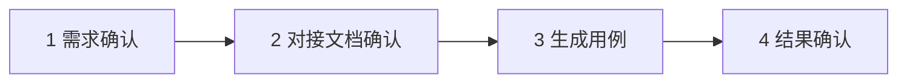

# 测试用例生成流程

工作台四步流程与 `docs/` 目录的对应关系如下。从**步骤1 → 步骤2**必须准确区分**机构对接**与**渠道对接**；**步骤3**须按对接类型与流程模式单选 `docs/rules/` 下的 **Demo** 测试用例。

## 流程总览

| 步骤 | 名称 | 主要输入 | 主要引用 docs |
|------|------|----------|----------------|
| 1 | 需求确认 | 飞书需求链接 | `docs/checklist/` 检查项表 |
| 2 | 对接文档确认 | 步骤1 确认的检查项 | `docs/knowledge/interface/` 接口文档 |
| 3 | 生成用例 | 步骤2 保存的对接文档 | `docs/rules/` Demo 规则 + `docs/knowledge/biz/` |
| 4 | 结果确认 | Agent 生成稿 | 采纳入库（SQLite） |

---

## 步骤1：需求确认

### 1.1 自动识别对接类型（机构 / 渠道）

识别**优先级**（解析时先识别类型，再加载检查项表，避免误用 HUB 表）：

1. **飞书文档标题 + 需求正文 + 链接**（最高）  
   - 标题/正文含 **「机构对接」** → 机构  
   - 标题/正文含 **「渠道对接」** → 渠道  
   - 例：标题「信用飞导下载我**机构对接**」→ 机构（不会因「导下载」误判为渠道）

2. **自动加载的检查项表**（识别类型后）  
   - **渠道对接** → `docs/checklist/渠道需求检查项.md`  
   - **机构对接** → `docs/checklist/机构需求检查项.md`（检查项结构）  
   - 并参考 `docs/knowledge/biz/机构概要信息.md` / `渠道概要信息.md` 作为概要记忆（LLM 填值参考，不替代检查项表）

3. **检查项表头（保存检查项后再次校正）**  
   - 含 `类型`、`机构编码` 等 → 机构  
   - 含 `内部渠道号`、`渠道流程模式` 等 → 渠道  

任务栏会显示 **机构对接 / 渠道对接 / 未识别**。未识别时请勿进入步骤2。

### 1.2 检查项确认

- 解析飞书文档并填充检查项；用户可编辑确认值。  
- 点击「下一步」时后端会根据**已保存的检查项**再次写入 `requirement_kind`。  
- 解析完成后会按类型回写 `docs/knowledge/biz/` 下渠道/机构概要信息。

---

## 步骤2：对接文档确认

在**已识别**机构或渠道的前提下，按规则从 `docs/knowledge/interface/` 自动加载一份 Markdown（可上传覆盖）。

### 2.1 机构对接

| 条件 | 自动匹配的接口文档 |
|------|-------------------|
| `类型` 含 **OSI标准机构** 或 **标准机构**，且流程为半流程/出额导下载 | `OSI标准机构对接-半流程导下载-接口文档.md` |
| 授信 API + 借还 H5、全流程 API 等 | `OSI标准机构对接-接口文档.md` |
| `类型` 为 **非标准机构** / 按机构自有文档 | 不上线默认文档，**必须上传** |

流程依据检查项 **「流程概要」** 或 **「流程摘要」** 的确认值。

### 2.2 渠道对接

| 条件 | 自动匹配的接口文档 |
|------|-------------------|
| `接口文档提供方` 为 **我方提供** | `HOMO标准渠道对接-接口文档.md` |
| **渠道提供** | 按 `渠道名称` / `渠道合作方` / `内部渠道号` 在 interface 目录**文件名**中匹配（如 `小赢V2` → `小赢V2渠道对接文档.md`） |
| 匹配失败 | 回退 `HOMO标准渠道对接-接口文档.md`，或上传覆盖 |

流程依据检查项 **「渠道流程模式」**（半流程导下载 / 全流程API / 全流程借还H5 等）。

---

## 步骤3：生成用例

### 3.1 应用规则与参照 Demo（自动匹配）

步骤3不再手选规则文件，系统根据**对接类型**（机构/渠道）与**流程模式**（检查项）自动匹配：

| 区域 | 目录 | 匹配逻辑 |
|------|------|----------|
| **应用规则** | `docs/rules/` | 机构 → `机构业务规则.md`；渠道 → `渠道业务规则.md` |
| **参照 Demo** | `docs/demo/` | 按流程模式匹配 Demo 用例骨架（见下表） |

| 对接类型 | 流程模式（检查项） | 参照 Demo 文件 |
|----------|-------------------|----------------|
| **渠道对接** | 半流程、出额导下载、导下载 | `Demo-标准渠道-半流程导下载-对接测试用例.md` |
| **渠道对接** | 全流程 API（及其它非半流程） | `Demo-标准渠道-全流程API对接-测试用例.md` |
| **机构对接** | 半流程、出额导下载 | `Demo-标准机构-半流程导下载-测试用例.md` |
| **机构对接** | 授信 API + 借还 H5、全流程 API 等 | `Demo-标准机构-借还H5-测试用例.md` |

Agent 生成时以匹配到的 Demo **章节骨架**为模板（见 `backend/prompts/agent_prompts.py`），不得擅自改成其它固定结构。

### 3.2 其它注入

- **规则文档（Rule Docs）**：匹配的 Demo（`docs/demo/`）+ 对应业务规则（`docs/rules/`，不混用）。  
- **业务知识（Knowledge Docs）**：默认 `docs/knowledge/biz/业务术语.md`；概要类文档可选注入。  
- **对接文档**：步骤2 任务字段 `external_cooperation_markdown`。  
- **数据库表**（可选）：渠道 → `HUB用户流程涉及表`；机构/APP → `APP用户流程涉及表`。

---

## 步骤4：结果确认

预览 Markdown、设置标题、采纳入测试用例库。

---

## docs/demo 目录说明（用例骨架）

| 文件 | 用途 |
|------|------|
| `Demo-标准渠道-半流程导下载-对接测试用例.md` | 渠道半流程（预授信导下载）用例骨架与示例 |
| `Demo-标准渠道-全流程API对接-测试用例.md` | 渠道全流程 API 用例骨架 |
| `Demo-标准机构-半流程导下载-测试用例.md` | 机构半流程导下载用例 Demo |
| `Demo-标准机构-借还H5-测试用例.md` | 机构授信 API + 借还 H5 用例 Demo |

## docs/rules 目录说明（业务规则）

| 文件 | 用途 |
|------|------|
| `机构业务规则.md` | 机构对接业务边界（步骤3自动匹配） |
| `渠道业务规则.md` | 渠道对接业务边界（步骤3自动匹配） |

已废弃：勿再使用 `HUB渠道对接测试用例骨架.md`（已由 `docs/demo` 下 Demo 替代）。

---

## 配置入口

- 流程文案：`frontend/flow_management.html` → `GET/PUT /pipeline-config`  
- 识别与匹配实现：`backend/services/integration_matching.py`  
- 工作台逻辑：`frontend/test_case_generator.html`
